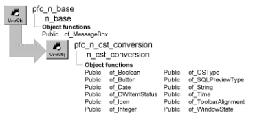

# n_cst_conversion

**Description**

Data type conversion service. This service provides functions you can call to convert values from one data type to another. For example, you can call the of_Boolean function to convert an integer or a string into a boolean value.

**Ancestry**



**Library**

- PFCAPSRV.PBL
- PFEAPSRV.PBL

**Usage**

To use conversion functions:

1. Declare a variable of type n_cst_conversion.

   Because PFC defines this object with the autoinstantiate option, you don’t need to code CREATE or DESTROY statements:

   ```
   n_cst_conversion   inv_conversion
   ```

2. Call conversion service functions as needed.

   This example assumes an inv_conversion instance variable:

   ```
   String    ls_fulltext
   Boolean   lb_fulltext

   ls_fulltext = ProfileString &
      (gnv_app.of_GetUserIniFile( ), &
      "Display", "FullText", "Yes")
   lb_fulltext = &
      inv_conversion.of_Boolean( ls_fulltext )
   ```

**See also**

- [n_cst_numerical](n_cst_numerical.md)
- [n_cst_string](n_cst_string.md)

## Functions

N_cst_conversion includes precoded object functions:

- of_Boolean
- of_Button
- of_Date
- of_DWItemStatus
- of_Icon
- of_Integer
- of_OSType
- of_SQLPreviewType
- of_String
- of_Time
- of_ToolbarAlignment
- of_WindowState

### of_Boolean

**Description**

Returns a boolean representation of the passed integer or string.

**Access**

Public

**Syntax**

```
instancename.of_Boolean ( stringorint )
```

| Argument | Description |
| --- | --- |
| *instancename* | Instance name of n_cst_conversion |
| *stringorint* | String or integer to be converted to a boolean value |

**Return value**

Boolean. Returns values as follows:

- **If** ***stringorint*** **is an integer** Returns TRUE if *stringorint* is 1, FALSE if *stringorint* is 0, and NULL if *stringorint* is any other value or NULL.
- **If** ***stringorint*** **is a string** Returns TRUE if *stringorint* is true, t, yes, y, or 1. Returns FALSE if *stringorint* is false, f, no, n or 0. This function returns NULL if *stringorint* is any other value or NULL.

**Usage**

Call this function to convert a string or integer to a boolean value.

**Examples**

This example calls the of_Boolean function to convert an INI file value to a boolean. It assumes an inv_conversion instance variable:

```
String    ls_fulltext
Boolean   lb_fulltext

ls_fulltext = ProfileString &
   (gnv_app.of_GetUserIniFile(), &
   "Display", "FullText", "Yes")
lb_fulltext = &
   inv_conversion.of_Boolean(ls_fulltext)
```

### of_Button

**Description**

Converts a string value to a Button enumerated data type.

**Access**

Public

**Syntax**

```
instancename.of_Button ( string, button )
```

| Argument | Description |
| --- | --- |
| *instancename* | Instance name of n_cst_conversion |
| *string* | String or integer to be converted to a button. *String* must be one of the following: |
|  | OK OKCancel YesNo YesNoCancel RetryCancel AbortRetryIgnore |
| *button* | Button enumerated data type to contain the converted string (passed by reference) |

**Return value**

Integer. Returns 1 if the function succeeds and -1 if an error occurs.

**Usage**

The error service calls this function to convert error message properties into the buttons displayed on message boxes.

**Examples**

This example calls the of_Button function:

```
...
IF ll_row > 0 THEN
   inv_conversion.of_Button &
   (ids_messages.object.button[ll_row], &
   inv_errorpass.ie_buttonstyle)
   inv_conversion.of_Icon &
   (ids_messages.object.icon[ll_row], &
   inv_errorpass.ie_icon)
...
```

### of_Date

**Description**

Converts a string value in date or datetime format to a date data type.

**Access**

Public

**Syntax**

```
instancename.of_Date ( string )
```

| Argument | Description |
| --- | --- |
| *instancename* | Instance name of n_cst_conversion |
| *string* | String in date or datetime format to be converted to a date data type |

**Return value**

Date. Returns a date if the function succeeds, 1900-01-01if *string* is an invalid date or datetime, and NULL if *string* is NULL.

**Usage**

Compare this function with the PowerScript function, which requires a string containing a date value as the argument.

**Examples**

This example calls the of_Date function:

```
String    ls_datetimeval = "07/28/71 12:35:14"
Date      ld_date
Time      ltm_time
n_cst_conversion   lnv_conversion

ld_date = lnv_conversion.of_Date(ls_datetimeval)
ltm_time = lnv_conversion.of_Time(ls_datetimeval)
...
```

### of_DWItemStatus

**Description**

Converts a string value to a dwItemStatus enumerated data type.

**Access**

Public

**Syntax**

```
instancename.of_DWItemStatus ( originalvalue, dwitemstatus )
```

| Argument | Description |
| --- | --- |
| *instancename* | Instance name of n_cst_conversion |
| *originalvalue* | String to be converted to the dwItemStatus enumerated data type. Valid values are: |
|  | DataModified New NewModified NotModified |
| *dwitemstatus* | DWItemStatus enumerated data type to contain the converted string (passed by reference) |

**Return value**

Integer. Returns 1 if the function succeeds, -1 if *originalvalue* is not a valid value, and NULL if *originalvalue* is NULL.

**Usage**

The DataWindow Properties dialog box calls this function to convert a string to a DWItemStatus enumerated data type.

**Examples**

This example calls the of_DWItemStatus function:

```
Integer   li_rc
Long   ll_currow
String   ls_desiredstatus
dwItemStatus le_desiredstatus
n_cst_conversion lnv_conversion

ll_currow = dw_requestorview.GetRow()
IF ll_currow > 0 THEN
   ls_desiredstatus = "NotModified"
   li_rc = lnv_conversion.of_DWItemStatus  &
      (ls_desiredstatus, le_desiredstatus)
...
```

### of_Icon

**Description**

Converts a string value to an Icon enumerated data type.

**Access**

Public

**Syntax**

```
instancename.of_Icon ( string, icon )
```

| Argument | Description |
| --- | --- |
| *instancename* | Instance name of n_cst_conversion |
| *string* | String or integer to be converted to an icon. *String* must be one of the following: |
|  | None Question Information StopSign Exclamation |
| *icon* | Icon enumerated data type to contain the converted string (passed by reference) |

**Return value**

Integer. Returns 1 if the function succeeds and -1 if an error occurs.

**Usage**

The error service calls this function to convert error message properties into the icons displayed on message boxes.

**Examples**

This example calls the of_Icon function:

```
...
IF ll_row > 0 THEN
   inv_conversion.of_Button &
   (ids_messages.object.button[ll_row], &
   inv_errorpass.ie_buttonstyle)
   inv_conversion.of_Icon &
   (ids_messages.object.icon[ll_row], &
   inv_errorpass.ie_icon)
...
```

### of_Integer

**Description**

Converts a boolean argument to an integer value (converts TRUE to 1 and FALSE to 0).

**Access**

Public

**Syntax**

```
instancename.of_Integer ( boolean )
```

| Argument | Description |
| --- | --- |
| *instancename* | Instance name of n_cst_conversion |
| *boolean* | Boolean to be converted to an integer |

**Return value**

Integer. Returns 1 if *boolean* is TRUE and 0 if *boolean* is FALSE.

**Examples**

This example calls of_Integer to convert a boolean value to an integer (assuming an inv_conversion instance variable):

```
Integer   li_boolean

li_boolean = inv_conversion.of_Integer &
   (cbx_minimize.Checked)
```

### of_OSType

**Description**

Converts a string value to an OSTypes enumerated data type.

**Access**

Public

**Syntax**

```
instancename.of_OSType ( originalvalue, ostype)
```

| Argument | Description |
| --- | --- |
| *instancename* | Instance name of n_cst_conversion |
| *originalvalue* | String to be converted to the OSType enumerated data type. Valid values are: |
|  | AIX HPUX Macintosh (obsolete) OSF1 (obsolete) SOL2 Windows WindowsNT |
| *ostype* | OSTypes variable into which the function returns the value (passed by reference) |

**Return value**

Integer. Returns 1 if the function succeeds, -1 if *originalvalue* is not a valid value, and NULL if *originalvalue* is NULL.

**Examples**

This example calls the of_OSType function:

```
OSTypes  lost_type
String   ls_original
Integer  li_return
n_cst_conversion  lnv_conversion

ls_original = "Windows"
li_return = lnv_conversion.of_OSType  &
 (ls_original, lost_type)
...
```

### of_SQLPreviewType

**Description**

Converts a string value to the SQLPreviewType enumerated data type.

**Access**

Public

**Syntax**

```
instancename.of_SQLPreviewType ( originalvalue, sqlpreview )
```

| Argument | Description |
| --- | --- |
| *instancename* | Instance name of n_cst_conversion |
| *originalvalue* | String to be converted to the SQLPreviewType enumerated data type. Valid values are: |
|  | Insert Update Delete Retrieve |
| *sqlpreview* | SQLPreviewType variable into which the function returns the value (passed by reference) |

**Return value**

Integer. Returns 1 if the function succeeds, -1 if *originalvalue* is not a valid value, and NULL if *originalvalue* is NULL.

**Examples**

This example calls the of_SQLPreviewType function:

```
SQLPreviewType   lsql_type
String    ls_statement

ls_statement = "Insert"
inv_conversion.of_SQLPreviewType &
   (ls_statement, lsql_type)
```

### of_String

Converts various data types to a string. There are two syntaxes, depending on the original data type:

| To | Use |
| --- | --- |
| Convert a boolean to a string | Syntax 1 |
| Convert SQLPreviewType, ToolbarAlignment, Icon, Button, DWItemStatus, WindowState, or OSTypes to a string | Syntax 2 |

| Syntax 1 | To convert a boolean to a string |
| --- | --- |

**Description**

Creates a string from a boolean.

**Access**

Public

**Syntax**

```
instancename.of_String ( boolean {, returntype } )
```

| Argument | Description |
| --- | --- |
| *instancename* | Instance name of n_cst_conversion |
| *boolean* | Boolean value to be converted to a string |
| *returntype* (optional) | String specifying how the function formats the return value. Valid values are: |
|  | • TRUEFALSE Returns TRUE or FALSE (default) |
|  | • TF Returns T or F |
|  | • YESNO Returns YES or NO |
|  | • YN Returns Y or N |
|  | • ZEROONE Returns 1 or 0 |

**Return value**

String. Returns a string corresponding to the passed boolean value. The string’s contents vary depending on the *returntype* argument.

**Usage**

Use Syntax 2 to convert a SQLPreviewType, ToolbarAlignment, Icon, Button, DWItemStatus, WindowState, or OSTypes to a string.

**Examples**

This example calls the of_String function:

```
Date      ldt_date
Boolean   lb_leapyear

ldt_date = Today( )
lb_leapyear = inv_datetime.of_IsLeapYear(ldt_date)
MessageBox("Leap Year Test", &
   "Leap year = " + &
   inv_conversion.of_String(lb_leapyear,’YESNO’))
```

| Syntax 2 | To convert a SQLPreviewType, ToolbarAlignment, Icon, Button, |
| --- | --- |

**DWItemStatus, WindowState, or OSTypes**

**Description**

Creates a string from a SQLPreviewType, ToolbarAlignment, Icon, Button, DWItemStatus, WindowState, or OSTypes enumerated variable.

**Access**

Public

**Syntax**

```
instancename.of_String ( input )
```

| Argument | Description |
| --- | --- |
| *instancename* | Instance name of n_cst_conversion |
| *input* | SQLPreviewType, ToolbarAlignment, Icon, Button, DWItemStatus, WindowState, or OSTypes enumerated variable to be converted to a string |

**Return value**

String. Returns values as follows:

- **If** ***input*** **is a SQLPreviewType** Returns one of the following values:

Delete Insert Retrieve Update ! (invalid argument)

Returns one of the following values:

- **If** ***input*** **is a ToolbarAlignment** Returns one of the following values:

Bottom Floating Left Right Top ! (invalid argument)

- **If** ***input*** **is an Icon** Returns one of the following values:

None Information StopSign Information Exclamation ! (invalid argument)

- **If** ***input*** **is a Button** Returns one of the following values:

OK OKCancel YesNo YesNoCancel RetryCancel AbortRetryIgnore ! (invalid argument)

- **If** ***input*** **is a DWItemStatus** Returns one of the following values:

DataModified New NewModified NotModified ! (invalid argument)

- **If** ***input*** **is a WindowState** Returns one of the following values:

Maximized Minimized Normal ! (invalid argument)

- **If** ***input*** **is an OSTypes** Returns one of the following values:

AIX HPUX Macintosh (obsolete) OSF1 (obsolete) SOL2 Windows WindowsNT ! (invalid argument)

**Usage**

Call this function to convert a SQLPreviewType, ToolbarAlignment, Icon, Button, DWItemStatus, WindowState, or OSTypes enumerated variable to a string.

Use Syntax 1 to convert a boolean to a string.

**Examples**

This example calls the of_String function to convert a ToolbarAlignment to a string:

```
String    ls_string

ls_string = inv_conversion.of_String &
   (gnv_app.of_GetFrame().ToolbarAlignment)
```

### of_Time

**Description**

Converts a string value in time or datetime format to a time data type.

**Access**

Public

**Syntax**

```
instancename.of_Time ( string )
```

| Argument | Description |
| --- | --- |
| *instancename* | Instance name of n_cst_conversion |
| *string* | String in time or datetime format to be converted to a time data type |

**Return value**

Time. Returns a time if the function succeeds, 00:00:00.000000 if *string* is an invalid time or datetime, and NULL if *string* is NULL.

**Examples**

This example calls the of_Time function:

```
String    ls_datetimeval = "07/28/71 12:35:14"
Date      ld_date
Time      ltm_time
n_cst_conversion   lnv_conversion

ld_date = lnv_conversion.of_Date(ls_datetimeval)
ltm_time = lnv_conversion.of_Time(ls_datetimeval)
...
```

### of_ToolbarAlignment

**Description**

Converts a string value to the ToolbarAlignment enumerated data type.

**Access**

Public

**Syntax**

```
instancename.of_ToolbarAlignment ( originalvalue, toolbaralign )
```

| Argument | Description |
| --- | --- |
| *instancename* | Instance name of n_cst_conversion |
| *originalvalue* | String to be converted to the SQLPreviewType enumerated data type. Valid values are: |
|  | Bottom Floating Left Right Top |
| *toolbaralign* | ToolbarAlignment variable into which the function returns the value (passed by reference) |

**Return value**

Integer. Returns 1 if the function succeeds, -1 if *originalvalue* is not a valid value, and NULL if *originalvalue* is NULL.

**Examples**

This example calls the of_ToolbarAlignment function:

```
ToolbarAlignment   le_alignment
Integer            li_index, li_rc
n_cst_conversion   lnv_conversion

li_index = of_GetListBoxIndex &
   (lb_toolbar.SelectedItem())
IF li_index > 0 THEN
   li_rc = lnv_conversion.of_ToolbarAlignment &
   (This.text, le_alignment)
   IF li_rc = 1 THEN
   istr_toolbar[li_index].e_alignment = &
      le_alignment
   END IF
END IF
```

### of_WindowState

**Description**

Converts a string value to a WindowState enumerated data type.

**Access**

Public

**Syntax**

```
instancename.of_WindowState ( string, windowstate )
```

| Argument | Description |
| --- | --- |
| *instancename* | Instance name of n_cst_conversion |
| *string* | String or integer to be converted to a windowstate. *String* must be one of the following: |
|  | Maximized Minimized Normal |
| *windowstate* | WindowState enumerated data type to contain the converted string (passed by reference) |

**Return value**

Integer. Returns 1 if the function succeeds and -1 if an error occurs.

**Examples**

This example is from the n_cst_error of_GetError function:

```
WindowState   lws_state
Integer       li_return
n_cst_conversion lnv_conversion

li_return = lnv_conversion.of_WindowState &
   ("maximized", lws_state)
```
