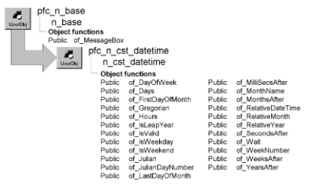

# n_cst_datetime

**Description**

Date/time service. This service provides functions that you can call to perform calculations with dates. For example, you can call the of_SecondsAfter function to determine the number of seconds between two date/time values.

**Ancestry**



**Library**

- PFCAPSRV.PBL
- PFEAPSRV.PBL

**Usage**

To use date/time functions:

1. Declare a variable of type n_cst_datetime.

   Because PFC defines this object with the autoinstantiate option, you don’t need to code CREATE or DESTROY statements:

   ```
   n_cst_datetime   inv_datetime
   ```

2. Call date/time service functions as needed.

   This example assumes an inv_datetime instance variable:

   ```
   Long   ll_seconds, ll_days

   ll_seconds = Long(sle_seconds.Text)
   ll_days = inv_datetime.of_Days(ll_seconds)

   MessageBox("Date/Time", String(ll_seconds) &
      + " seconds is equal to " + &
      String(ll_days) + " days.")
   ```

**See also**

- [n_cst_conversion](n_cst_conversion.md)
- [n_cst_filesrv](n_cst_filesrv.md)
- [n_cst_numerical](n_cst_numerical.md)
- [n_cst_platform](n_cst_platform.md)
- [n_cst_sql](n_cst_sql.md)
- [n_cst_string](n_cst_string.md)

## Instance variables

N_cst_datetime includes instance variables:

| Instance variable | Description | Data type | Access |
| --- | --- | --- | --- |
| 28 |  | Integer | Protected |
| 30 |  | Integer | Protected |
| 30 |  | Integer | Protected |
| 30 |  | Integer | Protected |
| 30 |  | Integer | Protected |
| 31 |  | Integer | Protected |
| 31 |  | Integer | Protected |
| 31 |  | Integer | Protected |
| 31 |  | Integer | Protected |
| 31 |  | Integer | Protected |
| ii_DaysInMonth[ ] |  | Integer | Protected |
| is_month[ ] |  | String | Protected |

## Functions

N_cst_datetime includes precoded object functions:

- of_DayOfWeek
- of_Days
- of_FirstDayOfMonth
- of_Gregorian
- of_Hours
- of_IsLeapYear
- of_IsValid
- of_IsWeekDay
- of_IsWeekEnd
- of_Julian
- of_JulianDayNumber
- of_LastDayOfMonth
- of_MilliSecsAfter
- of_MonthName
- of_MonthsAfter
- of_RelativeDateTime
- of_RelativeMonth
- of_RelativeYear
- of_SecondsAfter
- of_Wait
- of_WeekNumber
- of_WeeksAfter
- of_YearsAfter

### of_DayOfWeek

**Description**

Determines the day of the week for the passed date.

**Access**

Public

**Syntax**

```
instancename.of_DayOfWeek ( sourcedate )
```

| Argument | Description |
| --- | --- |
| *instancename* | Instance name of n_cst_datetime |
| *sourcedate* | Date variable that contains the day to be determined |

**Return value**

Integer. Returns values, as follows:

1. Sunday
2. Monday
3. Tuesday
4. Wednesday
5. Thursday
6. Friday
7. Saturday

If *sourcedate* is invalid, the function returns -1; if *sourcedate* is NULL, the function returns NULL.

**Usage**

Call this function to convert a date variable into a weekday.

**Examples**

This example calls the of_DayOfWeek function:

```
Date      ldt_date
Integer   li_day
String    ls_days[ ] = &
   {"Sunday", "Monday", "Tuesday", "Wednesday", &
   "Thursday", "Friday", "Saturday"}

ldt_date = Today()
li_day = inv_datetime.of_DayOfWeek(ldt_date)
MessageBox("Convert Date to Day", &
   "Today is " + ls_days[li_day])
```

### of_Days

**Description**

Given the number of seconds, calculates the equivalent number of days.

**Access**

Public

**Syntax**

```
instancename.of_Days ( seconds )
```

| Argument | Description |
| --- | --- |
| *instancename* | Instance name of n_cst_datetime |
| *seconds* | Long specifying the number of seconds to be converted to days |

**Return value**

Long. Returns the number of days for *seconds*. If *seconds* is invalid, the function returns -1; if *seconds* is NULL, the function returns NULL.

**Examples**

This example calls the of_Days function:

```
Long   ll_seconds, ll_days

ll_seconds = Long(sle_seconds.Text)
ll_days = inv_datetime.of_Days(ll_seconds)
MessageBox("Date/Time", &
   String(ll_seconds) + " seconds is equal to " + &
   String(ll_days) + " days.")
```

### of_FirstDayOfMonth

**Description**

Given a date, determines the first date of the month.

**Access**

Public

**Syntax**

```
instancename.of_FirstDayOfMonth ( sourcedate )
```

| Argument | Description |
| --- | --- |
| *instancename* | Instance name of n_cst_datetime |
| *sourcedate* | Date for which the date of the first day of the month is returned |

**Return value**

Date. Returns the date of the first day of the month. If *sourcedate* is invalid, the function returns 1900-01-01; if *sourcedate* is NULL, the function returns NULL.

**Examples**

This example calls the of_FirstDayOfMonth function:

```
Date   ldt_date, ldt_firstday

ldt_date = Today( )
ldt_firstday = &
   inv_datetime.of_FirstDayOfMonth(ldt_date)
   MessageBox("First day of the month", &
   "Today is " + String(ldt_date) + &
   " - First day of the month is " + &
      String(ldt_firstday))
```

### of_Gregorian

**Description**

Converts a Julian date to a Gregorian date.

**Access**

Public

**Syntax**

```
instancename.of_Gregorian ( juliandate )
```

| Argument | Description |
| --- | --- |
| *instancename* | Instance name of n_cst_datetime |
| *juliandate* | Long containing the Julian date to be converted to Gregorian (the basis for *juliandate* is January 1, 0000) |

**Return value**

Date. Returns the Gregorian date that corresponds to *juliandate*. If *juliandate* is NULL, the function returns NULL.

**Examples**

This example calls the of_Gregorian function:

```
Long   ll_julian
Date   ldt_gregorian

ll_julian = Long(sle_julian.Text)
ldt_gregorian = inv_datetime.of_Gregorian &
   (ll_julian)
   MessageBox("Julian to Gregorian", &
   "Julian: " + String(ll_julian) + &
      " is Gregorian: " + String(ldt_gregorian))
```

### of_Hours

**Description**

Converts seconds to hours.

**Access**

Public

**Syntax**

```
instancename.of_Hours ( seconds )
```

| Argument | Description |
| --- | --- |
| *instancename* | Instance name of n_cst_datetime |
| *seconds* | Long containing the seconds value to be converted |

**Return value**

Long. Returns the number of hours for *seconds*. If *seconds* is invalid, the function returns -1; if *seconds* is NULL, the function returns NULL.

**Examples**

This example calls the of_Hours function:

```
Long   ll_seconds, ll_hours

ll_seconds = Long(sle_seconds.Text)
ll_hours = inv_datetime.of_Hours(ll_seconds)
MessageBox("Date/Time", &
   String(ll_seconds) + " seconds is equal to " + &
   String(ll_hours) + " hours.")
```

### of_IsLeapYear

**Description**

Determines whether the passed date is in a leap year.

**Access**

Public

**Syntax**

```
instancename.of_IsLeapYear ( sourcedate )
```

| Argument | Description |
| --- | --- |
| *instancename* | Instance name of n_cst_datetime |
| *sourcedate* | Date variable containing the date to be tested |

**Return value**

Boolean. Returns TRUE if *sourcedate* is in a leap year, FALSE if it is not, and NULL if it is NULL.

**Examples**

This example calls the of_IsLeapYear function:

```
Date      ldt_date
Boolean   lb_leapyear

ldt_date = Today( )
lb_leapyear = inv_datetime.of_IsLeapYear(ldt_date)
MessageBox("Leap Year Test", &
   "Leap year = " + &
   inv_conversion.of_String(lb_leapyear,’YESNO’))
```

### of_IsValid

**Description**

Reports whether a passed argument is a valid date, DateTime, or time.

**Access**

Public

**Syntax**

```
instancename.of_IsValid ( source )
```

| Argument | Description |
| --- | --- |
| *instancename* | Instance name of n_cst_datetime |
| *source* | Date, DateTime, or Time value to be tested |

**Return value**

Boolean. Returns TRUE if *source* is a valid date, DateTime, or time; FALSE if it is not; and NULL if *source* is NULL.

**Usage**

Call this function to ensure valid data before updating the database or calling functions.

**Examples**

This example calls the of_IsValid function:

```
Boolean   lb_valid

lb_valid = &
   inv_datetime.of_IsValid(sle_date.Text)
IF NOT lb_valid THEN
   MessageBox("Date/Time", &
   sle_date.text + " is not a valid date")
END IF
```

**Date function always returns valid date** If you cast the user-entered string to Date format ( **Date (sle_date.Text)** ), the of_IsValid function will always return true. This is because Date will return 1900-01-01 for any invalid date.

### of_IsWeekDay

**Description**

Determines if a passed date is a weekday.

**Access**

Public

**Syntax**

```
instancename.of_IsWeekDay ( source )
```

| Argument | Description |
| --- | --- |
| *instancename* | Instance name of n_cst_datetime |
| *source* | Date variable to be tested |

**Return value**

Boolean. Returns TRUE if *source* is a weekday, FALSE if it is not, and NULL if *source* is NULL.

**Examples**

This example calls the of_IsWeekDay function:

```
Date      ldt_date
Boolean   lb_weekday

ldt_date = Today()
lb_weekday = inv_datetime.of_IsWeekDay(ldt_date)
IF lb_weekday THEN
   MessageBox("Weekday Test", String(ldt_date) &
   + " is a weekday")
ELSE
   MessageBox("Weekday Test", String(ldt_date) &
   + " is not a weekday")
END IF
```

### of_IsWeekEnd

**Description**

Determines if a passed date is on a weekend.

**Access**

Public

**Syntax**

```
instancename.of_IsWeekEnd ( source )
```

| Argument | Description |
| --- | --- |
| *instancename* | Instance name of n_cst_datetime |
| *source* | Date variable to be tested |

**Return value**

Boolean. Returns TRUE if *source* is on a weekend, FALSE if it is not, and NULL if *source* is NULL.

**Examples**

This example calls the of_IsWeekEnd function:

```
Date      ldt_date
Boolean   lb_weekend

ldt_date = Today( )
lb_weekend = inv_datetime.of_IsWeekEnd(ldt_date)
IF lb_weekend THEN
   MessageBox("Weekend Test", String(ldt_date) &
   + " is a weekend")
ELSE
   MessageBox("Weekend Test", String(ldt_date) &
   + " is not a weekend")
END IF
```

### of_Julian

**Description**

Converts a Gregorian date to a Julian date.

**Access**

Public

**Syntax**

```
instancename.of_Julian ( gregoriandate )
```

| Argument | Description |
| --- | --- |
| *instancename* | Instance name of n_cst_datetime |
| *gregoriandate* | Date containing the Gregorian date to be converted to Julian (the basis for *gregoriandate* is January 1, 0000) |

**Return value**

Long. Returns the Julian date that corresponds to *gregoriandate*. If *gregoriandate* is invalid, the function returns -1; if it is NULL, the function returns NULL.

**Examples**

This example calls the of_Julian function:

```
Date   ldt_gregorian
Long   ll_julian

ldt_gregorian = Today( )
ll_julian = inv_datetime.of_Julian &
   (ldt_gregorian)
   MessageBox("Gregorian to Julian", &
   "Gregorian: " + String(ldt_gregorian) + &
      " is Julian: " + String(ll_julian))
```

### of_JulianDayNumber

**Description**

Given a date, this function determines the day number, within the current year.

**Access**

Public

**Syntax**

```
instancename.of_JulianDayNumber ( source )
```

| Argument | Description |
| --- | --- |
| *instancename* | Instance name of n_cst_datetime |
| *source* | Date for which day number is returned |

**Return value**

Long. Returns the day number within the current year.

**Examples**

This example calls the of_JulianDayNumber function:

```
Date   ldt_gregorian
Long   ll_julian

ldt_gregorian = Today( )
ll_julian = inv_datetime.of_JulianDayNumber &
   (ldt_gregorian)
   MessageBox("Gregorian to Julian", &
   "Gregorian: " + String(ldt_gregorian) + &
      " is day number: " + String(ll_julian))
```

### of_LastDayOfMonth

**Description**

Given a date, this function determines the last date of the date’s month.

**Access**

Public

**Syntax**

```
instancename.of_LastDayOfMonth ( sourcedate )
```

| Argument | Description |
| --- | --- |
| *instancename* | Instance name of n_cst_datetime |
| *sourcedate* | Date for which the date of the last day of the month is returned |

**Return value**

Date. Returns the date of the last day of the month. If *sourcedate* is NULL, the function returns NULL.

**Examples**

This example calls the of_LastDayOfMonth function:

```
Date   ldt_date, ldt_lastday

ldt_date = Today( )
ldt_lastday = &
   inv_datetime.of_LastDayOfMonth(ldt_date)
MessageBox("Last day of the month", &
   "Today is " + String(ldt_date) + &
   " - Last day of the month is " + &
      String(ldt_lastday) )
```

### of_MilliSecsAfter

**Description**

Calculates the number of milliseconds between two times.

**Access**

Public

**Syntax**

```
instancename.of_MilliSecsAfter ( starttime, endtime )
```

| Argument | Description |
| --- | --- |
| *instancename* | Instance name of n_cst_datetime |
| *starttime* | Time variable containing the starting time |
| *endtime* | Time variable containing the ending time |

**Return value**

Long. Returns the number of milliseconds between *starttime* and *endtime*. If *endtime* is less than *starttime*, this value is negative. If either argument is NULL, the function returns a NULL.

**Examples**

This example calls the of_MilliSecsAfter function:

```
Time   lt_start, lt_finish
Long   ll_between, ll_loop, ll_count

lt_start = Now( )
For ll_loop = 1 to 10000
   ll_count++
NEXT
lt_finish = Now( )
ll_between = inv_datetime.of_MilliSecsAfter &
   (lt_start, lt_finish)
   MessageBox("Date/Time", String(ll_between) &
   + " millisecs between " + String(lt_start) &
      + " and " + String(lt_finish) )
```

### of_MonthName

**Description**

Given the month number or a date, calculates the month name.

**Access**

Public

**Syntax**

```
instancename.of_MonthName ( numberordate )
```

| Argument | Description |
| --- | --- |
| *instancename* | Instance name of n_cst_datetime |
| *numberordate* | Date variable or month number for which the function returns the month name |

**Return value**

String. Returns the month name.

**Examples**

This example calls the of_MonthName function:

```
Date   ldt_date
String ls_name
n_cst_datetime lnv_datetime

ldt_date = Today()

ls_name = lnv_datetime.of_MonthName &
   (ldt_date)
MessageBox("Date/Time", ls_name)
```

### of_MonthsAfter

**Description**

Calculates the number of whole months between two dates.

**Access**

Public

**Syntax**

```
instancename.of_MonthsAfter ( startdate, enddate )
```

| Argument | Description |
| --- | --- |
| *instancename* | Instance name of n_cst_datetime |
| *startdate* | Date variable containing the start date |
| *enddate* | Date variable containing the end date |

**Return value**

Long. Returns the number of months between *startdate* and *enddate*. If *enddate* is less than *startdate*, this value is negative. If either argument is NULL or invalid, the function returns a NULL.

**Examples**

This example calls the of_MonthsAfter function:

```
Date   ldt_start, ldt_finish
Long   ll_between

ldt_start = Date(sle_startmonth.text)
ldt_finish = Date(sle_endmonth.text)

ll_between = inv_datetime.of_MonthsAfter &
   (ldt_start, ldt_finish)
MessageBox("Date/Time", String(ll_between) &
   + " months between " + sle_startmonth.text &
   + " and " + sle_endmonth.text )
```

### of_RelativeDateTime

**Description**

Determines a date/time relative to a given DateTime.

**Access**

Public

**Syntax**

```
instancename.of_RelativeDateTime ( start, offset )
```

| Argument | Description |
| --- | --- |
| *instancename* | Instance name of n_cst_datetime |
| *start* | Datetime variable that the function uses as the starting point |
| *offset* | Long representing the number of seconds between *start* and the returned relative date/time (can be either positive or negative) |

**Return value**

Datetime. Returns the date/time *offset* number of seconds before or after *start*. If *start* is invalid, the function returns 1900-01-01; if *start* is NULL, the function returns NULL.

**Examples**

This example calls the of_RelativeDateTime function:

```
Datetime   ldtm_start, ldtm_new
Long       ll_between

ldtm_start = DateTime(Today( ), Now( ) )
ll_between = Long(sle_relative.text)

ldtm_new = inv_datetime.of_RelativeDateTime &
   (ldtm_start, ll_between)
MessageBox("Date/Time", String(ldtm_new) &
   + " is " + sle_relative.text &
   + " seconds before/after " + string(ldtm_start))
```

### of_RelativeMonth

**Description**

Calculates a date, plus or minus a given number of months from a given date. For example, three months from 6/13/97 is 9/13/97.

**Access**

Public

**Syntax**

```
instancename.of_RelativeMonth ( start, offset )
```

| Argument | Description |
| --- | --- |
| *instancename* | Instance name of n_cst_datetime |
| *start* | Date variable that the function uses as the starting point |
| *offset* | Long representing the number of months between *start* and the returned relative date (can be either positive or negative) |

**Return value**

Date. Returns a date the specified number of months before or after *start*. If *start* is invalid, the function returns 1900-01-01; if *start* is NULL, the function returns NULL.

**Examples**

This example calls the of_RelativeMonth function:

```
Date   ldt_start, ldt_new
Long   ll_between

ldt_start = Today( )
ll_between = Long(sle_relative.text)

ldt_new = inv_datetime.of_RelativeMonth &
   (ldt_start, ll_between)
MessageBox("Date/Time", String(ldt_new) &
   + " is " + sle_relative.text &
   + " months before/after " + string(ldt_start )
```

### of_RelativeYear

**Description**

Calculates a date, plus or minus a given number of years from a given date. For example, three years from 6/13/97 is 6/13/00.

**Access**

Public

**Syntax**

```
instancename.of_RelativeYear ( start, offset )
```

| Argument | Description |
| --- | --- |
| *instancename* | Instance name of n_cst_datetime |
| *start* | Date variable that the function uses as the starting point |
| *offset* | Long representing the number of years between *start* and the returned relative date (can be either positive or negative) |

**Return value**

Date. Returns a date the specified number of years before or after *start*. If *start* is invalid, the function returns 1900-01-01; if *start* is NULL, the function returns NULL.

**Examples**

This example calls the of_RelativeYear function. It assumes an inv_datetime instance variable:

```
Date   ldt_start, ldt_new
Long   ll_between

ldt_start = Today( )
ll_between = Long(sle_relative.text)

ldt_new = inv_datetime.of_RelativeYear &
   (ldt_start, ll_between)
MessageBox("Date/Time", String(ldt_new) &
   + " is " + sle_relative.text &
   + " years before/after " + string(ldt_start))
```

### of_SecondsAfter

**Description**

Calculates the number of seconds between two date/times.

**Access**

Public

**Syntax**

```
instancename.of_SecondsAfter ( starttime, endtime )
```

| Argument | Description |
| --- | --- |
| *instancename* | Instance name of n_cst_datetime |
| *starttime* | Datetime variable containing the starting time |
| *endtime* | Datetime variable containing the ending time |

**Return value**

Long. Returns the number of seconds between *starttime* and *endtime*. If *endtime* is less than *starttime*, this value is negative. If either argument is NULL or invalid, the function returns a NULL.

**Examples**

This example calls the of_SecondsAfter function:

```
Datetime   ldtm_start, ldtm_finish
Long       ll_between, ll_loop, ll_count

ldtm_start = DateTime(Today( ), Now( ) )
For ll_loop = 1 to 100000
   ll_count++
NEXT
ldtm_finish = DateTime(Today( ), Now( ) )
ll_between = inv_datetime.of_SecondsAfter &
   (ldtm_start, ldtm_finish)
   MessageBox("Date/Time", String(ll_between) &
   + " seconds between " + String(ldtm_start) &
      + " and " + String(ldtm_finish) )
```

### of_Wait

Stops processing temporarily. There are two syntaxes:

| To | Use |
| --- | --- |
| Wait until a specified date/time | Syntax 1 |
| Wait a specified number of seconds | Syntax 2 |

| Syntax 1 | Wait until a specified date/time |
| --- | --- |

**Description**

Stops processing until a specified date/time is reached.

**Access**

Public

**Syntax**

```
instancename.of_Wait ( waituntil )
```

| Argument | Description |
| --- | --- |
| *instancename* | Instance name of n_cst_datetime |
| *waituntil* | Datetime variable that must be reached before processing will continue |

**Return value**

Integer. Returns 1 when the wait finishes, -1 if *waituntil* is invalid, or NULL if *waituntil* is NULL.

**Usage**

Use Syntax 2 to wait a specified number of seconds.

**Examples**

This example calls the of_Wait function. It assumes an inv_datetime instance variable:

```
Datetime   ldtm_start, ldtm_wait
Long       ll_wait
Integer    li_return

ldtm_start = DateTime(Today( ), Now( ) )
ll_wait = Long(sle_wait.text)
ldtm_wait = inv_datetime.of_RelativeDateTime &
   (ldtm_start, ll_wait)
gnv_app.of_GetFrame( ).SetMicroHelp &
   ("Begin wait: " + String(Now()))
li_return = inv_datetime.of_Wait(ldtm_wait)
gnv_app.of_GetFrame().SetMicroHelp("End wait: " &
   + String(Now ()))
```

| Syntax 2 | Wait a specified number of seconds |
| --- | --- |

**Description**

Stops processing for a specified number of seconds.

**Access**

Public

**Syntax**

```
instancename.of_Wait ( waitseconds )
```

| Argument | Description |
| --- | --- |
| *instancename* | Instance name of n_cst_datetime |
| *waitseconds* | UnsignedLong specifying the number of seconds to wait |

**Return value**

Integer. Returns 1 when the wait finishes, -1 if *waituntil* is invalid, and NULL if *waituntil* is NULL.

**Usage**

Use Syntax 1 to wait until a specified date/time.

**Examples**

This example calls the of_Wait function. It assumes an inv_datetime instance variable:

```
Datetime   ldtm_start, ldtm_wait
Long       ll_wait
Integer    li_return

ll_wait = Long(sle_wait.text)
gnv_app.of_GetFrame( ).SetMicroHelp("Begin wait: " &
   + String(Now()))
li_return = inv_datetime.of_Wait(ll_wait)
gnv_app.of_GetFrame().SetMicroHelp("End wait: " &
   + String(Now ()))
```

### of_WeekNumber

**Description**

Calculates the whole weeks between the first day of the year and the specified date.

**Access**

Public

**Syntax**

```
instancename.of_WeekNumber ( date )
```

| Argument | Description |
| --- | --- |
| *instancename* | Instance name of n_cst_datetime |
| *date* | Date variable containing the date for which the week number is returned |

**Return value**

Long. Returns the number of whole weeks between the first day of the year and the specified date. If *date* is invalid, the function returns -1; if *date* is NULL, the function returns NULL.

**Examples**

This example calls the of_WeekNumber function. It assumes an inv_datetime instance variable:

```
Date   ldt_date
Long   ll_weeknumber

ldt_date = Today()
ll_weeknumber = inv_datetime.of_WeekNumber(ldt_date)
MessageBox("Week Number", String(ldt_date) &
   + " is week number " + String(ll_weeknumber) )
```

### of_WeeksAfter

**Description**

Calculates the number of whole weeks between two dates.

**Access**

Public

**Syntax**

```
instancename.of_WeeksAfter ( startdate, enddate )
```

| Argument | Description |
| --- | --- |
| *instancename* | Instance name of n_cst_datetime |
| *startdate* | Date variable containing the start date |
| *enddate* | Date variable containing the end date |

**Return value**

Long. Returns the number of weeks between *startdate* and *enddate*. If *enddate* is less than *startdate*, this value is negative; if either argument is NULL or invalid, the function returns a NULL.

**Examples**

This example calls the of_WeeksAfter function. It assumes an inv_datetime instance variable:

```
Date   ldt_start, ldt_finish
Long   ll_between

ldt_start = Date(sle_startweek.text)
ldt_finish = Date(sle_endweek.text)

ll_between = inv_datetime.of_WeeksAfter &
   (ldt_start, ldt_finish)
MessageBox("Date/Time", String(ll_between) &
   + " weeks between " + sle_startweek.text &
   + " and " + sle_endweek.text )
```

### of_YearsAfter

**Description**

Calculates the number of whole years between two dates.

**Access**

Public

**Syntax**

```
instancename.of_YearsAfter ( startdate, enddate )
```

| Argument | Description |
| --- | --- |
| *instancename* | Instance name of n_cst_datetime |
| *startdate* | Date variable containing the start date |
| *enddate* | Date variable containing the end date |

**Return value**

Long. Returns the number of years between *startdate* and *enddate*. If *enddate* is less than *startdate*, this value is negative; if either argument is NULL or invalid, the function returns a NULL.

**Examples**

This example calls the of_YearsAfter function. It assumes an inv_datetime instance variable:

```
Date   ldt_start, ldt_finish
Long   ll_between

ldt_start = Date(sle_startdate.text)
ldt_finish = Date(sle_enddate.text)
ll_between = inv_datetime.of_YearsAfter &
   (ldt_start, ldt_finish)
MessageBox("Date/Time", String(ll_between) &
    " years between " + sle_startdate.text &
   + " and " + sle_enddate.text )
```
