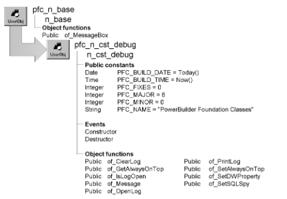

# n_cst_debug

**Description**

Debugging object. This object includes:

- The reference variable for the SQL SPY debugging service
- A function to enable or disable the DataWindow Properties window
- Log window capabilities

When this object is instantiated, PFC displays debugging messages in certain situations.

**Ancestry**



**Library**

- PFCAPSRV.PBL
- PFEAPSRV.PBL

**Object relationships**

- [n_cst_sqlspy](n_cst_sqlspy.md)
- [n_ds](../08-standard-class-user-objects/n_ds.md)
- [u_dw](../06-standard-visual-user-objects/u_dw.md)
- w_debuglog

**Usage**

To use this object:

1. Enable the debugging service by calling the n_cst_appmanager of_SetDebug function:

   ```
   gnv_app.of_SetDebug(TRUE)
   ```

Once enabled, the service captures all entries to the log, even if you don't open the w_debuglog window.

2. (Optional) Enable the SQL Spy service by calling the n_cst_debug of_SetSQLSpy function:

   ```
   gnv_app.inv_debug.of_SetSQLSpy(TRUE)
   ```

3. (Optional) Log debugging messages:

   ```
   gnv_app.inv_debug.of_Message &
      ("Opening window w_test")
   ```

4. (Optional) Display logged messages:

   ```
   gnv_app.inv_debug.of_OpenLog(TRUE)
   ```

5. (Optional) Enable the DataWindow Properties window by calling the n_cst_debug of_SetDWProperty function:

   ```
   gnv_app.inv_debug.of_SetDWProperty(TRUE)
   ```

**See also**

- [n_cst_appmanager](n_cst_appmanager.md)
- [n_cst_error](n_cst_error.md)

## Instance variables

N_cst_debug includes instance variables:

| Instance variable | Description | Data type | Access | Usage |
| --- | --- | --- | --- | --- |
| ib_alwaysontop | Specifies whether the service displays the debug window on top of other windows | Boolean | Protected | Call of_SetAlwaysOnTop and of_GetAlwaysOnTop to access |
| ids_debugjson |  | n_ds | Public |  |
| PFC_BUILD_DATE | Build date | Date | Public | Informational |
| PFC_FIXES | PFC revision level | Integer | Public | Informational |
| PFC_MAJOR | PFC major revision level | Integer | Public | Informational |
| PFC_MINOR | PFC minor revision | Integer | Public | Informational |
| PFC_NAME | PFC title | String | Public | Informational |
| PFC_BUILD_TIME | Build time | Time | Public | Informational |
| ids_debuglog | DataStore containing the debug log | n_ds | Public | Used by w_debuglog to display debugging messages |
| inv_sqlspy | Reference to SQL Spy debugging object | n_cst_sqlspy | Public | Internal |

## Events

N_cst_debug includes precoded events:

- Constructor
- Destructor

### Constructor

**Description**

Creates an instance of ids_debuglog.

**Usage**

This event enables the debug log.

### Destructor

**Description**

Performs clean up.

**Usage**

This event destroys all objects used by the debugging service.

## Functions

N_cst_debug includes precoded functions:

- of_ClearLog
- of_CloseJSON
- of_GetAlwaysOnTop
- of_IsDWProperty
- of_IsLogOpen
- of_Message
- of_OpenJSON
- of_OpenLog
- of_PrintLog
- of_SetAlwaysOnTop
- of_SetDWProperty
- of_SetSQLSpy

### of_ClearLog

**Description**

Clears all data from the ids_debuglog DataStore.

**Access**

Public

**Syntax**

```
instancename.of_ClearLog ( )
```

| Argument | Description |
| --- | --- |
| *instancename* | Instance name of n_cst_debug (the n_cst_appmanager default for this is inv_debug) |

**Return value**

Integer. Returns 1 if the function succeeds and -1 if an error occurs.

**Usage**

The w_debuglog window calls this function to clear the debugging log.

**Examples**

This example is from the w_debuglog cb_clear Clicked event:

```
gnv_app.inv_debug.of_ClearLog()
```

### of_CloseJSON

**Description**

Closethe DebugJSON window.

**Access**

Public

**Syntax**

```
instancename.of_CloseJSON ( )
```

| Argument | Description |
| --- | --- |
| *instancename* | Instance name of n_cst_debug |

**Return value**

Integer. Return value of Close PowerBuilder call. 0 if no action to close the window is taken. If any argument's value is NULL, function returns -1.

### of_GetAlwaysOnTop

**Description**

Reports whether the w_debuglog window always displays on top of other windows.

**Access**

Public

**Syntax**

```
instancename.of_GetAlwaysOnTop ( )
```

| Argument | Description |
| --- | --- |
| *instancename* | Instance name of n_cst_debug (the n_cst_appmanager default for this is inv_debug) |

**Return value**

Boolean. Returns TRUE if the w_debuglog window is always on top and FALSE if it is not.

**Examples**

This example calls the of_GetAlwaysOnTop function:

```
Boolean   ib_ontop

ib_ontop = gnv_app.inv_debug.of_GetAlwaysOnTop()
...
```

### of_IsDWProperty

**Description**

Determines the state of the Shared DW Property Service.

**Access**

Public

**Syntax**

```
instancename.of_IsDWProperty ( )
```

| Argument | Description |
| --- | --- |
| *instancename* | Instance name of n_cst_debug |

**Return value**

Boolean.

### of_IsLogOpen

**Description**

Reports whether the w_debuglog window is currently open.

**Access**

Public

**Syntax**

```
instancename.of_IsLogOpen ( )
```

| Argument | Description |
| --- | --- |
| *instancename* | Instance name of n_cst_debug (the n_cst_appmanager default for this is inv_debug) |

**Return value**

Boolean. Returns TRUE if the w_debuglog window is open and FALSE if it is not.

**Examples**

This example calls the of_IsLogOpen function:

```
Boolean   ib_open

ib_open = gnv_app.inv_debug.of_IsLogOpen()
...
```

### of_Message

**Description**

Adds an entry to the debug log.

**Access**

Public

**Syntax**

```
instancename.of_Message ( message )
```

| Argument | Description |
| --- | --- |
| *instancename* | Instance name of n_cst_debug (the n_cst_appmanager default for this is inv_debug) |
| *message* | String containing the text to be added to the debug log |

**Return value**

Integer. Returns 1 if the function succeeds and -1 if an error occurs.

**Examples**

This example calls the of_Message function:

```
Integer   li_return

li_return = gnv_app.inv_debug.of_Message &
   ("Login Error for: " + gnv_app.of_GetUserID())
```

### of_OpenJSON

**Description**

Open the DebugJSON window.

**Access**

Public

**Syntax**

```
instancename.of_OpenJSON ( anv_json )
```

| Argument | Description |
| --- | --- |
| *instancename* | Instance name of n_cst_debug |
| *anv_json* | n_cst_json. |

**Return value**

Integer. Return value of Open or Close PowerBuilder call. 0 if no action to open or close the window is taken. If any argument's value is NULL, function returns -1.

### of_OpenLog

**Description**

Opens or closes the w_debuglog window.

**Access**

Public

**Syntax**

```
instancename.of_OpenLog ( boolean )
```

| Argument | Description |
| --- | --- |
| *instancename* | Instance name of n_cst_debug (the n_cst_appmanager default for this is inv_debug) |
| *boolean* | Boolean specifying whether to open (TRUE) or close (FALSE) the w_debuglog window |

**Return value**

Integer. Returns the value of the PowerScript Open or Close function if the function succeeds or -1 if any argument’s value is NULL.

**Examples**

This example calls the of_OpenLog function:

```
gnv_app.inv_debug.of_OpenLog(TRUE)
```

### of_PrintLog

**Description**

Prints the debug log.

**Access**

Public

**Syntax**

```
instancename.of_PrintLog ( )
```

| Argument | Description |
| --- | --- |
| *instancename* | Instance name of n_cst_debug (the n_cst_appmanager default for this is inv_debug) |

**Return value**

Integer. Returns 1 if the function succeeds and -1 if an error occurs.

**Examples**

This example calls the of_PrintLog function:

```
Integer   li_return

li_return = gnv_app.inv_debug.of_PrintLog()

IF li_return = -1 THEN
   MessageBox("Debug Log", "Error printing log")
ELSE
   gnv_app.of_GetFrame().SetMicroHelp &
   ("Log printed successfully")
END IF
```

### of_SetAlwaysOnTop

**Description**

Controls whether the w_debuglog window always displays on top of other windows.

**Access**

Public

**Syntax**

```
instancename.of_SetAlwaysOnTop ( boolean )
```

| Argument | Description |
| --- | --- |
| *instancename* | Instance name of n_cst_debug (the n_cst_appmanager default for this is inv_debug) |
| *boolean* | Boolean indicating whether to always display w_debuglog on top of other windows (TRUE) or to let other windows display on top of w_debuglog (FALSE) |

**Return value**

Integer. Returns 1 if the function succeeds and -1 if an error occurs.

**Examples**

This example calls the of_SetAlwaysOnTop function:

```
...
gnv_app.inv_debug.of_SetAlwaysOnTop(FALSE)
...
```

### of_SetDWProperty

**Description**

Enables or disables display of the DataWindow Properties window.

**Access**

Public

**Syntax**

```
instancename.of_SetDWProperty ( boolean )
```

| Argument | Description |
| --- | --- |
| *instancename* | Instance name of n_cst_debug (the n_cst_appmanager default for this is inv_debug) |
| *boolean* | Boolean indicating whether to enable (TRUE) or disable (FALSE) display of the DataWindow Properties window |

**Return value**

Integer. Returns 1 if the function succeeds, 0 if no action is taken, and -1 if an error occurs.

**Usage**

While running an application, you display the DataWindow Properties window by right-clicking over a DataWindow and selecting DataWindow Properties from the popup menu.

**Examples**

This example calls the of_SetDWProperty function:

```
gnv_app.of_SetDebug(TRUE)
gnv_app.inv_debug.of_SetDWProperty(TRUE)
```

### of_SetSQLSpy

**Description**

Starts or stops the SQL Spy service.

**Access**

Public

**Syntax**

```
instancename.of_SetSQLSpy ( boolean )
```

| Argument | Description |
| --- | --- |
| *instancename* | Instance name of n_cst_debug (the n_cst_appmanager default for this is inv_debug) |
| *boolean* | Boolean indicating whether to start (TRUE) or stop (FALSE) the SQL Spy service |

**Return value**

Integer. Returns 1 if the function succeeds, 0 if no action is taken, and -1 if an error occurs.

**Examples**

This example calls the of_SetSQLSpy function:

```
gnv_app.of_SetDebug(TRUE)
gnv_app.inv_debug.of_SetSQLSpy(TRUE)
```
