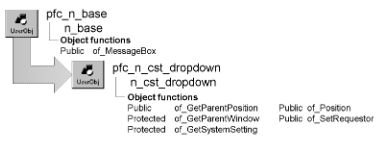

# n_cst_dropdown

**Description**

Dropdown service. The u_calculator and u_calendar objects use this object to control dropdown behavior when used with DataWindow columns and EditMasks.

**Ancestry**



**Library**

- PFCAPSRV.PBL
- PFEAPSRV.PBL

**Usage**

PFC objects use this object to control dropdown behavior. For usage information, see u_calculator and u_calendar.

**See also**

- [u_calculator](../07-custom-visual-user-objects/u_calculator.md)
- [u_calendar](../07-custom-visual-user-objects/u_calendar.md)

## Instance variables

N_cst_dropdown includes instance variables:

| Instance variable | Description | Data type | Access | Usage |
| --- | --- | --- | --- | --- |
| iu_requestor | Requester object | UserObject | Protected | Control associated with this instance of the dropdown service |
| DWSTYLE_BOX | Constant set to 1 | Integer | Protected | Internal |
| DWSTYLE_SHADOWBOX | Constant set to 2 | Integer | Protected | Internal |
| DWSTYLE_LOWERED | Constant set to 3 | Integer | Protected | Internal |
| DWSTYLE_RAISED | Constant set to 4 | Integer | Protected | Internal |
| STYLE_BOX | Constant set to 5 | Integer | Protected | Internal |
| STYLE_SHADOWBOX | Constant set to 6 | Integer | Protected | Internal |
| STYLE_LOWERED | Constant set to 7 | Integer | Protected | Internal |
| STYLE_RAISED | Constant set to 8 | Integer | Protected | Internal |
| DW_HSPLITBAR_WIDTH | Constant set to 9 | Integer | Protected | Internal |
| TAB_BORDER | Constant set to 10 | Integer | Protected | Internal |
| MISC_XPOSITION | Constant set to 11 | Integer | Protected | Internal |
| MISC_YPOSITION | Constant set to 12 | Integer | Protected | Internal |
| DWMISC_XPOSITION | Constant set to 13 | Integer | Protected | Internal |
| DWMISC_YPOSITION | Constant set to 14 | Integer | Protected | Internal |
| DWDETAIL_HEIGHT | Constant set to 15 | Integer | Protected | Internal |
| BORDER_CHECK | Constant set to 16 | Integer | Protected | Internal |

## Functions

N_cst_dropdown contains precoded object functions:

- of_GetParentPosition
- of_GetParentWindow
- of_GetSystemSetting
- of_Position
- of_SetRequestor

### of_GetParentPosition

**Description**

Retrieves the x and y coordinates for the parent object in relationship to the window on which it is placed.

**Access**

Public

**Syntax**

```
instancename.of_GetParentPosition ( control, x, y )
```

| Argument | Description |
| --- | --- |
| *instancename* | Instance name of n_cst_dropdown |
| *control* | DragObject whose parent position is returned |
| *x* | Integer into which the function places the parent’s x coordinate (passed by reference) |
| *y* | Integer into which the function places the parent’s y coordinate (passed by reference) |

**Return value**

Integer. Returns 1 if the function succeeds and -1 if an error occurs.

**Usage**

The of_Position function calls this function.

**Examples**

This example is from the of_Position function:

```
...
of_GetParentWindow(adrg_object, lw_parent)
IF IsNull(lw_parent) OR NOT IsValid(lw_parent) THEN
   Return -1
END IF
of_GetParentPosition &
   (adrg_object, li_parentx, li_parenty)
...
```

### of_GetParentWindow

**Description**

Retrieves the window containing the current object.

**Access**

Protected

**Syntax**

```
instancename.of_GetParentWindow ( control, window )
```

| Argument | Description |
| --- | --- |
| *instancename* | Instance name of n_cst_dropdown |
| *control* | DragObject whose window is returned |
| *window* | Window variable into which the function places a reference to the window containing *control*. If there is no parent window, this argument returns NULL (passed by reference) |

**Return value**

Integer. Returns 1 if the function succeeds and -1 if an error occurs.

**Usage**

Internal.

**Examples**

This example is from the of_Position function:

```
...
of_GetParentWindow (adrg_object, lw_parent)
IF IsNull(lw_parent) OR NOT IsValid(lw_parent) THEN
   Return -1
END IF
of_GetParentPosition &
   (adrg_object, li_parentx, li_parenty)
...
```

### of_GetSystemSetting

**Description**

Retrieves the platform-specific setting.

**Access**

Protected

**Syntax**

```
instancename.of_GetSystemSetting ( settingtype )
```

| Argument | Description |
| --- | --- |
| *instancename* | Instance name of n_cst_dropdown |
| *settingtype* | Integer or n_cst_dropdown constant specifying the setting to be returned: |

- **1 or DWSTYLE_BOX**
- **2 or DWSTYLE_SHADOWBOX**
- **3 or DWSTYLE_LOWERED**
- **4 or DWSTYLE_RAISED**
- **5 or STYLE_BOX**
- **6 or STYLE_SHADOWBOX**
- **7 or STYLE_LOWERED**
- **8 or STYLE_RAISED**
- **9 or DW_HSPLITBAR_WIDTH**
- **10 or TAB_BORDER**
- **11 or MISC_XPOSITION**
- **12 or MISC_YPOSITION**
- **13 or DWMISC_XPOSITION**
- **14 or DWMISC_YPOSITION**
- **15 or DWDETAIL_HEIGHT**
- **16 or BORDER_CHECK**

**Return value**

Integer. Returns the platform-specific setting.

**Usage**

Internal.

**Examples**

This example is from the of_GetParentPosition function:

```
...
CHOOSE CASE luo_parent.BorderStyle
CASE StyleBox!
   li_border = of_GetSystemSetting(STYLE_BOX)
CASE StyleShadowBox!
   li_border = &
   of_GetSystemSetting(STYLE_SHADOWBOX)
CASE StyleLowered!
   li_border = &
   of_GetSystemSetting(STYLE_LOWERED)
CASE StyleRaised!
   li_border = &
   of_GetSystemSetting(STYLE_RAISED)
END CHOOSE
...
```

### of_Position

**Description**

Updates the position of the requestor object based on the current position of the passed control.

**Access**

Public

**Syntax**

```
instancename.of_Position ( control, makevisible )
```

| Argument | Description |
| --- | --- |
| *instancename* | Instance name of n_cst_dropdown |
| *control* | DragObject containing the control used to calculate the new position |
| *makevisible* | Boolean indicating whether the dropdown object should be made visible after calculating a new position |

**Return value**

Integer. Returns values as follows:

- 1 Success
- -1 An error occurred
- -2 The requested functionality is not supported
- -3 Unable to calculate a valid position

**Examples**

This example from the u_calendar of_DropDown function calls the of_Position function:

```
...
li_rc = inv_dropdown. of_Position &
   (idrg_requestor, FALSE)
IF li_rc < 0 THEN Return -1
...
```

### of_SetRequestor

**Description**

Associates this instance of n_cst_dropdown with a dropdown object (such as u_calendar).

**Access**

Public

**Syntax**

```
instancename.of_SetRequestor ( requestor )
```

| Argument | Description |
| --- | --- |
| *instancename* | Instance name of n_cst_dropdown |
| *requestor* | UserObject variable containing a reference to the dropdown object to associate with this instance of n_cst_dropdown |

**Return value**

Integer. Returns 1 if the function succeeds and -1 if an error occurs.

**Examples**

This example calls the of_SetRequestor function:

```
Integer li_rc

IF IsNull (ab_switch) THEN Return -1
  IF ab_switch THEN
    IF IsNull(inv_dropdown) OR NOT &
      IsValid(inv_dropdown) THEN
        inv_dropdown = CREATE n_cst_dropdown
        inv_dropdown.of_SetRequestor(this)
        li_rc = 1
    END IF
  ELSE
    IF IsValid (inv_dropdown) THEN
      DESTROY inv_dropdown
      li_rc = 1
    END IF
  END IF
Return li_rc
```
