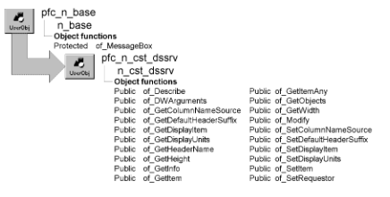

# n_cst_dssrv

**Description**

Base DataStore service object.

**Ancestry**

**Library**

- PFCDWSRV.PBL
- PFEDWSRV.PBL

**Usage**

Call the functions in this object to obtain basic information about a DataStore and its contents.

N_cst_dssrv is identical to n_cst_dwsrv, the base DataWindow service object.

For complete information on the instance variables, events, and functions in n_cst_dssrv, see [n_cst_dwsrv](n_cst_dwsrv.md).

**Descendants**

- [n_cst_dssrv_multitable](n_cst_dssrv_multitable.md)
- [n_cst_dssrv_printpreview](n_cst_dssrv_printpreview.md)
- [n_cst_dssrv_report](n_cst_dssrv_report.md)

**See also**

- [n_cst_dwsrv](n_cst_dwsrv.md)
- [n_ds](../08-standard-class-user-objects/n_ds.md)
