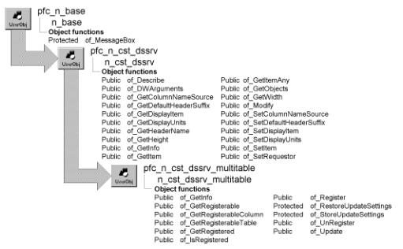

# n_cst_dssrv_multitable

**Description**

A collection of functions that facilitate the updating of DataStores that contain rows from more than one table.

**Ancestry**

**Library**

- PFCDWSRV.PBL
- PFEDWSRV.PBL

**Usage**

Use this object to handle update of multiple tables within a DataStore.

N_cst_dssrv_multitable is identical to n_cst_dwsrv_multitable, the DataWindow multitable update service object.

For complete information on the instance variables, events, and functions in n_cst_dssrv_multitable, see [n_cst_dwsrv_multitable](n_cst_dwsrv_multitable.md).

**See also**

- [n_cst_dssrv](n_cst_dssrv.md)
- [n_cst_dssrv_printpreview](n_cst_dssrv_printpreview.md)
- [n_cst_dssrv_report](n_cst_dssrv_report.md)
- [n_cst_dwsrv_multitable](n_cst_dwsrv_multitable.md)
- [n_ds](../08-standard-class-user-objects/n_ds.md)
