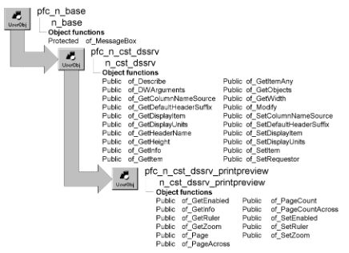

# n_cst_dssrv_printpreview

**Description**

Contains functions that allow you to control print preview.

**Ancestry**

**Library**

- PFCDWSRV.PBL
- PFEDWSRV.PBL

**Usage**

Use this object to provide print preview functionality for DataStores.

N_cst_dssrv_printpreview is identical to n_cst_dwsrv_printpreview, the DataWindow print preview service object.

For complete information on the instance variables, events, and functions in n_cst_dssrv_printpreview, see [n_cst_dwsrv_printpreview](n_cst_dwsrv_printpreview.md).

**See also**

- [n_cst_dssrv](n_cst_dssrv.md)
- [n_cst_dssrv_multitable](n_cst_dssrv_multitable.md)
- [n_cst_dssrv_report](n_cst_dssrv_report.md)
- [n_cst_dwsrv_printpreview](n_cst_dwsrv_printpreview.md)
- [n_ds](../08-standard-class-user-objects/n_ds.md)
