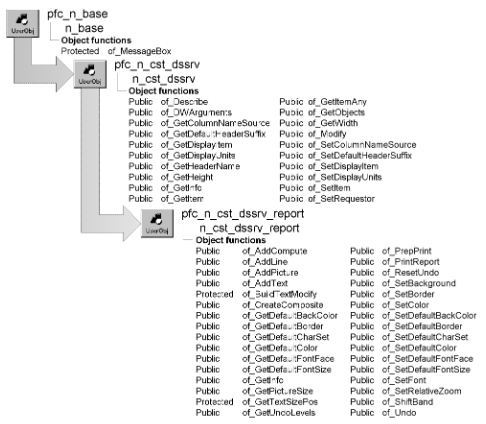

# n_cst_dssrv_report

**Description**

Contains functions that help you handle report DataStores and their printing.

**Ancestry**

**Library**

- PFCDWSRV.PBL
- PFEDWSRV.PBL

**Usage**

Use this service to provide enhanced viewing and printing capabilities to DataStores that contain reports.

N_cst_dssrv_report is identical to n_cst_dwsrv_report, the DataWindow report service object.

For complete information on the instance variables, events, and functions in n_cst_dssrv_report, see [n_cst_dwsrv_report](n_cst_dwsrv_report.md).

**See also**

- [n_cst_dssrv](n_cst_dssrv.md)
- [n_cst_dssrv_multitable](n_cst_dssrv_multitable.md)
- [n_cst_dssrv_printpreview](n_cst_dssrv_printpreview.md)
- [n_cst_dwsrv_report](n_cst_dwsrv_report.md)
- [n_ds](../08-standard-class-user-objects/n_ds.md)
