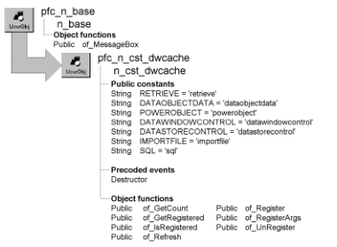

# n_cst_dwcache

**Description**

Caching service. This object is designed to contain data used in multiple places within an application. It provides a single data source, eliminating redundant database retrievals.

**Ancestry**



**Library**

- PFCAPSRV.PBL
- PFEAPSRV.PBL

**Object relationships**

- [n_ds](../08-standard-class-user-objects/n_ds.md)
- [n_tr](../08-standard-class-user-objects/n_tr.md)

**Usage**

To use caching:

1. Enable the caching service with the n_cst_appmanager of_SetDwCache function:

   ```
   gnv_app.of_SetDwCache(TRUE)
   ```

2. Cache data by calling the of_Register function, passing different arguments depending on the data to be cached:
   - To cache rows retrieved from the database via a DataWindow object, pass an identifier, a transaction object, the DataWindow object name, and arguments if any
   - To cache rows retrieved from the database via a SQL statement, pass an identifier, a transaction object, and the SQL statement
   - To cache rows in an array, pass an identifier, the DataWindow object name, and the data
   - To cache rows from a DataWindow control, pass an identifier and the DataWindow control
   - To cache rows from a DataStore, pass an identifier and the DataStore instance
   - To cache rows from a file, pass an identifier and the filename
3. Call the of_GetRegistered function to access cached data. This example assumes an ids_datastore instance variable:

   ```
   gnv_app.inv_dwcache.of_GetRegistered &
      ("d_emplist", ids_datastore)
   ids_datastore.ShareData(dw_emplist)
   ```

4. Refresh the cache object as needed, by calling of_Refresh.

**PFC 7 custom class extension** To further the extendibility of PFC, a new n_cst_dwcacheattrib custom class user object replaces the os_cachelist object structure that is now obsolete.

**See also**

n_cst_appmanager

## Instance variables

N_cst_dwcache includes instance variables:

| Instance variable | Description | Data type | Access | Usage |
| --- | --- | --- | --- | --- |
| DATAOBJECTDATA | Constant that indicates original data location and refresh functionality | String | Public | Internal |
| EMPTY | Constant set to '' | String | Protected |  |
| ics_dataobjectdata | Obsoleted in 6.0. | String | Protected |  |
| ics_powerobject | Obsoleted in 6.0. | String | Protected |  |
| ics_retrieve | Obsoleted in 6.0. | String | Protected |  |
| istr_cachelist[ ] |  | n_cst_dwcacheattrib | Protected |  |
| POWEROBJECT | Constant that indicates original data location and refresh functionality | String | Public | Internal |
| RETRIEVE | Constant that indicates original data location and refresh functionality | String | Public | Internal |
| inv_cachelist [ ] | Custom class user object containing cached data | n_cst_dwcache attrib | Protected | Internal |
| DATASTORECONTROL | Constant that indicates original data location and refresh functionality a | String | Public | Internal |
| DATAWINDOWCONTROL | Constant that indicates original data location and refresh functionality | String | Public | Internal |
| IMPORTFILE | Constant that indicates original data location and refresh functionality | String | Public | Internal |
| SQL | Constant that indicates original data location and refresh functionality | String | Public | Internal |

## Events

N_cst_dwcache includes one precoded event:

Destructor

### Constructor

**Description**

DataWindow/DataStore caching.

**Syntax**

```
instancename.EVENT Constructor ( )
```

| Argument | Description |
| --- | --- |
| *instancename* | Instance name of n_cst_dwcache |

**Return value**

None.

### Destructor

**Description**

Destroys all cache objects.

**Usage**

This event destroys all DataStores used by the caching service.

## Functions

N_cst_dwcache includes precoded object functions:

- of_GetCount
- of_GetRegistered
- of_IsRegistered
- of_Refresh
- of_Register
- of_RegisterArgs
- of_UnRegister

### of_GetCount

**Description**

Retrieves the number of objects currently registered.

**Access**

Public

**Syntax**

```
application.instancename.of_GetCount ( )
```

| Argument | Description |
| --- | --- |
| *application* | Global variable of type n_cst_appmanager (must be gnv_app) |
| *instancename* | Instance name of n_cst_dwcache (the n_cst_appmanager default for this is inv_dwcache) |

**Return value**

Integer. Returns the number of objects currently registered.

**Examples**

This example calls the of_GetCount function:

```
Integer   li_registered

li_registered = gnv_app.inv_dwcache.of_GetCount()
...
```

### of_GetRegistered

Accesses cached data. There are three syntaxes:

| To access | Use |
| --- | --- |
| A specified DataStore | Syntax 1 |
| The IDs for all DataStores | Syntax 2 |
| All DataStores | Syntax 3 |

| Syntax 1 | To access a specified DataStore |
| --- | --- |

**Description**

Returns a reference to the DataStore matching the passed ID.

**Access**

Public

**Syntax**

```
application.instancename.of_GetRegistered ( id, cache )
```

| Argument | Description |
| --- | --- |
| *application* | Global variable of type n_cst_appmanager (must be gnv_app) |
| *instancename* | Instance name of n_cst_dwcache (the n_cst_appmanager default for this is inv_dwcache) |
| *id* | String specifying the cached DataWindow objects ID, as specified in the of_Register function |
| *cache* | N_ds variable into which the function places a reference to the cached data’s DataStore (passed by reference) |

**Return value**

Integer. Returns 1 if the function succeeds and -1 if an error occurs.

**Usage**

Call this function when you know the ID and need to access a single item.

To access all IDs, use Syntax 2; to access all DataStores, use Syntax 3.

**Examples**

This example calls the of_GetRegistered function. This example assumes an ids_datastore instance variable:

```
gnv_app.inv_dwcache.of_GetRegistered &
   ("d_emplist", ids_datastore)
ids_datastore.ShareData(dw_emplist)
```

| Syntax 2 | To access all IDs |
| --- | --- |

**Description**

Returns a reference to all IDs in the istr_cachelist array.

**Access**

Public

**Syntax**

```
application.instancename.of_GetRegistered ( idlist )
```

| Argument | Description |
| --- | --- |
| *application* | Global variable of type n_cst_appmanager (must be gnv_app) |
| *instancename* | Instance name of n_cst_dwcache (the n_cst_appmanager default for this is inv_dwcache) |
| *idlist* | String array into which the function places the cached IDs, as specified in the of_Register function (passed by reference) |

**Return value**

Integer. Returns the number of elements in the *idlist* array if the function succeeds and -1 if an error occurs.

**Usage**

Call this function to access all IDs.

To access a single item, use Syntax 1; to access all DataStores, use Syntax 3.

**Examples**

This example calls the of_GetRegistered function:

```
String    idlist[ ]

gnv_app.inv_dwcache.of_GetRegistered &
   (idlist)
...
```

| Syntax 3 | To access all DataStores |
| --- | --- |

**Description**

Returns a reference to all DataStores in the istr_cachelist array.

**Access**

Public

**Syntax**

```
application.instancename.of_GetRegistered ( dslist )
```

| Argument | Description |
| --- | --- |
| *application* | Global variable of type n_cst_appmanager (must be gnv_app) |
| *instancename* | Instance name of n_cst_dwcache (the n_cst_appmanager default for this is inv_dwcache) |
| *dslist* | N_ds array into which the function places the cached DataStores (passed by reference) |

**Return value**

Integer. Returns the number of elements in the *dslist* array if the function succeeds and -1 if an error occurs.

**Usage**

Call this function to access all DataStores.

To access a single item, use Syntax 1; to access all IDs, use Syntax 2.

**Examples**

This example calls the of_GetRegistered function:

```
n_ds   dslist[ ]

gnv_app.inv_dwcache.of_GetRegistered &
   (dslist)
...
```

### of_IsRegistered

**Description**

Reports whether a specified ID is registered with the DataWindow caching service.

**Access**

Public

**Syntax**

```
application.instancename.of_IsRegistered ( id )
```

| Argument | Description |
| --- | --- |
| *application* | Global variable of type n_cst_appmanager (must be gnv_app) |
| *instancename* | Instance name of n_cst_dwcache (the n_cst_appmanager default for this is inv_dwcache) |
| *id* | String specifying the ID specified in the of_Register function |

**Return value**

Integer. Returns 1 if *id* is registered, 0 if it is not, and -1 if an error occurs.

**Examples**

This example calls the of_IsRegistered function:

```
Integer   li_return

li_return = gnv_app.inv_dwcache.of_IsRegistered &
   ("d_emplist")
CHOOSE CASE li_return
CASE 1
   gnv_app.inv_dwcache.of_GetRegistered &
   ("d_emplist", ids_datastore)
ids_datastore.ShareData(dw_emplist)
CASE 0
   gnv_app.inv_dwcache.of_Register &
   ("d_emplist", "d_emplist", SQLCA)
   gnv_app.inv_dwcache.of_GetRegistered &
   ("d_emplist", ids_datastore)
   ids_datastore.ShareData(dw_emplist)
CASE -1
   MessageBox("DW Caching", "Error")
END CHOOSE
```

### of_Refresh

**Description**

Refreshes one or all DataStores registered with the caching service.

**Access**

Public

**Syntax**

```
application.instancename.of_Refresh ( { id } )
```

| Argument | Description |
| --- | --- |
| *application* | Global variable of type n_cst_appmanager (must be gnv_app) |
| *instancename* | Instance name of n_cst_dwcache (the n_cst_appmanager default for this is inv_dwcache) |
| *id* (optional) | Specifies the ID of the cached object to be refreshed |

**Return value**

Long. Returns values as follows:

- **If you specified an ID** Returns the number of rows retrieved
- **If you did not specify an ID** Returns the number of DataStores that were refreshed

**Usage**

Call this function to reretrieve rows for one or all cached objects.

**Must be able to refresh** Not all cached objects are refreshable. For example, the specified Transaction object may no longer be connected.

**Examples**

This example calls the of_Refresh function:

```
gnv_app.inv_dwcache.of_Refresh("d_emplist")
```

### of_Register

Enables caching for a specified object. There are seven syntaxes:

| To | Use |
| --- | --- |
| Cache data retrieved via a DataWindow object, optionally using retrieval arguments | Syntax 1 |
| Cache data retrieved via a DataWindow object | Syntax 2 |
| Cache data retrieved via a SQL statement | Syntax 3 |
| Cache data from a DataWindow control | Syntax 4 |
| Cache data from a DataStore | Syntax 5 |
| Cache passed data | Syntax 6 |
| Cache data from a file | Syntax 7 |

**Protected versions of of_Register** There are also two protected versions of of_Register. These are for internal use.

| Syntax 1 | To cache data retrieved via a DataWindow object, optionally using |
| --- | --- |

**retrieval arguments**

**Description**

Retrieves rows from the database (using the specified DataWindow object) and caches them.

**Access**

Public

**Syntax**

```
application.instancename.of_Register ( id, dwobject {, trans {, arguments
{, initialload } } } )
```

| Argument | Description |
| --- | --- |
| *application* | Global variable of type n_cst_appmanager (must be gnv_app) |
| *instancename* | Instance name of n_cst_dwcache (the n_cst_appmanager default for this is inv_dwcache) |
| *id* | String identifying the cached DataWindow object |
| *dwobject* | String specifying the DataWindow object to be cached |
| *trans* (optional) | N_tr transaction object used to retrieve rows for *dwobject* If you do not specify this argument, *dwobject* must have been saved with the data |
| *arguments* (optional) | Twenty-element array of the Any data type specifying arguments for *dwobject* |
| *initialload* (optional) | Boolean specifying whether to load the data immediately or wait until the first of_Refresh request |

**Return value**

Integer. Returns 1 if the function succeeds, 0 if *dwobject* is already registered, -1 if an error occurs, -2 if there is an error with *trans*, and -3 if there is a retrieve error.

**Usage**

Call this function to cache data for a DataWindow object that uses retrieval arguments.

**Examples**

This example calls the of_Register function:

```
gnv_app.inv_dwcache.of_Register &
   ("d_emplist", "d_emplist", SQLCA)
...
```

| Syntax 2 | To cache data retrieved via a DataWindow object |
| --- | --- |

**Description**

Retrieves rows from the database (using the specified DataWindow object) and caches them.

**Access**

Public

**Syntax**

```
application.instancename.of_Register ( id, dwobject {, trans {, initialload } } )
```

| Argument | Description |
| --- | --- |
| *application* | Global variable of type n_cst_appmanager (must be gnv_app) |
| *instancename* | Instance name of n_cst_dwcache (the n_cst_appmanager default for this is inv_dwcache) |
| *id* | String identifying the cached DataWindow object |
| *dwobject* | String specifying the DataWindow object to be cached |
| *trans* (optional) | N_tr transaction object used to retrieve rows for *dwobject* If you do not specify this argument, *dwobject* must have been saved with the data |
| *initialload* (optional) | Boolean specifying whether to load the data immediately or wait until the first of_Refresh request |

**Return value**

Integer. Returns 1 if the function succeeds, 0 if *dwobject* is already registered, -1 if an error occurs, -2 if there is an error with *trans*, and -3 if there is a retrieve error.

**Usage**

Call this function to cache data for a DataWindow object that has no retrieval arguments.

**Examples**

This example calls the of_Register function:

```
gnv_app.inv_dwcache.of_Register &
   ("d_emplist", "d_emplist", SQLCA, TRUE)
...
```

| Syntax 3 | To cache data retrieved via a SQL statement |
| --- | --- |

**Description**

Retrieves rows (using a specified SQL statement) and caches them.

**Access**

Public

**Syntax**

```
application.instancename.of_Register ( id, trans, sql {, initialload } )
```

| Argument | Description |
| --- | --- |
| *application* | Global variable of type n_cst_appmanager (must be gnv_app) |
| *instancename* | Instance name of n_cst_dwcache (the n_cst_appmanager default for this is inv_dwcache) |
| *id* | String identifying the cached DataWindow object |
| *trans* | N_tr transaction object used to retrieve rows for *dwobject* |
| *sql* | String specifying the SQL SELECT statement used to create the cache |
| *initialload* (optional) | Boolean specifying whether to load the data immediately or wait until the first of_Refresh request |

**Return value**

Integer. Returns 1 if the function succeeds, 0 if *id* is already registered, and -1 if an error occurs.

**Usage**

Call this function to cache data for a DataWindow object, using SQL to retrieve rows from the database.

**Examples**

This example calls the of_Register function:

```
gnv_app.inv_dwcache.of_Register &
   ("sql_empall", SQLCA, &
     "SELECT * FROM employee")
...
```

| Syntax 4 | To cache data from a DataWindow control |
| --- | --- |

**Description**

Caches rows from a passed DataWindow control.

**Access**

Public

**Syntax**

```
application.instancename.of_Register ( id, dwcontrol {, initialload } )
```

| Argument | Description |
| --- | --- |
| *application* | Global variable of type n_cst_appmanager (must be gnv_app) |
| *instancename* | Instance name of n_cst_dwcache |
|  | The n_cst_appmanager default for this is inv_dwcache |
| *id* | String identifying the cached DataWindow object |
| *dwcontrol* | DataWindow control instance whose DataWindow object contains the data to be cached |
| *initialload* (optional) | Boolean specifying whether to load the data immediately or wait until the first of_Refresh request |

**Return value**

Integer. Returns 1 if the function succeeds, 0 if *dwobject* is already registered, and -1 if an error occurs.

**Usage**

Call this function to cache data from a DataWindow control.

**Examples**

This example calls the of_Register function:

```
gnv_app.inv_dwcache.of_Register &
   ("d_emplist", dw_emplist, TRUE)
```

| Syntax 5 | To cache data from a DataStore |
| --- | --- |

**Description**

Caches rows from a passed DataStore.

**Access**

Public

**Syntax**

```
application.instancename.of_Register ( id, datastore {, initialload } )
```

| Argument | Description |
| --- | --- |
| *application* | Global variable of type n_cst_appmanager (must be gnv_app) |
| *instancename* | Instance name of n_cst_dwcache (the n_cst_appmanager default for this is inv_dwcache) |
| *id* | String identifying the cached DataWindow object |
| *datastore* | DataStore instance whose DataWindow object contains the data to be cached |
| *initialload* (optional) | Boolean specifying whether to load the data immediately or wait until the first of_Refresh request |

**Return value**

Integer. Returns 1 if the function succeeds, 0 if *id* is already registered, and -1 if an error occurs.

**Usage**

Call this function to cache data from a DataStore.

**Examples**

This example calls the of_Register function:

```
gnv_app.inv_dwcache.of_Register &
   ("d_emplist", ids_emplist, TRUE)
```

| Syntax 6 | To cache passed data |
| --- | --- |

**Description**

Caches passed data.

**Access**

Public

**Syntax**

```
application.instancename.of_Register ( id, dwobject, data )
```

| Argument | Description |
| --- | --- |
| *application* | Global variable of type n_cst_appmanager (must be gnv_app) |
| *instancename* | Instance name of n_cst_dwcache (the n_cst_appmanager default for this is inv_dwcache) |
| *id* | String identifying the cached object |
| *dwobject* | String specifying the DataWindow object to be cached |
| *data* | PowerObject array of structures whose elements match *dwobject*. This array contains the data to be cached |

**Return value**

Integer. Returns 1 if the function succeeds, 0 if *dwobject* is already registered, and -1 if an error occurs.

**Usage**

Call this function to cache external data for a DataWindow object.

**Elements must match** Application errors will occur if the elements of the *data* structure do not exactly match the columns of *dwobject*.

The of_Refresh function does not affect data cached with this syntax.

**Examples**

This example calls the of_Register function:

```
s_newdata   str_newdata[ ]

... // Logic to populate str_newdata
gnv_app.inv_dwcache.of_Register &
   ("d_emplist", "d_emplist", str_newdata)
```

| Syntax 7 | To cache data from a file |
| --- | --- |

**Description**

Caches data from a file.

**Access**

Public

**Syntax**

```
application.instancename.of_Register ( id, dwobject, filename {, initialload } )
```

| Argument | Description |
| --- | --- |
| *application* | Global variable of type n_cst_appmanager (must be gnv_app) |
| *instancename* | Instance name of n_cst_dwcache (the n_cst_appmanager default for this is inv_dwcache) |
| *id* | String identifying the cached object |
| *dwobject* | String specifying the DataWindow object to be cached |
| *filename* | String specifying the name of a tab-delimited file whose elements match *dwobject* |
| *initialload* (optional) | Boolean specifying whether to load the data immediately or wait until the first of_Refresh request |

**Return value**

Integer. Returns 1 if the function succeeds, 0 if *dwobject* is already registered, and -1 if an error occurs.

**Usage**

Call this function to cache data from a file.

**Elements must match** Application errors will occur if the elements of the lines in *filename* do not exactly match the columns of *dwobject*.

The of_Refresh function does not affect data cached with this syntax.

To cache data from a database, use Syntax 1; to cache data stored with the DataWindow object, use Syntax 3.

**Examples**

This example calls the of_Register function:

```
gnv_app.inv_dwcache.of_Register &
   ("d_emplist", "d_emplist", "c:\temp\emplist.txt")
```

### of_RegisterArgs

**Description**

Modifies retrieval arguments for a registered object.

**Access**

Public

**Syntax**

```
application.instancename.of_RegisterArgs ( id, arguments )
```

| Argument | Description |
| --- | --- |
| *application* | Global variable of type n_cst_appmanager (must be gnv_app) |
| *instancename* | Instance name of n_cst_dwcache (the n_cst_appmanager default for this is inv_dwcache) |
| *id* | ID of the cached object |
| *arguments* | Twenty-element array of the Any data type specifying new arguments for the DataWindow object associated with *id* |

**Return value**

Integer. Returns 1 if the function succeeds and -1 if an error occurs.

**Usage**

Call this function to establish new retrieval arguments for a previously cached DataWindow.

The number of arguments specified in *arguments* must match the number of arguments specified when the cached object was registered.

**Examples**

This example calls the of_RegisterArgs function:

```
Any la_args[20]

// Code to populate la_args
...
gnv_app.inv_dwcache.of_RegisterArgs &
   ("d_emplist", la_args)
```

### of_UnRegister

**Description**

Removes one or all objects from the caching service.

**Access**

Public

**Syntax**

```
application.instancename.of_UnRegister ( { id } )
```

| Argument | Description |
| --- | --- |
| *application* | Global variable of type n_cst_appmanager (must be gnv_app) |
| *instancename* | Instance name of n_cst_dwcache (the n_cst_appmanager default for this is inv_dwcache) |
| *id* (optional) | ID of the DataWindow object to be removed from the cache |

**Return value**

Integer. Returns the number of objects that were unregistered if the function succeeds and -1 if an error occurs.

**Usage**

If you do not specify *id*, the function unregisters all objects.

**Examples**

This example calls the of_UnRegister function:

```
gnv_app.inv_dwcache.of_UnRegister &
   ("d_emplist")
```
