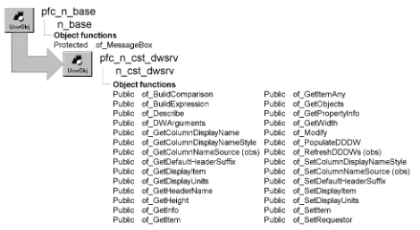

# n_cst_dwsrv

**Description**

Base DataWindow services object. N_cst_dwsrv serves as the ancestor object for all DataWindow services. In addition to being the ancestor for all other DataWindow services, u_dw instantiates this user object as inv_base.

**N_cst_dssrv is the same as n_cst_dwsrv** N_cst_dssrv, the base DataStore service object is almost identical to n_cst_dwsrv except that it applies to DataStores instead of DataWindow controls. N_cst_dssrv has the same relationship to n_ds as n_cst_dwsrv has to u_dw. Except where noted, references to n_cst_dwsrv in the following discussions apply equally to n_cst_dssrv.

**Ancestry**



**Library**

- PFCDWSRV.PBL
- PFEDWSRV.PBL

**Object relationships**

- [n_cst_string](n_cst_string.md)
- [n_cst_dwobjectattrib](../05-global-structures-and-structure-objects/n_cst_dwobjectattrib.md)
- [n_cst_infoattrib](../05-global-structures-and-structure-objects/n_cst_infoattrib.md)
- [n_cst_propertyattrib](../05-global-structures-and-structure-objects/n_cst_propertyattrib.md)
- [u_dw](../06-standard-visual-user-objects/u_dw.md)

**Usage**

Call the functions in this user object to obtain basic information about a DataWindow object and its contents.

To use this service:

1. Enable the service using the u_dw of_SetBase function:

   ```
   dw_emp.of_SetBase(TRUE)
   ```

2. Call base DataWindow service functions as needed:

   ```
   dw_emp.inv_base.of_SetDisplayUnits &
   ("selected employees")
   dw_emp.inv_base.of_SetDisplayItem &
   ("the selected employee")
   ```

**Descendants**

- [n_cst_dwsrv_dropdownsearch](n_cst_dwsrv_dropdownsearch.md)
- [n_cst_dwsrv_filter](n_cst_dwsrv_filter.md)
- [n_cst_dwsrv_find](n_cst_dwsrv_find.md)
- [n_cst_dwsrv_linkage](n_cst_dwsrv_linkage.md)
- [n_cst_dwsrv_multitable](n_cst_dwsrv_multitable.md)
- [n_cst_dwsrv_printpreview](n_cst_dwsrv_printpreview.md)
- [n_cst_dwsrv_property](n_cst_dwsrv_property.md)
- [n_cst_dwsrv_querymode](n_cst_dwsrv_querymode.md)
- [n_cst_dwsrv_report](n_cst_dwsrv_report.md)
- [n_cst_dwsrv_reqcolumn](n_cst_dwsrv_reqcolumn.md)
- [n_cst_dwsrv_resize](n_cst_dwsrv_resize.md)
- [n_cst_dwsrv_rowmanager](n_cst_dwsrv_rowmanager.md)
- [n_cst_dwsrv_rowselection](n_cst_dwsrv_rowselection.md)
- [n_cst_dwsrv_sort](n_cst_dwsrv_sort.md)

**See also**

- [u_dw](../06-standard-visual-user-objects/u_dw.md)
- [n_cst_dssrv](n_cst_dssrv.md)

## Instance variables

N_cst_dwsrv includes instance variables:

| Instance variable | Description | Data type | Access | Usage |
| --- | --- | --- | --- | --- |
| DBNAME | Constant set to 1 | Integer | Public | Use with of_SetColumnDisplayName Style |
| DEFAULT | Constant set to 0 | Integer | Public | Use with of_SetColumnDisplayName Style |
| HEADER | Constant set to 2 | Integer | Public | Use with of_SetColumnDisplayName Style |
| idw_requestor | The DataWindow control that owns the n_cst_dwsrv instance | u_dw | Protected | Used to access and control the associated DataWindow control |
| ii_source | Used by n_cst_dwsrv_querymode | Integer | Protected | Access |
| is_charThousand | leave this empty to read char from Registry. | String | Protected |  |
| is_defaultheadersuffix | Default suffix for DataWindow column headers and labels (the default is _t) | String | Protected | Call of_SetDefaultHeaderSuffix and of_GetDefaultHeaderSuffix to access |
| is_displayitem | Controls message text displayed for a single row | String | Protected | Call of_SetDisplayItem and of_GetDisplayItem to access |
| is_displayunits | Controls message text displayed for multiple rows | String | Protected | Call of_SetDisplayUnits and of_GetDisplayUnits to access |

## Functions

N_cst_dwsrv includes precoded object functions:

- of_BuildComparison
- of_BuildExpression
- of_Describe
- of_DWArguments
- of_GetColumnDisplayName
- of_GetColumnDisplayNameStyle
- of_GetColumnEditStatus
- of_GetColumnNameSource
- of_GetDefaultHeaderSuffix
- of_GetDescription
- of_GetDisplayItem
- of_GetDisplayUnits
- of_GetHeaderName
- of_GetHeight
- of_GetInfo
- of_GetItem
- of_GetItemAny
- of_GetName
- of_GetObjects
- of_GetPropertyInfo
- of_GetWidth
- of_Modify
- of_PopulateDDDW
- of_RefreshDDDWs
- of_SetColumnDisplayNameStyle
- of_SetColumnNameSource
- of_SetDefaultHeaderSuffix
- of_SetDisplayItem
- of_SetDisplayUnits
- of_SetItem
- of_SetRequestor

### of_BuildComparison

**Description**

Returns a comparison string that can be used in a Find or Filter operation. This string does not contain the column specification, so it can be used with other columns.

**Access**

Public

**Syntax**

```
dwcontrol.instancename.of_BuildComparison ( row, column {, value } )
```

| Argument | Description |
| --- | --- |
| *dwcontrol* | Instance name of the u_dw-based DataWindow control |
| *instancename* | Instance name of n_cst_dwsrv (the u_dw default is inv_base) |
| *row* | Long specifying the row number containing the column value |
| *column* | String specifying the name of the column containing the value |
| *value* (optional) | String specifying a value to be cast to the Any datatype. If you specify this argument, the function does not use *row* and *column* |

**Return value**

Any. Returns the column’s value cast to the Any data type if the function succeeds and ! if an error occurs.

**Usage**

Internal.

A string value is quoted with n_cst_string of_ExpressionString, so a value that contains a single quote or a tilde gives a valid comparison (PFC 2025 and later). Pass the value as it is: don't escape it yourself.

**Examples**

This example is from the n_cst_dwsrv_linkage pfc_PreDeleteRow event:

```
...
li_upperbound = UpperBound(is_keycols)
FOR li_i = 1 TO li_upperbound
   is_keycolsvalue[li_i] = of_BuildComparison &
     (al_row, is_keycols[li_i] )
NEXT
...
```

### of_BuildExpression

**Description**

Creates a complete expression that can be used with a find or filter operation.

**Access**

Public

**Syntax**

```
dwcontrol.instancename.of_BuildExpression ( row, column {, operator
{, value } } )
```

| Argument | Description |
| --- | --- |
| *dwcontrol* | Instance name of the u_dw-based DataWindow control |
| *instancename* | Instance name of n_cst_dwsrv (the u_dw default is inv_base) |
| *row* | Long specifying the row number containing the column value used in the comparison string |
| *column* | String specifying the column used in the comparison string |
| *operator* (optional) | String specifying the operator used in the comparison string (the default is =) |
| *value* (optional) | String specifying a value used in the comparison string. If you specify this argument, the function does not use *row* and *column* to determine the value |

**Return value**

Any. Returns a comparison string if the function succeeds and ! if an error occurs.

**Usage**

Internal.

A string value is quoted with n_cst_string of_ExpressionString, so a value that contains a single quote (O'Brien) or a tilde gives a valid expression (PFC 2025 and later). Pass the value as it is: don't escape it yourself. The n_cst_dssrv function of the same name, for DataStores, works the same way.

**Examples**

This example is from the n_cst_dwsrv_linkage of_ScrollDetails function:

```
...
ls_expression = of_BuildExpression  &
   (0, inv_linkargs.is_detailcolarg[li_i],  &
     ’=’, ls_value)
...
```

### of_Describe

Describes DataWindow attributes. There are two syntaxes:

| To | Use |
| --- | --- |
| Describe multiple columns or bands | Syntax 1 |
| Describe a single column | Syntax 2 |

| Syntax 1 | To describe multiple columns or bands |
| --- | --- |

**Description**

Describes the specified attribute for multiple columns or bands.

**Access**

Public

**Syntax**

```
dwcontrol.instancename.of_Describe ( returndescribe, attribute
{, objecttype, band, visibleonly } )
```

| Argument | Description |
| --- | --- |
| *dwcontrol* | Instance name of the u_dw-based DataWindow control |
| *instancename* | Instance name of n_cst_dwsrv (the u_dw default is inv_base) |
| *returndescribe* | N_cst_dwobjectattrib instance into which the function places the described attributes |
| *attribute* | String specifying the name of the attribute to describe |
| *objecttype* (optional) | String specifying the type of objects to describe. The default is \*, which describes all types |
|  | For more information on DataWindow types, see of_GetObjects |
| *band* (optional) | String specifying the band to describe (specify \* to return all bands). If you specify *objecttype*, you must specify this argument. The default is \*, which describes all bands. Valid bands are: |
|  | • Header |
|  | • Detail |
|  | • Footer |
|  | • Summary |
|  | • Header.*levelnumber* |
|  | • Trailer.*levelnumber* |
| *visibleonly* (optional) | Boolean indicating whether to describe visible columns only (TRUE) or all columns (FALSE). If you specify *objecttype*, you must specify this argument. The default is FALSE |

**Return value**

Integer. Returns 1 if the function succeeds and -1 if an error occurs.

**Usage**

Call this function as an alternative to multiple Describe functions.

Use Syntax 2 to describe a single column.

**Examples**

This example describes the border attribute for all visible columns in all bands:

```
n_cst_dwobjectattrib lnv_dwobjectattrib[ ]

dw_employee.inv_base.of_Describe &
   (lnv_dwobjectattrib, "border", "column", &
   "*", TRUE)
```

| Syntax 2 | To describe a single column |
| --- | --- |

**Description**

Describes the specified attribute for a single column.

**Access**

Public

**Syntax**

```
dwcontrol.instancename.of_Describe ( returndescribe, attribute,
columnname )
```

| Argument | Description |
| --- | --- |
| *dwcontrol* | Instance name of the u_dw-based DataWindow control |
| *instancename* | Instance name of n_cst_dwsrv (the u_dw default is inv_base) |
| *returndescribe* | N_cst_dwobjectattrib instance into which the function places the described attributes |
| *attribute* | String specifying the name of the attribute to describe |
| *columnname* | String specifying the column to describe |

**Return value**

Integer. Returns 1 if the function succeeds and -1 if an error occurs.

**Usage**

Call this function as an alternative to multiple Describe functions.

Use Syntax 1 to describe multiple columns.

**Examples**

This example describes the border attribute for the emp_id column:

```
n_cst_dwobjectattrib lnv_dwobjectattrib[ ]

dw_employee.inv_base.of_Describe &
   (lnv_dwobjectattrib, "border", "emp_id")
```

### of_DWArguments

Determines DataWindow and DropDownDataWindow arguments. There are two syntaxes:

| To | Use |
| --- | --- |
| Determine DropDownDataWindow arguments | Syntax 1 |
| Determine DataWindow arguments | Syntax 2 |

| Syntax 1 | To access DropDownDataWindow arguments |
| --- | --- |

**Description**

Determines if the passed dropdown DataWindow has retrieval arguments.

**Access**

Public

**Syntax**

```
dwcontrol.instancename.of_DWArguments ( dwchild, arguments,
datatypes )
```

| Argument | Description |
| --- | --- |
| *dwcontrol* | Instance name of the u_dw-based DataWindow control |
| *instancename* | Instance name of n_cst_dwsrv (the u_dw default is inv_base) |
| *dwchild* | DataWindowChild variable specifying the DropDownDataWindow to be tested for retrieval arguments |
| *arguments* | String array into which the function places argument names (passed by reference) |
| *datatypes* | String array into which the function places argument data types (passed by reference) |

**Return value**

Integer. Returns the number of elements in the *arguments* and *datatypes* arrays.

**Usage**

Internal.

**Examples**

This example calls the of_DWArguments function:

```
Long  ll_cnt, ll_max, ll_num_dddws
DataWindowChild  ldwc_dddws[ ]
String  ls_dddw_col, ls_dddw_name
String  ls_args[ ], ls_types[ ]
...
IF of_DWArguments(ldwc_dddws[ll_num_dddws], &
   ls_args, ls_types ) > 0 THEN
   idw_Requestor.Event pfc_RetrieveDDDW &
      (ls_dddw_col)
ELSE
   ldwc_dddws [ll_num_dddws].SetTransObject &
   (idw_Requestor.itr_object)
   ldwc_dddws [ll_num_dddws].Retrieve( )
END IF
```

| Syntax 2 | To access DataWindow arguments |
| --- | --- |

**Description**

Determines if the passed DataWindow has retrieval arguments.

**Access**

Public

**Syntax**

```
dwcontrol.instancename.of_DWArguments ( arguments, datatypes )
```

| Argument | Description |
| --- | --- |
| *dwcontrol* | Instance name of the u_dw-based DataWindow control |
| *instancename* | Instance name of n_cst_dwsrv (the u_dw default is inv_base) |
| *arguments* | String array into which the function places argument names (passed by reference) |
| *datatypes* | String array into which the function places argument data types (passed by reference) |

**Return value**

Integer. Returns the number of elements in the *arguments* and *datatypes* arrays.

**Examples**

This example calls the of_DWArguments function:

```
Integer   li_return, li_count
String    ls_args[ ], ls_types[ ]

li_return = dw_employee.inv_base.of_DWArguments &
   (ls_args, ls_types)
IF li_return > 0 THEN
   FOR li_count = 1 to li_return
   // processing logic
   NEXT
ELSE
   MessageBox("Error", "No DW arguments")
END IF
```

### of_GetColumnDisplayName

**Description**

Retrieves the display name for a specified column.

**Access**

Public

**Syntax**

```
dwcontrol.instancename.of_GetColumnDisplayName ( column )
```

| Argument | Description |
| --- | --- |
| *dwcontrol* | Instance name of the u_dw-based DataWindow control |
| *instancename* | Instance name of n_cst_dwsrv (the u_dw default is inv_base) |
| *column* | String specifying the column name or integer specifying the column number |

**Return value**

String. Returns the display name for the column.

**Usage**

PFC uses the database column name, the DataWindow column name, or the column header name for the display name. You set the display name with the of_SetColumnDisplayNameStyle function.

**Examples**

This example calls the of_GetColumnDisplayName function:

```
String  ls_name

ls_name =  &
  dw_1.inv_base.of_GetColumnDisplayName("emp_id")
MessageBox("Name", "Display name is " + ls_name)
```

### of_GetColumnDisplayNameStyle

**Description**

Retrieves the DataWindow’s column display name style.

**Access**

Public

**Syntax**

```
dwcontrol.instancename.of_GetColumnDisplayNameStyle ( )
```

| Argument | Description |
| --- | --- |
| *dwcontrol* | Instance name of the u_dw-based DataWindow control |
| *instancename* | Instance name of n_cst_dwsrv (the u_dw default is inv_base) |

**Return value**

Integer. Returns values as follows:

- **0 or DEFAULT** DataWindow column name
- **1 or DBNAME** Database column name
- **2 or HEADER** Column header name

**Examples**

This example calls the of_GetColumnDisplayNameStyle function:

```
Integer  li_style

li_style =  &
   dw_1.inv_base.of_GetColumnDisplayNameStyle()
MessageBox("Style",  &
   "Display style is " + String(li_style))
```

### of_GetColumnEditStatus

**Description**

Determine the Edit Status of the passed column/row combination.

**Access**

Public

**Syntax**

```
instancename.of_GetColumnEditStatus ( as_column, al_row )
```

| Argument | Description |
| --- | --- |
| *instancename* | Instance name of n_cst_dwsrv |
| *as_column* | String. The column to test. |
| *al_row* | Long. The row number to test. |

**Return value**

String. "editable" The column/row is editable. "displayonly" The column/row is display only "protected" The column/row is not editable. "!" if an error is encountered.

### of_GetColumnNameSource

**Description**

Obsolete. Call of_GetColumnDisplayNameStyle instead.

**Access**

Public

**Syntax**

```
dwcontrol.instancename.of_GetColumnNameSource ( )
```

| Argument | Description |
| --- | --- |
| *dwcontrol* | Instance name of the u_dw-based DataWindow control |
| *instancename* | Instance name of n_cst_dwsrv (the u_dw default is inv_base) |

**Return value**

Integer. Returns the column name source:

- 0—DataWindow column names
- 1—Database column names
- 2—Column header names

### of_GetDefaultHeaderSuffix

**Description**

Retrieves the default header suffix.

**Access**

Public

**Syntax**

```
dwcontrol.instancename.of_GetDefaultHeaderSuffix ( )
```

| Argument | Description |
| --- | --- |
| *dwcontrol* | Instance name of the u_dw-based DataWindow control |
| *instancename* | Instance name of n_cst_dwsrv (the u_dw default is inv_base) |

**Return value**

String. Returns the default header suffix.

**Usage**

Call this function to access the default suffix used by DataWindow objects to designate headers.

**Examples**

This example calls the of_GetDefaultHeaderSuffix function:

```
String    ls_suffix

ls_suffix = inv_base.of_GetDefaultHeaderSuffix( )
MessageBox("DataWindow", "Header suffix is: " &
   + ls_suffix)
```

### of_GetDescription

**Description**

Gets the Service Description.

**Access**

Public

**Syntax**

```
instancename.of_GetDescription ( )
```

| Argument | Description |
| --- | --- |
| *instancename* | Instance name of n_cst_dwsrv |

**Return value**

String. The Service Description.

### of_GetDisplayItem

**Description**

Retrieves the display name for single items in the DataWindow.

**Access**

Public

**Syntax**

```
dwcontrol.instancename.of_GetDisplayItem ( )
```

| Argument | Description |
| --- | --- |
| *dwcontrol* | Instance name of the u_dw-based DataWindow control |
| *instancename* | Instance name of n_cst_dwsrv (the u_dw default is inv_base) |

**Return value**

String. Returns the display name for single rows of the DataWindow.

**Usage**

Call this function to access the display name for individual rows of the DataWindow. PFC uses this name in error message text when confirming single-row deletion. For example, if this name is *this row*, the n_cst_dwsrv_rowmanager function displays *Are you sure you want to delete*

```
this row?
```

**Examples**

This example calls the of_GetDisplayItem function:

```
String    ls_item

ls_item = inv_base.of_GetDisplayItem( )
MessageBox("DataWindow", "Item label is: " &
   + ls_item)
```

### of_GetDisplayUnits

**Description**

Retrieves the display name for multiple rows in the DataWindow. N_cst_dwsrv maintains this as the is_displayunits instance variable.

**Access**

Public

**Syntax**

```
dwcontrol.instancename.of_GetDisplayUnits ( )
```

| Argument | Description |
| --- | --- |
| *dwcontrol* | Instance name of the u_dw-based DataWindow control |
| *instancename* | Instance name of n_cst_dwsrv (the u_dw default is inv_base) |

**Return value**

String. Returns the display name for multiple rows of the DataWindow.

**Usage**

Call this function to access the display name for the rows of the DataWindow. PFC uses this name in error message text when confirming multiple row deletion. For example, if this name is *rows*, the n_cst_dwsrv_rowmanager function displays *Are you sure you want to delete these rows?*

**Examples**

This example calls the of_GetDisplayUnits function:

```
String    ls_units

ls_units = inv_base.of_GetDisplayUnits( )
MessageBox("DataWindow", "Unit label is: " &
   + ls_units)
```

### of_GetHeaderName

**Description**

Returns a header name for the passed DataWindow column name.

**Access**

Public

**Syntax**

```
dwcontrol.instancename.of_GetHeaderName ( columnname {, suffix } )
```

| Argument | Description |
| --- | --- |
| *dwcontrol* | Instance name of the u_dw-based DataWindow control |
| *instancename* | Instance name of n_cst_dwsrv (the u_dw default is inv_base) |
| *columnname* | String specifying the DataWindow column name |
| *suffix* (optional) | String specifying the suffix the function uses to find the header name. The default is _t |

**Return value**

String. Returns a formatted DataWindow column heading (with underscores, carriage returns, line feeds, and quotes removed).

**Usage**

The Sort and Filter dialog boxes used by the n_cst_dwsrv_querymode, n_cst_dwsrv_filter, and n_cst_dwsrv_sort services call this function to determine column header text.

**Examples**

This example calls the of_GetHeaderName function:

```
String    ls_colhead, ls_columns

ls_colhead = &
idw_dw.inv_sort.of_GetHeaderName &
   (ls_columns)
```

### of_GetHeight

**Description**

Retrieves the height of the DataWindow object in the associated DataWindow control.

**Access**

Public

**Syntax**

```
dwcontrol.instancename.of_GetHeight ( )
```

| Argument | Description |
| --- | --- |
| *dwcontrol* | Instance name of the u_dw-based DataWindow control |
| *instancename* | Instance name of n_cst_dwsrv (the u_dw default is inv_base) |

**Return value**

Long. Returns the height of the DataWindow object in the unit of measure specified for the DataWindow.

**Examples**

This example, from a window Open event, returns the height of the dw_detail DataWindow control:

```
Long   ll_height

ll_height = dw_detail.of_GetHeight( )
```

### of_GetInfo

**Description**

Retrieves service information.

**Access**

Public

**Syntax**

```
dwcontrol.instancename.of_GetInfo ( infoobject )
```

| Argument | Description |
| --- | --- |
| *dwcontrol* | Instance name of the u_dw-based DataWindow control |
| *instancename* | Instance name of n_cst_dwsrv (the u_dw default is inv_base) |
| *infoobject* | n_cst_infoattrib instance into which the function places service information (passed by reference) |

**Return value**

Integer. Returns 1 if the function succeeds and -1 if an error occurs.

**Usage**

The DataWindow properties window calls this function to access service information.

**Examples**

This example calls the of_GetInfo function:

```
n_cst_infoattrib  lnv_info

dw_1.inv_base.of_GetInfo(lnv_info)
MessageBox("Info",  &
  "Description: " + lnv_info.is_description  &
    + ". Name: " + lnv_info.is_name)
```

### of_GetItem

**Description**

Retrieves the formatted text of any DataWindow column, regardless of the column’s data type. The returned text includes formats, editmasks, and display values, if any.

**Access**

Public

**Syntax**

```
dwcontrol.instancename.of_GetItem ( row, column {, buffer, originalvalue } )
```

| Argument | Description |
| --- | --- |
| *dwcontrol* | Instance name of the u_dw-based DataWindow control |
| *instancename* | Instance name of n_cst_dwsrv (the u_dw default is inv_base) |
| *row* | Long specifying the row containing the column to be returned |
| *column* | String or integer identifying the column to be returned |
| *buffer* (optional) | DWBuffer enumerated data type optionally specifying the DataWindow buffer from which to return the value. The default is Primary! |
| *originalvalue* (optional) | Boolean specifying whether to return the original value (TRUE) or the current DataWindow value (FALSE). The default is FALSE. IF you specify *buffer*, you must also specify this argument |

**Return value**

String. Returns the formatted text for the specifying row and column.

**Examples**

This example calls the of_GetItem function:

```
String    ls_string

IF al_row <= 0 THEN Return ""
/* Get the string value */
IF IsValid(idw_master) THEN
   IF IsValid(idw_master.inv_linkage) THEN
   ls_string = &
      idw_master.inv_linkage.of_GetItem &
         (al_row, as_column)
   ELSE
   Return ""
   END IF
ELSE
   Return ""
END IF
...
```

### of_GetItemAny

**Description**

Returns a column’s value, cast to the Any data type.

**Access**

Public

**Syntax**

```
dwcontrol.instancename.of_GetItemAny ( row, column {, buffer,
originalvalue } )
```

| Argument | Description |
| --- | --- |
| *dwcontrol* | Instance name of the u_dw-based DataWindow control |
| *instancename* | Instance name of n_cst_dwsrv (the u_dw default is inv_base) |
| *row* | Long specifying the row number of the value to be retrieved |
| *column* | String or integer specifying the name of the column for the value to be retrieved |
| *buffer* (optional) | String specifying the name of the DataWindow buffer from which to get the column’s data value. The default is Primary! |
| *originalvalue* (optional) | Boolean specifying whether to return the originally retrieved database value (TRUE) or to return the current value (FALSE). The default is FALSE |

**Return value**

Any. Returns the column value, cast to the Any data type.

**Examples**

This example is from the n_cst_dwsrv_linkage of_RetrieveDetails function:

```
Integer   li_num_links, li_i, li_rc
Any ls_args[20]
Any la_detail

li_num_links = &
   UpperBound(inv_linkargs.is_mastercolarg)
FOR li_i = 1 to li_num_links
   /* Get the column data value from the master */
   IF IsValid(idw_master) THEN
   IF IsValid(idw_master.inv_linkage) THEN
      ls_args[li_i] = &
         idw_master.inv_linkage.of_GetItemAny &
            (al_row, &
               inv_linkargs.is_mastercolarg[li_i])
   ELSE
      Return -1
   END IF
   ELSE
   Return -1
   END IF
...
```

### of_GetName

**Description**

Gets the Service Name.

**Access**

Public

**Syntax**

```
instancename.of_GetName ( )
```

| Argument | Description |
| --- | --- |
| *instancename* | Instance name of n_cst_dwsrv |

**Return value**

String. The Service Name.

### of_GetObjects

**Description**

Parses the list of objects contained in the associated DataWindow, placing their names into a string array passed by reference and returning the number of names in the array.

**Access**

Public

**Syntax**

```
dwcontrol.instancename.of_GetObjects ( objectlist {, objecttype, band,
visibleonly } )
```

| Argument | Description |
| --- | --- |
| *dwcontrol* | Instance name of the u_dw-based DataWindow control |
| *instancename* | Instance name of n_cst_dwsrv (the u_dw default is inv_base) |
| *objectlist* | String array into which the function places object names (passed by reference) |
| *objecttype* (optional) | String specifying the type of objects to return (specify \* to return all object types). The default is to return all object types. Valid types are: |
|  | Bitmap Column Compute (for computed field) Graph Line Ellipse (for oval) Rectangle Report Roundrectangle Tableblob Text |
| *band* (optional) | String specifying the band from which to return objects (specify \* to return all bands). The default is to return all bands. Valid bands are: |
|  | Header Detail Footer Summary Header.*levelnumber* Trailer.*levelnumber* |
| *visibleonly* (optional) | Boolean specifying whether to return visible objects only (TRUE) or to return all objects (FALSE). The default is FALSE |

**Return value**

Integer. Returns the number of elements in the *objectlist* array.

**Usage**

Call this function to access information on the objects contained in the DataWindow object associated with the current DataWindow control.

You can control the objects returned by *type*, *band*, and *visibleonly*. Specifying an asterisk (\*) for either *objecttype* or *band* means that you want all occurrences of objects across type or band. Specifying TRUE for *visibleonly* means that you only want visible objects; FALSE returns all objects.

**Examples**

This example calls the of_GetObjects function:

```
Integer   li_size
String    ls_objects[ ]

li_size = dw_employee.inv_base.of_GetObjects &
   (ls_objects[ ], "*", "detail", TRUE)
```

### of_GetPropertyInfo

**Description**

Retrieves information about the service’s properties.

**Access**

Public

**Syntax**

```
dwcontrol.instancename.of_GetPropertyInfo ( propertyobject )
```

| Argument | Description |
| --- | --- |
| *dwcontrol* | Instance name of the u_dw-based DataWindow control |
| *instancename* | Instance name of n_cst_dwsrv (the u_dw default is inv_base) |
| *propertyobject* | n_cst_propertyattrib instance into which the function places property information (passed by reference) |

**Return value**

Integer. Returns 1 if the function succeeds and -1 if an error occurs.

**Usage**

The DataWindow properties window calls this function to access service information:

**Examples**

This example calls the of_GetPropertyInfo function:

```
n_cst_propertyattrib  lnv_prop

dw_1.inv_base.of_GetPropertyInfo(lnv_prop)
MessageBox("Info",  &
  "Description: " + lnv_prop.is_description  &
    + ". Name: " + lnv_prop.is_name  &
      + ". Property tab text: " +  &
        lnv_prop.is_propertytabtext)
```

### of_GetWidth

**Description**

Retrieves the width (in the units specified for the DataWindow object) of the associated DataWindow.

**Access**

Public

**Syntax**

```
dwcontrol.instancename.of_GetWidth ( )
```

| Argument | Description |
| --- | --- |
| *dwcontrol* | Instance name of the u_dw-based DataWindow control |
| *instancename* | Instance name of n_cst_dwsrv (the u_dw default is inv_base) |

**Return value**

Long. Returns the DataWindow width in the units specified for the DataWindow object.

**Examples**

This example uses the of_GetWidth function to determine the width of the dw_employee DataWindow:

```
Long   ll_width

ll_width = dw_employee.inv_base.of_GetWidth( )
```

### of_Modify

Modifies DataWindow attributes. There are two syntaxes:

| To | Use |
| --- | --- |
| Modify multiple columns or bands | Syntax 1 |
| Modify a single column | Syntax 2 |

| Syntax 1 | To modify multiple columns or bands |
| --- | --- |

**Description**

Modifies the specified attribute for multiple columns or bands.

**Access**

Public

**Syntax**

```
dwcontrol.instancename.of_Modify ( attribute, value
{, objecttype, band, visibleonly } )
```

| Argument | Description |
| --- | --- |
| *dwcontrol* | Instance name of the u_dw-based DataWindow control |
| *instancename* | Instance name of n_cst_dwsrv (the u_dw default is inv_base) |
| *attribute* | String specifying the name of the attribute to be modified |
| *value* | String specifying the new value for the attribute |
| *objecttype* (optional) | String specifying the type of objects to modify. The default is \*, which modifies all types |
|  | For more information on DataWindow types, see of_GetObjects |
| *band* (optional) | String specifying the band to modify (specify \* to return all bands). The default is \*, which modifies all bands. Valid bands are: |
|  | Header Detail Footer Summary Header.*levelnumber* Trailer.*levelnumber* |
| *visibleonly* (optional) | Boolean indicating whether to modify visible columns only (TRUE) or all columns (FALSE). The default is FALSE |

**Return value**

String. Returns the string from the Modify function. An empty string indicates success.

**Usage**

Call this function as an alternative to multiple Modify functions.

Use Syntax 2 to modify a single column.

**Examples**

This example changes the border for all columns in all bands to 3D lowered (5):

```
String    ls_return

ls_return = dw_employee.inv_base.of_Modify &
   ("border", "5", "column", "*", TRUE)
```

| Syntax 2 | To modify a single column |
| --- | --- |

**Description**

Modifies the specified attribute for a single column.

**Access**

Public

**Syntax**

```
dwcontrol.instancename.of_Modify ( attribute, value, columnname )
```

| Argument | Description |
| --- | --- |
| *dwcontrol* | Instance name of the u_dw-based DataWindow control |
| *instancename* | Instance name of n_cst_dwsrv (the u_dw default is inv_base) |
| *attribute* | String specifying the name of the attribute to be modified |
| *value* | String specifying the new value for the attribute |
| *columnname* | String specifying the column to modify |

**Return value**

String. Returns the string from the Modify function. An empty string indicates success.

**Usage**

Call this function as an alternative to multiple Modify functions.

Use Syntax 1 to modify multiple columns.

**Examples**

This example changes the border for the emp_id column to 3D lowered (5):

```
String    ls_return

ls_return = dw_employee.inv_base.of_Modify &
   ("border", "5", "emp_id")
```

### of_PopulateDDDW

**Description**

Populates the specified DropDownDataWindow column or columns.

**Access**

Public

**Syntax**

```
dwcontrol.instancename.of_PopulateDDDW ( {column } )
```

| Argument | Description |
| --- | --- |
| *dwcontrol* | Instance name of the u_dw-based DataWindow control |
| *instancename* | Instance name of n_cst_dwsrv (the u_dw default is inv_base) |
| *column* (optional) | String specifying the column name or integer specifying the column number. If you omit this argument, the function populates all DropDownDataWindows in a DataWindow |

**Return value**

Integer. Returns 1 if the function succeeds and -1 if an error occurs.

**Usage**

This function calls the u_dw pfc_PopulateDDDW event. You must extend this event to call the PowerScript Retrieve function for the passed DropDownDataWindow column, specifying retrieval arguments as necessary.

**Not in n_cst_dssrv** This function is not implemented in n_cst_dssrv.

**Examples**

This example calls the of_PopulateDDDW function:

```
...
dw_1.inv_base.of_PopulateDDDW("dept_id")
...
```

### of_RefreshDDDWs

**Description**

Obsolete. Call of_PopulateDDDW instead.

**Access**

Public

**Syntax**

```
dwcontrol.instancename.of_RefreshDDDWs ( )
```

| Argument | Description |
| --- | --- |
| *dwcontrol* | Instance name of the u_dw-based DataWindow control |
| *instancename* | Instance name of n_cst_dwsrv (the u_dw default is inv_base) |

**Return value**

Integer. Returns the number of DropDownDataWindows found and refreshed.

### of_SetColumnDisplayNameStyle

**Description**

Specifies the DataWindow’s column display name style.

**Access**

Public

**Syntax**

```
dwcontrol.instancename.of_SetColumnDisplayNameStyle ( style )
```

| Argument | Description |
| --- | --- |
| *dwcontrol* | Instance name of the u_dw-based DataWindow control |
| *instancename* | Instance name of n_cst_dwsrv (the u_dw default is inv_base) |
| *style* | Integer or n_cst_dwsrv constant specifying the display style: |
|  | **• 0 or DEFAULT** DataWindow column name |
|  | **• 1 or DBNAME** Database column name |
|  | **• 2 or HEADER** Column header name |

**Return value**

Integer. Returns 1 if the function succeeds and -1 if an error occurs.

**Usage**

Call this function to specify the column labels and headings used by the n_cst_dwsrv_querymode, n_cst_dwsrv_filter, and n_cst_dwsrv_sort services.

You typically call this function just after instantiating the service.

**Examples**

This example calls the of_SetColumnDisplayNameStyle function:

```
...
dw_1.inv_base.of_SetColumnDisplayNameStyle  &
 (dw_1.inv_base.HEADER)
```

### of_SetColumnNameSource

**Description**

Obsolete. Call of_SetColumnDisplayNameStyle instead.

**Access**

Public

**Syntax**

```
dwcontrol.instancename.of_SetColumnNameSource ( source )
```

| Argument | Description |
| --- | --- |
| *dwcontrol* | Instance name of the u_dw-based DataWindow control |
| *instancename* | Instance name of n_cst_dwsrv (the u_dw default is inv_base) |
| *source* | Integer specifying the column name source: |
|  | • 0—DataWindow column names (default) |
|  | • 1—Database column names |
|  | • 2—DataWindow column header names |

**Return value**

Integer. Returns 1 if the function succeeds and -1 if an error occurs.

### of_SetDefaultHeaderSuffix

**Description**

Specifies the default suffix that your application uses in DataWindow objects to designate headers.

**Access**

Public

**Syntax**

```
dwcontrol.instancename.of_SetDefaultHeaderSuffix ( suffix )
```

| Argument | Description |
| --- | --- |
| *dwcontrol* | Instance name of the u_dw-based DataWindow control |
| *instancename* | Instance name of n_cst_dwsrv (the u_dw default is inv_base) |
| *suffix* | String specifying the suffix characters used for column labels and headers |

**Return value**

Integer. Returns 1 if the function succeeds and -1 if an error occurs.

**Examples**

This example calls the of_SetDefaultHeaderSuffix function:

```
of_SetDefaultHeaderSuffix("_h")
```

### of_SetDisplayItem

**Description**

Specifies the display name for single items in the DataWindow. N_cst_dwsrv maintains this as the is_displayitem instance variable.

**Access**

Public

**Syntax**

```
dwcontrol.instancename.of_SetDisplayItem ( itemname )
```

| Argument | Description |
| --- | --- |
| *dwcontrol* | Instance name of the u_dw-based DataWindow control |
| *instancename* | Instance name of n_cst_dwsrv (the u_dw default is inv_base) |
| *itemname* | String specifying the display name for single rows of the DataWindow |

**Return value**

Integer. Returns 1 if the function succeeds and -1 if an error occurs.

**Usage**

Call this function to specify the display name for individual rows of the DataWindow. PFC uses this name in error message text when confirming single-row deletion. For example, if you specify *this row*, the n_cst_dwsrv_rowmanager function displays *Are you sure you want to delete*

```
this row?
```

**Examples**

This example calls the of_SetDisplayItem function:

```
...
inv_base.of_SetDisplayItem("the selected row")
...
```

### of_SetDisplayUnits

**Description**

Specifies the display name for multiple rows in the DataWindow. N_cst_dwsrv maintains this as the is_displayunits instance variable.

**Access**

Public

**Syntax**

```
dwcontrol.instancename.of_SetDisplayUnits ( units )
```

| Argument | Description |
| --- | --- |
| *dwcontrol* | Instance name of the u_dw-based DataWindow control |
| *instancename* | Instance name of n_cst_dwsrv (the u_dw default is inv_base) |
| *units* | String specifying the display name for multiple rows of the DataWindow |

**Return value**

Integer. Returns 1 if the function succeeds and -1 if an error occurs.

**Usage**

Call this function to specify the display name for the rows of the DataWindow. PFC uses this name in error message text when confirming multiple row deletion. For example, if this name is *rows*, the n_cst_dwsrv_rowmanager function displays *Are you sure you want to delete these rows?*

**Examples**

This example calls the of_SetDisplayUnits function:

```
...
inv_base.of_SetDisplayUnits("selected rows")
...
```

### of_SetItem

**Description**

Sets values in a specified row and column.

**Access**

Public

**Syntax**

```
dwcontrol.instancename.of_SetItem ( row, column, value )
```

| Argument | Description |
| --- | --- |
| *dwcontrol* | Instance name of the u_dw-based DataWindow control |
| *instancename* | Instance name of n_cst_dwsrv (the u_dw default is inv_base) |
| *row* | Long specifying the row containing the column to be updated |
| *column* | String or integer identifying the column to be updated. The function automatically converts this into the appropriate data type |
| *value* | String containing the new value |

**Return value**

Integer. Returns 1 if the function succeeds and -1 if an error occurs.

**Usage**

Call this function to update a DataWindow column when you aren’t sure of the column’s data type.

**Examples**

This example calls the of_SetItem function to blank out the emp_id column for the current row:

```
Integer   li_return
Long      ll_current

ll_current = dw_employee.GetRow()
li_return = inv_base.of_SetItem &
   (ll_current, "emp_id", "")
```

### of_SetRequestor

**Description**

Associates a DataWindow service with a DataWindow control.

**Access**

Public

**Syntax**

```
dwcontrol.instancename.of_SetRequestor ( requestor )
```

| Argument | Description |
| --- | --- |
| *dwcontrol* | Instance name of the u_dw-based DataWindow control |
| *instancename* | Instance name of n_cst_dwsrv (the u_dw default is inv_base) |
| *requestor* | U_dw-based DataWindow control to be associated with a service |

**Return value**

None

**Usage**

The u_dw of_Set*servicename* functions call this function.

**Examples**

The u_dw of_SetReport function calls the of_SetRequestor function to associate the reporting service with u_dw-based DataWindow:

```
IF NOT IsValid (inv_Report) THEN
   inv_Report = CREATE n_cst_dwsrv_report
   inv_Report.of_SetRequestor(This)
END IF
```
