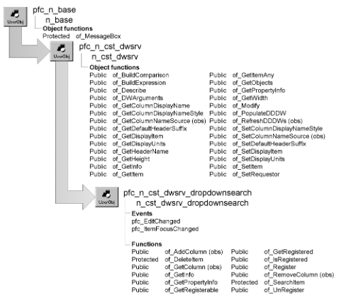

# n_cst_dwsrv_dropdownsearch

**Description**

Scrolls a DropDownDataWindow or DropDownListBox automatically, filling in the field as the user types.

**Ancestry**



**Library**

- PFCDWSRV.PBL
- PFEDWSRV.PBL

**Object relationships**

- [n_cst_infoattrib](../05-global-structures-and-structure-objects/n_cst_infoattrib.md)
- [n_cst_propertyattrib](../05-global-structures-and-structure-objects/n_cst_propertyattrib.md)

**Usage**

Use this object to add code to u_dw that provides automatic scrolling in DropDownDataWindows.

To use this service:

1. Enable the service by calling the u_dw of_SetDropDownSearch function.

   ```
   dw_emp.of_SetDropDownSearch(TRUE)
   ```

2. Specify the DropDownDataWindow column for which the service is enabled:

   ```
   dw_emp.inv_dropdownsearch.of_Register("dept_id")
   ```

3. In the DataWindow control’s EditChanged event, add a call to the n_cst_dwsrv_dropdownsearch pfc_EditChanged event:

   ```
   inv_dropdownsearch.Event pfc_EditChanged &
   (row, dwo, data)
   ```

4. In the DataWindow control’s ItemFocusChanged event, add a call to the n_cst_dwsrv_dropdownsearch pfc_ItemFocusChanged event:

   ```
   inv_dropdownsearch.Event pfc_ItemFocusChanged &
   (row, dwo)
   ```

**PFC 7 custom class extension** To further the extendibility of PFC, the n_cst_dwsrv_dropdownsearchattrib custom class user object replaces the os_columns object structure that is now obsolete.

**See also**

- [n_cst_dwsrv](n_cst_dwsrv.md)
- [u_ddlb](../06-standard-visual-user-objects/u_ddlb.md)
- [u_ddplb](../06-standard-visual-user-objects/u_ddplb.md)
- [u_dw](../06-standard-visual-user-objects/u_dw.md)

## Instance variables

N_cst_dwsrv_dropdownsearch includes instance variables:

| Instance variable | Description | Data type | Access | Usage |
| --- | --- | --- | --- | --- |
| ib_performsearch | Indicates whether the current column is a dropdown DataWindow | Boolean | Protected | Internal |
| ii_currentindex | Current index value | Integer | Protected | Internal |
| inv_columns [ ] | Column and text information for dropdown DataWindows | n_cst_dwsrv _dropdowns earchattrib | Protected | Internal |
| is_textprev | Previously typed text | String | Protected | Internal |

## Events

N_cst_dwsrv_dropdownsearch includes precoded events:

- pfc_EditChanged
- pfc_ItemFocusChanged

### pfc_EditChanged

**Description**

Scrolls the column to the first row that matches the typed characters.

**Syntax**

```
dwcontrol.instancename.EVENT pfc_EditChanged ( row, dwobject, data )
```

| Argument | Description |
| --- | --- |
| *dwcontrol* | Instance name of the u_dw-based DataWindow control |
| *instancename* | Instance name of n_cst_dwsrv_dropdownsearch (the u_dw default is inv_dropdownsearch) |
| *row* | Long containing the number of the row for the item whose value has been changed. From within the pfc_EditChanged event, access this value through the *al_row* argument (passed by reference) |
| *dwobject* | DWObject containing a reference to the column for the item whose value has been changed. *Dwobject* is a reference to the column object, not the name of the column. From within the pfc_EditChanged event, access this value through the *adwo_obj* argument (passed by reference) |
| *data* | String containing the new data the user has specified for the item. From within the pfc_EditChanged event, access this value through the *as_data* argument (passed by reference) |

**Usage**

Add code to the DataWindow’s EditChanged event to call this event.

**Examples**

This example calls the pfc_EditChanged event from the DataWindow’s EditChanged event:

```
inv_dropdownsearch.Event pfc_EditChanged &
   (row, dwo, data)
```

### pfc_ItemFocusChanged

**Description**

Initializes fields in the istr_columns structure array.

**Syntax**

```
dwcontrol.instancename.EVENT pfc_ItemFocusChanged ( row, dwobject )
```

| Argument | Description |
| --- | --- |
| *dwcontrol* | Instance name of the u_dw-based DataWindow control |
| *instancename* | Instance name of n_cst_dwsrv_dropdownsearch (the u_dw default is inv_dropdownsearch) |
| *row* | Long containing the number of the row. From within the pfc_ItemFocusChanged event, access this value through the *al_row* argument |
| *dwobject* | DWObject containing a reference to the column containing the item whose value has been changed. *Dwobject* is a reference to the column object, not the name of the column. From within the pfc_ItemFocusChanged event, access this value through the *adwo_object* argument (passed by reference) |

**Usage**

This event executes when item focus changes. You must add code to the DataWindow’s ItemFocusChanged event to call this event.

**Examples**

This example calls the pfc_ItemFocusChanged event from the DataWindow’s ItemFocusChanged event:

```
inv_dropdownsearch.Event pfc_ItemFocusChanged &
   (row, dwo)
```

## Functions

N_cst_dwsrv_dropdownseach contains precoded object functions:

- of_AddColumn
- of_DeleteItem
- of_GetColumn
- of_GetInfo
- of_GetPropertyInfo
- of_GetRegisterable
- of_GetRegistered
- of_IsRegistered
- of_Register
- of_RemoveColumn
- of_SearchItem
- of_UnRegister

### of_AddColumn

**Description**

Obsolete. Call of_Register instead.

**Access**

Public

**Syntax**

```
dwcontrol.instancename.of_AddColumn ( { column } )
```

| Argument | Description |
| --- | --- |
| *dwcontrol* | Instance name of the u_dw-based DataWindow control |
| *instancename* | Instance name of n_cst_dwsrv_dropdownsearch (the u_dw default is inv_dropdownsearch) |
| *column* (optional) | String specifying the dropdown DataWindow column to add to the istr_columns array. This column should be a dropdown DataWindow and contain string data. If you do not specify this argument, the function adds all dropdown DataWindows to the istr_columns array |

**Return value**

Integer. Returns the number of dropdown DataWindow columns added if the function succeeds, 0 if the column was not added, and -1 if an error occurs.

### of_DeleteItem

**Description**

Removes an item from the istr_columns array and then compresses the array.

**Access**

Protected

**Syntax**

```
dwcontrol.instancename.of_DeleteItem ( index )
```

| Argument | Description |
| --- | --- |
| *dwcontrol* | Instance name of the u_dw-based DataWindow control |
| *instancename* | Instance name of n_cst_dwsrv_dropdownsearch (the u_dw default is inv_dropdownsearch) |
| *index* | Integer indicating which element of the istr_columns array to remove |

**Return value**

Integer. Returns 1 if the function succeeds and -1 if an error occurs.

**Usage**

Internal.

**Examples**

This example calls the of_DeleteItem function:

```
...
of_DeleteItem(li_index)
...
```

### of_GetColumn

**Description**

Obsolete. Call of_GetRegistered instead.

**Access**

Public

**Syntax**

```
dwcontrol.instancename.of_GetColumn ( columns )
```

| Argument | Description |
| --- | --- |
| *dwcontrol* | Instance name of the u_dw-based DataWindow control |
| *instancename* | Instance name of n_cst_dwsrv_dropdownsearch (the u_dw default is inv_dropdownsearch) |
| *columns* | String array into which the function places the dropdown DataWindow column names (passed by reference) |

**Return value**

Integer. Returns the number of elements in the *columns* array.

### of_GetInfo

**Description**

Retrieves dropdown search service information.

**Access**

Public

**Syntax**

```
dwcontrol.instancename.of_GetInfo ( infoobject )
```

| Argument | Description |
| --- | --- |
| *dwcontrol* | Instance name of the u_dw-based DataWindow control |
| *instancename* | Instance name of n_cst_dwsrv_dropdownsearch (the u_dw default is inv_dropdownsearch) |
| *infoobject* | n_cst_infoattrib instance into which the function places service information (passed by reference) |

**Return value**

Integer. Returns 1 if the function succeeds and -1 if an error occurs.

**Usage**

The DataWindow properties window calls this function to access service information.

**Examples**

This example calls the of_GetInfo function:

```
n_cst_infoattrib  lnv_info

dw_1.inv_dropdownsearch.of_GetInfo(lnv_info)
MessageBox("Info",  &
  "Description: " + lnv_info.is_description  &
    + ". Name: " + lnv_info.is_name)
```

### of_GetPropertyInfo

**Description**

Retrieves information about the dropdown search service’s properties.

**Access**

Public

**Syntax**

```
dwcontrol.instancename.of_GetPropertyInfo ( propertyobject )
```

| Argument | Description |
| --- | --- |
| *dwcontrol* | Instance name of the u_dw-based DataWindow control |
| *instancename* | Instance name of n_cst_dwsrv_dropdownsearch (the u_dw default is inv_dropdownsearch) |
| *propertyobject* | n_cst_propertyattrib instance into which the function places property information (passed by reference) |

**Return value**

Integer. Returns 1 if the function succeeds and -1 if an error occurs.

**Usage**

The DataWindow properties window calls this function to access service information:

**Examples**

This example calls the of_GetPropertyInfo function:

```
n_cst_propertyattrib  lnv_prop

dw_1.inv_dropdownsearch.of_GetPropertyInfo(lnv_prop)
MessageBox("Info",  &
  "Description: " + lnv_prop.is_description  &
    + ". Name: " + lnv_prop.is_name  &
      + ". Property tab text: " +  &
        lnv_prop.is_propertytabtext)
```

### of_GetRegisterable

**Description**

Retrieves an array of registerable columns.

**Access**

Public

**Syntax**

```
dwcontrol.instancename.of_GetRegisterable ( columns )
```

| Argument | Description |
| --- | --- |
| *dwcontrol* | Instance name of the u_dw-based DataWindow control |
| *instancename* | Instance name of n_cst_dwsrv_dropdownsearch (the u_dw default is inv_dropdownsearch) |
| *columns* | String array into which the function places a list of registerable columns (passed by reference) |

**Return value**

Integer. Returns the number of entries in the *columns* array.

**Usage**

A registerable column has the DropDownDataWindow or DropDownListBox edit style and has a display value of type Char.

**Examples**

This example calls the of_GetRegisterable function:

```
String   ls_columns[ ]
Integer  li_count, li_loop
li_loop =  &
   dw_1.inv_dropdownsearch.of_GetRegisterable  &
     (ls_columns)
lb_1.Reset()
IF li_loop <> 0 THEN
  FOR li_count = 1 to li_loop
    lb_1.AddItem(ls_columns[li_count])
  NEXT
ELSE
  lb_1.AddItem("No Registerable columns")
END IF
```

### of_GetRegistered

**Description**

Retrieves an array of registered columns.

**Access**

Public

**Syntax**

```
dwcontrol.instancename.of_GetRegistered ( columns )
```

| Argument | Description |
| --- | --- |
| *dwcontrol* | Instance name of the u_dw-based DataWindow control |
| *instancename* | Instance name of n_cst_dwsrv_dropdownsearch (the u_dw default is inv_dropdownsearch) |
| *columns* | String array into which the function places a list of registered columns (passed by reference) |

**Return value**

Integer. Returns the number of entries in the *columns* array.

**Examples**

This example calls the of_GetRegistered function:

```
String   ls_columns[ ]
Integer  li_count, li_loop

li_loop =  &
   dw_1.inv_dropdownsearch.of_GetRegistered  &
     (ls_columns)
lb_1.Reset()
IF li_loop <> 0 THEN
  FOR li_count = 1 to li_loop
    lb_1.AddItem(ls_columns[li_count])
  NEXT
ELSE
  lb_1.AddItem("No Registered columns")
END IF
```

### of_IsRegistered

**Description**

Reports whether a column is registered.

**Access**

Public

**Syntax**

```
dwcontrol.instancename.of_IsRegistered ( column )
```

| Argument | Description |
| --- | --- |
| *dwcontrol* | Instance name of the u_dw-based DataWindow control |
| *instancename* | Instance name of n_cst_dwsrv_dropdownsearch (the u_dw default is inv_dropdownsearch) |
| *column* | String specifying the column to be checked |

**Return value**

Boolean. Returns TRUE if *column* is registered and FALSE if it is not.

**Examples**

This example calls the of_IsRegistered function:

```
IF NOT dw_1.inv_dropdownsearch.of_IsRegistered  &
  ("dept_id") THEN
    dw_1.inv_dropdownsearch.of_Register("dept_id")
END IF
```

### of_Register

**Description**

Registers one or all DropDownDataWindow and DropDownListBox columns with the dropdown search service.

**Access**

Public

**Syntax**

```
dwcontrol.instancename.of_Register ( { column } )
```

| Argument | Description |
| --- | --- |
| *dwcontrol* | Instance name of the u_dw-based DataWindow control |
| *instancename* | Instance name of n_cst_dwsrv_dropdownsearch (the u_dw default is inv_dropdownsearch) |
| *column* (optional) | String specifying the column to be registered. If you omit this argument, the function registers all eligible columns |

**Return value**

Integer. Returns the number of columns registered if the function succeeds and -1 if an error occurs.

**Usage**

A registerable column has the DropDownDataWindow or DropDownListBox edit style and has a display value of type Char.

**Examples**

This example calls the of_Register function:

```
IF NOT dw_1.inv_dropdownsearch.of_IsRegistered  &
  ("dept_id") THEN
    dw_1.inv_dropdownsearch.of_Register("dept_id")
END IF
```

### of_RemoveColumn

**Description**

Obsolete. Call of_UnRegister instead.

**Access**

Public

**Syntax**

```
dwcontrol.instancename.of_RemoveColumn ( column )
```

| Argument | Description |
| --- | --- |
| *dwcontrol* | Instance name of the u_dw-based DataWindow control |
| *instancename* | Instance name of n_cst_dwsrv_dropdownsearch (the u_dw default is inv_dropdownsearch) |
| *column* | String specifying the dropdown DataWindow column to remove from the istr_columns array |

**Return value**

Integer. Returns the number of columns in the istr_columns array if the function succeeds, 0 if *column* is not found, and -1 if an error occurs.

### of_SearchItem

**Description**

Searches the istr_columns array for the specified column name.

**Access**

Protected

**Syntax**

```
dwcontrol.instancename.of_SearchItem ( column )
```

| Argument | Description |
| --- | --- |
| *dwcontrol* | Instance name of the u_dw-based DataWindow control |
| *instancename* | Instance name of n_cst_dwsrv_dropdownsearch (the u_dw default is inv_dropdownsearch) |
| *column* | String specifying the column to be searched for |

**Return value**

Integer. Returns the istr_columns array element containing *column*, 0 if *column* is not in istr_columns, and -1 if an error occurs.

**Usage**

Internal.

**Examples**

This example is from the pfc_ItemFocusChanged event:

```
...
li_index = of_SearchItem(ls_dwcolname)
...
```

### of_UnRegister

**Description**

Removes one or all columns from the list of registered columns.

**Access**

Public

**Syntax**

```
dwcontrol.instancename.of_UnRegister ( { column } )
```

| Argument | Description |
| --- | --- |
| *dwcontrol* | Instance name of the u_dw-based DataWindow control |
| *instancename* | Instance name of n_cst_dwsrv_dropdownsearch (the u_dw default is inv_dropdownsearch) |
| *column* (optional) | String specifying the name of the column to unregister |

**Return value**

Integer. Returns 1 if the function succeeds, 0 if *column* is not registered, and -1 if an error occurs.

**Examples**

This example calls the of_UnRegister function:

```
dw_1.inv_dropdownsearch.of_UnRegister("dept_id")
```
