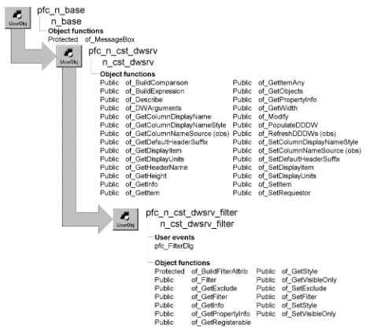

# n_cst_dwsrv_filter

**Description**

Filter service. Provides functions that make it easy for you to add DataWindow filter functionality to an application. This service allows you to choose among three styles of filter dialog boxes.

**Ancestry**



**Library**

- PFCDWSRV.PBL
- PFEDWSRV.PBL

**Object relationships**

- [n_cst_filterattrib](../05-global-structures-and-structure-objects/n_cst_filterattrib.md)
- [n_cst_infoattrib](../05-global-structures-and-structure-objects/n_cst_infoattrib.md)
- [n_cst_propertyattrib](../05-global-structures-and-structure-objects/n_cst_propertyattrib.md)
- [n_cst_returnattrib](../05-global-structures-and-structure-objects/n_cst_returnattrib.md)
- w_filterextended
- w_filtersimple

**Usage**

Use this service to add filter capabilities to your DataWindow. For example, you might add a menu items that calls the u_dw pfc_FilterDlg event.

To use this service:

1. Enable the service using the u_dw of_SetFilter function:

   ```
   dw_emp.of_SetFilter(TRUE)
   ```

2. (Optional) Specify whether filter dialog boxes should display database column names, DataWindow column names, or column header names, by calling the n_cst_dwsrv of_SetColumnDisplayNameStyle function:

   ```
   dw_emp.inv_filter.of_SetColumnDisplayNameStyle(2)
   ```

3. (Optional) Specify the filter dialog box style by calling the of_SetStyle function:

   ```
   dw_emp.inv_filter.of_SetStyle  &
      (dw_emp.inv_filter.EXTENDED)
   ```

4. Call the pfc_FilterDlg event:

   ```
   dw_emp.inv_filter.Event pfc_FilterDlg()
   ```

This displays the filter dialog box.

**See also**

- [n_cst_dwsrv_sort](n_cst_dwsrv_sort.md)
- [u_dw](../06-standard-visual-user-objects/u_dw.md)

## Instance variables

N_cst_dwsrv_filter includes instance variables:

| Instance variable | Description | Data type | Access | Usage |
| --- | --- | --- | --- | --- |
| EXTENDED | Constant set to 1 | Integer | Public | Use with of_SetStyle to specify filter dialog box style |
| ib_visibleonly | Controls whether Filter dialog boxes display nonvisible columns | Boolean | Protected | Internal |
| ii_style | Tracks filter style | Integer | Protected | Internal |
| is_excludecolumns[ ] | Tracks excluded columns | String | Protected | Internal |
| is_filterin | Filter the user specified | String | Protected | Internal |
| is_filterout | DataWindow filter | String | Protected | Internal |
| SIMPLE | Constant set to 2 | Integer | Public | Use with of_SetStyle to specify filter dialog box style |

## Events

N_cst_dwsrv_filter contains a precoded user event:

pfc_FilterDlg

### pfc_FilterDlg

**Description**

Displays the filter dialog box and filters the DataWindow.

**Return value**

Integer. Returns 1 if the function succeeds, 0 if the user canceled out of the dialog box, and -1 if an error occurs.

**Usage**

This event is called when the user selects View>Filter from the menu bar of a menu that descends from PFC’s m_master menu.

## Functions

N_cst_dwsrv_filter contains precoded object functions:

- of_BuildFilterAttrib
- of_Filter
- of_GetExclude
- of_GetFilter
- of_GetInfo
- of_GetPropertyInfo
- of_GetRegisterable
- of_GetStyle
- of_GetVisibleOnly
- of_SetExclude
- of_SetFilter
- of_SetStyle
- of_SetVisibleOnly

### of_BuildFilterAttrib

**Description**

Prepares the filter information required by the filter dialog boxes.

**Access**

Protected

**Syntax**

```
dwcontrol.instancename.of_BuildFilterAttrib ( filterattrib )
```

| Argument | Description |
| --- | --- |
| *dwcontrol* | Instance name of the u_dw-based DataWindow control |
| *instancename* | Instance name of n_cst_dwsrv_filter (the u_dw default is inv_filter) |
| *filterattrib* | N_cst_filterattrib instance into which the function places filter information |

**Return value**

Integer. Returns 1 if the function succeeds and -1 if an error occurs.

**Usage**

Internal.

**Examples**

This example calls the of_BuildFilterAttrib function:

```
...
IF of_BuildFilterAttrib(lnv_filterattrib) <> 1 THEN
   Return -1
END IF
...
```

### of_Filter

**Description**

Filters a DataWindow and calls the u_dw pfc_RowChanged event to indicate that the current row may have changed.

**Access**

Public

**Syntax**

```
dwcontrol.instancename.of_Filter ( )
```

| Argument | Description |
| --- | --- |
| *dwcontrol* | Instance name of the u_dw-based DataWindow control |
| *instancename* | Instance name of n_cst_dwsrv_filter (the u_dw default is inv_filter) |

**Return value**

Integer. Returns 1 if the function succeeds and -1 if an error occurs.

**Usage**

Call this function after calling the of_SetFilter function to filter a DataWindow.

**Examples**

This example calls the of_Filter function after calling the of_SetFilter function. Because of_SetFilter is passed a NULL argument, it displays a filter dialog box, as specified in the of_SetStyle function:

```
String    ls_null

SetNull(ls_null)
dw_emplist.inv_filter.of_SetStyle  &
   (dw_emplist.inv_filter.SIMPLE)
dw_emplist.inv_filter.of_SetFilter(ls_null)
dw_emplist.inv_filter.of_Filter( )
```

### of_GetExclude

**Description**

Retrieves the list of excluded columns as set by the of_SetExclude function.

**Access**

Public

**Syntax**

```
dwcontrol.instancename.of_GetExclude ( columns )
```

| Argument | Description |
| --- | --- |
| *dwcontrol* | Instance name of the u_dw-based DataWindow control |
| *instancename* | Instance name of n_cst_dwsrv_filter (the u_dw default is inv_filter) |
| *columns* | String array into which the function places the excluded columns (passed by reference) |

**Return value**

Integer. Returns 1 if the function succeeds and -1 if an error occurs.

**Examples**

This example calls the of_GetExclude function:

```
String    ls_exclude[ ]
String    ls_list
Integer   li_count

dw_emplist.inv_filter.of_GetExclude(ls_exclude)
For li_count = 1 to UpperBound(ls_exclude)
   ls_list = ls_list + ls_exclude[li_count] + ", "
NEXT
MessageBox("Filter Service", &
   "Excluded columns are: " + ls_list)
```

### of_GetFilter

**Description**

Retrieves the current filter.

**Access**

Public

**Syntax**

```
dwcontrol.instancename.of_GetFilter ( )
```

| Argument | Description |
| --- | --- |
| *dwcontrol* | Instance name of the u_dw-based DataWindow control |
| *instancename* | Instance name of n_cst_dwsrv_filter (the u_dw default is inv_filter) |

**Return value**

String. Returns the current filter.

**Examples**

This example calls the of_GetFilter function:

```
String    ls_filter

ls_filter = &
   dw_emplist.inv_filter.of_GetFilter()
MessageBox("Filter Service", "Filter is: " &
   + ls_filter)
```

### of_GetInfo

**Description**

Retrieves filter service information.

**Access**

Public

**Syntax**

```
dwcontrol.instancename.of_GetInfo ( infoobject )
```

| Argument | Description |
| --- | --- |
| *dwcontrol* | Instance name of the u_dw-based DataWindow control |
| *instancename* | Instance name of n_cst_dwsrv_filter (the u_dw default is inv_filter) |
| *infoobject* | N_cst_infoattrib instance into which the function places service information (passed by reference) |

**Return value**

Integer. Returns 1 if the function succeeds and -1 if an error occurs.

**Usage**

The DataWindow properties window calls this function to access service information.

**Examples**

This example calls the of_GetInfo function:

```
n_cst_infoattrib  lnv_info

dw_1.inv_filter.of_GetInfo(lnv_info)
MessageBox("Info",  &
  "Description: " + lnv_info.is_description  &
    + ". Name: " + lnv_info.is_name)
```

### of_GetPropertyInfo

**Description**

Retrieves information about the filter service’s properties.

**Access**

Public

**Syntax**

```
dwcontrol.instancename.of_GetPropertyInfo ( propertyobject )
```

| Argument | Description |
| --- | --- |
| *dwcontrol* | Instance name of the u_dw-based DataWindow control |
| *instancename* | Instance name of n_cst_dwsrv_filter (the u_dw default is inv_filter) |
| *propertyobject* | N_cst_propertyattrib instance into which the function places property information (passed by reference) |

**Return value**

Integer. Returns 1 if the function succeeds and -1 if an error occurs.

**Usage**

The DataWindow properties window calls this function to access service information.

**Examples**

This example calls the of_GetPropertyInfo function:

```
n_cst_propertyattrib  lnv_prop

dw_1.inv_filter.of_GetPropertyInfo(lnv_prop)
MessageBox("Info",  &
  "Description: " + lnv_prop.is_description  &
    + ". Name: " + lnv_prop.is_name  &
      + ". Property tab text: " +  &
        lnv_prop.is_propertytabtext)
```

### of_GetRegisterable

**Description**

Retrieves an array of registerable columns.

**Access**

Public

**Syntax**

```
dwcontrol.instancename.of_GetRegisterable ( columns )
```

| Argument | Description |
| --- | --- |
| *dwcontrol* | Instance name of the u_dw-based DataWindow control |
| *instancename* | Instance name of n_cst_dwsrv_filter (the u_dw default is inv_filter) |
| *columns* | String array into which the function places a list of registerable columns (passed by reference) |

**Return value**

Integer. Returns the number of entries in the *columns* array.

**Usage**

You can register all columns, including computed columns.

**Examples**

This example calls the of_GetRegisterable function:

```
String   ls_columns[ ]
Integer  li_count, li_loop
li_loop =  &
   dw_1.inv_filter.of_GetRegisterable  &
     (ls_columns)
lb_1.Reset()
IF li_loop <> 0 THEN
  FOR li_count = 1 to li_loop
    lb_1.AddItem(ls_columns[li_count])
  NEXT
ELSE
  lb_1.AddItem("No Registerable columns")
END IF
```

### of_GetStyle

**Description**

Retrieves the current filter style. The filter style specifies which filter dialog box displays when you call the pfc_FilterDlg event.

**Access**

Public

**Syntax**

```
dwcontrol.instancename.of_GetStyle ( )
```

| Argument | Description |
| --- | --- |
| *dwcontrol* | Instance name of the u_dw-based DataWindow control |
| *instancename* | Instance name of n_cst_dwsrv_filter (the u_dw default is inv_filter) |

**Return value**

Integer. Returns the current filter style:

- 0—PowerBuilder Filter dialog box (default)
- 1—PFC's w_filterextended dialog box
- 2—PFC's w_filtersimple dialog box

**Examples**

This example calls the of_GetStyle function:

```
Integer   li_filter_style
String    ls_filter_style[3] = &
   {"Default", "Wizard", "Simple"}

li_filter_style = &
   dw_emplist.inv_filter.of_GetStyle()
MessageBox("Filter Service", "Filter style is: " &
   + ls_filter_style[li_filter_style + 1] )
```

### of_GetVisibleOnly

**Description**

Reports whether the filter service uses visible columns only or all columns.

**Access**

Public

**Syntax**

```
dwcontrol.instancename.of_GetVisibleOnly ( )
```

| Argument | Description |
| --- | --- |
| *dwcontrol* | Instance name of the u_dw-based DataWindow control |
| *instancename* | Instance name of n_cst_dwsrv_filter (the u_dw default is inv_filter) |

**Return value**

Boolean. Returns TRUE if the filter service uses visible columns only and FALSE if it uses all columns.

**Examples**

This example calls the of_GetVisibleOnly function:

```
IF dw_emplist.inv_filter.of_GetVisibleOnly() THEN
   gnv_app.of_GetFrame().SetMicroHelp &
   ("Visible columns only")
ELSE
   gnv_app.of_GetFrame().SetMicroHelp &
   ("All columns used for filter")
END IF
```

### of_SetExclude

**Description**

Establishes a list of columns to be excluded from Filter dialog boxes.

**Access**

Public

**Syntax**

```
dwcontrol.instancename.of_SetExclude ( excludecols )
```

| Argument | Description |
| --- | --- |
| *dwcontrol* | Instance name of the u_dw-based DataWindow control |
| *instancename* | Instance name of n_cst_dwsrv_filter (the u_dw default is inv_filter) |
| *excludecols* | String array specifying columns to be excluded from filter dialog boxes |

**Return value**

Integer. Returns 1 if the function succeeds and -1 if an error occurs.

**Examples**

This example calls the of_SetExclude function:

```
String    ls_exclude[ ]

ls_exclude[1] = "dept_id"
dw_emplist.inv_filter.of_SetExclude(ls_exclude)
```

### of_SetFilter

**Description**

Specifies a DataWindow filter or displays a Filter dialog box.

**Access**

Public

**Syntax**

```
dwcontrol.instancename.of_SetFilter ( filter )
```

| Argument | Description |
| --- | --- |
| *dwcontrol* | Instance name of the u_dw-based DataWindow control |
| *instancename* | Instance name of n_cst_dwsrv_filter (the u_dw default is inv_filter) |
| *filter* | String containing the filter expression. If this argument is NULL, the function displays a filter dialog box to obtain the filter expression |

**Return value**

Integer. Returns 1 if the function succeeds and -1 if an error occurs.

**Usage**

You control the type of filter dialog box in the of_SetStyle function.

**Examples**

This example calls the of_SetFilter function:

```
String    ls_null
Integer   li_return

SetNull(ls_null)
dw_emplist.inv_filter.of_SetStyle(1)
li_return = &
   dw_emplist.inv_filter.of_SetFilter(ls_null)
gnv_app.of_GetFrame().SetMicroHelp &
   ("Return code = " + String(li_return))
dw_emplist.inv_filter.of_Filter( )
```

### of_SetStyle

**Description**

Specifies the filter dialog box type:

Default PowerBuilder Filter dialog box PFC’s w_filterextended dialog box PFC’s w_filtersimple dialog box

**Access**

Public

**Syntax**

```
dwcontrol.instancename.of_SetStyle ( filterstyle )
```

| Argument | Description |
| --- | --- |
| *dwcontrol* | Instance name of the u_dw-based DataWindow control |
| *instancename* | Instance name of n_cst_dwsrv_filter (the u_dw default is inv_filter) |
| *filterstyle* | Integer or n_cst_dwsrv_filter constant specifying the filter style: |
|  | **• 0 or DEFAULT** PowerBuilder Filter dialog box (default) |
|  | **• 1 or EXTENDED** The w_filterextended dialog box |
|  | **• 2 or SIMPLE** The w_filtersimple dialog box |

**Return value**

Integer. Returns 1 if the function succeeds and -1 if an error occurs.

**Usage**

Call this function to specify a filter style before calling the of_SetFilter and of_Filter functions or the pfc_FilterDlg event.

**Examples**

This example calls the of_SetStyle function to enable display of the w_filterextended dialog box:

```
String    ls_null
Integer   li_return

SetNull(ls_null)
dw_emplist.inv_filter.of_SetStyle  &
  (dw_emplist.inv_filter.EXTENDED)
li_return =
dw_emplist.inv_filter.of_SetFilter(ls_null)
gnv_app.of_GetFrame().SetMicroHelp("Return code = " &
   + String(li_return))
dw_emplist.inv_filter.of_Filter( )
```

### of_SetVisibleOnly

**Description**

Controls whether filter dialog boxes display all columns or visible columns only.

**Access**

Public

**Syntax**

```
dwcontrol.instancename.of_SetVisibleOnly ( boolean )
```

| Argument | Description |
| --- | --- |
| *dwcontrol* | Instance name of the u_dw-based DataWindow control |
| *instancename* | Instance name of n_cst_dwsrv_filter (the u_dw default is inv_filter) |
| *boolean* | Boolean indicating whether filter dialog boxes display visible columns only (TRUE) or all columns (FALSE) |

**Return value**

Integer. Returns 1 if the function succeeds and -1 if an error occurs.

**Examples**

This example calls the of_SetVisibleOnly function:

```
dw_emplist.inv_filter.of_SetVisibleOnly(TRUE)
```
