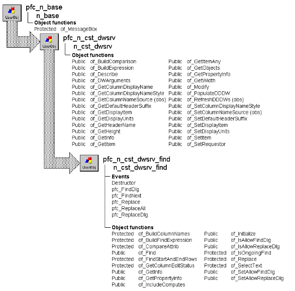

# n_cst_dwsrv_find

**Description**

Find and replace service. Provides functions and events that make it easy for you to add find and replace functionality to your application’s DataWindows.

**Ancestry**



**Library**

- PFCDWSRV.PBL
- PFEDWSRV.PBL

**Object relationships**

- [n_cst_infoattrib](../05-global-structures-and-structure-objects/n_cst_infoattrib.md)
- [n_cst_propertyattrib](../05-global-structures-and-structure-objects/n_cst_propertyattrib.md)

**Usage**

Use this object to add find and replace capabilities to DataWindows.

To use this service:

1. Enable the service using the u_dw of_SetFind function:

   ```
   dw_emp.of_SetFind(TRUE)
   ```

When users select Edit>Find or Edit>Replace from the menu bar of a menu that descends from the m_master menu, the service displays the w_find or w_replace dialog box. You can also display these dialog boxes programmatically, as explained in the next step.

2. Display the w_find dialog box by calling the u_dw pfc_FindDlg event; display the w_replace dialog box by calling the u_dw pfc_ReplaceDlg event. This example displays the w_find dialog box:

   ```
   dw_emp.Event pfc_FindDlg()
   ```

**See also**

- [n_cst_dwsrv](n_cst_dwsrv.md)
- [n_cst_rtefind](n_cst_rtefind.md)
- [u_dw](../06-standard-visual-user-objects/u_dw.md)

## Instance variables

N_cst_dwsrv_find includes instance variables:

| Instance variable | Description | Data type | Access | Usage |
| --- | --- | --- | --- | --- |
| ib_allowfinddlg | Indicates whether the service displays the Find dialog | Boolean | Protected | Use of_SetAllowFindDlg and of_IsAllowFindDlg to access |
| ib_allowreplacedlg | Indicates whether the service displays the Replace dialog | Boolean | Protected | Use of_SetAllowReplaceDlg and of_IsAllowReplaceDlg to access |
| ib_includecomputes | Indicates whether a find operation includes computed fields | Boolean | Protected | Use of_IncludeComputes to access |
| ib_ongoingfind | Indicates whether a find operation is in progress | Boolean | Protected | Internal |
| ib_replaced | Indicates whether a replace succeeded | Boolean | Protected | Internal |
| il_lastfindrow | Tracks the number of the last row found | Long | Protected | Internal |
| inv_findattrib | Structure object containing find and replace information | n_cst_findattrib | Protected | Internal |
| is_findexpression | Contains the string that is passed to the Find function | String | Protected | Internal |
| is_lastfindcolumn | Tracks the name of the last column found | String | Protected | Internal |

## Events

N_cst_dwsrv_find includes precoded events:

- Destructor
- pfc_FindDlg
- pfc_FindNext
- pfc_Replace
- pfc_ReplaceAll
- pfc_ReplaceDlg

### Destructor

**Description**

Perform cleanup.

**Syntax**

```
instancename.EVENT Destructor ( )
```

| Argument | Description |
| --- | --- |
| *instancename* | Instance name of n_cst_dwsrv_find |

**Return value**

None.

### pfc_FindDlg

**Description**

Displays the w_find dialog box.

**Usage**

This event is called when the DataWindow has focus and the user selects Edit>Find from a menu that descends from the PFC m_master menu. To include computed fields in a search, call of_IncludeComputes (true) before this event is triggered.

### pfc_FindNext

**Description**

Continues a search or finds the next occurrence.

**Syntax**

```
instancename.EVENT pfc_FindNext ( findattrib )
```

| Argument | Description |
| --- | --- |
| *instancename* | Instance name of n_cst_dwsrv_find |
| *findattrib* | n_cst_findattrib instance containing find information. From within the pfc_FindNext event, access this value through the *anv_findattrib* argument |

**Return value**

Integer. Returns the number of the next matching row. This event returns 0 if no matching text is found and -1 if an error occurs.

**Usage**

This event is called by the w_find and w_replace dialog boxes to continue a search for a previously specified string.

### pfc_Replace

**Description**

Replaces text as specified in the w_replace dialog box.

**Syntax**

```
instancename.Event pfc_Replace ( findattrib )
```

| Argument | Description |
| --- | --- |
| *instancename* | Instance name of n_cst_dwsrv_find |
| *findattrib* | n_cst_findattrib instance containing find information. From within the pfc_Replace event, access this value through the *anv_findattrib* argument |

**Return value**

Integer. Returns 1 if the event succeeds and -1 if an error occurs.

**Usage**

The w_replace dialog box calls this event when the user clicks Replace.

### pfc_ReplaceAll

**Description**

Calls the pfc_Replace event to replace all occurrences of the search string with the target string.

**Syntax**

```
instancename.Event pfc_ReplaceAll ( findattrib )
```

| Argument | Description |
| --- | --- |
| *instancename* | Instance name of n_cst_dwsrv_find |
| *findattrib* | n_cst_findattrib instance containing find information. From within the pfc_ReplaceAll event, access this value through the *anv_findattrib* argument |

**Return value**

Integer. Returns 1 if the event succeeds and -1 if an error occurs.

**Usage**

The w_replace dialog box calls this event when the user clicks Replace All.

### pfc_ReplaceDlg

**Description**

Displays the w_replace dialog box.

**Usage**

This event is called when the DataWindow has focus and the user selects Edit>Replace from a menu that descends from the PFC m_master menu.

## Functions

N_cst_dwsrv_find includes precoded object functions:

- of_BuildColumnNames
- of_BuildFindExpression
- of_CompareAttrib
- of_Find
- of_FindStartAndEndRows
- of_GetColumnEditStatus
- of_GetInfo
- of_GetPropertyInfo
- of_IncludeComputes
- of_Initialize
- of_IsAllowFindDlg
- of_IsAllowReplaceDlg
- of_IsOngoingFind
- of_Replace
- of_SelectText
- of_SetAllowFindDlg
- of_SetAllowReplaceDlg

### of_BuildColumnNames

**Description**

Populates the inv_findattrib.is_lookdata and is_lookdisplay array elements with the columns to display in the w_find and w_replace dialog boxes.

**Access**

Protected

**Syntax**

```
dwcontrol.instancename.of_BuildColumnNames ( replacelist )
```

| Argument | Description |
| --- | --- |
| *dwcontrol* | Instance name of the u_dw-based DataWindow control |
| *instancename* | Instance name of n_cst_dwsrv_find (the u_dw default is inv_find) |
| *replacelist* | Boolean indicating whether to replace the list of columns flag |

**Return value**

Integer. Returns 1 if the function succeeds and -1 if an error occurs.

**Usage**

Internal.

**Examples**

This example is from the pfc_FindDlg event:

```
...
of_BuildColumnNames(FALSE)

//Open the Find dialog.
OpenWithParm(w_find, inv_findattrib)
...
```

### of_BuildFindExpression

**Description**

Builds the string that is passed to the PowerScript Find function.

**Access**

Protected

**Syntax**

```
dwcontrol.instancename.of_BuildFindExpression ( find, column )
```

| Argument | Description |
| --- | --- |
| *dwcontrol* | Instance name of the u_dw-based DataWindow control |
| *instancename* | Instance name of n_cst_dwsrv_find (the u_dw default is inv_find) |
| *find* | String being searched for |
| *column* | String specifying the column to search in |

**Return value**

String. Returns the expression for use with the Find function if the function succeeds and ! if an error occurs.

**Usage**

Internal.

**Examples**

This example is from the pfc_FindNext event:

```
...
//Build the Find expression.
is_findexpression = &
   of_BuildFindExpression(inv_findattrib.is_find, &
   inv_findattrib.is_lookdata &
      [inv_findattrib.ii_lookindex])
IF is_findexpression = ’!’ THEN Return 0
...
```

### of_CompareAttrib

**Description**

Reports whether the user has made changes to specifications on the w_replace dialog box.

**Access**

Protected

**Syntax**

```
dwcontrol.instancename.of_CompareAttrib ( findattrib )
```

| Argument | Description |
| --- | --- |
| *dwcontrol* | Instance name of the u_dw-based DataWindow control |
| *instancename* | Instance name of n_cst_dwsrv_find (the u_dw default is inv_find) |
| *findattrib* | n_cst_findattrib instance containing find information |

**Return value**

Boolean. Returns TRUE if there are no changes and FALSE if changes were made.

**Usage**

Internal.

**Examples**

This example is from the of_IsOnGoingFind function:

```
...
If IsValid(anv_findattrib) Then
   IF NOT of_CompareAttrib(anv_findattrib) THEN
   Return FALSE
   END IF
END IF
Return True
...
```

### of_Find

**Description**

Searches for a value using the specified column, start row, and end row.

**Access**

Public

**Syntax**

```
dwcontrol.instancename.of_Find ( { column, findstring, startrow, endrow } )
```

| Argument | Description |
| --- | --- |
| *dwcontrol* | Instance name of the u_dw-based DataWindow control |
| *instancename* | Instance name of n_cst_dwsrv_find (the u_dw default is inv_find) |
| *column* (optional) | String specifying the column to be searched |
| *findstring* (optional) | String to be searched for |
| *startrow* (optional) | Long specifying the row at which to start the search |
| *endrow* (optional) | Long specifying the row at which to end the search |

**Return value**

Long. Returns the number of the first row containing *findstring* if the function succeeds, 0 if *findstring* is not found, or -1 if an error occurs.

**Usage**

Call this function to search for a string within a DataWindow. If you call this function with no arguments, PFC uses arguments from the previously specified of_Find function.

**Examples**

This example is from the of_Replace function:

```
...
CASE ’char’
   IF of_Find(as_colname, inv_findattrib.is_find, &
   al_row, al_row) = al_row THEN
      //Get the entire string.
      ls_find = idw_requestor.GetItemString &
         (al_row, as_colname)
   li_find_startpos = &
      Pos(Lower(ls_find), &
         Lower(inv_findattrib.is_find))
...
```

### of_FindStartAndEndRows

**Description**

Determines the start and end row for a find.

**Access**

Protected

**Syntax**

```
dwcontrol.instancename.of_FindStartAndEndRows ( startrow, endrow )
```

| Argument | Description |
| --- | --- |
| *dwcontrol* | Instance name of the u_dw-based DataWindow control |
| *instancename* | Instance name of n_cst_dwsrv_find (the u_dw default is inv_find) |
| *startrow* | Long into which the function places the start row (passed by reference) |
| *endrow* | Long into which the function places the end row (passed by reference) |

**Return value**

Integer. Returns 1 if the function succeeds, 0 if the last row is reached, and -1 if an error occurs.

**Usage**

Internal.

**Examples**

This example is from the of_Find function:

```
...
ls_colname = &
   inv_findattrib.is_lookdata &
   [inv_findattrib.ii_lookindex]

//Determine the start and end rows for the find.
li_rc = of_FindStartAndEndRows &
   (ll_startrow, ll_endrow)
IF li_rc <= 0 THEN
   ib_ongoingfind = FALSE
   Return 0
END IF
...
```

### of_GetColumnEditStatus

**Description**

Determines the edit status (editable, display-only, or protected) of the specified row/column location.

**Access**

Protected

**Syntax**

```
dwcontrol.instancename.of_GetColumnEditStatus ( column, row )
```

| Argument | Description |
| --- | --- |
| *dwcontrol* | Instance name of the u_dw-based DataWindow control |
| *instancename* | Instance name of n_cst_dwsrv_find (the u_dw default is inv_find) |
| *column* | String specifying the column to test |
| *row* | String specifying the row to test |

**Return value**

String. Returns values as follows:

- **Editable** The row/column is editable
- **Displayonly** The row/column is display-only
- **Protected** The row/column is not editable
- **!** An error occurred

**Usage**

Internal.

**Examples**

This example is from the pfc_Replace event:

```
...
//Get the column edit status.
ls_coleditstatus = &
   of_GetColumnEditStatus(ls_colname, ll_currrow)

//Determine if the current row/col can be replaced.
IF ls_coleditstatus = ’editable’ THEN
...
```

### of_GetInfo

**Description**

Retrieves find service information.

**Access**

Public

**Syntax**

```
dwcontrol.instancename.of_GetInfo ( infoobject )
```

| Argument | Description |
| --- | --- |
| *dwcontrol* | Instance name of the u_dw-based DataWindow control |
| *instancename* | Instance name of n_cst_dwsrv_find (the u_dw default is inv_find) |
| *infoobject* | N_cst_infoattrib instance into which the function places service information (passed by reference) |

**Return value**

Integer. Returns 1 if the function succeeds and -1 if an error occurs.

**Usage**

The DataWindow properties window calls this function to access service information.

**Examples**

This example calls the of_GetInfo function:

```
n_cst_infoattrib  lnv_info

dw_1.inv_find.of_GetInfo(lnv_info)
MessageBox("Info",  &
  "Description: " + lnv_info.is_description  &
    + ". Name: " + lnv_info.is_name)
```

### of_GetPropertyInfo

**Description**

Retrieves information about the find service’s properties.

**Access**

Public

**Syntax**

```
dwcontrol.instancename.of_GetPropertyInfo ( propertyobject )
```

| Argument | Description |
| --- | --- |
| *dwcontrol* | Instance name of the u_dw-based DataWindow control |
| *instancename* | Instance name of n_cst_dwsrv_find (the u_dw default is inv_find) |
| *propertyobject* | n_cst_propertyattrib instance into which the function places property information (passed by reference) |

**Return value**

Integer. Returns 1 if the function succeeds and -1 if an error occurs.

**Usage**

The DataWindow properties window calls this function to access service information.

**Examples**

This example calls the of_GetPropertyInfo function:

```
n_cst_propertyattrib  lnv_prop

dw_1.inv_find.of_GetPropertyInfo(lnv_prop)
MessageBox("Info",  &
  "Description: " + lnv_prop.is_description  &
    + ". Name: " + lnv_prop.is_name  &
      + ". Property tab text: " +  &
        lnv_prop.is_propertytabtext)
```

### of_IncludeComputes

**Description**

Determines whether computed fields are included in a search that uses the pfc_FindDlg event.

**Access**

Public

**Syntax**

```
instancename.of_IncludeComputes ( ab_switch )
```

| Argument | Description |
| --- | --- |
| *instancename* | Instance name of n_cst_dwsrv_find |
| *ab_switch* | Boolean. If value is TRUE, computed fields will be included in subsequent searches |

**Return value**

Integer. Returns 1 if the function succeeds and -1 if an error occurs.

**Usage**

Call this function before the pfc_FindDlg event is triggered.

**Examples**

This example calls the of_IncludeComputes function:

```
dw_emp.inv_find.of_IncludeComputes (true)
```

### of_Initialize

**Description**

Initializes the inv_findattrib instance with the passed values.

**Access**

Public

**Syntax**

```
instancename.of_Initialize ( findattrib )
```

| Argument | Description |
| --- | --- |
| *instancename* | Instance name of n_cst_dwsrv_find |
| *findattrib* | n_cst_findattrib instance containing find information |

**Return value**

Integer. Returns 1 if the function succeeds and -1 if an error occurs.

**Usage**

Call this function when the inv_findattrib default values are not appropriate.

**Examples**

This example calls the of_Initialize function:

```
// Display the Find/Replace windows with
// The Direction Control only.
n_cst_findattrib lnv_findattrib

lnv_findattrib.is_find = ’’
lnv_findattrib.is_replacewith = ’’
lnv_findattrib.ib_wholewordvisible =False
lnv_findattrib.ib_wholewordenabled =False
lnv_findattrib.ib_wholeword = False
lnv_findattrib.ib_matchcasevisible = False
lnv_findattrib.ib_matchcaseenabled = False
lnv_findattrib.ib_matchcase = False
lnv_findattrib.ib_directionvisible = True
lnv_findattrib.ib_directionenabled = True
lnv_findattrib.is_direction = ’Down’
lnv_findattrib.ib_lookvisible = False
lnv_findattrib.ib_lookenabled = False
dw_emp.inv_find.of_Initialize(lnv_findattrib)
```

### of_IsAllowFindDlg

**Description**

Reports whether the Find dialog box is allowed.

**Access**

Public

**Syntax**

```
dwcontrol.instancename.of_IsAllowFindDlg ( )
```

| Argument | Description |
| --- | --- |
| *dwcontrol* | Instance name of the u_dw-based DataWindow control |
| *instancename* | Instance name of n_cst_dwsrv_find (the u_dw default is inv_find) |

**Return value**

Boolean. Returns TRUE if the Find dialog box is allowed and FALSE if it is not.

**Examples**

This example calls the of_IsAllowFindDlg function:

```
IF NOT dw_1.inv_find.of_IsAllowFindDlg() THEN
   MessageBox("Find", "Find is not allowed")
ELSE
   MessageBox("Find", "Find is allowed")
END IF
```

### of_IsAllowReplaceDlg

**Description**

Reports whether the Replace dialog box is allowed.

**Access**

Public

**Syntax**

```
dwcontrol.instancename.of_IsAllowReplaceDlg ( )
```

| Argument | Description |
| --- | --- |
| *dwcontrol* | Instance name of the u_dw-based DataWindow control |
| *instancename* | Instance name of n_cst_dwsrv_find (the u_dw default is inv_find) |

**Return value**

Boolean. Returns TRUE if the Replace dialog box is allowed and FALSE if it is not.

**Examples**

This example calls the of_IsAllowReplaceDlg function:

```
IF NOT dw_1.inv_find.of_IsAllowReplaceDlg() THEN
   MessageBox("Replace", "Replace is not allowed")
ELSE
   MessageBox("Replace", "Replace is allowed")
END IF
```

### of_IsOngoingFind

**Description**

Reports whether the current find operation is a new Find or Find Next operation.

**Access**

Protected

**Syntax**

```
dwcontrol.instancename.of_IsOngoingFind ( findattrib )
```

| Argument | Description |
| --- | --- |
| *dwcontrol* | Instance name of the u_dw-based DataWindow control |
| *instancename* | Instance name of n_cst_dwsrv_find |
| *findattrib* | N_cst_findattrib instance containing find information |

**Return value**

Boolean. Returns TRUE if the current find is the same as before and FALSE if it is not.

**Usage**

Internal.

**Examples**

This example is from the pfc_FindNext event:

```
String    ls_findexp
Long      ll_row

IF ib_ongoingfind THEN
//Determine if this continues as an ongoing Find.
   ib_ongoingfind = &
   of_IsOngoingFind(anv_findattrib)
END IF
...
```

### of_Replace

**Description**

Replaces the specified row/column with the specified text.

**Access**

Protected

**Syntax**

```
dwcontrol.instancename.of_Replace ( row, column, replacewith )
```

| Argument | Description |
| --- | --- |
| *dwcontrol* | Instance name of the u_dw-based DataWindow control |
| *instancename* | Instance name of n_cst_dwsrv_find (the u_dw default is inv_find) |
| *row* | Long specifying the row containing the column whose text is to be replaced |
| *column* | String specifying the column whose text is to be replaced |
| *replacewith* | String specifying the new text |

**Return value**

Integer. Returns 1 if the function succeeds, -2 if *replacewith* is not a valid value for *column*, and -1 if an error occurs.

**Usage**

Internal.

**Examples**

This example is from the pfc_Replace event:

```
...
is_findexpression = &
   of_BuildFindExpression &
   (inv_findattrib.is_find, ls_colname)
IF is_findexpression = ’!’ THEN Return 0
IF idw_requestor.GetColumnName() = &
   ls_colname THEN
   // Replace the selected text.
   li_rc = of_Replace(ll_currrow, &
      ls_colname, &
         inv_findattrib.is_replacewith)
...
```

### of_SelectText

**Description**

Selects the appropriate text at the specified row/column location. This function works for all column types, including dropdown DataWindows, dropdown listboxes, and edit masks.

**Access**

Protected

**Syntax**

```
dwcontrol.instancename.of_SelectText ( column, row, matchcase, find )
```

| Argument | Description |
| --- | --- |
| *dwcontrol* | Instance name of the u_dw-based DataWindow control |
| *instancename* | Instance name of n_cst_dwsrv_find (the u_dw default is inv_find) |
| *column* | String specifying the column name |
| *row* | Long specifying the row number |
| *matchcase* | Boolean indicating whether the search is case-sensitive |
| *find* | String specifying the find string |

**Return value**

Integer. Returns 1 if the function succeeds and 0 if text selection is not appropriate.

**Usage**

Internal.

**Examples**

This example is from the of_Find function:

```
...
ls_coleditstatus = &
   of_GetColumnEditStatus(ls_colname, li_rowfound)
IF ls_coleditstatus = &
   ’editable’ OR ls_coleditstatus=’readonly’ THEN
   of_SelectText(ls_colname, li_rowfound, &
      inv_findattrib.ib_matchcase, &
         inv_findattrib.is_find)
END IF
...
```

### of_SetAllowFindDlg

**Description**

Controls whether the Find dialog box is allowed.

**Access**

Public

**Syntax**

```
dwcontrol.instancename.of_SetAllowFindDlg ( boolean )
```

| Argument | Description |
| --- | --- |
| *dwcontrol* | Instance name of the u_dw-based DataWindow control |
| *instancename* | Instance name of n_cst_dwsrv_find (the u_dw default is inv_find) |
| *boolean* | Boolean specifying whether the Find dialog is allowed (TRUE) or not (FALSE) |

**Return value**

Integer. Returns 1 if the function succeeds -1 if an error occurs.

**Examples**

This example calls the of_SetAllowFindDlg function:

```
dw_1.inv_find.of_SetAllowFindDlg(FALSE)
```

### of_SetAllowReplaceDlg

**Description**

Specifies whether the Replace dialog box is allowed.

**Access**

Public

**Syntax**

```
dwcontrol.instancename.of_SetAllowReplaceDlg ( boolean )
```

| Argument | Description |
| --- | --- |
| *dwcontrol* | Instance name of the u_dw-based DataWindow control |
| *instancename* | Instance name of n_cst_dwsrv_find (the u_dw default is inv_find) |
| *boolean* | Boolean specifying whether the Replace dialog is allowed (TRUE) or not (FALSE) |

**Return value**

Integer. Returns 1 if the function succeeds -1 if an error occurs.

**Examples**

This example calls the of_SetAllowReplaceDlg function:

```
dw_1.inv_find.of_SetAllowReplaceDlg(FALSE)
```
