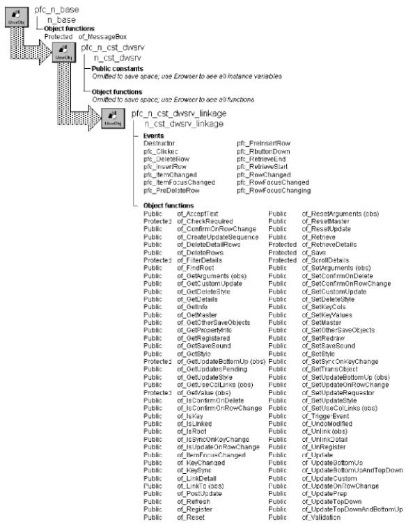

# n_cst_dwsrv_linkage

**Description**

Service for linking DataWindow actions. This is typically used for Master/Detail processing.

N_cst_dwsrv_linkage contains the following features:

**Linkage style** Controls whether detail DataWindows retrieve rows, filter rows, or scroll to the appropriate row

**Update style** Controls how n_cst_dwsrv_linkage updates DataWindows (top-down, bottom-up, top-down then bottom-up, bottom-up then top-down, or a developer-specified custom update)

**Custom update** Allows you to specify a customized update sequence

**Delete style** When you delete a master row, this option specifies whether n_cst_dwsrv_linkage deletes detail rows, discards detail rows, or leaves them alone

**Cascading key changes** N_cst_dwsrv_linkage automatically updates detail DataWindows when you change a key value on the master

**Update on row change** When the master changes rows, this option updates the database with modifications made to detail DataWindows (retrieval style only)

**Confirm on row change** When the master changes rows, this option displays a confirmation dialog box if modifications made to detail DataWindows will be lost (retrieval style only)

**Confirm on delete** Displays a confirmation dialog box when the user deletes rows (retrieval style only)

**Extended update** Allows you to integrate other controls (such as ListViews, TreeViews, and DataStores) into the default save process

N_cst_dwsrv_linkage is completely integrated with n_cst_luw and with the w_master pfc_Save process.

**Ancestry**



**Library**

- PFCDWSRV.PBL
- PFEDWSRV.PBL

**Object relationships**

- [n_cst_infoattrib](../05-global-structures-and-structure-objects/n_cst_infoattrib.md)
- [n_cst_linkageattrib](../05-global-structures-and-structure-objects/n_cst_linkageattrib.md)
- [n_cst_platform](n_cst_platform.md)
- [n_cst_propertyattrib](../05-global-structures-and-structure-objects/n_cst_propertyattrib.md)
- [n_tr](../08-standard-class-user-objects/n_tr.md)

**Usage**

Use this service to coordinate processing between related DataWindows.

You can specify the action taken by a detail DataWindow when row focus changes on the master. When row focus changes on the master DataWindow, the detail can:

Retrieve a new set of rows Set a filter Scroll to a new row

**If you share data, don’t add rows in the detail** You can use the PowerScript ShareData function to share data between master and detail DataWindows. However, do not insert rows into the detail when sharing data,.

To use this service to control Master/Detail processing using columns in the master DataWindow as retrieval arguments for the detail DataWindow:

1. Enable the linkage service for the master DataWindow:

   ```
   dw_master.of_SetLinkage(TRUE)
   ```

2. Enable the linkage service for the detail DataWindow:

   ```
   dw_detail.of_SetLinkage(TRUE)
   ```

3. In the detail DataWindow, link to the Master:

   ```
   dw_detail.inv_linkage.of_SetMaster(dw_master)
   ```

4. Register the related columns:

   ```
   dw_detail.inv_linkage.of_Register &
     ("emp_id", "emp_id")
   ```

5. Establish the action taken in the detail when row focus changes in the master (this example retrieves a new set of rows):

   ```
   dw_detail.inv_linkage.of_SetStyle &
     (dw_detail.inv_linkage.RETRIEVE)
   ```

6. Establish the transaction object for all DataWindows in the linkage chain by calling the linkage service’s of_SetTransObject function for the top-level DataWindow:

   ```
   dw_master.inv_linkage.of_SetTransObject(SQLCA)
   ```

7. Add retrieval logic to the DataWindows’ pfc_Retrieve events (with the retrieval style, you only need to code pfc_Retrieve for the master DataWindow):

   ```
   Return this.Retrieve()
   ```

8. Call the master DataWindow’s of_Retrieve function:

   ```
   IF dw_master.of_Retrieve() = -1 THEN
      MessageBox("Error", "Retrieval error")
   ELSE
      dw_master.SetFocus()
   END IF
   ```

9. Call other linkage service functions as needed.

   **Start from the top** When you want an action to ripple down through the chain of linked DataWindows, call the function in the topmost DataWindow.

**See also**

- [n_cst_luw](n_cst_luw.md)
- [u_dw](../06-standard-visual-user-objects/u_dw.md)
- [w_master](../02-window-objects/w_master.md)

## Instance variables

N_cst_dwsrv_linkage includes instance variables for Internal:

| Instance variable | Description | Data type | Access | Usage |
| --- | --- | --- | --- | --- |
| BOTTOMUP | Constant set to 2 | Integer | Public | Use with of_SetUpdateStyle |
| BOTTOMUP_TOPDOWN | Constant set to 4 | Integer | Public | Use with of_SetUpdateStyle |
| CUSTOM | Constant set to 101 | Integer | Public | Use with of_SetUpdateStyle |
| DELETE_ROWS | Constant set to 1 | Integer | Public | Use with of_SetDeleteStyle |
| DISCARD_ROWS | Constant set to 2 | Integer | Public | Use with of_SetDeleteStyle |
| FAILURE | Constant set to -1 | Integer | Public | Internal |
| FILTER | Constant set to 1 | Integer | Public | Use with of_SetStyle |
| ib_confirmondelete | Indicates whether the user is prompted to confirm deletions | Boolean | Protected | Set with of_SetConfirmOn Delete |
| ib_confirmonrowchange | Indicates whether the user is prompted to confirm modifications | Boolean | Protected | Set with of_SetConfirmOn RowChange |
| ib_retrieving | Indicates whether the DataWindow is retrieving data | Boolean | Protected | Internal |
| ib_synconkeychange | Indicates whether the linkage service cascades key changes to detail DataWindows | Boolean | Protected | Set with of_SetSyncOn KeyChange |
| ib_updatebottomup | Obsolete. Use ii_updatestyle | Boolean | Protected | Obsolete |
| ib_updateonrowchange | Indicates whether the service updates details when the master’s row changes (retrieval style only) | Boolean | Protected | Set with of_SetUpdateOn RowChange |
| idw_details[ ] | Array of all DataWindows that are details to this DataWindow | u_dw | Protected | Internal |
| idw_master | Master to this DataWindow | u_dw | Protected | Internal |
| ii_collinkuse | Indicates how PFC uses column links to refresh data: | Integer | Protected | Internal |
|  | • 1 Filter |  |  |  |
|  | • 2 Retrieve |  |  |  |
|  | • 3 Scroll |  |  |  |
| ii_customupdate | Custom update indicator | Integer | Protected | Set with of_SetCustom Update |
| ii_deletestyle | Delete style indicator | Integer | Protected | Set with of_SetDeleteStyle |
| ii_updatestyle | Indicates how PFC performs updates | Integer | Protected | Internal |
| il_priorrow | Tracks rows | Long | Protected | Internal |
| inv_linkargs | Structure object containing linkage information | n_cst_linkageattrib | Protected | Internal |
| inv_platform | Platform services | n_cst_platform | Protected | Internal |
| ipo_othersaveobjects[ ] | Additional controls to be updated when row focus changes | PowerObject | Protected | Set with of_SetOther SaveObjects |
| is_filterexp | Expression used to filter rows in detail DataWindows. This is used if ii_collinkuse is set to 1 | String | Protected | Internal |
| is_keycols[ ] | Column that controls Master/Detail refresh processing. This is used if ii_collinkuse is set to 2 | String | Protected | Internal |
| is_keycolsvalue[ ] | Saves keys | String | Protected | Internal |
| is_savesound | Sound file to be played for a successful save | String | Protected | Set with of_SetSaveSound |
| RETRIEVE | Constant set to 2 | Integer | Public | Use with of_SetStyle |
| SCROLL | Constant set to 3 | Integer | Public | Use with of_SetStyle |
| TOPDOWN | Constant set to 1 | Integer | Public | Use with of_SetUpdateStyle |
| TOPDOWN_BOTTOMUP | Constant set to 3 | Integer | Public | Use with of_SetUpdateStyle |

## Events

N_cst_dwsrv_linkage contains precoded user events:

- Destructor
- pfc_Clicked
- pfc_DeleteRow
- pfc_InsertRow
- pfc_ItemChanged
- pfc_ItemFocusChanged
- pfc_PreDeleteRow
- pfc_PreInsertRow
- pfc_RButtonDown
- pfc_RetrieveEnd
- pfc_RetrieveStart
- pfc_RowChanged
- pfc_RowFocusChanged
- pfc_RowFocusChanging

### Destructor

**Description**

Destroys the platform service instance (inv_platform instance variable).

**Usage**

This event executes when the service is destroyed.

### pfc_Clicked

**Description**

Determines if focus is going to another row and continues, halts processing, or updates rows as appropriate.

**Syntax**

```
dwcontrol.instancename.EVENT pfc_Clicked ( x, y, row, dwobject )
```

| Argument | Description |
| --- | --- |
| *dwcontrol* | Instance name of the u_dw-based DataWindow control |
| *instancename* | Instance name of n_cst_dwsrv_linkage (the u_dw default is inv_linkage) |
| *x* | Integer indicating the *x* position of the mouse click. From within the pfc_Clicked event, access this value through the *ai_xpos* argument |
| *y* | Integer indicating the *y* position of the mouse click. From within the pfc_Clicked event, access this value through the *ai_ypos* argument |
| *row* | Long indicating the clicked row. From within the pfc_Clicked event, access this value through the *al_row* argument |
| *dwobject* | DWObject variable indicating the clicked object. This argument is passed by reference. From within the pfc_Clicked event, access this value through the *adwo_obj* argument |

**Return value**

Integer. Returns 1 to prevent focus from changing, 0 to continue processing, and -1 if an error occurs.

**Usage**

This event is called by the u_dw Clicked event.

### pfc_DeleteRow

**Description**

Notifies detail DataWindows that a row has been deleted and there is a new current row.

**Syntax**

```
dwcontrol.instancename.EVENT pfc_DeleteRow ( row )
```

| Argument | Description |
| --- | --- |
| *dwcontrol* | Instance name of the u_dw-based DataWindow control |
| *instancename* | Instance name of n_cst_dwsrv_linkage (the u_dw default is inv_linkage) |
| *row* | Long specifying the row that was deleted. From within the pfc_DeleteRow event, access this value through the *al_row* argument |

**Return value**

Integer. Returns 1 if the event succeeds and -1 if an error occurs.

**Usage**

The u_dw pfc_DeleteRow event calls this event.

### pfc_InsertRow

**Description**

Establishes key values for a newly inserted row.

**Syntax**

```
dwcontrol.instancename.Event pfc_InsertRow ( row )
```

| Argument | Description |
| --- | --- |
| *dwcontrol* | Instance name of the u_dw-based DataWindow control |
| *instancename* | Instance name of n_cst_dwsrv_linkage (the u_dw default is inv_linkage) |
| *row* | Long specifying the row that was inserted. From within the pfc_InsertRow event, access this value through the *al_row* argument |

**Return value**

Integer. Returns 1 if the event succeeds and -1 if an error occurs.

**Usage**

The u_dw pfc_InsertRow event calls this event.

### pfc_ItemChanged

**Description**

Synchronizes key values in detail DataWindows (if key synchronization is enabled via the of_SetSyncOnKeyChange function).

**Syntax**

```
dwcontrol.instancename.EVENT pfc_ItemChanged ( row, dwobject, data )
```

| Argument | Description |
| --- | --- |
| *dwcontrol* | Instance name of the u_dw-based DataWindow control |
| *instancename* | Instance name of n_cst_dwsrv_linkage (the u_dw default is inv_linkage) |
| *row* | Long indicating the number of the row in which the ItemChanged event occurred. From within the pfc_ItemChanged event, access this variable through the *al_row* argument |
| *dwobject* | DWObject variable indicating the changed item. From within the pfc_ItemChanged event, access this value through the *adwo_obj* argument |
| *data* | String containing the new data for the item. |

**Return value**

Integer. Returns 1 if the event succeeds and -1 if an error occurs.

**Usage**

The u_dw ItemChanged event calls this event.

### pfc_ItemFocusChanged

**Description**

Calls the of_ItemFocusChanged function.

**Syntax**

```
dwcontrol.instancename.EVENT pfc_ItemFocusChanged ( row, dwobject )
```

| Argument | Description |
| --- | --- |
| *dwcontrol* | Instance name of the u_dw-based DataWindow control |
| *instancename* | Instance name of n_cst_dwsrv_linkage (the u_dw default is inv_linkage) |
| *row* | Long indicating the number of the row in which the ItemFocusChanged event occurred. From within the pfc_ItemFocusChanged event, access this variable through the *al_row* argument |
| *dwobject* | DWObject variable indicating the changed item. From within the pfc_ItemFocusChanged event, access this value through the *adwo_obj* argument |

**Return value**

Integer. Returns 1 if the event succeeds and -1 if an error occurs.

**Usage**

The u_dw ItemFocusChanged event calls this event.

### pfc_PreDeleteRow

**Description**

Provides notification that a row may be deleted and prepares for possible deletion processing.

**Syntax**

```
dwcontrol.instancename.EVENT pfc_PreDeleteRow ( row )
```

| Argument | Description |
| --- | --- |
| *dwcontrol* | Instance name of the u_dw-based DataWindow control |
| *instancename* | Instance name of n_cst_dwsrv_linkage (the u_dw default is inv_linkage) |
| *row* | Long specifying the number of the row to be deleted |

**Return value**

Integer. Returns 1 if the event succeeds, 0 if the delete should be prevented, and -1 if an error occurs.

**Usage**

The u_dw pfc_PreDeleteRow event calls this event.

### pfc_PreInsertRow

**Description**

Prepares for insertion processing.

**Syntax**

```
dwcontrol.instancename.EVENT pfc_PreInsertRow ( )
```

| Argument | Description |
| --- | --- |
| *dwcontrol* | Instance name of the u_dw-based DataWindow control |
| *instancename* | Instance name of n_cst_dwsrv_linkage (the u_dw default is inv_linkage) |

**Return value**

Integer. Returns 1 if the event succeeds, 0 if the insert should be prevented, and -1 if an error occurs.

**Usage**

The u_dw pfc_PreInsertRow event calls this event.

### pfc_RButtonDown

**Description**

Determines if focus is going to another row and updates rows as appropriate.

**Syntax**

```
dwcontrol.instancename.EVENT pfc_RButtonDown ( x, y, row, dwobject )
```

| Argument | Description |
| --- | --- |
| *dwcontrol* | Instance name of the u_dw-based DataWindow control |
| *instancename* | Instance name of n_cst_dwsrv_linkage (the u_dw default is inv_linkage) |
| *x* | Integer indicating the *x* position of the mouse click. From within the pfc_RButtonDown event, access this value through the *ai_xpos* argument |
| *y* | Integer indicating the *y* position of the mouse click. From within the pfc_RButtonDown event, access this value through the *ai_ypos* argument |
| *row* | Long indicating the number of the row in which the RButtonDown event occurred. From within the pfc_RButtonDown event, access this variable through the *al_row* argument |
| *dwobject* | DWObject variable indicating the clicked item. From within the pfc_RButtonDown event, access this value through the *adwo_obj* argument |

**Return value**

Integer. Returns 1 to continue processing, 0 to prevent focus from changing, and -1 if an error occurs.

**Usage**

The u_dw RButtonDown event calls this event.

### pfc_RetrieveEnd

**Description**

Resets the ib_retrieving instance variable.

**Syntax**

```
dwcontrol.instancename.EVENT pfc_RetrieveEnd ( rowcount )
```

| Argument | Description |
| --- | --- |
| *dwcontrol* | Instance name of the u_dw-based DataWindow control |
| *instancename* | Instance name of n_cst_dwsrv_linkage (the u_dw default is inv_linkage) |
| *rowcount* | Long specifying the number of rows retrieved |

**Return value**

Integer. Returns 1 if the event succeeds and -1 if an error occurs.

**Usage**

The u_dw RetrieveEnd event calls this event.

### pfc_RetrieveStart

**Description**

Sets the ib_retrieving instance variable.

**Syntax**

```
dwcontrol.instancename.EVENT pfc_RetrieveStart ( )
```

| Argument | Description |
| --- | --- |
| *dwcontrol* | Instance name of the u_dw-based DataWindow control |
| *instancename* | Instance name of n_cst_dwsrv_linkage (the u_dw default is inv_linkage) |

**Return value**

Integer. Returns 1 if the event succeeds and -1 if an error occurs.

**Usage**

The u_dw RetrieveStart event calls this event.

### pfc_RowChanged

**Description**

Determines whether a row change requires a database update.

**Syntax**

```
dwcontrol.instancename.EVENT pfc_RowChanged ( )
```

| Argument | Description |
| --- | --- |
| *dwcontrol* | Instance name of the u_dw-based DataWindow control |
| *instancename* | Instance name of n_cst_dwsrv_linkage (the u_dw default is inv_linkage) |

**Return value**

Integer. Returns 1 if the event succeeds and -1 if an error occurs.

**Usage**

The u_dw RowChanged event calls this event.

When using the retrieval style and automatic updates, this event could be triggered without the benefit of a RowFocusChanging notification (for example, by a filter or sort action). With the Retrieve Style and ib_updateonrowchange = TRUE there is the possibility of data requiring updates before going to the new row. You should call of_Validation and of_Update to force these actions before performing the filter or sort.

### pfc_RowFocusChanged

**Description**

Notifies each of the detail DataWindows attached to the requester that row focus has changed and that the contents of the new current row require the DataWindows to be refreshed based on values in the requester’s current row.

**Syntax**

```
dwcontrol.instancename.Event pfc_RowFocusChanged (row )
```

| Argument | Description |
| --- | --- |
| *dwcontrol* | Instance name of the u_dw-based DataWindow control |
| *instancename* | Instance name of n_cst_dwsrv_linkage (the u_dw default is inv_linkage) |
| *row* | Long specifying the new row. From within the pfc_RowFocusChanged event, access this value through the *al_row* argument |

**Return value**

Integer. Returns 1 if the event succeeds and -1 if an error occurs.

**Usage**

The u_dw RowFocusChanged event calls this event.

### pfc_RowFocusChanging

**Description**

Updates the DataWindow before row focus changes, if enabled via the of_SetUpdateOnRowChange function.

**Syntax**

```
dwcontrol.instancename.EVENT pfc_RowFocusChanging ( previousrow,
newrow )
```

| Argument | Description |
| --- | --- |
| *dwcontrol* | Instance name of the u_dw-based DataWindow control |
| *instancename* | Instance name of n_cst_dwsrv_linkage (the u_dw default is inv_linkage) |
| *previousrow* | Long specifying the previous row. From within the pfc_RowFocusChanging event, access this value through the *al_prevrow* argument |
| *newrow* | Long specifying the new row. From within the pfc_RowFocusChanging event, access this value through the *al_newrow* argument |

**Return value**

Integer. Returns 1 if the event succeeds, 0 to prevent row focus from changing, and -1 if an error occurs.

**Usage**

The u_dw RowFocusChanging event calls this event.

## Functions

N_cst_dwsrv_linkage includes precoded object functions:

- of_AcceptText
- of_CheckRequired
- of_ConfirmOnRowChange
- of_CreateUpdateSequence
- of_DeleteDetailRows
- of_DeleteRows
- of_FilterDetails
- of_FindRoot
- of_GetArguments
- of_GetCustomUpdate
- of_GetDeleteStyle
- of_GetDetails
- of_GetInfo
- of_GetMaster
- of_GetOtherSaveObjects
- of_GetPropertyInfo
- of_GetRegistered
- of_GetSaveSound
- of_GetStyle
- of_GetUpdateBottomUp
- of_GetUpdatesPending
- of_GetUpdateStyle
- of_GetUseColLinks
- of_GetValue
- of_IsConfirmOnDelete
- of_IsConfirmOnRowChange
- of_IsKey
- of_IsLinked
- of_IsRoot
- of_IsSyncOnKeyChange
- of_IsUpdateOnRowChange
- of_ItemFocusChanged
- of_KeyChanged
- of_KeySync
- of_LinkDetail
- of_LinkTo
- of_PostUpdate
- of_Refresh
- of_Register
- of_Reset
- of_ResetArguments
- of_ResetMaster
- of_ResetUpdate
- of_Retrieve
- of_RetrieveDetails
- of_Save
- of_ScrollDetails
- of_SetArguments
- of_SetConfirmOnDelete
- of_SetConfirmOnRowChange
- of_SetCustomUpdate
- of_SetDeleteStyle
- of_SetKeyCols
- of_SetKeyValues
- of_SetMaster
- of_SetOtherSaveObjects
- of_SetRedraw
- of_SetSaveSound
- of_SetStyle
- of_SetSyncOnKeyChange
- of_SetTransObject
- of_SetUpdateBottomUp
- of_SetUpdateOnRowChange
- of_SetUpdateRequestor
- of_SetUpdateStyle
- of_SetUseColLinks
- of_TriggerEvent
- of_UndoModified
- of_Unlink
- of_UnlinkDetail
- of_UnRegister
- of_Update
- of_UpdateBottomUp
- of_UpdateBottomUpAndTopDown
- of_UpdateCustom
- of_UpdateOnRowChange
- of_UpdatePrep
- of_UpdateTopDown
- of_UpdateTopDownAndBottomUp
- of_Validation

### of_AcceptText

**Description**

Performs an AcceptText function for all DataWindows in the linkage chain, starting with the current DataWindow.

**Access**

Public

**Syntax**

```
dwcontrol.instancename.of_AcceptText ( { focusonerror } )
```

| Argument | Description |
| --- | --- |
| *dwcontrol* | Instance name of the u_dw-based DataWindow control |
| *instancename* | Instance name of n_cst_dwsrv_linkage (the u_dw default is inv_linkage) |
| *focusonerror* (optional) | Boolean indicating whether PFC sets focus to the DataWindow when an error occurs (the default is FALSE) |

**Return value**

Integer. Returns 1 if the function succeeds and -1 if an error occurs.

**Usage**

U_dw calls this function as part of the default save process. This function is part of the self-updating object API.

**Examples**

This example is from the u_dw the of_AcceptText function:

```
...
If IsValid(inv_linkage) Then
   li_rc = inv_linkage.of_AcceptText(ab_focusonerror)
Else
   li_rc = this.Event pfc_AcceptText(ab_focusonerror)
End If
...
```

### of_CheckRequired

**Description**

Determines if any required columns contain NULL values in a specified row.

**Access**

Protected

**Syntax**

```
dwcontrol.instancename.of_CheckRequired ( buffer, row, column, colname,
updateonly )
```

| Argument | Description |
| --- | --- |
| *dwcontrol* | Instance name of the u_dw-based DataWindow control |
| *instancename* | Instance name of n_cst_dwsrv_linkage (the u_dw default is inv_linkage) |
| *buffer* | DWBuffer variable indicating the DataWindow buffer to check for required fields |
| *row* | Long specifying the number of the row to check. This argument also returns the number of the row in error (passed by reference) |
| *column* | Integer specifying the number of the first column to check. This argument also returns the number of the column in error (passed by reference) |
| *colname* | String into which the function places the name of the column in error (passed by reference) |
| *updateonly* | Boolean indicating whether you want to validate all rows and columns or only rows that have been inserted or modified |

**Return value**

Integer. Returns 1 if there were columns with NULL values, 0 if there were no columns with NULL value, and -1 if an error occurs.

**Usage**

Internal.

**Examples**

This example is from the of_Save function:

```
...
ll_checkrow = al_validaterow
   li_checkcolumn = 1
   li_rc = of_CheckRequired &
   (primary!, ll_checkrow, li_checkcolumn,  &
     ls_checkcolname, lb_updateonly)
...
```

### of_ConfirmOnDelete

**Description**

Reports whether the linkage service displays a confirmation dialog box when rows are deleted.

**Access**

Public

**Syntax**

```
dwcontrol.instancename.of_ConfirmOnDelete ( )
```

| Argument | Description |
| --- | --- |
| *dwcontrol* | Instance name of the u_dw-based DataWindow control |
| *instancename* | Instance name of n_cst_dwsrv_linkage (the u_dw default is inv_linkage) |

**Return value**

Boolean. Returns TRUE if confirm on delete is required and FALSE if it is not.

**Usage**

This function is for retrieval style only. You do not typically call it directly.

**Examples**

This example is from the of_Save function:

```
...
If ab_prompt Then
   If of_ConfirmOnDelete() Then
...
```

### of_ConfirmOnRowChange

**Description**

Reports whether the linkage service displays a confirmation dialog box when a row change in a master DataWindow will causes updates to be lost in the detail DataWindow. This is accomplished by examining properties in the current DataWindow and the detail DataWindow.

**Access**

Public

**Syntax**

```
dwcontrol.instancename.of_ConfirmOnRowChange ( )
```

| Argument | Description |
| --- | --- |
| *dwcontrol* | Instance name of the u_dw-based DataWindow control |
| *instancename* | Instance name of n_cst_dwsrv_linkage (the u_dw default is inv_linkage) |

**Return value**

Boolean. Returns TRUE if confirm on row change is required and FALSE if it is not.

**Usage**

This function is for retrieval style only. You do not typically call it directly.

**Examples**

This example is from the of_Save function:

```
...
If ab_prompt Then
   If of_ConfirmOnRowChange() Then
...
```

### of_CreateUpdateSequence

**Description**

Retrieves an array containing the default top-down update sequence.

**Access**

Public

**Syntax**

```
dwcontrol.instancename.of_CreateUpdateSequence ( sequence )
```

| Argument | Description |
| --- | --- |
| *dwcontrol* | Instance name of the u_dw-based DataWindow control |
| *instancename* | Instance name of n_cst_dwsrv_linkage (the u_dw default is inv_linkage) |
| *sequence* | U_dw array into which the function places references to linked DataWindows in the default update sequence (passed by reference) |

**Return value**

Integer. Returns 1 if the function succeeds and -1 if an error occurs.

**Usage**

To determine the top-to-bottom sequence, access the array from the first element to the upper bound. To determine the bottom-up sequence, access the array from the upper bound down to one.

The linkage service uses this function to create a sequence for DataWindow updates.

**Examples**

This example calls the of_CreateUpdateSequence function:

```
Integer   li_i
Integer   li_max
u_dw      ldw_updatedw[ ]

// Create an array of the linked DataWindows
IF of_CreateUpdateSequence &
   (ldw_updatedw) <> 1 THEN Return -1

// Get the number of DataWindows
li_max = UpperBound(ldw_updatedw)

// Loop thru the array backwards to create
// a reverse update sequence.
FOR li_i = li_max to 1 STEP -1
   // Update the DataWindow
   IF ldw_updatedw[li_i].Event pfc_Update &
   (FALSE, FALSE) <> 1 THEN Return -1
NEXT

Return 1
```

### of_DeleteDetailRows

**Description**

Deletes detail rows when the corresponding master row is deleted.

**Access**

Public

**Syntax**

```
dwcontrol.instancename.of_DeleteDetailRows ( )
```

| Argument | Description |
| --- | --- |
| *dwcontrol* | Instance name of the u_dw-based DataWindow control |
| *instancename* | Instance name of n_cst_dwsrv_linkage (the u_dw default is inv_linkage) |

**Return value**

Integer. Returns the number of rows deleted or discarded if the function succeeds and -1 if an error occurs.

**Usage**

Internal.

**Examples**

This example is from the pfc_DeleteRow event:

```
...
of_SetRedraw(False)
li_rc = of_DeleteDetailRows()
this.Event pfc_RowFocusChanged(al_row)
...
```

### of_DeleteRows

**Description**

Deletes or discards current DataWindows rows corresponding to the deleted row in the master.

**Access**

Public

**Syntax**

```
dwcontrol.instancename.of_DeleteRows ( delete, masterkeys,
mastervalues )
```

| Argument | Description |
| --- | --- |
| *dwcontrol* | Instance name of the u_dw-based DataWindow control |
| *instancename* | Instance name of n_cst_dwsrv_linkage (the u_dw default is inv_linkage) |
| *delete* | Boolean whether to delete the rows (TRUE) or discard them (FALSE) |
| *masterkeys* | String array containing column names from the deleted master row |
| *instancename* | String array containing values from the deleted master row |

**Return value**

Integer. Returns the number of rows deleted or discarded if the function succeeds and -1 if an error occurs.

**Usage**

Internal.

**Examples**

This example is from the of_DeleteDetailRows function:

```
...
CASE DELETE_ROWS
  li_rc =  &
   idw_details[li_detail].inv_Linkage.of_DeleteRows &
     (True, is_keycols, is_keycolsvalue)
CASE DISCARD_ROWS
  li_rc = &
    idw_details[li_detail].inv_Linkage.of_DeleteRows &
      (False, is_keycols, is_keycolsvalue)
...
```

### of_FilterDetails

**Description**

Filters detail DataWindows based on current row values in the detail’s master.

**Access**

Protected

**Syntax**

```
dwcontrol.instancename.of_FilterDetails ( row )
```

| Argument | Description |
| --- | --- |
| *dwcontrol* | Instance name of the u_dw-based DataWindow control |
| *instancename* | Instance name of n_cst_dwsrv_linkage (the u_dw default is inv_linkage) |
| *row* | Long specifying the current row of the master DataWindow control |

**Return value**

Integer. Returns 1 if the function succeeds, 0 if refresh is not required, and -1 if an error occurs.

**Usage**

Internal.

**Examples**

This example calls the of_FilterDetails function:

```
CHOOSE CASE of_GetStyle( )
   CASE FILTER
   Return of_FilterDetails(al_row)
   CASE RETRIEVE
   Return of_RetrieveDetails(al_row)
   CASE SCROLL
   Return of_ScrollDetails(al_row)
END CHOOSE
```

### of_FindRoot

**Description**

Searches the linkage chain for the topmost DataWindow.

**Access**

Public

**Syntax**

```
dwcontrol.instancename.of_FindRoot ( root )
```

| Argument | Description |
| --- | --- |
| *dwcontrol* | Instance name of the u_dw-based DataWindow control |
| *instancename* | Instance name of n_cst_dwsrv_linkage (the u_dw default is inv_linkage) |
| *root* | U_dw-based DataWindow into which the function places a reference to the topmost DataWindow (passed by reference) |

**Return value**

Integer. Returns 1 if the function succeeds and -1 if an error occurs.

**Usage**

Call this function from any DataWindow in the linkage chain.

**Examples**

This example calls the of_FindRoot function:

```
...
IF of_FindRoot(ldw_root) <> 1 THEN Return -2
...
```

### of_GetArguments

**Description**

Obsolete. Call of_GetRegistered instead.

**Access**

Public

**Syntax**

```
dwcontrol.instancename.of_GetArguments ( linkageinfo )
```

| Argument | Description |
| --- | --- |
| *dwcontrol* | Instance name of the u_dw-based DataWindow control |
| *instancename* | Instance name of n_cst_dwsrv_linkage (the u_dw default is inv_linkage) |
| *linkageinfo* | N_cst_linkageattrib structure object into which the function places linkage information (passed by reference) |

**Return value**

Integer. Returns 1 if the function succeeds and -1 if an error occurs.

### of_GetCustomUpdate

**Description**

Retrieves the current custom update attribute.

**Access**

Public

**Syntax**

```
dwcontrol.instancename.of_GetCustomUpdate ( )
```

| Argument | Description |
| --- | --- |
| *dwcontrol* | Instance name of the u_dw-based DataWindow control |
| *instancename* | Instance name of n_cst_dwsrv_linkage (the u_dw default is inv_linkage) |

**Return value**

Integer. Returns the current custom update attribute.

**Usage**

The linkage service architecture allows for multiple custom updates. Define an of_UpdateCustom function in the n_cst_dwsrv_linkage extension level object and call this function to determine the current custom update style.

**Examples**

This example calls the of_GetCustomUpdate function:

```
IF this.of_GetCustomUpdate() = 1 THEN
   Return this.of_UpdateBottomUp()
ELSE
   Return this.of_UpdateTopDown()
END IF
```

### of_GetDeleteStyle

**Description**

Retrieves the current delete style.

**Access**

Public

**Syntax**

```
dwcontrol.instancename.of_GetDeleteStyle ( )
```

| Argument | Description |
| --- | --- |
| *dwcontrol* | Instance name of the u_dw-based DataWindow control |
| *instancename* | Instance name of n_cst_dwsrv_linkage (the u_dw default is inv_linkage) |

**Return value**

Integer. Returns the current delete style:

- **0 or DEFAULT** Default deletion style
- **1 or DELETE_ROWS** Delete rows from the database
- **2 or DISCARD_ROWS** Discard rows from the DataWindow buffer

**Examples**

This example calls the of_GetDeleteStyle function:

```
Integer  li_style

li_style =  &
   dw_orderitems.inv_linkage.of_GetDeleteStyle()
MessageBox("Delete Style", "Delete style is "  &
   + String(li_style))
```

### of_GetDetails

**Description**

Creates an array containing references to all details for the current DataWindow.

**Access**

Public

**Syntax**

```
dwcontrol.instancename.of_GetDetails ( details )
```

| Argument | Description |
| --- | --- |
| *dwcontrol* | Instance name of the u_dw-based DataWindow control |
| *instancename* | Instance name of n_cst_dwsrv_linkage (he u_dw default for this value is inv_linkage) |
| *details* | U_dw array into which the function places references to all details of *dwcontrol* (passed by reference) |

**Return value**

Integer. Returns the number of elements in the *details* array.

**Usage**

Call this function from any DataWindow in the linkage chain.

When using the of_Unlink function along with this function, check that all the elements in the Linkage chain reference a u_dw object as you loop through the linkage chain. Note that the of_Unlink function does not remove elements from the PFC Linkage chain. It only changes the element references to point to a random section in memory.

**Examples**

This example calls the of_GetDetails function:

```
Integer   li_details
u_dw      ldw_details[ ]

li_details = &
   dw_emp.inv_linkage.of_GetDetails(idw_details)
...
```

### of_GetInfo

**Description**

Retrieves service information.

**Access**

Public

**Syntax**

```
dwcontrol.instancename.of_GetInfo ( infoobject )
```

| Argument | Description |
| --- | --- |
| *dwcontrol* | Instance name of the u_dw-based DataWindow control |
| *instancename* | Instance name of n_cst_dwsrv_linkage (the u_dw default for this is inv_linkage) |
| *infoobject* | n_cst_infoattrib instance into which the function places service information (passed by reference) |

**Return value**

Integer. Returns 1 if the function succeeds and -1 if an error occurs.

**Usage**

The DataWindow properties window calls this function to access service information.

**Examples**

This example calls the of_GetInfo function:

```
n_cst_infoattrib  lnv_info

dw_1.inv_linkage.of_GetInfo(lnv_info)
MessageBox("Info",  &
  "Description: " + lnv_info.is_description  &
    + ". Name: " + lnv_info.is_name)
```

### of_GetMaster

**Description**

Retrieves a reference to the current DataWindows master.

**Access**

Public

**Syntax**

```
dwcontrol.instancename.of_GetMaster ( master )
```

| Argument | Description |
| --- | --- |
| *dwcontrol* | Instance name of the u_dw-based DataWindow control |
| *instancename* | Instance name of n_cst_dwsrv_linkage (the u_dw default is inv_linkage) |
| *master* | u_dw instance into which the function places a reference to the master DataWindow (passed by reference) |

**Return value**

Integer. Returns 1 if the function succeeds and -1 if there is no master reference.

**Usage**

All but the topmost DataWindow in the linkage chain have a master DataWindow.

**Examples**

This example calls the of_GetMaster function:

```
u_dw  ldw_master

IF  &
  dw_orderitems.inv_linkage.of_GetMaster(ldw_master) &
    = 1 THEN
      MessageBox("Master", "Master is "  &
        + ldw_master.ClassName())
END IF
```

### of_GetOtherSaveObjects

**Description**

Retrieves the list of other objects, which are also updated when the UpdateOnRowChange functionality is enabled.

**Access**

Public

**Syntax**

```
dwcontrol.instancename.of_GetOtherSaveObjects ( objects )
```

| Argument | Description |
| --- | --- |
| *dwcontrol* | Instance name of the u_dw-based DataWindow control |
| *instancename* | Instance name of n_cst_dwsrv_linkage (the u_dw default is inv_linkage) |
| *objects* | PowerObject array into which the function places the list of other objects |

**Return value**

Integer. Returns the number of objects in the objects *array* if the function succeeds and -1 if an error occurs.

**Examples**

This example calls the of_GetOtherSaveObjects function:

```
PowerObject  lpo_obj[]
Integer  li_count

dw_1.inv_linkage.of_GetOtherSaveObjects(lpo_obj)
FOR li_count = 1 to UpperBound(lpo_obj)
  lb_1.AddItem(lpo_obj[li_count].ClassName())
NEXT
```

### of_GetPropertyInfo

**Description**

Retrieves information about the service’s properties.

**Access**

Public

**Syntax**

```
dwcontrol.instancename.of_GetPropertyInfo ( propertyobject )
```

| Argument | Description |
| --- | --- |
| *dwcontrol* | Instance name of the u_dw-based DataWindow control |
| *instancename* | Instance name of n_cst_dwsrv_linkage (the u_dw default for this is inv_linkage) |
| *propertyobject* | n_cst_propertyattrib instance into which the function places property information (passed by reference) |

**Return value**

Integer. Returns 1 if the function succeeds and -1 if an error occurs.

**Usage**

The DataWindow Properties window calls this function to access service information.

**Examples**

This example calls the of_GetPropertyInfo function:

```
n_cst_propertyattrib  lnv_prop

dw_1.inv_linkage.of_GetPropertyInfo(lnv_prop)
MessageBox("Info",  &
  "Description: " + lnv_prop.is_description  &
    + ". Name: " + lnv_prop.is_name  &
      + ". Property tab text: " +  &
        lnv_prop.is_propertytabtext)
```

### of_GetRegistered

**Description**

Retrieves the retrieval arguments that a master uses to populate a detail.

**Access**

Public

**Syntax**

```
dwcontrol.instancename.of_GetRegistered ( linkattrib )
```

| Argument | Description |
| --- | --- |
| *dwcontrol* | Instance name of the u_dw-based DataWindow control |
| *instancename* | Instance name of n_cst_dwsrv_linkage (the u_dw default for this is inv_linkage) |
| *linkattrib* | N_cst_linkageattrib instance into which the function places linkage argument values (passed by reference) |

**Return value**

Integer. Returns 1 if the function succeeds and -1 if an error occurs.

**Usage**

Call this function from a detail DataWindow to access the retrieval arguments used by its master (set with of_Register).

**Examples**

This example calls the of_GetRegistered function:

```
n_cst_linkageattrib  lnv_link
Integer  li_count

dw_salesorder.inv_linkage.of_GetRegistered  &
  (lnv_link)
FOR li_count =  &
  1 TO UpperBound(lnv_link.is_mastercolarg)
    lb_1.AddItem(lnv_link.is_mastercolarg[li_count])
NEXT
FOR li_count =  &
  1 TO UpperBound(lnv_link.is_detailcolarg)
    lb_2.AddItem(lnv_link.is_detailcolarg[li_count])
NEXT
```

### of_GetSaveSound

**Description**

Retrieves the name of the sound file, if enabled, that is played after a successful save.

**Access**

Public

**Syntax**

```
dwcontrol.instancename.of_GetSaveSound ( )
```

| Argument | Description |
| --- | --- |
| *dwcontrol* | Instance name of the u_dw-based DataWindow control |
| *instancename* | Instance name of n_cst_dwsrv_linkage (the u_dw default is inv_linkage) |

**Return value**

String. Returns the name of the sound file played after a successful save (if enabled via the of_SetSaveSound function).

**Examples**

This example calls the of_GetSaveSound function:

```
String  ls_sound
ls_sound = dw_cust.inv_linkage.of_GetSaveSound()
MessageBox("Sound", "Save sound is " + ls_sound)
```

### of_GetStyle

**Description**

Retrieves the style for the current detail DataWindow.

**Access**

Public

**Syntax**

```
dwcontrol.instancename.of_GetStyle ( )
```

| Argument | Description |
| --- | --- |
| *dwcontrol* | Instance name of the u_dw-based DataWindow control |
| *instancename* | Instance name of n_cst_dwsrv_linkage (the u_dw default is inv_linkage) |

**Return value**

Integer. Returns the style:

- **1 or FILTER** Filter style
- **2 or RETRIEVE** Column retrieval style
- **3 or SCROLL** Scroll style

**Examples**

This example calls the of_GetStyle function:

```
Integer li_style

li_style = dw_orderitems.inv_linkage.of_GetStyle()
CHOOSE CASE li_style
CASE dw_orderitems.inv_linkage.FILTER
   MessageBox("Style", "Filter style")
CASE dw_orderitems.inv_linkage.RETRIEVE
   MessageBox("Style", "Retrieval style")
CASE dw_orderitems.inv_linkage.SCROLL
   MessageBox("Style", "Scroll style")
END CHOOSE
```

### of_GetUpdateBottomUp

**Description**

Obsolete. Call of_GetUpdateStyle instead.

**Access**

Protected

**Syntax**

```
dwcontrol.instancename.of_GetUpdateBottomUp ( )
```

| Argument | Description |
| --- | --- |
| *dwcontrol* | Instance name of the u_dw-based DataWindow control |
| *instancename* | Instance name of n_cst_dwsrv_linkage (the u_dw default is inv_linkage) |

**Return value**

Boolean. Returns TRUE if PFC performs updates from the bottom-up and FALSE if PFC performs updates from the top-down.

### of_GetUpdatesPending

**Description**

Determines if there are updates pending in this DataWindow or any DataWindow below this one in the linkage chain.

**Access**

Public

**Syntax**

```
dwcontrol.instancename.of_GetUpdatesPending ( )
```

| Argument | Description |
| --- | --- |
| *dwcontrol* | Instance name of the u_dw-based DataWindow control |
| *instancename* | Instance name of n_cst_dwsrv_linkage (the u_dw default is inv_linkage) |

**Return value**

Integer. Returns values as follows:

- 1 Updates are pending within the linkage chain
- 0 No updates pending within the linkage chain
- -1 An error occurred

**Examples**

This example calls the of_GetUpdatesPending function:

```
...
li_rc = ldw_root.inv_linkage.of_GetUpdatesPending( )
IF li_rc = -1 THEN Return -1
...
```

### of_GetUpdateStyle

**Description**

Retrieves the update style for the current DataWindow.

**Access**

Public

**Syntax**

```
dwcontrol.instancename.of_GetUpdateStyle ( )
```

| Argument | Description |
| --- | --- |
| *dwcontrol* | Instance name of the u_dw-based DataWindow control |
| *instancename* | Instance name of n_cst_dwsrv_linkage (the u_dw default is inv_linkage) |

**Return value**

Integer. Returns the update style:

- **1 or TOPDOWN**
- **2 or BOTTOMUP**
- **3 or TOPDOWN_BOTTOMUP**
- **4 or BOTTOMUP_TOPDOWN**
- **101 or CUSTOM**

**Examples**

This example calls the of_GetUpdateStyle function:

```
Integer  li_count

li_count = dw_cust.inv_linkage.of_GetUpdateStyle()
MessageBox("Update Style",  &
  + "Update style is " + String(li_count))
```

### of_GetUseColLinks

**Description**

Obsolete. Call of_GetStyle instead.

**Access**

Public

**Syntax**

```
dwcontrol.instancename.of_GetUseColLinks ( )
```

| Argument | Description |
| --- | --- |
| *dwcontrol* | Instance name of the u_dw-based DataWindow control |
| *instancename* | Instance name of n_cst_dwsrv_linkage (the u_dw default is inv_linkage) |

**Return value**

Integer. Returns the retrieval style:

- **1 or FILTER** Filter style
- **2 or RETRIEVE** Column retrieval style
- **3 or SCROLL** Scroll style

### of_GetValue

**Description**

Obsolete.

**Access**

Protected

**Syntax**

```
dwcontrol.instancename.of_GetValue ( row, column )
```

| Argument | Description |
| --- | --- |
| *dwcontrol* | Instance name of the u_dw-based DataWindow control |
| *instancename* | Instance name of n_cst_dwsrv_linkage (the u_dw default is inv_linkage) |
| *row* | String specifying the row containing the item to be accessed |
| *column* | String specifying the column containing the item to be accessed |

**Return value**

String. Returns the specified value in a format suitable for DataWindow expressions.

### of_IsConfirmOnDelete

**Description**

Reports whether the linkage service displays a dialog box asking the user to confirm deletions.

**Access**

Public

**Syntax**

```
dwcontrol.instancename.of_IsConfirmOnDelete ( )
```

| Argument | Description |
| --- | --- |
| *dwcontrol* | Instance name of the u_dw-based DataWindow control |
| *instancename* | Instance name of n_cst_dwsrv_linkage (the u_dw default is inv_linkage) |

**Return value**

Boolean. Returns TRUE if confirm on delete is enabled and FALSE if it is not.

**Usage**

This applies only if the retrieval style is retrieve and update on row change has been enabled.

**Examples**

This example calls the of_IsConfirmOnDelete function:

```
IF dw_1.inv_linkage.of_IsConfirmOnDelete() = TRUE THEN
  MessageBox("Delete", "Confirm on delete enabled")
ELSE
  MessageBox("Delete", "Confirm on delete disabled")
END IF
```

### of_IsConfirmOnRowChange

**Description**

Reports whether the linkage service displays a dialog box asking the user to confirm row changes in the master that might cause updates to be lost in the details.

**Access**

Public

**Syntax**

```
dwcontrol.instancename.of_IsConfirmOnRowChange ( )
```

| Argument | Description |
| --- | --- |
| *dwcontrol* | Instance name of the u_dw-based DataWindow control |
| *instancename* | Instance name of n_cst_dwsrv_linkage (the u_dw default is inv_linkage) |

**Return value**

Boolean. Returns TRUE if confirm on row changed is enabled and FALSE if it is not.

**Usage**

This applies only if the retrieval style is retrieve and update on row change has been enabled.

**Examples**

This example calls the of_IsConfirmOnRowChange function:

```
IF dw_1.inv_linkage.of_IsConfirmOnRowChange() =  &
  TRUE THEN
    MessageBox("Confirm on Row Change", "Enabled")
ELSE
  MessageBox("Confirm on Row Change", "Disabled")
END IF
```

### of_IsKey

**Description**

Reports whether the specified column is a key column.

**Access**

Public

**Syntax**

```
dwcontrol.instancename.of_IsKey ( column )
```

| Argument | Description |
| --- | --- |
| *dwcontrol* | Instance name of the u_dw-based DataWindow control |
| *instancename* | Instance name of n_cst_dwsrv_linkage (the u_dw default is inv_linkage) |
| *column* | String specifying the column to be tested |

**Return value**

Boolean. Returns TRUE if *column* is a key column and FALSE if it is not.

**Usage**

Specify key columns by calling the of_Register function.

**Examples**

This example calls the of_IsKey function:

```
IF dw_1.inv_linkage.of_IsKey("cust_id") THEN
  MessageBox("ID", "Cust_id is registered")
ELSE
  MessageBox("ID", "Cust_id is not registered")
END IF
```

### of_IsLinked

**Description**

Reports whether a DataWindow is linked.

**Access**

Public

**Syntax**

```
dwcontrol.instancename.of_IsLinked ( )
```

| Argument | Description |
| --- | --- |
| *dwcontrol* | Instance name of the u_dw-based DataWindow control |
| *instancename* | Instance name of n_cst_dwsrv_linkage (the u_dw default is inv_linkage) |

**Return value**

Boolean. Returns TRUE if *dwcontrol* is part of a linkage chain and FALSE if it is not.

**Examples**

This example calls the of_IsLinked function:

```
IF dw_emp.inv_linkage.of_IsLinked( ) THEN
   dw_emp.inv_linkage.of_Update( )
ELSE
   Return
END IF
```

### of_IsRoot

**Description**

Reports whether the current DataWindow is the topmost in the linkage chain.

**Access**

Public

**Syntax**

```
dwcontrol.instancename.of_IsRoot ( )
```

| Argument | Description |
| --- | --- |
| *dwcontrol* | Instance name of the u_dw-based DataWindow control |
| *instancename* | Instance name of n_cst_dwsrv_linkage (the u_dw default is inv_linkage) |

**Return value**

Boolean. Returns TRUE if *dwcontrol* is at the top of the linkage chain and FALSE if it is not.

**Examples**

This example calls the of_IsRoot function:

```
Integer   li_i
Integer   li_numlinks
Integer   li_rc
String    ls_coldata
String    ls_filter

IF of_IsRoot() THEN Return -1
...
```

### of_IsSyncOnKeyChange

**Description**

Reports whether the linkage service cascades key changes through detail DataWindows.

**Access**

Public

**Syntax**

```
dwcontrol.instancename.of_IsSyncOnKeyChange ( )
```

| Argument | Description |
| --- | --- |
| *dwcontrol* | Instance name of the u_dw-based DataWindow control |
| *instancename* | Instance name of n_cst_dwsrv_linkage (the u_dw default is inv_linkage) |

**Return value**

Boolean. Returns TRUE if the linkage service cascades key changes through detail DataWindows and FALSE if it does not.

**Examples**

This example calls the of_IsSyncOnKeyChange function:

```
IF dw_1.inv_linkage.of_IsSyncOnKeyChange() THEN
  MessageBox("SyncOnKeyChange", "Enabled")
ELSE
  MessageBox("SyncOnKeyChange", "Disabled")
END IF
```

### of_IsUpdateOnRowChange

**Description**

Reports whether the linkage service automatically updates modified detail rows when row focus changes in the master. Applies to retrieval style only.

**Access**

Public

**Syntax**

```
dwcontrol.instancename.of_IsUpdateOnRowChange ( )
```

| Argument | Description |
| --- | --- |
| *dwcontrol* | Instance name of the u_dw-based DataWindow control |
| *instancename* | Instance name of n_cst_dwsrv_linkage (the u_dw default is inv_linkage) |

**Return value**

Integer. Returns TRUE if update on row change is enabled and FALSE if it is not.

**Examples**

This example calls the of_IsUpdateOnRowChange function:

```
IF dw_1.inv_linkage.of_IsUpdateOnRowChange() THEN
  MessageBox("UpdateOnRowChange", "Enabled")
ELSE
  MessageBox("UpdateOnRowChange", "Disabled")
END IF
```

### of_ItemFocusChanged

**Description**

Tracks the row number and name of the column with focus.

**Access**

Public

**Syntax**

```
dwcontrol.instancename.of_ItemFocusChanged ( row, column )
```

| Argument | Description |
| --- | --- |
| *dwcontrol* | Instance name of the u_dw-based DataWindow control |
| *instancename* | Instance name of n_cst_dwsrv_linkage (the u_dw default is inv_linkage) |
| *row* | Long specifying the row with focus |
| *column* | String specifying the column with focus |

**Return value**

Integer. Returns 1 if the function succeeds and -1 if an error occurs.

**Usage**

The pfc_ItemFocusChanged event calls this function.

**Examples**

This example calls the of_ItemFocusChanged function:

```
...
of_ItemFocusChanged(al_row, adwo_object.Name)
```

### of_KeyChanged

**Description**

Updates detail DataWindows with changes to the master’s key.

**Access**

Public

**Syntax**

```
dwcontrol.instancename.of_KeyChanged ( row, column, prevvalue,
newvalue )
```

| Argument | Description |
| --- | --- |
| *dwcontrol* | Instance name of the u_dw-based DataWindow control |
| *instancename* | Instance name of n_cst_dwsrv_linkage (the u_dw default is inv_linkage) |
| *row* | Long specifying the row number of the changed column in the master DataWindow |
| *column* | String specifying the key column in the master DataWindow |
| *prevvalue* | String containing the previous value |
| *newvalue* | Any containing the new value |

**Return value**

Integer. Returns 1 if the function succeeds and -1 if an error occurs.

**Usage**

Enable cascading key updates by calling of_SetSyncOnKeyChange.

**Examples**

This example is from the pfc_ItemChanged event:

```
...
of_KeyChanged(al_row, ls_colname, is_focusval,  &
   la_newvalue)
...
```

### of_KeySync

**Description**

Synchronizes all detail DataWindows to the new key value.

**Access**

Public

**Syntax**

```
dwcontrol.instancename.of_KeySync ( row, column, prevvalue, newvalue )
```

| Argument | Description |
| --- | --- |
| *dwcontrol* | Instance name of the u_dw-based DataWindow control |
| *instancename* | Instance name of n_cst_dwsrv_linkage (the u_dw default is inv_linkage) |
| *row* | Long specifying the row number of the changed column in the master DataWindow |
| *column* | String specifying the key column in the master DataWindow |
| *prevvalue* | String containing the previous value |
| *newvalue* | Any containing the new value |

**Return value**

Integer. Returns 1 if the function succeeds and -1 if an error occurs.

**Usage**

The of_KeyChanged function calls this function.

**Examples**

This example is from the of_KeyChanged function:

```
...
li_rc = idw_details[li_i].inv_Linkage.of_KeySync &
  (al_row, as_column, as_prevvalue, aa_newvalue)
...
```

### of_LinkDetail

**Description**

Adds the specified DataWindow to a master DataWindow’s idw_details array.

**Access**

Public

**Syntax**

```
dwcontrol.instancename.of_LinkDetail ( detail )
```

| Argument | Description |
| --- | --- |
| *dwcontrol* | Instance name of the u_dw-based DataWindow control |
| *instancename* | Instance name of n_cst_dwsrv_linkage (the u_dw default is inv_linkage) |
| *detail* | U_dw-based DataWindow variable pointing to the detail DataWindow |

**Return value**

Integer. Returns 1 if the function succeeds and -1 if an error occurs.

**Usage**

The detail DataWindow’s of_SetMaster function calls this function in the master DataWindow to establish the master/detail relationship.

**Examples**

This example calls the of_LinkDetail function:

```
IF IsValid(adw_master) THEN
   IF IsValid ( adw_master.inv_Linkage ) THEN
   IF adw_master.inv_Linkage.of_LinkDetail &
      (idw_Requestor) = 1 THEN
         idw_master = adw_master
         Return 1
   END IF
   END IF
END IF
```

### of_LinkTo

**Description**

Obsolete. Call of_SetMaster instead.

**Access**

Public

**Syntax**

```
dwcontrol.instancename.of_LinkTo ( master )
```

| Argument | Description |
| --- | --- |
| *dwcontrol* | Instance name of the u_dw-based DataWindow control |
| *instancename* | Instance name of n_cst_dwsrv_linkage (the u_dw default is inv_linkage) |
| *master* | DataWindow variable pointing to the master DataWindow |

**Return value**

Integer. Returns 1 if the function succeeds and -1 if an error occurs.

### of_PostUpdate

**Description**

Performs post update processing on all DataWindows in the linkage chain.

**Access**

Public

**Syntax**

```
dwcontrol.instancename.of_PostUpdate ( )
```

| Argument | Description |
| --- | --- |
| *dwcontrol* | Instance name of the u_dw-based DataWindow control |
| *instancename* | Instance name of n_cst_dwsrv_linkage (the u_dw default is inv_linkage) |

**Return value**

Integer. Returns 1 if the function succeeds and -1 if an error occurs.

**Usage**

U_dw calls this function as part of the default save process. This function is part of the self-updating object API.

**Examples**

This example is from the u_dw of_PostUpdate function:

```
...
If IsValid(inv_linkage) Then
   li_rc = inv_linkage.of_PostUpdate()
Else
   li_rc = this.Event pfc_postupdate()
End If
...
```

### of_Refresh

**Description**

Refreshes detail DataWindows, based on the refresh type specified in the of_SetStyle function.

**Access**

Public

**Syntax**

```
dwcontrol.instancename.of_Refresh ( row )
```

| Argument | Description |
| --- | --- |
| *dwcontrol* | Instance name of the u_dw-based DataWindow control |
| *instancename* | Instance name of n_cst_dwsrv_linkage (the u_dw default is inv_linkage) |
| *row* | Long specifying the current row in the requesting DataWindow |

**Return value**

Integer. Returns 1 if the function succeeds and -1 if an error occurs.

**Usage**

The pfc_RowFocusChanged event calls this function when the current row changes in a master DataWindow. You do not typically call this function explicitly.

**Examples**

This example is from the pfc_RowFocusChanged event:

```
...
li_rc = &
   idw_details[li_detail].inv_Linkage.of_Refresh &
   (al_row)
...
```

### of_Register

**Description**

Establishes the columns that relate master and detail DataWindows.

**Access**

Public

**Syntax**

```
dwcontrol.instancename.of_Register ( mastercol, detailcol )
```

| Argument | Description |
| --- | --- |
| *dwcontrol* | Instance name of the u_dw-based DataWindow control |
| *instancename* | Instance name of n_cst_dwsrv_linkage (the u_dw default is inv_linkage) |
| *mastercol* | String specifying the column in the master DataWindow that is a linkage argument |
| *detailcol* | String specifying the column in the detail DataWindow that relates to *mastercol* |

**Return value**

Integer. Returns 1 if the function succeeds and -1 if an error occurs.

**Usage**

Call this function from the detail DataWindow.

**Examples**

This example calls the of_Register function:

```
dw_detail.inv_linkage.of_Register("id", "id")
```

### of_Reset

**Description**

Clears data from the DataWindows in the linked chain, starting with the current DataWindow down through its linkage chain.

**Access**

Public

**Syntax**

```
dwcontrol.instancename.of_Reset ( )
```

| Argument | Description |
| --- | --- |
| *dwcontrol* | Instance name of the u_dw-based DataWindow control |
| *instancename* | Instance name of n_cst_dwsrv_linkage (the u_dw default is inv_linkage). |

**Return value**

Integer. Returns 1 if the function succeeds and -1 if an error occurs.

**Examples**

This example calls the of_Reset function:

```
dw_department.inv_linkage.of_Reset( )
```

### of_ResetArguments

**Description**

Obsolete. Call of_UnRegister instead.

**Access**

Public

**Syntax**

```
dwcontrol.instancename.of_ResetArguments ( )
```

| Argument | Description |
| --- | --- |
| *dwcontrol* | Instance name of the u_dw-based DataWindow control |
| *instancename* | Instance name of n_cst_dwsrv_linkage (the u_dw default is inv_linkage) |

**Return value**

Integer. Returns 1 if the function succeeds and -1 if an error occurs.

### of_ResetMaster

**Description**

Unlinks the current detail DataWindow from its master.

**Access**

Public

**Syntax**

```
dwcontrol.instancename.of_ResetMaster ( )
```

| Argument | Description |
| --- | --- |
| *dwcontrol* | Instance name of the u_dw-based DataWindow control |
| *instancename* | Instance name of n_cst_dwsrv_linkage (the u_dw default is inv_linkage) |

**Return value**

Integer. Returns 1 if the function succeeds and -1 if an error occurs.

**Usage**

After calling this function, the idw_master instance variable is NULL and should not be referenced.

**Examples**

This example calls the of_ResetMaster function:

```
dw_1.inv_linkage.of_ResetMaster()
```

### of_ResetUpdate

**Description**

Clears the update flags for the DataWindows in the linked chain, starting with this DataWindow down through its linkage chain.

**Access**

Public

**Syntax**

```
dwcontrol.instancename.of_ResetUpdate ( )
```

| Argument | Description |
| --- | --- |
| *dwcontrol* | Instance name of the u_dw-based DataWindow control |
| *instancename* | Instance name of n_cst_dwsrv_linkage (the u_dw default is inv_linkage) |

**Return value**

Integer. Returns 1 if the function succeeds and -1 if an error occurs.

**Usage**

Call this function to reset update flags after calling the of_Update function with the *resetflags* argument set to FALSE.

**Examples**

This example calls the of_ResetUpdate function if the of_Update function succeeds:

```
...
li_return = dw_master.inv_linkage.of_Update &
   (lb_accepttext, lb_reset_update)

IF li_return <> 1 THEN // Update failed
   ROLLBACK using SQLCA;
   IF SQLCA.SQLCODE <> 0 THEN
 MessageBox("RollBack Error", SQLCA.SQLErrText)
   ELSE
 MessageBox("Update Failed", "ROLLBACK Succeeded")
   END IF
ELSE
   COMMIT using SQLCA; // All updates succeeded
   IF SQLCA.SQLCODE <> 0 THEN
   MessageBox("Commit Error", SQLCA.SQLErrText)
   Return
   END IF
   dw_master.inv_linkage.of_ResetUpdate( )
END IF
```

### of_Retrieve

**Description**

Retrieves the DataWindows in the linked chain, starting with this DataWindow down through the linkage chain.

**Access**

Public

**Syntax**

```
dwcontrol.instancename.of_Retrieve ( )
```

| Argument | Description |
| --- | --- |
| *dwcontrol* | Instance name of the u_dw-based DataWindow control |
| *instancename* | Instance name of n_cst_dwsrv_linkage (the u_dw default is inv_linkage) |

**Return value**

Integer. Returns 1 if the function succeeds and -1 if an error occurs.

**Usage**

Call this function to coordinate retrieval among DataWindows in the linkage chain. You typically call this function from the uppermost DataWindow in the linkage chain. This function calls the DataWindow’s pfc_Retrieve event.

For the retrieval style, you code a Retrieve function in the topmost DataWindow’s pfc_Retrieve event. For the scroll and filter styles, you code a Retrieve function in each DataWindow's pfc_Retrieve event.

**Examples**

This example calls the of_Retrieve function:

```
dw_cust.of_SetLinkage(TRUE)
dw_salesorder.of_SetLinkage(TRUE)
dw_orderitems.of_SetLinkage(TRUE)

dw_salesorder.inv_linkage.of_SetMaster(dw_cust)
dw_salesorder.inv_linkage.of_Register("id", "cust_id")
dw_orderitems.inv_linkage.of_SetMaster(dw_salesorder)
dw_orderitems.inv_linkage.of_Register("id", "id")

dw_salesorder.inv_linkage.of_SetStyle  &
   (dw_salesorder.inv_linkage.RETRIEVE)
dw_orderitems.inv_linkage.of_SetStyle  &
   (dw_orderitems.inv_linkage.RETRIEVE)
dw_cust.inv_linkage.of_SetTransObject(SQLCA)

dw_cust.inv_linkage.of_Retrieve()
```

### of_RetrieveDetails

**Description**

Retrieves rows for detail DataWindows based on the current row values in the detail’s master.

**Access**

Protected

**Syntax**

```
dwcontrol.instancename.of_RetrieveDetails ( row )
```

| Argument | Description |
| --- | --- |
| *dwcontrol* | Instance name of the u_dw-based DataWindow control |
| *instancename* | Instance name of n_cst_dwsrv_linkage (the u_dw default is inv_linkage) |
| *row* | Long specifying the current row in the master DataWindow |

**Return value**

Integer. Returns 1 if the function succeeds and -1 if an error occurs.

**Usage**

Internal.

**Examples**

This example is from the of_Refresh function:

```
...
Choose Case of_GetStyle()
   Case FILTER
   Return of_FilterDetails(al_row)
   Case RETRIEVE
   Return of_RetrieveDetails(al_row)
   Case SCROLL
   Return of_ScrollDetails(al_row)
End Choose
...
```

### of_Save

**Description**

Saves data for all DataWindows in the linkage chain as well as any other objects specified via the of_SetOtherSaveObjects function.

**Access**

Protected

**Syntax**

```
dwcontrol.instancename.of_Save ( validaterow, prompt )
```

| Argument | Description |
| --- | --- |
| *dwcontrol* | Instance name of the u_dw-based DataWindow control |
| *instancename* | Instance name of n_cst_dwsrv_linkage (the u_dw default is inv_linkage) |
| *validaterow* | Long specifying the row to validate. Specify 0 if there is no row to validate |
| *prompt* | Boolean specifying whether the user should be prompted to save changes (TRUE) or changes should be saved automatically (FALSE) |

**Return value**

Integer. Returns values as follows:

- **2** Canceled
- **1** Successful
- **0** Updates pending
- **-1** An error occurred

**Usage**

This function saves data by calling the associated window’s pfc_SaveObjects function. It is called by n_cst_dwsrv_linkage events when update on row change is enabled.

**Examples**

This example is from the pfc_RowChanged event:

```
...
If of_UpdateOnRowChange() Then
   li_rc = of_Save(0, False)
...
```

### of_ScrollDetails

**Description**

Scrolls the DataWindows in the linked chain, starting with this DataWindow down through its linkage chain.

**Access**

Protected

**Syntax**

```
dwcontrol.instancename.of_ScrollDetails ( row )
```

| Argument | Description |
| --- | --- |
| *dwcontrol* | Instance name of the u_dw-based DataWindow control |
| *instancename* | Instance name of n_cst_dwsrv_linkage (the u_dw default is inv_linkage) |
| *row* | Long specifying the current row in the master DataWindow |

**Return value**

Integer. Returns 1 if the function succeeds and -1 if an error occurs.

**Usage**

Internal.

**Examples**

This example is from the of_Refresh function:

```
...
Choose Case of_GetStyle()
   Case FILTER
   Return of_FilterDetails(al_row)
   Case RETRIEVE
   Return of_RetrieveDetails(al_row)
   Case SCROLL
   Return of_ScrollDetails(al_row)
End Choose
...
```

### of_SetArguments

**Description**

Obsolete. Call of_Register instead.

**Access**

Public

**Syntax**

```
dwcontrol.instancename.of_SetArguments ( mastercol, detailcol )
```

| Argument | Description |
| --- | --- |
| *dwcontrol* | Instance name of the u_dw-based DataWindow control |
| *instancename* | Instance name of n_cst_dwsrv_linkage (the u_dw default is inv_linkage) |
| *mastercol* | String specifying the column in the master DataWindow that is a linkage argument |
| *detailcol* | String specifying the column in the detail DataWindow that relates to *mastercol* |

**Return value**

Integer. Returns 1 if the function succeeds and -1 if an error occurs.

### of_SetConfirmOnDelete

**Description**

Specifies whether the linkage service prompts users when deleting rows.

**Access**

Public

**Syntax**

```
dwcontrol.instancename.of_SetConfirmOnDelete ( boolean )
```

| Argument | Description |
| --- | --- |
| *dwcontrol* | Instance name of the u_dw-based DataWindow control |
| *instancename* | Instance name of n_cst_dwsrv_linkage (the u_dw default is inv_linkage) |
| *boolean* | Boolean specifying whether confirm on delete is enabled (TRUE) or disabled (FALSE) |

**Return value**

Integer. Returns 1 if the function succeeds and -1 if an error occurs.

**Usage**

This specification only applies when using retrieval style and when you have enabled update on row change by calling of_SetUpdateOnRowChange(TRUE).

**Examples**

This example calls the of_SetConfirmOnDelete function:

```
dw_orditems.inv_linkage.of_SetStyle  &
   (dw_orditems.inv_linkage.RETRIEVE)
dw_orditems.inv_linkage.of_SetConfirmOnRowChange(TRUE)
dw_orditems.inv_linkage.of_SetConfirmOnDelete(TRUE)
dw_orditems.inv_linkage.of_SetUpdateOnRowChange(TRUE)
```

### of_SetConfirmOnRowChange

**Description**

Specifies whether the linkage service prompts users when changing rows in the master will result in lost changes in this DataWindow. This specification affects row focus changing in the current DataWindow and all DataWindows in the linkage chain.

**Access**

Public

**Syntax**

```
dwcontrol.instancename.of_SetConfirmOnRowChange ( boolean )
```

| Argument | Description |
| --- | --- |
| *dwcontrol* | Instance name of the u_dw-based DataWindow control |
| *instancename* | Instance name of n_cst_dwsrv_linkage (the u_dw default is inv_linkage) |
| *boolean* | Boolean specifying whether confirm on row change is enabled (TRUE) or disabled (FALSE) |

**Return value**

Integer. Returns 1 if the function succeeds and -1 if an error occurs.

**Usage**

Call this function in detail DataWindows. This specification only applies when using retrieval style and when you have enabled update on row change by calling of_SetUpdateOnRowChange(TRUE).

**Examples**

This example calls the of_SetConfirmOnRowChange function:

```
dw_orditems.inv_linkage.of_SetStyle  &
   (dw_orditems.inv_linkage.RETRIEVE)
dw_orditems.inv_linkage.of_SetConfirmOnRowChange(TRUE)
dw_orditems.inv_linkage.of_SetConfirmOnDelete(TRUE)
dw_orditems.inv_linkage.of_SetUpdateOnRowChange(TRUE)
```

### of_SetCustomUpdate

**Description**

Specifies a custom update identifier.

**Access**

Public

**Syntax**

```
dwcontrol.instancename.of_SetCustomUpdate ( id )
```

| Argument | Description |
| --- | --- |
| *dwcontrol* | Instance name of the u_dw-based DataWindow control |
| *instancename* | Instance name of n_cst_dwsrv_linkage (the u_dw default is inv_linkage) |
| *id* | Integer from 1 to 9 specifying the custom update identifier |

**Return value**

Integer. Returns 1 if the function succeeds and -1 if an error occurs.

**Usage**

Call this function when you need to establish more than one custom update sequence. Enable custom update by calling the of_SetUpdateStyle function.

**Examples**

This example calls the of_SetCustomUpdate function:

```
dw_cust.inv_linkage.of_SetCustomUpdate(9)
```

### of_SetDeleteStyle

**Description**

Specifies the deletion style for this DataWindow’s detail DataWindows. The deletion style controls whether the of_DeleteRows function leaves detail DataWindows alone, deletes detail rows from the database, or discards detail rows from the DataWindow buffer.

**Access**

Public

**Syntax**

```
dwcontrol.instancename.of_SetDeleteStyle ( style )
```

| Argument | Description |
| --- | --- |
| *dwcontrol* | Instance name of the u_dw-based DataWindow control |
| *instancename* | Instance name of n_cst_dwsrv_linkage (the u_dw default is inv_linkage) |
| *style* | Integer specifying the delete style: |
|  | **• 0 or DEFAULT** Detail rows remain when you delete a row in the master |
|  | **• 1 or DELETE_ROWS** Deletes all rows of all corresponding detail DataWindows |
|  | **• 2 or DISCARD_ROWS** Discards rows from the DataWindow buffer for all rows or all corresponding detail DataWindows |

**Return value**

Integer. Returns 1 if the function succeeds and -1 if an error occurs.

**Usage**

Call this function for master DataWindows to control how detail rows are affected when a master row is deleted.

**Examples**

This example calls the of_SetDeleteStyle function:

```
dw_cust.inv_linkage.of_SetDeleteStyle  &
   (dw_cust.inv_linkage.DISCARD_ROWS)
```

### of_SetKeyCols

**Description**

Establishes key columns on the master DataWindow. When the user changes data in a key column, the linkage service refreshes detail DataWindows automatically.

**Access**

Public

**Syntax**

```
dwcontrol.instancename.of_SetKeyCols ( column )
```

| Argument | Description |
| --- | --- |
| *dwcontrol* | Instance name of the u_dw-based DataWindow control |
| *instancename* | Instance name of n_cst_dwsrv_linkage (the u_dw default is inv_linkage) |
| *column* | String specifying the column in the master DataWindow that contains a linkage argument |

**Return value**

Integer. Returns 1 if the function succeeds and -1 if an error occurs.

**Usage**

Internal.

**Examples**

This example calls the of_SetKeyCols function:

```
...
Return idw_master.inv_Linkage.of_SetKeyCols &
   (as_masterarg)
```

### of_SetKeyValues

**Description**

Retrieves key column values from the master DataWindow and sets the new value in detail DataWindow rows.

**Access**

Public

**Syntax**

```
dwcontrol.instancename.of_SetKeyValues ( row )
```

| Argument | Description |
| --- | --- |
| *dwcontrol* | Instance name of the u_dw-based DataWindow control |
| *instancename* | Instance name of n_cst_dwsrv_linkage (the u_dw default is inv_linkage) |
| *row* | Long specifying the row in the master DataWindow that contains the new value |

**Return value**

Integer. Returns 1 if the function succeeds and -1 if an error occurs.

**Usage**

Internal.

**Examples**

This example calls the of_SetKeyValues function:

```
...
integer   li_rc

// Set the Key values for the new row.
li_rc = of_SetKeyValues(al_row)

Return li_rc...
```

### of_SetMaster

**Description**

Links this DataWindow to the specified master DataWindow.

**Access**

Public

**Syntax**

```
dwcontrol.instancename.of_SetMaster ( masterdw )
```

| Argument | Description |
| --- | --- |
| *dwcontrol* | Instance name of the u_dw-based DataWindow control |
| *instancename* | Instance name of n_cst_dwsrv_linkage (the u_dw default is inv_linkage) |
| *masterdw* | U_dw-based DataWindow variable referencing the master DataWindow |

**Return value**

Integer. Returns 1 if the function succeeds and -1 if an error occurs.

**Examples**

This example calls the of_SetMaster function:

```
dw_salesorder.inv_linkage.of_SetMaster(dw_cust)
dw_salesorder.inv_linkage.of_Register("id", "cust_id")
dw_orderitems.inv_linkage.of_SetMaster(dw_salesorder)
dw_orderitems.inv_linkage.of_Register("id", "id")
```

### of_SetOtherSaveObjects

**Description**

Specifies other objects to be updated when update on row change is enabled.

**Access**

Public

**Syntax**

```
dwcontrol.instancename.of_SetOtherSaveObjects ( objects )
```

| Argument | Description |
| --- | --- |
| *dwcontrol* | Instance name of the u_dw-based DataWindow control |
| *instancename* | Instance name of n_cst_dwsrv_linkage (the u_dw default is inv_linkage) |
| *objects* | PowerObject array containing objects to be updated when row focus changes |

**Return value**

Integer. Returns 1 if the function succeeds and -1 if an error occurs.

**Usage**

Call this function to enable DataWindows and other PowerBuilder controls to be updated when row focus changes. This specification only applies when using retrieval style and when you have enabled update on row change by calling of_SetUpdateOnRowChange(TRUE).

**Examples**

This example calls the of_SetOtherSaveObjects function:

```
PowerObject  lpo_objs[ ]

lpo_objs[1] = lv_salesinfo
dw_cust.inv_linkage.of_SetOtherSaveObjects(lpo_objs)
```

### of_SetRedraw

**Description**

Sets redraw for this DataWindow and all detail DataWindows.

**Access**

Public

**Syntax**

```
dwcontrol.instancename.of_SetRedraw ( boolean )
```

| Argument | Description |
| --- | --- |
| *dwcontrol* | Instance name of the u_dw-based DataWindow control |
| *instancename* | Instance name of n_cst_dwsrv_linkage (the u_dw default is inv_linkage) |
| *boolean* | Boolean specifying whether to enable (TRUE) or disable (FALSE) redraw |

**Return value**

Integer. Returns 1 if the function succeeds and -1 if an error occurs.

**Examples**

This example calls the of_SetRedraw function:

```
dw_cust.inv_linkage.of_SetRedraw(FALSE)
```

### of_SetSaveSound

**Description**

Specifies the name of a sound file to play after a successful save.

**Access**

Public

**Syntax**

```
dwcontrol.instancename.of_SetSaveSound ( soundfile )
```

| Argument | Description |
| --- | --- |
| *dwcontrol* | Instance name of the u_dw-based DataWindow control |
| *instancename* | Instance name of n_cst_dwsrv_linkage (the u_dw default is inv_linkage) |
| *soundfile* | String specifying the name of the sound file to play after a successful save |

**Return value**

Integer. Returns 1 if the function succeeds and -1 if an error occurs.

**Usage**

To disable the save sound, set *soundfile* to an empty string. This feature is only used with the retrieval style.

**Examples**

This example calls the of_SetSaveSound function:

```
dw_cust.inv_linkage.of_SetSaveSound("slurp.wav")
```

### of_SetStyle

**Description**

Specifies how the linkage service refreshes detail DataWindows:

- **Filter** The linkage service uses column links to build a filter and apply it to detail DataWindows
- **Retrieve** The linkage service uses column links as arguments to detail DataWindows
- **Scroll** The linkage service uses column links scroll detail DataWindows to the proper row

**Access**

Public

**Syntax**

```
dwcontrol.instancename.of_SetStyle (style )
```

| Argument | Description |
| --- | --- |
| *dwcontrol* | Instance name of the u_dw-based DataWindow control |
| *instancename* | Instance name of n_cst_dwsrv_linkage (the u_dw default is inv_linkage) |
| *style* | Integer or n_cst_dwsrv_linkage constant specifying the style: |

- **1 or FILTER**
- **2 or RETRIEVE**
- **3 or SCROLL**

**Return value**

Integer. Returns 1 if the function succeeds and -1 if an error occurs.

**Usage**

Detail DataWindows call this function to specify how their rows are displayed.

If you will be updating rows through these DataWindows, it’s best to use filter or scroll.

**Examples**

This example calls the of_SetStyle function:

```
dw_salesorder.inv_linkage.of_SetStyle  &
   (dw_salesorder.inv_linkage.RETRIEVE)
dw_orderitems.inv_linkage.of_SetStyle  &
   (dw_orderitems.inv_linkage.RETRIEVE)
```

### of_SetSyncOnKeyChange

**Description**

Specifies whether the linkage service cascades key changes through detail DataWindows .

**Access**

Public

**Syntax**

```
dwcontrol.instancename.of_SetSyncOnKeyChange ( boolean )
```

| Argument | Description |
| --- | --- |
| *dwcontrol* | Instance name of the u_dw-based DataWindow control |
| *instancename* | Instance name of n_cst_dwsrv_linkage (the u_dw default is inv_linkage) |
| *boolean* | Boolean indicating whether key changes are cascaded through detail DataWindows (TRUE) or not (FALSE) |

**Return value**

Integer. Returns 1 if the function succeeds and -1 if an error occurs.

**Usage**

Call this function for every DataWindow in the linkage chain.

**Examples**

This example calls the of_SetSyncOnKeyChange function:

```
dw_cust.inv_linkage.of_SetSyncOnKeyChange(TRUE)
dw_salesorder.inv_linkage.of_SetSyncOnKeyChange(TRUE)
dw_orderitems.inv_linkage.of_SetSyncOnKeyChange(TRUE)
```

### of_SetTransObject

**Description**

Sets the Transaction object for all DataWindows in the linked chain, from this DataWindow, on down through its linkage chain.

**Access**

Public

**Syntax**

```
dwcontrol.instancename.of_SetTransObject ( transaction )
```

| Argument | Description |
| --- | --- |
| *dwcontrol* | Instance name of the u_dw-based DataWindow control |
| *instancename* | Instance name of n_cst_dwsrv_linkage (the u_dw default is inv_linkage) |
| *transaction* | N_tr variable specifying the Transaction object to use for the DataWindow |

**Return value**

Integer. Returns 1 if the function succeeds and -1 if an error occurs.

**Usage**

Call this function on the top-level DataWindow to establish a Transaction object for DataWindows in the linkage chain.

**Don’t use the SetTransObject PowerScript function** Because this function calls the u_dw of_SetTransObject function, which establishes variables for use by other DataWindow services, call this function to specify a DataWindow’s Transaction object instead of the SetTransObject PowerScript function.

**Examples**

This example calls the of_SetTransObject function. It assumes you have associated n_tr with SQLCA in the Application painter:

```
dw_master.inv_linkage.of_SetTransObject(SQLCA)
```

### of_SetUpdateBottomUp

**Description**

Obsolete. Call of_SetUpdateStyle instead.

**Access**

Public

**Syntax**

```
dwcontrol.instancename.of_SetUpdateBottomUp ( direction )
```

| Argument | Description |
| --- | --- |
| *dwcontrol* | Instance name of the u_dw-based DataWindow control |
| *instancename* | Instance name of n_cst_dwsrv_linkage (the u_dw default is inv_linkage) |
| *direction* | Boolean indicating whether to update DataWindows from the bottom-up (TRUE) or from the top-down (FALSE) |

**Return value**

Integer. Returns 1 if the function succeeds and -1 if an error occurs.

### of_SetUpdateOnRowChange

**Description**

Specifies whether the linkage service automatically updates modified detail rows when row focus changes in the master.

**Access**

Public

**Syntax**

```
dwcontrol.instancename.of_SetUpdateOnRowChange ( )
```

| Argument | Description |
| --- | --- |
| *dwcontrol* | Instance name of the u_dw-based DataWindow control |
| *instancename* | Instance name of n_cst_dwsrv_linkage (the u_dw default is inv_linkage) |

**Return value**

Integer. Returns 1 if the function succeeds and -1 if an error occurs.

**Usage**

Call this function for detail DataWindows.

The update on row change feature is only enabled when using the retrieval style.

**Examples**

This example calls the of_SetUpdateOnRowChange function:

```
dw_salesorder.inv_linkage.of_SetUpdateOnRowChange  &
  (TRUE)
dw_orderitems.inv_linkage.of_SetUpdateOnRowChange  &
  (TRUE)
```

### of_SetUpdateRequestor

**Description**

Calls the u_dw of_SetUpdateRequestor function for each DataWindow in the linkage chain.

**Access**

Public

**Syntax**

```
dwcontrol.instancename.of_SetUpdateRequestor ( requestor )
```

| Argument | Description |
| --- | --- |
| *dwcontrol* | Instance name of the u_dw-based DataWindow control |
| *instancename* | Instance name of n_cst_dwsrv_linkage (the u_dw default is inv_linkage) |
| *requestor* | PowerObject containing the object requesting the update |

**Return value**

Integer. Returns 1 if the function succeeds and -1 if an error occurs.

**Usage**

Internal.

**Examples**

This example is from the of_SetUpdateRequestor function:

```
...
If IsNull(idw_details[li_i].inv_Linkage) Or &
   Not IsValid ( idw_details[li_i].inv_Linkage Then
 Return -1
END IF
li_rc =  &
 idw_details[li_i].inv_Linkage.of_SetUpdateRequestor &
   (apo_updaterequestor)
...
```

### of_SetUpdateStyle

**Description**

Specifies the update style.

**Access**

Public

**Syntax**

```
dwcontrol.instancename.of_SetUpdateStyle ( updatestyle )
```

| Argument | Description |
| --- | --- |
| *dwcontrol* | Instance name of the u_dw-based DataWindow control |
| *instancename* | Instance name of n_cst_dwsrv_linkage (the u_dw default is inv_linkage) |
| *updatestyle* | Integer or n_cst_dwsrv_linkage constant specifying the update style: |

- **1 or TOPDOWN**
- **2 or BOTTOMUP**
- **3 or TOPDOWN_BOTTOMUP**
- **4 or BOTTOMUP_TOPDOWN**
- **101 or CUSTOM**

**Return value**

Integer. Returns 1 if the function succeeds and -1 if an error occurs.

**Usage**

The update style controls the order in which the linkage service updates DataWindows in the linkage chain.

If you specify a custom update style, you must also create and code an of_UpdateCustom function in the n_cst_dwsrv_linkage extension-level object. This function then updates the DataWindows in the desired order.

**Examples**

This example calls the of_SetUpdateStyle function:

```
dw_cust.inv_linkage.of_SetUpdateStyle  &
   (dw_cust.inv_linkage.TOPDOWN)
```

### of_SetUseColLinks

**Description**

Obsolete. Call of_SetStyle instead.

**Access**

Public

**Syntax**

```
dwcontrol.instancename.of_SetUseColLinks ( linktype )
```

| Argument | Description |
| --- | --- |
| *dwcontrol* | Instance name of the u_dw-based DataWindow control |
| *instancename* | Instance name of n_cst_dwsrv_linkage (the u_dw default is inv_linkage) |
| *linktype* | Integer specifying the linkage type: |
|  | • 1 PFC uses columns in the master DataWindow as filter criteria for detail DataWindows |
|  | • 2 PFC uses columns in the master DataWindow as retrieval arguments for the detail DataWindow |
|  | • 3 PFC uses columns in the master DataWindow to control scrolling in the detail DataWindow |

**Return value**

Integer. Returns 1 if the function succeeds and -1 if an error occurs.

### of_TriggerEvent

**Description**

Triggers the specified user event in the DataWindows in the linked chain, starting with this DataWindow down through its linkage chain.

**Access**

Public

**Syntax**

```
dwcontrol.instancename.of_TriggerEvent ( userevent )
```

| Argument | Description |
| --- | --- |
| *dwcontrol* | Instance name of the u_dw-based DataWindow control |
| *instancename* | Instance name of n_cst_dwsrv_linkage (the u_dw default is inv_linkage) |
| *userevent* | String containing the name of a valid user event for the DataWindow control |

**Return value**

Integer. Returns 1 if the function succeeds, -1 if *userevent* did not exist (or had no code) in at least one DataWindow, and -2 if an error occurs.

**Examples**

This example calls the of_TriggerEvent function:

```
dw_master.inv_linkage.of_TriggerEvent  &
   ("ue_custom_update")
```

### of_UndoModified

**Description**

Undoes pending changes to the requesting DataWindow or to all the DataWindows in the linkage chain.

**Access**

Public

**Syntax**

***dwcontrol.instancename.*****of_UndoModified ( {*****ab_all*****} )**

| Argument | Description |
| --- | --- |
| *dwcontrol* | Instance name of the u_dw-based DataWindow control |
| *instancename* | Instance name of n_cst_dwsrv_linkage (the u_dw default is inv_linkage) |
| *ab_all* | Boolean to indicate whether or not the changes should be undone in the entire linkage chain or only in the requesting DataWindow: |
|  | TRUE—Changes undone in entire linkage chain FALSE—Changes undone in requesting DataWindow |

**Return value**

Integer. Returns 1 if the function succeeds and -1 if an error occurs.

**Usage**

You do not need to enter an argument to restrict the Undo operation to the requesting DataWindow.

**Examples**

This example undoes pending changes in all the DataWindows in the linkage chain:

```
dw_master.inv_linkage.of_UndoModified (TRUE)
```

### of_Unlink

**Description**

Obsolete. Call of_ResetMaster instead.

**Access**

Public

**Syntax**

```
dwcontrol.instancename.of_Unlink ( )
```

| Argument | Description |
| --- | --- |
| *dwcontrol* | Instance name of the u_dw-based DataWindow control |
| *instancename* | Instance name of n_cst_dwsrv_linkage (the u_dw default is inv_linkage) |

**Return value**

Integer. Returns 1 if the function succeeds and -1 if an error occurs.

### of_UnlinkDetail

**Description**

Removes the specified DataWindow from a master DataWindow’s idw_details array.

**Access**

Public

**Syntax**

```
dwcontrol.instancename.of_UnlinkDetail ( detaildatawindow )
```

| Argument | Description |
| --- | --- |
| *dwcontrol* | Instance name of the u_dw-based DataWindow control |
| *instancename* | Instance name of n_cst_dwsrv_linkage (the u_dw default is inv_linkage) |
| *detaildatawindow* | U_dw DataWindow variable pointing to the detail DataWindow to be unlinked |

**Return value**

Integer. Returns 1 if the function succeeds and -1 if an error occurs.

**Usage**

Internal.

**Examples**

This example is from the of_ResetMaster function:

```
...
If idw_master.inv_Linkage.of_UnlinkDetail  &
  (idw_Requestor) <> 1 Then
     Return -1
End If
...
```

### of_UnRegister

**Description**

Removes the current DataWindow from the linkage chain.

**Access**

Public

**Syntax**

```
dwcontrol.instancename.of_UnRegister ( )
```

| Argument | Description |
| --- | --- |
| *dwcontrol* | Instance name of the u_dw-based DataWindow control |
| *instancename* | Instance name of n_cst_dwsrv_linkage (the u_dw default is inv_linkage) |

**Return value**

Integer. Returns 1 if the function succeeds and -1 if an error occurs.

**Usage**

You cannot call this function on the topmost DataWindow in the linkage chain.

**Examples**

This example calls the of_UnRegister function:

```
dw_orderitems.inv_linkage.of_UnRegister()
```

### of_Update

**Description**

Updates the linked DataWindows in the direction specified in the of_SetUpdateStyle function. Depending on the arguments specified, this function calls the PowerScript AcceptText function before calling the Update function. You can also specify whether to clear each DataWindow’s update flags.

**Access**

Public

**Syntax**

```
dwcontrol.instancename.of_Update ( { accepttext {, resetflags } } )
```

| Argument | Description |
| --- | --- |
| *dwcontrol* | Instance name of the u_dw-based DataWindow control |
| *instancename* | Instance name of n_cst_dwsrv_linkage (the u_dw default is inv_linkage) |
| *accepttext* (optional) | Boolean indicating whether the DataWindow control should automatically perform an AcceptText before performing the update: |
|  | TRUE—Perform AcceptText (default) FALSE—Do not perform AcceptText |
| *resetflags* (optional) | Boolean indicating whether *dwcontrol* should automatically reset the update flags: |
|  | TRUE—Reset the flags (default) FALSE—Do not reset the flags |

**Return value**

Integer. Returns 1 if the function succeeds and -1 if an error occurs.

**Usage**

U_dw calls this function as part of the default save process. This function is part of the self-updating object API.

If *resetflags* is FALSE, the function does not reset the DataWindows’ update flags. If the function succeeds, you should reset these flags by calling the of_ResetUpdate function.

**Examples**

This example is from the u_dw of_Update function:

```
...
If IsValid(inv_linkage) Then
   li_rc = inv_linkage.of_Update  &
      (ab_accepttext, ab_resetflag)
Else
   li_rc = this.Event pfc_Update  &
      (ab_accepttext, ab_resetflag)
End If
...
```

### of_UpdateBottomUp

**Description**

Updates the DataWindow in the linked chain, starting with the current DataWindow and going up the chain.

**Access**

Public

**Syntax**

```
dwcontrol.instancename.of_UpdateBottomUp ( )
```

| Argument | Description |
| --- | --- |
| *dwcontrol* | Instance name of the u_dw-based DataWindow control |
| *instancename* | Instance name of n_cst_dwsrv_linkage (the u_dw default is inv_linkage) |

**Return value**

Integer. Returns 1 if the function succeeds and -1 if an error occurs.

**Usage**

This function is called by the of_Update function when you have previously specified bottom-up update direction by calling of_SetUpdateStyle(BOTTOMUP). You don’t typically call this function explicitly.

**Examples**

This example is from the of_Update function:

```
...
CHOOSE CASE ii_updatestyle
CASE TOPDOWN
   li_rc = of_UpdateTopDown()
CASE BOTTOMUP
   li_rc = of_UpdateBottomUp()
CASE TOPDOWN_BOTTOMUP
...
```

### of_UpdateBottomUpAndTopDown

**Description**

Updates the DataWindow in the linked chain, starting with the current DataWindow and going up the chain (performing deletes) and then starting with the top DataWindow and going down the chain (performing inserts and updates).

**Access**

Public

**Syntax**

```
dwcontrol.instancename.of_UpdateBottomUpAndTopDown ( )
```

| Argument | Description |
| --- | --- |
| *dwcontrol* | Instance name of the u_dw-based DataWindow control |
| *instancename* | Instance name of n_cst_dwsrv_linkage (the u_dw default is inv_linkage) |

**Return value**

Integer. Returns 1 if the function succeeds and -1 if an error occurs.

**Usage**

This function is called by the of_Update function when you have previously specified bottom-up/top-down update direction by calling of_SetUpdateStyle(BOTTOMUP_TOPDOWN). You don’t typically call this function explicitly.

**Examples**

This example is from the of_Update function:

```
...
CHOOSE CASE ii_updatestyle
CASE TOPDOWN
   li_rc = of_UpdateTopDown()
CASE BOTTOMUP
   li_rc = of_UpdateBottomUp()
CASE TOPDOWN_BOTTOMUP
   li_rc = of_UpdateTopDownAndBottomUp()
CASE BOTTOMUP_TOPDOWN
   li_rc = of_UpdateBottomUpAndTopDown()
CASE CUSTOM
...
```

### of_UpdateCustom

**Description**

Empty function that contains custom update processing.

**Access**

Public

**Syntax**

```
dwcontrol.instancename.of_UpdateCustom ( id )
```

| Argument | Description |
| --- | --- |
| *dwcontrol* | Instance name of the u_dw-based DataWindow control |
| *instancename* | Instance name of n_cst_dwsrv_linkage (the u_dw default is inv_linkage) |
| *id* | Integer identifying the custom update, as specified in a previously called of_SetCustomUpdate function |

**Return value**

Integer. Returns 1 if the function succeeds and -1 if an error occurs.

**Usage**

The of_Update function calls this function when you set the update style to Custom via the of_SetUpdateStyle function.

You must implement an of_UpdateCustom function in the n_cst_dwsrv_linkage extension level object. This function checks the passed argument (if there are multiple custom update possibilities) and updates DataWindows in the appropriate order.

**Examples**

This example is from the of_Update function:

```
...
CHOOSE CASE ii_updatestyle
CASE TOPDOWN
   li_rc = of_UpdateTopDown()
CASE BOTTOMUP
   li_rc = of_UpdateBottomUp()
CASE TOPDOWN_BOTTOMUP
   li_rc = of_UpdateTopDownAndBottomUp()
CASE BOTTOMUP_TOPDOWN
   li_rc = of_UpdateBottomUpAndTopDown()
CASE CUSTOM
   li_rc = of_UpdateCustom(ii_customupdate)
...
```

### of_UpdateOnRowChange

**Description**

Polls the current DataWindow and all detail DataWindows to see whether any updates are required before changing rows.

**Access**

Public

**Syntax**

```
dwcontrol.instancename.of_UpdateOnRowChange ( )
```

| Argument | Description |
| --- | --- |
| *dwcontrol* | Instance name of the u_dw-based DataWindow control |
| *instancename* | Instance name of n_cst_dwsrv_linkage (the u_dw default is inv_linkage) |

**Return value**

Boolean. Returns TRUE if updates are required and FALSE if they are not.

**Usage**

Internal.

**Examples**

This example is from the pfc_DeleteRow event:

```
...
If of_UpdateOnRowChange() Then
   li_rc = of_Save(0, FALSE)
...
```

### of_UpdatePrep

**Description**

Prepares all linked DataWindows for update.

**Access**

Public

**Syntax**

```
dwcontrol.instancename.of_UpdatePrep ( )
```

| Argument | Description |
| --- | --- |
| *dwcontrol* | Instance name of the u_dw-based DataWindow control |
| *instancename* | Instance name of n_cst_dwsrv_linkage (the u_dw default is inv_linkage) |

**Return value**

Integer. Returns 1 if the function succeeds and -1 if an error occurs.

**Usage**

U_dw calls this function as part of the default save process. This function is part of the self-updating object API.

**Examples**

This example is from the u_dw of_UpdatePrep function:

```
...
If IsValid(inv_linkage) Then
   li_rc = inv_linkage.of_UpdatePrep()
Else
   li_rc = this.Event pfc_UpdatePrep()
End If
...
```

### of_UpdateTopDown

**Description**

Updates the DataWindow in the linked chain, starting with the current DataWindow and going down the chain.

**Access**

Public

**Syntax**

```
dwcontrol.instancename.of_UpdateTopDown ( )
```

| Argument | Description |
| --- | --- |
| *dwcontrol* | Instance name of the u_dw-based DataWindow control |
| *instancename* | Instance name of n_cst_dwsrv_linkage (the u_dw default is inv_linkage) |

**Return value**

Integer. Returns 1 if the function succeeds and -1 if an error occurs.

**Usage**

This function is called by the of_Update function when you have previously specified top-down update direction by calling of_SetUpdateStyle(TOPDOWN). You don’t typically call this function explicitly.

**Examples**

This example is from the of_Update function:

```
...
CHOOSE CASE ii_updatestyle
CASE TOPDOWN
   li_rc = of_UpdateTopDown()
CASE BOTTOMUP
   li_rc = of_UpdateBottomUp()
CASE TOPDOWN_BOTTOMUP

...
```

### of_UpdateTopDownAndBottomUp

**Description**

Updates the DataWindows in the linked chain, starting with the top DataWindow and going down the chain (performing inserts and updates) and then starting with the bottom DataWindow and going up the chain (performing deletes).

**Access**

Public

**Syntax**

```
dwcontrol.instancename.of_UpdateTopDownAndBottomUp ( )
```

| Argument | Description |
| --- | --- |
| *dwcontrol* | Instance name of the u_dw-based DataWindow control |
| *instancename* | Instance name of n_cst_dwsrv_linkage (the u_dw default is inv_linkage) |

**Return value**

Integer. Returns 1 if the function succeeds and -1 if an error occurs.

**Usage**

This function is called by the of_Update function when you have previously specified top-down/bottom-up update direction by calling of_SetUpdateStyle(TOPDOWN_BOTTOMUP). You don’t typically call this function explicitly.

**Examples**

This example is from the of_Update function:

```
...
CASE TOPDOWN
   li_rc = of_UpdateTopDown()
CASE BOTTOMUP
   li_rc = of_UpdateBottomUp()
CASE TOPDOWN_BOTTOMUP
   li_rc = of_UpdateTopDownAndBottomUp()
CASE BOTTOMUP_TOPDOWN
   li_rc = of_UpdateBottomUpAndTopDown()
...
```

### of_Validation

**Description**

Performs validation on all DataWindows in the linkage chain.

**Access**

Public

**Syntax**

```
dwcontrol.instancename.of_Validation ( )
```

| Argument | Description |
| --- | --- |
| *dwcontrol* | Instance name of the u_dw-based DataWindow control |
| *instancename* | Instance name of n_cst_dwsrv_linkage (the u_dw default is inv_linkage) |

**Return value**

Integer. Returns 1 if the function succeeds and -1 if a validation error occurs.

**Usage**

U_dw calls this function as part of the default save process. This function is part of the self-updating object API.

**Examples**

This example is from the u_dw of_Validation function:

```
...
If IsValid(inv_linkage) Then
   li_rc = inv_linkage.of_Validation()
Else
   li_rc = this.Event pfc_Validation()
End If
...
```
