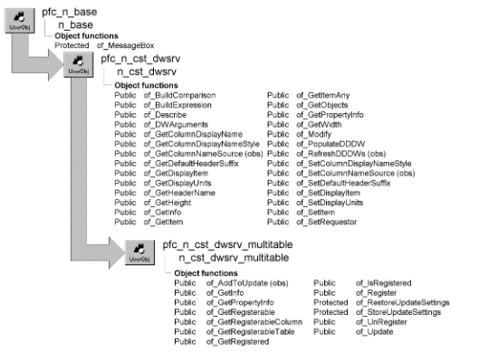

# n_cst_dwsrv_multitable

**Description**

A collection of functions that facilitate update operations for DataWindows that contain rows from more than one table.

**N_cst_dssrv_multitable is the same as n_cst_dwsrv_multitable** N_cst_dssrv_multitable, the DataStore multitable update service object, is almost identical to n_cst_dwsrv_multitable except that it applies to DataStores instead of DataWindow controls. Except where noted, references to n_cst_dwsrv_multitable in the following discussions apply equally to n_cst_dssrv_multitable.

**Ancestry**



**Library**

- PFCDWSRV.PBL
- PFEDWSRV.PBL

**Object relationships**

- [n_cst_infoattrib](../05-global-structures-and-structure-objects/n_cst_infoattrib.md)
- [n_cst_propertyattrib](../05-global-structures-and-structure-objects/n_cst_propertyattrib.md)

**Usage**

Use this object to handle update operations for multiple tables within a DataWindow.

To use this service:

1. Enable the service using the u_dw of_SetMultiTable function:

   ```
   dw_project.of_SetMultiTable(TRUE)
   ```

2. Call the of_Register function once for each table to be updated in a multitable update:

   ```
   String  ls_projcols[ ] = {"project_proj_id"}
   String  ls_taskcols[ ] =  &
      {"task_proj_id", "task_task_id"}

   dw_project.inv_multitable.of_Register &
      ("project", ls_projcols)
   dw_project.inv_multitable.of_Register &
      ("task", ls_taskcols)
   ```

3. Update all specified tables by calling the w_master pfc_Save event:

   ```
   Integer   li_return

   li_return = w_projlist.Event pfc_Save( )
   ```

**PFC 7 custom class extension** To further the extendibility of PFC, a new n_cst_dwsrv_multitableattrib custom class user object (n_cst_dssrv_multitableattrib for n_cst_dssrv_multitable) replaces the os_updcharacteristics object structure that is now obsolete.

**See also**

- [n_cst_dwsrv_rowmanager](n_cst_dwsrv_rowmanager.md)
- [n_cst_dwsrv_linkage](n_cst_dwsrv_linkage.md)
- [u_dw](../06-standard-visual-user-objects/u_dw.md)

## Instance variables

N_cst_dwsrv_multitable includes the following instance variable:

| Instance variable | Description | Data type | Access | Usage |
| --- | --- | --- | --- | --- |
| inv_newupdate [ ] (replaces istr_newupdate[ ] ) | Used to control multiple updates | n_cst_dwsrv_multitableattrib (n_cst_dssrv_multitableattrib for n_cst_dssrv_multitable) | Protected | Internal |

## Functions

N_cst_dwsrv_multitable includes precoded object functions:

- of_AddToUpdate
- of_GetInfo
- of_GetPropertyInfo
- of_GetRegisterable
- of_GetRegisterableColumn
- of_GetRegisterableTable
- of_GetRegistered
- of_IsRegistered
- of_Register
- of_RestoreUpdateSettings
- of_StoreUpdateSettings
- of_UnRegister
- of_Update

### of_AddToUpdate

**Description**

Obsolete. Call of_Register instead.

**Access**

Public

**Syntax**

```
dwcontrol.instancename.of_AddToUpdate ( table, keycolumns
{, updateablecols {, keyinplace, whereoption } } )
```

| Argument | Description |
| --- | --- |
| *dwcontrol* | Instance name of the u_dw-based DataWindow control |
| *instancename* | Instance name of n_cst_dwsrv_multitable (the u_dw default is inv_multitable) |
| *table* | String specifying the table name |
| *keycolumns* | String array containing the key columns used for update |
| *updateablecols* (optional) | String array containing the list of updatable columns (the default is all columns in the DataWindow) |
| *keyinplace* (optional) | Boolean indicating whether to update the key in place (TRUE) or delete and reinsert (FALSE) (the default is FALSE). If you specify this argument, you must also specify *whereoption* |
| *whereoption* (optional) | Integer specifying the DataWindow Update Where option: • 0 Key columns |
|  | • 1 Key and updatable columns |
|  | • 2 Key and modified columns |
|  | If you specify this argument, you must also specify *keyinplace* |

**Return value**

Integer. Returns 1 if the function succeeds and -1 if an error occurs.

### of_GetInfo

**Description**

Retrieves service information.

**Access**

Public

**Syntax**

```
dwcontrol.instancename.of_GetInfo ( infoobject )
```

| Argument | Description |
| --- | --- |
| *dwcontrol* | Instance name of the u_dw-based DataWindow control |
| *instancename* | Instance name of n_cst_dwsrv_multitable (the u_dw default is inv_multitable) |
| *infoobject* | N_cst_infoattrib instance into which the function places service information (passed by reference) |

**Return value**

Integer. Returns 1 if the function succeeds and -1 if an error occurs.

**Usage**

The DataWindow Properties window calls this function to access service information.

**Examples**

This example calls the of_GetInfo function:

```
n_cst_infoattrib  lnv_info

dw_1.inv_multitable.of_GetInfo(lnv_info)
MessageBox("Info",  &
  "Description: " + lnv_info.is_description  &
    + ". Name: " + lnv_info.is_name)
```

### of_GetPropertyInfo

**Description**

Retrieves information about the service’s properties.

**Access**

Public

**Syntax**

```
dwcontrol.instancename.of_GetPropertyInfo ( propertyobject )
```

| Argument | Description |
| --- | --- |
| *dwcontrol* | Instance name of the u_dw-based DataWindow control |
| *instancename* | Instance name of n_cst_dwsrv_multitable (the u_dw default is inv_multitable) |
| *propertyobject* | N_cst_propertyattrib instance into which the function places property information (passed by reference) |

**Return value**

Integer. Returns 1 if the function succeeds and -1 if an error occurs.

**Usage**

The DataWindow Properties window calls this function to access service information:

**Not in n_cst_dssrv_multitable** This function is not implemented in n_cst_dssrv_multitable.

**Examples**

This example calls the of_GetPropertyInfo function:

```
n_cst_propertyattrib  lnv_prop

dw_1.inv_multitable.of_GetPropertyInfo(lnv_prop)
MessageBox("Info",  &
  "Description: " + lnv_prop.is_description  &
    + ". Name: " + lnv_prop.is_name  &
      + ". Property tab text: " +  &
        lnv_prop.is_propertytabtext)
```

### of_GetRegisterable

**Description**

Retrieves an array of columns in the current DataWindow.

**Access**

Public

**Syntax**

```
dwcontrol.instancename.of_GetRegisterable ( columns )
```

| Argument | Description |
| --- | --- |
| *dwcontrol* | Instance name of the u_dw-based DataWindow control |
| *instancename* | Instance name of n_cst_dwsrv_multitable (the u_dw default is inv_multitable) |
| *columns* | String array into which the function places a list of columns (passed by reference) |

**Return value**

Integer. Returns the number of entries in the *columns* array.

**Usage**

The DataWindow Properties window calls this function.

**Examples**

This example calls the of_GetRegisterable function:

```
String   ls_columns[ ]
Integer  li_count, li_loop
li_loop =  &
   dw_1.inv_multitable.of_GetRegisterable  &
     (ls_columns)
lb_1.Reset()
IF li_loop <> 0 THEN
  FOR li_count = 1 to li_loop
    lb_1.AddItem(ls_columns[li_count])
  NEXT
ELSE
  lb_1.AddItem("No Registerable columns")
END IF
```

### of_GetRegisterableColumn

**Description**

Retrieves all registerable columns for the passed table.

**Access**

Public

**Syntax**

```
dwcontrol.instancename.of_GetRegisterableColumn ( table, columns )
```

| Argument | Description |
| --- | --- |
| *dwcontrol* | Instance name of the u_dw-based DataWindow control |
| *instancename* | Instance name of n_cst_dwsrv_multitable (the u_dw default is inv_multitable) |
| *table* | String specifying the name of the table |
| *columns* | String array into which the function places all registerable columns for *table* (passed by reference) |

**Return value**

Integer. Returns the number of elements in the *columns* array if the function succeeds and -1 if an error occurs.

**Examples**

This example calls the of_GetRegisterableColumn function:

```
String  ls_cols[ ]
Integer  li_count, li_loop

li_count =  &
  dw_1.inv_multitable.of_GetRegisterableColumn  &
    ("employee", ls_cols)
lb_1.Reset()
FOR li_loop = 1 to li_count
   lb_1.AddItem(ls_cols[li_loop])
NEXT
```

### of_GetRegisterableTable

**Description**

Retrieves an array of registerable tables whose columns are used in the current DataWindow.

**Access**

Public

**Syntax**

```
dwcontrol.instancename.of_GetRegisterableTable ( tables )
```

| Argument | Description |
| --- | --- |
| *dwcontrol* | Instance name of the u_dw-based DataWindow control |
| *instancename* | Instance name of n_cst_dwsrv_multitable (the u_dw default is inv_multitable) |
| *tables* | String array into which the function places the names of tables whose columns are used in the current DataWindow (passed by reference) |

**Return value**

Integer. Returns 1 if the function succeeds and -1 if an error occurs.

**Usage**

The DataWindow Properties window calls this function.

**Examples**

This example calls the of_GetRegisterableTable function:

```
String  ls_tables[ ]
Integer  li_count, li_loop

li_count =  &
  dw_1.inv_multitable.of_GetRegisterableTable  &
   (ls_tables)
lb_1.Reset()
FOR li_loop = 1 to li_count
   lb_1.AddItem(ls_tables[li_loop])
NEXT
```

### of_GetRegistered

**Description**

Retrieves information on registered columns for a specified table.

**Access**

Public

**Syntax**

```
dwcontrol.instancename.of_GetRegistered ( columns )
```

| Argument | Description |
| --- | --- |
| *dwcontrol* | Instance name of the u_dw-based DataWindow control |
| *instancename* | Instance name of n_cst_dwsrv_multitable (the u_dw default is inv_multitable) |
| *columns* | String array into which the function places a list of registered columns (passed by reference) |

**Return value**

Integer. Returns the number of entries in the *columns* array.

**Examples**

This example calls the of_GetRegistered function:

```
String  ls_empkey[ ]
String  ls_updatable[ ]
Boolean  lb_keyinplace
Integer  li_whereoption
Integer  li_count, li_loop

li_count =  &
  dw_1.inv_multitable.of_GetRegistered  &
    ("employee", ls_empkey, ls_updatable,  &
      lb_keyinplace, li_whereoption)
lb_1.Reset()
FOR li_loop = 1 to li_count
   lb_1.AddItem(ls_empkey[li_loop])
NEXT
```

### of_IsRegistered

**Description**

Reports whether a table is registered.

**Access**

Public

**Syntax**

```
dwcontrol.instancename.of_IsRegistered ( table )
```

| Argument | Description |
| --- | --- |
| *dwcontrol* | Instance name of the u_dw-based DataWindow control |
| *instancename* | Instance name of n_cst_dwsrv_multitable (the u_dw default is inv_multitable) |
| *table* | String specifying the table to be checked |

**Return value**

Boolean. Returns TRUE if *table* is registered and FALSE if it is not.

**Examples**

This example calls the of_IsRegistered function:

```
IF NOT dw_1.inv_multitable.of_IsRegistered  &
  ("department") THEN
    Return -1
END IF
```

### of_Register

**Description**

Registers a table (and its corresponding update characteristics) with the multitable update service.

**Access**

Public

**Syntax**

```
dwcontrol.instancename.of_Register ( table, keycolumns
{, updatablecolumns {, keyinplace, whereoption } } )
```

| Argument | Description |
| --- | --- |
| *dwcontrol* | Instance name of the u_dw-based DataWindow control |
| *instancename* | Instance name of n_cst_dwsrv_multitable (the u_dw default is inv_multitable) |
| *table* | String specifying the table to be registered |
| *keycolumns* | String array specifying the key columns for *table* |
| *updatablecolumns* (optional) | String array specifying updatable columns for *table*. The default is all columns |
| *keyinplace* (optional) | Boolean specifying whether to update the key in place (TRUE) or delete then insert if the key changes (FALSE) (the default is FALSE). If you specify this argument, you must also specify *whereoption* |
| *whereoption* (optional) | Integer specifying the WHERE option: **• 0** Key columns only |
|  | **• 1** Key columns and all updatable columns (default) |
|  | **• 2** Key and modified columns |
|  | If you specify this argument, you must also specify *keyinplace* |

**Return value**

Integer. Returns the 1 if the function succeeds and -1 if an error occurs.

**Usage**

Call this function after enabling the multitable update service.

**Examples**

This example calls the of_Register function:

```
String  ls_empcols[ ] = {"employee_emp_id"}
String  ls_deptcols[ ] = {"department_dept_id"}

dw_1.of_SetMultiTable(TRUE)
dw_1.inv_multitable.of_Register &
   ("employee", ls_empcols)
dw_1.inv_multitable.of_Register &
   ("department", ls_deptcols)
```

### of_RestoreUpdateSettings

**Description**

Restores DataWindow update characteristics.

**Access**

Protected

**Syntax**

```
dwcontrol.instancename.of_RestoreUpdateSettings ( settings )
```

| Argument | Description |
| --- | --- |
| *dwcontrol* | Instance name of the u_dw-based DataWindow control |
| *instancename* | Instance name of n_cst_dwsrv_multitable (the u_dw default is inv_multitable) |
| *settings* | Os_updcharacteristics structure containing the update characteristics |

**Return value**

Integer. Returns 1 if the function succeeds and -1 if an error occurs.

**Usage**

Internal.

**Examples**

This example calls the of_RestoreUpdateSettings function:

```
...
li_rc = &
   of_RestoreUpdateSettings(lstr_originalupdate)
IF li_rc < 0 THEN Return li_rc
...
```

### of_StoreUpdateSettings

**Description**

Stores DataWindow update characteristics.

**Access**

Protected

**Syntax**

```
dwcontrol.instancename.of_StoreUpdateSettings ( settings )
```

| Argument | Description |
| --- | --- |
| *dwcontrol* | Instance name of the u_dw-based DataWindow control |
| *instancename* | Instance name of n_cst_dwsrv_multitable (the u_dw default is inv_multitable) |
| *settings* | Os_updcharacteristics structure containing the update characteristics |

**Return value**

Integer. Returns 1 if the function succeeds and -1 if an error occurs.

**Usage**

Internal.

**Examples**

This example calls the of_StoreUpdateSettings function:

```
...
li_rc = &
   of_StoreUpdateSettings(lstr_originalupdate)
IF li_rc < 0 THEN Return li_rc
...
```

### of_UnRegister

**Description**

Removes one or all tables from the list of tables handled by the multitable update service.

**Access**

Public

**Syntax**

```
dwcontrol.instancename.of_UnRegister ( { table } )
```

| Argument | Description |
| --- | --- |
| *dwcontrol* | Instance name of the u_dw-based DataWindow control |
| *instancename* | Instance name of n_cst_dwsrv_multitable (the u_dw default is inv_multitable) |
| *table* (optional) | String specifying the name of the table to be unregistered. If you omit this argument, the function unregisters all tables |

**Return value**

Integer. Returns the number of tables unregistered if the function succeeds and -1 if an error occurs.

**Examples**

This example calls the of_UnRegister function:

```
dw_1.inv_multitable.of_UnRegister  &
  ("department")
```

### of_Update

**Description**

Saves rows for all registered tables in the DataWindow.

**Access**

Public

**Syntax**

```
dwcontrol.instancename.of_Update ( { accept {, resetflag } } )
```

| Argument | Description |
| --- | --- |
| *dwcontrol* | Instance name of the u_dw-based DataWindow control |
| *instancename* | Instance name of n_cst_dwsrv_multitable (the u_dw default is inv_multitable) |
| *accept* (optional) | Boolean indicating whether the Update function performs an AcceptText before saving rows to the database. The default is TRUE |
| *resetflag* (optional) | Boolean indicating whether the Update function resets the update flags. The default is TRUE |

**Return value**

Integer. Returns 1 if the function succeeds, -1 if an update error occurs, and -2 for all other errors.

**Usage**

Call this function to update all tables registered with the service.

**Examples**

This example is from the u_dw pfc_Update event:

```
...
IF IsValid (inv_multitable) THEN
   li_rc = inv_multitable.of_update  &
      (ab_accepttext, ab_resetflag)
ELSE
   li_rc = this.Update(ab_accepttext, ab_resetflag)
END IF

...
```
