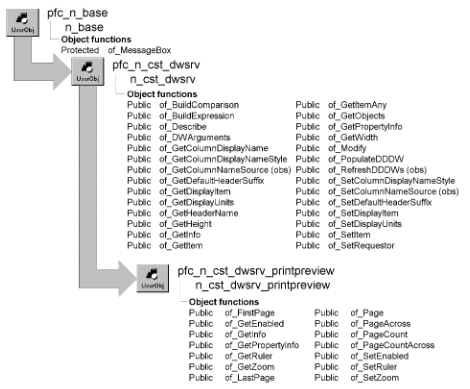

# n_cst_dwsrv_printpreview

**Description**

Contains functions that allow you to control print preview. When this service is enabled, menus that descend from PFC’s m_master menu have automatic access to print preview functionality (such as zoom, first page, last page, previous page, and next page).

**N_cst_dssrv_printpreview is the same as n_cst_dwsrv_printpreview** N_cst_dssrv_printpreview, the DataStore print preview service object is identical to n_cst_dwsrv_printpreview except that it applies to DataStores instead of DataWindow controls. Except where noted, references to n_cst_dwsrv_printpreview in the following discussions apply equally to n_cst_dssrv_printpreview.

**Ancestry**



**Library**

- PFCDWSRV.PBL
- PFEDWSRV.PBL

**Object relationships**

- [n_cst_infoattrib](../05-global-structures-and-structure-objects/n_cst_infoattrib.md)
- [n_cst_propertyattrib](../05-global-structures-and-structure-objects/n_cst_propertyattrib.md)
- [n_cst_string](n_cst_string.md)

**Usage**

Use this object to provide DataWindow print preview functionality.

To use this service:

1. Enable the service using the u_dw of_SetPrintPreview function:

   ```
   dw_emp.of_SetPrintPreview(TRUE)
   ```

2. Toggle print preview mode by calling the u_dw pfc_PrintPreview event:

   ```
   dw_emp.Event pfc_PrintPreview()
   ```

3. Call other print preview functions as needed.

**See also**

- [n_cst_dwsrv_report](n_cst_dwsrv_report.md)
- [u_dw](../06-standard-visual-user-objects/u_dw.md)

## Functions

N_cst_dwsrv_printpreview contains precoded object functions:

- of_FirstPage
- of_GetEnabled
- of_GetInfo
- of_GetPropertyInfo
- of_GetRuler
- of_GetZoom
- of_LastPage
- of_Page
- of_PageAcross
- of_PageCount
- of_PageCountAcross
- of_SetEnabled
- of_SetRuler
- of_SetZoom

### of_FirstPage

**Description**

Scrolls to the first page.

**Access**

Public

**Syntax**

```
dwcontrol.instancename.of_FirstPage ( )
```

| Argument | Description |
| --- | --- |
| *dwcontrol* | Instance name of the u_dw-based DataWindow control |
| *instancename* | Instance name of n_cst_dwsrv_printpreview (the u_dw default is inv_printpreview) |

**Return value**

Integer. Returns 1 if the function succeeds and -1 if an error occurs.

**Usage**

**Not in n_cst_dssrv_printpreview** This function is not implemented in n_cst_dssrv_printpreview.

**Examples**

This example calls the of_FirstPage function:

```
dw_emplist.inv_printpreview.of_FirstPage( )
```

### of_GetEnabled

**Description**

Reports whether the DataWindow is in print preview mode.

**Access**

Public

**Syntax**

```
dwcontrol.instancename.of_GetEnabled ( )
```

| Argument | Description |
| --- | --- |
| *dwcontrol* | Instance name of the u_dw-based DataWindow control |
| *instancename* | Instance name of n_cst_dwsrv_printpreview (the u_dw default is inv_printpreview) |

**Return value**

Boolean. Returns TRUE if the DataWindow is in print preview mode and FALSE if it is not.

**Examples**

This example calls the of_GetEnabled function:

```
IF NOT dw_emp.inv_printpreview.of_GetEnabled() THEN
   dw_emp.inv_printpreview.of_SetEnabled(TRUE)
END IF
```

### of_GetInfo

**Description**

Retrieves service information.

**Access**

Public

**Syntax**

```
dwcontrol.instancename.of_GetInfo ( infoobject )
```

| Argument | Description |
| --- | --- |
| *dwcontrol* | Instance name of the u_dw-based DataWindow control |
| *instancename* | Instance name of n_cst_dwsrv_printpreview (the u_dw default is inv_printpreview) |
| *infoobject* | N_cst_infoattrib instance into which the function places service information (passed by reference) |

**Return value**

Integer. Returns 1 if the function succeeds and -1 if an error occurs.

**Usage**

The DataWindow Properties window calls this function to access service information.

**Examples**

This example calls the of_GetInfo function:

```
n_cst_infoattrib  lnv_info

dw_1.inv_printpreview.of_GetInfo(lnv_info)
MessageBox("Info",  &
  "Description: " + lnv_info.is_description  &
    + ". Name: " + lnv_info.is_name)
```

### of_GetPropertyInfo

**Description**

Retrieves information about the service’s properties.

**Access**

Public

**Syntax**

```
dwcontrol.instancename.of_GetPropertyInfo ( propertyobject )
```

| Argument | Description |
| --- | --- |
| *dwcontrol* | Instance name of the u_dw-based DataWindow control |
| *instancename* | Instance name of n_cst_dwsrv_printpreview (the u_dw default is inv_printpreview) |
| *propertyobject* | N_cst_propertyattrib instance into which the function places property information (passed by reference) |

**Return value**

Integer. Returns 1 if the function succeeds and -1 if an error occurs.

**Usage**

The DataWindow Properties window calls this function to access service information.

**Not in n_cst_dssrv_printpreview** This function is not implemented in n_cst_dssrv_printpreview.

**Examples**

This example calls the of_GetPropertyInfo function:

```
n_cst_propertyattrib  lnv_prop

dw_1.inv_printpreview.of_GetPropertyInfo(lnv_prop)
MessageBox("Info",  &
  "Description: " + lnv_prop.is_description  &
    + ". Name: " + lnv_prop.is_name  &
      + ". Property tab text: " +  &
        lnv_prop.is_propertytabtext)
```

### of_GetRuler

**Description**

Reports whether a ruler is displayed.

**Access**

Public

**Syntax**

```
dwcontrol.instancename.of_GetRuler ( )
```

| Argument | Description |
| --- | --- |
| *dwcontrol* | Instance name of the u_dw-based DataWindow control |
| *instancename* | Instance name of n_cst_dwsrv_printpreview (the u_dw default is inv_printpreview) |

**Return value**

Boolean. Returns TRUE if the ruler is displayed and FALSE if it is not.

**Examples**

This example calls the of_GetRuler function:

```
IF NOT dw_emp.inv_printpreview.of_GetRuler ( ) THEN
   dw_emp.inv_printpreview.of_SetEnabled(TRUE)
END IF
```

### of_GetZoom

**Description**

Retrieves the current zoom factor.

**Access**

Public

**Syntax**

```
dwcontrol.instancename.of_GetZoom ( )
```

| Argument | Description |
| --- | --- |
| *dwcontrol* | Instance name of the u_dw-based DataWindow control |
| *instancename* | Instance name of n_cst_dwsrv_printpreview (the u_dw default is inv_printpreview) |

**Return value**

Integer. Returns the current zoom percentage if the function succeeds and -1 if an error occurs.

**Examples**

This example calls the of_GetZoom function:

```
Integer   li_zoom

li_zoom = dw_emp.inv_printpreview.of_GetZoom( )
```

### of_LastPage

**Description**

Scrolls to the last page.

**Access**

Public

**Syntax**

```
dwcontrol.instancename.of_LastPage ( )
```

| Argument | Description |
| --- | --- |
| *dwcontrol* | Instance name of the u_dw-based DataWindow control |
| *instancename* | Instance name of n_cst_dwsrv_printpreview (the u_dw default is inv_printpreview) |

**Return value**

Integer. Returns 1 if the function succeeds and -1 if an error occurs.

**Usage**

**Not in n_cst_dssrv_printpreview** This function is not implemented in n_cst_dssrv_printpreview.

**Examples**

This example calls the of_LastPage function:

```
dw_emplist.inv_printpreview.of_LastPage( )
```

### of_Page

**Description**

Retrieves the number of the current page.

**Access**

Public

**Syntax**

```
dwcontrol.instancename.of_Page ( )
```

| Argument | Description |
| --- | --- |
| *dwcontrol* | Instance name of the u_dw-based DataWindow control |
| *instancename* | Instance name of n_cst_dwsrv_printpreview (the u_dw default is inv_printpreview) |

**Return value**

Integer. Returns the number of the current page if the function succeeds and -1 if an error occurs.

**Examples**

This example calls the of_Page function:

```
Integer   li_page

li_page = dw_emp.inv_printpreview.of_Page( )
```

### of_PageAcross

**Description**

Retrieves the number of the current horizontal page.

**Access**

Public

**Syntax**

```
dwcontrol.instancename.of_PageAcross ( )
```

| Argument | Description |
| --- | --- |
| *dwcontrol* | Instance name of the u_dw-based DataWindow control |
| *instancename* | Instance name of n_cst_dwsrv_printpreview (the u_dw default is inv_printpreview) |

**Return value**

Integer. Returns the number of the current horizontal page if the function succeeds and -1 if an error occurs.

**Examples**

This example calls the of_PageAcross function:

```
Integer   li_page

li_page = dw_emp.inv_printpreview.of_PageAcross( )
```

### of_PageCount

**Description**

Retrieves the total number of pages.

**Access**

Public

**Syntax**

```
dwcontrol.instancename.of_PageCount ( )
```

| Argument | Description |
| --- | --- |
| *dwcontrol* | Instance name of the u_dw-based DataWindow control |
| *instancename* | Instance name of n_cst_dwsrv_printpreview (the u_dw default is inv_printpreview) |

**Return value**

Integer. Returns the total number of pages if the function succeeds and -1 if an error occurs.

**Examples**

This example calls the of_PageCount function:

```
Integer   li_total

li_total = dw_emp.inv_printpreview.of_PageCount( )
```

### of_PageCountAcross

**Description**

Retrieves the total number of horizontal pages.

**Access**

Public

**Syntax**

```
dwcontrol.instancename.of_PageCountAcross ( )
```

| Argument | Description |
| --- | --- |
| *dwcontrol* | Instance name of the u_dw-based DataWindow control |
| *instancename* | Instance name of n_cst_dwsrv_printpreview (the u_dw default is inv_printpreview) |

**Return value**

Integer. Returns the total number of horizontal pages if the function succeeds and -1 if an error occurs.

**Examples**

This example calls the of_PageCountAcross function:

```
Integer   li_total

li_total = &
   dw_emp.inv_printpreview.of_PageCountAcross( )
```

### of_SetEnabled

**Description**

Controls a DataWindow’s print preview setting.

**Access**

Public

**Syntax**

```
dwcontrol.instancename.of_SetEnabled ( boolean )
```

| Argument | Description |
| --- | --- |
| *dwcontrol* | Instance name of the u_dw-based DataWindow control |
| *instancename* | Instance name of n_cst_dwsrv_printpreview (the u_dw default is inv_printpreview) |
| *boolean* | Boolean specifying whether to place the DataWindow in print preview mode (TRUE) or normal view (FALSE) |

**Return value**

Integer. Returns 1 if the function succeeds and -1 if an error occurs.

**Examples**

This example calls the of_SetEnabled function to place the dw_emp DataWindow into print preview mode:

```
String    ls_return

ls_return = &
   dw_emp.inv_printpreview.of_SetEnabled(TRUE)
IF ls_return <> "" THEN
   MessageBox("Print Preview Error", ls_return)
END IF
```

### of_SetRuler

**Description**

Controls ruler display.

**Access**

Public

**Syntax**

```
dwcontrol.instancename.of_SetRuler ( boolean )
```

| Argument | Description |
| --- | --- |
| *dwcontrol* | Instance name of the u_dw-based DataWindow control |
| *instancename* | Instance name of n_cst_dwsrv_printpreview (the u_dw default is inv_printpreview) |
| *boolean* | Boolean specifying whether to display the ruler (TRUE) or not (FALSE) |

**Return value**

Integer. Returns 1 if the function succeeds and -1 if an error occurs.

**Examples**

This example calls the of_SetRuler function:

```
IF NOT dw_emp.inv_printpreview.of_GetRuler() THEN
   dw_emp.inv_printpreview.of_SetRuler(TRUE)
END IF
```

### of_SetZoom

**Description**

Controls zoom factor.

**Access**

Public

**Syntax**

```
dwcontrol.instancename.of_SetZoom ( { zoompercentage } )
```

| Argument | Description |
| --- | --- |
| *dwcontrol* | Instance name of the u_dw-based DataWindow control |
| *instancename* | Instance name of n_cst_dwsrv_printpreview (the u_dw default is inv_printpreview) |
| *zoompercentage* (optional) | Integer specifying the DataWindow’s zoom percentage. If you omit this argument, the w_zoom dialog box displays allowing the user to specify the zoom percentage |

**Return value**

Integer. Returns 1 if the function succeeds and -1 if an error occurs.

**Examples**

This example calls the of_SetZoom function, displaying the w_zoom dialog box:

```
dw_emp.inv_printpreview.of_SetZoom( )
```
