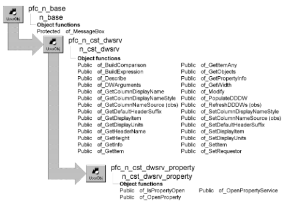

# n_cst_dwsrv_property

**Description**

DataWindow property object.

**Ancestry**



**Library**

- PFCUTIL.PBL
- PFEUTIL.PBL

**Object relationships**

- [n_cst_dwpropertyattrib](../05-global-structures-and-structure-objects/n_cst_dwpropertyattrib.md)
- [n_cst_infoattrib](../05-global-structures-and-structure-objects/n_cst_infoattrib.md)
- [n_cst_metaclass](n_cst_metaclass.md)
- [n_cst_propertyattrib](../05-global-structures-and-structure-objects/n_cst_propertyattrib.md)
- w_dwproperty
- w_dwpropertyservice

**Usage**

U_dw uses this object to control the DataWindow Properties window.

**See also**

u_dw

## Instance variables

| Instance variable | Description | Data type | Access | Usage |
| --- | --- | --- | --- | --- |
| iw_property | Reference to w_dwproperty window | w_dwproperty | Protected | Internal |
| iw_dwpropertyservices | Reference to w_dwpropertyservices window | w_dwpropertyservices | Protected | Internal |

## Events

N_cst_dwsrv_property includes one precoded event:

Destructor

### Destructor

**Description**

Performs cleanup.

**Usage**

This event executes when the object is destroyed.

## Functions

N_cst_debug includes precoded functions:

|   |
| --- |
| of_IsPropertyOpen of_OpenPropertyService |
| of_OpenProperty |

### of_IsPropertyOpen

**Description**

Reports whether either the w_dwproperty window or the w_dwpropertyservices dialog box is open.

**Access**

Public

**Syntax**

```
dwcontrol.instancename.of_IsPropertyOpen ( )
```

| Argument | Description |
| --- | --- |
| *dwcontrol* | Instance name of the u_dw-based DataWindow control |
| *instancename* | Instance name of n_cst_dwsrv_property (the u_dw default is either inv_property or snv_property) |

**Return value**

Integer. Returns TRUE if either w_dwproperty or w_dwpropertyservices is open and FALSE if neither is open.

**Examples**

This example is from the u_dw RButtonUp event:

```
...
If IsValid(inv_property) Then
   If inv_property.of_IsPropertyOpen() = False Then
   lm_dw.m_table.m_debug.visible = True
   lm_dw.m_table.m_debug.enabled = True
   End If
...
```

### of_OpenProperty

**Description**

Opens the w_dwproperty window.

**Access**

Public

**Syntax**

```
dwcontrol.instancename.of_OpenProperty ( properties )
```

| Argument | Description |
| --- | --- |
| *dwcontrol* | Instance name of the u_dw-based DataWindow control |
| *instancename* | Instance name of n_cst_dwsrv_property (the u_dw default is either inv_property or snv_property) |
| *properties* | N_cst_dwpropertyattrib instance containing properties to display |

**Return value**

Integer. Returns 1 if the function succeeds and -1 if an error occurs.

**Usage**

Internal.

**Examples**

This example is from the u_dw pfc_Properties event:

```
...
If IsValid(inv_property) Then
   inv_property.of_OpenProperty(lnv_dwproperty)
   Else
   snv_property.of_OpenProperty(lnv_dwproperty)
   End If
...
```

### of_OpenPropertyService

**Description**

Opens the w_dwpropertyservice dialog box for the specified service.

**Access**

Public

**Syntax**

```
dwcontrol.instancename.of_OpenPropertyService ( service )
```

| Argument | Description |
| --- | --- |
| *dwcontrol* | Instance name of the u_dw-based DataWindow control |
| *instancename* | Instance name of n_cst_dwsrv_property (the u_dw default is either inv_property or snv_property) |
| *service* | PowerObject containing the service to be displayed in the w_dwpropertyservice dialog box |

**Return value**

Integer. Returns 1 if the function succeeds and -1 if an error occurs.

**Usage**

Internal.

**Examples**

This example calls the of_OpenPropertyService function:

```
PowerObject  lpo_service

lpo_service = dw_1.inv_multitable
dw_1.inv_property.of_OpenPropertyService(lpo_service)
```
