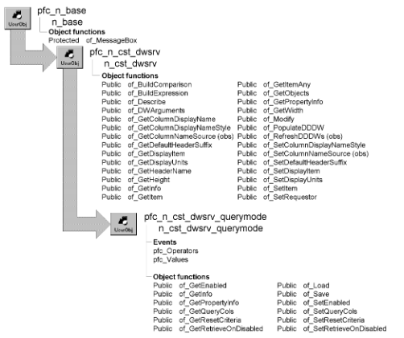

# n_cst_dwsrv_querymode

**Description**

Service to enable and disable query mode. Includes the ability to save and load queries.

**Ancestry**



**Library**

- PFCDWSRV.PBL
- PFEDWSRV.PBL

**Object relationships**

- [n_cst_infoattrib](../05-global-structures-and-structure-objects/n_cst_infoattrib.md)
- [n_cst_propertyattrib](../05-global-structures-and-structure-objects/n_cst_propertyattrib.md)
- [n_cst_selection](n_cst_selection.md)

**Usage**

Use this object’s functions to control DataWindow query mode processing. In particular, the of_Save and of_Load functions make it easy to access and save queries in a file.

To use this service:

1. Enable the service using the u_dw of_SetQuerymode function:

   ```
   dw_emplist.of_SetQuerymode(TRUE)
   ```

2. Specify the columns eligible for query mode:

   ```
   String    ls_cols[]

   ls_cols[1] = "emp_dept_id"
   ls_cols[2] = "emp_id"
   dw_emplist.inv_querymode.of_SetQueryCols &
      (ls_cols)
   ```

3. Call query mode functions as needed.

**PFC 7 custom class extension** To further the extendibility of PFC, a new n_cst_dwsrv_querymodeattrib custom class user object replaces the os_querymodeinfo object structure that is now obsolete.

**See also**

- [n_cst_dwsrv_filter](n_cst_dwsrv_filter.md)
- [n_cst_dwsrv_sort](n_cst_dwsrv_sort.md)
- [u_dw](../06-standard-visual-user-objects/u_dw.md)

## Instance variables

N_cst_dwsrv_querymode includes instance variables:

| Instance variable | Description | Data type | Access | Usage |
| --- | --- | --- | --- | --- |
| ib_resetcriteria |  | Boolean | Protected |  |
| ib_resetquerycriteria | Indicates whether PFC resets query criteria between query mode toggles | Boolean | Protected | Internal |
| ib_retrieveondisabled | Indicates whether PFC automatically retrieves the DataWindow when query mode is disabled | Boolean | Protected | Internal |
| inv_querymodeinfo[ ] | Stores querymode information for each of the DataWindow’s columns | n_cst_dwsrv_query modeattrib | Protected | Internal |
| is_querycolumns[ ] |  | String | Protected |  |
| istr_querymodeinfo[ ] |  | n_cst_dwsrv_querymodeattrib | Protected |  |

## Events

N_cst_dwsrv_querymode includes precoded events:

- pfc_Operators
- pfc_Values

### pfc_Operators

**Description**

Displays a selection dialog box, prompting the user to select an operator (=, >=, &lt;=, and so on) for use in query mode criteria.

**Return value**

Integer. Returns 1 if the event succeeds, 0 if the user cancels out of the selection dialog box, and -1 if an error occurs.

**Usage**

This event is called when the user clicks the right mouse button over the DataWindow and selects Operators from the m_dw popup menu.

### pfc_Values

**Description**

Displays a selection dialog box, prompting the user to select a value for use in query mode criteria. The dialog box displays a list of all unique values for the clicked column.

**Return value**

Integer. Returns 1 if the event succeeds, 0 if the user cancels out of the selection dialog box, and -1 if an error occurs.

**Usage**

This event is called when the user clicks the right mouse button over a DataWindow column and selects Values from the m_dw popup menu.

## Functions

N_cst_dwsrv_querymode contains precoded object functions:

- of_GetEnabled
- of_GetInfo
- of_GetPropertyInfo
- of_GetQueryCols
- of_GetResetCriteria
- of_GetRetrieveOnDisabled
- of_Load
- of_Save
- of_SetEnabled
- of_SetQueryCols
- of_SetResetCriteria
- of_SetRetrieveOnDisabled

### of_GetEnabled

**Description**

Retrieves the DataWindow’s current query mode state.

**Access**

Public

**Syntax**

```
dwcontrol.instancename.of_GetEnabled ( )
```

| Argument | Description |
| --- | --- |
| *dwcontrol* | Instance name of the u_dw-based DataWindow control |
| *instancename* | Instance name of n_cst_dwsrv_querymode (the u_dw default is inv_querymode) |

**Return value**

Boolean. Returns TRUE if query mode is currently enabled and FALSE if it is not.

**Usage**

Enable and disable query mode by calling the of_SetEnabled function.

**Examples**

This example calls the of_GetEnabled function:

```
IF NOT dw_emp.inv_querymode.of_GetEnabled() THEN
   dw_emp.inv_querymode.of_SetEnabled(TRUE)
END IF
```

### of_GetInfo

**Description**

Retrieves service information.

**Access**

Public

**Syntax**

```
dwcontrol.instancename.of_GetInfo ( infoobject )
```

| Argument | Description |
| --- | --- |
| *dwcontrol* | Instance name of the u_dw-based DataWindow control |
| *instancename* | Instance name of n_cst_dwsrv_querymode (the u_dw default is inv_querymode) |
| *infoobject* | N_cst_infoattrib instance into which the function places service information (passed by reference) |

**Return value**

Integer. Returns 1 if the function succeeds and -1 if an error occurs.

**Usage**

The DataWindow Properties window calls this function to access service information.

**Examples**

This example calls the of_GetInfo function:

```
n_cst_infoattrib  lnv_info

dw_1.inv_querymode.of_GetInfo(lnv_info)
MessageBox("Info",  &
  "Description: " + lnv_info.is_description  &
    + ". Name: " + lnv_info.is_name)
```

### of_GetPropertyInfo

**Description**

Retrieves information about the service’s properties.

**Access**

Public

**Syntax**

```
dwcontrol.instancename.of_GetPropertyInfo ( propertyobject )
```

| Argument | Description |
| --- | --- |
| *dwcontrol* | Instance name of the u_dw-based DataWindow control |
| *instancename* | Instance name of n_cst_dwsrv_querymode (the u_dw default is inv_querymode) |
| *propertyobject* | N_cst_propertyattrib instance into which the function places property information (passed by reference) |

**Return value**

Integer. Returns 1 if the function succeeds and -1 if an error occurs.

**Usage**

The DataWindow Properties window calls this function to access service information:

**Examples**

This example calls the of_GetPropertyInfo function:

```
n_cst_propertyattrib  lnv_prop

dw_1.inv_querymode.of_GetPropertyInfo(lnv_prop)
MessageBox("Info",  &
  "Description: " + lnv_prop.is_description  &
    + ". Name: " + lnv_prop.is_name  &
      + ". Property tab text: " +  &
        lnv_prop.is_propertytabtext)
```

### of_GetQueryCols

**Description**

Retrieves the columns that are eligible for query criteria.

**Access**

Public

**Syntax**

```
dwcontrol.instancename.of_GetQueryCols ( columns )
```

| Argument | Description |
| --- | --- |
| *dwcontrol* | Instance name of the u_dw-based DataWindow control |
| *instancename* | Instance name of n_cst_dwsrv_querymode (the u_dw default is inv_querymode) |
| *columns* | String array containing the columns that can be set as querymode columns (passed by reference) |

**Return value**

Integer. Returns 1 if the function succeeds and -1 if an error occurs.

**Examples**

This example calls the of_GetQueryCols function:

```
String  ls_cols[ ]
Integer  li_count, li_loop
li_count =  &
  dw_1.inv_querymode.of_GetQueryCols  &
    (ls_cols)
lb_1.Reset()
FOR li_loop = 1 to li_count
   lb_1.AddItem(ls_cols[li_loop])
NEXT
```

### of_GetResetCriteria

**Description**

Reports whether PFC resets query criteria between query mode toggles.

**Access**

Public

**Syntax**

```
dwcontrol.instancename.of_GetResetCriteria ( )
```

| Argument | Description |
| --- | --- |
| *dwcontrol* | Instance name of the u_dw-based DataWindow control |
| *instancename* | Instance name of n_cst_dwsrv_querymode (the u_dw default is inv_querymode) |

**Return value**

Boolean. Returns TRUE if PFC resets query criteria between query mode toggles and FALSE if it does not.

**Usage**

Call this function to determine whether PFC resets query criteria between query mode toggles.

**Examples**

This example calls the of_GetResetCriteria function:

```
Boolean   lb_reset

lb_reset = &
   dw_emp.inv_querymode.of_GetResetCriteria( )
```

### of_GetRetrieveOnDisabled

**Description**

Reports whether PFC automatically retrieves the DataWindow when query mode is disabled.

**Access**

Public

**Syntax**

```
dwcontrol.instancename.of_GetRetrieveOnDisabled ( )
```

| Argument | Description |
| --- | --- |
| *dwcontrol* | Instance name of the u_dw-based DataWindow control |
| *instancename* | Instance name of n_cst_dwsrv_querymode (the u_dw default is inv_querymode) |

**Return value**

Boolean. Returns TRUE if PFC automatically retrieves the DataWindow when query mode is disabled and FALSE if it does not.

**Usage**

Call this function to determine whether PFC automatically retrieves the DataWindow when query mode is disabled.

**Examples**

This example calls the of_GetRetrieveOnDisabled function:

```
Boolean   lb_retrieve

lb_retrieve = &
   dw_emp.inv_querymode.of_GetRetrieveOnDisabled( )
```

### of_Load

**Description**

Displays the File Open dialog box, prompting the user to select a saved query from disk. If the user selects a file, this function enables query mode for the DataWindow and uses the selected file to determine selection criteria.

**Access**

Public

**Syntax**

```
dwcontrol.instancename.of_Load ( title, pathname, filename {, extension
{, filter } } )
```

| Argument | Description |
| --- | --- |
| *dwcontrol* | Instance name of the u_dw-based DataWindow control |
| *instancename* | Instance name of n_cst_dwsrv_querymode (the u_dw default is inv_querymode) |
| *title* | String specifying the title of the File Open dialog box |
| *pathname* | String into which the function returns the path for the chosen file (passed by reference) |
| *filename* | String into which the function returns the filename (passed by reference) |
| *extension* (optional) | String specifying the 1- to 3-character default file extension. The default is TXT |
| *filter* (optional) | String specifying a text description of the files to include in the listbox and the file mask that you want to use to select the displayed files (for example, \*.\* or \*.exe). The format for filter is: description,\*.ext. The default is: "Queries (\*.TXT),\*.TXT" |

**Return value**

Integer. Returns 1 if the function succeeds, 0 if the user clicks Cancel or the system cancels the display, and -1 if an error occurs.

**Usage**

Call this function to allow the user to select a previously saved query.

Call the of_Save function to save a query.

**Examples**

This example calls the of_Load function:

```
Integer   li_return
String    ls_path_name, ls_doc_name

ls_path_name = "c:\temp\rkn.txt"
dw_employee.inv_querymode.of_Load &
   ("Load a Query", ls_path_name, ls_doc_name)
```

### of_Save

**Description**

Displays the File Save dialog box, allowing the user to save a query to disk. This function works only when the DataWindow is in query mode.

**Access**

Public

**Syntax**

```
dwcontrol.instancename.of_Save ( title, pathname, filename {, extension
{, filter } } )
```

| Argument | Description |
| --- | --- |
| *dwcontrol* | Instance name of the u_dw-based DataWindow control |
| *instancename* | Instance name of n_cst_dwsrv_querymode (the u_dw default is inv_querymode) |
| *title* | String specifying the title of the File Save dialog box |
| *pathname* | String specifying the default path and filename. The function uses this argument to return the path for the saved file (passed by reference) |
| *filename* | String into which the function returns the filename (passed by reference) |
| *extension* (optional) | String specifying the 1- to 3-character default file extension. The default is TXT |
| *filter* (optional) | String specifying a text description of the files to include in the listbox and the file mask that you want to use to select the displayed files (for example, \*.\* or \*.exe). The format for filter is: description,\*.ext. The default is: "Queries (\*.TXT),\*.TXT" |

**Return value**

Integer. Returns 1 if the function succeeds, 0 if the user clicks Cancel or the system cancels the display, and -1 if an error occurs.

**Usage**

Call this function to allow the user to select a previously saved query.

Call the of_Load function to use a previously saved query.

The query must have been applied before it can be saved.

**Examples**

This example calls the of_Save function:

```
String    ls_path_name, ls_doc_name

ls_path_name = "c:\temp\rkn.txt"
dw_employee.inv_querymode.of_Save &
   ("Save a Query", ls_path_name, ls_doc_name)
```

### of_SetEnabled

**Description**

Controls a DataWindow’s query mode setting. This function also removes the border and protects non-query mode columns.

**Access**

Public

**Syntax**

```
dwcontrol.instancename.of_SetEnabled ( boolean )
```

| Argument | Description |
| --- | --- |
| *dwcontrol* | Instance name of the u_dw-based DataWindow control |
| *instancename* | Instance name of n_cst_dwsrv_querymode (the u_dw default is inv_querymode) |
| *boolean* | Boolean specifying whether to turn query mode on (TRUE) or off (FALSE) |

**Return value**

Integer. Returns 1 if the function succeeds and -1 if an error occurs.

**Examples**

This example calls the of_SetEnabled function:

```
Integer   li_return

li_return = dw_master.inv_querymode.of_SetEnabled &
   (NOT dw_master.inv_querymode.of_GetEnabled( ) )
```

### of_SetQueryCols

**Description**

Specifies the columns that are eligible for query criteria and changes the tab order and border style for those columns

**Access**

Public

**Syntax**

```
dwcontrol.instancename.of_SetQueryCols ( columns )
```

| Argument | Description |
| --- | --- |
| *dwcontrol* | Instance name of the u_dw-based DataWindow control |
| *instancename* | Instance name of n_cst_dwsrv_querymode (the u_dw default is inv_querymode) |
| *columns* | String array specifying the columns to be set as querymode columns |

**Return value**

Integer. Returns 1 if the function succeeds and -1 if an error occurs.

**Examples**

This calls the of_SetQueryCols function:

```
Integer   li_itemtotal, li_itemcount
Integer   li_sel_cnt
String    ls_cols[ ]

// Get the number of items in the ListBox.
li_itemtotal = lb_col.TotalItems( )

// Loop through all the items.
FOR li_itemcount = 1 TO li_itemtotal
   IF lb_col.State(li_itemcount) = 1 THEN
   li_sel_cnt++
   ls_cols[li_sel_cnt] = &
   lb_col.Text(li_itemcount)
   END IF
NEXT

dw_emp.inv_querymode.of_SetQueryCols &
   (ls_cols)
```

### of_SetResetCriteria

**Description**

Specifies whether PFC resets query criteria between query mode toggles.

**Access**

Public

**Syntax**

```
dwcontrol.instancename.of_SetResetCriteria ( boolean )
```

| Argument | Description |
| --- | --- |
| *dwcontrol* | Instance name of the u_dw-based DataWindow control |
| *instancename* | Instance name of n_cst_dwsrv_querymode (the u_dw default is inv_querymode) |
| *boolean* | Boolean indicating whether PFC resets query criteria (TRUE) or not (FALSE) |

**Return value**

Boolean. Returns TRUE if PFC resets query criteria between query mode toggles and FALSE if it does not.

**Examples**

This example calls the of_SetResetCriteria function:

```
dw_emp.inv_querymode.of_SetResetCriteria(TRUE)
```

### of_SetRetrieveOnDisabled

**Description**

Specifies whether PFC automatically retrieves the DataWindow when query mode is disabled.

**Access**

Public

**Syntax**

```
dwcontrol.instancename.of_SetRetrieveOnDisabled ( boolean )
```

| Argument | Description |
| --- | --- |
| *dwcontrol* | Instance name of the u_dw-based DataWindow control |
| *instancename* | Instance name of n_cst_dwsrv_querymode (the u_dw default is inv_querymode) |
| *boolean* | Boolean indicating whether PFC automatically retrieves the DataWindow (TRUE) or not (FALSE) |

**Return value**

Integer. Returns 1 if the function succeeds and -1 if an error occurs.

**Usage**

Call this function to specify whether PFC automatically retrieves the DataWindow when query mode is disabled.

**Examples**

This example calls the of_SetRetrieveOnDisabled function:

```
dw_emp.inv_querymode.of_SetRetrieveOnDisabled(TRUE)
```
