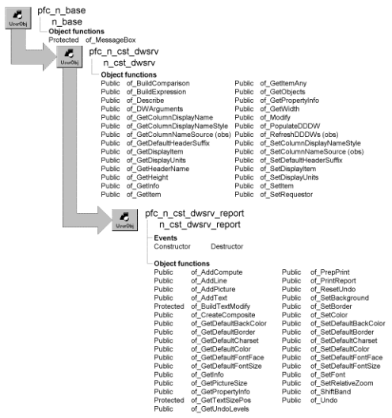

# n_cst_dwsrv_report

**Description**

Reporting service. This object contains functions that help you handle report DataWindows and their printing.

**N_cst_dssrv_report is the same as n_cst_dwsrv_report** N_cst_dssrv_report, the DataStore report service object, is almost identical to n_cst_dwsrv_report except that it applies to DataStores instead of DataWindow controls. Except where noted, references to n_cst_dwsrv_report in the following discussions apply equally to n_cst_dssrv_report.

**Ancestry**



**Library**

- PFCDWSRV.PBL
- PFEDWSRV.PBL

**Object relationships**

- [n_cst_infoattrib](../05-global-structures-and-structure-objects/n_cst_infoattrib.md)
- [n_cst_platform](n_cst_platform.md)
- [n_cst_propertyattrib](../05-global-structures-and-structure-objects/n_cst_propertyattrib.md)
- [n_cst_string](n_cst_string.md)

**Usage**

Use this service with report DataWindows to provide enhanced viewing and printing capabilities.

Many of this service’s functions provide the option of either executing the DataWindow Modify function or returning Modify syntax for use as input to your own Modify function. If you code more than two consecutive report service functions, consider returning the Modify syntax, concatenating the strings, and issuing the Modify function from within your own code.

To use this service, the DataWindow object must use PBUs or pixels as the DataWindow unit. It does not work with DataWindows that use Thousandths of an Inch or Thousandths of a Centimeter as the DataWindow unit.

To use this service:

1. Enable the service using the u_dw of_SetReport function:

   ```
   dw_emp.of_SetReport(TRUE)
   ```

2. Call reporting and printing functions as needed.

**See also**

- [n_cst_dwsrv_printpreview](n_cst_dwsrv_printpreview.md)
- [u_dw](../06-standard-visual-user-objects/u_dw.md)

## Instance variables

N_cst_dwsrv_report contains instance variables:

| Instance variable | Description | Data type | Access | Usage |
| --- | --- | --- | --- | --- |
| ibo_defaultborder | Default border | Border | Protected | Internal |
| ifc_defaultcharset | Default font character set | FontCharSet | Protected | Internal |
| ii_defaultfontsize | Default font size | Integer | Protected | Internal |
| ii_objectnum | Internal counter of the objects created in the associated DataWindow | Integer | Protected | Internal (updated by of_Add functions) |
| ii_undolevel | Counter of the number of changes made to the DataWindow | Integer | Protected | Internal |
| il_defaultbackcolor | Default background color | Long | Protected | Internal |
| il_defaultcolor | Default color | Long | Protected | Internal |
| inv_platform | Reference variable for platform services | n_cst_platform | Protected | Internal |
| is_undo[ ] | Array containing changed or deleted DataWindow columns and text fields | String | Protected | Internal (used by of_ResetUndo and of_Undo) |

## Events

N_cst_dwsrv_report includes precoded events:

- Constructor
- Destructor

### Constructor

**Description**

Sets defaults for the report service.

**Usage**

This event executes when the DataWindow is created.

### Destructor

**Description**

Destroys the platform service instance (inv_platform instance variable).

**Usage**

This event executes when the DataWindow is destroyed.

## Functions

N_cst_dwsrv_report contains precoded functions:

- of_AddCompute
- of_AddLine
- of_AddPicture
- of_AddText
- of_BuildTextModify
- of_CreateComposite
- of_GetDefaultBackColor
- of_GetDefaultBorder
- of_GetDefaultCharset
- of_GetDefaultColor
- of_GetDefaultFontFace
- of_GetDefaultFontSize
- of_GetInfo
- of_GetPictureSize
- of_GetPropertyInfo
- of_GetTextSizePos
- of_GetUndoLevels
- of_PrepPrint
- of_PrintReport
- of_ResetUndo
- of_SetBackground
- of_SetBorder
- of_SetColor
- of_SetDefaultBackColor
- of_SetDefaultBorder
- of_SetDefaultCharset
- of_SetDefaultColor
- of_SetDefaultFontFace
- of_SetDefaultFontSize
- of_SetFont
- of_SetRelativeZoom
- of_ShiftBand
- of_Undo

### of_AddCompute

**Description**

Adds a computed column to any band of a DataWindow.

**Access**

Public

**Syntax**

```
dwcontrol.instancename.of_AddCompute ( expression, band, xcoordinate,
ycoordinate {, border {, bold, italic, underline {, fontface, fontsize,
characterset {, color, backcolor {, execute } } } } } )
```

| Argument | Description |
| --- | --- |
| *dwcontrol* | Instance name of the u_dw-based DataWindow control |
| *instancename* | Instance name of n_cst_dwsrv_report (the u_dw default is inv_report) |
| *expression* | String specifying the expression to be added as the computed column |
| *band* | String specifying the band to which the function will add the computed column. Valid bands are: |
|  | Header Detail Footer Summary Header.*levelnumber* Trailer.*levelnumber* |
| *xcoordinate* | Either of the following: |
|  | • Integer specifying the *x* location of the computed column. If you specify an integer for *xcoordinate*, you must also specify an integer for *ycoordinate* |
|  | • Alignment enumerated data type (Center!, Justify!, Left!, or Right!). If you specify an alignment enumerated data type for *xcoordinate*, you must specify a VTextAlign enumerated data type for *ycoordinate* |
| *ycoordinate* | Either of the following: |
|  | • Integer specifying the *y* location of the computed column. If you specify an integer for *ycoordinate*, you must also specify an integer for *xcoordinate* |
|  | • VTextAlign enumerated data type (Bottom!, MultiLine!, Top!, or VCenter!). If you specify a VTextAlign enumerated data type for *ycoordinate*, you must specify an Alignment enumerated data type for *xcoordinate* |
| *border* (optional) | Border enumerated data type specifying the border style: NoBorder! ShadowBox! Box! ResizeBorder! Underline! Lowered! Raised! |
|  | Specify the default border style using the of_SetDefaultBorder function |
| *bold* (optional) | Boolean specifying whether text is bold: TRUE—Bold FALSE—Not bold (default) |
| *italic* (optional) | Boolean specifying whether text is italic: TRUE—Italic FALSE—Not italic (default) |
| *underline* (optional) | Boolean specifying whether text is underlined: TRUE—Underlined FALSE—Not underlined (default) |
| *fontface* (optional) | String specifying the font to use Specify the default font face using the of_SetDefaultFontFace function |
| *fontsize* (optional) | Integer specifying the point size of the font for the computed column |
|  | Specify the default font size using the of_SetDefaultFontSize function |
| *characterset* (optional) | FontCharSet enumerated data type specifying the character set to use for the computed column: |
|  | ANSI! Symbol! ChineseBig5! Hangul! ShiftJIS! OEM! |
|  | Specify the default character set using the of_SetDefaultCharset function |
| *color* (optional) | Long specifying the color of the computed field Specify the default color using the of_SetDefaultColor function |
| *backcolor* (optional) | Long specifying the background color of the computed field Specify the default background color using the of_SetDefaultBackColor function |
| *execute* (optional) | Boolean specifying whether to execute the Modify function that adds the computed column to the band (TRUE) or return a string that you use to execute the Modify function (FALSE). The default is TRUE |

**Return value**

String. If *execute* is TRUE, this function returns the result of the Modify statement that added the computed column; an empty string indicates success. If *execute* is FALSE, this function returns a string that you use as input to a Modify function to add the computed column.

**Usage**

Depending on the *execute* argument, the function either adds the computed column to the DataWindow or returns syntax that you use in a Modify function to add the computed column.

**Examples**

This example adds a computed column to display the page number in the bottom-right corner of the footer:

```
String    ls_return, ls_expression

ls_expression = "~"Page ~" + page()"
ls_Return = dw_employee.inv_report.of_AddCompute &
   (ls_expression, "footer", Right!, Bottom!, &
   Underline!, TRUE, FALSE, FALSE, "Arial", &
      14, ANSI!)

IF Trim(ls_Return) <> "" THEN
   MessageBox("Modify Error",ls_Return)
END IF
```

### of_AddLine

Adds a line to any band of a DataWindow. There are two syntaxes.

| To | Use |
| --- | --- |
| Add a line by specifying the x and y coordinates of the endpoints | Syntax 1 |
| Add a line by specifying a VTextAlign enumerated data type | Syntax 2 |

| Syntax 1 | Add a line by specifying the x and y coordinates of the endpoints |
| --- | --- |

**Description**

Adds a line by specifying the x and y coordinates of the endpoints.

**Access**

Public

**Syntax**

```
dwcontrol.instancename.of_AddLine ( band, penstyle, penwidth, x1, y1, x2,
y2 {, color, backcolor {, execute } } )
```

| Argument | Description |
| --- | --- |
| *dwcontrol* | Instance name of the u_dw-based DataWindow control |
| *instancename* | Instance name of n_cst_dwsrv_report (the u_dw default is inv_report) |
| *band* | String specifying the band to which the function will add the line. Valid bands are: |
|  | Header Detail Footer Summary Header.*levelnumber* Trailer.*levelnumber* |
| *penstyle* | Linestyle enumerated data type specifying the pen style of the line: |
|  | Continuous! Dash! Dot! DashDot! DashDotDot! Transparent! |
| *penwidth* | Integer specifying the pen width of the line |
| *x1* | Integer specifying the *x1* location of the line |
| *y1* | Integer specifying the *y1* coordinate of the line |
| *x2* | Integer specifying the *x2* location of the line |
| *y2* | Integer specifying the *y2* coordinate of the line |
| *color* (optional) | Long specifying the color of the line Specify the default color using the of_SetDefaultColor function |
| *backcolor* (optional) | Long specifying the background color of the line Specify the default background color using the of_SetDefaultBackColor function |
| *execute* (optional) | Boolean specifying whether to execute the Modify function that adds the line to the band (TRUE) or return a string that you use to execute the Modify function (FALSE). The default is TRUE |

**Return value**

String. If *execute* is TRUE, this function returns the result of the Modify statement that added the line; an empty string indicates success. If *execute* is FALSE, this function returns a string that you use as input to a Modify function to add the line.

**Usage**

Depending on the *execute* argument, the function either adds the line to the DataWindow or returns syntax that you use in a Modify function to add the line.

You can call this function to draw a separator line above the footer area when preparing a DataWindow for printing.

Use Syntax 2 to add a line by specifying a VTextAlign enumerated data type.

**Examples**

This example adds a line to the top of the DataWindow’s footer:

```
String   ls_return, ls_expression

// Draw the line.
ls_Return = dw_employee.inv_report.of_AddLine &
   ("footer", Continuous!, 10, 1, 1, 1, 100)
IF Trim(ls_Return) <> "" THEN
   MessageBox("Modify Error",ls_Return)
   Return
END IF
```

| Syntax 2 | Add a line by specifying a VTextAlign enumerated data type |
| --- | --- |

**Description**

Adds a line by specifying the a VTextAlign enumerated data type.

**Access**

Public

**Syntax**

```
dwcontrol.instancename.of_AddLine ( band, penstyle, penwidth, placement
{, color, backcolor {, execute } } )
```

| Argument | Description |
| --- | --- |
| *dwcontrol* | Instance name of the u_dw-based DataWindow control |
| *instancename* | Instance name of n_cst_dwsrv_report (the u_dw default is inv_report) |
| *band* | String specifying the band to which the function will add the line. Valid bands are: |
|  | Header Detail Footer Summary Header.*levelnumber* Trailer.*levelnumber* |
| *penstyle* | Linestyle enumerated data type specifying the pen style of the line: |
|  | Continuous! Dash! Dot! DashDot! DashDotDot! Transparent! |
| *penwidth* | Integer specifying the pen width of the line |
| *placement* | VTextAlign enumerated data type specifying the line placement: |
|  | Bottom! MultiLine! Top! VCenter! |
| *color* (optional) | Long specifying the color of the line Specify the default color using the of_SetDefaultColor function |
| *backcolor* (optional) | Long specifying the background color of the line Specify the default background color using the of_SetDefaultBackColor function |
| *execute* (optional) | Boolean specifying whether to execute the Modify function that adds the line to the band (TRUE) or return a string that you use to execute the Modify function (FALSE). The default is TRUE |

**Return value**

String. If *execute* is TRUE, this function returns the result of the Modify statement that added the line; an empty string indicates success. If *execute* is FALSE, this function returns a string that you use as input to a Modify function to add the line.

**Usage**

Depending on the *execute* argument, the function either adds the line to the DataWindow or returns syntax that you use in a Modify function to add the line.

You can call this function to draw a separator line above the footer area when preparing a DataWindow for printing.

Use Syntax 1 to add a line by specifying *x* and *y* coordinates.

**Examples**

This example adds a line to the top of the DataWindow’s footer:

```
String   ls_return, ls_expression

// Draw the line.
ls_Return = dw_employee.inv_report.of_AddLine &
   ("footer", Continuous!, 10, Top!)
IF Trim(ls_Return) <> "" THEN
   MessageBox("Modify Error",ls_Return)
   Return
END IF
```

### of_AddPicture

**Description**

Adds a picture object to the specified DataWindow band.

**Access**

Public

**Syntax**

```
dwcontrol.instancename.of_AddPicture ( filename, band, xcoordinate,
ycoordinate {, border {, execute } } )
```

| Argument | Description |
| --- | --- |
| *dwcontrol* | Instance name of the u_dw-based DataWindow control |
| *instancename* | Instance name of n_cst_dwsrv_report (the u_dw default is inv_report) |
| *filename* | String specifying the name of the bitmap file |
|  | If the directory containing the file is not in your system path, you must specify the complete path |
| *band* | String specifying the name of the band to which the function will add the bitmap. Valid bands are: |
|  | • Header |
|  | • Detail |
|  | • Footer |
|  | • Summary |
|  | • Header.*levelnumber* |
|  | • Trailer.*levelnumber* |
| *xcoordinate* | Either of the following: |
|  | • Integer specifying the *x* location of the bitmap. If you specify an integer for *xcoordinate*, you must also specify an integer for *ycoordinate* |
|  | • Alignment enumerated data type (Center!, Justify!, Left!, or Right!). If you specify an alignment enumerated data type for *xcoordinate*, you must specify a VTextAlign enumerated data type for *ycoordinate* |
| *ycoordinate* | Either of the following: |
|  | • Integer specifying the *y* location of the bitmap. If you specify an integer for *ycoordinate*, you must also specify an integer for *xcoordinate* |
|  | • VTextAlign enumerated data type (Bottom!, MultiLine!, Top!, or VCenter!). If you specify a VTextAlign enumerated data type for *ycoordinate*, you must specify an Alignment enumerated data type for *xcoordinate* |
| *border* (optional) | Border enumerated data type specifying the border style: NoBorder! ShadowBox! Box! ResizeBorder! Underline! Lowered! Raised! |
|  | Specify the default border style using the of_SetDefaultBorder function |
| *execute* (optional) | Boolean specifying whether to execute the Modify function that adds the bitmap to the band (TRUE) or return a string that you use to execute the Modify function (FALSE). The default is TRUE |

**Return value**

String. If *execute* is TRUE, this function returns the result of the Modify statement that added the bitmap; an empty string indicates success. If *execute* is FALSE, this function returns a string that you use as input to a Modify function to add the bitmap.

**Usage**

Depending on the *execute* argument, the function either adds the bitmap to the DataWindow or returns syntax that you use in a Modify function to add the bitmap.

**Examples**

This example adds the logo.bmp bitmap to the Header band:

```
String    ls_return

ls_Return = dw_employee.inv_report.of_AddPicture &
   ("logo.bmp", "header", Center!, Top!, &
   NoBorder!, TRUE)

IF Trim(ls_Return) <> "" THEN
   MessageBox("Modify Error",ls_Return)
END IF
```

### of_AddText

**Description**

Adds text to any band of a DataWindow.

**Access**

Public

**Syntax**

```
dwcontrol.instancename.of_AddText ( text, band, xcoordinate, ycoordinate
{, border {, bold, italic, underline {, fontface, fontsize, characterset
{, color, backcolor {,execute } } } } } )
```

| Argument | Description |
| --- | --- |
| *dwcontrol* | Instance name of the u_dw-based DataWindow control |
| *instancename* | Instance name of n_cst_dwsrv_report (the u_dw default is inv_report) |
| *text* | String specifying the text to be added |
| *band* | String specifying the band to which the function will add the text. Valid bands are: |
|  | Header Detail Footer Summary Header.*levelnumber* Trailer.*levelnumber* |
| *xcoordinate* | Either of the following: |
|  | • Integer specifying the *x* location of the text. If you specify an integer for *xcoordinate*, you must also specify an integer for *ycoordinate* |
|  | • Alignment enumerated data type (Center!, Justify!, Left!, or Right!). If you specify an alignment enumerated data type for *xcoordinate*, you must specify a VTextAlign enumerated data type for *ycoordinate* |
| *ycoordinate* | Either of the following: |
|  | • Integer specifying the *y* location of the text. If you specify an integer for *ycoordinate*, you must also specify an integer for *xcoordinate* |
|  | • VTextAlign enumerated data type (Bottom!, MultiLine!, Top!, or VCenter!). If you specify a VTextAlign enumerated data type for *ycoordinate*, you must specify an Alignment enumerated data type for *xcoordinate* |
| *border* (optional) | Border enumerated data type specifying the border style: NoBorder! ShadowBox! Box! ResizeBorder! Underline! Lowered! Raised! |
|  | Specify the default border style using the of_SetDefaultBorder function |
| *bold* (optional) | Boolean specifying whether text is bold: TRUE—Bold FALSE—Not bold (default) |
| *italic* (optional) | Boolean specifying whether text is italic: TRUE—Italic FALSE—Not italic (default) |
| *underline* (optional) | Boolean specifying whether text is underlined: TRUE—Underlined FALSE—Not underlined (default) |
| *fontface* (optional) | String specifying the font to use Specify the default font face using the of_SetDefaultFontFace function |
| *fontsize* (optional) | Integer specifying the point size of the font for the text Specify the default font size using the of_SetDefaultFontSize function |
| *characterset* (optional) | FontCharSet enumerated data type specifying the character set to use for the computed column: |
|  | ANSI! Symbol! ChineseBig5! Hangul! ShiftJIS! OEM! |
|  | Specify the default character set using the of_SetDefaultCharset function |
| *color* (optional) | Long specifying the color of the text Specify the default color using the of_SetDefaultColor function |
| *backcolor* (optional) | Long specifying the background color of the text Specify the default background color using the of_SetDefaultBackColor function |
| *execute* (optional) | Boolean specifying whether to execute the Modify function that adds the text to the band (TRUE) or return a string that you use to execute the Modify function (FALSE). The default is TRUE |

**Return value**

String. If *execute* is TRUE, this function returns the result of the Modify statement that added the text; an empty string indicates success. If *execute* is FALSE, this function returns a string that you use as input to a Modify function to add the text.

**Usage**

Depending on the *execute* argument, the function either adds the text to the DataWindow or returns syntax that you use in a Modify function to add the text.

**Examples**

This example adds text to the DataWindow’s header area:

```
String    ls_return

ls_return = dw_employee.inv_report.of_AddText &
   ("**Company Confidential**", "header", Center!, &
   Top!, Raised!, TRUE, FALSE, FALSE)
IF Trim(ls_return) <> "" THEN
   MessageBox("Modify Error", ls_return)
END IF
```

### of_BuildTextModify

**Description**

Builds input text for the PowerScript Modify function.

**Access**

Protected

**Syntax**

```
dwcontrol.instancename.of_BuildTextModify ( type, text, band,
xcoordinate, ycoordinate, height, width, border, bold, italic,
underline, fontface, fontsize, characterset, color, backcolor )
```

| Argument | Description |
| --- | --- |
| *dwcontrol* | Instance name of the u_dw-based DataWindow control |
| *instancename* | Instance name of n_cst_dwsrv_report (the u_dw default is inv_report) |
| *type* | String specifying the type of object being added (text or computed column) |
| *text* | String specifying the text to be added |
| *band* | String specifying the band to which the function will add the text. Valid bands are: |
|  | Header Detail Footer Summary Header.*levelnumber* Trailer.*levelnumber* |
| *xcoordinate* | Integer specifying the *x* location of the text |
| *ycoordinate* | Integer specifying the *y* location of the text |
| *height* | Integer specifying the height of the text |
| *width* | Integer specifying the width of the text |
| *border* | Border enumerated data type specifying the border style: |
|  | NoBorder! ShadowBox! Box! ResizeBorder! Underline! Lowered! Raised! |
|  | Specify the default border style using the of_SetDefaultBorder function |
| *bold* | Boolean specifying whether text is bold: |
|  | TRUE—Bold FALSE—Not bold (default) |
| *italic* | Boolean specifying whether text is italic: |
|  | TRUE—Italic FALSE—Not italic (default) |
| *underline* | Boolean specifying whether text is underlined: |
|  | TRUE—Underlined FALSE—Not underlined (default) |
| *fontface* | String specifying the font to use |
|  | Specify the default font face using the of_SetDefaultFontFace function |
| *fontsize* | Integer specifying the point size of the font |
|  | Specify the default font size using the of_SetDefaultFontSize function |
| *characterset* | FontCharSet enumerated data type specifying the character set to use: |
|  | ANSI! Symbol! ChineseBig5! Hangul! ShiftJIS! OEM! |
|  | Specify the default character set using the of_SetDefaultCharset function |
| *color* | Long specifying the color |
|  | Specify the default color using the of_SetDefaultColor function |
| *backcolor* | Long specifying the background color |
|  | Specify the default background color using the of_SetDefaultBackColor function |

**Return value**

String. Returns the text of the Modify command to add the object.

**Usage**

Internal.

**Examples**

This example is from the of_AddCompute function:

```
...
ls_modify = ls_modify + of_BuildTextModify &
   ("compute", as_expr, as_band, ai_x, ai_y, &
       li_height, li_width, abo_border, ab_bold, &
          ab_italic, ab_underline, as_fontface, &
             ai_fontsize, afc_charset, al_color, &
                 al_backcolor)
...
```

### of_CreateComposite

**Description**

Creates a composite DataWindow from an array of DataWindows. Composite DataWindows enable you to print more than one DataWindow on a page.

**Access**

Public

**Syntax**

```
dwcontrol.instancename.of_CreateComposite ( datawindows,
arrangevertical, trailfooter, slide, border )
```

| Argument | Description |
| --- | --- |
| *dwcontrol* | Instance name of the u_dw-based DataWindow control |
| *instancename* | Instance name of n_cst_dwsrv_report (the u_dw default is inv_report) |
| *datawindows* | String array naming the DataWindow objects to make up the composite DataWindow |
| *arrangevertical* | Boolean specifying whether to arrange the DataWindows vertically (TRUE) or horizontally (FALSE) |
| *trailfooter* | String array of values to set the trail_footer property for each DataWindow. Valid values are: |
|  | Yes No An empty string (defaults to Yes) |
| *slide* | String array of values to set the Slide properties for each DataWindow. If *arrangevertical* is TRUE, this function sets the DataWindow’s SlideUp property. Valid values are: |
|  | AllAbove DirectlyAbove No An empty string (defaults to AllAbove) |
|  | If *arrangevertical* is FALSE, this function sets the SlideLeft property. Valid values are: |
|  | Yes No |
| *border* | Array of the Border enumerated data type specifying the border for each DataWindow in the composite: |
|  | NoBorder! ShadowBox! Box! ResizeBorder! Underline! Lowered! Raised! |

**Return value**

Integer. Returns 1 if the function succeeds and -1 if it fails.

**Examples**

This example creates a composite report containing the d_employee and d_benefits DataWindows:

```
String    ls_dws[ ], ls_trailfooter[ ], ls_slide[ ]
String    ls_return
Integer   li_return
Boolean   lb_vertical
Border   lbo_border[ ]

lb_vertical = TRUE
ls_dws[1] = "d_employee"
ls_dws[2] = "d_benefits"
ls_trailfooter[1] = "No"
ls_trailfooter[2] = "Yes"
ls_slide[1] = "AllAbove"
ls_slide[2] = "AllAbove"
lbo_border[1] = Lowered!
lbo_border[2] = Lowered!

li_Return = &
   dw_composite.inv_report.of_CreateComposite &
   (ls_dws, lb_vertical, ls_trailfooter, &
      ls_slide, lbo_border)
IF li_Return = 1 THEN
   dw_composite.SetTransObject(SQLCA)
   dw_composite.Event pfc_Retrieve( )
END IF
```

### of_GetDefaultBackColor

**Description**

Retrieves the default background color.

**Access**

Public

**Syntax**

```
dwcontrol.instancename.of_GetDefaultBackColor ( )
```

| Argument | Description |
| --- | --- |
| *dwcontrol* | Instance name of the u_dw-based DataWindow control |
| *instancename* | Instance name of n_cst_dwsrv_report (the u_dw default is inv_report) |

**Return value**

Long. Returns the default background color.

**Examples**

This example calls the of_GetDefaultBackColor function:

```
Long   ll_backcolor

ll_backcolor = &
   dw_emp.inv_report.of_GetDefaultBackColor( )
```

### of_GetDefaultBorder

**Description**

Retrieves the default border.

**Access**

Public

**Syntax**

```
dwcontrol.instancename.of_GetDefaultBorder ( )
```

| Argument | Description |
| --- | --- |
| *dwcontrol* | Instance name of the u_dw-based DataWindow control |
| *instancename* | Instance name of n_cst_dwsrv_report (the u_dw default is inv_report) |

**Return value**

Border. Returns a Border enumerated data type identifying the border:

- NoBorder!
- ShadowBox!
- Box!
- ResizeBorder!
- Underline!
- Lowered!
- Raised!

**Examples**

This example calls the of_GetDefaultBorder function:

```
Border   lbo_border

lbo_border = &
   dw_emp.inv_report.of_GetDefaultBorder( )
IF lb_border = Box! THEN
...
```

### of_GetDefaultCharset

**Description**

Retrieves the default character set.

**Access**

Public

**Syntax**

```
dwcontrol.instancename.of_GetDefaultCharset ( )
```

| Argument | Description |
| --- | --- |
| *dwcontrol* | Instance name of the u_dw-based DataWindow control |
| *instancename* | Instance name of n_cst_dwsrv_report (the u_dw default is inv_report) |

**Return value**

FonCharSet. Returns a FontCharSet enumerated data type identifying the default character set:

- ANSI!
- Symbol!
- ChineseBig5!
- Hangul!
- ShiftJIS!
- OEM!

**Examples**

This example calls the of_GetDefaultCharset function:

```
FontCharSet   lfc_charset
lfc_charset = &
   dw_emp.inv_report.of_GetDefaultCharset()
IF lfc_charset = ANSI! THEN
...
```

### of_GetDefaultColor

**Description**

Retrieves the default color.

**Access**

Public

**Syntax**

```
dwcontrol.instancename.of_GetDefaultColor ( )
```

| Argument | Description |
| --- | --- |
| *dwcontrol* | Instance name of the u_dw-based DataWindow control |
| *instancename* | Instance name of n_cst_dwsrv_report (the u_dw default is inv_report) |

**Return value**

Long. Returns the default color.

**Examples**

This example calls the of_GetDefaultColor function:

```
Long   ll_color

ll_color = &
   dw_emp.inv_report.of_GetDefaultColor( )
```

### of_GetDefaultFontFace

**Description**

Retrieves the default font (for example, Arial).

**Access**

Public

**Syntax**

```
dwcontrol.instancename.of_GetDefaultFontFace ( )
```

| Argument | Description |
| --- | --- |
| *dwcontrol* | Instance name of the u_dw-based DataWindow control |
| *instancename* | Instance name of n_cst_dwsrv_report (the u_dw default is inv_report) |

**Return value**

String. Returns the default font.

**Examples**

This example calls the of_GetDefaultFontFace function:

```
String    ls_font

ls_font = dw_emp.inv_report.of_GetDefaultFontFace()
IF ls_font = "Arial" THEN
...
```

### of_GetDefaultFontSize

**Description**

Retrieves the default font point size.

**Access**

Public

**Syntax**

```
dwcontrol.instancename.of_GetDefaultFontSize ( )
```

| Argument | Description |
| --- | --- |
| *dwcontrol* | Instance name of the u_dw-based DataWindow control |
| *instancename* | Instance name of n_cst_dwsrv_report (the u_dw default is inv_report) |

**Return value**

Integer. Returns the default font size.

**Examples**

This example calls the of_GetDefaultFontSize function:

```
Integer   li_fontsize
li_fontsize = &
   dw_emp.inv_report.of_GetDefaultFontSize()
...
```

### of_GetInfo

**Description**

Retrieves service information.

**Access**

Public

**Syntax**

```
dwcontrol.instancename.of_GetInfo ( infoobject )
```

| Argument | Description |
| --- | --- |
| *dwcontrol* | Instance name of the u_dw-based DataWindow control |
| *instancename* | Instance name of n_cst_dwsrv_report (the u_dw default for this is inv_report) |
| *infoobject* | n_cst_infoattrib instance into which the function places service information (passed by reference) |

**Return value**

Integer. Returns 1 if the function succeeds and -1 if an error occurs.

**Usage**

The DataWindow Properties window calls this function to access service information.

**Examples**

This example calls the of_GetInfo function:

```
n_cst_infoattrib  lnv_info

dw_1.inv_report.of_GetInfo(lnv_info)
MessageBox("Info",  &
  "Description: " + lnv_info.is_description  &
    + ". Name: " + lnv_info.is_name)
```

### of_GetPictureSize

**Description**

Calculates the height and width of a picture object in PBUs or pixels. A PowerBuilder picture object can display a bitmap (BMP) file, a runlength-encoded (RLE) file, or a Windows metafile (WMF).

**Access**

Public

**Syntax**

```
dwcontrol.instancename.of_GetPictureSize ( filename, height, width )
```

| Argument | Description |
| --- | --- |
| *dwcontrol* | Instance name of the u_dw-based DataWindow control |
| *instancename* | Instance name of n_cst_dwsrv_report (the u_dw default is inv_report) |
| *filename* | String specifying the name of the file containing the picture. This must be either a fully qualified filename or reside in a directory on the system path |
| *height* | Integer specifying the height of the picture in PBUs or pixels (passed by reference) |
| *width* | Integer specifying the width of the picture in PBUs or pixels (passed by reference) |

**Return value**

Integer. Returns 1 if the function succeeds and -1 if an error occurs.

**Examples**

This example returns the height and width for the logo.bmp file. The function returns the height in li_height and the width in li_width:

```
Integer   li_return,li_height,li_width

li_return = &
   dw_employee.inv_report.of_GetPictureSize &
   ("logo.bmp", li_height, li_width)
```

### of_GetPropertyInfo

**Description**

Retrieves information about the service’s properties.

**Access**

Public

**Syntax**

```
dwcontrol.instancename.of_GetPropertyInfo ( propertyobject )
```

| Argument | Description |
| --- | --- |
| *dwcontrol* | Instance name of the u_dw-based DataWindow control |
| *instancename* | Instance name of n_cst_dwsrv_report (the u_dw default for this is inv_report) |
| *propertyobject* | n_cst_propertyattrib instance into which the function places property information (passed by reference) |

**Return value**

Integer. Returns 1 if the function succeeds and -1 if an error occurs.

**Usage**

The DataWindow Properties window calls this function to access service information.

**Not in n_cst_dssrv_report** This function is not implemented in n_cst_dssrv_report.

**Examples**

This example calls the of_GetPropertyInfo function:

```
n_cst_propertyattrib  lnv_prop

dw_1.inv_report.of_GetPropertyInfo(lnv_prop)
MessageBox("Info",  &
  "Description: " + lnv_prop.is_description  &
    + ". Name: " + lnv_prop.is_name  &
      + ". Property tab text: " +  &
        lnv_prop.is_propertytabtext)
```

### of_GetTextSizePos

**Description**

Calculates the size and position of a text object.

**Access**

Protected

**Syntax**

```
dwcontrol.instancename.of_GetTextSizePos (text, band, halign, valign,
bold, italic, underline, fontface, fontsize, height, width, xcoordinate,
ycoordinate )
```

| Argument | Description |
| --- | --- |
| *dwcontrol* | Instance name of the u_dw-based DataWindow control |
| *instancename* | Instance name of n_cst_dwsrv_report (the u_dw default is inv_report) |
| *text* | String specifying the text to be added |
| *band* | String specifying the band. Valid values are: |
|  | Header Detail Footer Summary Header.*levelnumber* Trailer.*levelnumber* |
| *halign* | Alignment enumerated data type (Center!, Justify!, Left!, or Right!) specifying horizontal alignment |
| *valign* | VTextAlign enumerated data type (Bottom!, MultiLine!, Top!, or VCenter!) specifying vertical alignment |
| *bold* | Boolean specifying whether text is bold: |
|  | TRUE—Bold FALSE—Not bold (default) |
| *italic* | Boolean specifying whether text is italic: |
|  | TRUE—Italic FALSE—Not italic (default) |
| *underline* | Boolean specifying whether text is underlined: |
|  | TRUE—Underlined FALSE—Not underlined (default) |
| *fontface* | String specifying the font to use. Specify the default font face using the of_SetDefaultFontFace function |
| *fontsize* | Integer specifying the point size of the font. Specify the default font size using the of_SetDefaultFontSize function |
| *height* | Integer specifying the height of the text |
| *width* | Integer specifying the width of the text |
| *xcoordinate* | Integer specifying the *x* location of the text |
| *ycoordinate* | Integer specifying the *y* location of the text |

**Return value**

Integer. Returns 1 if the function succeeds and -1 if an error occurs.

**Usage**

Internal.

**Examples**

This example is from the of_AddCompute function:

```
...
li_newlines = of_GetTextSizePos(as_expr, as_band, &
   aal_halign, avta_valign, ab_bold, ab_italic, &
   ab_underline, as_fontface, ai_fontsize, &
      li_height, li_width, ai_x, ai_y)
...
```

### of_GetUndoLevels

**Description**

Retrieves the DataWindow’s current undo level.

**Access**

Public

**Syntax**

```
dwcontrol.instancename.of_GetUndoLevels ( )
```

| Argument | Description |
| --- | --- |
| *dwcontrol* | Instance name of the u_dw-based DataWindow control |
| *instancename* | Instance name of n_cst_dwsrv_report (the u_dw default is inv_report) |

**Return value**

Integer. Returns the number of changes to the DataWindow.

**Usage**

Call this function when determining the number of levels to specify when using the of_Undo function.

**Examples**

This example calls the of_GetUndoLevels function to display the number of undo levels in the status bar:

```
gnv_app.of_GetFrame( ).SetMicroHelp &
   ("Undo Levels: " + &
   String(dw_emp.inv_report.of_GetUndoLevels( )))
```

### of_PrepPrint

**Description**

Prepares a DataWindow for printing: changes all colors to black on white and removes borders from all columns.

**Access**

Public

**Syntax**

```
dwcontrol.instancename.of_PrepPrint ( underlineheadings )
```

| Argument | Description |
| --- | --- |
| *dwcontrol* | Instance name of the u_dw-based DataWindow control |
| *instancename* | Instance name of n_cst_dwsrv_report (the u_dw default is inv_report) |
| *underlineheadings* | Boolean specifying whether to replace header borders with underlines (TRUE) or remove header borders (FALSE) |
|  | This function only changes column headings whose object names end with _t |

**Return value**

String. Returns the output of the Modify command. An empty string ("") indicates success.

**Usage**

Call this function to modify a DataWindow to a format more suitable for printing (black on white; no borders around columns).

This function removes borders from all columns, including headers. You can highlight headings by setting *underlineheadings* to TRUE, which replaces header borders with underlines.

This function is called by of_PrintReport and calls of_SetColor and of_SetBorder.

**Examples**

This example calls of_PrepPrint before printing dw_employee using underlined headings:

```
String    ls_return

// Prepare for printing.
ls_Return = &
   dw_employee.inv_report.of_PrepPrint(TRUE)
IF Trim(ls_Return) <> "" THEN
   MessageBox("Print Error", &
   "Error preparing DataWindow for printing")
END IF
// Print report.
dw_employee.Print(TRUE)
```

### of_PrintReport

**Description**

Prepares a DataWindow for printing, prints it, and restores it to its original state. This function calls of_PrepPrint.

**Access**

Public

**Syntax**

```
dwcontrol.instancename.of_PrintReport ( underlineheadings
{, canceldialog } )
```

| Argument | Description |
| --- | --- |
| *dwcontrol* | Instance name of the u_dw-based DataWindow control |
| *instancename* | Instance name of n_cst_dwsrv_report (the u_dw default is inv_report) |
| *underlineheadings* | Boolean specifying whether to replace header borders with underlines (TRUE) or remove header borders (FALSE) |
|  | This function only changes column headings whose object names end with _t |
| *canceldialog* (optional) | Boolean specifying whether to display the Cancel dialog box (TRUE) or not (FALSE). The default is FALSE |

**Return value**

String. Returns the output of the Modify command. An empty string ("") indicates success.

**Examples**

This example prints dw_employee with underlined headings:

```
String   ls_return

ls_return = &
   dw_employee.inv_report.of_PrintReport(TRUE,TRUE)
IF ls_Return <> "" THEN
   MessageBox("Print Error", &
   "Error printing DataWindow")
END IF
```

### of_ResetUndo

**Description**

Resets the number of undo levels to zero.

**Access**

Public

**Syntax**

```
dwcontrol.instancename.of_ResetUndo ( )
```

| Argument | Description |
| --- | --- |
| *dwcontrol* | Instance name of the u_dw-based DataWindow control |
| *instancename* | Instance name of n_cst_dwsrv_report (the u_dw default is inv_report) |

**Return value**

None

**Usage**

Call this function to clear the is_undo array, which maintains a list of changes to the DataWindow.

**Examples**

This example uses the of_ResetUndo function to reset the number of undo levels for dw_employee:

```
dw_employee.inv_report.of_ResetUndo()
```

### of_SetBackground

Places a picture in the background of the DataWindow. There are two syntaxes:

| To | Use |
| --- | --- |
| Add a background picture at its exact size | Syntax 1 |
| Add a background picture, sizing it to fit the DataWindow | Syntax 2 |

| Syntax 1 | Add a background picture at its exact size |
| --- | --- |

**Description**

Add a background picture, displayed at its exact size.

**Access**

Public

**Syntax**

```
dwcontrol.instancename.of_SetBackground ( filename {, xcoordinate
{, ycoordinate {, height, width {, execute } } } } )
```

| Argument | Description |
| --- | --- |
| *dwcontrol* | Instance name of the u_dw-based DataWindow control |
| *instancename* | Instance name of n_cst_dwsrv_report (the u_dw default is inv_report) |
| *filename* | String specifying the name of the bitmap file |
|  | If the directory containing the file is not in your system path, you must specify the complete path |
| *xcoordinate* (optional) | Integer specifying the *x* location of the bitmap. The default is 0 |
| *ycoordinate* (optional) | Integer specifying the *y* location of the bitmap. The default is 0 |
| *height* (optional) | Integer specifying the height of the bitmap being placed. If you pass 0, the function uses the of_GetPictureSize function to calculate this value. The default is 0 |
| *width* (optional) | Integer specifying the width of the bitmap being placed. If you pass 0, the function uses the of_GetPictureSize function to calculate this value. The default is 0 |
| *execute* (optional) | Boolean specifying whether to execute the Modify function that adds the background picture (TRUE) or return a string that you use to execute the Modify function (FALSE). The default is TRUE |

**Return value**

String. If *execute* is TRUE, this function returns the result of the Modify statement that added the background picture; an empty string indicates success. If *execute* is FALSE, this function returns a string that you use as input to a Modify function to add the background picture.

**Usage**

A background picture to can provide a watermark effect, enhancing a DataWindow’s online and printed appearance.

Depending on the *execute* argument, the function either adds the background to the DataWindow or returns syntax that you use in a Modify function to add the background picture.

Use Syntax 2 to add a background picture, sizing it to fit the DataWindow.

**Examples**

This example uses the of_SetBackground function to add the confid.bmp background picture to dw_employee:

```
String    ls_return

ls_Return = &
   dw_employee.inv_report.of_SetBackground &
   ("confid.bmp", 20, 20)
IF Trim(ls_Return) <> "" THEN
   MessageBox("Modify error",ls_Return)
END IF
```

| Syntax 2 | Add a background picture, sizing it to fit the DataWindow |
| --- | --- |

**Description**

Add a background picture, optionally sizing it to fit the DataWindow.

**Access**

Public

**Syntax**

```
dwcontrol.instancename.of_SetBackground ( filename , sizetofit,
xcoordinate, ycoordinate, height, width execute )
```

| Argument | Description |
| --- | --- |
| *dwcontrol* | Instance name of the u_dw-based DataWindow control |
| *instancename* | Instance name of n_cst_dwsrv_report (the u_dw default is inv_report) |
| *filename* | String specifying the name of the bitmap file |
|  | If the directory containing the file is not in your system path, you must specify the complete path |
| *sizetofit* | Boolean specifying whether to set the picture width to the width of the DataWindow and use the *height*/*width* ratio to set the height (TRUE) or use the *height* and *width* values |
| *xcoordinate* | Integer specifying the *x* location of the bitmap |
| *ycoordinate* | Integer specifying the *y* location of the bitmap |
| *height* | Integer specifying the height of the bitmap being placed. If you pass 0, the function uses the of_GetPictureSize function to calculate this value |
| *width* | Integer specifying the width of the bitmap being placed. If you pass 0, the function uses the of_GetPictureSize function to calculate this value |
| *execute* | Boolean specifying whether to execute the Modify function that adds the background picture (TRUE) or return a string that you use to execute the Modify function (FALSE). The default is TRUE |

**Return value**

String. If *execute* is TRUE, this function returns the result of the Modify statement that added the background picture; an empty string indicates success. If *execute* is FALSE, this function returns a string that you use as input to a Modify function to add the background picture.

**Usage**

A background picture can provide a watermark effect, enhancing a DataWindow’s online and printed appearance.

Depending on the *execute* argument, the function either adds the background to the DataWindow or returns syntax that you use in a Modify function to add the background picture.

Use Syntax 1 to add a background picture at its exact size.

**Examples**

This example uses the of_SetBackground function to add the confid.bmp background picture to dw_employee, sizing it to fit:

```
String   ls_return

ls_Return = &
   dw_employee.inv_report.of_SetBackground &
   ("confid.bmp", TRUE, 20, 20, 0, 0, TRUE)
IF Trim(ls_Return) <> "" THEN
   MessageBox("Modify error",ls_Return)
END IF
```

### of_SetBorder

**Description**

Changes the border for one or more objects in a DataWindow.

**Access**

Public

**Syntax**

```
dwcontrol.instancename.of_SetBorder ( border {, objectname {, band
{, execute } } } )
```

| Argument | Description |
| --- | --- |
| *dwcontrol* | Instance name of the u_dw-based DataWindow control |
| *instancename* | Instance name of n_cst_dwsrv_report (the u_dw default is inv_report) |
| *border* | Border enumerated data type specifying the border style: |
|  | NoBorder! ShadowBox! Box! ResizeBorder! Underline! Lowered! Raised! |
|  | Specify the default border style using the of_SetDefaultBorder function |
| *objectname* (optional) | String specifying the name of the object to change. If you specify an asterisk (\*), the function changes the border for all objects in the band |
|  | The default is an asterisk (\*) |
| *band* (optional) | String specifying the band in which to change the objects. The function ignores this argument if you pass a name in *objectname*. Valid values are: |
|  | An asterisk (\*), which changes all objects in the DataWindow Header Detail Footer Summary Header.*levelnumber* Trailer.*levelnumber* |
|  | The default is an asterisk (\*) |
| *execute* (optional) | Boolean specifying whether to execute the Modify function that sets the border (TRUE) or return a string that you use to execute the Modify function (FALSE). The default is TRUE |

**Return value**

String. If *execute* is TRUE, this function returns the result of the Modify statement that changed the border style; an empty string indicates success. If *execute* is FALSE, this function returns a string that you use as input to a Modify function to change the border style.

**Usage**

The of_PrepPrint function calls this function to remove all border styles. You can use it to selectively change border styles before printing (for example, you might change 3d Lowered to Box).

Depending on the *execute* argument, the function either changes the border style or returns syntax that you use in a Modify function to change the border style.

**Examples**

This example changes the border for all objects in the header band to a box:

```
String    ls_return
ls_return = dw_employee.inv_report.of_SetBorder &
   (Box!, "*", "header", TRUE)
IF Trim(ls_Return) <> "" THEN
   MessageBox("Modify error",ls_Return)
END IF
```

### of_SetColor

**Description**

Changes the color and background color (if applicable) of one or more objects in a DataWindow.

**Access**

Public

**Syntax**

```
dwcontrol.instancename.of_SetColor ( color, backgroundcolor
{, objectname {, band {, execute } } } )
```

| Argument | Description |
| --- | --- |
| *dwcontrol* | Instance name of the u_dw-based DataWindow control |
| *instancename* | Instance name of n_cst_dwsrv_report (the u_dw default is inv_report) |
| *color* | Long specifying a long value that identifies the new color. If you pass a NULL, the function does not change the color |
| *backgroundcolor* | Long specifying a long value that identifies the new background color. If you pass a NULL, the function does not change the background color |
| *objectname* (optional) | String specifying the name of the object to change. If you specify an asterisk (\*), the function changes the border for all objects in the band |
|  | The default is an asterisk (\*) |
| *band* (optional) | String specifying the band in which to change the objects. The function ignores this argument if you pass a name in *objectname*. Valid bands are: |
|  | An asterisk (\*), which changes colors for all objects Header Detail Footer Summary Header.*levelnumber* Trailer.*levelnumber* |
|  | The default is an asterisk (\*) |
| *execute* (optional) | Boolean specifying whether to execute the Modify function that sets the color (TRUE) or return a string that you use to execute the Modify function (FALSE). The default is TRUE |

**Return value**

String. If *execute* is TRUE, this function returns the result of the Modify statement that changed the color; an empty string indicates success. If *execute* is FALSE, this function returns a string that you use as input to a Modify function to change the color.

**Usage**

The of_PrepPrint function calls this function to change all text to black on white. You can use it to selectively change colors before printing.

Depending on the *execute* argument, the function either changes the color or returns syntax that you use in a Modify function to change the color.

**Examples**

This example changes the text color to black and the background color to white:

```
String    ls_return
Long      ll_white = (RGB(255, 255, 255))
Long      ll_black = 0

// Change all colors to black on white
ls_return = dw_employee.inv_report.of_SetColor &
   (ll_black, ll_white, "*", "*", TRUE)
IF Trim(ls_return) <> "" THEN
   MessageBox("Modify error",ls_Return)
END IF
```

### of_SetDefaultBackColor

**Description**

Specifies the default background color.

**Access**

Public

**Syntax**

```
dwcontrol.instancename.of_SetDefaultBackColor ( color )
```

| Argument | Description |
| --- | --- |
| *dwcontrol* | Instance name of the u_dw-based DataWindow control |
| *instancename* | Instance name of n_cst_dwsrv_report (the u_dw default is inv_report) |
| *color* | Long specifying the default background color. If you pass a NULL, the function sets the background color to transparent |

**Return value**

None

**Examples**

This example calls the of_SetDefaultBackColor function, setting the background color to transparent:

```
Long   ll_backcolor

SetNull(ll_backcolor)
dw_emp.inv_report.of_SetDefaultBackColor &
 (ll_backcolor)
```

### of_SetDefaultBorder

**Description**

Specifies the default border.

**Access**

Public

**Syntax**

```
dwcontrol.instancename.of_SetDefaultBorder ( border )
```

| Argument | Description |
| --- | --- |
| *dwcontrol* | Instance name of the u_dw-based DataWindow control |
| *instancename* | Instance name of n_cst_dwsrv_report (the u_dw default is inv_report) |
| *border* | Border enumerated data type specifying the default border: |
|  | NoBorder! ShadowBox! Box! ResizeBorder! Underline! Lowered! Raised! |

**Return value**

None

**Examples**

This example calls the of_SetDefaultBorder function:

```
dw_emp.inv_report.of_SetDefaultBorder(Lowered!)
```

### of_SetDefaultCharset

**Description**

Specifies the default character set.

**Access**

Public

**Syntax**

```
dwcontrol.instancename.of_SetDefaultCharset ( charset )
```

| Argument | Description |
| --- | --- |
| *dwcontrol* | Instance name of the u_dw-based DataWindow control |
| *instancename* | Instance name of n_cst_dwsrv_report (the u_dw default is inv_report) |
| *charset* | FontCharSet enumerated data type specifying the default character set: |
|  | ANSI! Symbol! ChineseBig5! Hangul! ShiftJIS! OEM! |

**Return value**

None

**Examples**

This example calls the of_SetDefaultCharset function:

```
dw_emp.inv_report.of_SetDefaultCharset(ANSI!)
```

### of_SetDefaultColor

**Description**

Specifies the default color.

**Access**

Public

**Syntax**

```
dwcontrol.instancename.of_SetDefaultColor ( color )
```

| Argument | Description |
| --- | --- |
| *dwcontrol* | Instance name of the u_dw-based DataWindow control |
| *instancename* | Instance name of n_cst_dwsrv_report (the u_dw default is inv_report) |
| *color* | Long specifying the default color. If you pass a NULL, the function sets the color to transparent |

**Return value**

None

**Examples**

This example calls the of_SetDefaultColor function:

```
Long   ll_color

ll_color = &
   dw_emp.inv_report.of_SetDefaultColor &
     (RGB(128, 128, 128))
```

### of_SetDefaultFontFace

**Description**

Specifies the default font (for example, Arial).

**Access**

Public

**Syntax**

```
dwcontrol.instancename.of_SetDefaultFontFace ( font )
```

| Argument | Description |
| --- | --- |
| *dwcontrol* | Instance name of the u_dw-based DataWindow control |
| *instancename* | Instance name of n_cst_dwsrv_report (the u_dw default is inv_report) |
| *font* | String specifying the default font |

**Return value**

None

**Examples**

This example calls the of_SetDefaultFontFace function:

```
dw_emp.inv_report.of_SetDefaultFontFace("Arial")
```

### of_SetDefaultFontSize

**Description**

Specifies the default font point size.

**Access**

Public

**Syntax**

```
dwcontrol.instancename.of_SetDefaultFontSize ( fontsize )
```

| Argument | Description |
| --- | --- |
| *dwcontrol* | Instance name of the u_dw-based DataWindow control |
| *instancename* | Instance name of n_cst_dwsrv_report (the u_dw default is inv_report) |
| *fontsize* | Integer specifying the default font size, in points |

**Return value**

None

**Examples**

This example calls the of_SetDefaultFontSize function:

```
dw_emp.inv_report.of_SetDefaultFontSize(12)
```

### of_SetFont

Changes the font of one or more objects in a DataWindow. There are two syntaxes:

| To | Use |
| --- | --- |
| Set the font, including bold, italic, and underline | Syntax 1 |
| Set the font, using defaults for bold, italic, and underline | Syntax 2 |

| Syntax 1 | Set the font, including bold, italic, and underline |
| --- | --- |

**Description**

Sets the font, including bold, italic, and underline.

**Access**

Public

**Syntax**

```
dwcontrol.instancename.of_SetFont ( fontface, fontsize, fontfamily, fontpitch
{, bold, italic, underline {, objectname {, band {, execute } } } } )
```

| Argument | Description |
| --- | --- |
| *dwcontrol* | Instance name of the u_dw-based DataWindow control |
| *instancename* | Instance name of n_cst_dwsrv_report (the u_dw default is inv_report) |
| *fontface* | String specifying the new font. If you pass a NULL, the function does not change the font |
| *fontsize* | Integer specifying the point size of the new font. If you pass a NULL, the function does not change the font size |
| *fontfamily* | FontFamily enumerated data type specifying the font family: |
|  | AnyFont! Roman! Swiss! Modern! Script! Decorative! |
|  | If you pass a NULL, the function does not change the font family |
| *fontpitch* | FontPitch enumerated data type specifying the pitch of the new font: |
|  | Default! Fixed! Variable! |
|  | If you pass a NULL, the function does not change the pitch |
| *bold* (optional) | Boolean specifying whether text is bold: TRUE—Bold FALSE—Not bold (default) |
|  | If you pass a NULL, the function does not change the bold property |
| *italic* (optional) | Boolean specifying whether text is italic: TRUE—Italic FALSE—Not italic (default) |
|  | If you pass a NULL, the function does not change the italic property |
| *underline* (optional) | Boolean specifying whether text is underlined: TRUE—Underlined FALSE—Not underlined (default) |
|  | If you pass a NULL, the function does not change the underline property |
| *objectname* (optional) | String specifying the name of the object to change. If you specify an asterisk (\*), the function changes the font for all objects in the band |
|  | The default is an asterisk (\*) |
| *band* (optional) | String specifying the band in which to change the objects. The function ignores this argument if you pass a name in *objectname*. Valid bands are: |
|  | An asterisk (\*), which changes the border for all objects Header Detail Footer Summary Header.*levelnumber* Trailer.*levelnumber* |
|  | The default is an asterisk (\*) |
| *execute* (optional) | Boolean specifying whether to execute the Modify function that sets the font (TRUE) or return a string that you use to execute the Modify function (FALSE). The default is TRUE |

**Return value**

String. If *execute* is TRUE, this function returns the result of the Modify statement that changes the font; an empty string indicates success. If *execute* is FALSE, this function returns a string that you use as input to a Modify function to change the font.

**Usage**

Call this function to change the font for a DataWindow column before printing.

Depending on the *execute* argument, the function either changes the font or returns syntax that you use in a Modify function to change the font.

Use Syntax 2 to call this function, leaving bold, italic, and underline properties as is.

**Examples**

This example changes all text to Arial bold, using the default pitch. No other properties are changed:

```
String    ls_return
Integer   li_size
Boolean   lb_bold, lb_italic, lb_underline

SetNull(li_size)
SetNull(lb_italic)
SetNull(lb_underline)
lb_bold = TRUE
ls_return = dw_employee.inv_report.of_SetFont &
   ("Arial", li_size, Swiss!, Default!, &
   lb_bold, lb_italic, lb_underline, &
      "*", "*", TRUE)
IF Trim(ls_Return) <> "" THEN
   MessageBox("Modify Error",ls_Return)
END IF
```

| Syntax 2 | Set the font, using defaults for bold, italic, and underline |
| --- | --- |

**Description**

Sets the font, using defaults for bold, italic, and underline. This syntax always executes the Modify statement that changes the font.

**Access**

Public

**Syntax**

```
dwcontrol.instancename.of_SetFont ( fontface, fontsize, fontfamily, fontpitch
{, objectname {, band } } )
```

| Argument | Description |
| --- | --- |
| *dwcontrol* | Instance name of the u_dw-based DataWindow control |
| *instancename* | Instance name of n_cst_dwsrv_report (the u_dw default is inv_report) |
| *fontface* | String specifying the new font. If you pass a NULL, the function does not change the font |
| *fontsize* | Integer specifying the point size of the new font. If you pass a NULL, the function does not change the font size |
| *fontfamily* | FontFamily enumerated data type specifying the font family: |
|  | AnyFont! Roman! Swiss! Modern! Script! Decorative! |
|  | If you pass a NULL, the function does not change the font family |
| *fontpitch* | FontPitch enumerated data type specifying the pitch of the new font: |
|  | Default! Fixed! Variable! |
|  | If you pass a NULL, the function does not change the pitch |
| *objectname* (optional) | String specifying the name of the object to change. If you specify an asterisk (\*), the function changes the font for all objects in the band |
|  | The default is an asterisk (\*) |
| *band* (optional) | String specifying the band in which to change the objects. The function ignores this argument if you pass a name in *objectname*. Valid bands are: |
|  | An asterisk (\*), which changes the border for all objects Header Detail Footer Summary Header.*levelnumber* Trailer.*levelnumber* |
|  | The default is an asterisk (\*) |

**Return value**

String. Returns the result of the Modify statement that changes the font; an empty string indicates success.

**Usage**

Call this function to change the font for a DataWindow column before printing.

Use Syntax 1 to call this function, with the addition of bold, italic, and underline properties.

**Examples**

This example changes all text to Arial, using the default pitch. No other properties are changed:

```
String    ls_return
Integer   li_size

SetNull(li_size)
ls_return = dw_employee.inv_report.of_SetFont &
   ("Arial", li_size, Swiss!, Default!, &
       "*", "*", TRUE)
```

### of_SetRelativeZoom

**Description**

Increases or decreases the size of a report relative to its current size.

**Access**

Public

**Syntax**

```
dwcontrol.instancename.of_SetRelativeZoom ( zoompercentage )
```

| Argument | Description |
| --- | --- |
| *dwcontrol* | Instance name of the u_dw-based DataWindow control |
| *instancename* | Instance name of n_cst_dwsrv_report (the u_dw default is inv_report) |
| *zoompercentage* | Integer specifying the percentage change to the DataWindow (50% = half the size, 200% = twice the size, 100% = no change) |

**Return value**

String. Returns the output of the Modify command. An empty string ("") indicates success.

**Usage**

This change is relative to the current report’s zoom percentage. To change the size to an absolute percentage, code a Modify statement that specifies DataWindow.Zoom.

**Examples**

This example reduces the dw_employee DataWindow’s size by 50 percent:

```
String    ls_return

ls_return = &
   dw_employee.inv_report.of_SetRelativeZoom(50)
IF ls_Return <> "" THEN
   MessageBox("Print Error", &
   "DataWindow.Zoom error")
END IF
```

### of_ShiftBand

**Description**

Shifts the objects in the given band of the DataWindow horizontally or vertically by a specified number of units.

**Access**

Public

**Syntax**

```
dwcontrol.instancename.of_ShiftBand ( band, xunits, yunits {, execute } )
```

| Argument | Description |
| --- | --- |
| *dwcontrol* | Instance name of the u_dw-based DataWindow control |
| *instancename* | Instance name of n_cst_dwsrv_report (the u_dw default is inv_report) |
| *band* | String specifying the band to shift. Valid bands are: |
|  | An asterisk (\*), which shifts entire the DataWindow Header Detail Footer Summary Header.*levelnumber* Trailer.*levelnumber* |
| *xunits* | Integer specifying the number of units to shift the objects right (to shift left, pass a negative number) |
| *yunits* | Integer specifying the number of units to shift the objects down (to shift up, pass a negative number) |
| *execute* (optional) | Boolean specifying whether to execute the Modify function that shifts the band (TRUE) or return a string that you use to execute the Modify function (FALSE). The default is TRUE |

**Return value**

String. If *execute* is TRUE, this function returns the result of the Modify statement that shifted the objects; an empty string indicates success. If *execute* is FALSE, this function returns a string that you use as input to a Modify function to shift the objects.

**Usage**

Call this function to reposition existing objects when adding other objects dynamically. For example, if you add a bitmap to a band, call the of_GetPictureSize function to determine the bitmap’s size and then call this function to reposition the other objects.

Depending on the *execute* argument, the function either shifts the objects or returns syntax that you use in a Modify function to shift the objects.

**Examples**

This example calls the of_ShiftBand function:

```
String    ls_return

ls_return = dw_employee.inv_report.of_ShiftBand &
   ("header", 50, 0, TRUE)
IF Trim(ls_Return) <> "" THEN
   MessageBox("Modify Error",ls_Return)
END IF
```

### of_Undo

**Description**

Restores changes made to a DataWindow.

**Access**

Public

**Syntax**

```
dwcontrol.instancename.of_Undo ( levelstoundo )
```

| Argument | Description |
| --- | --- |
| *dwcontrol* | Instance name of the u_dw-based DataWindow control |
| *instancename* | Instance name of n_cst_dwsrv_report (the u_dw default is inv_report) |
| *levelstoundo* | Integer specifying the number of changes to restore. Specify 0 to undo all changes |

**Return value**

String. Returns the output of the Modify command. An empty string ("") indicates success.

**Usage**

Call this function to undo changes made while viewing an online report. This function is used internally by of_PrintReport to undo the changes made by of_PrepPrint.

If you are buffering multiple strings to use in a single Modify function, each function call counts as a separate undo level. For example, if you might call of_AddCompute, of_AddLine, and of_AddText, with *execute* set to FALSE, for input to a single Modify function. To remove these changes, call of_Undo(3).

This function is for undoing cosmetic changes made while preparing a DataWindow for online reporting and hardcopy printing. To undo changes made to DataWindow data, use the n_cst_dwsrv_rowmanager of_Undelete function.

**Examples**

This example uses the of_Undo function after printing a DataWindow:

```
String    ls_return

// Prepare for printing.
ls_Return = &
   dw_employee.inv_report.of_PrepPrint(TRUE)
IF ls_Return <> "" THEN
   MessageBox("Print Error", &
   "Error preparing DataWindow for printing")
END IF

// Print report.
dw_employee.Print(TRUE)

// Undo changes made by of_PrepPrint.
ls_return = dw_employee.inv_report.of_Undo(1)
IF Trim(ls_Return) <> "" THEN
   MessageBox("Modify Error",ls_Return)
END IF
```
