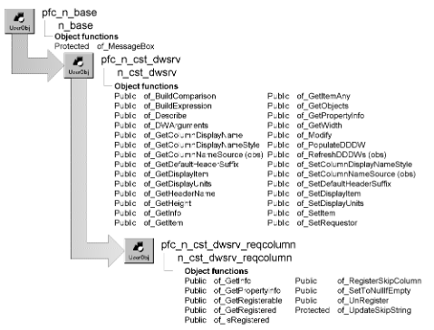

# n_cst_dwsrv_reqcolumn

**Description**

DataWindow required column service. This service enables and disables default DataWindow processing for required fields, making it easier for your application to handle interdependent fields within a DataWindow.

This service applies only to DataWindow columns that use the Nilisnull property. For example, EditMasks don’t have this property so the required column service doesn’t apply to edit masks.

**Ancestry**



**Library**

- PFCDWSRV.PBL
- PFEDWSRV.PBL

**Object relationships**

- [n_cst_infoattrib](../05-global-structures-and-structure-objects/n_cst_infoattrib.md)
- [n_cst_propertyattrib](../05-global-structures-and-structure-objects/n_cst_propertyattrib.md)

**Usage**

This service allows you to defer required fields processing until the user completes data entry. It also allows you to specify columns for which PowerBuilder should still perform required fields processing.

When enabled, this service writes NULL values to empty fields with the Nilisnull property, suppressing required fields messages.

To use the required column service:

1. Enable the service using the u_dw of_SetReqColumn function:

   ```
   dw_emp.of_SetReqColumn(TRUE)
   ```

2. Call the of_RegisterSkipColumn to selectively enable default DataWindow required fields processing:

   ```
   dw_emp.inv_reqcolumn.of_RegisterSkipColumn &
      ("dept_id")
   ```

**See also**

u_dw

## Instance variables

| Instance variable | Description | Data type | Access | Usage |
| --- | --- | --- | --- | --- |
| is_skip | Tracks skipped columns | String | Protected | Internal |
| is_skipcolumn[ ] | Specifies columns for which default DataWindow required fields processing is enabled | String | Protected | Internal |

## Functions

N_cst_dwsrv_reqcolumn includes precoded object functions:

- of_GetInfo
- of_GetPropertyInfo
- of_GetRegisterable
- of_GetRegistered
- of_IsRegistered
- of_RegisterSkipColumn
- of_SetToNullIfEmpty
- of_UnRegister
- of_UpdateSkipString

### of_GetInfo

**Description**

Retrieves service information.

**Access**

Public

**Syntax**

```
dwcontrol.instancename.of_GetInfo ( infoobject )
```

| Argument | Description |
| --- | --- |
| *dwcontrol* | Instance name of the u_dw-based DataWindow control |
| *instancename* | Instance name of n_cst_dwsrv_reqcolumn (the u_dw default is inv_reqcolumn) |
| *infoobject* | N_cst_infoattrib instance into which the function places service information (passed by reference) |

**Return value**

Integer. Returns 1 if the function succeeds and -1 if an error occurs.

**Usage**

The DataWindow Properties window calls this function to access service information.

**Examples**

This example calls the of_GetInfo function:

```
n_cst_infoattrib  lnv_info

dw_1.inv_reqcolumn.of_GetInfo(lnv_info)
MessageBox("Info",  &
  "Description: " + lnv_info.is_description  &
    + ". Name: " + lnv_info.is_name)
```

### of_GetPropertyInfo

**Description**

Retrieves information about the service’s properties.

**Access**

Public

**Syntax**

```
dwcontrol.instancename.of_GetPropertyInfo ( propertyobject )
```

| Argument | Description |
| --- | --- |
| *dwcontrol* | Instance name of the u_dw-based DataWindow control |
| *instancename* | Instance name of n_cst_dwsrv_reqcolumn (the u_dw default is inv_reqcolumn) |
| *propertyobject* | N_cst_propertyattrib instance into which the function places property information (passed by reference) |

**Return value**

Integer. Returns 1 if the function succeeds and -1 if an error occurs.

**Usage**

The DataWindow Properties window calls this function to access service information.

**Examples**

This example calls the of_GetPropertyInfo function:

```
n_cst_propertyattrib  lnv_prop

dw_1.inv_reqcolumn.of_GetPropertyInfo(lnv_prop)
MessageBox("Info",  &
  "Description: " + lnv_prop.is_description  &
    + ". Name: " + lnv_prop.is_name  &
      + ". Property tab text: " +  &
        lnv_prop.is_propertytabtext)
```

### of_GetRegisterable

**Description**

Retrieves an array of registerable columns.

**Access**

Public

**Syntax**

```
dwcontrol.instancename.of_GetRegisterable ( columns )
```

| Argument | Description |
| --- | --- |
| *dwcontrol* | Instance name of the u_dw-based DataWindow control |
| *instancename* | Instance name of n_cst_dwsrv_reqcolumn (the u_dw default is inv_reqcolumn) |
| *columns* | String array into which the function places a list of registerable columns (passed by reference) |

**Return value**

Integer. Returns the number of entries in the *columns* array.

**Examples**

This example calls the of_GetRegisterable function:

```
String   ls_columns[ ]
Integer  li_count, li_loop

li_loop =  &
   dw_1.inv_reqcolumn.of_GetRegisterable  &
     (ls_columns)
...
```

### of_GetRegistered

**Description**

Retrieves an array of registered columns.

**Access**

Public

**Syntax**

```
dwcontrol.instancename.of_GetRegistered ( columns )
```

| Argument | Description |
| --- | --- |
| *dwcontrol* | Instance name of the u_dw-based DataWindow control |
| *instancename* | Instance name of n_cst_dwsrv_reqcolumn (the u_dw default is inv_reqcolumn) |
| *columns* | String array into which the function places a list of registered columns (passed by reference) |

**Return value**

Integer. Returns the number of entries in the *columns* array.

**Examples**

This example calls the of_GetRegistered function:

```
String   ls_columns[ ]
Integer  li_count, li_loop

li_loop =  &
   dw_1.inv_reqcolumn.of_GetRegistered  &
     (ls_columns)
...
```

### of_IsRegistered

**Description**

Reports whether a column is registered.

**Access**

Public

**Syntax**

```
dwcontrol.instancename.of_IsRegistered ( column )
```

| Argument | Description |
| --- | --- |
| *dwcontrol* | Instance name of the u_dw-based DataWindow control |
| *instancename* | Instance name of n_cst_dwsrv_reqcolumn (the u_dw default is inv_reqcolumn) |
| *column* | String specifying the column to be checked |

**Return value**

Boolean. Returns TRUE if *column* is registered and FALSE if it is not.

**Examples**

This example calls the of_IsRegistered function:

```
IF NOT dw_1.inv_reqcolumn.of_IsRegistered  &
  ("termination_date") THEN
    dw_1.inv_reqcolumn.of_RegisterSkipColumn  &
      ("termination_date")
END IF
```

### of_RegisterSkipColumn

**Description**

Specifies that the specified column uses default DataWindow required field processing.

**Access**

Public

**Syntax**

```
dwcontrol.instancename.of_RegisterSkipColumn ( column )
```

| Argument | Description |
| --- | --- |
| *dwcontrol* | Instance name of the u_dw-based DataWindow control |
| *instancename* | Instance name of n_cst_dwsrv_reqcolumn (the u_dw default is inv_reqcolumn) |
| *column* | String specifying the column for which default DataWindow required fields processing applies |

**Return value**

Integer. Returns 1 if the function succeeds and -1 if an error occurs.

**Examples**

This example calls the of_RegisterSkipColumn function:

```
Integer   li_return

li_return = &
   dw_emp.inv_reqcolumn.of_RegisterSkipColumn &
   ("emp_id")
```

### of_SetToNullIfEmpty

**Description**

Replaces empty strings with a null value, suppressing the DataWindow’s Value Required dialog box.

**Access**

Public

**Syntax**

```
dwcontrol.instancename.of_SetToNullIfEmpty ( row, column, text )
```

| Argument | Description |
| --- | --- |
| *dwcontrol* | Instance name of the u_dw-based DataWindow control |
| *instancename* | Instance name of n_cst_dwsrv_reqcolumn (the u_dw default is inv_reqcolumn) |
| *row* | Long specifying the row to check |
| *column* | String specifying the column to check |
| *text* | String specifying the current text |

**Return value**

Integer. Returns values as follows:

- **3** The function rejects the data value but allows focus to change; the current value is NULL
- **1** The function converts the empty value to NULL
- **0** No action taken
- **-1** An error occurred

**Usage**

The u_dw ItemError event calls this function.

**Examples**

This example is from the u_dw ItemError event:

```
w_master   lw_parent

IF IsValid(inv_reqcolumn) THEN
   IF inv_reqcolumn.of_SetToNullIfEmpty &
   (row, string(dwo.Name), &
      this.GetText()) > 0 THEN
         Return 3
   END IF
END IF
...
```

### of_UnRegister

**Description**

Removes a column from the is_skipcolumn array.

**Access**

Public

**Syntax**

```
dwcontrol.instancename.of_UnRegister ( column )
```

| Argument | Description |
| --- | --- |
| *dwcontrol* | Instance name of the u_dw-based DataWindow control |
| *instancename* | Instance name of n_cst_dwsrv_reqcolumn (the u_dw default is inv_reqcolumn) |
| *column* | String specifying the column to be removed from the is_skipcolumn array |

**Return value**

Integer. Returns 1 if the function succeeds and -1 if an error occurs.

**Usage**

Once removed from the array, default DataWindow required fields processing is enabled.

**Examples**

This example calls the of_UnRegister function:

```
Integer   li_return

li_return = &
   dw_emp.inv_reqcolumn.of_UnRegister &
   ("emp_id")
```

### of_UpdateSkipString

**Description**

Creates a skip string.

**Access**

Protected

**Syntax**

```
dwcontrol.instancename.of_UpdateSkipString ( skipcolumns )
```

| Argument | Description |
| --- | --- |
| *dwcontrol* | Instance name of the u_dw-based DataWindow control |
| *instancename* | Instance name of n_cst_dwsrv_reqcolumn (the u_dw default is inv_reqcolumn) |
| *skipcolumns* | String array used by the function to construct the skip string |

**Return value**

Integer. Returns 1 if the function succeeds and -1 if an error occurs.

**Usage**

Internal.

**Examples**

This example is from the of_RegisterSkipColumn function:

```
...
of_UpdateSkipString(is_skipcolumn)
...
```
