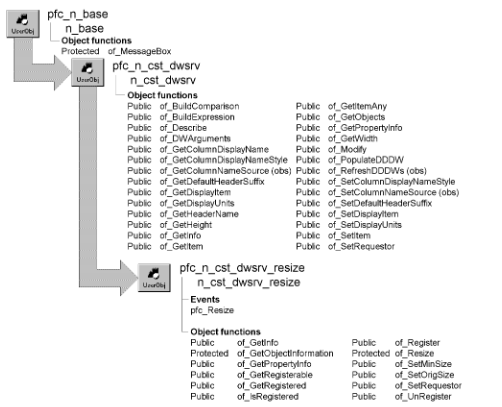

# n_cst_dwsrv_resize

**Description**

DataWindow resize service. This object resizes the objects within a DataWindow object, including columns, computed fields, bitmaps, and text.

**Ancestry**



**Library**

- PFCDWSRV.PBL
- PFEDWSRV.PBL

**Object relationships**

- [n_cst_infoattrib](../05-global-structures-and-structure-objects/n_cst_infoattrib.md)
- [n_cst_propertyattrib](../05-global-structures-and-structure-objects/n_cst_propertyattrib.md)

**Usage**

Use this object’s functions to enable resizing of the objects displayed in a DataWindow object (so that when the user resizes the window, this service resizes DataWindow contents automatically).

**Presentation styles** You cannot use the DataWindow resize service with DataWindow objects that have the Composite or RichTextEdit presentation style.

This service provides two resizing options:

- **For simple resizing** Call the of_Register function passing n_cst_dwsrv_resize constants, such as FIXEDBOTTOM
- **For total control over resizing** Implement weighted resize by calling the of_Register function with explicit specifications for moving and scaling

To use the DataWindow resize service:

1. Enable the DataWindow resize service using the u_dw of_SetResize function (this example is from a DataWindow Constructor event):

   ```
   this.of_SetResize(TRUE)
   ```

2. (Optional) Call the of_SetMinSize function to specify a minimum size below which the DataWindow resize service no longer resizes DataWindow contents:

   ```
   this.inv_resize.of_SetMinSize &
      (this.width-50, this.height-100)
   ```

3. Specify the objects to be resized and how they should be resized by calling the of_Register function:

   ```
   this.inv_resize.of_Register("emp_fname", &
      0, 0, 50, 50)
   this.inv_resize.of_Register("emp_lname", &
      100, 0, 50, 50)
   ```

4. Enable the window resize service and register the DataWindow control (this example is from a window Open event):

   ```
   this.of_SetResize(TRUE)
   this.inv_resize.of_Register(dw_1, 0, 0, 100, 100)
   ```

5. (Optional) Call the of_UnRegister function to remove objects from the resize list.

**PFC 7 custom class extension** To further the extendibility of PFC, a new n_cst_dwsrv_resizeattrib custom class user object replaces the os_resize object structure that is now obsolete.

**See also**

- [n_cst_dwsrv](n_cst_dwsrv.md)
- [n_cst_resize](n_cst_resize.md)
- [u_dw](../06-standard-visual-user-objects/u_dw.md)

## Instance variables

N_cst_dwsrv_resize includes instance variables:

| Instance variable | Description | Data type | Access | Usage |
| --- | --- | --- | --- | --- |
| EMPTY | Constant set to an empty string | String | Protected | Internal |
| FIXEDBOTTOM | Constant set to FixedToBottom | String | Public | Use with of_Register |
| FIXEDBOTTOM_SCALERIGHT | Constant set to FixedToBottom&ScaleToRight | String | Public | Use with of_Register |
| FIXEDCENTER | Constant set to FixedToCenter (PFC 2025 and later) | String | Public | Use with of_Register |
| FIXEDCENTERBOTTOM | Constant set to FixedToCenterBottom (PFC 2025 and later) | String | Public | Use with of_Register |
| FIXEDCENTERLEFT | Constant set to FixedToCenterLeft (PFC 2025 and later) | String | Public | Use with of_Register |
| FIXEDCENTERRIGHT | Constant set to FixedToCenterRight (PFC 2025 and later) | String | Public | Use with of_Register |
| FIXEDCENTERTOP | Constant set to FixedToCenterTop (PFC 2025 and later) | String | Public | Use with of_Register |
| FIXEDRIGHT | Constant set to FixedToRight | String | Public | Use with of_Register |
| FIXEDRIGHT_SCALEBOTTOM | Constant set to FixedToRight&ScaleToBottom | String | Public | Use with of_Register |
| FIXEDRIGHTBOTTOM | Constant set to FixedToRight&Bottom | String | Public | Use with of_Register |
| ii_rounding | Rounding factor | Integer | Protected | Internal (default is 5) |
| il_parentminimumheight | Minimum height of DataWindow control | Long | Protected | Set with of_SetMinSize |
| il_parentminimumwidth | Minimum width of DataWindow control | Long | Protected | Set with of_SetMinSize |
| il_parentprevheight | Original height of DataWindow control | Long | Protected | Set with of_SetOrigSize |
| il_parentprevwidth | Original width of DataWindow control | Long | Protected | Set with of_SetOrigSize |
| inv_registered [] | Array of registered columns and text objects | n_cst_dws rv_resizeat trib | Protected | Set with of_Register |
| istr_registered[ ] |  | n_cst_dwsrv_resizeattrib | Protected |  |
| LINE | Constant set to "line" | String | Protected | Internal |
| SCALE | Constant set to "Scale" | String | Public | Use with of_Register |
| SCALEBOTTOM | Constant set to "ScaleToBottom" | String | Public | Use with of_Register |
| SCALERIGHT | Constant set to "ScaleToRight" | String | Public | Use with of_Register |
| SCALERIGHTBOTTOM | Constant set to "ScaleToRight&Bottom" | String | Public | Use with of_Register |

## Events

N_cst_dwsrv_resize includes a precoded event:

pfc_Resize

### Constructor

**Description**

DW Resize service.

**Syntax**

```
instancename.EVENT Constructor ( )
```

| Argument | Description |
| --- | --- |
| *instancename* | Instance name of n_cst_dwsrv_resize |

**Return value**

None.

### pfc_Resize

**Description**

Calls the of_Resize function.

**Syntax**

```
dwcontrol.instancename.EVENT pfc_Resize ( sizetype, newwidth,
newheight )
```

| Argument | Description |
| --- | --- |
| *dwcontrol* | Instance name of the u_dw-based DataWindow control |
| *instancename* | Instance name of n_cst_dwsrv_resize (the u_dw default is inv_resize) |
| *sizetype* | UnsignedLong specifying the resize type: |
|  | • 0 — (Restored) The window or DataWindow has been resized, but it was not minimized or maximized. The user may have dragged the borders or a script may have called the Resize PowerScript function |
|  | • 1 — (Minimized) The window or DataWindow has been minimized |
|  | • 2 — (Maximized) The window or DataWindow has been maximized |
| *newwidth* | Integer specifying the new DataWindow width |
| *newheight* | Integer specifying the new DataWindow height |

**Return value**

Integer. Returns 1 if the event succeeds and -1 if an error occurs.

**Usage**

This event is called by the u_dw Resize event.

## Functions

N_cst_dwsrv_resize contains precoded object functions:

- of_GetInfo
- of_GetObjectInformation
- of_GetPropertyInfo
- of_GetRegisterable
- of_GetRegistered
- of_IsRegistered
- of_Register
- of_Resize
- of_SetMinSize
- of_SetOrigSize
- of_SetRequestor
- of_UnRegister

### of_GetInfo

**Description**

Retrieves service information.

**Access**

Public

**Syntax**

```
dwcontrol.instancename.of_GetInfo ( infoobject )
```

| Argument | Description |
| --- | --- |
| *dwcontrol* | Instance name of the u_dw-based DataWindow control |
| *instancename* | Instance name of n_cst_dwsrv_resize (the u_dw default is inv_resize) |
| *infoobject* | N_cst_infoattrib instance into which the function places service information (passed by reference) |

**Return value**

Integer. Returns 1 if the function succeeds and -1 if an error occurs.

**Usage**

The DataWindow Properties window calls this function to access service information.

**Examples**

This example calls the of_GetInfo function:

```
n_cst_infoattrib  lnv_info

dw_1.inv_resize.of_GetInfo(lnv_info)
MessageBox("Info",  &
  "Description: " + lnv_info.is_description  &
    + ". Name: " + lnv_info.is_name)
```

### of_GetObjectInformation

**Description**

Retrieves information on a specified object within a DataWindow.

**Access**

Protected

**Syntax**

```
dwcontrol.instancename.of_GetObjectInformation ( control, type, x, y,
width, height )
```

| Argument | Description |
| --- | --- |
| *dwcontrol* | Instance name of the u_dw-based DataWindow control |
| *instancename* | Instance name of n_cst_dwsrv_resize (the u_dw default is inv_resize) |
| *control* | String specifying the object for which the function returns information |
| *type* | String into which the function places the object type Object types include column text, bitmap, compute, and so on (passed by reference) |
| *x* | Integer into which the function places the x coordinate (passed by reference) |
| *y* | Integer into which the function places the y coordinate (passed by reference) |
| *width* | Integer into which the function places the object’s width (passed by reference) |
| *height* | Integer into which the function places the object’s height (passed by reference) |

**Return value**

Integer. Returns 1 if the function succeeds and -1 if an error occurs.

**Usage**

Internal.

**Examples**

This example is from the of_Resize function:

```
...
IF Len(istr_registered[li_cnt].s_control) > 0 THEN
  li_rc = of_GetObjectInformation &
    (istr_registered[li_cnt].s_control, &
      ls_type, li_x, li_y, li_width, &
        li_height)
...
```

### of_GetPropertyInfo

**Description**

Retrieves information about the service’s properties.

**Access**

Public

**Syntax**

```
dwcontrol.instancename.of_GetPropertyInfo ( propertyobject )
```

| Argument | Description |
| --- | --- |
| *dwcontrol* | Instance name of the u_dw-based DataWindow control |
| *instancename* | Instance name of n_cst_dwsrv_resize (the u_dw default is inv_resize) |
| *propertyobject* | N_cst_propertyattrib instance into which the function places property information (passed by reference) |

**Return value**

Integer. Returns 1 if the function succeeds and -1 if an error occurs.

**Usage**

The DataWindow Properties window calls this function to access service information.

**Examples**

This example calls the of_GetPropertyInfo function:

```
n_cst_propertyattrib  lnv_prop

dw_1.inv_resize.of_GetPropertyInfo(lnv_prop)
MessageBox("Info",  &
  "Description: " + lnv_prop.is_description  &
    + ". Name: " + lnv_prop.is_name  &
      + ". Property tab text: " +  &
        lnv_prop.is_propertytabtext)
```

### of_GetRegisterable

**Description**

Retrieves an array of registerable columns.

**Access**

Public

**Syntax**

```
dwcontrol.instancename.of_GetRegisterable ( columns )
```

| Argument | Description |
| --- | --- |
| *dwcontrol* | Instance name of the u_dw-based DataWindow control |
| *instancename* | Instance name of n_cst_dwsrv_resize (the u_dw default is inv_resize) |
| *columns* | String array into which the function places a list of registerable columns (passed by reference) |

**Return value**

Integer. Returns the number of entries in the *columns* array.

**Examples**

This example calls the of_GetRegisterable function:

```
String   ls_columns[ ]
Integer  li_count, li_loop
li_loop =  &
   dw_1.inv_resize.of_GetRegisterable  &
     (ls_columns)
lb_1.Reset()
IF li_loop <> 0 THEN
  FOR li_count = 1 to li_loop
    lb_1.AddItem(ls_columns[li_count])
  NEXT
ELSE
  lb_1.AddItem("No Registerable columns")
END IF
```

### of_GetRegistered

**Description**

Retrieves information for a registered object.

**Access**

Public

**Syntax**

```
dwcontrol.instancename.of_GetRegistered ( object, scale, movex, movey,
scalewidth, scaleheight )
```

| Argument | Description |
| --- | --- |
| *dwcontrol* | Instance name of the u_dw-based DataWindow control |
| *instancename* | Instance name of n_cst_dwsrv_resize (the u_dw default is inv_resize) |
| *object* | DWObject or string specifying the object for which information is returned |
| *scale* | Boolean into which the function places the object’s scale switch (passed by reference) |
| *movex* | Integer into which the function places the object’s move x specification (passed by reference) |
| *movey* | Integer into which the function places the object’s move y specification (passed by reference) |
| *scalewidth* | Integer into which the function places the object’s scale width specification (passed by reference) |
| *scaleheight* | Integer into which the function places the object’s scale height specification (passed by reference) |

**Return value**

Integer. Returns 1 if the function succeeds and -1 if an error occurs.

**Examples**

This example calls the of_GetRegistered function:

```
...
dw_1.inv_resize.of_GetRegistered  &
    ("dept_id", lb_scale, li_x, li_y,  &
       li_scalewidth, li_scaleheight)
...
```

### of_IsRegistered

**Description**

Reports whether an object is registered.

**Access**

Public

**Syntax**

```
dwcontrol.instancename.of_IsRegistered ( column )
```

| Argument | Description |
| --- | --- |
| *dwcontrol* | Instance name of the u_dw-based DataWindow control |
| *instancename* | Instance name of n_cst_dwsrv_resize (the u_dw default is inv_resize) |
| *column* | String specifying the column to be checked |

**Return value**

Boolean. Returns TRUE if *column* is registered and FALSE if it is not.

**Examples**

This example calls the of_IsRegistered function:

```
IF NOT dw_1.inv_resize.of_IsRegistered  &
  ("dept_id") THEN
    dw_1.inv_resize.of_Register("dept_id",  &
      0, 0, 50, 50)
END IF
```

### of_Register

Registers an object within a DataWindow. The DataWindow resize service acts on registered objects only. There are four syntaxes:

| To register by specifying a | Use |
| --- | --- |
| DWObject variable and resize percentage | Syntax 1 |
| DWObject variable and resize method | Syntax 2 |
| String and resize percentage | Syntax 3 |
| String and resize method | Syntax 4 |

**One additional syntax** N_cst_dwsrv_resize supports one additional of_Register syntax, which is defined as protected and used internally by the other syntaxes.

For more information on this syntax, use the Object Browser.

| Syntax 1 | Specify a DWObject variable and resize percentages |
| --- | --- |

**Description**

Registers an object for resizing, given a DWObject variable and a set of resize percentages.

**Access**

Public

**Syntax**

```
dwcontrol.instancename.of_Register ( object, movex, movey, scalewidth,
scaleheight )
```

| Argument | Description |
| --- | --- |
| *dwcontrol* | Instance name of the u_dw-based DataWindow control |
| *instancename* | Instance name of n_cst_dwsrv_resize (the u_dw default is inv_resize) |
| *object* | DWObject variable specifying the object to be resized |
| *movex* | Integer specifying the percentage to move the object along the x axis |
| *movey* | Integer specifying the percentage to move the object along the y axis |
| *scalewidth* | Integer specifying the percentage to resize the object along the x axis |
| *scaleheight* | Integer specifying the percentage to resize the object along the y axis |

**Return value**

Integer. Returns 1 if the function succeeds and -1 if an error occurs.

**Usage**

You typically use either this syntax or Syntax 3 to register objects with the DataWindow resize service.

**Examples**

This example calls the of_Register function:

```
DWObject ldwo_obj

ldwo_obj = this.Object.emp_lname
this.inv_resize.of_Register &
   (ldwo_obj, inv_resize.0, 0, 50, 50)
ldwo_obj = this.Object.emp_fname
this.inv_resize.of_Register &
   (ldwo_obj, 100, 0, 50, 50)
this.of_SetTransObject(SQLCA)
this.of_Retrieve()
```

| Syntax 2 | Specify a DWObject variable and resize method |
| --- | --- |

**Description**

Registers an object for resizing, given a DWObject variable and a resize method.

**Access**

Public

**Syntax**

```
dwcontrol.instancename.of_Register ( object, resizemethod )
```

| Argument | Description |
| --- | --- |
| *dwcontrol* | Instance name of the u_dw-based DataWindow control |
| *instancename* | Instance name of n_cst_dwsrv_resize (the u_dw default is inv_resize) |
| *object* | DWObject variable specifying the object to be resized |
| *resizemethod* | String or n_cst_dwsrv_resize constant specifying the action the service takes when the DataWindow Resize event is triggered: |
|  | • "FixedToRight" or FIXEDRIGHT |
|  | • "FixedToBottom" or FIXEDBOTTOM |
|  | • "FixedToRight&Bottom" or FIXEDRIGHTBOTTOM |
|  | • "Scale" or SCALE |
|  | • "ScaleToRight" or SCALERIGHT |
|  | • "ScaleToBottom" or SCALEBOTTOM |
|  | • "ScaleToRight&Bottom" or SCALERIGHTBOTTOM |
|  | • "FixedToRight&ScaleToBottom" or FIXEDRIGHT_SCALEBOTTOM |
|  | • "FixedToBottom&ScaleToRight" or FIXEDBOTTOM_SCALERIGHT |
|  | • "FixedToCenter" or FIXEDCENTER: moves half as far as the DataWindow grows, to the right and down, so the object stays centered (PFC 2025 and later) |
|  | • "FixedToCenterTop" or FIXEDCENTERTOP: stays centered horizontally, fixed to the top |
|  | • "FixedToCenterBottom" or FIXEDCENTERBOTTOM: centered horizontally, fixed to the bottom |
|  | • "FixedToCenterLeft" or FIXEDCENTERLEFT: fixed to the left, centered vertically |
|  | • "FixedToCenterRight" or FIXEDCENTERRIGHT: fixed to the right, centered vertically |

**Return value**

Integer. Returns 1 if the function succeeds and -1 if an error occurs.

**Usage**

Because explicit move and resize percentages provide more flexibility when handling multiple objects, it’s usually best to use Syntax 1 instead.

**Examples**

This example calls the of_Register function:

```
DWObject ldwo_obj

ldwo_obj = this.Object.comments
this.inv_resize.of_Register &
  (ldwo_obj, inv_resize.SCALEBOTTOM)
this.of_SetTransObject(SQLCA)
this.of_Retrieve()
```

| Syntax 3 | Specify a string and resize percentages |
| --- | --- |

**Description**

Registers an object for resizing, given a string identifying the object and a set of resize percentages.

**Access**

Public

**Syntax**

```
dwcontrol.instancename.of_Register ( object, movex, movey, scalewidth,
scaleheight )
```

| Argument | Description |
| --- | --- |
| *dwcontrol* | Instance name of the u_dw-based DataWindow control |
| *instancename* | Instance name of n_cst_dwsrv_resize (the u_dw default is inv_resize) |
| *object* | String specifying the object to be resized |
| *movex* | Integer specifying the percentage to move the object along the x axis |
| *movey* | Integer specifying the percentage to move the object along the y axis |
| *scalewidth* | Integer specifying the percentage to resize the object along the x axis |
| *scaleheight* | Integer specifying the percentage to resize the object along the y axis |

**Return value**

Integer. Returns 1 if the function succeeds and -1 if an error occurs.

**Usage**

You typically use either this syntax or Syntax 1 to register objects with the DataWindow resize service.

**Examples**

This example calls the of_Register function:

```
this.of_SetResize(TRUE)
this.inv_resize.of_Register &
  ("emp_fname", 0, 0, 50, 50)
this.inv_resize.of_Register &
  ("emp_lname", 100, 0, 50, 50)
this.Event of_Retrieve()
```

| Syntax 4 | Specify a string and resize method |
| --- | --- |

**Description**

Registers an object for resizing, given a string identifying the object and a resize method.

**Access**

Public

**Syntax**

```
dwcontrol.instancename.of_Register ( object, resizemethod )
```

| Argument | Description |
| --- | --- |
| *dwcontrol* | Instance name of the u_dw-based DataWindow control |
| *instancename* | Instance name of n_cst_dwsrv_resize (the u_dw default is inv_resize) |
| *object* | String specifying the object to be resized |
| *resizemethod* | String or n_cst_dwsrv_resize constant specifying the action the service takes when the DataWindow Resize event is triggered: |
|  | • "FixedToRight" or FIXEDRIGHT |
|  | • "FixedToBottom" or FIXEDBOTTOM |
|  | • "FixedToRight&Bottom" or FIXEDRIGHTBOTTOM |
|  | • "Scale" or SCALE |
|  | • "ScaleToRight" or SCALERIGHT |
|  | • "ScaleToBottom" or SCALEBOTTOM |
|  | • "ScaleToRight&Bottom" or SCALERIGHTBOTTOM |
|  | • "FixedToRight&ScaleToBottom" or FIXEDRIGHT_SCALEBOTTOM |
|  | • "FixedToBottom&ScaleToRight" or FIXEDBOTTOM_SCALERIGHT |
|  | • "FixedToCenter" or FIXEDCENTER: moves half as far as the DataWindow grows, to the right and down, so the object stays centered (PFC 2025 and later) |
|  | • "FixedToCenterTop" or FIXEDCENTERTOP: stays centered horizontally, fixed to the top |
|  | • "FixedToCenterBottom" or FIXEDCENTERBOTTOM: centered horizontally, fixed to the bottom |
|  | • "FixedToCenterLeft" or FIXEDCENTERLEFT: fixed to the left, centered vertically |
|  | • "FixedToCenterRight" or FIXEDCENTERRIGHT: fixed to the right, centered vertically |

**Return value**

Integer. Returns 1 if the function succeeds and -1 if an error occurs.

**Usage**

Because explicit move and resize percentages provide more flexibility when handling multiple objects, it’s usually best to use Syntax 3 instead.

**Examples**

This example calls the of_Register function:

```
this.inv_resize.of_Register &
  ("comments", inv_resize.SCALEBOTTOM)
this.of_SetTransObject(SQLCA)
this.of_Retrieve()
```

### of_Resize

**Description**

Moves or resizes registered objects as specified in the of_Register function.

**Access**

Protected

**Syntax**

```
dwcontrol.instancename.of_Resize ( newwidth, newheight )
```

| Argument | Description |
| --- | --- |
| *dwcontrol* | Instance name of the u_dw-based DataWindow control |
| *instancename* | Instance name of n_cst_dwsrv_resize (the u_dw default is inv_resize) |
| *newwidth* | Integer specifying the new DataWindow width |
| *newheight* | Integer specifying the new DataWindow height |

**Return value**

Integer. Returns 1 if the function succeeds and -1 if an error occurs.

**Usage**

The pfc_Resize event calls this function when the DataWindow is resized.

**Examples**

This example is from the pfc_Resize event:

```
Return of_Resize(ai_newwidth, ai_newheight)
```

### of_SetMinSize

**Description**

Sets a minimum DataWindow size below which the resize service no longer modifies the position of registered objects.

**Access**

Public

**Syntax**

```
dwcontrol.instancename.of_SetMinSize ( minimumwidth, minimumheight )
```

| Argument | Description |
| --- | --- |
| *dwcontrol* | Instance name of the u_dw-based DataWindow control |
| *instancename* | Instance name of n_cst_dwsrv_resize (the u_dw default is inv_resize) |
| *minimumwidth* | Integer specifying minimum width |
| *minimumheight* | Integer specifying minimum height |

**Return value**

Integer. Returns 1 if the function succeeds and -1 if an error occurs.

**Usage**

Test different control sizes in the Window or User Object painter to determine an appropriate minimum size.

**Examples**

This example calls the of_SetMinSize function in a DataWindow Constructor event:

```
this.of_SetResize(TRUE)
this.inv_resize.of_SetMinSize &
  (this.width - 50, this.height - 100)
...
```

### of_SetOrigSize

**Description**

Saves the current DataWindow control size.

**Access**

Public

**Syntax**

```
dwcontrol.instancename.of_SetOrigSize ( width, height )
```

| Argument | Description |
| --- | --- |
| *dwcontrol* | Instance name of the u_dw-based DataWindow control |
| *instancename* | Instance name of n_cst_dwsrv_resize (the u_dw default is inv_resize) |
| *width* | Integer specifying the DataWindow width |
| *height* | Integer specifying the DataWindow height |

**Return value**

Integer. Returns 1 if the function succeeds and -1 if an error occurs.

**Usage**

The u_dw of_SetResize function calls this function to set the original DataWindow control size. If you want to modify the original size, you must call this function before calling the of_Register function.

**Examples**

This example is from the u_dw of_SetResize function:

```
IF ab_switch THEN
  IF IsNull(inv_resize) OR NOT &
    IsValid(inv_resize) THEN
      inv_resize = CREATE n_cst_dwsrv_resize
      inv_resize.of_SetRequestor(this)
      inv_resize.of_SetOrigSize &
        (this.Width, this.Height)
      Return 1
  END IF
...
```

### of_SetRequestor

**Description**

Associates a DataWindow control with this instance of n_cst_dwsrv_resize and ensures that the DataWindow uses a valid presentation style. The DataWindow resize service does not support the Composite and RichTextEdit presentation styles.

**Access**

Public

**Syntax**

```
dwcontrol.instancename.of_SetRequestor ( requestor )
```

| Argument | Description |
| --- | --- |
| *dwcontrol* | Instance name of the u_dw-based DataWindow control |
| *instancename* | Instance name of n_cst_dwsrv_resize (the u_dw default is inv_resize) |
| *requestor* | U_dw-based DataWindow window control to associate with this instance of n_cst_dwsrv_resize |

**Return value**

Integer. Returns 1 if the function succeeds and -1 if an error occurs.

**Usage**

The u_dw of_SetResize function calls this function.

**Examples**

This example is from the u_dw of_SetResize function:

```
IF ab_Switch THEN
  IF IsNull(inv_resize) OR NOT &
    IsValid(inv_resize) THEN
      inv_resize = CREATE n_cst_dwsrv_resize
      inv_resize.of_SetRequestor(this)
      inv_resize.of_SetOrigSize &
        (this.Width, this.Height)
      Return 1
  END IF
...
```

### of_UnRegister

Removes an object from the list of registered objects. There are two syntaxes:

| To unregister by specifying a | Use |
| --- | --- |
| DWObject variable | Syntax 1 |
| String | Syntax 2 |

| Syntax 1 | Specify a DWObject |
| --- | --- |

**Description**

Removes an object from the list of registered objects, given a DWObject variable.

**Access**

Public

**Syntax**

```
dwcontrol.instancename.of_UnRegister ( object )
```

| Argument | Description |
| --- | --- |
| *dwcontrol* | Instance name of the u_dw-based DataWindow control |
| *instancename* | Instance name of n_cst_dwsrv_resize (the u_dw default is inv_resize) |
| *object* | DWObject variable specifying the object to be removed from the list of registered objects |

**Return value**

Integer. Returns 1 if the function succeeds and -1 if an error occurs.

**Examples**

This example calls the of_UnRegister function:

```
DWObject ldwo_obj

ldwo_obj = this.Object.emp_lname
this.inv_resize.of_UnRegister (ldwo_obj)
```

| Syntax 2 | Specify a string |
| --- | --- |

**Description**

Removes an object from the list of registered objects, given a string.

**Access**

Public

**Syntax**

```
dwcontrol.instancename.of_UnRegister ( object )
```

| Argument | Description |
| --- | --- |
| *dwcontrol* | Instance name of the u_dw-based DataWindow control |
| *instancename* | Instance name of n_cst_dwsrv_resize (the u_dw default is inv_resize) |
| *object* | String specifying the object to be removed from the list of registered objects |

**Return value**

Integer. Returns 1 if the function succeeds and -1 if an error occurs.

**Examples**

This example calls the of_UnRegister function:

```
this.inv_resize.of_UnRegister ("emp_fname")
```
