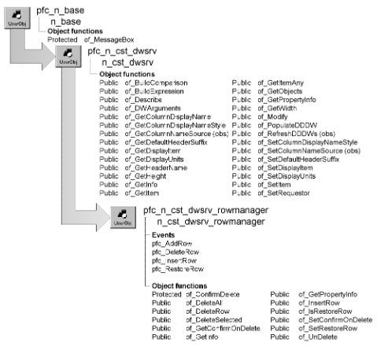

# n_cst_dwsrv_rowmanager

**Description**

Row management service. Contains functions and events that allow you to:

- Add an empty row to the end of the DataWindow
- Insert an empty row between two existing rows
- Delete one or more rows
- Restores the last delete

**Ancestry**



**Library**

- PFCDWSRV.PBL
- PFEDWSRV.PBL

**Object relationships**

- [n_cst_infoattrib](../05-global-structures-and-structure-objects/n_cst_infoattrib.md)
- [n_cst_propertyattrib](../05-global-structures-and-structure-objects/n_cst_propertyattrib.md)

**Usage**

Use this service to enhance your application’s row management capabilities. You can insert rows, delete rows, and restore deleted rows.

To use this service:

1. Enable the service using the u_dw of_SetRowManager function:

   ```
   dw_emp.of_SetRowManager(TRUE)
   ```

2. (Optional) Enable restore row functionality by calling the of_SetRestoreRow function:

   ```
   dw_emp.inv_rowmanager.of_SetRestoreRow(TRUE)
   ```

3. Call row management events and functions as needed.

**See also**

- [n_cst_dwsrv_linkage](n_cst_dwsrv_linkage.md)
- [u_dw](../06-standard-visual-user-objects/u_dw.md)

## Instance variables

N_cst_dwsrv_rowmanager includes instance variables:

| Instance variable | Description | Data type | Access | Usage |
| --- | --- | --- | --- | --- |
| ib_confirmondelete | Indicates whether the service prompts users before deleting rows | Boolean | Protected | Internal |
| ib_restorerow | Indicates whether restore row functionality is enabled | Boolean | Protected | Set with of_SetRestoreRow |

## Events

N_cst_dwsrv_rowmanager includes precoded events:

- pfc_AddRow
- pfc_DeleteRow
- pfc_InsertRow
- pfc_RestoreRow

### pfc_AddRow

**Description**

Inserts a new row at the end of the DataWindow and sets focus.

**Return value**

Long. Returns the number of the inserted row if the event succeeds and -1 if an error occurs.

**Usage**

This event executes when the user selects Add from the m_dw popup menu.

### pfc_DeleteRow

**Description**

Deletes the currently selected row or rows.

**Return value**

Long. Returns the number of rows deleted if the event succeeds and -1 if an error occurs.

**Usage**

This event executes when the user selects Delete from the m_dw popup menu.

### pfc_InsertRow

**Description**

Inserts a new row into the associated DataWindow and sets focus.

**Syntax**

```
dwcontrol.instancename.Event pfc_InsertRow ( nextrow )
```

| Argument | Description |
| --- | --- |
| *dwcontrol* | Instance name of the u_dw-based DataWindow control |
| *instancename* | Instance name of n_cst_dwsrv_rowmanager (the u_dw default is inv_rowmanager). |
| *nextrow* | Long specifying the row before which the event adds a row. From within the pfc_InsertRow event, access this value through the *al_beforerow* argument |

**Return value**

Long. Returns the number of the inserted row if the event succeeds and -1 if an error occurs.

**Usage**

This event executes when the user selects Insert from the m_dw popup menu.

### pfc_RestoreRow

**Description**

Displays the w_restorerow dialog box, allowing users to restore previously deleted rows.

**Return value**

Long. Returns the number of rows retrieved if the event succeeds, -1 if an error occurs, and -2 if there are no rows in the undelete buffer.

**Usage**

This event executes when the user selects Restore from the m_dw popup menu.

## Functions

N_cst_dwsrv_rowmanager includes precoded object functions:

- of_ConfirmDelete
- of_DeleteAll
- of_DeleteRow
- of_DeleteSelected
- of_GetConfirmOnDelete
- of_GetInfo
- of_GetPropertyInfo
- of_InsertRow
- of_IsRestoreRow
- of_SetConfirmOnDelete
- of_SetRestoreRow
- of_UnDelete

### of_ConfirmDelete

**Description**

Displays a message box, prompting the user to confirm a deletion request.

**Access**

Protected

**Syntax**

```
dwcontrol.instancename.of_ConfirmDelete ( amount )
```

| Argument | Description |
| --- | --- |
| *dwcontrol* | Instance name of the u_dw-based DataWindow control |
| *instancename* | Instance name of n_cst_dwsrv_rowmanager (the u_dw default is inv_rowmanager) |
| *amount* | Long specifying the number of rows to be deleted |

**Return value**

Integer. Returns 1 if the deletion should continue, 2 if the deletion should not continue, and -1 if an error occurs.

**Usage**

Internal.

**Examples**

This example calls the of_ConfirmDelete function:

```
...
IF ib_confirmondelete THEN
   li_confirm = of_ConfirmDelete(ll_rowcount)
END IF
...
```

### of_DeleteAll

**Description**

Deletes all rows from the associated DataWindow’s primary buffer.

**Access**

Public

**Syntax**

```
dwcontrol.instancename.of_DeleteAll ( )
```

| Argument | Description |
| --- | --- |
| *dwcontrol* | Instance name of the u_dw-based DataWindow control |
| *instancename* | Instance name of n_cst_dwsrv_rowmanager (the u_dw default is inv_rowmanager) |

**Return value**

Integer. Returns the number of rows deleted if the function succeeds and -1 if an error occurs.

**Usage**

You must still code a PowerScript Update function to apply the changes to the database.

**Examples**

This example deletes all rows:

```
Integer   li_return

li_return = &
   dw_emplist.inv_rowmanager.of_DeleteAll( )
...
```

### of_DeleteRow

**Description**

Deletes the specified row in the DataWindow. After the delete, the function sets focus to the next row in the DataWindow at the first column with a nonzero tab order.

**Access**

Public

**Syntax**

```
dwcontrol.instancename.of_DeleteRow ( rownumber )
```

| Argument | Description |
| --- | --- |
| *dwcontrol* | Instance name of the u_dw-based DataWindow control |
| *instancename* | Instance name of n_cst_dwsrv_rowmanager (the u_dw default is inv_rowmanager) |
| *rownumber* | Long specifying the row to be deleted. If *rownumber* is zero, the function deletes the current row |

**Return value**

Integer. Returns 1 if the row is deleted successfully, 0 if the row was not deleted, and -1 if an error occurs.

**Usage**

You must still code a PowerScript Update function to apply the changes to the database.

You can call of_UnDelete to reverse deletions made by of_DeleteRow.

**Examples**

This example deletes the current row:

```
Integer   li_return

li_return = dw_emplist.inv_rowmanager.of_DeleteRow(0)
...
```

### of_DeleteSelected

**Description**

Deletes all selected rows in the DataWindow.

**Access**

Public

**Syntax**

```
dwcontrol.instancename.of_DeleteSelected ( )
```

| Argument | Description |
| --- | --- |
| *dwcontrol* | Instance name of the u_dw-based DataWindow control |
| *instancename* | Instance name of n_cst_dwsrv_rowmanager (the u_dw default is inv_rowmanager) |

**Return value**

Integer. Returns the number of rows deleted if the function succeeds and -1 if an error occurs.

**Usage**

Call this function in conjunction with the row selection service to delete multiple rows in a DataWindow. You must still code an Update function to apply the changes to the database.

**Examples**

This example deletes all selected rows. It assumes that you have enabled multirow selection via the u_dw of_SetRowSelect function:

```
Integer   li_return

li_return = &
   dw_emplist.inv_rowmanager.of_DeleteSelected( )
...
```

### of_GetConfirmOnDelete

**Description**

Reports whether the service prompts the user to confirm deletion requests.

**Access**

Public

**Syntax**

```
dwcontrol.instancename.of_GetConfirmOnDelete ( )
```

| Argument | Description |
| --- | --- |
| *dwcontrol* | Instance name of the u_dw-based DataWindow control |
| *instancename* | Instance name of n_cst_dwsrv_rowmanager (the u_dw default is inv_rowmanager) |

**Return value**

Boolean. Returns TRUE if the service confirms deletions and FALSE if it does not.

**Examples**

This example calls the of_GetConfirmOnDelete function:

```
n_cst_conversion   lnv_conversion
Boolean   lb_confirm

lb_confirm = &
   dw_emp.inv_rowmanager.of_GetConfirmOnDelete( )
   essageBox("Delete", "Confirm on delete is " &
   + lnv_conversion.of_String(lb_confirm) )
```

### of_GetInfo

**Description**

Retrieves service information.

**Access**

Public

**Syntax**

```
dwcontrol.instancename.of_GetInfo ( infoobject )
```

| Argument | Description |
| --- | --- |
| *dwcontrol* | Instance name of the u_dw-based DataWindow control |
| *instancename* | Instance name of n_cst_dwsrv_rowmanager (the u_dw default is inv_rowmanager) |
| *infoobject* | N_cst_infoattrib instance into which the function places service information (passed by reference) |

**Return value**

Integer. Returns 1 if the function succeeds and -1 if an error occurs.

**Usage**

The DataWindow Properties window calls this function to access service information.

**Examples**

This example calls the of_GetInfo function:

```
n_cst_infoattrib  lnv_info

dw_1.inv_rowmanager.of_GetInfo(lnv_info)
MessageBox("Info",  &
  "Description: " + lnv_info.is_description  &
    + ". Name: " + lnv_info.is_name)
```

### of_GetPropertyInfo

**Description**

Retrieves information about the service’s properties.

**Access**

Public

**Syntax**

```
dwcontrol.instancename.of_GetPropertyInfo ( propertyobject )
```

| Argument | Description |
| --- | --- |
| *dwcontrol* | Instance name of the u_dw-based DataWindow control |
| *instancename* | Instance name of n_cst_dwsrv_rowmanager (the u_dw default is inv_rowmanager) |
| *propertyobject* | N_cst_propertyattrib instance into which the function places property information (passed by reference) |

**Return value**

Integer. Returns 1 if the function succeeds and -1 if an error occurs.

**Usage**

The DataWindow Properties window calls this function to access service information.

**Examples**

This example calls the of_GetPropertyInfo function:

```
n_cst_propertyattrib  lnv_prop

dw_1.inv_rowmanager.of_GetPropertyInfo(lnv_prop)
MessageBox("Info",  &
  "Description: " + lnv_prop.is_description  &
    + ". Name: " + lnv_prop.is_name  &
      + ". Property tab text: " +  &
        lnv_prop.is_propertytabtext)
```

### of_InsertRow

**Description**

Inserts a row in the DataWindow at a specified place, then sets focus to the first column with tab order and scrolls to the new row.

**Access**

Public

**Syntax**

```
dwcontrol.instancename.of_InsertRow ( insertionpoint )
```

| Argument | Description |
| --- | --- |
| *dwcontrol* | Instance name of the u_dw-based DataWindow control |
| *instancename* | Instance name of n_cst_dwsrv_rowmanager (the u_dw default is inv_rowmanager) |
| *insertionpoint* | Long specifying the row before which the function inserts the new row. Specify 0 to insert at the end of all rows |

**Return value**

Long. Returns the new row number if the function succeeds and -1 if an error occurs.

**Examples**

This example inserts a new row at the end of the DataWindow:

```
dw_emplist.inv_rowmanager.of_InsertRow(0)
```

### of_IsRestoreRow

**Description**

Reports whether restore row functionality is enabled.

**Access**

Public

**Syntax**

```
dwcontrol.instancename.of_IsRestoreRow ( )
```

| Argument | Description |
| --- | --- |
| *dwcontrol* | Instance name of the u_dw-based DataWindow control |
| *instancename* | Instance name of n_cst_dwsrv_rowmanager (the u_dw default is inv_rowmanager) |

**Return value**

Boolean. Returns TRUE if restore row functionality is enabled and FALSE if it is not.

**Examples**

This example calls the of_IsRestoreRow function:

```
IF dw_1.inv_rowmanager.of_IsRestoreRow() THEN
   MessageBox("RowMan", "Restore row is enabled")
ELSE
   MessageBox("RowMan", "Restore row is disabled")
END IF
```

### of_SetConfirmOnDelete

**Description**

Specifies whether the service prompts the user to confirm deletion requests.

**Access**

Public

**Syntax**

```
dwcontrol.instancename.of_SetConfirmOnDelete ( boolean )
```

| Argument | Description |
| --- | --- |
| *dwcontrol* | Instance name of the u_dw-based DataWindow control |
| *instancename* | Instance name of n_cst_dwsrv_rowmanager (the u_dw default is inv_rowmanager) |
| *boolean* | Boolean indicating whether the service prompts the user to confirm deletion request (TRUE) or not (FALSE) |

**Return value**

Integer. Returns 1 if the function succeeds and -1 if an error occurs.

**Examples**

This example calls the of_SetConfirmOnDelete function:

```
dw_emp.inv_rowmanager.of_SetConfirmOnDelete(FALSE)
```

### of_SetRestoreRow

**Description**

Specifies whether restore row functionality is enabled.

**Access**

Public

**Syntax**

```
dwcontrol.instancename.of_SetRestoreRow ( boolean )
```

| Argument | Description |
| --- | --- |
| *dwcontrol* | Instance name of the u_dw-based DataWindow control |
| *instancename* | Instance name of n_cst_dwsrv_rowmanager (the u_dw default is inv_rowmanager) |
| *boolean* | Boolean indicating whether to enable (TRUE) or disable (FALSE) restore row functionality |

**Return value**

Integer. Returns 1 if the function succeeds and -1 if an error occurs.

**Usage**

When restore row functionality is enabled, users can display the w_restorerow dialog box by right clicking and selecting Restore from the popup menu.

**Examples**

This example calls the of_SetRestoreRow function:

```
dw_1.of_SetRowManager(TRUE)
dw_1.inv_rowmanager.of_SetRestoreRow(TRUE)
```

### of_UnDelete

**Description**

Displays the w_restorerow dialog box, allowing users to restore deleted rows.

**Access**

Public

**Syntax**

```
dwcontrol.instancename.of_UnDelete ( )
```

| Argument | Description |
| --- | --- |
| *dwcontrol* | Instance name of the u_dw-based DataWindow control |
| *instancename* | Instance name of n_cst_dwsrv_rowmanager (the u_dw default is inv_rowmanager) |

**Return value**

Long. Returns the number of restored rows if the function succeeds, -1 if an error occurs, and -2 if the delete buffer is empty.

**Usage**

Call this function to display the w_restorerow dialog box, which allows users to restore deleted rows from the Deleted buffer. This means that newly added rows that you delete before saving to the database can’t be undeleted, since they never get copied to the Deleted buffer.

**Examples**

This example calls the of_UnDelete function:

```
IF dw_emplist.inv_rowmanager.of_UnDelete( ) = -1 THEN
   MessageBox("Undelete", "Undelete error")
ELSE
   nv_app.of_GetFrame( ).SetMicroHelp &
   ("Undelete was successful")
END IF
```
