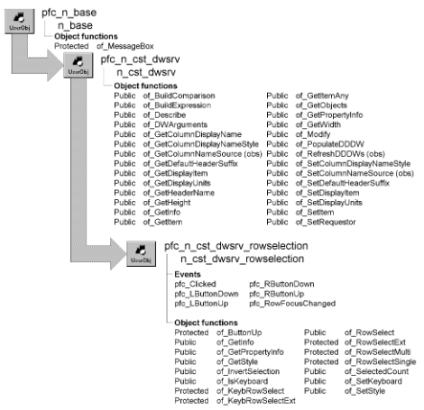

# n_cst_dwsrv_rowselection

**Description**

Row selection service. You can implement different styles of this service:

- **Single-row selection** Handles row selection when your DataWindow allows one row to be selected at a time.
- **Multirow selection** Handles row selection by allowing your runtime users to select multiple rows with single clicks. These rows can be contiguous or noncontiguous.

  When multirow selection is enabled, runtime users toggle a row’s selected state by clicking it. This capability is similar to a ListBox’s MultiSelect property.

- **Extended selection** Handles row selection by allowing your runtime users to select multiple rows with SHIFT+click, CTRL+click, and CTRL+ SHIFT+click.

  This capability is similar to a ListBox’s ExtendedSelect property.

**Ancestry**



**Library**

- PFCDWSRV.PBL
- PFEDWSRV.PBL

**Object relationships**

- [n_cst_infoattrib](../05-global-structures-and-structure-objects/n_cst_infoattrib.md)
- [n_cst_propertyattrib](../05-global-structures-and-structure-objects/n_cst_propertyattrib.md)

**Usage**

This service handles all row selection automatically. You don’t need to add any code to implement row selection itself.

To use this service:

1. Enable the service using the u_dw of_SetRowSelect function:

   ```
   dw_emp.of_SetRowSelect(TRUE)
   ```

2. Specify the row selection option by calling the of_SetStyle function with one of the following arguments:
   - **SINGLE or 0** Single-row selection
   - **MULTIPLE or 1** Multirow selection
   - **EXTENDED or 2** Extended selection

**Selecting rows in extended mode** If you choose the extended mode for a tabular list style DataWindow, the mouse pointer must be somewhere inside the DataWindow in order to select rows with the space bar.

This example enables extended selection:

```
dw_emp.inv_rowselect.of_SetStyle  &
   (dw_emp.inv_rowselect.EXTENDED)
```

3. Add logic to your application to access and process selected rows. For example, you might call the row manager service’s pfc_DeleteRow event to delete all selected rows:

   ```
   IF dw_emp.inv_rowmanager.Event pfc_DeleteRow() &
      = -1 THEN
      MessageBox("Error", "Deletion error")
   END IF
   ```

**See also**

- [n_cst_dwsrv_rowmanager](n_cst_dwsrv_rowmanager.md)
- [n_cst_selection](n_cst_selection.md)
- [u_dw](../06-standard-visual-user-objects/u_dw.md)

## Instance variables

N_cst_dwsrv_rowselection includes instance variables:

| Instance variable | Description | Data type | Access | Usage |
| --- | --- | --- | --- | --- |
| EXTENDED | Constant set to 2 | Integer | Public | Use with of_SetStyle |
| ib_keyboard | Indicates whether keyboard support is active | Boolean | Protected | Internal |
| ib_lbuttonpressed | Indicates that the user is pressing the left mouse button | Boolean | Protected | Internal |
| ib_prevcntrl | Indicates whether the user pressed the CTRL key the last time a row was clicked | Boolean | Protected | Internal |
| ib_prevshift | Indicates whether the user pressed the SHIFT key the last time a row was clicked | Boolean | Protected | Internal |
| ib_rbuttonpressed | Indicates that the user is pressing the right mouse button | Boolean | Protected | Internal |
| ii_style | Indicates whether single-row, multirow, or extended selection service is enabled | Integer | Protected | Internal |
| il_anchorrow | Number of the row that is the current anchor point | Long | Protected | Internal |
| il_currclickedrow | Tracks the number of the current clicked row | Long | Protected | Internal |
| il_prevclickedrow | Tracks the number of the last clicked row | Long | Protected | Internal |
| il_prevrow | Previous row | Long | Protected | Internal |
| il_prevrowcount | Row count before last row focus change | Long | Protected | Internal |
| MULTIPLE | Constant set to 1 | Integer | Public | Use with of_SetStyle |
| SINGLE | Constant set to 0 | Integer | Public | Use with of_SetStyle |

## Events

N_cst_dwsrv_rowselection includes precoded events:

- pfc_Clicked
- pfc_LButtonDown
- pfc_LButtonUp
- pfc_RButtonDown
- pfc_RButtonUp
- pfc_RowFocusChanged

### pfc_Clicked

**Description**

Selects or clears rows based on the pressed keys and the row selection option.

**Syntax**

```
dwcontrol.instancename.Event pfc_Clicked ( x, y, row, dwobject )
```

| Argument | Description |
| --- | --- |
| *dwcontrol* | Instance name of the u_dw-based DataWindow control |
| *instancename* | Instance name of n_cst_dwsrv_rowselection (the u_dw default is inv_rowselect) |
| *x* | Integer indicating the *x* position of the mouse click. From within the pfc_Clicked event, access this value through the *ai_xpos* argument |
| *y* | Integer indicating the *y* position of the mouse click. From within the pfc_Clicked event, access this value through the *ai_ypos* argument |
| *row* | Long indicating the clicked row. From within the pfc_Clicked event, access this value through the *al_row* argument |
| *dwobject* | DWObject variable indicating the clicked object (passed by reference). From within the pfc_Clicked event, access this value through the *adwo_obj* argument |

**Return value**

Integer. Returns 1 if the function succeeds and -1 if an error occurs.

**Usage**

This event is called by the u_dw Clicked event.

### pfc_LButtonDown

**Description**

Processes row selection when the user presses the left mouse button.

**Syntax**

```
dwcontrol.instancename.Event pfc_LButtonDown ( flags, x, y )
```

| Argument | Description |
| --- | --- |
| *dwcontrol* | Instance name of the u_dw-based DataWindow control |
| *instancename* | Instance name of n_cst_dwsrv_rowselection (the u_dw default is inv_rowselect) |
| *flags* | Unsigned long indicating the modifier keys and mouse buttons that are pressed. Values are: |
|  | 1—Left mouse button 2—Right mouse button 4— SHIFT key 8— CTRL key 16—Middle mouse button |
|  | From within the pfc_LButtonDown event, access this value through the *aul_flags* argument |
| *x* | Integer indicating the *x* position of the mouse click. From within the pfc_LButtonDown event, access this value through the *ai_xpos* argument |
| *y* | Integer indicating the *y* position of the mouse click. From within the pfc_LButtonDown event, access this value through the *ai_ypos* argument |

**Usage**

This event is called by the u_dw LButtonDown event.

### pfc_LButtonUp

**Description**

Processes row selection when the user releases the left mouse button.

**Syntax**

```
dwcontrol.instancename.Event pfc_LButtonUp ( flags, x, y )
```

| Argument | Description |
| --- | --- |
| *dwcontrol* | Instance name of the u_dw-based DataWindow control |
| *instancename* | Instance name of n_cst_dwsrv_rowselection (the u_dw default is inv_rowselect) |
| *flags* | Unsigned Long indicating the modifier keys and mouse buttons that are pressed. Values are: |
|  | 1—Left mouse button 2—Right mouse button 4— SHIFT key 8— CTRL key 16—Middle mouse button |
|  | From within the pfc_LButtonUp event, access this value through the *aul_flags* argument |
| *x* | Integer indicating the *x* position of the mouse click. From within the pfc_LButtonUp event, access this value through the *ai_xpos* argument |
| *y* | Integer indicating the *y* position of the mouse click. From within the pfc_LButtonUp event, access this value through the *ai_ypos* argument |

**Usage**

This event is called by the u_dw LButtonUp event.

### pfc_RButtonDown

**Description**

Processes row selection when the user presses the right mouse button.

**Syntax**

```
dwcontrol.instancename.Event pfc_RButtonDown ( flags, x, y )
```

| Argument | Description |
| --- | --- |
| *dwcontrol* | Instance name of the u_dw-based DataWindow control |
| *instancename* | Instance name of n_cst_dwsrv_rowselection (the u_dw default is inv_rowselect) |
| *flags* | Unsigned Long indicating the modifier keys and mouse buttons that are pressed. Values are: |
|  | 1—Left mouse button 2—Right mouse button 4— SHIFT key 8— CTRL key 16—Middle mouse button |
|  | From within the pfc_RButtonDown event, access this value through the *aul_flags* argument |
| *x* | Integer indicating the *x* position of the mouse click. From within the pfc_RButtonDown event, access this value through the *ai_xpos* argument |
| *y* | Integer indicating the *y* position of the mouse click. From within the pfc_RButtonDown event, access this value through the *ai_ypos* argument |

**Return value**

None

**Usage**

This event is called by the u_dw RButtonDown event.

### pfc_RButtonUp

**Description**

Processes row selection when the user releases the right mouse button.

**Syntax**

```
dwcontrol.instancename.Event pfc_RButtonUp ( flags, x, y )
```

| Argument | Description |
| --- | --- |
| *dwcontrol* | Instance name of the u_dw-based DataWindow control |
| *instancename* | Instance name of n_cst_dwsrv_rowselection (the u_dw default is inv_rowselect) |
| *flags* | Unsigned Long indicating the modifier keys and mouse buttons that are pressed. Values are: |
|  | 1—Left mouse button 2—Right mouse button 4— SHIFT key 8— CTRL key 16—Middle mouse button |
|  | From within the pfc_RButtonUp event, access this value through the *aul_flags* argument |
| *x* | Integer indicating the *x* position of the mouse click. From within the pfc_RButtonUp event, access this value through the *ai_xpos* argument |
| *y* | Integer indicating the *y* position of the mouse click. From within the pfc_RButtonUp event, access this value through the *ai_ypos* argument |

**Return value**

None

**Usage**

This event is called by the u_dw RButtonUp event.

### pfc_RowFocusChanged

**Description**

Implements keyboard support for row selection.

**Syntax**

```
dwcontrol.instancename.Event pfc_RowFocusChanged ( row )
```

| Argument | Description |
| --- | --- |
| *dwcontrol* | Instance name of the u_dw-based DataWindow control |
| *instancename* | Instance name of n_cst_dwsrv_rowselection (the u_dw default is inv_rowselect) |
| *row* | Long specifying the new row. From within the pfc_RowFocusChanged event, access this value through the *al_row* argument |

**Return value**

Integer. Returns 1 if the event succeeds and -1 if an error occurs.

**Usage**

This event is called by the u_dw RowFocusChanged event.

## Functions

N_cst_dwsrv_rowselection contains precoded object functions:

- of_ButtonUp
- of_GetInfo
- of_GetPropertyInfo
- of_GetStyle
- of_InvertSelection
- of_IsKeyboard
- of_KeybRowSelect
- of_KeybRowSelectExt
- of_RowSelect
- of_RowSelectExt
- of_RowSelectMulti
- of_RowSelectSingle
- of_SelectedCount
- of_SetKeyboard
- of_SetStyle

### of_ButtonUp

**Description**

Performs extended selection processing.

**Access**

Protected

**Syntax**

```
dwcontrol.instancename.of_ButtonUp ( )
```

| Argument | Description |
| --- | --- |
| *dwcontrol* | Instance name of the u_dw-based DataWindow control |
| *instancename* | Instance name of n_cst_dwsrv_rowselection (the u_dw default is inv_rowselect) |

**Return value**

Integer. Returns 1 if the function succeeds and -1 if an error occurs.

**Usage**

Internal.

**Examples**

This example is from the pfc_RButtonUp event:

```
ib_buttonpressed = FALSE
of_ButtonUp( )
```

### of_GetInfo

**Description**

Retrieves service information.

**Access**

Public

**Syntax**

```
dwcontrol.instancename.of_GetInfo ( infoobject )
```

| Argument | Description |
| --- | --- |
| *dwcontrol* | Instance name of the u_dw-based DataWindow control |
| *instancename* | Instance name of n_cst_dwsrv_rowselection (the u_dw default is inv_rowselect) |
| *infoobject* | N_cst_infoattrib instance into which the function places service information (passed by reference) |

**Return value**

Integer. Returns 1 if the function succeeds and -1 if an error occurs.

**Usage**

The DataWindow Properties window calls this function to access service information.

**Examples**

This example calls the of_GetInfo function:

```
n_cst_infoattrib  lnv_info

dw_1.inv_rowselect.of_GetInfo(lnv_info)
MessageBox("Info",  &
  "Description: " + lnv_info.is_description  &
    + ". Name: " + lnv_info.is_name)
```

### of_GetPropertyInfo

**Description**

Retrieves information about the service’s properties.

**Access**

Public

**Syntax**

```
dwcontrol.instancename.of_GetPropertyInfo ( propertyobject )
```

| Argument | Description |
| --- | --- |
| *dwcontrol* | Instance name of the u_dw-based DataWindow control |
| *instancename* | Instance name of n_cst_dwsrv_rowselection (the u_dw default is inv_rowselect) |
| *propertyobject* | N_cst_propertyattrib instance into which the function places property information (passed by reference) |

**Return value**

Integer. Returns 1 if the function succeeds and -1 if an error occurs.

**Usage**

The DataWindow Properties window calls this function to access service information.

**Examples**

This example calls the of_GetPropertyInfo function:

```
n_cst_propertyattrib  lnv_prop

dw_1.inv_rowselect.of_GetPropertyInfo(lnv_prop)
MessageBox("Info",  &
  "Description: " + lnv_prop.is_description  &
    + ". Name: " + lnv_prop.is_name  &
      + ". Property tab text: " +  &
        lnv_prop.is_propertytabtext)
```

### of_GetStyle

**Description**

Retrieves the currently enabled selection option.

**Access**

Public

**Syntax**

```
dwcontrol.instancename.of_GetStyle ( )
```

| Argument | Description |
| --- | --- |
| *dwcontrol* | Instance name of the u_dw-based DataWindow control |
| *instancename* | Instance name of n_cst_dwsrv_rowselection (the u_dw default is inv_rowselect) |

**Return value**

Integer. Returns one of the following values:

- **SINGLE or 0** Single-row selection
- **MULTIPLE or 1** Multirow selection
- **EXTENDED or 2** Extended selection

**Examples**

This example calls the of_GetStyle function from within a DataWindow:

```
IF IsValid(inv_rowselect) THEN
   IF inv_rowselect.of_GetStyle( ) = 2 THEN
...
```

### of_InvertSelection

**Description**

Reverses selection on all rows. Selected rows become unselected; unselected rows become selected.

**Access**

Public

**Syntax**

```
dwcontrol.instancename.of_InvertSelection ( )
```

| Argument | Description |
| --- | --- |
| *dwcontrol* | Instance name of the u_dw-based DataWindow control |
| *instancename* | Instance name of n_cst_dwsrv_rowselection (the u_dw default is inv_rowselect) |

**Return value**

Integer. Returns 1 if the function succeeds and -1 if an error occurs.

**Examples**

This example calls the of_InvertSelection function:

```
dw_emplist.inv_rowselect.of_InvertSelection()
```

### of_IsKeyboard

**Description**

Reports whether keyboard support is enabled.

**Access**

Public

**Syntax**

```
dwcontrol.instancename.of_IsKeyboard ( )
```

| Argument | Description |
| --- | --- |
| *dwcontrol* | Instance name of the u_dw-based DataWindow control |
| *instancename* | Instance name of n_cst_dwsrv_rowselection (the u_dw default for this value is inv_rowselect) |

**Return value**

Boolean. Returns TRUE if keyboard support is enabled and FALSE if it is not.

**Examples**

This example calls the of_IsKeyboard function:

```
IF dw_1.inv_rowselect.of_IsKeyboard() THEN
   MessageBox("RowSelect", "Keyboard is enabled")
ELSE
   MessageBox("RowSelect", "Keyboard is disabled")
END IF
```

### of_KeybRowSelect

**Description**

Performs the appropriate keyboard-based selection processing for the passed row.

**Access**

Protected

**Syntax**

```
dwcontrol.instancename.of_KeybRowSelect ( row )
```

| Argument | Description |
| --- | --- |
| *dwcontrol* | Instance name of the u_dw-based DataWindow control |
| *instancename* | Instance name of n_cst_dwsrv_rowselection (the u_dw default for this value is inv_rowselect) |
| *row* | Long specifying the row to process |

**Return value**

Integer. Returns 1 if the function succeeds and -1 if an error occurs.

**Usage**

Internal.

**Examples**

This example is from the pfc_RowFocusChanged event:

```
...
If (Not lb_rowdeletion) And (Not lb_rowclicked) Then
   li_rc = of_KeybRowSelect(al_row)
   End If
...
```

### of_KeybRowSelectExt

**Description**

Performs keyboard-based extended selection.

**Access**

Protected

**Syntax**

```
dwcontrol.instancename.of_KeybRowSelectExt ( row, ctrlpressed,
shiftpressed )
```

| Argument | Description |
| --- | --- |
| *dwcontrol* | Instance name of the u_dw-based DataWindow control |
| *instancename* | Instance name of n_cst_dwsrv_rowselection (the u_dw default for this value is inv_rowselect) |
| *row* | Long specifying the current row number |
| *ctrlpressed* | Boolean indicating whether the CTRL key is down |
| *shiftpressed* | Boolean indicating whether the SHIFT key is down |

**Return value**

Integer. Returns 1 if the function succeeds and -1 if an error occurs.

**Usage**

Internal.

**Examples**

This example is from the of_KeybRowSelect function:

```
...
CHOOSE CASE ii_style
   CASE SINGLE
   li_rc = of_RowSelectSingle(al_row)
   CASE MULTIPLE
   // No Action.
   CASE EXTENDED
   li_rc = of_KeyBRowSelectExt(al_row,
      Keydown(KeyControl!), Keydown(KeyShift!))
END CHOOSE
...
```

### of_RowSelect

**Description**

Calls one of the row selection functions based on the specified selection option:

- **Single-row selection** of_RowSelectSingle
- **Multirow selection** of_RowSelectMulti
- **Extended selection** of_RowSelectExt

**Access**

Protected

**Syntax**

```
dwcontrol.instancename.of_RowSelect ( clickedrow )
```

| Argument | Description |
| --- | --- |
| *dwcontrol* | Instance name of the u_dw-based DataWindow control |
| *instancename* | Instance name of n_cst_dwsrv_rowselection (the u_dw default is inv_rowselect) |
| *clickedrow* | Long containing the number of the clicked row |

**Return value**

Integer. Returns 1 if the function succeeds and -1 if an error occurs.

**Usage**

Internal.

**Examples**

This example is from the pfc_Clicked event:

```
IF Not IsValid( idw_requestor ) Then Return
IF IsNull(adwo_obj) THEN Return
IF IsNull(al_row) OR al_row <=0 THEN Return
of_RowSelect(al_row)
```

### of_RowSelectExt

**Description**

Selects or clears rows depending on whether the CTRL and SHIFT keys are down.

**Access**

Protected

**Syntax**

```
dwcontrol.instancename.of_RowSelectExt ( clickedrow, ctrlpressed,
shiftpressed )
```

| Argument | Description |
| --- | --- |
| *dwcontrol* | Instance name of the u_dw-based DataWindow control |
| *instancename* | Instance name of n_cst_dwsrv_rowselection (the u_dw default is inv_rowselect) |
| *clickedrow* | Long containing the number of the clicked row |
| *ctrlpressed* | Boolean indicating whether the CTRL key is down |
| *shiftpressed* | Boolean indicating whether the SHIFT key is down |

**Return value**

Integer. Returns 1 if the function succeeds and -1 if an error occurs.

**Usage**

Internal.

**Examples**

This example is from the of_RowSelect function:

```
...
CASE EXTENDED
   li_rc = of_RowSelectExt(al_row, &
       KeyDown(KeyControl!), Keydown(KeyShift!) )
...
```

### of_RowSelectMulti

**Description**

Selects or clears the clicked row depending on its current state. This function does not clear previously selected rows.

**Access**

Protected

**Syntax**

```
dwcontrol.instancename.of_RowSelectMulti ( clickedrow )
```

| Argument | Description |
| --- | --- |
| *dwcontrol* | Instance name of the u_dw-based DataWindow control |
| *instancename* | Instance name of n_cst_dwsrv_rowselection (the u_dw default is inv_rowselect) |
| *clickedrow* | Long containing the number of the clicked row |

**Return value**

Integer. Returns 1 if the function succeeds and -1 if an error occurs.

**Usage**

Internal.

**Examples**

This example is from the of_RowSelect function:

```
...
CASE MULTIPLE
   li_rc = of_RowSelectMulti(al_row)
...
```

### of_RowSelectSingle

**Description**

Selects the clicked row, clearing previously selected rows.

**Access**

Protected

**Syntax**

```
dwcontrol.instancename.of_RowSelectSingle ( clickedrow )
```

| Argument | Description |
| --- | --- |
| *dwcontrol* | Instance name of the u_dw-based DataWindow control |
| *instancename* | Instance name of n_cst_dwsrv_rowselection (the u_dw default is inv_rowselect) |
| *clickedrow* | Long containing the number of the clicked row |

**Return value**

Integer. Returns 1 if the function succeeds and -1 if an error occurs.

**Usage**

Internal.

**Examples**

This example is from the of_RowSelect function:

```
Integer  li_rc

CHOOSE CASE ii_style
   CASE SINGLE
   li_rc = of_RowSelectSingle(al_row)
...
```

### of_SelectedCount

**Description**

Retrieves the number of selected rows in a DataWindow.

**Access**

Public

**Syntax**

```
dwcontrol.instancename.of_SelectedCount ( selectedrows )
```

| Argument | Description |
| --- | --- |
| *dwcontrol* | Instance name of the u_dw-based DataWindow control |
| *instancename* | Instance name of n_cst_dwsrv_rowselection (the u_dw default is inv_rowselect) |
| *selectedrows* | Long array into which the function places the row numbers of selected rows (passed by reference) |

**Return value**

Long. Returns the number of selected rows in the DataWindow if the function succeeds and -1 if an error occurs.

**Examples**

This example is from the pfc_Print event:

```
...
IF this.object.datawindow.print.page.range = &
   "selection" THEN
   lb_rowselection = IsValid(inv_rowselect)
   IF NOT lb_rowselection THEN
      of_SetRowSelect(TRUE)
   END IF
   ll_selectedcount = &
      inv_rowselect.of_SelectedCount(ll_selected)
   IF NOT lb_rowselection THEN
      of_SetRowSelect (FALSE)
   END IF
...
```

### of_SetKeyboard

**Description**

Specifies whether keyboard selection is enabled.

**Access**

Public

**Syntax**

```
dwcontrol.instancename.of_SetKeyboard ( boolean )
```

| Argument | Description |
| --- | --- |
| *dwcontrol* | Instance name of the u_dw-based DataWindow control |
| *instancename* | Instance name of n_cst_dwsrv_rowselection (the u_dw default for this value is inv_rowselect) |
| *boolean* | Boolean indicating whether to enable (TRUE) or disable (FALSE keyboard support |

**Return value**

Integer. Returns 1 if the function succeeds and -1 if an error occurs.

**Usage**

When keyboard selection is enabled, users can select multiple rows using the CTRL and SHIFT keys in conjunction with the arrow keys.

**Examples**

This example calls the of_SetKeyboard function:

```
dw_1.of_SetRowSelect(TRUE)
dw_1.inv_rowselect.of_SetKeyboard(FALSE)
```

### of_SetStyle

**Description**

Specifies the row selection style:

- Single-row
- Multirow
- Extended

**Access**

Public

**Syntax**

```
dwcontrol.instancename.of_SetStyle ( selectoption )
```

| Argument | Description |
| --- | --- |
| *dwcontrol* | Instance name of the u_dw-based DataWindow control |
| *instancename* | Instance name of n_cst_dwsrv_rowselection (the u_dw default is inv_rowselect) |
| *selectoption* | Integer or n_cst_dwsrv_rowselection constant specifying the row selection option: |
|  | **• SINGLE or 0** Single-row selection (default) |
|  | **• MULTIPLE or 1** Multirow selection |
|  | **• EXTENDED or 2** Extended row selection |

**Return value**

Integer. Returns 1 if the function succeeds and -1 if an error occurs.

**Examples**

This example calls the of_SetStyle function:

```
dw_emplist.of_SetRowSelect(TRUE)
dw_emplist.inv_rowselect.of_SetStyle  &
   (dw_emplist.inv_rowselect.EXTENDED)
```
