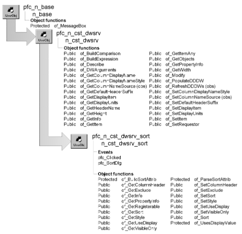

# n_cst_dwsrv_sort

**Description**

Sort service. Provides functions that make it easy for you to add DataWindow sort functionality to an application. This service provides many options:

- You can choose among four styles of sort dialog boxes
- You can allow the user to sort by clicking on column headings

**Ancestry**



**Library**

- PFCDWSRV.PBL
- PFEDWSRV.PBL

**Object relationships**

- [n_cst_infoattrib](../05-global-structures-and-structure-objects/n_cst_infoattrib.md)
- [n_cst_propertyattrib](../05-global-structures-and-structure-objects/n_cst_propertyattrib.md)
- [n_cst_returnattrib](../05-global-structures-and-structure-objects/n_cst_returnattrib.md)
- [n_cst_sortattrib](../05-global-structures-and-structure-objects/n_cst_sortattrib.md)
- [n_cst_string](n_cst_string.md)

**Usage**

Use this service to add sort capabilities to your application.

To use this service:

1. Enable the service using the u_dw of_SetSort function:

   ```
   dw_emp.of_SetSort(TRUE)
   ```

2. (Optional) Specify whether to use display values instead of data values by calling the of_SetUseDisplay function:

   ```
   dw_emp.inv_sort.of_SetUseDisplay(TRUE)
   ```

3. (Optional) Specify whether sort dialog boxes should display database column names, DataWindow column names, or column header names, by calling the n_cst_dwsrv of_SetColumnNameSource function:

   ```
   dw_emp.inv_sort.of_SetColumnnameSource  &
      (dw_emp.inv_sort.HEADER)
   ```

4. (Optional) Specify the sort dialog box style by calling the of_SetStyle function:

   ```
   dw_emp.inv_sort.of_SetStyle  &
      (dw_emp.inv_sort.DRAGDROP)
   ```

5. (Optional) Enable column header sorting by calling the of_SetColumnHeader function:

   ```
   dw_emp.inv_sort.of_SetColumnHeader(TRUE)
   ```

**Sorting by column headers** Columns that you add to a DataWindow are not automatically assigned column headers. If you are sorting columns by column header, make sure that all columns added to the DataWindow have headers, and that these conform to the naming scheme for headers. The default naming scheme uses the suffix _t, but you can change this by calling the of_SetDefaultHeaderSuffix function.

6. Display the sort dialog box by calling the u_dw pfc_SortDlg event:

   ```
   dw_emp.Event pfc_SortDlg()
   ```

**See also**

- [n_cst_dwsrv_filter](n_cst_dwsrv_filter.md)
- [u_dw](../06-standard-visual-user-objects/u_dw.md)

## Instance variables

N_cst_dwsrv_sort includes instance variables:

| Instance variable | Description | Data type | Access | Usage |
| --- | --- | --- | --- | --- |
| DRAGDROP | Constant set to 1 | Integer | Public | Use with of_SetStyle |
| DROPDOWNLISTBOX | Constant set to 3 | Integer | Public | Use with of_SetStyle |
| ib_columnheadersort | Tracks whether column header sort is active | Boolean | Protected | Internal |
| ib_displayvalues | Tracks whether display values are used for sorting | Boolean | Protected | Internal |
| ib_visibleonly | Tracks whether sort dialog boxes display visible columns only | Boolean | Protected | Internal |
| ii_style | Tracks sort style | Integer | Protected | Internal |
| invo_sortDraw |  | n_cst_dwsrv_sortdraw | Protected |  |
| is_excludecolumns[ ] | Contains a list of columns not displayed in sort dialog boxes | String | Protected | Internal |
| is_sortcolumn | Indicates the sort column when sorting by clicking headings | String | Protected | Internal |
| is_sortorder | Indicates sort order when the user sorts by clicking headings | String | Protected | Internal |
| SIMPLE | Constant set to 2 | Integer | Public | Use with of_SetStyle |

## Events

N_cst_dwsrv_sort includes user events:

- Destructor
- pfc_Clicked
- pfc_SortDlg

### Destructor

**Description**

Clean up to avoid memory leaks.

**Syntax**

```
instancename.EVENT Destructor ( )
```

| Argument | Description |
| --- | --- |
| *instancename* | Instance name of n_cst_dwsrv_sort |

**Return value**

None.

### pfc_Clicked

**Description**

Sorts rows when the user clicks on the header. This event executes only if you have enabled column header sorting by calling the of_SetColumnHeader function.

**Syntax**

```
dwcontrol.instancename.Event pfc_Clicked ( x, y, row, dwobject )
```

| Argument | Description |
| --- | --- |
| *dwcontrol* | Instance name of the u_dw-based DataWindow control |
| *instancename* | Instance name of n_cst_dwsrv_sort (the u_dw default is inv_sort) |
| *x* | Integer indicating the *x* position of the mouse click. From within the pfc_Clicked event, access this value through the *ai_xpos* argument |
| *y* | Integer indicating the *y* position of the mouse click. From within the pfc_Clicked event, access this value through the *ai_ypos* argument |
| *row* | Long indicating the clicked row. From within the pfc_Clicked event, access this value through the *al_row* argument |
| *dwobject* | DWObject variable indicating the clicked object (passed by reference). From within the pfc_Clicked event, access this value through the *adwo_obj* argument |

**Return value**

Integer. Returns 1 if the event succeeds, 0 if no action is required, and -1 if an error occurs.

**Usage**

This event is called by the u_dw clicked event.

### pfc_SortDlg

**Description**

Displays a sort dialog box and sorts the DataWindow as specified by the user.

**Return value**

Integer. Returns 1 if the event succeeds and -1 if an error occurs.

**Usage**

Call this event to display a sort dialog box using the style specified in the of_SetStyle function.

## Functions

N_cst_dwsrv_sort includes precoded object functions:

- of_BuildSortAttrib
- of_GetColumnHeader
- of_GetExclude
- of_GetInfo
- of_GetPropertyInfo
- of_GetRegisterable
- of_GetSort
- of_GetStyle
- of_GetUseDisplay
- of_GetVisibleOnly
- of_ParseSortAttrib
- of_SetColumnHeader
- of_SetExclude
- of_SetSort
- of_SetStyle
- of_SetUseDisplay
- of_SetVisibleOnly
- of_Sort
- of_sortIndicatorDraw
- of_sortIndicatorNone
- of_UsesDisplayValue

### of_BuildSortAttrib

**Description**

Prepares sort information before displaying one of the sort dialog boxes.

**Access**

Protected

**Syntax**

```
dwcontrol.instancename.of_BuildSortAttrib ( sortattrib )
```

| Argument | Description |
| --- | --- |
| *dwcontrol* | Instance name of the u_dw-based DataWindow control |
| *instancename* | Instance name of n_cst_dwsrv_sort (the u_dw default is inv_sort) |
| *sortattrib* | N_cst_sortattrib instance into which the function places sort information (passed by reference) |

**Return value**

Integer. Returns 1 if the function succeeds and -1 if an error occurs.

**Usage**

Internal.

**Examples**

This example is from the of_SetSort function:

```
...
CASE DRAGDROP, SIMPLE, DROPDOWNLISTBOX
   IF of_BuildSortAttrib(lnv_sortattrib) <> 1 THEN &
       Return -1
   END IF
...
```

### of_GetColumnHeader

**Description**

Reports whether the sort service is set to sort when the user clicks on a column header.

**Access**

Public

**Syntax**

```
dwcontrol.instancename.of_GetColumnHeader ( )
```

| Argument | Description |
| --- | --- |
| *dwcontrol* | Instance name of the u_dw-based DataWindow control |
| *instancename* | Instance name of n_cst_dwsrv_sort (the u_dw default is inv_sort) |

**Return value**

Boolean. Returns TRUE if column header sort is active and FALSE if it is not.

**Examples**

This example is from the pfc_Clicked event:

```
...
IF NOT of_GetColumnHeader() THEN Return 0
...
```

### of_GetExclude

**Description**

Retrieves the list of excluded columns, as set by the of_SetExclude function.

**Access**

Public

**Syntax**

```
dwcontrol.instancename.of_GetExclude (columns )
```

| Argument | Description |
| --- | --- |
| *dwcontrol* | Instance name of the u_dw-based DataWindow control |
| *instancename* | Instance name of n_cst_dwsrv_sort (the u_dw default is inv_sort) |
| *columns* | String array into which the function places the excluded columns (passed by reference) |

**Return value**

Integer. Returns 1 if the function succeeds and -1 if an error occurs.

**Examples**

This example calls the of_GetExclude function:

```
String    ls_exclude[ ]
String    ls_list
Integer   li_count

dw_emp.inv_sort.of_GetExclude(ls_exclude)
For li_count = 1 to UpperBound(ls_exclude)
   ls_list += ls_exclude[li_count] + ", "
NEXT
MessageBox("Sort Service", &
   "Excluded columns are: " + ls_list)
```

### of_GetInfo

**Description**

Retrieves service information.

**Access**

Public

**Syntax**

```
dwcontrol.instancename.of_GetInfo ( infoobject )
```

| Argument | Description |
| --- | --- |
| *dwcontrol* | Instance name of the u_dw-based DataWindow control |
| *instancename* | Instance name of n_cst_dwsrv_sort (the u_dw default is inv_sort) |
| *infoobject* | N_cst_infoattrib instance into which the function places service information (passed by reference) |

**Return value**

Integer. Returns 1 if the function succeeds and -1 if an error occurs.

**Usage**

The DataWindow Properties window calls this function to access service information.

**Examples**

This example calls the of_GetInfo function:

```
n_cst_infoattrib  lnv_info
dw_1.inv_sort.of_GetInfo(lnv_info)
MessageBox("Info",  &
  "Description: " + lnv_info.is_description  &
    + ". Name: " + lnv_info.is_name)
```

### of_GetPropertyInfo

**Description**

Retrieves information about the service’s properties.

**Access**

Public

**Syntax**

```
dwcontrol.instancename.of_GetPropertyInfo ( propertyobject )
```

| Argument | Description |
| --- | --- |
| *dwcontrol* | Instance name of the u_dw-based DataWindow control |
| *instancename* | Instance name of n_cst_dwsrv_sort (the u_dw default is inv_sort) |
| *propertyobject* | N_cst_propertyattrib instance into which the function places property information (passed by reference) |

**Return value**

Integer. Returns 1 if the function succeeds and -1 if an error occurs.

**Usage**

The DataWindow Properties window calls this function to access service information.

**Examples**

This example calls the of_GetPropertyInfo function:

```
n_cst_propertyattrib  lnv_prop

dw_1.inv_sort.of_GetPropertyInfo(lnv_prop)
MessageBox("Info",  &
  "Description: " + lnv_prop.is_description  &
    + ". Name: " + lnv_prop.is_name  &
      + ". Property tab text: " +  &
        lnv_prop.is_propertytabtext)
```

### of_GetRegisterable

**Description**

Retrieves an array of registerable columns.

**Access**

Public

**Syntax**

```
dwcontrol.instancename.of_GetRegisterable ( columns )
```

| Argument | Description |
| --- | --- |
| *dwcontrol* | Instance name of the u_dw-based DataWindow control |
| *instancename* | Instance name of n_cst_dwsrv_sort (the u_dw default is inv_sort) |
| *columns* | String array into which the function places a list of registerable columns (passed by reference) |

**Return value**

Integer. Returns the number of entries in the *columns* array.

**Examples**

This example calls the of_GetRegisterable function:

```
String   ls_columns[ ]
Integer  li_count, li_loop
li_loop =  &
   dw_1.inv_sort.of_GetRegisterable  &
     (ls_columns)
lb_1.Reset()
IF li_loop <> 0 THEN
  FOR li_count = 1 to li_loop
    lb_1.AddItem(ls_columns[li_count])
  NEXT
ELSE
  lb_1.AddItem("No Registerable columns")
END IF
```

### of_GetSort

**Description**

Retrieves the current sort expression for the DataWindow. The sort is created when you call the of_SetSort function.

**Access**

Public

**Syntax**

```
dwcontrol.instancename.of_GetSort ( )
```

| Argument | Description |
| --- | --- |
| *dwcontrol* | Instance name of the u_dw-based DataWindow control |
| *instancename* | Instance name of n_cst_dwsrv_sort (the u_dw default is inv_sort) |

**Return value**

String. Returns the current sort expression for the DataWindow.

**Examples**

This example calls the of_GetSort function:

```
String    ls_sort

ls_sort = &
   dw_emp.inv_sort.of_GetSort()
MessageBox("Sort Service", "Sort is: " &
   + ls_sort)
```

### of_GetStyle

**Description**

Retrieves the current sort style (the sort style specifies which dialog box displays when you call the of_Sort function).

**Access**

Public

**Syntax**

```
dwcontrol.instancename.of_GetStyle ( )
```

| Argument | Description |
| --- | --- |
| *dwcontrol* | Instance name of the u_dw-based DataWindow control |
| *instancename* | Instance name of n_cst_dwsrv_sort (the u_dw default is inv_sort) |

**Return value**

Integer. Returns the current sort style:

- **DEFAULT or 0** PowerBuilder Sort dialog box (default)
- **DRAGDROP or 1** PFC’s w_sortdragdrop dialog box
- **SIMPLE or 2** PFC’s w_sortsingle dialog box
- **DROPDOWNLISTBOX or 3** PFC’s w_sortmulti dialog box

**Examples**

This example calls the of_GetStyle function:

```
IF IsValid(inv_sort) THEN
   IF inv_sort.of_GetStyle( )= 2 THEN
...
```

### of_GetUseDisplay

**Description**

Reports whether this service is using display values for PFC sort dialog boxes.

**PowerBuilder Sort dialog box always uses data values** The PowerBuilder Sort dialog box always uses data values for sorting.

**Access**

Public

**Syntax**

```
dwcontrol.instancename.of_GetUseDisplay ( )
```

| Argument | Description |
| --- | --- |
| *dwcontrol* | Instance name of the u_dw-based DataWindow control |
| *instancename* | Instance name of n_cst_dwsrv_sort (the u_dw default is inv_sort) |

**Return value**

Boolean. Returns TRUE if PFC dialog boxes use display values and FALSE if they use data values.

**Examples**

This example calls the of_GetUseDisplay function:

```
...
IF idw_dw.inv_sort.of_GetUseDisplay( ) AND &
   idw_dw.inv_sort.of_UsesDisplayValue &
   (  ls_col) THEN
      ls_sort_string = ls_sort_string + &
         "LookUpDisplay(" + ls_col + ") "
ELSE
...
```

### of_GetVisibleOnly

**Description**

Reports whether the sort service uses visible columns only.

**Access**

Public

**Syntax**

```
dwcontrol.instancename.of_GetVisibleOnly ( )
```

| Argument | Description |
| --- | --- |
| *dwcontrol* | Instance name of the u_dw-based DataWindow control |
| *instancename* | Instance name of n_cst_dwsrv_sort (the u_dw default is inv_sort) |

**Return value**

Boolean. Returns TRUE if the sort service uses visible columns only and FALSE if it uses all columns.

**Examples**

This example calls the of_GetVisibleOnly function:

```
IF dw_emp.inv_sort.of_GetVisibleOnly() THEN
   gnv_app.of_GetFrame().SetMicroHelp &
   ("Visible columns only")
ELSE
   gnv_app.of_GetFrame().SetMicroHelp &
   ("All columns used for sort")
END IF
```

### of_ParseSortAttrib

**Description**

Parses a sort statement into its component parts.

**Access**

Protected

**Syntax**

```
dwcontrol.instancename.of_ParseSortAttrib ( originalsort, sortattrib )
```

| Argument | Description |
| --- | --- |
| *dwcontrol* | Instance name of the u_dw-based DataWindow control |
| *instancename* | Instance name of n_cst_dwsrv_sort (the u_dw default is inv_sort) |
| *originalsort* | String containing the original sort statement |
| *sortattrib* | N_cst_sortattrib instance into which the function places sort information (passed by reference) |

**Return value**

Integer. Returns 1 if the function succeeds and -1 if an error occurs.

**Usage**

Internal.

**Examples**

This example is from the of_BuildSortAttrib function:

```
...
of_ParseSortAttrib(anv_sortattrib.is_sort, &
   anv_sortattrib)
...
```

### of_SetColumnHeader

**Description**

Specifies whether n_cst_dwsrv_sort sorts when the user clicks on a column header. With column header sorting (a feature found in many Windows-compliant applications), PFC sorts a DataWindow based on the column the user clicks on. If the user clicks the same column twice, PFC reverses the sort order.

**Access**

Public

**Syntax**

```
dwcontrol.instancename.of_SetColumnHeader ( boolean )
```

| Argument | Description |
| --- | --- |
| *dwcontrol* | Instance name of the u_dw-based DataWindow control |
| *instancename* | Instance name of n_cst_dwsrv_sort (the u_dw default is inv_sort) |
| *boolean* | Boolean specifying whether the service implements column header sorting (TRUE) or not (FALSE) |

**Return value**

Integer. Returns 1 if the function succeeds and -1 if an error occurs.

**Usage**

The N-Up presentation style does not support column header sorting.

If your DataWindow object uses column header suffixes other than _t, you must first call the n_cst_dwsrv of_SetDefaultHeaderSuffix function to specify the column header suffix.

**Examples**

This example calls the of_SetColumnHeader function:

```
dw_list.inv_sort.of_SetColumnHeader(TRUE)
```

### of_SetExclude

**Description**

Establishes a list of columns to be excluded from sort dialog boxes.

**Access**

Public

**Syntax**

```
dwcontrol.instancename.of_SetExclude ( excludecols )
```

| Argument | Description |
| --- | --- |
| *dwcontrol* | Instance name of the u_dw-based DataWindow control |
| *instancename* | Instance name of n_cst_dwsrv_sort (the u_dw default is inv_sort) |
| *excludecols* | String array specifying columns to be excluded from sort dialog boxes |

**Return value**

Integer. Returns 1 if the function succeeds and -1 if an error occurs.

**Examples**

This example calls the of_SetExclude function:

```
String    ls_exclude[ ]

ls_exclude[1] = "dept_id"
dw_emp.inv_sort.of_SetExclude(ls_exclude)
```

### of_SetSort

**Description**

Specifies a DataWindow sort string or opens a sort dialog box.

**Access**

Public

**Syntax**

```
dwcontrol.instancename.of_SetSort (sort )
```

| Argument | Description |
| --- | --- |
| *dwcontrol* | Instance name of the u_dw-based DataWindow control |
| *instancename* | Instance name of n_cst_dwsrv_sort (the u_dw default is inv_sort) |
| *sort* | String containing a valid DataWindow sort expression. Column names must be preceded by a pound sign (#). If this argument is NULL, the function displays a sort dialog box |

**Return value**

Integer. Returns 1 if the function succeeds, 0 if the user canceled out of the sort dialog box, and -1 if an error occurs.

**Usage**

To control the type of sort dialog box, call the of_SetStyle function.

**Examples**

This example calls the of_SetSort function:

```
String    ls_null
Integer   li_return
SetNull(ls_null)
dw_emp.inv_sort.of_SetStyle(1)
li_return = &
   dw_emp.inv_sort.of_SetSort(ls_null)
gnv_app.of_GetFrame().SetMicroHelp &
   ("Return code = " + String(li_return))
dw_emp.inv_sort.of_Sort( )
```

### of_SetStyle

**Description**

Specifies the sort style. The sort style determines the dialog box that displays when the of_SetSort function is called:

Default PowerBuilder Sort dialog box W_sortdragdrop dialog box W_sortsingle dialog box W_sortmulti dialog box

**Access**

Public

**Syntax**

```
dwcontrol.instancename.of_SetStyle ( sortstyle )
```

| Argument | Description |
| --- | --- |
| *dwcontrol* | Instance name of the u_dw-based DataWindow control |
| *instancename* | Instance name of n_cst_dwsrv_sort (the u_dw default is inv_sort) |
| *sortstyle* | Integer or n_cst_dwsrv_sort constant specifying the sort style: |
|  | **• DEFAULT or 0** PowerBuilder Sort dialog box (default) |
|  | **• DRAGDROP or 1** W_sortdragdrop dialog box |
|  | **• SIMPLE or 2** W_sortsingle dialog box |
|  | **• DROPDOWNLISTBOX or 3** W_sortmulti dialog box |

**Return value**

Integer. Returns 1 if the function succeeds and -1 if an error occurs.

**Usage**

Call this function to specify a sort style before calling the of_SetSort function.

To implement column header sorting (a feature found in many Windows-compliant applications), call the of_SetColumnHeader function.

**Examples**

This example calls the of_SetStyle function to enable display of the w_sortdragdrop dialog box (of_SetColumnNameSource is an ancestor function, defined in n_cst_dwsrv):

```
dw_emplist.of_SetSort(TRUE)
dw_emplist.inv_sort.of_SetColumnNameSource(2)
dw_emplist.inv_sort.of_SetUseDisplay(TRUE)
dw_emplist.inv_sort.of_SetStyle  &
  (dw_emplist.inv_sort.DRAGDROP)
```

### of_SetUseDisplay

**Description**

Specifies whether PFC sorts on display values or data values, for columns that display using a code table.

**PowerBuilder Sort dialog box always uses data values** The PowerBuilder Sort dialog box always uses data values for sorting.

**Access**

Public

**Syntax**

```
dwcontrol.instancename.of_SetUseDisplay ( boolean )
```

| Argument | Description |
| --- | --- |
| *dwcontrol* | Instance name of the u_dw-based DataWindow control |
| *instancename* | Instance name of n_cst_dwsrv_sort (the u_dw default is inv_sort) |
| *boolean* | Boolean specifying whether to use display values (TRUE) or data values (FALSE) for sorting |

**Return value**

Integer. Returns 1 if the function succeeds and -1 if an error occurs.

**Examples**

This example calls the of_SetUseDisplay function to specify that PFC sort dialog boxes uses display values for sorting (of_SetColumnNameSource is an ancestor function, defined in n_cst_dwsrv):

```
dw_emplist.of_SetSort(TRUE)
dw_emplist.of_SetStyle(dw_emplist.inv_sort.SIMPLE)
dw_emplist.inv_sort.of_SetUseDisplay(TRUE)
```

### of_SetVisibleOnly

**Description**

Controls whether sort dialog boxes display all columns or visible columns only.

**Access**

Public

**Syntax**

```
dwcontrol.instancename.of_SetVisibleOnly ( boolean )
```

| Argument | Description |
| --- | --- |
| *dwcontrol* | Instance name of the u_dw-based DataWindow control |
| *instancename* | Instance name of n_cst_dwsrv_sort (the u_dw default is inv_sort) |
| *boolean* | Boolean indicating whether sort dialog boxes display visible columns only (TRUE) or all columns (FALSE) |

**Return value**

Integer. Returns 1 if the function succeeds and -1 if an error occurs.

**Examples**

This example calls the of_SetVisibleOnly function:

```
dw_emp.inv_sort.of_SetVisibleOnly(TRUE)
```

### of_Sort

**Description**

Sorts a DataWindow and calls the u_dw pfc_RowChanged event.

**Access**

Public

**Syntax**

```
dwcontrol.instancename.of_Sort ( )
```

| Argument | Description |
| --- | --- |
| *dwcontrol* | Instance name of the u_dw-based DataWindow control |
| *instancename* | Instance name of n_cst_dwsrv_sort (the u_dw default is inv_sort) |

**Return value**

Integer. Returns 1 if the function succeeds and -1 if an error occurs.

**Usage**

Call this function to perform a sort automatically. Call the pfc_SortDlg event to display a sort dialog box.

**Examples**

This example is from the pfc_Clicked event:

```
...
li_rc = of_SetSort(ls_sortstring)
If li_rc < 0 Then Return li_rc

li_rc = of_Sort()
...
```

### of_sortIndicatorDraw

**Description**

Grants pfc_u_dw access to of_draw() in the sub-service n_cst_sortDraw.

**Access**

Public

**Syntax**

```
instancename.of_sortIndicatorDraw ( )
```

| Argument | Description |
| --- | --- |
| *instancename* | Instance name of n_cst_dwsrv_sort |

**Return value**

None.

### of_sortIndicatorNone

**Description**

Grants pfc_u_dw access to of_drawNone() in the sub-service n_cst_sortDraw. It also keeps instance variable in this service in sync with n_cst_sortDraw.

**Access**

Public

**Syntax**

```
instancename.of_sortIndicatorNone ( )
```

| Argument | Description |
| --- | --- |
| *instancename* | Instance name of n_cst_dwsrv_sort |

**Return value**

None.

### of_UsesDisplayValue

**Description**

Reports whether a column has a display value.

**Access**

Protected

**Syntax**

```
dwcontrol.instancename.of_UsesDisplayValue ( column )
```

| Argument | Description |
| --- | --- |
| *dwcontrol* | Instance name of the u_dw-based DataWindow control |
| *instancename* | Instance name of n_cst_dwsrv_sort (the u_dw default is inv_sort) |
| *column* | String specifying the column name |

**Return value**

Boolean. Returns TRUE if the column has a display value and FALSE if it does not.

**Usage**

Internal.

**Examples**

This example calls the of_UsesDisplayValue function:

```
IF idw_dw.inv_sort.of_GetUseDisplay() AND &
   idw_dw.inv_sort.of_UsesDisplayValue  &
       (ls_col) THEN
          ls_sort_string = ls_sort_string + &
             "LookUpDisplay(" + ls_col + ") "
...
```
