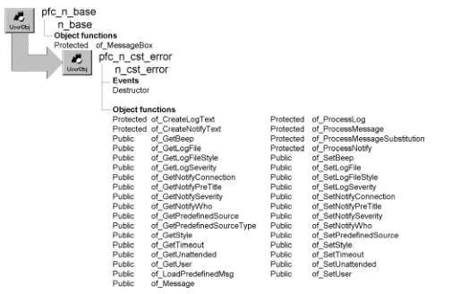

# n_cst_error

**Description**

Error message service. Provides many features for handling your application’s error messages, including:

- Functions to enable error message display for application, SQL, DataWindow, and system errors
- Message logging to a file or database
- Automatic error notification via e-mail (MAPI-compliant e-mail systems only)
- Displaying messages in w_message (the PFC message dialog box)
- Access to an error message database (which can reside in either a database or a file)
- Symbolic parameter replacement

**Ancestry**



**Library**

- PFCAPSRV.PBL
- PFEAPSRV.PBL

**Object relationships**

d_definedmessages Messages table in PFC.DB (copy to your application database) n_cst_conversion n_cst_errorattrib n_cst_filesrv n_cst_string n_ds n_tr w_message

**Usage**

To use n_cst_error:

1. Create the object by calling the n_cst_appmanager of_SetError function (this example is from an n_cst_appmanager pfc_Open event:

   ```
   this.of_SetError(TRUE)
   ```

2. Specify the error message source:
   - If the source is a file, call the of_SetPredefinedSource function, passing the filename:

     ```
     this.inv_error.of_SetPredefinedSource &
        ("c:\eisapp\eiserr.txt")
     ```

   - If the source is a database, call the of_SetPredefinedSource function, passing the transaction object:

     ```
     this.inv_error.of_SetPredefinedSource &
        (itr_error)
     ```

3. Specify the name of the log file:

   ```
   this.inv_error.of_SetLogFile &
      ("c:\pb6\errlog.txt")
   ```

4. Specify the types of messages for which the error service will provide automatic notification and logging:

   ```
   this.inv_error.of_SetNotifySeverity(5)
   this.inv_error.of_SetLogSeverity(4)
   ```

5. If your application uses the error service's automatic notification feature, specify a MailSession variable to use. Also specify the e-mail IDs of the users to be notified automatically. This example assumes a mechanism for storing e-mail IDs and user passwords:

   ```
   this.inv_error.of_SetNotifyConnection &
      (ims_mailsess)
   this.inv_error.of_SetNotifyWho(is_autonotify  &
      is_notifylist)
   ```

**N_cst_appmanager pfc_Open** The steps listed above might all be coded in the n_cst_appmanager pfc_Open event.

6. In your application error checking, call the of_Message function to display messages, with optional logging and notification. The of_Message function allows you to either use the message database or specify message text dynamically. This example uses the message database:

   ```
   gnv_app.inv_error.of_Message &
      ("EIS0210")
   ```

**See also**

n_cst_errorattrib

## Instance variables

N_cst_error includes instance variables:

| Instance variable | Description | Data type | Access | Usage |
| --- | --- | --- | --- | --- |
| DATABASE | Constant set to "database" | String | Protected | Internal |
| DEFAULT | Constant set to 0 | Integer | Public | Use with of_SetStyle |
| FILE | Constant set to "File" | String | Protected | Internal |
| ib_beep | Indicates whether PFC beeps when displaying a message box | Boolean | Protected | Set with of_SetBeep |
| ib_unattended | Indicates whether the unattended option is enabled | Boolean | Protected | Set with of_SetUnattended |
| ics_database | Obsoleted in 6.0. | String | Protected |  |
| ics_file | Obsoleted in 6.0. | String | Protected |  |
| ids_messages | DataStore that caches all messages at runtime | n_ds | Protected | Internal |
| ii_logfilestyle | Controls format of log file text | Integer | Protected | Set with of_SetLogFileStyle |
| ii_logseverity | Error logging threshold | Integer | Protected | Set with of_SetLogSeverity |
| ii_notifyseverity | Automatic notification threshold | Integer | Protected | Set with of_SetNotifySeverity |
| ii_style | Controls whether the service uses the PowerBuilder MessageBox (default) or the PFC w_message window | Integer | Protected | Set with of_SetStyle |
| ii_timeout | Timeout interval | Integer | Protected | Set with of_SetTimeout |
| ims_mses | MailSession for automatic error notification | MailSession | Protected | Set with of_SetNotifyConnection |
| inv_conversion | Reference variable for the conversion service | n_cst_conversion | Protected | Internal |
| inv_errorpass | Used to pass information to error message boxes | n_cst_errorattrib | Protected | Internal |
| inv_filesrv | Reference variable for the file service | n_cst_filesrv | Protected | Internal |
| inv_string | Reference variable for the string service | n_cst_string | Protected | Internal |
| is_logfile | File to which the service writes messages | String | Protected | Set with of_SetLogFile |
| is_msgfile | File containing predefined error messages | String | Protected | Set with of_SetPredefinedSource (passing a string) |
| is_msgsrc | Input source for predefined messages: file or database | String | Protected | Set with of_SetPredefinedSource |
| is_notifyaddress[ ] | List of e-mail addresses to be notified when errors occur | String | Protected | Set with of_SetNotifyWho |
| is_notifypretitle | Prefix used with mail notification | String | Protected | Set with of_SetNotifyPreTitle |
| is_notifywho[ ] | List of e-mail IDs to be notified when errors occur | String | Protected | Set with of_SetNotifyWho |
| is_user | Prefix ;used with mail notification | String | Protected | Set with of_Message or through error message database |
| itr_msgdb | Transaction object for message database | n_tr | Public | Set with of_SetPredefinedSource (passing a Transaction object) |
| NEWLINE_DELIMITED | Constant set to 2 | Integer | Public | Use with of_SetLogFileStyle |
| PFCWINDOW | Constant set to 1 | Integer | Public | Use with of_SetStyle |
| TAB_DELIMITED | Constant set to 1 | Integer | Public | Use with of_SetLogFileStyle |

## Events

N_cst_error includes one precoded event:

Destructor

### Destructor

**Description**

Destroys the message DataStore and the file service object.

**Usage**

This event executes when the object is destroyed.

## Functions

N_cst_error includes precoded object functions:

- of_CreateLogText
- of_CreateNotifyText
- of_GetBeep
- of_GetLogFile
- of_GetLogFileStyle
- of_GetLogSeverity
- of_GetNotifyConnection
- of_GetNotifyPreTitle
- of_GetNotifySeverity
- of_GetNotifyWho
- of_GetPredefinedSource
- of_GetPredefinedSourceType
- of_GetStyle
- of_GetTimeOut
- of_GetUnattended
- of_GetUser
- of_LoadPredefinedMsg
- of_Message
- of_ProcessLog
- of_ProcessMessage
- of_ProcessMessageSubstitution
- of_ProcessNotify
- of_SetBeep
- of_SetLogFile
- of_SetLogFileStyle
- of_SetLogSeverity
- of_SetNotifyConnection
- of_SetNotifyPreTitle
- of_SetNotifySeverity
- of_SetNotifyWho
- of_SetPredefinedSource
- of_SetStyle
- of_SetTimeOut
- of_SetUnattended
- of_SetUser

### of_CreateLogText

**Description**

Creates text used to perform the logging process.

**Access**

Protected

**Syntax**

```
application.instancename.of_CreateLogText ( text )
```

| Argument | Description |
| --- | --- |
| *application* | Global variable of type n_cst_appmanager or a customized n_cst_appmanager descendant (must be gnv_app) |
| *instancename* | Instance name of n_cst_error (the n_cst_appmanager default for this is inv_error) |
| *text* | String containing text to be logged |

**Return value**

Integer. Returns 1 if the function succeeds and -1 if an error occurs.

**Usage**

Internal.

To log anything other than standard text, override this function in a descendant.

**Examples**

This example is from the of_ProcessLog function:

```
...
li_rc = of_CreateLogText(ls_errortext)
...
```

### of_CreateNotifyText

**Description**

Creates text used by the notify process.

**Access**

Protected

**Syntax**

```
application.instancename.of_CreateNotifyText ( subject, text )
```

| Argument | Description |
| --- | --- |
| *application* | Global variable of type n_cst_appmanager or a customized n_cst_appmanager descendant (must be gnv_app) |
| *instancename* | Instance name of n_cst_error (the n_cst_appmanager default for this is inv_error) |
| *subject* | String containing text used in the mail messages subject line |
| *text* | String containing message text |

**Return value**

Integer. Returns 1 if the function succeeds and -1 if an error occurs.

**Usage**

Internal.

To notify with anything other than standard text, override this function in a descendant.

**Examples**

This example is from the of_ProcessNotify function:

```
...
li_rc = of_CreateNotifyText &
   (ls_notesubject, ls_notetext)
...
```

### of_GetBeep

**Description**

Reports whether PFC beeps before displaying the w_message window.

**Access**

Public

**Syntax**

```
application.instancename.of_GetBeep ( )
```

| Argument | Description |
| --- | --- |
| *application* | Global variable of type n_cst_appmanager or a customized n_cst_appmanager descendant (must be gnv_app) |
| *instancename* | Instance name of n_cst_error (the n_cst_appmanager default for this is inv_error) |

**Return value**

Boolean. Returns TRUE if PFC beeps before displaying the w_message window and FALSE if it does not.

**Examples**

This example calls the of_GetBeep function:

```
IF gnv_app.inv_error.of_GetBeep() THEN
   MessageBox("Error", "Beep enabled"
ELSE
   MessageBox("Error", "Beep disabled"
END IF
```

### of_GetLogFile

**Description**

Retrieves the name of the log file.

**Access**

Public

**Syntax**

```
application.instancename.of_GetLogFile ( )
```

| Argument | Description |
| --- | --- |
| *application* | Global variable of type n_cst_appmanager or a customized n_cst_appmanager descendant (must be gnv_app) |
| *instancename* | Instance name of n_cst_error (the n_cst_appmanager default for this is inv_error) |

**Return value**

String. Returns the name of the log file.

**Examples**

This example calls the of_GetLogFile function:

```
String    ls_logfile

ls_logfile = gnv_app.inv_error.of_GetLogFile()
...
```

### of_GetLogFileStyle

**Description**

Retrieves the log file style, which specifies the format of the log file.

**Access**

Public

**Syntax**

```
application.instancename.of_GetLogFileStyle ( )
```

| Argument | Description |
| --- | --- |
| *application* | Global variable of type n_cst_appmanager or a customized n_cst_appmanager descendant (must be gnv_app) |
| *instancename* | Instance name of n_cst_error (the n_cst_appmanager default for this value is inv_error) |

**Return value**

Integer. Returns the log file style:

- **TAB_DELIMITED or 1** Tab delimited log file
- **NEWLINE_DELIMITED or 2** Newline delimited log file

**Examples**

This example calls the of_GetLogFileStyle function:

```
Integer li_style

li_style = gnv_app.inv_error.of_GetLogFileStyle()
IF li_style = gnv_app.inv_error.TAB_DELIMITED THEN
   MessageBox("Log File Style", "Tab delimited")
ELSE
   MessageBox("Log File Style", "Newline delimited")
END IF
```

### of_GetLogSeverity

**Description**

Retrieves the current log severity level.

**Access**

Public

**Syntax**

```
application.instancename.of_GetLogSeverity ( )
```

| Argument | Description |
| --- | --- |
| *application* | Global variable of type n_cst_appmanager or a customized n_cst_appmanager descendant (must be gnv_app) |
| *instancename* | Instance name of n_cst_error (the n_cst_appmanager default for this is inv_error) |

**Return value**

Integer. Returns the log severity level.

**Examples**

This example calls the of_GetLogSeverity function:

```
Integer   ii_severity

ii_severity = gnv_app.inv_error.of_GetLogSeverity( )
...
```

### of_GetNotifyConnection

**Description**

Retrieves the mail session used for automatic notification.

**Access**

Public

**Syntax**

```
application.instancename.of_GetNotifyConnection ( mailsession )
```

| Argument | Description |
| --- | --- |
| *application* | Global variable of type n_cst_appmanager or a customized n_cst_appmanager descendant (must be gnv_app) |
| *instancename* | Instance name of n_cst_error (the n_cst_appmanager default for this is inv_error) |
| *mailsession* | MailSession variable into which the function places the current mail connection (passed by reference) |

**Return value**

Integer. Returns 1 if the function succeeds and -1 if an error occurs.

**Examples**

This example calls the of_GetNotifyConnection function:

```
MailSession   lms_mses
Integer       li_return

li_return = &
   gnv_app.inv_error.of_GetNotifyConnection &
   (lms_mses)
...
```

### of_GetNotifyPreTitle

**Description**

Retrieves the prefix used with automatic e-mail notification.

**Access**

Public

**Syntax**

```
application.instancename.of_GetNotifyPreTitle ( )
```

| Argument | Description |
| --- | --- |
| *application* | Global variable of type n_cst_appmanager or a customized n_cst_appmanager descendant (must be gnv_app) |
| *instancename* | Instance name of n_cst_error (the n_cst_appmanager default for this value is inv_error) |

**Return value**

String. Returns the prefix used with automatic e-mail notification.

**Examples**

This example calls the of_GetNotifyPreTitle function:

```
String  ls_prefix

ls_prefix = gnv_app.inv_error.of_GetNotifyPreTitle()
MessageBox("Prefix", "Prefix is " + ls_prefix)
```

### of_GetNotifySeverity

**Description**

Retrieves the current notify severity level.

**Access**

Public

**Syntax**

```
application.instancename.of_GetNotifySeverity ( )
```

| Argument | Description |
| --- | --- |
| *application* | Global variable of type n_cst_appmanager or a customized n_cst_appmanager descendant (must be gnv_app) |
| *instancename* | Instance name of n_cst_error (the n_cst_appmanager default for this is inv_error) |

**Return value**

Integer. Returns the current notify severity.

**Examples**

This example calls the of_GetNotifySeverity function:

```
Integer   ii_severity

ii_severity = &
   gnv_app.inv_error.of_GetNotifySeverity()
...
```

### of_GetNotifyWho

**Description**

Retrieves a list of users to be notified when errors occur.

**Access**

Public

**Syntax**

```
application.instancename.of_GetNotifyWho ( users, addresses )
```

| Argument | Description |
| --- | --- |
| *application* | Global variable of type n_cst_appmanager or a customized n_cst_appmanager descendant (must be gnv_app) |
| *instancename* | Instance name of n_cst_error (the n_cst_appmanager default for this is inv_error) |
| *users* | String array into which the function places the list of users to be notified when errors occur (passed by reference) |
| *addresses* | String array into which the function places the list of e-mail addresses to be notified when errors occur (passed by reference) |

**Return value**

Integer. Returns the number of users and addresses to notify.

**Examples**

This example calls the of_GetNotifyWho function:

```
String    ls_notify[ ]
Integer   li_count, li_return

li_return = &
   gnv_app.inv_error.of_GetNotifyWho(ls_notify)

FOR li_count = 1 to li_return
   lb_who.Item[li_count] = ls_notify[li_count]
NEXT
```

### of_GetPredefinedSource

**Description**

Retrieves the source for predefined messages. This is either a file or a Transaction object connected to a database containing the messages.

**Access**

Public

**Syntax**

```
application.instancename.of_GetPredefinedSource ( source )
```

| Argument | Description |
| --- | --- |
| *application* | Global variable of type n_cst_appmanager or a customized n_cst_appmanager descendant (must be gnv_app) |
| *instancename* | Instance name of n_cst_error (the n_cst_appmanager default for this is inv_error) |
| *source* | String or n_tr variable for predefined messages |

**Return value**

Integer. Returns 1 if the function succeeds and -1 if an error occurs.

**Examples**

This example calls the of_GetPredefinedSource function:

```
String    ls_source
Integer   li_return
li_return = &
   gnv_app.inv_error.of_GetPredefinedSource  &
       (ls_source)
...
```

### of_GetPredefinedSourceType

**Description**

Reports the message source type: file or database.

**Access**

Public

**Syntax**

```
application.instancename.of_GetPredefinedSourceType ( )
```

| Argument | Description |
| --- | --- |
| *application* | Global variable of type n_cst_appmanager or a customized n_cst_appmanager descendant (must be gnv_app) |
| *instancename* | Instance name of n_cst_error (the n_cst_appmanager default for this is inv_error) |

**Return value**

String. Returns the message source type:

- File
- Database

**Examples**

This example calls the of_GetPredefinedSourceType function:

```
String   ls_source

ls_source = &
   gnv_app.inv_error.of_GetPredefinedSourceType()
...
```

### of_GetStyle

**Description**

Retrieves the current message box style:

PowerBuilder MessageBox PFC w_message window

**Access**

Public

**Syntax**

```
application.instancename.of_GetStyle ( )
```

| Argument | Description |
| --- | --- |
| *application* | Global variable of type n_cst_appmanager or a customized n_cst_appmanager descendant (must be gnv_app) |
| *instancename* | Instance name of n_cst_error (the n_cst_appmanager default for this is inv_error) |

**Return value**

Integer. Returns the message box style:

- **DEFAULT or 0** PowerBuilder MessageBox
- **PFCWINDOW or 1** PFC w_message window

**Examples**

This example calls the of_GetStyle function:

```
Integer   li_return

li_return = gnv_app.inv_error.of_GetStyle()
...
```

### of_GetTimeOut

**Description**

Retrieves the number of seconds before a w_message dialog box closes automatically.

**Access**

Public

**Syntax**

```
application.instancename.of_GetTimeOut ( )
```

| Argument | Description |
| --- | --- |
| *application* | Global variable of type n_cst_appmanager or a customized n_cst_appmanager descendant (must be gnv_app) |
| *instancename* | Instance name of n_cst_error (the n_cst_appmanager default for this is inv_error) |

**Return value**

Integer. Returns the number of seconds before PFC automatically closes a w_message dialog box. A value of 0 indicates that PFC does not close w_message automatically.

**Examples**

This example calls the of_GetTimeOut function:

```
Integer   li_return

li_return = &
   gnv_app.inv_error.of_GetTimeOut( )
...
```

### of_GetUnattended

**Description**

Reports whether the unattended option is enabled.

**Access**

Public

**Syntax**

```
application.instancename.of_GetUnattended ( )
```

| Argument | Description |
| --- | --- |
| *application* | Global variable of type n_cst_appmanager or a customized n_cst_appmanager descendant (must be gnv_app) |
| *instancename* | Instance name of n_cst_error (the n_cst_appmanager default for this is inv_error) |

**Return value**

Boolean. Returns TRUE if the unattended option is enabled and FALSE if it is not.

**Examples**

This example calls the of_GetUnattended function:

```
...
IF gnv_app.inv_error.of_GetUnattended( ) THEN
   MessageBox("Error", "Unattended enabled")
ELSE
   MessageBox("Error", "Unattended disabled")
END IF
```

### of_GetUser

**Description**

Retrieves the user name.

**Access**

Public

**Syntax**

```
application.instancename.of_GetUser ( )
```

| Argument | Description |
| --- | --- |
| *application* | Global variable of type n_cst_appmanager or a customized n_cst_appmanager descendant (must be gnv_app) |
| *instancename* | Instance name of n_cst_error (the n_cst_appmanager default for this value is inv_error) |

**Return value**

String. Returns the user name as specified by the of_SetUser function.

**Usage**

The user name is used in message logging and automatic e-mail notification.

**Examples**

This example calls the of_GetUser function:

```
String  ls_user

ls_user = gnv_app.inv_error.of_GetUser()
MessageBox("User", "User is " + ls_user)
```

### of_LoadPredefinedMsg

**Description**

Loads or reloads the message cache from the source file or database.

**Access**

Public

**Syntax**

```
application.instancename.of_LoadPredefinedMsg ( )
```

| Argument | Description |
| --- | --- |
| *application* | Global variable of type n_cst_appmanager or a customized n_cst_appmanager descendant (must be gnv_app) |
| *instancename* | Instance name of n_cst_error (the n_cst_appmanager default for this is inv_error) |

**Return value**

Integer. Returns 1 if the function succeeds and -1 if an error occurs.

**Examples**

This example calls the of_LoadPredefinedMsg function:

```
Integer   li_return

li_return = &
   gnv_app.inv_error.of_LoadPredefinedMsg()
...
```

### of_Message

Displays the w_message dialog box using either the ids_messages DataStore or a passed string. There are two syntaxes.

| To | Use |
| --- | --- |
| Display a specified message from the ids_messages DataStore | Syntax 1 |
| Display a message using a passed string | Syntax 2 |

| Syntax 1 | Display message text from the ids_messages DataStore |
| --- | --- |

**Description**

Displays message text and display information from the ids_messages DataStore.

**Access**

Public

**Syntax**

```
application.instancename.of_Message ( messageid {, substitutions
{, overridetitle } } )
```

| Argument | Description |
| --- | --- |
| *application* | Global variable of type n_cst_appmanager or a customized n_cst_appmanager descendant (must be gnv_app) |
| *instancename* | Instance name of n_cst_error (the n_cst_appmanager default for this is inv_error) |
| *messageid* | String specifying the identifier of the message to be displayed. This value must be in the msgnumber column of the ids_messages DataStore |
| *substitutions* (optional) | String array specifying substitution parameters for the message. The message source indicates substitution parameters with %s |
| *overridetitle* (optional) | String specifying a title to override the default title |

**Return value**

Integer. Returns the button the user clicked if the function succeeds and -1 if an error occurs.

**Usage**

Call this function to display a predefined message from the ids_messages DataStore.

This function displays either the PowerBuilder MessageBox or the PFC w_message window, depending on what you specify for the of_SetStyle function.

The function uses substitution parameters to replace percent sign characters (%) in the predefined message. You define one element in the *substitution* array for each % in the predefined message text; the first element in the array replaces the first %, the second element replaces the second %, and so on.

Use Syntax 2 to display w_message passing message text in a string.

**Examples**

This example calls the of_Message function:

```
gnv_app.inv_error.of_Message("EIS0210")
```

| Syntax 2 | Display a message using a passed string |
| --- | --- |

**Description**

Displays message text and display information from passed arguments.

**Access**

Public

**Syntax**

```
application.instancename.of_Message ( title, message {, icon {, button
{, default {, severity, print, userinput } } } } )
```

| Argument | Description |
| --- | --- |
| *application* | Global variable of type n_cst_appmanager or a customized n_cst_appmanager descendant (must be gnv_app) |
| *instancename* | Instance name of n_cst_error (the n_cst_appmanager default for this is inv_error) |
| *title* | String specifying the title of the w_message dialog box |
| *message* | String specifying the message text |
| *icon* (optional) | Icon enumerated data type indicating the icon you want to display on the left side of the message box. Values are: |
|  | • Information! (Default) |
|  | • StopSign! |
|  | • Exclamation! |
|  | • Question! |
|  | • None! |
| *button* (optional) | Button enumerated data type indicating the set of CommandButtons you want to display at the bottom of the message box. The buttons are numbered in the order listed in the enumerated data type. Values are: |
|  | • OK! (default) |
|  | • OKCancel! |
|  | • YesNo! |
|  | • YesNoCancel! |
|  | • RetryCancel! |
|  | • AbortRetryIgnore! |
| *default* (optional) | Integer specifying the number of the button you want to be the default button. The default is 1. If you specify a number larger than the number of buttons displayed, w_message uses the default |
| *severity* (optional) | Integer indicating message severity |
| *print* (optional) | Boolean indicating whether to display a print button |
| *userinput* (optional) | Boolean indicating whether the cb_userinput button displays, allowing the users to specify additional information |

**Return value**

Integer. Returns the button the user clicked if the function succeeds and -1 if an error occurs.

**Usage**

Call this function to display a string in the w_message dialog box, optionally specifying additional information to be displayed.

This function displays either the PowerBuilder MessageBox or the PFC w_message window, depending on what you specify for the of_SetStyle function. The *print* and *userinput* arguments apply only when using the PFC w_message window.

Use Syntax 1 to display w_message accessing a message in the ids_messages DataStore.

**Examples**

This example calls the of_Message function:

```
Integer   li_return

li_return = &
   gnv_app.inv_error.of_Message &
       ("EIS Application", &
          "Data has changed. Call Sys Admin.", &
             Information!, Ok!, 1, 100, FALSE, FALSE)
```

### of_ProcessLog

**Description**

Writes a message to the log file.

**Access**

Protected

**Syntax**

```
instancename.of_ProcessLog ( )
```

| Argument | Description |
| --- | --- |
| *instancename* | Instance name of n_cst_error (the n_cst_appmanager default for this is inv_error) |

**Return value**

Integer. Returns 1 if the function succeeds and -1 if an error occurs.

**Usage**

Internal.

**Examples**

This example is from the of_ProcessMessage function:

```
...
IF (inv_errorpass.ii_severity >= ii_logseverity) THEN
   li_testrc = of_ProcessLog( )
END IF
...
```

### of_ProcessMessage

**Description**

Processes a message, logging it and notifying administrators as appropriate.

**Access**

Protected

**Syntax**

```
instancename.of_ProcessMessage ( )
```

| Argument | Description |
| --- | --- |
| *instancename* | Instance name of n_cst_error (the n_cst_appmanager default for this is inv_error) |

**Return value**

Integer. Returns the button pressed on the message window if the function succeeds and -1 if an error occurs.

**Usage**

Internal.

**Examples**

This example is from the of_Message function:

```
...
Return of_ProcessMessage( )
```

### of_ProcessMessageSubstitution

**Description**

Replaces substitution parameters in a message with the passed values.

**Access**

Protected

**Syntax**

```
instancename.of_ProcessMessageSubstitution ( parms )
```

| Argument | Description |
| --- | --- |
| *instancename* | Instance name of n_cst_error (the n_cst_appmanager default for this is inv_error) |
| *parms* | String array containing the values to be substituted into the message replacing %s |

**Return value**

Integer. Returns 1 if the function succeeds, 0 if it could not correctly convert the substitution, and -1 if an error occurs.

**Usage**

Internal.

**Examples**

This example is from the of_Message function:

```
...
IF UpperBound (as_msgparms) > 0 THEN
   li_rc = &
       of_ProcessMessageSubstitution(as_msgparms)
END IF
...
```

### of_ProcessNotify

**Description**

Sends an e-mail notification to the list of users specified in the of_SetNotifyWho function.

**Access**

Protected

**Syntax**

```
instancename.of_ProcessNotify ( )
```

| Argument | Description |
| --- | --- |
| *instancename* | Instance name of n_cst_error (the n_cst_appmanager default for this is inv_error) |

**Return value**

Integer. Returns 1 if the function succeeds, 0 if there is no mail connection or the list is empty, and -1 if an error occurs.

**Usage**

Internal.

**Examples**

This example is from the of_ProcessMessage function:

```
...
IF (inv_errorpass.ii_severity >= &
   ii_notifyseverity) THEN
   li_testrc = of_ProcessNotify( )
END IF

Return inv_errorpass.ii_buttonclicked
```

### of_SetBeep

**Description**

Specifies whether PFC beeps before displaying the w_message window.

**Access**

Public

**Syntax**

```
application.instancename.of_SetBeep ( boolean )
```

| Argument | Description |
| --- | --- |
| *application* | Global variable of type n_cst_appmanager or a customized n_cst_appmanager descendant (must be gnv_app) |
| *instancename* | Instance name of n_cst_error (the n_cst_appmanager default for this is inv_error) |
| *boolean* | Boolean specifying whether to beep (TRUE) or not (FALSE) |

**Return value**

Integer. Returns 1 if the function succeeds and -1 if an error occurs.

**Examples**

This example calls the of_SetBeep function:

```
gnv_app.inv_error.of_SetBeep(TRUE)
```

### of_SetLogFile

**Description**

Specifies the name of the log file.

**Access**

Public

**Syntax**

```
application.instancename.of_SetLogFile ( logfile )
```

| Argument | Description |
| --- | --- |
| *application* | Global variable of type n_cst_appmanager or a customized n_cst_appmanager descendant (must be gnv_app) |
| *instancename* | Instance name of n_cst_error (the n_cst_appmanager default for this is inv_error) |
| *logfile* | String specifying the name of the file to contain logged messages |

**Return value**

Integer. Returns 1 if the function succeeds and -1 if an error occurs.

**Usage**

The function will create *logfile* if it doesn’t exist. To disable logging, call this function passing an empty string. By default, PFC writes all loggable messages to errlog.txt.

N_cst_error appends messages to the end of the log file. You might consider purging it regularly.

**Examples**

This example calls the of_SetLogFile function:

```
gnv_app.inv_error.of_SetLogFile &
   ("c:\eisapp\eislog.txt")
```

### of_SetLogFileStyle

**Description**

Specifies the formatting used for message logging.

**Access**

Public

**Syntax**

```
application.instancename.of_SetLogFileStyle ( logstyle )
```

| Argument | Description |
| --- | --- |
| *application* | Global variable of type n_cst_appmanager or a customized n_cst_appmanager descendant (must be gnv_app) |
| *instancename* | Instance name of n_cst_error (the n_cst_appmanager default for this value is inv_error) |
| *logstyle* | Integer or n_cst_error constant specifying the log file style: |
|  | **• TAB_DELIMITED or 1** Log entry items are separated by a tab |
|  | **• NEWLINE_DELIMITED or 2** Log entry items are separated by a newline character |

**Return value**

Integer. Returns 1 if the function succeeds and -1 if an error occurs.

**Usage**

A newline delimited log file is easier to read but contains more lines.

**Examples**

This example calls the of_SetLogFileStyle function:

```
...
this.inv_error.of_SetLogFileStyle  &
   (this.inv_error.NEWLINE_DELIMITED)
...
```

### of_SetLogSeverity

**Description**

Specifies the log severity level.

**Access**

Public

**Syntax**

```
application.instancename.of_SetLogSeverity ( level )
```

| Argument | Description |
| --- | --- |
| *application* | Global variable of type n_cst_appmanager or a customized n_cst_appmanager descendant (must be gnv_app) |
| *instancename* | Instance name of n_cst_error (the n_cst_appmanager default for this is inv_error) |
| *level* | Integer specifying the logging threshold |

**Return value**

Integer. Returns 1 if the function succeeds and -1 if an error occurs.

**Usage**

Messages have a default severity of zero. To log all messages, call this function passing -1. N_cst_error automatically logs messages with a severity higher than *level*.

**Examples**

This example calls the of_SetLogSeverity function:

```
gnv_app.inv_error.of_SetLogSeverity(5)
```

### of_SetNotifyConnection

**Description**

Sets the mail session used for automatic notification.

**Access**

Public

**Syntax**

```
application.instancename.of_SetNotifyConnection ( mailsession )
```

| Argument | Description |
| --- | --- |
| *application* | Global variable of type n_cst_appmanager or a customized n_cst_appmanager descendant (must be gnv_app) |
| *instancename* | Instance name of n_cst_error (the n_cst_appmanager default for this is inv_error) |
| *mailsession* | MailSession variable containing a valid mail connection |

**Return value**

Integer. Returns 1 if the function succeeds and -1 if an error occurs.

**Usage**

Create a valid mail connection by instantiating *mailsession* and calling the PowerScript MailLogon function.

32-bit PowerBuilder must use a 32-bit e-mail system; 16-bit PowerBuilder must use a 16-bit e-mail system.

**Examples**

This example calls the of_SetNotifyConnection function:

```
...
gnv_app.inv_error.of_SetNotifyConnection(ims_sess)
...
```

### of_SetNotifyPreTitle

**Description**

Specifies the prefix that displays on automatic e-mail notifications.

**Access**

Public

**Syntax**

```
application.instancename.of_SetNotifyPreTitle ( prefix )
```

| Argument | Description |
| --- | --- |
| *application* | Global variable of type n_cst_appmanager or a customized n_cst_appmanager descendant (must be gnv_app) |
| *instancename* | Instance name of n_cst_error (the n_cst_appmanager default for this value is inv_error) |
| *prefix* | String specifying the prefix |

**Return value**

Integer. Returns 1 if the function succeeds and -1 if an error occurs.

**Examples**

This example calls the of_SetNotifyPreTitle function:

```
...
this.inv_error.of_SetNotifyPreTitle  &
   ("EISAPP AutoMessage - ")
...
```

### of_SetNotifySeverity

**Description**

Specifies the message severity threshold, above which the users specified in the of_SetNotifyWho function are automatically notified via e-mail.

**Access**

Public

**Syntax**

```
application.instancename.of_SetNotifySeverity ( threshold )
```

| Argument | Description |
| --- | --- |
| *application* | Global variable of type n_cst_appmanager or a customized n_cst_appmanager descendant. (must be gnv_app). |
| *instancename* | Instance name of n_cst_error (the n_cst_appmanager default for this is inv_error) |
| *threshold* | Integer specifying the value above which the error service sends automatic notification |

**Return value**

Integer. Returns 1 if the function succeeds and -1 if an error occurs.

**Usage**

When a message occurs, PFC compares the message’s severity with the threshold value. If the message’s severity is higher, PFC sends a notification via e-mail.

**Examples**

This example, from an n_cst_appmanager pfc_Open event, calls the of_SetNotifySeverity function:

```
this.of_SetError(TRUE)
this.inv_error.of_SetPredefinedSource &
   ("c:\eisapp\eiserr.txt")
this.inv_error.of_SetNotifySeverity(4)
```

### of_SetNotifyWho

**Description**

Establishes the list of e-mail user IDs that are notified when certain errors occur.

**MAPI-compliant e-mail systems only** PFC’s automatic error notification works with MAPI-compliant systems only. To use this feature with non-MAPI e-mail systems, you must extend this functionality.

**Access**

Public

**Syntax**

```
application.instancename.of_SetNotifyWho ( userlist {, addresslist } )
```

| Argument | Description |
| --- | --- |
| *application* | Global variable of type n_cst_appmanager or a customized n_cst_appmanager descendant (must be gnv_app) |
| *instancename* | Instance name of n_cst_error (the n_cst_appmanager default for this is inv_error) |
| *userlist* | String array containing the e-mail IDs of users to be notified when certain errors occur |
| *addresslist* | String array containing the e-mail addresses of users to be notified when certain errors occur |

**Return value**

Integer. Returns 1 if the function succeeds and -1 if an error occurs.

**Examples**

This example calls the of_SetNotifyWho function:

```
String    ls_notify[ ] = {"Doe, John", "Burt, Ben"}

gnv_app.inv_error.of_SetNotifyWho(ls_notify)
```

### of_SetPredefinedSource

**Description**

Specifies the source for predefined messages. This is either a file or a Transaction object connected to a database containing the messages. This function also loads the messages from the source into the ids_messages DataStore.

**Access**

Public

**Syntax**

```
application.instancename.of_SetPredefinedSource ( source )
```

| Argument | Description |
| --- | --- |
| *application* | Global variable of type n_cst_appmanager or a customized n_cst_appmanager descendant (must be gnv_app) |
| *instancename* | Instance name of n_cst_error (the n_cst_appmanager default for this is inv_error) |
| *source* | String specifying a filename or n_tr variable for predefined messages. If this is an n_tr variable, it must already be instantiated and connected to the message database |

**Return value**

Integer. Returns 1 if the function succeeds and -1 if an error occurs.

**Usage**

If *source* specifies an n_tr-based Transaction object, it must be instantiated and the database must contain a table named *messages* whose columns match those in PFC’s d_definedmessages DataWindow object.

If *source* specifies a filename, the file must contain tab-delimited messages in a format that corresponds to PFC’s d_definedmessages DataWindow object; and the file must contain predefined PFC messages, copied from the messages table in the PFC database.

**Examples**

This example calls the of_SetPredefinedSource function:

```
String    ls_source
Integer   li_return

ls_source = "c:\eisapp\eismsg.txt"
li_return = &
   gnv_app.inv_error.of_SetPredefinedSource &
       (ls_source)
```

### of_SetStyle

**Description**

Specifies the message box style:

PowerBuilder MessageBox PFC w_message window

**Access**

Public

**Syntax**

```
application.instancename.of_SetStyle ( style )
```

| Argument | Description |
| --- | --- |
| *application* | Global variable of type n_cst_appmanager or a customized n_cst_appmanager descendant (must be gnv_app) |
| *instancename* | Instance name of n_cst_error (the n_cst_appmanager default for this is inv_error) |
| *style* | Integer or n_cst_error constant specifying the message box style: |
|  | **• DEFAULT or 0** PowerBuilder MessageBox |
|  | **• PFCWINDOW or 1** PFC w_message window |

**Return value**

Integer. Returns 1 if the function succeeds and -1 if an error occurs.

**Usage**

If you use the w_message window, the of_Message function can optionally include print and user input capabilities.

**Examples**

This example calls the of_SetStyle function:

```
Integer   li_return

li_return = gnv_app.inv_error.of_SetStyle  &
   (gnv_app.inv_error.PFCWINDOW)
...
```

### of_SetTimeOut

**Description**

Specifies the number of seconds a w_message dialog box will stay open.

**Access**

Public

**Syntax**

```
application.instancename.of_SetTimeOut ( seconds )
```

| Argument | Description |
| --- | --- |
| *application* | Global variable of type n_cst_appmanager or a customized n_cst_appmanager descendant (must be gnv_app) |
| *instancename* | Instance name of n_cst_error (the n_cst_appmanager default for this is inv_error) |
| *seconds* | Integer specifying the number of seconds that the w_message dialog box will stay open. If you specify 0, the dialog box stays open until the user closes it |

**Return value**

Integer. Returns 1 if the function succeeds and -1 if an error occurs.

**Usage**

Timeout processing only applies when using the w_message window.

**Examples**

This example calls the of_SetTimeOut function:

```
...
this.inv_error.of_SetTimeOut(60)
...
```

### of_SetUnattended

**Description**

Specifies whether the unattended option is enabled.

**Access**

Public

**Syntax**

```
application.instancename.of_SetUnattended ( boolean )
```

| Argument | Description |
| --- | --- |
| *application* | Global variable of type n_cst_appmanager or a customized n_cst_appmanager descendant (must be gnv_app) |
| *instancename* | Instance name of n_cst_error (the n_cst_appmanager default for this is inv_error) |
| *boolean* | Boolean indicating whether unattended processing is enabled (TRUE) or not (FALSE) |

**Return value**

Integer. Returns 1 if the function succeeds and -1 if an error occurs.

**Usage**

Use unattended processing to suppress message display while still using message logging and automatic e-mail notification.

Unattended processing only applies when using the w_message window.

**Examples**

This example calls the of_SetUnattended function:

```
...
this.inv_error.of_SetLogFile &
   ("c:\pb6i32\errlog.txt")
this.inv_error.of_SetUnattended(TRUE)
...
```

### of_SetUser

**Description**

Specifies the user name.

**Access**

Public

**Syntax**

```
application.instancename.of_SetUser ( )
```

| Argument | Description |
| --- | --- |
| *application* | Global variable of type n_cst_appmanager or a customized n_cst_appmanager descendant (must be gnv_app) |
| *instancename* | Instance name of n_cst_error (the n_cst_appmanager default for this value is inv_error) |

**Return value**

Integer. Returns 1 if the function succeeds and -1 if an error occurs.

**Usage**

The user name is used in message logging and automatic e-mail notification.

**Examples**

This example calls the of_SetUser function:

```
this.inv_error.of_SetUser(this.of_GetUserID())
```
