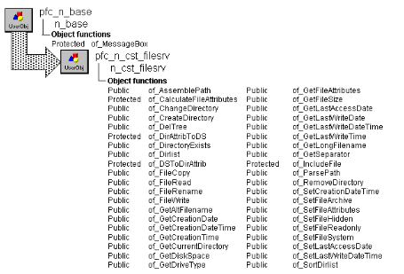

# n_cst_filesrv

**Description**

Ancestor object for platform-specific file-access functions. Many of the functions in this object are virtual functions and return -1, FALSE, or an empty string. A virtual function is an empty placeholder function; the actual processing occurs in its descendants.

Defining virtual functions in an ancestor object is a technique that allows you to define a reference variable with the ancestor’s data type but instantiate the variable with the descendant’s data type. PFC contains descendent objects for each supported platform.

**Ancestry**



**Library**

- PFCAPSRV.PBL
- PFEAPSRV.BPL

**Object relationships**

- [n_cst_dirattrib](../05-global-structures-and-structure-objects/n_cst_dirattrib.md)
- [n_cst_numerical](n_cst_numerical.md)
- [n_cst_string](n_cst_string.md)
- [n_ds](../08-standard-class-user-objects/n_ds.md)

**Usage**

To use the file service:

1. Instantiate the appropriate file services object by calling the f_SetFilesrv global function. This function examines your environment and instantiates the appropriate user object.
2. Call file services functions, as required. The code for many of these functions is defined in the descendent objects. If the function isn’t available on your platform, PowerBuilder executes the ancestor (n_cst_filesrv) function, which returns -1, FALSE, or an empty string.

**Descendants**

- [n_cst_filesrvunicode](n_cst_filesrvunicode.md)

**See also**

- [f_SetFilesrv](../04-global-functions/f_setfilesrv.md)
- [n_cst_platform](n_cst_platform.md)

## Instance variables

N_cst_filesrv includes instance variables:

| Instance variable | Description | Data type | Access | Usage |
| --- | --- | --- | --- | --- |
| FILE_ATTRIBUTE_ARCHIVE | (0x20)		A file or directory that is an archive file or directory. | Long | Public |  |
| FILE_ATTRIBUTE_COMPRESSED | (0x800)		A file or directory that is compressed. | Long | Public |  |
| FILE_ATTRIBUTE_DEVICE | (0x40)		This value is reserved for system use. | Long | Public |  |
| FILE_ATTRIBUTE_DIRECTORY | (0x10)		The handle that identifies a directory. | Long | Public |  |
| FILE_ATTRIBUTE_ENCRYPTED | (0x4000)		A file or directory that is encrypted. | Long | Public |  |
| FILE_ATTRIBUTE_HIDDEN | (0x2)			The file or directory is hidden. | Long | Public |  |
| FILE_ATTRIBUTE_INTEGRITY_STREAM | (0x8000)		The directory or user data stream is configured with integrity (only supported on ReFS volumes). | Long | Public |  |
| FILE_ATTRIBUTE_NO_SCRUB_DATA | (0x20000)	The user data stream not to be read by the background data integrity scanner (AKA scrubber). | Long | Public |  |
| FILE_ATTRIBUTE_NORMAL | (0x80)		A file that does not have other attributes set. | Long | Public |  |
| FILE_ATTRIBUTE_NOT_CONTENT_INDEXED | (0x2000)		The file or directory is not to be indexed by the content indexing service. | Long | Public |  |
| FILE_ATTRIBUTE_OFFLINE | (0x1000)		The data of a file is not available immediately. | Long | Public |  |
| FILE_ATTRIBUTE_READONLY | (0x1)			A file that is read-only. | Long | Public |  |
| FILE_ATTRIBUTE_READONLY_ARCHIVE | Constant set to 33 | Long | Public |  |
| FILE_ATTRIBUTE_READWRITE | Constant set to 0 | Long | Public |  |
| FILE_ATTRIBUTE_REPARSE_POINT | (0x400)		A file or directory that has an associated reparse point, or a file that is a symbolic link. | Long | Public |  |
| FILE_ATTRIBUTE_SPARSE_FILE | (0x200)		A file that is a sparse file. | Long | Public |  |
| FILE_ATTRIBUTE_SYSTEM | (0x4)			A file or directory that the operating system uses a part of, or uses exclusively. | Long | Public |  |
| FILE_ATTRIBUTE_TEMPORARY | (0x100)		A file that is being used for temporary storage. | Long | Public |  |
| FILE_ATTRIBUTE_VIRTUAL | (0x10000)	This value is reserved for system use. | Long | Public |  |
| ids_files | Used for sorting | n_ds | Protected | Internal |
| is_allfiles | Operating system specific characters to indicate all files (for example, \*.\* in DOS) | String | Protected | Internal |
| is_FileType |  | String | Protected |  |
| is_separator | Separator character used by the operating system when specifying a file’s fully qualified pathname | String | Protected | Internal |

## Functions

N_cst_filesrv includes precoded object functions, most of which are virtual functions with corresponding versions in n_cst_filesrv descendants. With few exceptions, these functions return -1 or an empty string.

By defining virtual functions in this object, you can declare a reference variable of type n_cst_filesrv for use with all n_cst_filesrv descendants.

N_cst_filsrv includes precoded object functions:

- of_AssemblePath
- of_CalculateFileAttributes
- of_ChangeDirectory
- of_CreateDirectory
- of_CreateDirectoryTree
- of_DelTree
- of_DirAttribToDS
- of_DirectoryExists
- of_DirList
- of_DSToDirAttrib
- of_FileCopy
- of_FileRead
- of_FileRename
- of_FileWrite
- of_GetAllFilesSpecifier
- of_GetAltFilename
- of_GetCreationDate
- of_GetCreationDateTime
- of_GetCreationTime
- of_GetCurrentDirectory
- of_GetDiskSpace
- of_getdiskspaceex
- of_GetDriveType
- of_GetFileAttributes
- of_GetFileSize
- of_getfiletype
- of_GetLastAccessDate
- of_GetLastWriteDate
- of_GetLastWriteDateTime
- of_GetLastWriteTime
- of_GetLongFilename
- of_getLongPathName
- of_GetSeparator
- of_getShortPathName
- of_getSystemDirectory
- of_getTempFileName
- of_getTempPath
- of_getvolumes
- of_getWindowsDirectory
- of_IncludeFile
- of_maxpath
- of_moveFile
- of_ParsePath
- of_RemoveDirectory
- of_SetCreationDateTime
- of_SetFileArchive
- of_SetFileAttributes
- of_SetFileHidden
- of_SetFileReadonly
- of_SetFileSystem
- of_setfiletype
- of_SetLastAccessDate
- of_SetLastWriteDateTime
- of_SortDirList

### of_AssemblePath

**Description**

Assembles a fully qualified directory path from its component parts.

**Access**

Public

**Syntax**

```
instancename.of_AssemblePath ( drive, path, filename {, extension } )
```

| Argument | Description |
| --- | --- |
| *instancename* | Instance name of n_cst_filesrv |
| *drive* | String specifying the drive name. The colon is optional |
| *path* | String specifying the directory path. The initial backslash is optional |
| *filename* | String specifying the name of the file |
| *extension* (optional) | String specifying the 1-to-3 character file extension. The default is an empty string |

**Return value**

String. Returns the fully qualified directory path.

**Examples**

This example calls the of_AssemblePath function (it assumes an inv_filesrv instance variable):

```
String    ls_drive, ls_dirpath, ls_filename
String    ls_extension, ls_fullpath

ls_fullpath = inv_filesrv.of_AssemblePath &
   (ls_drive, ls_dirpath, ls_filename, ls_extension)
```

### of_CalculateFileAttributes

**Description**

Calculates a file’s attribute byte.

**Access**

Protected

**Syntax**

```
instancename.of_CalculateFileAttributes ( filename, readonly, hidden,
system, archive )
```

| Argument | Description |
| --- | --- |
| *instancename* | Instance name of n_cst_filesrv |
| *filename* | String specifying the name of the files whose attributes will be set. If *filename* does not specify a fully qualified path, the function works relative to the current directory |
| *readonly* | Boolean indicating the read-only attribute. If you specify NULL for this argument, the function does not change the read-only attribute |
| *hidden* | Boolean indicating the hidden attribute. If you specify NULL for this argument, the function does not change the hidden attribute |
| *system* | Boolean indicating the system attribute. If you specify NULL for this argument, the function does not change the system attribute |
| *archive* | Boolean indicating the archive attribute. If you specify NULL for this argument, the function does not change the archive attribute |

**Return value**

UnsignedLong. Returns the new attribute byte if the function succeeds and -1 if an error occurs.

**Examples**

This example is from the original n_cst_filesrvwin32 of_SetFileAttributes function:

```
Integer   li_rc
ULong     lul_attrib

lul_attrib = of_CalculateFileAttributes &
   (as_filename, ab_readonly, ab_hidden, &
       ab_system, ab_archive)
IF lul_Attrib = -1 THEN Return -1
...
```

### of_ChangeDirectory

**Description**

Virtual function only. By defining virtual functions in this object, you can declare a reference variable of type n_cst_filesrv for use with all n_cst_filesrv descendants.

**Access**

Public

**Syntax**

```
instancename.of_ChangeDirectory ( directoryname)
```

| Argument | Description |
| --- | --- |
| *instancename* | Instance name of n_cst_filesrv |
| *directoryname* | String |

**Return value**

Integer. Always returns -1.

**See also**

[n_cst_filesrvunicode](n_cst_filesrvunicode.md) of_ChangeDirectory function

### of_CreateDirectory

**Description**

Virtual function only. By defining virtual functions in this object, you can declare a reference variable of type n_cst_filesrv for use with all n_cst_filesrv descendants.

**Access**

Public

**Syntax**

```
instancename.of_CreateDirectory ( directoryname )
```

| Argument | Description |
| --- | --- |
| *instancename* | Instance name of n_cst_filesrv |
| *directoryname* | String |

**Return value**

Integer. Always returns -1.

**See also**

[n_cst_filesrvunicode](n_cst_filesrvunicode.md) of_CreateDirectory function

### of_CreateDirectoryTree

**Description**

Create all directories specified in the passed directory tree. Restore intial directory afterward, if requested.

**Syntax 1**

Access: Public

**Syntax**

```
instancename.of_CreateDirectoryTree ( as_directorytree, ab_restorecurrentdirectory )
```

| Argument | Description |
| --- | --- |
| *instancename* | Instance name of n_cst_filesrv |
| *as_directorytree* | String. The directory tree to be created. |
| *ab_restorecurrentdirectory* | Boolean. Restore or not the current directory at the end. |

**Return value**

Integer. 1, ok or -1 when an error occurs.

**Syntax 2**

Create all directories specified in the passed directory tree.

Access: Public

**Syntax**

```
instancename.of_CreateDirectoryTree ( as_directorytree )
```

| Argument | Description |
| --- | --- |
| *instancename* | Instance name of n_cst_filesrv |
| *as_directorytree* | String. The directory tree to be created. |

**Return value**

Integer. 1, ok or -1 when an error occurs.

### of_DelTree

**Description**

Recursively deletes a directory, along with all of its files and subdirectories.

**Access**

Public

**Syntax**

```
instancename.of_DelTree ( directoryname )
```

| Argument | Description |
| --- | --- |
| *instancename* | Instance name of n_cst_filesrv |
| *directoryname* | String specifying the path to the directory to be deleted. If you do not specify an absolute path, this function deletes relative to the current working directory |

**Return value**

Integer. Returns 0 if the function succeeds, 1 if the directory does not exist, and a negative number if an error occurs.

**Examples**

This example erases the directory named in the sle_del_directory SingleLineEdit, its files, its subdirectories, and its subdirectory’s files (it assumes an inv_filesrv instance variable):

```
Integer   li_return

li_return = MessageBox("Delete", &
   "Delete all files and directories in " + &
   sle_del_directory.Text + "?", &
      Exclamation!, OKCancel!, 2)
IF li_return = 1 THEN
   li_return = inv_filesrv.of_DelTree &
   (sle_del_directory.Text)
   IF li_return = 1 THEN
   MessageBox("Delete", "Directory not found")
   Return
...
```

### of_DirAttribToDS

**Description**

Copies the passed n_cst_dirattrib structure object to a DataStore.

**Access**

Protected

**Syntax**

```
instancename.of_DirAttribToDS ( datastore, entry, file, group )
```

| Argument | Description |
| --- | --- |
| *instancename* | Instance name of n_cst_filesrv |
| *datastore* | N_ds |
| *entry* | N_cst_dirattrib |
| *file* | String |
| *group* | Integer |

**Return value**

Integer. Returns 1 if the function succeeds and -1 if an error occurs.

**Usage**

Internal.

**Examples**

This example is from the of_SortDirList function:

```
...
If anv_DirList[li_Cnt].ib_Subdirectory Then
  ls_sortfilename = Mid(lnv_direntry.is_FileName, &
    2, (Len(lnv_direntry.is_FileName) - 2))
  of_DirAttribToDS(lds_files, lnv_direntry,  &
    ls_sortfilename, 0)
...
```

### of_DirectoryExists

**Description**

Virtual function only. By defining virtual functions in this object, you can declare a reference variable of type n_cst_filesrv for use with all n_cst_filesrv descendants.

**Access**

Public

**Syntax**

```
instancename.of_DirectoryExists ( directoryname )
```

| Argument | Description |
| --- | --- |
| *instancename* | Instance name of n_cst_filesrv |
| *directoryname* | String |

**Return value**

Boolean. Always returns FALSE.

**See also**

[n_cst_filesrvunicode](n_cst_filesrvunicode.md) of_DirectoryExists function

### of_DirList

**Description**

Virtual function only. By defining virtual functions in this object, you can declare a reference variable of type n_cst_filesrv for use with all n_cst_filesrv descendants.

**Access**

Public

**Syntax**

```
instancename.of_DirList ( filespec, filetype, dirlist, sorttype )
```

| Argument | Description |
| --- | --- |
| *instancename* | Instance name of n_cst_filesrv |
| *filespec* | String |
| *filetype* | Long |
| *dirlist* | N_cst_dirlistattrib structure object (passed by reference) |
| *sorttype* | Integer |

**Return value**

Long. Always returns -1.

**See also**

[n_cst_filesrvunicode](n_cst_filesrvunicode.md) of_DirList function

### of_DSToDirAttrib

**Description**

Copies the specified row in the passed DataStore to an n_cst_dirattrib structure object.

**Access**

Protected

**Syntax**

```
instancename.of_DSToDirAttrib ( datastore, entry, row )
```

| Argument | Description |
| --- | --- |
| *instancename* | Instance name of n_cst_filesrv |
| *datastore* | N_ds |
| *entry* | N_cst_dirattrib (passed by reference) |
| *row* | Long |

**Return value**

Integer. Returns 1 if the function succeeds and -1 if an error occurs.

**Usage**

Internal.

**Examples**

This example is from the of_SortDirList function:

```
...
ll_rowcount = lds_files.RowCount()
FOR li_cnt = 1 TO ll_rowcount
   of_DSToDirAttrib(lds_files, lnv_direntry, li_cnt)
   anv_dirlist[li_pos] = lnv_direntry
   li_pos++
NEXT
...
```

### of_FileCopy

**Description**

Copies one file to another, optionally appending to the target file.

**Access**

Public

**Syntax**

```
instancename.of_FileCopy ( sourcefile, targetfile {, append } )
```

| Argument | Description |
| --- | --- |
| *instancename* | Instance name of n_cst_filesrv |
| *sourcefile* | String specifying the name of the file to be copied. If *sourcefile* does not specify a fully qualified path, the function works relative to the current directory |
| *targetfile* | String specifying the name of the target file. If *targetfile* does not specify a fully qualified path, the function works relative to the current directory |
| *append* (optional) | Boolean specifying whether to append to *targetfile* (TRUE) or replace it (FALSE) |

**Return value**

Integer. Returns values as follows:

1—Success -1—Error opening *sourcefile* -2—Error writing *targetfile*

**Examples**

This example calls the of_FileCopy function to copy the file specified in the sle_source SingleLineEdit to the file specified in the sle_target SingleLineEdit, replacing the previous contents of the target file. It assumes that n_cst_filesrv has been created using the inv_filesrv instance variable:

```
Integer   li_return

li_return = &
   inv_filesrv.of_FileCopy(sle_source.text, &
       sle_target.text, FALSE)
CHOOSE CASE li_return
   CASE -1
   MessageBox("Copy Error", &
      "Error opening source file")
   CASE -2
   MessageBox("Copy Error", &
      "Error reading source file")
   CASE -3
   MessageBox("Copy Error", &
      "Error accessing target file")
END CHOOSE
```

### of_FileRead

Reads a file into a Blob or string array. There are two syntaxes:

| To | Use |
| --- | --- |
| Read a file into a BLOB variable | Syntax 1 |
| Read a file into a string array | Syntax 2 |

| Syntax 1 | To read a file into a Blob variable |
| --- | --- |

**Description**

Reads a file into a Blob variable.

**Access**

Public

**Syntax**

```
instancename.of_FileRead ( filename, blob )
```

| Argument | Description |
| --- | --- |
| *instancename* | Instance name of n_cst_filesrv |
| *filename* | String specifying the name of the file to be read. If *filename* does not specify a fully qualified path, the function works relative to the current directory |
| *blob* | Blob variable into which the function copies the contents of *filename* (passed by reference) |

**Return value**

Long. Returns the size of *blob* if the function succeeds and -1 if an error occurs.

**Usage**

Call this function to access files in any size or format, including bitmaps and text files.

Use Syntax 2 to read a file into a string array.

**Examples**

This example calls the of_FileRead function (it assumes an inv_filesrv instance variable):

```
Long   ll_return
Blob   lblb_file

ll_return = inv_filesrv.of_FileRead &
   (sle_filename.text, lblb_file)
CHOOSE CASE ll_return
   CASE -1
   MessageBox("Error", "Error accessing file")
   CASE ELSE
   // File processing goes here
END CHOOSE
```

| Syntax 2 | To read a file into a string array |
| --- | --- |

**Description**

Reads the contents of a file into a string array. Each element in the string array holds 32K of data.

**Access**

Public

**Syntax**

```
instancename.of_FileRead ( filename, text )
```

| Argument | Description |
| --- | --- |
| *instancename* | Instance name of n_cst_filesrv |
| *filename* | String specifying the name of the file to be read. If *filename* does not specify a fully qualified path, the function works relative to the current directory |
| *text* | String array into which the function copies the contents of *filename* |

**Return value**

Integer. Returns the number of elements in the *text* array if the function succeeds and -1 if an error occurs.

**Usage**

Call this function to access text files of any size.

Use Syntax 1 to read files of any format into a Blob.

**Examples**

This example calls the of_FileRead function (it assumes an inv_filesrv instance variable):

```
Integer   li_return
String    ls_file[ ]

li_return = inv_filesrv.of_FileRead &
   (sle_filename.text, ls_file)
CHOOSE CASE li_return
   CASE -1
   MessageBox("Error", "Error accessing file")
   CASE ELSE
   // File processing goes here
END CHOOSE
```

### of_FileRename

**Description**

Virtual function only. By defining virtual functions in this object, you can declare a reference variable of type n_cst_filesrv for use with all n_cst_filesrv descendants.

**Access**

Public

**Syntax**

```
instancename.of_FileRename ( oldname, newname )
```

| Argument | Description |
| --- | --- |
| *instancename* | Instance name of n_cst_filesrv |
| *oldname* | String |
| *newname* | String |

**Return value**

Integer. Always returns -1.

**See also**

[n_cst_filesrvunicode](n_cst_filesrvunicode.md) of_FileRename function

### of_FileWrite

Writes a file from a Blob or string. There are two syntaxes:

| To | Use |
| --- | --- |
| Write a file from a Blob variable | Syntax 1 |
| Write a file from a string | Syntax 2 |

**Description**

Writes the contents of a blob variable to a file.

**Access**

Public

**Syntax**

```
instancename.of_FileWrite ( filename, blob {, append } )
```

| Argument | Description |
| --- | --- |
| *instancename* | Instance name of n_cst_filesrv |
| *filename* | String specifying the name of the file to be written. If *filename* does not specify a fully qualified path, the function works relative to the current directory |
| *blob* | Blob variable from which the function copies to *filename* |
| *append* (optional) | Boolean specifying whether to append to (TRUE) or overwrite (FALSE) *filename*. The default is TRUE |

**Return value**

Integer. Returns 1 if the function succeeds and -1 if an error occurs.

**Usage**

Call this function to write files in any format, including bitmaps and text files.

**Examples**

This example calls the of_FileWrite. It assumes that n_cst_filesrv has been created using the inv_filesrv instance variable:

```
Blob   lblb_file
... // Logic to populate lblb_file
IF inv_filesrv.of_FileWrite &
   (sle_filename.text, lblb_file, FALSE) = -1 THEN
   MessageBox("Write Error", &
      "Error writing BLOB file")
END IF
```

| Syntax 2 | To write from a string |
| --- | --- |

**Description**

Writes to a text file using the contents of a passed string.

**Access**

Public

**Syntax**

```
instancename.of_FileWrite ( filename, text {, append } )
```

| Argument | Description |
| --- | --- |
| *instancename* | Instance name of n_cst_filesrv |
| *filename* | String specifying the name of the file to be written. If *filename* does not specify a fully qualified path, the function works relative to the current directory |
| *text* | String from which the function copies to *filename* |
| *append* (optional) | Boolean specifying whether to append to (TRUE) or overwrite (FALSE) *filename*. The default is TRUE |

**Return value**

Integer. Returns 1 if the function succeeds and -1 if an error occurs.

**Examples**

This example calls the of_FileWrite function (it assumes an inv_filesrv instance variable):

```
String    ls_file
... // Logic to populate ls_file
IF inv_filesrv.of_FileWrite &
   (sle_filename.text, ls_file, FALSE) = -1 THEN
   MessageBox("Write Error", &
      "Error writing file")
END IF
```

### of_GetAllFilesSpecifier

**Description**

Returns the value of the protected instance Allfiles which specifies the string value needed to retrieve all the files in the current operating system for a directory.

**Access**

Public

**Syntax**

```
instancename.of_GetAllFilesSpecifier ( )
```

| Argument | Description |
| --- | --- |
| *instancename* | Instance name of n_cst_filesrv |

**Return value**

String. The all files string value.

### of_GetAltFilename

**Description**

Virtual function only. By defining virtual functions in this object, you can declare a reference variable of type n_cst_filesrv for use with all n_cst_filesrv descendants.

**Access**

Public

**Syntax**

```
instancename.of_GetAltFilename ( filename )
```

| Argument | Description |
| --- | --- |
| *instancename* | Instance name of n_cst_filesrv |
| *filename* | String |

**Return value**

String. Always returns an empty string.

**See also**

[n_cst_filesrvunicode](n_cst_filesrvunicode.md) of_GetAltFilename function

### of_GetCreationDate

**Description**

Retrieves the date the file was created.

**Access**

Public

**Syntax**

```
instancename.of_GetCreationDate ( filename, date )
```

| Argument | Description |
| --- | --- |
| *instancename* | Instance name of n_cst_filesrv |
| *filename* | String specifying the name of the file whose creation date is to be returned. If *filename* does not specify a fully qualified path, the function works relative to the current directory |
| *date* | Date variable into which the function places the date *filename* was created (passed by reference) |

**Return value**

Integer. Returns 1 if the function succeeds and -1 if a problem occurs.

**Usage**

This function calls the of_GetCreationDateTime function.

**Examples**

This example calls the of_GetCreationDate function (it assumes an inv_filesrv instance variable):

```
Date   ldt_date

inv_filesrv.of_GetCreationDate &
   (sle_filename.Text, ldt_date)
MessageBox("Creation Date", &
   "Creation date: " + String(ldt_date) )
```

### of_GetCreationDateTime

**Description**

Virtual function only. By defining virtual functions in this object, you can declare a reference variable of type n_cst_filesrv for use with all n_cst_filesrv descendants.

**Access**

Public

**Syntax**

```
instancename.of_GetCreationDateTime ( filename, date, time )
```

| Argument | Description |
| --- | --- |
| *instancename* | Instance name of n_cst_filesrv |
| *filename* | String |
| *date* | Date |
| *time* | Time |

**Return value**

Integer. Always returns -1.

**See also**

[n_cst_filesrvunicode](n_cst_filesrvunicode.md) of_GetCreationDateTime function

### of_GetCreationTime

**Description**

Retrieves the time the file was created.

**Access**

Public

**Syntax**

```
instancename.of_GetCreationTime ( filename, time )
```

| Argument | Description |
| --- | --- |
| *instancename* | Instance name of n_cst_filesrv |
| *filename* | String specifying the name of the file whose creation time is to be returned. If *filename* does not specify a fully qualified path, the function works relative to the current directory |
| *time* | Time variable into which the function places the time *filename* was created (passed by reference) |

**Return value**

Integer. Returns 1 if the function succeeds and -1 if a problem occurs.

**Usage**

This function calls the of_GetCreationDateTime function.

**Examples**

This example calls the of_GetCreationTime function (it assumes an inv_filesrv instance variable):

```
Time   lt_time

inv_filesrv.of_GetCreationTime &
   (sle_filename.Text, lt_time)
MessageBox("Creation Time", &
   "Creation time: " + String(lt_time) )
```

### of_GetCurrentDirectory

**Description**

Virtual function only. By defining virtual functions in this object, you can declare a reference variable of type n_cst_filesrv for use with all n_cst_filesrv descendants.

**Access**

Public

**Syntax**

```
instancename.of_GetCurrentDirectory ( )
```

| Argument | Description |
| --- | --- |
| *instancename* | Instance name of n_cst_filesrv |

**Return value**

String. Always returns an empty string.

**See also**

[n_cst_filesrvunicode](n_cst_filesrvunicode.md) of_GetCurrentDirectory function

### of_GetDiskSpace

**Description**

Virtual function only. By defining virtual functions in this object, you can declare a reference variable of type n_cst_filesrv for use with all n_cst_filesrv descendants.

**Access**

Public

**Syntax**

```
instancename.of_GetDiskSpace ( drive, total, free )
```

| Argument | Description |
| --- | --- |
| *instancename* | Instance name of n_cst_filesrv |
| *drive* | Character |
| *total* | Long |
| *free* | Long |

**Return value**

Integer. Always returns -1.

**See also**

[n_cst_filesrvunicode](n_cst_filesrvunicode.md) of_GetDiskSpace function

### of_getdiskspaceex

**Description**

No description is available.

**Access**

Public

**Syntax**

```
instancename.of_getdiskspaceex ( as_drive, adec_totalspace, adec_freespace )
```

| Argument | Description |
| --- | --- |
| *instancename* | Instance name of n_cst_filesrv |
| *as_drive* | String. |
| *adec_totalspace* | Decimal, passed by reference. |
| *adec_freespace* | Decimal, passed by reference. |

**Return value**

Integer.

### of_GetDriveType

**Description**

Virtual function only. By defining virtual functions in this object, you can declare a reference variable of type n_cst_filesrv for use with all n_cst_filesrv descendants.

**Access**

Public

**Syntax**

```
instancename.of_GetDriveType ( drive )
```

| Argument | Description |
| --- | --- |
| *instancename* | Instance name of n_cst_filesrv |
| *drive* | Character |

**Return value**

Integer. Always returns -1.

**See also**

[n_cst_filesrvunicode](n_cst_filesrvunicode.md) of_GetDriveType function

### of_GetFileAttributes

**Description**

Virtual function only. By defining virtual functions in this object, you can declare a reference variable of type n_cst_filesrv for use with all n_cst_filesrv descendants.

**Access**

Public

**Syntax**

```
instancename.of_GetFileAttributes ( filename, readonly, hidden, system,
subdirectory, archive )
```

| Argument | Description |
| --- | --- |
| *instancename* | Instance name of n_cst_filesrv |
| *filename* | String |
| *readonly* | Boolean |
| *hidden* | Boolean |
| *system* | Boolean |
| *subdirectory* | Boolean |
| *archive* | Boolean |

**Return value**

Integer. Always returns -1.

**See also**

[n_cst_filesrvunicode](n_cst_filesrvunicode.md) of_GetFileAttributes function

### of_GetFileSize

**Description**

Virtual function only. By defining virtual functions in this object, you can declare a reference variable of type n_cst_filesrv for use with all n_cst_filesrv descendants.

**Access**

Public

**Syntax**

```
instancename.of_GetFileSize ( filename )
```

| Argument | Description |
| --- | --- |
| *instancename* | Instance name of n_cst_filesrv |
| *filename* | String |

**Return value**

Double. Always returns -1.

**See also**

[n_cst_filesrvunicode](n_cst_filesrvunicode.md) of_GetFileSize function

### of_getfiletype

**Description**

returns the actual file type used.

**Access**

Public

**Syntax**

```
instancename.of_getfiletype ( )
```

| Argument | Description |
| --- | --- |
| *instancename* | Instance name of n_cst_filesrv |

**Return value**

String. the actual value of the file type used.

**Usage**

CAll this method to know what file type is acutally used.

### of_GetLastAccessDate

**Description**

Virtual function only. By defining virtual functions in this object, you can declare a reference variable of type n_cst_filesrv for use with all n_cst_filesrv descendants.

**Access**

Public

**Syntax**

```
instancename.of_GetLastAccessDate ( filename, date )
```

| Argument | Description |
| --- | --- |
| *instancename* | Instance name of n_cst_filesrv |
| *filename* | String specifying the name of the file whose last access date is to be returned. If *filename* does not specify a fully qualified path, the function works relative to the current directory |
| *date* | Date variable into which the function places the date *filename* last accessed (passed by reference) |

**Return value**

Integer. Always returns -1.

**See also**

[n_cst_filesrvunicode](n_cst_filesrvunicode.md) of_GetLastAccessDate function

### of_GetLastWriteDate

**Description**

Retrieves the date the file was last modified.

**Access**

Public

**Syntax**

```
instancename.of_GetLastWriteDate ( filename, date )
```

| Argument | Description |
| --- | --- |
| *instancename* | Instance name of n_cst_filesrv |
| *filename* | String specifying the name of the file whose last write date is to be returned. If *filename* does not specify a fully qualified path, the function works relative to the current directory |
| *date* | Date variable into which the function places the date *filename* last modified (passed by reference) |

**Return value**

Integer. Returns 1 if the function succeeds and -1 if a problem occurs.

**Usage**

This function calls the of_GetLastWriteDateTime function.

**Examples**

This example calls the of_GetLastWriteDate function (it assumes an inv_filesrv instance variable):

```
Date   ldt_date

inv_filesrv.of_GetLastWriteDate &
   (sle_filename.Text, ldt_date)
MessageBox("Last Write Date", &
   "Last write date: " + String(ldt_date) )
```

### of_GetLastWriteDateTime

**Description**

Virtual function only. By defining virtual functions in this object, you can declare a reference variable of type n_cst_filesrv for use with all n_cst_filesrv descendants.

**Access**

Public

**Syntax**

```
instancename.of_GetLastWriteDateTime ( filename, date, time )
```

| Argument | Description |
| --- | --- |
| *instancename* | Instance name of n_cst_filesrv |
| *filename* | String |
| *date* | Date |
| *time* | Time |

**Return value**

Integer. Always returns -1.

**See also**

[n_cst_filesrvunicode](n_cst_filesrvunicode.md) of_GetLastWriteDateTime function

### of_GetLastWriteTime

**Description**

Retrieves the time the file was last modified.

**Access**

Public

**Syntax**

```
instancename.of_GetLastWriteTime ( filename, time )
```

| Argument | Description |
| --- | --- |
| *instancename* | Instance name of n_cst_filesrv |
| *filename* | String specifying the name of the file whose last write date is to be returned. If *filename* does not specify a fully qualified path, the function works relative to the current directory |
| *time* | Time variable into which the function place the time *filename* last modified (passed by reference) |

**Return value**

Integer. Returns 1 if the function succeeds and -1 if an error occurs.

**Usage**

This function calls the of_GetLastWriteDateTime function.

**Examples**

This example calls the of_GetLastWriteTime function (it assumes an inv_filesrv instance variable):

```
Time   lt_time

inv_filesrv.of_GetLastWriteTime &
   (sle_filename.Text, lt_time)
MessageBox("Last Write Time", &
   "Last write time: " + String(lt_time) )
```

### of_GetLongFilename

**Description**

Virtual function only. By defining virtual functions in this object, you can declare a reference variable of type n_cst_filesrv for use with all n_cst_filesrv descendants.

**Access**

Public

**Syntax**

```
instancename.of_GetLongFilename ( filename )
```

| Argument | Description |
| --- | --- |
| *instancename* | Instance name of n_cst_filesrv |
| *filename* | String |

**Return value**

String. Always returns an empty string.

**See also**

[n_cst_filesrvunicode](n_cst_filesrvunicode.md) of_GetLongFilename function

### of_getLongPathName

**Description**

Converts the specified path or file to its long form.

**Access**

Public

**Syntax**

```
instancename.of_getLongPathName ( as_shortpathname )
```

| Argument | Description |
| --- | --- |
| *instancename* | Instance name of n_cst_filesrv |
| *as_shortpathname* | String. Path or file to be converted to its long form. |

**Return value**

String. String Path or file in its long form.

### of_GetSeparator

**Description**

Retrieves the directory separator character.

**Access**

Public

**Syntax**

```
instancename.of_GetSeparator ( )
```

| Argument | Description |
| --- | --- |
| *instancename* | Instance name of n_cst_filesrv |

**Return value**

String. Returns the is_separator instance variable.

**Usage**

N_cst_filesrv descendants can call this function to create fully qualified pathnames.

**Examples**

This example calls the of_GetSeparator function:

```
String    is_separator

is_separator = inv_filesrv.of_GetSeparator( )
```

### of_getShortPathName

**Description**

Converts the specified path or file to its short form.

**Access**

Public

**Syntax**

```
instancename.of_getShortPathName ( as_longpathname )
```

| Argument | Description |
| --- | --- |
| *instancename* | Instance name of n_cst_filesrv |
| *as_longpathname* | String. Path or file to be converted to its short form. |

**Return value**

String. String Path or file in its short form.

### of_getSystemDirectory

**Description**

Gets the system directory.

**Access**

Public

**Syntax**

```
instancename.of_getSystemDirectory ( )
```

| Argument | Description |
| --- | --- |
| *instancename* | Instance name of n_cst_filesrv |

**Return value**

String. String Path to the system directory.

### of_getTempFileName

**Description**

Returns a name for a temporary file. If a unique file name is generated, an empty file is created and the handle to it is released; otherwise, only a file name is generated.

**Syntax 1**

Access: Public

**Syntax**

```
instancename.of_getTempFileName ( vs_directory, vs_prefix, vui_unique )
```

| Argument | Description |
| --- | --- |
| *instancename* | Instance name of n_cst_filesrv |
| *vs_directory* | String. |
| *vs_prefix* | String. |
| *vui_unique* | UnsignedInteger. |

**Return value**

String. String A unique file name.

**Syntax 2**

Access: Public

**Syntax**

```
instancename.of_getTempFileName ( vs_prefix )
```

| Argument | Description |
| --- | --- |
| *instancename* | Instance name of n_cst_filesrv |
| *vs_prefix* | String. |

**Return value**

String. String A unique file name.

### of_getTempPath

**Description**

Returns a string specifying the temporary file path. The returned string ends with a backslash.

**Access**

Public

**Syntax**

```
instancename.of_getTempPath ( )
```

| Argument | Description |
| --- | --- |
| *instancename* | Instance name of n_cst_filesrv |

**Return value**

String. String Path to the file system temporary storage directory.

### of_getvolumes

**Description**

No description is available.

**Access**

Public

**Syntax**

```
instancename.of_getvolumes ( as_volumes )
```

| Argument | Description |
| --- | --- |
| *instancename* | Instance name of n_cst_filesrv |
| *as_volumes* | String array, passed by reference. |

**Return value**

Integer.

### of_getWindowsDirectory

**Description**

Gets the windows directory.

**Access**

Public

**Syntax**

```
instancename.of_getWindowsDirectory ( )
```

| Argument | Description |
| --- | --- |
| *instancename* | Instance name of n_cst_filesrv |

**Return value**

String. String Path to the windows directory.

### of_IncludeFile

**Description**

Called by the of_DirList function to report whether a file contains the specified attribute settings.

**Access**

Protected

**Syntax**

```
instancename.of_IncludeFile ( filename, attributemask, fileattrib )
```

| Argument | Description |
| --- | --- |
| *instancename* | Instance name of n_cst_filesrv |
| *filename* | String specifying the file to be accessed. If *filename* does not specify a fully qualified path, the function works relative to the current directory |
| *attributemask* | Long containing the bit string that determines whether *filename* is included by of_DirList |
| *fileattrib* | UnsignedLong containing the file’s attribute bits |

**Return value**

Boolean. Returns TRUE if *filename* should be included and FALSE if it should not.

**Usage**

The of_DirList function calls this function to determine whether to include the file in its list of files.

**Examples**

This example is from the of_DirList function:

```
...
DO WHILE li_RC = 0
   lui_Attrib = Asc(lstr_FindData.c_Attrib)

   // Determine if this file should be included.
   IF of_IncludeFile(String(lstr_FindData.c_Name), &
   al_FileType, lui_Attrib) THEN
...
```

### of_maxpath

**Description**

Gets the windows directory.

**Access**

Protected

**Syntax**

```
instancename.of_maxpath ( )
```

| Argument | Description |
| --- | --- |
| *instancename* | Instance name of n_cst_filesrv |

**Return value**

Long. String Path to the windows directory.

### of_moveFile

**Description**

Renames a file or directory.

**Access**

Public

**Syntax**

```
instancename.of_moveFile ( as_existingfilename, as_newfilename )
```

| Argument | Description |
| --- | --- |
| *instancename* | Instance name of n_cst_filesrv |
| *as_existingfilename* | String. The current name of the file or directory on the local computer. |
| *as_newfilename* | String. The new name for the file or directory. The new name must not already exist. A new file may be on a different file system or drive. A new directory must be on the same drive. |

**Return value**

Boolean. Boolean TRUE if successful.

### of_ParsePath

**Description**

Separates a fully qualified filename into its component parts.

**Access**

Public

**Syntax**

```
instancename.of_ParsePath ( path, drive, directorypath, filename
{, extension } )
```

| Argument | Description |
| --- | --- |
| *instancename* | Instance name of n_cst_filesrv |
| *path* | String specifying the fully qualified filename |
| *drive* | String into which the function places the drive specification, including the colon and backslash (if specified in *fullname*) (passed by reference) |
| *directorypath* | String into which the function places the directory path (passed by reference) |
| *filename* | String into which the function places the filename without the extension (passed by reference) |
| *extension* (optional) | String into which the function places the extension (passed by reference) |

**Return value**

Integer. Returns 1 if the function succeeds and -1 if an error occurs.

**Examples**

This example calls the of_ParsePath function (it assumes an inv_filesrv instance variable):

```
String    ls_drive, ls_path, ls_filename
String    ls_extension

inv_filesrv.of_ParsePath &
   (sle_fullpath.Text, ls_drive, ls_path, &
       ls_filename, ls_extension)
sle_filename.Text = ls_filename + "." + ls_extension
```

### of_RemoveDirectory

**Description**

Virtual function only. By defining virtual functions in this object, you can declare a reference variable of type n_cst_filesrv for use with all n_cst_filesrv descendants.

**Access**

Public

**Syntax**

```
instancename.of_RemoveDirectory ( directoryname )
```

| Argument | Description |
| --- | --- |
| *instancename* | Instance name of n_cst_filesrv |
| *directoryname* | String |

**Return value**

Integer. Always returns -1.

**See also**

[n_cst_filesrvunicode](n_cst_filesrvunicode.md) of_RemoveDirectory function

### of_SetCreationDateTime

**Description**

Virtual function only. By defining virtual functions in this object, you can declare a reference variable of type n_cst_filesrv for use with all n_cst_filesrv descendants.

**Access**

Public

**Syntax**

```
instancename.of_SetCreationDateTime ( filename, date, time )
```

| Argument | Description |
| --- | --- |
| *instancename* | Instance name of n_cst_filesrv |
| *filename* | String |
| *date* | Date |
| *time* | Time |

**Return value**

Integer. Always returns -1.

**See also**

[n_cst_filesrvunicode](n_cst_filesrvunicode.md) of_SetCreationDateTime function

### of_SetFileArchive

**Description**

Calls the of_SetFileAttributes function to set a file’s archive attribute.

**Access**

Public

**Syntax**

```
instancename.of_SetFileArchive ( filename, archive )
```

| Argument | Description |
| --- | --- |
| *instancename* | Instance name of n_cst_filesrv |
| *filename* | String specifying the name of the file whose archive attribute is to be set. If *filename* does not specify a fully qualified path, the function works relative to the current directory |
| *archive* | Boolean specifying whether to turn the archive bit on (TRUE) or off (FALSE) |

**Return value**

Integer. Returns 1 if the function succeeds and -1 if an error occurs.

**Examples**

This example calls the of_SetFileArchive function (it assumes an inv_filesrv instance variable):

```
inv_filesrv.of_SetFileArchive &
   (sle_filename.Text, cbx_archive.Checked)
```

### of_SetFileAttributes

**Description**

Virtual function only. By defining virtual functions in this object, you can declare a reference variable of type n_cst_filesrv for use with all n_cst_filesrv descendants.

**Access**

Public

**Syntax**

```
instancename.of_SetFileAttributes ( filename, readonly, hidden, system,
archive )
```

| Argument | Description |
| --- | --- |
| *instancename* | Instance name of n_cst_filesrv |
| *filename* | String |
| *readonly* | Boolean |
| *hidden* | Boolean |
| *system* | Boolean |
| *archive* | Boolean |

**Return value**

Integer. Always returns -1.

**See also**

[n_cst_filesrvunicode](n_cst_filesrvunicode.md) of_SetFileAttributes function

### of_SetFileHidden

**Description**

Calls the of_SetFileAttributes function to set a file’s hidden attribute.

**Access**

Public

**Syntax**

```
instancename.of_SetFileHidden ( filename, hidden )
```

| Argument | Description |
| --- | --- |
| *instancename* | Instance name of n_cst_filesrv |
| *filename* | String specifying the name of the file whose hidden attribute is to be set. If *filename* does not specify a fully qualified path, the function works relative to the current directory |
| *hidden* | Boolean specifying whether to make the file hidden (TRUE) or not (FALSE) |

**Return value**

Integer. Returns 1 if the function succeeds and -1 if an error occurs.

**Examples**

This example calls the of_SetFileHidden function (it assumes an inv_filesrv instance variable):

```
inv_filesrv.of_SetFileHidden &
   (sle_filename.Text, cbx_hidden.Checked)
```

### of_SetFileReadonly

**Description**

Calls the of_SetFileAttributes function to set a file’s read-only attribute.

**Access**

Public

**Syntax**

```
instancename.of_SetFileReadonly ( filename, readonly )
```

| Argument | Description |
| --- | --- |
| *instancename* | Instance name of n_cst_filesrv |
| *filename* | String specifying the name of the file whose read-only attribute is to be set. If *filename* does not specify a fully qualified path, the function works relative to the current directory |
| *readonly* | Boolean specifying whether to make the file read-only (TRUE) or not (FALSE) |

**Return value**

Integer. Returns 1 if the function succeeds and -1 if an error occurs.

**Examples**

This example calls the of_SetFileReadonly function (it assumes an inv_filesrv instance variable):

```
inv_filesrv.of_SetFileReadonly &
   (sle_filename.Text, cbx_readonly.Checked)
```

### of_SetFileSystem

**Description**

Calls the of_SetFileAttributes function to set a file’s system attribute.

**Access**

Public

**Syntax**

```
instancename.of_SetFileSystem ( filename, system )
```

| Argument | Description |
| --- | --- |
| *instancename* | Instance name of n_cst_filesrv |
| *filename* | String specifying the name of the file whose system attribute is to be set. If *filename* does not specify a fully qualified path, the function works relative to the current directory |
| *system* | Boolean specifying whether to set the file’s system attribute (TRUE) or not (FALSE) |

**Return value**

Integer. Returns 1 if the function succeeds and -1 if an error occurs.

**Examples**

This example calls the of_SetFileSystem function (it assumes an inv_filesrv instance variable):

```
inv_filesrv.of_SetFileSystem &
   (sle_filename.Text, cbx_system.Checked)
```

### of_setfiletype

**Description**

Set current File Type value.

**Access**

Public

**Syntax**

```
instancename.of_setfiletype ( as_filetype )
```

| Argument | Description |
| --- | --- |
| *instancename* | Instance name of n_cst_filesrv |
| *as_filetype* | String. The file type to set. |

**Return value**

Integer. 1, OK -1, An error occurs.

**Usage**

Call this method in order to se a file type toe be used.

### of_SetLastAccessDate

**Description**

Virtual function only. By defining virtual functions in this object, you can declare a reference variable of type n_cst_filesrv for use with all n_cst_filesrv descendants.

**Access**

Public

**Syntax**

```
instancename.of_SetLastAccessDate ( filename, date )
```

| Argument | Description |
| --- | --- |
| *instancename* | Instance name of n_cst_filesrv |
| *filename* | String |
| *date* | Date |

**Return value**

Integer. Always returns -1.

**See also**

[n_cst_filesrvunicode](n_cst_filesrvunicode.md) of_SetLastAccessDate function

### of_SetLastWriteDateTime

**Description**

Virtual function only. By defining virtual functions in this object, you can declare a reference variable of type n_cst_filesrv for use with all n_cst_filesrv descendants.

**Access**

Public

**Syntax**

```
instancename.of_SetLastWriteDateTime ( filename, date, time )
```

| Argument | Description |
| --- | --- |
| *instancename* | Instance name of n_cst_filesrv |
| *filename* | String |
| *date* | Date |
| *time* | Time |

**Return value**

Integer. Always returns -1.

**See also**

[n_cst_filesrvunicode](n_cst_filesrvunicode.md) of_SetLastWriteDateTime function

### of_SortDirList

**Description**

Sorts the directory list output from the of_DirList function.

**Access**

Public

**Syntax**

```
instancename.of_SortDirList ( dirlist, sorttype {, ascending } )
```

| Argument | Description |
| --- | --- |
| *instancename* | Instance name of n_cst_filesrv |
| *dirlist* | Array of type n_cst_dirattrib containing the output from the of_DirList function (passed by reference) |
| *sorttype* | Integer specifying how to sort *dirlist*: |
|  | • 1 By filename |
|  | • 2 By extension |
|  | • 3 By last write date/time |
|  | • 4 By filesize |
| *ascending* (optional) | Boolean indicating whether the sort direction is ascending (TRUE) or descending (FALSE). The default is TRUE |

**Return value**

Integer. Returns 1 if the function succeeds and -1 if an error occurs.

**Usage**

The of_DirList function calls this function to sort the *dirlist* array.

**Examples**

This example calls the of_SortDirList function:

```
String    ls_currdir
Integer   li_cnt, li_entries
String    ls_import
n_cst_dirlistattrib lnv_dirlist[ ]

SetPointer(HourGlass!)
ls_currdir = "c:\Win95"

li_entries = &
   inv_filesrv.of_DirList &
       (ls_currdir, 0, lnv_dirlist)
...
inv_filesrv.of_SortDirList(lnv_dirlist, 1, TRUE)
...
```
