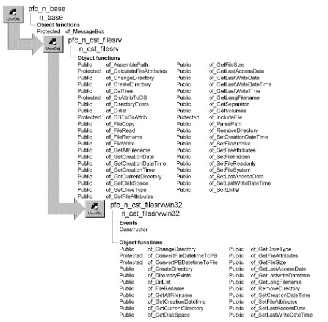

# n_cst_filesrvwin32

**Description**

Platform-specific file management functions for applications running under Windows. Platform-specific file management functions require a call to a platform-specific external function. When you call the f_SetFilesrv global function, it detects the operating environment and instantiates the correct platform-specific object.

Many of the functions in this object call platform-specific external functions. To see a complete list of platform-specific external functions used by this object, access the User Object painter and select Declare>Local External Functions from the menu bar. This object calls functions in the KERNEL32.DLL module.

**Ancestry**



**Library**

- PFCAPSRV.PBL
- PFEAPSRV.PBL

**Object relationships**

- [n_cst_dirattrib](../05-global-structures-and-structure-objects/n_cst_dirattrib.md)
- [n_cst_numerical](n_cst_numerical.md)

**Usage**

To use the file management service:

1. Instantiate the appropriate file management object by calling the f_SetFilesrv global function. This function examines your environment and instantiates the appropriate user object.
2. Call file management functions as required. The code for these functions is defined in the descendant objects. If the function isn’t available on your platform, PowerBuilder executes the ancestor (n_cst_filesrv) function, which, depending on the function, returns an empty string, TRUE, -1, 0, or NULL.

| Structures Structure | Field | Data type |
| --- | --- | --- |
| os_filedatetime | ul_highdatetime | UnsignedLong |
|  | ul_lowdatetime | UnsignedLong |
| os_systemtime | ui_wday | UnsignedInteger |
|  | ui_wdayofweek | UnsignedInteger |
|  | ui_whour | UnsignedInteger |
|  | ui_wmilliseconds | UnsignedInteger |
|  | ui_wminute | UnsignedInteger |
|  | ui_wmonth | UnsignedInteger |
|  | ui_wsecond | UnsignedInteger |
|  | ui_wyear | UnsignedInteger |
| os_securityattributes | b_inherit | Boolean |
|  | ch_description | Character |
|  | ul_length | UnsignedLong |
| os_finddata | ch_alternatefilename[14] | Character |
|  | ch_filename[260] | Character |
|  | str_creationtime | os_filedatetime |
|  | str_lastaccesstime | os_filedatetime |
|  | str_lastwritetime | os_filedatetime |
|  | ul_fileattributes | UnsignedLong |
|  | ul_filesizehigh | UnsignedLong |
|  | ul_filesizelow | UnsignedLong |
|  | ul_reserved0 | UnsignedLong |
|  | ul_reserved1 | UnsignedLong |
| os_fileopeninfo | c_fixed_disk | Character |
|  | c_length | Character |
|  | c_pathname[128] | Character |
|  | ui_dos_error | UnsignedInteger |
|  | ui_na1 | UnsignedInteger |
|  | ui_na2 | UnsignedInteger |

**See also**

- [f_SetFilesrv](../04-global-functions/f_setfilesrv.md)
- [n_cst_filesrv](n_cst_filesrv.md)
- [n_cst_platform](n_cst_platform.md)

## Events

N_cst_filesrvwin32 contains a precoded event:

Constructor

### Constructor

**Description**

Initializes the is_separator and is_allfiles instance variables.

**Usage**

This event executes when the object is created.

## Functions

N_cst_filesrvwin32 includes precoded object functions:

- of_ChangeDirectory
- of_ConvertFileDateTimeToPB
- of_ConvertPBDateTimeToFile
- of_CreateDirectory
- of_DirectoryExists
- of_DirList
- of_FileRename
- of_GetAltFilename
- of_GetCreationDateTime
- of_GetCurrentDirectory
- of_GetDiskSpace
- of_GetDriveType
- of_GetFileAttributes
- of_GetFileSize
- of_GetLastAccessDate
- of_GetLastWriteDateTime
- of_GetLongFilename
- of_RemoveDirectory
- of_SetCreationDateTime
- of_SetFileAttributes
- of_SetLastAccessDate
- of_SetLastWriteDateTime

### of_ChangeDirectory

**Description**

Changes the current working directory.

**Access**

Public

**Syntax**

```
instancename.of_ChangeDirectory ( directoryname )
```

| Argument | Description |
| --- | --- |
| *instancename* | Instance name of n_cst_filesrv |
| *directoryname* | String specifying the name of the new working directory. If you do not specify an absolute path, this function changes directories relative to the current working directory |

**Return value**

Integer. Returns 1 if the function succeeds and -1 if an error occurs.

**Usage**

If your application performs functions that change the working directory, call this function before path-sensitive PowerBuilder functions, such as ShowHelp, to ensure access to the proper files. This enables your applications to work without depending on the system path.

This function calls the SetCurrentDirectory external function.

**Examples**

This example changes directory to the \realapp directory before calling the SetProfileString function (this example assumes an inv_filesrv instance variable):

```
Integer  li_return
String  ls_language

ls_language = sle_curr_language.Text
li_return = inv_filesrv.of_ChangeDirectory &
   ("\realapp")
IF li_return = 1 THEN
   SetProfileString("realapp.ini", "language", &
       "currentlanguage", ls_language)
END IF
```

### of_ConvertFileDateTimeToPB

**Description**

Converts a file date (UnsignedInteger) into a PowerBuilder date.

**Access**

Protected

**Syntax**

```
instancename.of_ConvertFileDateTimeToPB ( filedatetime, date, time )
```

| Argument | Description |
| --- | --- |
| *instancename* | Instance name of n_cst_filesrv |
| *filedatetime* | Structure of type os_filedatetime containing a file’s system date and time |
| *date* | Date variable into which the function places the date (passed by reference) |
| *time* | Time variable into which the function places the time (passed by reference) |

**Return value**

Date. Returns *date* and *time* in PowerBuilder format.

**Usage**

Internal.

This function calls the FileTimeToLocalFileTime and FileTimeToSystemTime external functions.

**Examples**

This example is from the of_DirList function:

```
os_finddata   lstr_FindData
...
of_ConvertFileDateTimeToPB &
   (lstr_FindData.str_CreationTime, &
       anv_DirList[li_Entries].id_CreationDate, &
          anv_DirList[li_Entries].it_CreationTime)
...
```

### of_ConvertPBDateTimeToFile

**Description**

Converts a PowerBuilder date and time to a system date and time.

**Access**

Protected

**Syntax**

```
instancename.of_ConvertPBDateTimeToFile ( date, time, datetime )
```

| Argument | Description |
| --- | --- |
| *instancename* | Instance name of n_cst_filesrv |
| *date* | Date variable containing a date to be converted |
| *time* | Time variable containing a time to be converted |
| *datetime* | Structure of type of_filedatetime into which the function places the converted system date and time (passed by reference) |

**Return value**

Integer. Returns 1 if the function succeeds and -1 if an error occurs.

**Usage**

Internal.

This function calls the SystemTimeToFileTime and LocalFileTimeToFileTime external functions.

**Examples**

This example is from the of_SetLastWriteDateTime function:

```
Boolean  lb_Ret
Long   ll_Error, ll_Handle
os_filedatetime  lstr_FileTime, lstr_Empty
os_finddata   lstr_FindData
os_fileopeninfo   lstr_FileInfo

ll_Handle = FindFirstFileA(as_FileName, lstr_FindData)
IF ll_Handle <= 0 THEN Return -1
   FindClose(ll_Handle)

IF of_ConvertPBDatetimeToFile &
   (ad_Date, at_Time, lstr_FileTime) < 0 THEN
   Return 1
END IF
...
```

### of_CreateDirectory

**Description**

Creates a new directory.

**Access**

Public

**Syntax**

```
instancename.of_CreateDirectory ( directoryname )
```

| Argument | Description |
| --- | --- |
| *instancename* | Instance name of n_cst_filesrv |
| *directoryname* | String specifying the name of the new directory. If you do not specify an absolute path, this function creates a directory relative to the current working directory |

**Return value**

Integer. Returns 1 if the function succeeds and -1 if an error occurs.

**Usage**

This function calls the CreateDirectoryA external function.

**Examples**

This example calls the of_CreateDirectory function (this example assumes an inv_filesrv instance variable):

```
IF inv_filesrv.of_CreateDirectory &
   ("temp") <> 0 THEN
   MessageBox("File Services", &
       "Error creating temp directory")
END IF
```

### of_DirectoryExists

**Description**

Reports whether the specified directory exists.

**Access**

Public

**Syntax**

```
instancename.of_DirectoryExists ( directoryname )
```

| Argument | Description |
| --- | --- |
| *instancename* | Instance name of n_cst_filesrv |
| *directoryname* | String specifying the name of the directory. If you do not specify an absolute path, this function looks for a directory relative to the current working directory |

**Return value**

Boolean. Returns TRUE if the directory exists and FALSE if it does not.

**Usage**

This function calls the GetFileAttributesA external function.

**Examples**

This example calls the of_DirectoryExists function (this example assumes an inv_filesrv instance variable):

```
Integer  li_return

IF NOT inv_filesrv.of_DirectoryExists &
   ("c:\rkndoc\temp") THEN
   li_return = inv_filesrv.of_CreateDirectory &
       ("c:\rkndoc\temp")
END IF
```

### of_DirList

**Description**

Retrieves information on all files within the passed directory that match the passed arguments.

**Access**

Public

**Syntax**

```
instancename.of_DirList ( filespec, filetype, dirlist )
```

| Argument | Description |
| --- | --- |
| *instancename* | Instance name of n_cst_filesrv |
| *filespec* | String specifying the path and file specification (including wildcards) to the directory containing the files to be listed. If you do not specify an absolute path, this function searches relative to the current working directory |
| *filetype* | Long specifying one or more types of files to return. Types are: |
|  | • 0—Read/write files |
|  | • 1—Read-only files |
|  | • 2—Hidden files |
|  | • 4—System files |
|  | • 16—Subdirectories |
|  | • 32—Archive (modified) files |
|  | • 16384—Drives |
|  | • 32768—Exclude read/write files from the list |
| *dirlist* | Array of type n_cst_dirattrib into which the function places information for the requested files (passed by reference) |

**Return value**

Long. Returns the number of elements in the *dirlist* array if the function succeeds and -1 if an error occurs.

**Usage**

To further sort the *dirlist* array, use the of_SortDirList function.

To list several types, add the *filetype* values together. For example, to list read/write files, subdirectories, and drives, specify 0+16+16384 or 16400 for *filetype*.

This function calls the FindNextFileA external function.

**Examples**

This example calls the of_DirList function (this example assumes an inv_filesrv instance variable):

```
String   ls_currdir
Integer  li_cnt, li_entries
String   ls_import
n_cst_dirattrib   lnv_dirlist[]

SetPointer(HourGlass!)
ls_currdir = "c:\Win95\*.dll"

li_entries = &
   inv_filesrv.of_DirList &
       (ls_currdir, 0, lnv_dirlist)
...
```

### of_FileRename

**Description**

Renames or moves a file or directory.

**Access**

Public

**Syntax**

```
instancename.of_FileRename ( oldname, newname )
```

| Argument | Description |
| --- | --- |
| *instancename* | Instance name of n_cst_filesrv |
| *oldname* | String specifying the complete path of the file to be renamed |
| *newname* | String specifying the complete path of the new filename |

**Return value**

Integer. Returns 1 if the function succeeds and -1 if an error occurs.

**Usage**

This function calls the MoveFileA external function.

**Examples**

This example calls the of_FileRename function:

```
String   ls_source, ls_target
Integer  li_return

ls_source = sle_source.text
ls_target = sle_target.text
li_return = inv_filesrv.of_FileRename &
   (ls_source, ls_target)
IF li_return = 1 THEN
   gnv_app.of_GetFrame().SetMicroHelp &
   (ls_source + " renamed to " + ls_target)
ELSE
   MessageBox("File Service", &
       "Error renaming " + ls_source + " to " &
          + ls_target)
END IF
```

### of_GetAltFilename

**Description**

Retrieves the internal 8.3 alternate filename for a passed long filename.

**Access**

Public

**Syntax**

```
instancename.of_GetAltFilename ( longfilename )
```

| Argument | Description |
| --- | --- |
| *instancename* | Instance name of n_cst_filesrv |
| *longfilename* | String specifying the long filename |

**Return value**

String. Returns the alternate filename for *longfilename*.

**Usage**

This function calls the FindFirstFileA and FindClose external functions.

**Examples**

This example calls the of_GetAltFilename function (this example assumes an inv_filesrv instance variable):

```
String   ls_filename, ls_return

ls_filename = sle_source.text
ls_return = inv_filesrv.of_GetAltFilename &
   (ls_filename)
IF ls_return = "" THEN
   MessageBox("File Service", &
       "Error accessing " + ls_filename)
ELSE
   MessageBox("File Service", ls_return &
       + " is the alternate filename for " &
          + ls_filename)
END IF
```

### of_GetCreationDateTime

**Description**

Retrieves the date and time a file was created.

**Access**

Public

**Syntax**

```
instancename.of_GetCreationDateTime ( filename, date, time )
```

| Argument | Description |
| --- | --- |
| *instancename* | Instance name of n_cst_filesrv |
| *filename* | String specifying the file whose creation date and time are to be returned. If you do not specify an absolute path, this function searches relative to the current working directory |
| *date* | Date into which the function places the creation date (passed by reference) |
| *time* | Time into which the function places the creation time (passed by reference) |

**Return value**

Integer. Returns 1 if the function succeeds and -1 if an error occurs.

**Examples**

This example calls the of_GetCreationDateTime function (this example assumes an inv_filesrv instance variable):

```
Integer  li_return
String   ls_filename
Date     ldt_date
Time     lt_time

ls_filename = sle_source.text
li_return = inv_filesrv.of_GetCreationDateTime &
   (ls_filename, ldt_date, lt_time)
IF li_return = -1 THEN
   MessageBox("File Service", &
       "Error accessing " + ls_filename)
ELSE
   MessageBox("File Service", ls_filename &
       + "~r~nCreation date: " &
       + String(ldt_date) &
       + "~r~nCreation time: " &
       + String(lt_time) )
END IF
```

### of_GetCurrentDirectory

**Description**

Retrieves the current working directory.

**Access**

Public

**Syntax**

```
instancename.of_GetCurrentDirectory ( )
```

| Argument | Description |
| --- | --- |
| *instancename* | Instance name of n_cst_filesrv |

**Return value**

String. Returns the fully qualified path of the current working directory.

**Usage**

This function calls the GetCurrentDirectoryA external function.

**Examples**

This example calls the of_GetCurrentDirectory function and, if the result isn’t equal to the is_app_dir instance variable, calls the of_ChangeDirectory function to reset the working directory (this example assumes an inv_filesrv instance variable):

```
String   ls_return

ls_return = inv_filesrv.of_GetCurrentDirectory()
IF ls_return <> is_app_dir THEN
   inv_filesrv.of_ChangeDirectory(is_app_dir)
END IF
```

### of_GetDiskSpace

**Description**

Retrieves space information for a specified disk drive.

**Access**

Public

**Syntax**

```
instancename.of_GetDiskSpace ( drive, total, free )
```

| Argument | Description |
| --- | --- |
| *instancename* | Instance name of n_cst_filesrv |
| *drive* | Character specifying the drive letter |
| *total* | Long into which the function returns the total bytes on *drive* (passed by reference) |
| *free* | Long into which the function returns the free space on *drive* (passed by reference) |

**Return value**

Integer. Returns 1 if the function succeeds and -1 if an error occurs.

**Usage**

This function calls the GetDiskFreeSpaceA external function.

**Examples**

This example calls the of_GetDiskSpace function:

```
Character   lc_drive
Long   ll_total, ll_free
Integer   li_return

lc_drive = lb_drive.SelectedItem()
li_return = inv_filesrv.of_GetDiskSpace &
   (lc_drive, ll_total, ll_free)
IF li_return = 1 THEN
   MessageBox("File Service", "Drive " + lc_drive &
   + "~r~n" + String(ll_total) + " total bytes~r~n" &
   + String(ll_free) + " total free space")
ELSE
   MessageBox("File Service", &
   "Error in of_GetDiskSpace")
END IF
```

### of_GetDriveType

**Description**

Retrieves the drive type for a specified drive.

**Access**

Public

**Syntax**

```
instancename.of_GetDriveType ( drive )
```

| Argument | Description |
| --- | --- |
| *instancename* | Instance name of n_cst_filesrv |
| *drive* | Character specifying the drive letter |

**Return value**

Integer. Returns values as follows:

0 Undetermined drive type 1 Root directory does not exist 2 Removable disk 3 Nonremovable disk 4 Remote (network) drive 5 CD-ROM drive 6 RAM disk

**Examples**

This example calls the of_GetDriveType function (this example assumes an inv_filesrv instance variable):

```
UnsignedInteger  lui_drivetype
String   ls_driveletter
String    ls_drivetype[ ] = &
   {"Undetermined","Does not exist","Removeable", &
       "Nonremoveable", "Network drive", "CD-ROM", &
       "RAM disk" }

ls_driveletter = lb_drivelist.SelectedItem()
lui_drivetype = inv_filesrv.of_GetDriveType &
   (ls_driveletter)
MessageBox("File Service", "Drive type is: " &
   + ls_drivetype[lui_drivetype + 1] )
```

### of_GetFileAttributes

**Description**

Retrieves all attributes for a specified file.

**Access**

Public

**Syntax**

```
instancename.of_GetFileAttributes ( filename, readonly, hidden, system,
subdirectory, archive )
```

| Argument | Description |
| --- | --- |
| *instancename* | Instance name of n_cst_filesrv |
| *filename* | String specifying the file whose attributes are to be returned. If you do not specify an absolute path, this function searches relative to the current working directory |
| *readonly* | Boolean indicating whether *filename* is read-only (passed by reference) |
| *hidden* | Boolean indicating whether *filename* is hidden (passed by reference) |
| *system* | Boolean indicating whether *filename* is a system file (passed by reference) |
| *subdirectory* | Boolean indicating whether *filename* is a subdirectory (passed by reference) |
| *archive* | Boolean indicating whether *filename* has the archive bit set (passed by reference) |

**Return value**

Integer. Returns 1 if the function succeeds and -1 if an error occurs.

**Examples**

This example calls the of_GetFileAttributes function (this example assumes an inv_filesrv instance variable):

```
Integer  li_return
String   ls_filename

ls_filename = sle_source.text
li_return = inv_filesrv.of_GetFileAttributes &
   (ls_filename, cbx_readonly.Checked, &
       cbx_hidden.Checked, &
       cbx_system.Checked, &
       cbx_subdirectory.Checked, &
       cbx_archive.Checked)
IF li_return = -1 THEN
   MessageBox("File Service", &
       "Error accessing " + ls_filename)
END IF
```

### of_GetFileSize

**Description**

Retrieves the size of a specified file.

**Access**

Public

**Syntax**

```
instancename.of_GetFileSize ( filename )
```

| Argument | Description |
| --- | --- |
| *instancename* | Instance name of n_cst_filesrv |
| *filename* | String specifying the file whose size is to be returned. If you do not specify an absolute path, this function searches relative to the current working directory |

**Return value**

Double. Returns the number of bytes in *filename* if the function succeeds and -1 if an error occurs.

**Usage**

This function calls the Findfirst and FindClose external functions.

**Examples**

This example calls the of_GetFileSize function (this example assumes an inv_filesrv instance variable):

```
Double   ld_return
String   ls_filename

ls_filename = sle_source.text
ld_return = &
   inv_filesrv.of_GetFileSize(ls_filename)
IF ld_return = -1 THEN
   MessageBox("File Service", &
       "Error accessing " + ls_filename)
ELSE
   MessageBox("File Service", ls_filename &
       + " has a size of " + String(ld_return) &
       + " bytes.")
END IF
```

### of_GetLastAccessDate

**Description**

Retrieves the date a file was last accessed.

**Access**

Public

**Syntax**

```
instancename.of_GetLastAccessDate ( filename, date )
```

| Argument | Description |
| --- | --- |
| *instancename* | Instance name of n_cst_filesrv |
| *filename* | String specifying the file whose last access date is to be returned. If you do not specify an absolute path, this function searches relative to the current working directory |
| *date* | Date into which the function places the last access date (passed by reference) |

**Return value**

Integer. Returns 1 if the function succeeds and -1 if an error occurs.

**Examples**

This example calls the of_GetLastAccessDate function (this example assumes an inv_filesrv instance variable):

```
Integer  li_return
String   ls_filename
Date   ldt_date

ls_filename = sle_source.text
li_return = inv_filesrv.of_GetLastAccessDate &
   (ls_filename, ldt_date)
IF li_return = -1 THEN
   MessageBox("File Service", &
   "Error accessing " + ls_filename)
ELSE
   MessageBox("File Service", ls_filename &
       + " has a last access date of " &
       + String(ldt_date) )
END IF
```

### of_GetLastWriteDateTime

**Description**

Retrieves the date and time a file was last modified.

**Access**

Public

**Syntax**

```
instancename.of_GetLastWriteDateTime ( filename, date, time )
```

| Argument | Description |
| --- | --- |
| *instancename* | Instance name of n_cst_filesrv |
| *filename* | String specifying the file whose last write date and time are to be returned. If you do not specify an absolute path, this function searches relative to the current working directory |
| *date* | Date into which the function places the last write date (passed by reference) |
| *time* | Time into which the function places the last write time (passed by reference) |

**Return value**

Integer. Returns 1 if the function succeeds and -1 if an error occurs.

**Examples**

This example calls the of_GetLastWriteDateTime function (this example assumes an inv_filesrv instance variable):

```
Integer  li_return
String   ls_filename
Date   ldt_date
Time   lt_time

ls_filename = sle_source.text
li_return = inv_filesrv.of_GetLastWriteDateTime &
   (ls_filename, ldt_date, lt_time)
IF li_return = -1 THEN
   MessageBox("File Service", &
       "Error accessing " + ls_filename)
ELSE
   MessageBox("File Service", ls_filename &
       + " has a last write date of " &
       + String(ldt_date) &
       + " and a last write time of &
       " + String(lt_time) )
END IF
```

### of_GetLongFilename

**Description**

Retrieves the corresponding long filename for a passed internal 8.3 (also called alternate) filename.

**Access**

Public

**Syntax**

```
instancename.of_GetLongFilename ( shortfilename )
```

| Argument | Description |
| --- | --- |
| *instancename* | Instance name of n_cst_filesrv |
| *shortfilename* | String specifying the short (alternate) filename |

**Return value**

String. Returns the long filename for *shortfilename*.

**Usage**

This function calls the FindFirstFileA and FindClose external functions.

**Examples**

This example calls the of_GetLongFilename function (this example assumes an inv_filesrv instance variable):

```
String   ls_filename, ls_return

ls_filename = sle_source.text
ls_return = inv_filesrv.of_GetLongFilename &
   (ls_filename)
IF ls_return = "" THEN
   MessageBox("File Service", &
       "Error accessing " + ls_filename)
ELSE
   MessageBox("File Service", ls_return &
       + " is the long filename for " &
       + ls_filename)
END IF
```

### of_RemoveDirectory

**Description**

Deletes the specified directory (the directory must be empty). To delete a directory and its files, call of_DelTree instead.

**Access**

Public

**Syntax**

```
instancename.of_RemoveDirectory ( directoryname )
```

| Argument | Description |
| --- | --- |
| *instancename* | Instance name of n_cst_filesrvwin |
| *directoryname* | String specifying the path to the directory to be deleted. If you do not specify an absolute path, this function deletes relative to the current working directory |

**Return value**

Integer. Returns 1 if the function succeeds and -1 if an error occurs.

**Usage**

This function calls the RemoveDirectoryA external function.

**Examples**

This example checks if pbapp is the current directory and, if it is, deletes the pbapp\temp directory (this example assumes an inv_filesrv instance variable):

```
String   ls_return, ls_temp
Integer  li_return

ls_temp = "temp"
ls_return = &
   gnv_app.inv_platform.of_GetCurrentDirectory( )
IF Mid(ls_return, 4, 5) = "pbapp" THEN
   li_return = inv_filesrv.of_RemoveDirectory &
       (ls_temp)
   IF li_return = 1 THEN
       MessageBox("Delete", &
          "Temp dir does not exist")
   ELSEIF li_return <0 THEN
       MessageBox("Delete", &
          "Deletion error: Temp dir must be empty")
   END IF
...
```

### of_SetCreationDateTime

**Description**

Sets a file’s creation date and time.

**Access**

Public

**Syntax**

```
instancename.of_SetCreationDateTime ( filename, date, time )
```

| Argument | Description |
| --- | --- |
| *instancename* | Instance name of n_cst_filesrv |
| *filename* | String specifying the file whose creation date and time are to be modified. If you do not specify an absolute path, this function searches relative to the current working directory |
| *date* | Date variable containing the new creation date |
| *time* | Time variable containing the new creation time |

**Return value**

Integer. Returns 1 if the function succeeds and -1 if an error occurs.

**Examples**

This example calls the of_SetCreationDateTime function (this example assumes an inv_filesrv instance variable):

```
Integer  li_return
String   ls_filename
Date   ldt_date
Time   lt_time

ls_filename = sle_source.text
ldt_date = Today()
lt_time = Now()
li_return = inv_filesrv.of_SetCreationDateTime &
   (ls_filename, ldt_date, lt_time)
IF li_return = -1 THEN
   MessageBox("File Service", &
       "Error modifying " + ls_filename)
ELSE
   MessageBox("File Service", ls_filename &
       + " has a new creation date of " &
       + String(ldt_date) &
       + " and a new creation time of " &
       + String(lt_time) )
END IF
```

### of_SetFileAttributes

**Description**

Sets attributes for the specified file.

**Access**

Public

**Syntax**

```
instancename.of_SetFileAttributes ( filename, readonly, hidden, system,
archive )
```

| Argument | Description |
| --- | --- |
| *instancename* | Instance name of n_cst_filesrvwin32 |
| *filename* | String specifying the file whose attributes are to be set. If you do not specify an absolute path, this function searches relative to the current working directory |
| *readonly* | Boolean indicating whether *filename* is read-only. If you specify NULL, the function doesn’t modify this attribute |
| *hidden* | Boolean indicating whether *filename* is hidden. If you specify NULL, the function doesn’t modify this attribute |
| *system* | Boolean indicating whether *filename* is a system file. If you specify NULL, the function doesn’t modify this attribute |
| *archive* | Boolean indicating whether *filename* has the archive bit set. If you specify NULL, the function doesn’t modify this attribute |

**Return value**

Integer. Returns 1 if the function succeeds and -1 if an error occurs.

**Examples**

This example calls the of_SetFileAttributes function (this example assumes an inv_filesrv instance variable):

```
Integer  li_return
String   ls_filename

ls_filename = sle_source.text
li_return = inv_filesrv.of_SetFileAttributes &
   (ls_filename, cbx_readonly.Checked, &
       cbx_hidden.Checked, &
       cbx_system.Checked, &
       cbx_archive.Checked)
IF li_return = -1 THEN
   MessageBox("File Service", &
        "Error accessing " + ls_filename)
END IF
```

### of_SetLastAccessDate

**Description**

Sets a file’s last-accessed date and time.

**Access**

Public

**Syntax**

```
instancename.of_SetLastAccessDate ( filename, date )
```

| Argument | Description |
| --- | --- |
| *instancename* | Instance name of n_cst_filesrv |
| *filename* | String specifying the file whose last access date is to be modified. If you do not specify an absolute path, this function searches relative to the current working directory |
| *date* | Date variable containing the new last-accessed date |

**Return value**

Integer. Returns 1 if the function succeeds and -1 if an error occurs.

**Examples**

This example calls the of_SetLastAccessDate function (this example assumes an inv_filesrv instance variable):

```
Integer  li_return
String   ls_filename
Date   ldt_date

ls_filename = sle_source.text
ldt_date = Today()
li_return = inv_filesrv.of_SetLastAccessDate &
   (ls_filename, ldt_date)
IF li_return = -1 THEN
   MessageBox("File Service", &
       "Error modifying " + ls_filename)
ELSE
   MessageBox("File Service", ls_filename &
       + " has a new last access date of " &
       + String(ldt_date))
END IF
```

### of_SetLastWriteDateTime

**Description**

Sets a file’s last-modified date and time.

**Access**

Public

**Syntax**

```
instancename.of_SetLastWriteDateTime ( filename, date, time )
```

| Argument | Description |
| --- | --- |
| *instancename* | Instance name of n_cst_filesrv |
| *filename* | String specifying the file whose last write date and time are to be modified. If you do not specify an absolute path, this function searches relative to the current working directory |
| *date* | Date variable containing the new last-modified date |
| *time* | Time variable containing the new last-modified time |

**Return value**

Integer. Returns 1 if the function succeeds and -1 if an error occurs.

**Examples**

This example calls the of_SetLastWriteDateTime function (this example assumes an inv_filesrv instance variable):

```
Integer  li_return
String   ls_filename
Date  ldt_date
Time  lt_time

ls_filename = sle_source.text
ldt_date = Today()
lt_time = Now()
li_return = inv_filesrv.of_SetLastWriteDateTime &
   (ls_filename, ldt_date, lt_time)
IF li_return = -1 THEN
   MessageBox("File Service", &
        "Error modifying " + ls_filename)
ELSE
   MessageBox("File Service", ls_filename &
       + " has a new last write date of " &
       + String(ldt_date) &
       + " and a new last write time of " &
       + String(lt_time) )
END IF
```
