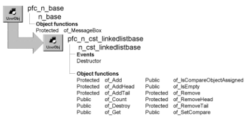

# n_cst_linkedlistbase

**Description**

List service ancestor object. Implement linked list processing through one of this object’s descendants:

- [N_cst_list](n_cst_list.md)
- [N_cst_queue](n_cst_queue.md)
- [N_cst_stack](n_cst_stack.md)

**Ancestry**



**Library**

- PFCAPSRV.PBL
- PFEAPSRV.PBL

**Object relationships**

- [n_cst_linkedlistnode](n_cst_linkedlistnode.md)
- [n_cst_linkedlistnodecompare](n_cst_linkedlistnodecompare.md)

**Usage**

PFC objects use this object as the ancestor for other list-processing objects.

**Descendants**

- [n_cst_list](n_cst_list.md)
- [n_cst_queue](n_cst_queue.md)
- [n_cst_stack](n_cst_stack.md)

**See also**

n_cst_tree

## Instance variables

N_cst_linkedlistbase includes instance variables:

| Instance variable | Description | Data type | Access | Usage |
| --- | --- | --- | --- | --- |
| inv_compare | Reference to comparison object | N_cst_linkedlistnodecompare | Protected | Set with of_SetCompare (default is n_cst_linkedlistnodecompare) |
| inv_head | First node in the list | N_cst_linkedlistnode | Protected | Internal |

| Instance variable | Description | Data type | Access | Usage |
| --- | --- | --- | --- | --- |
| inv_nil | Always nil | N_cst_linkedlistnode | Protected | Internal |
| inv_tail | Last node in the list | N_cst_linkedlistnode | Protected | Internal |

## Events

N_cst_linkedlistbase includes a precoded event:

Destructor

### Destructor

**Description**

Destroys existing nodes.

**Usage**

This event executes when the object is destroyed.

## Functions

N_cst_linkedlistbase includes precoded object functions:

- of_Add
- of_AddHead
- of_AddTail
- of_Count
- of_Destroy
- of_Get
- of_IsCompareObjectAssigned
- of_IsEmpty
- of_Remove
- of_RemoveHead
- of_RemoveTail
- of_SetCompare

### of_Add

**Description**

Adds a new node to the linked list.

**Access**

Protected

**Syntax**

```
instancename.of_Add ( newnode, where )
```

| Argument | Description |
| --- | --- |
| *instancename* | Instance name of n_cst_linkedlistbase |
| *newnode* | N_cst_linkedlistnode instance to be added to the linked list |
| *where* | N_cst_linkedlistnode instance after which *newnode* is added. This node must already be in the list |

**Return value**

Integer. Returns 1 if the function succeeds and -1 if an error occurs.

**Usage**

Internal.

**Examples**

This example calls the of_Add function:

```
Return this.of_Add(inv_newnode, inv_currnode)
```

### of_AddHead

**Description**

Adds a new node to the beginning of the linked list.

**Access**

Protected

**Syntax**

```
instancename.of_AddHead ( newnode )
```

| Argument | Description |
| --- | --- |
| *instancename* | Instance name of n_cst_linkedlistbase |
| *newnode* | N_cst_linkedlistnode instance to be added at the beginning of the linked list |

**Return value**

Integer. Returns 1 if the function succeeds and -1 if an error occurs.

**Usage**

Internal.

**Examples**

This example is from the of_AddTail function:

```
...
if isnull(inv_head) or not isvalid(inv_head) then
   return of_AddHead(anv_newtailnode)
end if
...
```

### of_AddTail

**Description**

Adds a new node to the end of the linked list.

**Access**

Protected

**Syntax**

```
instancename.of_AddTail ( newnode )
```

| Argument | Description |
| --- | --- |
| *instancename* | Instance name of n_cst_linkedlistbase |
| *newnode* | N_cst_linkedlistnode instance to be added at the end of the linked list |

**Return value**

Integer. Returns 1 if the function succeeds and -1 if an error occurs.

**Usage**

Internal.

**Examples**

This example is from the of_Add function:

```
...
If anv_insertafternode = inv_tail Then
   Return of_AddTail(anv_newnode)
End If
...
```

### of_Count

**Description**

Retrieves a count of the number of nodes in the linked list.

**Access**

Public

**Syntax**

```
instancename.of_Count ( )
```

| Argument | Description |
| --- | --- |
| *instancename* | Instance name of n_cst_linkedlistbase |

**Return value**

Long. Returns the number of nodes in the linked list.

**Examples**

This example calls the of_Count function:

```
...
ll_count = inv_list.of_Count()
st_result.Text =  &
   "Item count: " + String(ll_count)
```

### of_Destroy

**Description**

Destroys all nodes in the linked list.

**Access**

Public

**Syntax**

```
instancename.of_Destroy ( )
```

| Argument | Description |
| --- | --- |
| *instancename* | Instance name of n_cst_linkedlistbase |

**Return value**

Integer. Returns the number of nodes destroyed if the function succeeds and -1 if an error occurs.

**Examples**

This example calls the of_Destroy function:

```
...li_count = inv_queue.of_Destroy()st_result.Text = &
   String(li_count) + ’ items deleted’...
```

### of_Get

**Description**

Retrieves all nodes in a list.

**Access**

Public

**Syntax**

```
instancename.of_Get ( nodes )
```

| Argument | Description |
| --- | --- |
| *instancename* | Instance name of n_cst_linkedlistbase |
| *node* | N_cst_linkedlistnode array into which the function places references to the nodes in the list (passed by reference) |

**Return value**

Integer. Returns the number of elements in the *node* array if the function succeeds and -1 if an error occurs.

**Examples**

This example calls the of_Get function:

```
Long ll_rc
n_cst_linkedlistnode inv_nodes[]

ll_rc = inv_list.of_Get(inv_nodes)
...
```

### of_IsCompareObjectAssigned

**Description**

Reports whether a comparison object has been assigned.

**Access**

Public

**Syntax**

```
instancename.of_IsCompareObjectAssigned ( )
```

| Argument | Description |
| --- | --- |
| *instancename* | Instance name of n_cst_linkedlistbase |

**Return value**

Boolean. Returns TRUE if a comparison object has been assigned and FALSE if no comparison object has been assigned.

**Examples**

This example calls the of_IsCompareObjectAssigned function:

```
IF NOT inv_list.of_IsCompareObjectAssigned() THEN
   MessageBox("Comparison object", "Not assigned")
ELSE
   MessageBox("Comparison object", "Is assigned")
END IF
```

### of_IsEmpty

**Description**

Reports whether a list is empty.

**Access**

Public

**Syntax**

```
instancename.of_IsEmpty ( )
```

| Argument | Description |
| --- | --- |
| *instancename* | Instance name of n_cst_linkedlistbase |

**Return value**

Integer. Returns TRUE if the list is empty and FALSE if it is not.

**Examples**

This example calls the of_IsEmpty function:

```
IF NOT inv_list.of_IsEmpty() THEN
   MessageBox("List", "Is empty")
ELSE
   MessageBox("List", "Is not empty")
END IF
```

### of_Remove

**Description**

Removes the specified node from a linked list, resetting pointers as appropriate.

**Access**

Protected

**Syntax**

```
instancename.of_Remove ( removenode )
```

| Argument | Description |
| --- | --- |
| *instancename* | Instance name of n_cst_linkedlistbase |
| *removenode* | N_cst_linkedlistnode instance to remove from the linked list (passed by reference) |

**Return value**

Integer. Returns 1 if the function succeeds and -1 if an error occurs.

**Usage**

Internal.

### of_RemoveHead

**Description**

Removes the first node from a linked list, resetting pointers as appropriate and returning the removed node.

**Access**

Protected

**Syntax**

```
instancename.of_RemoveHead ( removenode )
```

| Argument | Description |
| --- | --- |
| *instancename* | Instance name of n_cst_linkedlistbase |
| *removenode* | N_cst_linkedlistnode instance into which the function places a reference to the returned node (passed by reference) |

**Return value**

Integer. Returns 1 if the function succeeds and -1 if an error occurs.

**Usage**

Internal.

**Examples**

This example is from the n_cst_list of_RemoveHead function:

```
Return Super::of_RemoveHead(anv_headnode)
```

### of_RemoveTail

**Description**

Removes the last node from a linked list, resetting pointers as appropriate and returning the removed node.

**Access**

Protected

**Syntax**

```
instancename.of_RemoveTail ( removenode )
```

| Argument | Description |
| --- | --- |
| *instancename* | Instance name of n_cst_linkedlistbase |
| *removenode* | N_cst_linkedlistnode instance into which the function places a reference to the returned node (passed by reference) |

**Return value**

Integer. Returns 1 if the function succeeds and -1 if an error occurs.

**Usage**

Internal.

**Examples**

This example is from the n_cst_list of_RemoveTail function:

```
Return Super::of_RemoveTail(anv_tailnode)
```

### of_SetCompare

**Description**

Establishes a comparison object other than n_cst_linkedlistnodecompare.

**Access**

Public

**Syntax**

```
instancename.of_SetCompare ( comparisonobject )
```

| Argument | Description |
| --- | --- |
| *instancename* | Instance name of n_cst_linkedlistbase |
| *comparisonobject* | N_cst_linkedlistnodecompare descendant instance that overrides the of_Compare function |

**Return value**

Integer. Returns 1 if the function succeeds, -1 if an error occurs, and -2 if the comparison object has already been set.

**Usage**

Call this function to establish a customized comparison object. List service objects uses the comparison object’s of_Compare function when handling sorted lists. The default comparison object (n_cst_linkedlistnodecompare) can handle comparison for simple data types. But if your list’s key items contain some other data type, you must create a customized n_cst_linkedlistnodecompare descendant and implement an of_Compare function to handle sort order.

**Examples**

This example calls the of_SetCompare function (it assumes an inv_customcompare instance variable):

```
inv_customcompare = CREATE n_cst_customcompare

inv_list.of_SetCompare(inv_customcompare)
```
