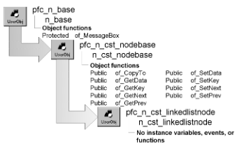

# n_cst_linkedlistnode

**Description**

List instance object.

**Ancestry**



**Library**

- PFCAPSRV.PBL
- PFEAPSRV.PBL

**Usage**

Use n_cst_linkedlistnode as the list instance object for stacks, queues, sorted lists, and unsorted lists.

To use n_cst_linkedlistnode:

1. Declare a variable for your list (an instance variable in this example):

   ```
   n_cst_list inv_list
   ```

2. Declare variables for list nodes (local variables in this example):

   ```
   n_cst_linkedlistnode lnv_node
   ```

3. Create the node instance:

   ```
   lnv_node = CREATE n_cst_linkedlistnode
   ```

4. Access the node’s key and data values as appropriate:

   ```
   lnv_node.of_SetKey(sle_1.text)
   lnv_node.of_SetData(sle_1.text)
   ```

5. Call list-processing functions as appropriate:

   ```
   li_return = inv_list.of_Add(lnv_node)
   ```

**See also**

- [n_cst_list](n_cst_list.md)
- [n_cst_queue](n_cst_queue.md)
- [n_cst_stack](n_cst_stack.md)
- [n_cst_linkedlistnodecompare](n_cst_linkedlistnodecompare.md)
