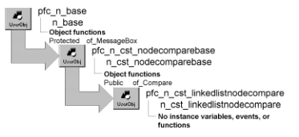

# n_cst_linkedlistnodecompare

**Description**

Node comparison object. N_cst_list uses this object to compare values during find operations and before placement in a sorted list.

**Ancestry**



**Library**

- PFCAPSRV.PBL
- PFEAPSRV.PBL

**Usage**

This object can handle key comparison for simple data types but if your list’s key items contain some other data type, you must create a customized n_cst_linkedlistnodecompare descendant to handle comparison processing.

To use a customized descendant of n_cst_linkedlistnodecompare:

1. Use the User Object painter to create a customized n_cst_linkedlistnodecompare descendant.
2. In the customized n_cst_linkedlistnodecompare descendant, implement a Public of_Compare function to compare key values in the two passed nodes. This function should take two arguments of type n_cst_nodebase (passed by value) and return integer values as follows:
   - **1** The key of the first node is less than the key of the second node
   - **0** The key of the first node is equal to the key of the second node
   - **2** The key of the first node is greater than the key of the second node

In this example, each passed node contains a reference to a custom class user object with state and last name instance variables to compare:

```
Any la_key1,la_key2
String ls_keytype1,ls_keytype2
n_cst_empinfo  lnv_emp1, lnv_emp2

IF NOT IsValid(anv_node1) THEN
  Return -1
END IF
IF NOT IsValid(anv_node2) THEN
  Return -1
END IF
anv_node1.of_GetKey(la_key1)
IF IsNull(la_key1) THEN
  Return -1
END IF
anv_node2.of_GetKey(la_key2)
IF IsNull(la_key2) THEN
  Return -1
END IF

ls_keytype1 = ClassName(la_key1)
ls_keytype2 = ClassName(la_key2)

// Check class types
IF ls_keytype1 <> ls_keytype2 THEN
  Return -1
END IF

IF ls_keytype1 = "" THEN Return -1
IF IsNull(ls_keytype1) THEN Return -1
IF ls_keytype1 <> "n_cst_empinfo" THEN Return -1
IF ls_keytype2 = "" THEN Return -1
IF IsNull(ls_keytype2) THEN Return -1
IF ls_keytype2 <> "n_cst_empinfo" THEN Return -1
lnv_emp1 = la_key1 // Cast to n_cst_empinfo
lnv_emp2 = la_key2

// First compare State.
IF lnv_emp1.is_state < lnv_emp2.is_state THEN
  return this.LESSTHAN
elseif lnv_emp1.is_state > lnv_emp2.is_state THEN
  return this.GREATERTHAN
ELSE   // States are equal; compare lname.
  IF lnv_emp1.is_lname < lnv_emp2.is_lname THEN
    Return this.LESSTHAN
  ELSEIF lnv_emp1.is_lname > lnv_emp2.is_lname THEN
    Return this.GREATERTHAN
  ELSE  // State and lname are equal.
    Return this.EQUAL
  END IF
END IF
Return this.FAILURE
```

3. In the object that uses PFC list-processing, define an instance variable that uses your customized n_cst_linkedlistnodecompare object as the data type:

   ```
   n_cst_mycompare inv_customcompare
   ```

4. Create an instance of the customized comparison object and call the n_cst_list of_SetCompare function:

   ```
   inv_customcompare = CREATE n_cst_mycompare

   inv_list.of_SetCompare(inv_customcompare)
   ```

5. Call list-processing functions as necessary (this example displays linked list contents in a ListBox):

   ```
   n_cst_linkedlistnode  lnv_nodes[ ]
   Integer  li_return, li_count
   Any  la_data
   String  ls_data
   n_cst_empinfo  lnv_empinfo

   li_return = inv_list.of_Get(lnv_nodes)
   FOR li_count = 1 to li_return
     lnv_nodes[li_count].of_GetData(la_data)
     lnv_empinfo = la_data  // Cast to n_cst_empinfo
       ls_data = lnv_empinfo.is_lname  &
         + ", " + lnv_empinfo.is_fname
     lb_1.AddItem(ls_data)
   NEXT
   ```

**See also**

- [n_cst_list](n_cst_list.md)
- [n_cst_treenodecompare](n_cst_treenodecompare.md)
