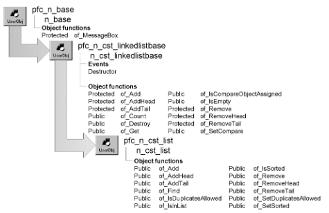

# n_cst_list

**Description**

List processing object. You can implement either a sorted or unsorted list, optionally allowing duplicates.

**Ancestry**



**Library**

- PFCAPSRV.PBL
- PFEAPSRV.PBL

**Object relationships**

- [n_cst_linkedlistnode](n_cst_linkedlistnode.md)
- [n_cst_linkedlistnodecompare](n_cst_linkedlistnodecompare.md)

**Usage**

Use this object for simple linked lists and sorted linked lists. A sorted linked list can optionally allow duplicates.

To use this object:

1. Establish a variable of type n_cst_list:

   ```
   n_cst_list  inv_list
   ```

2. (Optional) Specify whether the list is sorted:

   ```
   inv_list.of_SetSorted(TRUE)
   ```

3. (Optional) Specify whether a sorted list disallows duplicates:

   ```
   inv_list.of_SetDuplicatesAllowed(FALSE)
   ```

4. Add nodes to the list:

   ```
   n_cst_linkedlistnode  lnv_node
   Integer  li_return

   lnv_node = CREATE n_cst_linkedlistnode
   lnv_node.of_SetKey(sle_key.text)
   lnv_node.of_SetData(sle_data.text)
   li_return = inv_list.of_Add(lnv_node)
   ```

5. Retrieve nodes from the list:

   ```
   n_cst_linkedlistnode  lnv_nodes[ ]
   Integer  li_return, li_count
   Any  la_data
   String  ls_data

   lb_1.Reset()
   li_return = inv_list.of_Get(lnv_nodes)
   FOR li_count = 1 to li_return
      lnv_nodes[li_count].of_GetData(la_data)
         ls_data = String(la_data)
         lb_1.AddItem(ls_data)
   NEXT
   ```

**See also**

- [n_cst_linkedlistnode](n_cst_linkedlistnode.md)
- [n_cst_linkedlistnodecompare](n_cst_linkedlistnodecompare.md)
- [n_cst_queue](n_cst_queue.md)
- [n_cst_stack](n_cst_stack.md)
- [n_cst_tree](n_cst_tree.md)

## Instance variables

N_cst_list includes instance variables:

| Instance variable | Description | Data type | Access | Usage |
| --- | --- | --- | --- | --- |
| ib_duplicatesallowed | Indicates whether the list allows duplicates | Boolean | Protected | Set with of_SetDuplicatesAllowed (the default is TRUE) |
| ib_sorted | Indicates whether list is sorted | Boolean | Protected | Set with of_SetSorted (the default is FALSE) |

## Functions

N_cst_list includes precoded object functions:

- of_Add
- of_AddHead
- of_AddTail
- of_Find
- of_IsDuplicatesAllowed
- of_IsInList
- of_IsSorted
- of_Remove
- of_RemoveHead
- of_RemoveTail
- of_SetDuplicatesAllowed
- of_SetSorted

### of_Add

**Description**

Adds a new node to the linked list.

**Access**

Public

**Syntax**

```
instancename.of_Add ( newnode )
```

| Argument | Description |
| --- | --- |
| *instancename* | Instance name of n_cst_list |
| *newnode* | N_cst_linkedlistnode instance to be added to the linked list |

**Return value**

Integer. Returns 1 if the function succeeds and -1 if an error occurs.

**Usage**

You must instantiate and initialize *newnode* before calling this function.

**Examples**

This example calls the of_Add function:

```
n_cst_linkedlistnode  lnv_node
Integer  li_return

lnv_node = CREATE n_cst_linkedlistnode

lnv_node.of_SetKey(sle_1.text)
lnv_node.of_SetData(sle_1.text)
li_return = inv_list.of_Add(lnv_node)
```

### of_AddHead

**Description**

Adds a new node to the beginning of the linked list.

**Access**

Public

**Syntax**

```
instancename.of_AddHead ( newnode )
```

| Argument | Description |
| --- | --- |
| *instancename* | Instance name of n_cst_list |
| *newnode* | N_cst_linkedlistnode instance to be added at the beginning of the linked list |

**Return value**

Integer. Returns 1 if the function succeeds and -1 if an error occurs.

**Usage**

Internal.

**Examples**

This example calls the of_AddHead function:

```
...
if isnull(inv_head) or not isvalid(inv_head) then
   return of_AddHead(anv_newnode)
end if
...
```

### of_AddTail

**Description**

Adds a new node to the end of the linked list.

**Access**

Public

**Syntax**

```
instancename.of_AddTail ( newnode )
```

| Argument | Description |
| --- | --- |
| *instancename* | Instance name of n_cst_list |
| *newnode* | N_cst_linkedlistnode instance to be added at the end of the linked list |

**Return value**

Integer. Returns 1 if the function succeeds and -1 if an error occurs.

**Usage**

Internal.

**Examples**

This example calls the of_AddTail function:

```
...
If anv_insertafternode = inv_tail Then
   Return of_AddTail(anv_newnode)
End If
...
```

### of_Find

**Description**

Retrieves a node from the linked listed based upon the key value.

**Access**

Public

**Syntax**

```
instancename.of_Find ( foundnode, nodewithkey )
```

| Argument | Description |
| --- | --- |
| *instancename* | Instance name of n_cst_list |
| *foundnode* | N_cst_linkedlistnode instance into which the function places the node if a match is found (passed by reference) |
| *nodewithkey* | N_cst_linkedlistnode instance containing the key value used to find the requested node |

**Return value**

Integer. Returns values as follows:

- **1** Success
- **0** Node not found
- **-1** Error

**Examples**

This example is from the of_IsInList function:

```
...
If of_Find(lnv_locatenode, anv_node) = 1 Then
   // Node was found in list.
   Return True
End If
...
```

### of_IsDuplicatesAllowed

**Description**

Reports whether a sorted linked list allows duplicates.

**Access**

Public

**Syntax**

```
instancename.of_IsDuplicatesAllowed ( )
```

| Argument | Description |
| --- | --- |
| *instancename* | Instance name of n_cst_list |

**Return value**

Boolean. Returns TRUE if duplicates are allowed and FALSE if they are not.

**Examples**

This example calls the of_IsDuplicatesAllowed function:

```
Boolean lb_duplicates

lb_duplicates = inv_list. of_IsDuplicatesAllowed()
IF lb_duplicates THEN
  MessageBox("Sorted List", "Duplicates are allowed")
ELSE
  MessageBox("Sorted List", "Duplicates not allowed")
END IF
```

### of_IsInList

**Description**

Reports whether a node with the specified key is in the list.

**Access**

Public

**Syntax**

```
instancename.of_IsInList ( node )
```

| Argument | Description |
| --- | --- |
| *instancename* | Instance name of n_cst_list |
| *node* | N_cst_linkedlistnode instance containing the key used as search criteria |

**Return value**

Integer. Returns 1 if the function succeeds and -1 if an error occurs.

**Usage**

This function calls the of_Find function.

**Examples**

This example calls the of_IsInList function:

```
n_cst_linkedlistnode  lnv_temp
Boolean  lb_return

lnv_temp = CREATE n_cst_linkedlistnode
lnv_temp.of_SetKey(sle_2.text)
lb_return = inv_list.of_IsInList(lnv_temp)
IF lb_return THEN
   MessageBox("Found", "Node was found")
ELSE
   MessageBox("Not Found", "Node was not found")
END IF
```

### of_IsSorted

**Description**

Reports whether a list is sorted.

**Access**

Public

**Syntax**

```
instancename.of_IsSorted ( )
```

| Argument | Description |
| --- | --- |
| *instancename* | Instance name of n_cst_list |

**Return value**

Boolean. Returns TRUE if the list is sorted and FALSE if it is not.

**Examples**

This example calls the of_IsSorted function:

```
IF inv_list.of_IsSorted() THEN
   MessageBox("Linked List", "Sorted")
ELSE
   MessageBox("Linked List", "Unsorted")
END IF
```

### of_Remove

**Description**

Removes the specified node from a linked list, resetting pointers as appropriate.

**Access**

Public

**Syntax**

```
instancename.of_Remove ( removenode )
```

| Argument | Description |
| --- | --- |
| *instancename* | Instance name of n_cst_list |
| *removenode* | N_cst_linkedlistnode instance to remove from the linked list |

**Return value**

Integer. Returns 1 if the function succeeds and -1 if an error occurs.

**Examples**

This example calls the of_Remove function:

```
n_cst_linkedlistnode  lnv_node, lnv_temp
Integer  li_return
Long  ll_oldtextcolor

lnv_temp = CREATE n_cst_linkedlistnode

IF sle_2.text = "" THEN
   MessageBox("Data Entry Error",  &
      "You must enter a node to delete")
   Return
END IF

lnv_temp.of_SetKey(sle_2.text)
li_return = inv_list.of_Find(lnv_node, lnv_temp)
IF li_return < 1 THEN
   ll_oldtextcolor = sle_2.textcolor
   sle_2.textcolor = RGB(255, 0, 0)
   MessageBox("Not Found",  &
      "The specified node was not found")
   sle_2.textcolor = ll_oldtextcolor
   Return
END IF
li_return = inv_list.of_Remove(lnv_node)
IF li_return = 1 THEN
   MessageBox("Success", "Node removed successfully")
END IF
```

### of_RemoveHead

**Description**

Removes the first node from a linked list, resetting pointers as appropriate and returning the removed node.

**Access**

Public

**Syntax**

```
instancename.of_RemoveHead ( removenode )
```

| Argument | Description |
| --- | --- |
| *instancename* | Instance name of n_cst_list |
| *removenode* | N_cst_linkedlistnode instance into which the function places a reference to the returned node (passed by reference) |

**Return value**

Integer. Returns 1 if the function succeeds and -1 if an error occurs.

**Usage**

Internal.

**Examples**

This example calls the of_RemoveHead function:

```
Return Super::of_RemoveHead(anv_headnode)
```

### of_RemoveTail

**Description**

Removes the last node from a linked list, resetting pointers as appropriate and returning the removed node.

**Access**

Public

**Syntax**

```
instancename.of_RemoveTail ( removenode )
```

| Argument | Description |
| --- | --- |
| *instancename* | Instance name of n_cst_list |
| *removenode* | N_cst_linkedlistnode instance into which the function places a reference to the returned node (passed by reference) |

**Return value**

Integer. Returns 1 if the function succeeds and -1 if an error occurs.

**Usage**

Internal.

**Examples**

This example calls the of_RemoveTail function:

```
Return Super::of_RemoveTail(anv_tailnode)
```

### of_SetDuplicatesAllowed

**Description**

Specifies whether a sorted list allows duplicates.

**Access**

Public

**Syntax**

```
instancename.of_SetDuplicatesAllowed ( boolean )
```

| Argument | Description |
| --- | --- |
| *instancename* | Instance name of n_cst_list |
| *boolean* | Boolean indicating whether duplicates are allowed (TRUE) or not (FALSE) |

**Return value**

Integer. Returns 1 if the function succeeds and -1 if an error occurs.

**Examples**

This example calls the of_SetDuplicatesAllowed function:

```
...
inv_list.of_SetSorted(TRUE)
inv_list.of_SetDuplicatesAllowed(FALSE)
...
```

### of_SetSorted

**Description**

Specifies whether the list is sorted.

**Access**

Public

**Syntax**

```
instancename.of_SetSorted ( switch )
```

| Argument | Description |
| --- | --- |
| *instancename* | Instance name of n_cst_list |
| *switch* | Boolean specifying whether the list is sorted (TRUE) or not (FALSE) |

**Return value**

Integer. Returns 1 if the function succeeds and -1 if an error occurs.

**Usage**

For a sorted list, you should also call of_SetDuplicatesAllowed to specify whether the sorted list allows duplicates.

**Examples**

This example calls the of_SetSorted function:

```
...
inv_list.of_SetSorted(TRUE)
inv_list.of_SetDuplicatesAllowed(FALSE)
...
```
