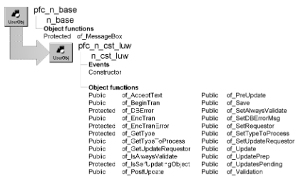

# n_cst_luw

**Description**

Logical unit of work service. N_cst_luw provides support for self-updating objects. A self-updating object encapsulates all required update functionality by implementing a set of functions (self-updating object API) that n_cst_luw calls during the save process:

- of_AcceptText
- of_UpdatesPending
- of_Validation
- of_UpdatePrep
- of_Update
- of_PostUpdate

PFC includes several self-updating objects, including u_dw, n_ds, u_lvs, u_tab, u_base, w_master, and u_tvs. Refer to these objects to see implementations of the self-updating object API.

**Ancestry**



**Library**

- PFCAPSRV.PBL
- PFEAPSRV.PBL

**Object relationships**

- [n_cst_dberrorattrib](../05-global-structures-and-structure-objects/n_cst_dberrorattrib.md)
- [n_cst_metaclass](n_cst_metaclass.md)
- [n_tr](../08-standard-class-user-objects/n_tr.md)

**Usage**

PFC uses n_cst_luw to coordinate and perform updates on a control or a group of controls. For example the w_master pfc_Save process calls n_cst_luw functions.

You can also use n_cst_luw as a standalone object to perform database updates via the of_Save function.

See the *PFC User’s Guide*.

**See also**

- [n_ds](../08-standard-class-user-objects/n_ds.md)
- [u_base](../07-custom-visual-user-objects/u_base.md)
- [u_dw](../06-standard-visual-user-objects/u_dw.md)
- [u_lvs](../06-standard-visual-user-objects/u_lvs.md)
- [u_tab](../06-standard-visual-user-objects/u_tab.md)
- [u_tvs](../06-standard-visual-user-objects/u_tvs.md)
- [w_master](../02-window-objects/w_master.md)

## Instance variables

N_cst_luw includes instance variables:

| Instance variable | Description | Data type | Access | Usage |
| --- | --- | --- | --- | --- |
| ALL_OBJECTS | Constant set to an empty string | String | Public | This is the default for ib_typetoprocess |
| ib_accepttext | Indicates whether the of_Save function accepts text by default | Boolean | Protected | The default is TRUE |
| ib_alwaysvalidate | Indicates whether n_cst_luw validates all controls, even those with no pending updates | Boolean | Protected | Set with of_SetAlwaysValidate (the default is FALSE) |
| ib_assist |  | Boolean | Public |  |
| ib_resetflag | Indicates whether the of_Save function resets update flags by default | Boolean | Protected | The default is FALSE |
| inv_dberrorattrib | Database error information | n_cst_dberrorattrib | Protected | Set with of_SetDBErrorMsg |
| inv_metaclass | Reference to metaclass service | n_cst_metaclass | Protected | Internal |
| ipo_pendingupdates[ ] | Controls with pending updates | PowerObject | Protected | Set by of_UpdatesPending |
| ipo_requestor | Object owning this instance of n_cst_luw | PowerObject | Protected | Set with of_Requestor |
| ipo_updaterequestor | Object requesting the update | PowerObject | Protected | Set with of_SetUpdateRequestor |
| is_instancename | Unique name for this instance of n_cst_luw | String | Protected | Internal |
| is_typetoprocess | Customized list of object types to update | String | Protected | Set with of_SetTypeToProcess. Default is ALL_OBJECTS |

## Events

N_cst_luw includes a precoded event:

Constructor

### Constructor

**Description**

Establishes a unique identifier for the current instance of n_cst_luw.

**Usage**

This event executes when the object is created.

## Functions

N_cst_luw includes precoded functions:

- of_AcceptText
- of_Assist
- of_BeginTran
- of_DBError
- of_EndTran
- of_EndTranError
- of_GetClassNames
- of_GetType
- of_GetTypeToProcess
- of_GetUpdateRequestor
- of_IsAlwaysValidate
- of_IsSelfUpdatingObject
- of_PostUpdate
- of_PreUpdate
- of_Save
- of_SetAlwaysValidate
- of_SetDBErrorMsg
- of_SetRequestor
- of_SetTypeToProcess
- of_SetUpdateRequestor
- of_Update
- of_UpdatePrep
- of_UpdatesPending
- of_Validation

### of_AcceptText

**Description**

Calls the of_AcceptText function (if implemented) for all passed controls.

**Access**

Public

**Syntax**

```
instancename.of_AcceptText ( controlarray, focusonerror )
```

| Argument | Description |
| --- | --- |
| *instancename* | Instance name of n_cst_luw (the PFC default is inv_luw) |
| *controlarray* | PowerObject array containing the control to check |
| *focusonerror* | Boolean specifying whether to set focus on a DataWindow column with errors |

**Return value**

Integer. Returns 1 if the function succeeds and -1 if an error occurs.

**Usage**

For non-PFC DataWindows and DataStores, this function calls the AcceptText function directly. For PFC DataWindows and other self updating objects, this function calls the object’s of_AcceptText function, if implemented. To create additional accept text processing, extend the self-updating object’s pfc_Accept event.

**Examples**

This example is from the w_master pfc_AcceptText event:

```
...If IsValid(inv_luw) Then
Return inv_luw.of_AcceptText(apo_control[ ],  &
   ab_focusonerror)End If...
```

### of_Assist

**Description**

Display / Log / Provide assistance. Note: This function should be implemented in descendant object.

**Access**

Protected

**Syntax**

```
instancename.of_Assist ( as_msg )
```

| Argument | Description |
| --- | --- |
| *instancename* | Instance name of n_cst_luw |
| *as_msg* | String. The message to provide assistance with. |

**Return value**

Integer. Returns 1 = successful, 0 = no action, -1 = error.

### of_BeginTran

**Description**

Begins transactions for the passed Transaction objects.

**Access**

Public

**Syntax**

```
instancename.of_BeginTran ( transactions )
```

| Argument | Description |
| --- | --- |
| *instancename* | Instance name of n_cst_luw (the PFC default is inv_luw) |
| *transactions* | N_tr or n_tr array referencing Transaction objects for which start-of-transaction processing is initiated |

**Return value**

Integer. Returns 1 if the function succeeds and -1 if an error occurs.

**Usage**

To use this function:

- Optionally add code to the window’s pfc_BeginTran event that calls this function
- Override the n_tr of_Begin function, adding code that performs begin transaction process as necessary

This function calls the n_tr of_Begin function for each object in the *transactions* array.

**Examples**

This example calls the of_BeginTran function:

```
n_tr  ltr_trans[ ]

ltr_trans[1] = SQLCA
IF IsValid(inv_luw) THEN
   IF inv_luw.of_BeginTran(ltr_trans) = -1 THEN
      Return -1
   END IF
END IF
Return 1
```

### of_DBError

**Description**

Displays a message box using the passed database error message.

**Access**

Protected

**Syntax**

```
instancename.of_DBError ( errorinfo )
```

| Argument | Description |
| --- | --- |
| *instancename* | Instance name of n_cst_luw (the PFC default is inv_luw) |
| *errorinfo* | N_cst_dberrorattrib containing database error information |

**Return value**

Integer. Returns 1 if the function succeeds and -1 if an error occurs.

**Usage**

Internal.

**Examples**

This example is from the of_Save function:

```
...
If li_save_rc<=0 Then
  This.of_dberror(inv_dberrorattrib)
...
```

### of_EndTran

**Description**

Commits or rolls back all specified transactions as appropriate.

**Access**

Public

**Syntax**

```
instancename.of_EndTran ( transactions, savestate )
```

| Argument | Description |
| --- | --- |
| *instancename* | Instance name of n_cst_luw (the PFC default is inv_luw) |
| *transactions* | N_tr array containing transactions |
| *savestate* | Integer containing the current status of the save process |

**Return value**

Integer. Returns 1 if the function succeeds and -1 if an error occurs.

**Usage**

Internal.

**Examples**

This example is from the of_Save function:

```
...
li_endtran_rc =  &
   This.of_endtran(atr_control, li_save_rc)
...
```

### of_EndTranError

**Description**

Displays a message box listing end of transaction errors. This can include information on transactions that were committed and those that were rolled back.

**Access**

Protected

**Syntax**

```
instancename.of_EndTranError ( trcommit, trrollback, returncodes,
savestate )
```

| Argument | Description |
| --- | --- |
| *instancename* | Instance name of n_cst_luw (the PFC default is inv_luw) |
| *trcommit* | N_tr array referencing transactions that were committed |
| *trrollback* | N_tr array referencing transactions that were rolled back |
| *returncodes* | Integer array containing ROLLBACK return codes |
| *savestate* | Integer containing the current status of the save process |

**Return value**

Integer. Returns 1 if the function succeeds and -1 if an error occurs.

**Usage**

Internal.

**Examples**

This example is from the of_EndTran function:

```
...
li_rc = of_EndTranError(ltr_performed,  &
   ltr_secondary, li_secondaryrc, ai_saverc)
...
```

### of_GetClassNames

**Description**

Get a name for all the objects passed in.

**Access**

Protected

**Syntax**

```
instancename.of_GetClassNames ( apo_control )
```

| Argument | Description |
| --- | --- |
| *instancename* | Instance name of n_cst_luw |
| *apo_control* | PowerObject array. array of controls to get names. |

**Return value**

String. ClassNames of all the objects passed in. ! = error.

### of_GetType

**Description**

Retrieves the type of the specified control.

**Access**

Protected

**Syntax**

```
instancename.of_GetType ( control )
```

| Argument | Description |
| --- | --- |
| *instancename* | Instance name of n_cst_luw (the PFC default is inv_luw) |
| *control* | PowerObject containing the control |

**Return value**

String. Returns the control name if the function succeeds and ! if an error occurs.

**Usage**

Internal.

**Examples**

This example is from the of_AcceptText function:

```
...
If Pos(is_typetoprocess,  &
   of_GetType(lpo_tocheck)) = 0 Then
      Continue
End If
...
```

### of_GetTypeToProcess

**Description**

Retrieves the types of objects accessed by the save process.

**Access**

Public

**Syntax**

```
instancename.of_GetTypeToProcess ( )
```

| Argument | Description |
| --- | --- |
| *instancename* | Instance name of n_cst_luw (the PFC default is inv_luw) |

**Return value**

String. Returns the types of objects accessed by the save process (an empty string means all objects are supported).

**Examples**

This example calls the of_GetTypeToProcess function:

```
String  ls_types

ls_types = parent.inv_luw.of_GetTypeToProcess()
MessageBox("LUW", "Save types are " + ls_types)
```

### of_GetUpdateRequestor

**Description**

Retrieves a reference to the object requesting the update.

**Access**

Public

**Syntax**

```
instancename.of_GetUpdateRequestor ( requestor )
```

| Argument | Description |
| --- | --- |
| *instancename* | Instance name of n_cst_luw (the PFC default is inv_luw) |
| *requestor* | PowerObject into which the function places a reference to the object requesting the update (passed by reference) |

**Return value**

Integer. Returns 1 if the function succeeds, 0 if there is no update requestor, and -1 if an error occurs.

**Usage**

An update requestor, which establishes an owner for self-updating objects, is optional.

**Examples**

This example calls the of_GetUpdateRequestor function:

```
PowerObject  lpo_req

IF inv_luw.of_GetUpdateRequestor(lpo_req) > 1 THEN
   MessageBox("LUW", "Update requestor is: "  &
      + lpo_req.ClassName())
END IF
```

### of_IsAlwaysValidate

**Description**

Reports whether n_cst_luw always performs validation.

**Access**

Public

**Syntax**

```
instancename.of_IsAlwaysValidate ( )
```

| Argument | Description |
| --- | --- |
| *instancename* | Instance name of n_cst_luw (the PFC default is inv_luw) |

**Return value**

Boolean. Returns TRUE if n_cst_luw performs validation on all objects (event those without pending updates) and FALSE if n_cst_luw performs validation on objects with pending updates only.

**Examples**

This example calls the of_IsAlwaysValidate function:

```
IF parent.inv_luw.of_IsAlwaysValidate() = TRUE THEN
   MessageBox("LUW", "Always validate")
ELSE
   MessageBox("LUW", "Sometimes validate")
END IF
```

### of_IsSelfUpdatingObject

**Description**

Reports whether the passed control is a self-updating object.

**Access**

Protected

**Syntax**

```
instancename.of_IsSelfUpdatingObject (control )
```

| Argument | Description |
| --- | --- |
| *instancename* | Instance name of n_cst_luw (the PFC default is inv_luw) |
| *control* | PowerObject containing the control |

**Return value**

Boolean. Returns TRUE if *control* is a self updating object.

**Usage**

Override this function redefine the functions that make up a self-updating object.

**Examples**

This example is from the of_AcceptText function:

```
...
Case Window!
   If Not of_IsSelfUpdatingObject(lpo_tocheck) Then
       lw_control = lpo_tocheck
       li_rc = This.of_AcceptText  &
          (lw_control.control, ab_FocusOnError )
...
```

### of_PostUpdate

**Description**

Calls the of_PostUpdate function (if implemented) for all passed controls.

**Access**

Public

**Syntax**

```
instancename.of_PostUpdate ( controls )
```

| Argument | Description |
| --- | --- |
| *instancename* | Instance name of n_cst_luw (the PFC default is inv_luw) |
| *controls* | PowerObject array containing the controls for which DataWindow update flags are reset |

**Return value**

Integer. Returns 1 if the function succeeds and -1 if an error occurs.

**Usage**

For non-PFC DataWindows, this function calls the ResetUpdate function directly. For PFC DataWindows and other self-updating objects, this function calls the object’s of_PostUpdate function, which resets updates flags as appropriate. To create additional post-update processing, extend the self-updating object’s pfc_PostUpdate event.

**Examples**

This example calls the of_PostUpdate function:

```
...
If IsValid(inv_luw) Then
   Return inv_luw.of_PostUpdate(apo_control)
End If
...
```

### of_PreUpdate

**Description**

Empty function that you override in n_cst_luw to perform application-specific pre-update processing.

**Access**

Public

**Syntax**

```
instancename.of_PreUpdate ( )
```

| Argument | Description |
| --- | --- |
| *instancename* | Instance name of n_cst_luw (the PFC default is inv_luw) |

**Return value**

Integer. Returns 1 if the function succeeds and -1 if an error occurs.

**Examples**

This example is from the w_master pfc_PreUpdate event:

```
...
If IsValid(inv_luw) Then
   Return inv_luw.of_PreUpdate()
End If
...
```

### of_Save

**Description**

Performs a complete save operation for the specified object or objects.

**Access**

Public

**Syntax**

```
instancename.of_Save ( control, transaction )
```

| Argument | Description |
| --- | --- |
| *instancename* | Instance name of n_cst_luw (the PFC default is inv_luw) |
| *control* | PowerObject or PowerObject array containing the control or controls to be updated |
| *transaction* | N_tr or n_tr array containing the Transaction objects required by the update |

**Return value**

Integer. Returns values as follows:

- **1** Success
- **0** No pending updates
- **-1** Accept text error
- **-2** Updates pending error
- **-3** Validation error
- **-4** Pre-update error
- **-5** Begin transaction error
- **-6** Update error
- **-7** End transaction error
- **-8** Post save error
- **-9** Update prep error

**Usage**

Call this function to perform the complete save process using n_cst_luw only.

The *transaction* argument is used by begin transaction and end transaction processing.

This function calls other n_cst_luw functions:

of_AcceptText of_UpdatesPending of_Validation of_UpdatePrep of_PreUpdate of_BeginTran of_Update of_DBError (as appropriate) of_PostUpdate

**Examples**

This example calls the of_Save function:

```
n_cst_luw  lnv_luw
Integer  li_return

lnv_luw = CREATE n_cst_luw
li_return = lnv_luw.of_Save(tv_1, SQLCA)
IF li_return < 0 THEN
   MessageBox("Save", "Save Error")
END IF
DESTROY lnv_luw
```

### of_SetAlwaysValidate

**Description**

Specifies whether n_cst_luw performs validation even for those objects that do not have pending updates.

**Access**

Public

**Syntax**

```
instancename.of_SetAlwaysValidate ( boolean )
```

| Argument | Description |
| --- | --- |
| *instancename* | Instance name of n_cst_luw (the PFC default is inv_luw) |
| *boolean* | Boolean specifying whether n_cst_luw always perform validation (TRUE) or only performs validation if a control has pending updates |

**Return value**

Integer. Returns 1 if the function succeeds and -1 if an error occurs.

**Examples**

This example calls the of_SetAlwaysValidate function:

```
inv_luw.of_SetAlwaysValidate(TRUE)
```

### of_SetDBErrorMsg

**Description**

Specifies the message that appears for a database error.

**Access**

Public

**Syntax**

```
instancename.of_SetDBErrorMsg ( errorinfo )
```

| Argument | Description |
| --- | --- |
| *instancename* | Instance name of n_cst_luw (the PFC default is inv_luw) |
| *errorinfo* | N_cst_dberrorattrib containing database error information |

**Return value**

Integer. Returns 1 if the function succeeds and -1 if an error occurs.

**Usage**

The message specified here is displayed by the of_DBError function.

**Examples**

This example calls the of_SetDBErrorMsg function:

```
n_cst_dberrorattrib lnv_dberrorattrib

inv_dberrorattrib.is_errormsg = "Update Error"
inv_luw.of_SetDBErrorMsg(lnv_dberrorattrib)
```

### of_SetRequestor

**Description**

Associates the requesting object with this instance of n_cst_luw.

**Access**

Public

**Syntax**

```
instancename.of_SetRequestor ( requestor )
```

| Argument | Description |
| --- | --- |
| *instancename* | Instance name of n_cst_luw (the PFC default is inv_luw) |
| *requestor* | PowerObject containing the requesting object (typically a w_master, u_tab, or u_base descendant) |

**Return value**

Integer. Returns 1 if the function succeeds and -1 if an error occurs.

**Usage**

This reference is not required.

**Examples**

This example is from the w_master of_SetLogicalUnitOfWork function:

```
...
if IsNull(inv_luw) Or not IsValid(inv_luw) then
   inv_luw = create n_cst_luw
   inv_luw.of_SetRequestor(this)
   inv_luw.of_SetUpdateRequestor(this)
   return 1
end if
...
```

### of_SetTypeToProcess

**Description**

Specifies the types of controls accessed by a default save process.

**Access**

Public

**Syntax**

```
instancename.of_SetTypeToProcess ( controltypes )
```

| Argument | Description |
| --- | --- |
| *instancename* | Instance name of n_cst_luw (the PFC default is inv_luw) |
| *controltypes* | String containing a blank separated list of the controls processed by a default save process |

**Return value**

Integer. Returns 1 if the function succeeds and -1 if an error occurs.

**Usage**

The default is an empty string (or the ALL_OBJECTS constant), which results in all controls being processed.

**Examples**

This example calls the of_SetTypeToProcess function:

```
inv_luw.of_SetTypeToProcess  &
   ("datawindow listview treeview")
```

### of_SetUpdateRequestor

**Description**

Associates n_cst_luw with the object requesting the update process.

**Access**

Public

**Syntax**

```
instancename.of_SetUpdateRequestor (requestor )
```

| Argument | Description |
| --- | --- |
| *instancename* | Instance name of n_cst_luw (the PFC default is inv_luw) |
| *requestor* | PowerObject containing the updating object or control |

**Return value**

Integer. Returns 1 if the function succeeds and -1 if an error occurs.

**Usage**

When appropriate, n_cst_luw uses this reference when referencing self-updating objects. If you don’t set this reference, n_cst_luw uses itself as the reference.

**Examples**

This example calls the of_SetUpdateRequestor function:

```
...
if IsNull(inv_luw) Or not IsValid(inv_luw) then
   inv_luw = create n_cst_luw
   inv_luw.of_SetRequestor(this)
   inv_luw.of_SetUpdateRequestor(this)
   return 1
   end if
...
```

### of_Update

**Description**

Calls the of_Update function (if implemented) for all passed controls.

**Access**

Public

**Syntax**

```
instancename.of_Update ( controlarray, accepttext, resetflags )
```

| Argument | Description |
| --- | --- |
| *instancename* | Instance name of n_cst_luw (the PFC default is inv_luw) |
| *controlarray* | PowerObject array containing the controls to be updated |
| *accepttext* | Boolean indicating whether to perform an accept text before performing the update |
| *resetflags* | Boolean indicating whether to automatically reset update flags |

**Return value**

Integer. Returns 1 if the function succeeds and -1 if an error occurs.

**Usage**

For non-PFC DataWindows and DataStores, this function calls the Update function directly. For PFC DataWindows and other self-updating objects, this function calls the object’s of_Update function, if implemented. To create additional update processing, extend the self-updating object’s pfc_Update event.

**Examples**

This example is from the w_master pfc_UpdateObjects event:

```
...
If IsValid(inv_luw) Then
   Return inv_luw.of_Update(apo_control, &
      ab_accepttext, ab_resetflag)
End If
...
```

### of_UpdatePrep

**Description**

Calls the of_UpdatePrep function (if implemented) for all passed controls.

**Access**

Public

**Syntax**

```
instancename.of_UpdatePrep ( controlarray )
```

| Argument | Description |
| --- | --- |
| *instancename* | Instance name of n_cst_luw (the PFC default is inv_luw) |
| *controlarray* | PowerObject array containing the controls to be updated |

**Return value**

Integer. Returns 1 if the function succeeds and -1 if an error occurs.

**Usage**

For non-PFC DataWindows and DataStores, this function calls the ue_UpdatePrep event, which you extend in the self-updating object to perform customized update preparation. For PFC DataWindows and other self-updating objects, this function calls the object’s of_UpdatePrep function, if implemented. To create additional update processing, extend the self-updating object’s pfc_UpdatePrep event

**Examples**

This example is from the w_master pfc_UpdatePrep event:

```
...
If IsValid(inv_luw) Then
   Return inv_luw.of_UpdatePrep(apo_control)
End If
...
```

### of_UpdatesPending

**Description**

Calls the of_UpdatePending function (if implemented) for all passed controls.

**Access**

Public

**Syntax**

```
instancename.of_UpdatesPending ( controlarray, pendingarray )
```

| Argument | Description |
| --- | --- |
| *instancename* | Instance name of n_cst_luw (the w_master default is inv_luw) |
| *controlarray* | PowerObject array containing the controls to be updated |
| *pendingarray* | PowerObject array into which the function places a list of controls that have pending updates (passed by reference) |

**Return value**

Integer. Returns 1 if updates are pending, 0 if no updates are pending, and -1 if an error occurs.

**Usage**

For non-PFC DataWindows and DataStores, this function accesses the objects directly to determine whether there are pending updates. For PFC DataWindows and other self-updating objects, this function calls the object’s of_UpdatesPending function, if implemented. To create additional update processing, extend the self-updating object’s pfc_UpdatesPending event.

There is also a Protected version of this function, which is for internal use.

**Examples**

This example is from the w_master pfc_UpdatesPendingRef event:

```
...
If IsValid(inv_luw) Then
   li_rc = inv_luw.of_UpdatesPending(apo_control,  &
       lpo_pending)
   apo_pending = lpo_pending
   Return li_rc
End If
...
```

### of_Validation

**Description**

Calls the of_Validation function (if implemented) for all passed controls.

**Access**

Public

**Syntax**

```
instancename.of_Validation ( controlarray )
```

| Argument | Description |
| --- | --- |
| *instancename* | Instance name of n_cst_luw (the w_master default is inv_luw) |
| *controlarray* | PowerObject array containing controls to be validated |

**Return value**

Integer. Returns 1 if the function succeeds and -1 if an error occurs.

**Usage**

For non-PFC DataWindows and DataStores, this function calls the ue_validation function, which you can optionally implement in these controls. For PFC DataWindows and other self-updating objects, this function calls the object’s of_Validation function, if implemented. To create additional update processing, extend the self-updating object’s pfc_Validation event

**Examples**

This example is from the w_master pfc_Validation event:

```
...
If IsValid(inv_luw) Then
   Return inv_luw.of_Validation(apo_control)
End If
...
```
