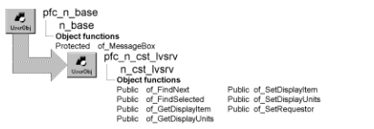

# n_cst_lvsrv

**Description**

ListView base service.

**Ancestry**



**Library**

- PFCAPSRV.PBL
- PFEAPSRV.PBL

**Object relationships**

- [n_ds](../08-standard-class-user-objects/n_ds.md)
- [u_lvs](../06-standard-visual-user-objects/u_lvs.md)

**Usage**

To use this service:

1. Enable the service by calling the u_lvs of_SetBase function:

   ```
   lv_1.of_SetBase(TRUE)
   ```

2. Populate the ListView.
3. Call n_cst_lvsrv functions as needed.

**Descendants**

- [n_cst_lvsrv_datasource](n_cst_lvsrv_datasource.md)
- [n_cst_lvsrv_sort](n_cst_lvsrv_sort.md)

**See also**

- [u_lvs](../06-standard-visual-user-objects/u_lvs.md)
- [u_tvs](../06-standard-visual-user-objects/u_tvs.md)

## Instance variables

N_cst_lvsrv includes instance variables:

| Instance variable | Description | Data type | Access | Usage |
| --- | --- | --- | --- | --- |
| is_delimiter |  | String | Protected |  |
| is_displayitem | Controls message text displayed for a single row | String | Protected | Call of_SetDisplayItem and of_GetDisplayItem to access |
| is_displayunits | Controls message text displayed for multiple rows | String | Protected | Call of_SetDisplayUnits and of_GetDisplayUnits to access |
| ilv_requestor | ListView control that owns the n_cst_lvsrv instance | u_lvs | Protected | Used to access and control the associated ListView control |

## Functions

N_cst_lvsrv includes precoded functions:

- of_FindNext
- of_FindSelected
- of_GetDelimiter
- of_GetDisplayItem
- of_GetDisplayUnits
- of_SetDelimiter
- of_SetDisplayItem
- of_SetDisplayUnits
- of_SetRequestor

### of_FindNext

**Description**

Searches for the next item relative to a specific location in the ListView.

**Access**

Public

**Syntax**

```
lvcontrol.instancename.of_FindNext ( startindex, direction )
```

| Argument | Description |
| --- | --- |
| *lvcontrol* | Instance name of the u_lvs-based ListView control |
| *instancename* | Instance name of n_cst_lvsrv (the u_lvs default for this is inv_base) |
| *startindex* | Integer specifying the index number from which you want your search to begin |
| *direction* | Direction enumerated data type specifying the search direction: |
|  | DirectionAll! DirectionUp! DirectionDown! DirectionLeft! DirectionRight! |

**Return value**

Integer. Returns the index of the item found if the function succeeds and -1 if an error occurs.

**Usage**

If you want to search from the beginning, specify 0 for *startindex*.

This function does not select the item it finds. Use the item’s Selected property in conjunction with this function to select the resulting match.

**Examples**

This example calls the of_FindNext function:

```
listviewitem   l_lvi
integer        li_index li_startindex

li_startindex = lv_list.SelectedIndex( )
lv_list.inv_base.of_FindNext(li_startindex,  &
   DirectionDown!)
IF li_index = -1 THEN
   MessageBox("Error", "Item not found.")
ELSE
   lv_list.GetItem (li_index, l_lvi )
   l_lvi.HasFocus = TRUE
   l_lvi.Selected = TRUE
   lv_list.SetItem(li_index,l_lvi)
END IF
```

### of_FindSelected

**Description**

Searches for the next ListView item that is selected.

**Access**

Public

**Syntax**

```
lvcontrol.instancename.of_FindSelected ( startindex, direction )
```

| Argument | Description |
| --- | --- |
| *lvcontrol* | Instance name of the u_lvs-based ListView control |
| *instancename* | Instance name of n_cst_lvsrv (the u_lvs default for this is inv_base) |
| *startindex* | Integer specifying the index number from which you want your search to begin |
| *direction* | Direction enumerated data type specifying the search direction: |
|  | DirectionAll! DirectionUp! DirectionDown! DirectionLeft! DirectionRight! |

**Return value**

Integer. Returns 1 if the function succeeds and -1 if an error occurs.

**Usage**

If you want to search from the beginning, specify 0 for *startindex*.

**Examples**

This example calls the of_FindSelected function:

```
...
lv_list.inv_base.of_FindSelected(0,  &
   DirectionDown!)
```

### of_GetDelimiter

**Description**

Gets the delimiter character used to separate items in the data attribute of the listview item.

**Access**

Public

**Syntax**

```
instancename.of_GetDelimiter ( )
```

| Argument | Description |
| --- | --- |
| *instancename* | Instance name of n_cst_lvsrv |

**Return value**

String.

### of_GetDisplayItem

**Description**

Retrieves the display name for single items in the ListView.

**Access**

Public

**Syntax**

```
lvcontrol.instancename.of_GetDisplayItem ( )
```

| Argument | Description |
| --- | --- |
| *lvcontrol* | Instance name of the u_lvs-based ListView control |
| *instancename* | Instance name of n_cst_lvsrv (the u_lvs default for this is inv_base) |

**Return value**

String. Returns the display name for single items in the ListView.

**Usage**

PFC uses this name in message text when confirming single-item deletion. For example, if this name is *this row*, PFC displays *Are you sure you want to delete*

```
this row?
```

**Examples**

This example calls the of_GetDisplayItem function:

```
String    ls_item

ls_item = lv_1.inv_base.of_GetDisplayItem( )
MessageBox("ListView", "Item label is: " &
   + ls_item)
```

### of_GetDisplayUnits

**Description**

Retrieves the display name for multiple rows in the ListView.

**Access**

Public

**Syntax**

```
lvcontrol.instancename.of_GetDisplayUnits ( )
```

| Argument | Description |
| --- | --- |
| *lvcontrol* | Instance name of the u_lvs-based ListView control |
| *instancename* | Instance name of n_cst_lvsrv (the u_lvs default for this is inv_base) |

**Return value**

String. Returns the display name for multiple items in the ListView.

**Usage**

PFC uses this name in message text when confirming multiple item deletion. For example, if this name is *rows*, PFC displays *Are you sure you want to delete*

```
these rows?
```

**Examples**

This example calls the of_GetDisplayUnits function:

```
String    ls_units

ls_units = lv_1.inv_base.of_GetDisplayUnits( )
MessageBox("ListView", "Unit label is: " &
   + ls_units)
```

### of_SetDelimiter

**Description**

Sets delimiter used to differentiate the keys placed in the data attribute of the listview item.

**Access**

Public

**Syntax**

```
instancename.of_SetDelimiter ( as_delimiter )
```

| Argument | Description |
| --- | --- |
| *instancename* | Instance name of n_cst_lvsrv |
| *as_delimiter* | String. The delimiter used to differentiate the keys of the compound key. |

**Return value**

Integer. SUCCESS = 1 ERROR = -1.

### of_SetDisplayItem

**Description**

Specifies the display name for single items in the ListView.

**Access**

Public

**Syntax**

```
lvcontrol.instancename.of_SetDisplayItem ( itemname )
```

| Argument | Description |
| --- | --- |
| *lvcontrol* | Instance name of the u_lvs-based ListView control |
| *instancename* | Instance name of n_cst_lvsrv (the u_lvs default for this is inv_base) |
| *itemname* | String specifying the display name for single items in the ListView |

**Return value**

Integer. Returns 1 if the function succeeds and -1 if an error occurs.

**Usage**

PFC uses this name in message text when confirming single-row deletion. For example, if you specify *this row*, PFC displays *Are you sure you want to delete*

```
this row?
```

**Examples**

This example calls the of_SetDisplayItem function:

```
...
lv_1.inv_base.of_SetDisplayItem("the selected row")
...
```

### of_SetDisplayUnits

**Description**

Specifies the display name for multiple items in the ListView.

**Access**

Public

**Syntax**

```
lvcontrol.instancename.of_SetDisplayUnits ( units )
```

| Argument | Description |
| --- | --- |
| *lvcontrol* | Instance name of the u_lvs-based ListView control |
| *instancename* | Instance name of n_cst_lvsrv (the u_lvs default for this is inv_base) |
| *units* | String specifying the display name for multiple rows of the ListView |

**Return value**

Integer. Returns 1 if the function succeeds and -1 if an error occurs.

**Usage**

PFC uses this name in message text when confirming multiple item deletion. For example, if this name is *rows*, PFC displays *Are you sure you want to delete*

```
these rows?
```

**Examples**

This example calls the of_SetDisplayUnits function:

```
...
lv_1.inv_base.of_SetDisplayUnits("selected rows")
...
```

### of_SetRequestor

**Description**

Associates the requesting object with this instance of n_cst_lvsrv.

**Access**

Public

**Syntax**

```
lvcontrol.instancename.of_SetRequestor ( requestor )
```

| Argument | Description |
| --- | --- |
| *lvcontrol* | Instance name of the u_lvs-based ListView control |
| *instancename* | Instance name of n_cst_lvsrv (the u_lvs default for this is inv_base) |
| *requestor* | U_lvs-based ListView control to be associated with the service |

**Return value**

Integer. Returns 1 if the function succeeds and -1 if an error occurs.

**Examples**

This example is from the u_lvs_of_SetBase function:

```
...
if ab_Switch then
   if IsNull(inv_base) Or not IsValid (inv_base) then
       inv_base = create n_cst_lvsrv
       inv_base.of_SetRequestor(this)
       li_rc = 1
   end if
...
```
