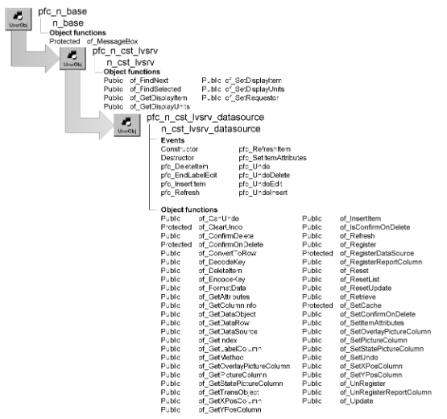

# n_cst_lvsrv_datasource

**Description**

ListView data access object. Use this object to display data in a u_lvs control and perform actions on that data. This data can come from a:

SQL statement DataWindow object DataStore DataWindow control PowerObject

**Ancestry**



**Library**

- PFCAPSRV.PBL
- PFEAPSRV.PBL

**Object relationships**

- [n_cst_dwcache](n_cst_dwcache.md)
- [n_cst_columnattrib](../05-global-structures-and-structure-objects/n_cst_columnattrib.md)
- [n_cst_lvsrvattrib](../05-global-structures-and-structure-objects/n_cst_lvsrvattrib.md)
- [n_ds](../08-standard-class-user-objects/n_ds.md)
- [n_tr](../08-standard-class-user-objects/n_tr.md)

**Usage**

To use this object:

1. Enable the service using the u_lvs of_SetDataSource function:

   ```
   this.of_SetDataSource(TRUE)
   ```

2. Define a data source by calling the of_Register function:

   ```
   this.inv_datasource.of_Register("emp_lname",  &
      "d_emplist", SQLCA)
   ```

3. Call additional functions to control ListView behavior:

   ```
   this.inv_datasource.of_RegisterReportColumn()
   this.inv_datasource.of_SetPictureColumn("1")
   ```

4. Populate the ListView by calling the u_lvs pfc_Populate event:

   ```
   this.Event pfc_Populate()
   ```

5. Extend the u_lvs pfc_Retrieve event to retrieve rows:

   ```
   Any  la_args[20]
   n_ds  lds_data

   la_args[1] = "windows"    // Retrieval argument
   this.of_Retrieve(la_args, lds_data)
   ```

**See also**

- [n_cst_lvsrv_sort](n_cst_lvsrv_sort.md)
- [n_cst_tvsrv_levelsource](n_cst_tvsrv_levelsource.md)
- [u_lvs](../06-standard-visual-user-objects/u_lvs.md)

## Instance variables

N_cst_lvsrv_datasource includes instance variables:

| Instance variable | Description | Data type | Access | Usage |
| --- | --- | --- | --- | --- |
| CACHE_ID | Constant set to "pfc listview" | String | Public | Internal |
| ib_confirmondelete | Indicates whether confirm on delete is enabled | Boolean | Protected | Set with of_SetConfirmOnDelete |
| ib_isrefreshing | Indicates whether a refresh is occurring | Boolean | Protected | Internal |
| ib_isundoing | Indicates whether an undo is occurring | Boolean | Protected | Internal |
| ib_undo | Indicates whether undo is supported | Boolean | Protected | Set with of_SetUndo |
| il_undodeletehandle[ ] | Deleted items | Long | Protected | Internal |
| il_undoedithandle | Modified items | Long | Protected | Internal |
| il_undoinserthandle | Last inserted item | Long | Protected | Internal |
| ilvi_undodeleteitem[ ] | Deleted items | ListViewItem | Protected | Internal |
| inv_cache | Cached data | n_cst_dwcache | Protected | Internal |
| is_dataobject | DataWindow object used to populate the ListView | String | Protected | Set with of_Register |
| is_pfckey | Key value | String | Protected | Internal |
| is_undoeditlabeltext | Modified label text | String | Protected | Internal |
| is_undotype | Undo type | String | Protected | Internal |
| inv_attrib | ListView attributes | n_cst_lvsrvattrib | Protected | Set with of_Register |
| inv_colattrib[ ] | Column attributes | n_cst_columnattrib | Protected | Set with of_RegisterReportColumn |
| UNDO_DELETE | Constant set to "Delete" | String | Public | Internal |
| UNDO_EDIT | Constant set to "Edit" | String | Public | Internal |
| UNDO_INSERT | Constant set to "Insert" | String | Public | Internal |

## Events

N_cst_lvsrv_datasource includes precoded events:

- Constructor
- Destructor
- pfc_DeleteItem
- pfc_EndLabelEdit
- pfc_InsertItem
- pfc_Refresh
- pfc_RefreshItem
- pfc_SetItemAttributes
- pfc_Undo
- pfc_UndoDelete
- pfc_UndoEdit
- pfc_UndoInsert

### Constructor

**Description**

Enables the caching service.

**Usage**

This event executes when the object is created.

### Destructor

**Description**

Destroys the caching service.

**Usage**

This event executes when the object is Destroyed.

### pfc_DeleteItem

**Description**

Deletes a row from the DataStore.

**Syntax**

```
lvcontrol.instancename.EVENT pfc_DeleteItem ( index )
```

| Argument | Description |
| --- | --- |
| *lvcontrol* | Instance name of the u_lvs-based ListView control |
| *instancename* | Instance name of n_cst_lvsrv_datasource (the u_lvs default for this value is inv_datasource) |
| *index* | Integer specifying the position of the ListView item to delete |

**Return value**

Integer. Returns 1 if the event succeeds and 0 if no action is taken.

**Usage**

This event does not remove the row from the database. To remove the row from the database, call the PowerScript Update function.

To get a reference to the DataStore, call of_GetAttributes and use the ids_source instance variable in the returned n_cst_lvsrvattrib instance.

This event does not perform processing if refreshing, resetting, or undoing an insert.

**Examples**

This example is from the u_lvs DeleteItem event:

```
...
If isvalid(inv_datasource) then
   inv_datasource.event pfc_DeleteItem(index)
...
```

### pfc_EndLabelEdit

**Description**

Change the label column in the associated data source.

**Syntax**

```
lvcontrol.instancename.EVENT pfc_EndLabelEdit (index, newlabel )
```

| Argument | Description |
| --- | --- |
| *lvcontrol* | Instance name of the u_lvs-based ListView control |
| *instancename* | Instance name of n_cst_lvsrv_datasource (the u_lvs default for this value is inv_datasource) |
| *index* | Integer specifying the index of the modified ListView item |
| *newlabel* | String specifying the updated label |

**Return value**

Integer. Returns 0 if the label update is allowed and 1 if PowerBuilder should prevent the label update.

**Usage**

PFC allows label update only when the associated label column is updatable. If the label column is a computed column, you must override this event to update the computed column and return a 0.

This event does not update the database.

**Examples**

This example is from the u_lvs EndLabelEdit event:

```
...
If IsValid(inv_datasource) Then
   li_rc = inv_datasource.event pfc_EndLabelEdit  &
      (index, newlabel)
   If li_rc < 1 then Return 1
End If
...
```

### pfc_InsertItem

**Description**

Inserts a new item into the ListView.

**Syntax**

```
lvcontrol.instancename.EVENT pfc_InsertItem ( datastore, row, lvitem,
position, index )
```

| Argument | Description |
| --- | --- |
| *lvcontrol* | Instance name of the u_lvs-based ListView control |
| *instancename* | Instance name of n_cst_lvsrv_datasource (the u_lvs default for this value is inv_datasource) |
| *datastore* | N_ds containing the data for the new item. This can be either the DataStore maintained by n_cst_lvsrv_datasource or another DataStore. If this is another DataStore, the associated DataWindow objects must be the same and the function also adds the row to the DataStore maintained by n_cst_lvsrv_datasource. This argument is accessed through the *ads_obj* argument |
| *row* | Long specifying the row containing the item to be inserted. This argument is accessed through the *al_row* argument |
| *lvitem* | ListViewItem containing the item to be inserted. This argument is accessed through the *alvi_item* argument |
| *position* | String specifying the position in which to insert the new item Values are: |
|  | • First |
|  | • Last |
|  | • Sort |
|  | • After |
|  | If you specify After, you must also specify *index* |
|  | This argument is accessed through the *as_position* argument |
| *index* | Integer containing the index to the ListView item before the new item. The function uses this argument if you specify After for *position*. This argument is accessed through the *ai_item* argument |

**Return value**

Integer. Returns the index of the new item if the function succeeds and -1 if an error occurs.

**Usage**

This event calls the of_InsertItem function.

**Examples**

This example is from the u_lvs pfc_InsertItem event:

```
...
Return inv_datasource.event pfc_InsertItem &
 (ads_source, al_row, llvi_new, as_position, ai_index)
...
```

### pfc_Refresh

**Description**

Refreshes the ListView items with data from the data source.

**Return value**

Integer. Returns the number of items refreshed if the event succeeds and -1 if an error occurs.

**Examples**

This example is from the u_lvs Refresh event:

```
If isvalid(inv_datasource) then
   Return inv_datasource.event pfc_Refresh()
End If
...
```

### pfc_RefreshItem

**Description**

Refreshes the specified ListView item, resetting all properties to the defaults specified in the data source.

**Syntax**

```
lvcontrol.instancename.EVENT pfc_RefreshItem ( index )
```

| Argument | Description |
| --- | --- |
| *lvcontrol* | Instance name of the u_lvs-based ListView control |
| *instancename* | Instance name of n_cst_lvsrv_datasource (the u_lvs default for this value is inv_datasource) |
| *index* | Integer specifying the ListView index of the item to refresh |

**Return value**

Integer. Returns 1 if the event succeeds and -1 if an error occurs.

**Examples**

This example is from the u_lvs pfc_RefreshItem event:

```
If isvalid(inv_datasource) then
   Return inv_datasource.event pfc_RefreshItem  &
      (ai_index)
End If
...
```

### pfc_SetItemAttributes

**Description**

Sets default properties for the ListView item before insertion.

**Syntax**

```
lvcontrol.instancename.EVENT pfc_SetItemAttributes ( data, row, lvitem )
```

| Argument | Description |
| --- | --- |
| *lvcontrol* | Instance name of the u_lvs-based ListView control |
| *instancename* | Instance name of n_cst_lvsrv_datasource (the u_lvs default for this value is inv_datasource) |
| *data* | N_ds containing the data for the item. This argument is accessed through the *ads_obj* argument |
| *row* | Long specifying the row containing the item. This argument is accessed through the *al_row* argument |
| *lvitem* | ListViewItem to be inserted. This argument is accessed through the *alvi_item* argument (passed by reference) |

**Usage**

This event calls the of_SetItemAttributes function.

### pfc_Undo

**Description**

Restores the last ListView change.

**Syntax**

```
lvcontrol.instancename.EVENT pfc_Undo ( )
```

| Argument | Description |
| --- | --- |
| *lvcontrol* | Instance name of the u_lvs-based ListView control |
| *instancename* | Instance name of n_cst_lvsrv_datasource (the u_lvs default for this value is inv_datasource) |

**Return value**

Integer. Returns 1 if the event succeeds, 0 if there is nothing to undo, and -1 if an error occurs.

**Examples**

This example is from the u_lvs pfc_Undo event:

```
...
if isvalid(inv_datasource) then
   li_rc = inv_datasource.event pfc_Undo()
end if
...
```

### pfc_UndoDelete

**Description**

Restores the last deleted item (or items if multiple items were deleted at once).

**Syntax**

```
lvcontrol.instancename.EVENT pfc_UndoDelete ( )
```

| Argument | Description |
| --- | --- |
| *lvcontrol* | Instance name of the u_lvs-based ListView control |
| *instancename* | Instance name of n_cst_lvsrv_datasource (the u_lvs default for this value is inv_datasource) |

**Return value**

Integer. Returns 1 if the event succeeds, 0 if there is nothing to undo, and -1 if an error occurs.

**Examples**

This example is from the pfc_Undo event:

```
...
Choose Case ls_UndoType
   Case UNDO_DELETE
       return this.event pfc_UndoDelete()
   Case UNDO_INSERT
       return this.event pfc_UndoInsert()
   Case UNDO_EDIT
       return this.event pfc_UndoEdit()
   End Choose
...
```

### pfc_UndoEdit

**Description**

Restores a label’s previous value.

**Syntax**

```
lvcontrol.instancename.EVENT pfc_UndoEdit ( )
```

| Argument | Description |
| --- | --- |
| *lvcontrol* | Instance name of the u_lvs-based ListView control |
| *instancename* | Instance name of n_cst_lvsrv_datasource (the u_lvs default for this value is inv_datasource) |

**Return value**

Integer. Returns 1 if the event succeeds, 0 if there is nothing to undo, and -1 if an error occurs.

**Examples**

This example is from the pfc_Undo event:

```
...
Choose Case ls_UndoType
   Case UNDO_DELETE
       return this.event pfc_UndoDelete()
   Case UNDO_INSERT
       return this.event pfc_UndoInsert()
   Case UNDO_EDIT
       return this.event pfc_UndoEdit()
   End Choose
...
```

### pfc_UndoInsert

**Description**

Removes the last inserted item.

**Syntax**

```
lvcontrol.instancename.EVENT pfc_UndoInsert ( )
```

| Argument | Description |
| --- | --- |
| *lvcontrol* | Instance name of the u_lvs-based ListView control |
| *instancename* | Instance name of n_cst_lvsrv_datasource (the u_lvs default for this value is inv_datasource) |

**Return value**

Integer. Returns 1 if the event succeeds and -1 if an error occurs.

**Examples**

This example is from the pfc_Undo event:

```
...
Choose Case ls_UndoType
   Case UNDO_DELETE
        return this.event pfc_UndoDelete()
   Case UNDO_INSERT
       return this.event pfc_UndoInsert()
   Case UNDO_EDIT
       return this.event pfc_UndoEdit()
   End Choose
...
```

## Functions

N_cst_lvsrv_datasource includes precoded functions:

- of_CanUndo
- of_ClearUndo
- of_ConfirmDelete
- of_ConfirmOnDelete
- of_ConvertToRow
- of_DecodeKey
- of_DeleteItem
- of_EncodeKey
- of_FormatData
- of_GetAttributes
- of_GetColumnInfo
- of_GetDataObject
- of_GetDataRow
- of_GetDataSource
- of_GetIndex
- of_GetLabelColumn
- of_GetMethod
- of_GetOverlayPictureColumn
- of_GetPictureColumn
- of_GetStatePictureColumn
- of_GetTransObject
- of_GetXPosColumn
- of_GetYPosColumn
- of_InsertItem
- of_IsConfirmOnDelete
- of_Refresh
- of_Register
- of_RegisterDataSource
- of_RegisterReportColumn
- of_Reset
- of_ResetList
- of_ResetUpdate
- of_Retrieve
- of_SetCache
- of_SetConfirmOnDelete
- of_SetItemAttributes
- of_SetOverlayPictureColumn
- of_SetPictureColumn
- of_SetStatePictureColumn
- of_SetUndo
- of_SetXPosColumn
- of_SetYPosColumn
- of_UnRegister
- of_UnRegisterReportColumn
- of_Update

### of_CanUndo

**Description**

Reports whether the ListView can undo the last edit, insertion, or deletion, optionally returning the operation type.

**Access**

Public

**Syntax**

```
lvcontrol.instancename.of_CanUndo ( { undotype } )
```

| Argument | Description |
| --- | --- |
| *lvcontrol* | Instance name of the u_lvs-based ListView control |
| *instancename* | Instance name of n_cst_lvsrv_datasource (the u_lvs default for this is inv_datasource) |
| *undotype* (optional) | String into which the function places the type of the last operation (passed by reference). Values are: |
|  | **• UNDO_EDIT or "Edit"** Edit |
|  | **• UNDO_INSERT or "Insert"** Insertion |
|  | **• UNDO_DELETE or "Delete"** Deletion |

**Return value**

Boolean. Returns TRUE if the last operation can be undone and FALSE if it cannot.

**Examples**

This example calls the of_CanUndo function:

```
IF lv_1.inv_datasource.of_CanUndo() THEN
   MessageBox("ListView", "Can undo")
ELSE
   MessageBox("ListView", "Cannot undo")
END IF
```

### of_ClearUndo

**Description**

Clears the ListView’s undo properties.

**Access**

Protected

**Syntax**

```
lvcontrol.instancename.of_ClearUndo ( )
```

| Argument | Description |
| --- | --- |
| *lvcontrol* | Instance name of the u_lvs-based ListView control |
| *instancename* | Instance name of n_cst_lvsrv_datasource (the u_lvs default for this is inv_datasource) |

**Return value**

Integer. Returns 1 if the function succeeds and -1 if an error occurs.

**Usage**

Internal.

**Examples**

This example is from the of_Refresh function:

```
...
this.of_ClearUndo()
...
```

### of_ConfirmDelete

**Description**

Displays a message box allowing the user to confirm a deletion.

**Access**

Public

**Syntax**

```
lvcontrol.instancename.of_ConfirmDelete ( amount )
```

| Argument | Description |
| --- | --- |
| *lvcontrol* | Instance name of the u_lvs-based ListView control |
| *instancename* | Instance name of n_cst_lvsrv_datasource (the u_lvs default for this is inv_datasource) |
| *amount* | Long specifying the number of rows to be deleted |

**Return value**

Integer. Returns 1 if deletion should proceed, 2 if deletions should not proceed, and -1 if an error occurs.

**Usage**

Internal.

**Examples**

This example is from the n_cst_lvsrv_datasource of_DeleteItem function:

```
...
li_confirm = inv_datasource.of_ConfirmDelete(1)
...
```

### of_ConfirmOnDelete

**Description**

Reports whether a confirmation dialog box displays when the user deletes a row.

**Access**

Protected

**Syntax**

```
lvcontrol.instancename.of_ConfirmOnDelete ( )
```

| Argument | Description |
| --- | --- |
| *lvcontrol* | Instance name of the u_lvs-based ListView control |
| *instancename* | Instance name of n_cst_lvsrv_datasource (the u_lvs default for this is inv_datasource) |

**Return value**

Boolean. Returns TRUE if confirm on delete is enabled and FALSE if it is disabled.

**Usage**

Internal.

**Examples**

This example is from the n_cst_lvsrv_datasource of_DeleteItem function:

```
...
if of_ConfirmOnDelete() then
   If li_totalitems = 1 then

...
```

### of_ConvertToRow

**Description**

Converts an array of data into a row in the DataStore.

**Access**

Public

**Syntax**

```
lvcontrol.instancename.of_ConvertToRow ( colvalues, datastore, row )
```

| Argument | Description |
| --- | --- |
| *lvcontrol* | Instance name of the u_lvs-based ListView control |
| *instancename* | Instance name of n_cst_lvsrv_datasource (the u_lvs default for this is inv_datasource) |
| *colvalues* | Any array containing the data to be used for the new row |
| *datastore* | N_ds instance into which the function places the new row (passed by reference) |
| *row* | Long into which the function places the new row number (passed by reference) |

**Return value**

Integer. Returns 1 if the function succeeds and -1 if an error occurs.

**Examples**

This example is from the u_lvs of_InsertItem function:

```
...
If inv_datasource.of_ConvertToRow  &
  (aa_columnvalues, lds_datastore, ll_row) <> 1 Then
...
```

### of_DecodeKey

**Description**

Retrieves the decoded key from the ListView item’s data attribute.

**Access**

Public

**Syntax**

```
lvcontrol.instancename.of_DecodeKey ( data )
```

| Argument | Description |
| --- | --- |
| *lvcontrol* | Instance name of the u_lvs-based ListView control |
| *instancename* | Instance name of n_cst_lvsrv_datasource (the u_lvs default for this is inv_datasource) |
| *data* | String containing the ListView item’s data attribute |

**Return value**

String. Returns the unique key if the function succeeds and ! if an error occurs.

**Usage**

Internal.

**Examples**

This example is from the pfc_UndoDelete event:

```
...
ls_undokey = of_DecodeKey(string(ltvi_undo.data))
...
```

### of_DeleteItem

**Description**

Removes either the specified item or all selected items from a ListView and the associated DataStore.

**Access**

Public

**Syntax**

```
lvcontrol.instancename.of_DeleteItem ( { index } )
```

| Argument | Description |
| --- | --- |
| *lvcontrol* | Instance name of the u_lvs-based ListView control |
| *instancename* | Instance name of n_cst_lvsrv_datasource (the u_lvs default for this is inv_datasource) |
| *index* (optional) | Integer specifying the index of the item to be deleted |

**Return value**

Integer. Returns 1 if the function succeeds, 0 if nothing was deleted, and -1 if an error occurs.

**Usage**

The pfc_DeleteItem event calls this function.

**Examples**

This example is from the pfc_DeleteItem event:

```
...
return of_DeleteItem()
...
```

### of_EncodeKey

**Description**

Creates an encoded key from the ListView item’s data attribute. The service uses this key to access rows in the associated DataStore.

**Access**

Public

**Syntax**

```
lvcontrol.instancename.of_EncodeKey ( source, row )
```

| Argument | Description |
| --- | --- |
| *lvcontrol* | Instance name of the u_lvs-based ListView control |
| *instancename* | Instance name of n_cst_lvsrv_datasource (the u_lvs default for this is inv_datasource) |
| *source* | N_ds containing the DataStore to populate the item |
| *row* | Long specifying the row containing the item |

**Return value**

String. Returns the unique key if the function succeeds and ! if an error occurs.

**Usage**

Internal.

**Examples**

This example is from the of_InsertItem function:

```
...
ls_key = of_EncodeKey(inv_attrib.ids_source, al_row)
...
```

### of_FormatData

**Description**

Converts DataWindow data from its native format to the string data type.

**Access**

Public

**Syntax**

```
lvcontrol.instancename.of_FormatData ( columnname, format, type,
datastore, row )
```

| Argument | Description |
| --- | --- |
| *lvcontrol* | Instance name of the u_lvs-based ListView control |
| *instancename* | Instance name of n_cst_lvsrv (the u_lvs default for this is inv_base) |
| *columnname* | String specifying the column |
| *format* | String specifying the column’s format |
| *type* | String specifying the column’s data type |
| *datastore* | N_ds specifying the DataStore containing the data |
| *row* | Long specifying the row for which the function returns column data |

**Return value**

String. Returns the specified row/column data as a formatted string.

**Examples**

This example calls the of_FormatData function:

```
Integer  li_cols, li_cnt
String  ls_column, ls_label
...
li_cols = UpperBound(is_Columns)
FOR li_cnt = 1 TO li_cols
   ls_column = of_FormatData(is_columns[li_cnt], &
       is_colformat[li_cnt], is_coltype[li_cnt], &
        ids_data, al_row)
...
```

### of_GetAttributes

**Description**

Retrieves the properties used to populate the ListView’s data source.

**Access**

Public

**Syntax**

```
lvcontrol.instancename.of_GetAttributes ( lvattrib )
```

| Argument | Description |
| --- | --- |
| *lvcontrol* | Instance name of the u_lvs-based ListView control |
| *instancename* | Instance name of n_cst_lvsrv_datasource (the u_lvs default for this is inv_datasource) |
| *lvattrib* | N_cst_lvsrvattrib into which the function places ListView properties (passed by reference) |

**Return value**

Integer. Returns 1 if the function succeeds and - if an error occurs.

**Usage**

Call this function to retrieve a reference to the DataStore and Transaction object for the data source.

**Examples**

This example calls the of_GetAttributes function:

```
n_cst_lvsrvattrib  lnv_attrib

lv_1.Event pfc_DeleteItem()
lv_1.inv_datasource.of_Update(TRUE, TRUE)
lv_1.inv_datasource.of_GetAttributes  &
   (lnv_attrib)
IF Not IsNull(lnv_attrib.itr_obj) THEN
   lnv_attrib.itr_obj.of_Commit()
END IF
...
```

### of_GetColumnInfo

**Description**

Retrieves column information from the ListView.

**Access**

Public

**Syntax**

```
lvcontrol.instancename.of_GetColumnInfo ( column, colattrib )
```

| Argument | Description |
| --- | --- |
| *lvcontrol* | Instance name of the u_lvs-based ListView control |
| *instancename* | Instance name of n_cst_lvsrv (the u_lvs default for this is inv_base) |
| *column* | Integer specifying the column from the ListView |
| *colattrib* | N_cst_columnattrib into which the function places column information (passed by reference) |

**Return value**

Integer. Returns 1 if the function succeeds and -1 if an error occurs.

**Usage**

Column information is used in detail view only.

**Examples**

This example is from the n_cst_lvsrv_sort pfc_ColumnClick event:

```
...
of_GetColumnInfo(ai_column, lnv_colinfo)
...
```

### of_GetDataObject

**Description**

Retrieves the DataWindow object used as the ListView’s data source.

**Access**

Public

**Syntax**

```
lvcontrol.instancename.of_GetDataObject ( )
```

| Argument | Description |
| --- | --- |
| *lvcontrol* | Instance name of the u_lvs-based ListView control |
| *instancename* | Instance name of n_cst_lvsrv_datasource (the u_lvs default for this is inv_datasource) |

**Return value**

String. Returns the name of the DataWindow object used to store data for display in the ListView.

**Examples**

This example calls the of_GetDataObject function:

```
String   ls_dataobject

ls_dataobject = lv_1.inv_datasource.of_GetDataObject()
MessageBox("ListView", "DataWindow object is: "  &
   + ls_dataobject)
```

### of_GetDataRow

**Description**

Retrieves from the DataStore the row that corresponds to the specified ListView item.

**Access**

Public

**Syntax**

```
lvcontrol.instancename.of_GetDataRow ( item, datasource, row )
```

| Argument | Description |
| --- | --- |
| *lvcontrol* | Instance name of the u_lvs-based ListView control |
| *instancename* | Instance name of n_cst_lvsrv_datasource (the u_lvs default for this is inv_datasource) |
| *item* | Integer specifying the index to the ListView item |
| *datasource* | N_ds specifying the DataStore that contains the row (passed by reference) |
| *row* | Long specifying the row in *datasource* that corresponds to *item* (passed by reference) |

**Return value**

Integer. Returns 1 if the function succeeds and -1 if an error occurs.

**Usage**

Use this function to update rows in the data source.

**Examples**

This example is from the pfc_UndoEdit event:

```
...
If of_GetDataRow(li_undohandle, lds_DataStore,  &
   ll_Row) = -1 Then
   Return -1
End If
...
```

### of_GetDataSource

**Description**

Retrieves the DataStore used as the source for the ListView.

**Access**

Public

**Syntax**

```
lvcontrol.instancename.of_GetDataSource ( source )
```

| Argument | Description |
| --- | --- |
| *lvcontrol* | Instance name of the u_lvs-based ListView control |
| *instancename* | Instance name of n_cst_lvsrv_datasource (the u_lvs default for this is inv_datasource) |
| *source* | N_ds instance into which the function places a reference to the DataStore used as the source for the ListView (passed by reference) |

**Return value**

Integer. Returns 1 if the function succeeds and -1 if an error occurs.

**Usage**

Use *source* to access the ListView’s internal data source.

**Examples**

This example is from the u_lvs pfc_Refresh event:

```
...
inv_datasource.of_GetDataSource(lds_source)
return this.event pfc_AddAll(lds_source)
...
```

### of_GetIndex

**Description**

Retrieves the ListView item index for the specified row.

**Access**

Public

**Syntax**

```
lvcontrol.instancename.of_GetIndex ( row )
```

| Argument | Description |
| --- | --- |
| *lvcontrol* | Instance name of the u_lvs-based ListView control |
| *instancename* | Instance name of n_cst_lvsrv_datasource (the u_lvs default for this is inv_datasource) |
| *row* | Long specifying the DataStore row for which the function returns the ListView item index |

**Return value**

Integer. Returns the index of the associated ListView item if the function succeeds, 0 if the item was not found, and -1 if an error occurs.

**Examples**

This example calls the of_GetIndex function:

```
Integer  li_item

li_item = lv_1.inv_datasource.of_GetIndex(10)
MessageBox("ListView", "Row 10 is item: "  &
   + String(li_item)
```

### of_GetLabelColumn

**Description**

Retrieves the name of the column used as the ListView item label.

**Access**

Public

**Syntax**

```
lvcontrol.instancename.of_GetLabelColumn ( )
```

| Argument | Description |
| --- | --- |
| *lvcontrol* | Instance name of the u_lvs-based ListView control |
| *instancename* | Instance name of n_cst_lvsrv_datasource (the u_lvs default for this is inv_datasource) |

**Return value**

String. Returns the data source column name.

**Examples**

This example calls the of_GetLabelColumn function:

```
String  ls_col

ls_col = lv_1.inv_datasource.of_GetLabelColumn()
MessageBox("ListView", "Label column is: " + ls_col)
```

### of_GetMethod

**Description**

Retrieves the method used to populate the ListView.

**Access**

Public

**Syntax**

```
lvcontrol.instancename.of_GetMethod ( )
```

| Argument | Description |
| --- | --- |
| *lvcontrol* | Instance name of the u_lvs-based ListView control |
| *instancename* | Instance name of n_cst_lvsrv_datasource (the u_lvs default for this is inv_datasource) |

**Return value**

String. Returns the method used to populate the ListView:

- DataObjectData
- DataStoreControl
- DataWindowControl
- ImportFile
- PowerObject
- Retrieve
- SQL

**Usage**

The of_Register function controls the method used to populate the ListView.

**Examples**

This example calls the of_GetMethod function:

```
String  ls_method

ls_method = lv_1.inv_datasource.of_GetMethod()
MessageBox("ListView", "Method is: " + ls_method)
```

### of_GetOverlayPictureColumn

**Description**

Retrieves the name of the column that specifies the overlay picture.

**Access**

Public

**Syntax**

```
lvcontrol.instancename.of_GetOverlayPictureColumn ( )
```

| Argument | Description |
| --- | --- |
| *lvcontrol* | Instance name of the u_lvs-based ListView control |
| *instancename* | Instance name of n_cst_lvsrv_datasource (the u_lvs default for this is inv_datasource) |

**Return value**

String. Returns the name of the column that specifies the overlay picture.

**Examples**

This example calls the of_GetOverlayPictureColumn function:

```
String  ls_column

ls_column =  &
   lv_1.inv_datasource.of_GetOverlayPictureColumn()
MessageBox("ListView", "Overlay is: " + ls_column)
```

### of_GetPictureColumn

**Description**

Retrieves the name of the column that specifies the picture used in icon view.

**Access**

Public

**Syntax**

```
lvcontrol.instancename.of_GetPictureColumn ( )
```

| Argument | Description |
| --- | --- |
| *lvcontrol* | Instance name of the u_lvs-based ListView control |
| *instancename* | Instance name of n_cst_lvsrv_datasource (the u_lvs default for this is inv_datasource) |

**Return value**

String. Returns the name of the column that specifies the picture used in icon view.

**Examples**

This example calls the of_GetPictureColumn function:

```
String  ls_column

ls_column = lv_1.inv_datasource.of_GetPictureColumn()
MessageBox("ListView", "Picture is: " + ls_column)
```

### of_GetStatePictureColumn

**Description**

Retrieves the name of the column that specifies the state picture.

**Access**

Public

**Syntax**

```
lvcontrol.instancename.of_GetStatePictureColumn ( )
```

| Argument | Description |
| --- | --- |
| *lvcontrol* | Instance name of the u_lvs-based ListView control |
| *instancename* | Instance name of n_cst_lvsrv_datasource (the u_lvs default for this is inv_datasource) |

**Return value**

String. Returns the name of the column that specifies the state picture.

**Examples**

This example calls the of_GetStatePictureColumn function:

```
String  ls_column

ls_column =  &
   lv_1.inv_datasource.of_GetStatePictureColumn()
MessageBox("ListView", "State picture is: " +  &
   ls_column)
```

### of_GetTransObject

**Description**

Retrieves the Transaction object used to display data in the ListView.

**Access**

Public

**Syntax**

```
lvcontrol.instancename.of_GetTransObject ( transaction )
```

| Argument | Description |
| --- | --- |
| *lvcontrol* | Instance name of the u_lvs-based ListView control |
| *instancename* | Instance name of n_cst_lvsrv_datasource (the u_lvs default for this is inv_datasource) |
| *transaction* | N_tr into which the function places a reference to the Transaction object used to display ListView data (passed by reference) |

**Return value**

Integer. Returns 1 if the function succeeds and -1 if an error occurs.

**Usage**

The of_Register function specifies the Transaction object. Not all data sources require a Transaction object.

**Examples**

This example calls the of_GetTransObject function:

```
n_tr  ltr_trans

lv_1.inv_datasource.of_GetTransObject(ltr_trans)
IF IsValid(ltr_trans) THEN
   ltr_trans.of_Commit()
END IF
```

### of_GetXPosColumn

**Description**

Retrieves the name of the column that specifies the item’s x coordinate.

**Access**

Public

**Syntax**

```
lvcontrol.instancename.of_GetXPosColumn ( )
```

| Argument | Description |
| --- | --- |
| *lvcontrol* | Instance name of the u_lvs-based ListView control |
| *instancename* | Instance name of n_cst_lvsrv_datasource (the u_lvs default for this is inv_datasource) |

**Return value**

String. Returns the name of the column that specifies the item’s x coordinate.

**Examples**

This example calls the of_GetXPosColumn function:

```
String  ls_column

ls_column = lv_1.inv_datasource.of_GetXPosColumn()
MessageBox("ListView", "XPos column is: "  &
   + ls_column)
```

### of_GetYPosColumn

**Description**

Retrieves the name of the column that specifies the item’s y coordinate.

**Access**

Public

**Syntax**

```
lvcontrol.instancename.of_GetYPosColumn ( )
```

| Argument | Description |
| --- | --- |
| *lvcontrol* | Instance name of the u_lvs-based ListView control |
| *instancename* | Instance name of n_cst_lvsrv_datasource (the u_lvs default for this is inv_datasource) |

**Return value**

String. Returns the name of the column that specifies the item’s y coordinate.

**Examples**

This example calls the of_GetYPosColumn function:

```
String  ls_column

ls_column = lv_1.inv_datasource.of_GetYPosColumn()
MessageBox("ListView", "YPos column is: " &
   + ls_column)
```

### of_InsertItem

**Description**

Adds a new item to the ListView using a row from the data source.

**Access**

Public

**Syntax**

```
lvcontrol.instancename.of_InsertItem ( datastore, row, lvitem, position, item )
```

| Argument | Description |
| --- | --- |
| *lvcontrol* | Instance name of the u_lvs-based ListView control |
| *instancename* | Instance name of n_cst_lvsrv_datasource (the u_lvs default for this is inv_datasource) |
| *datastore* | N_ds containing the data for the new item. This can be either the DataStore maintained by n_cst_lvsrv_datasource or another DataStore. If this is another DataStore, the associated DataWindow objects must be the same and the function also adds the row to the DataStore maintained by n_cst_lvsrv_datasource |
| *row* | Long specifying the row containing the new item |
| *lvitem* | ListViewItem containing the item to be added to the ListView |
| *position* | String specifying the position under the current parent in which to insert the new item. Values are: |
|  | • First |
|  | • Last |
|  | • Before |
|  | • After |
| *item* | Integer containing an index relative to the current position. The function uses this argument if you specify Before or After for *position* |

**Return value**

Integer. Returns the index of the new item if the function succeeds and -1 if an error occurs.

**Usage**

Internal.

**Examples**

This example is from the u_lvs pfc_InsertItem event:

```
...
If isvalid(inv_datasource) then
   Return inv_datasource.of_InsertItem(ads_source,  &
      al_row, llvi_new, as_position, ai_index)
End If
```

### of_IsConfirmOnDelete

**Description**

Reports whether deletions are confirmed.

**Access**

Public

**Syntax**

```
lvcontrol.instancename.of_IsConfirmOnDelete ( )
```

| Argument | Description |
| --- | --- |
| *lvcontrol* | Instance name of the u_lvs-based ListView control |
| *instancename* | Instance name of n_cst_lvsrv_datasource (the u_lvs default for this is inv_datasource) |

**Return value**

Boolean. Returns TRUE if deletions are confirmed and FALSE if they are not.

**Examples**

This example calls the of_IsConfirmOnDelete function:

```
IF lv_1.inv_datasource.of_IsConfirmOnDelete() THEN
   MessageBox("ListView", "Confirm enabled")
ELSE
   MessageBox("ListView", "Confirm disabled")
END IF
```

### of_Refresh

**Description**

Updates the ListView with items from the data source.

**Access**

Public

**Syntax**

```
lvcontrol.instancename.of_Refresh ( )
```

| Argument | Description |
| --- | --- |
| *lvcontrol* | Instance name of the u_lvs-based ListView control |
| *instancename* | Instance name of n_cst_lvsrv_datasource (the u_lvs default for this is inv_datasource) |

**Return value**

Integer. Returns 1 if the function succeeds and -1 if an error occurs.

**Examples**

This example is from the u_lvs pfc_Refresh event:

```
...
If inv_datasource.of_Refresh() < 1 Then
   Return -1
   End If
...
```

### of_Register

Registers a data source for the ListView control. There are six syntaxes:

| To | Use |
| --- | --- |
| Display data retrieved via a DataWindow object | Syntax 1 |
| Display data retrieved via a SQL statement | Syntax 2 |
| Display data from a DataWindow control | Syntax 3 |
| Display data from a DataStore | Syntax 4 |
| Display passed data | Syntax 5 |
| Display data from a file | Syntax 6 |

**Another version of of_Register** There is also an undocumented version of of_Register that is for internal use.

| Syntax 1 | To display data retrieved via a DataWindow object |
| --- | --- |

**Description**

Establishes a ListView data source by retrieving rows using the specified DataWindow object.

**Access**

Public

**Syntax**

```
lvcontrol.instancename.of_Register ( labelcolumn, dwobject
{, trans } )
```

| Argument | Description |
| --- | --- |
| *lvcontrol* | Instance name of the u_lvs-based ListView control |
| *instancename* | Instance name of n_cst_lvsrv_datasource (the u_lvs default for this is inv_datasource) |
| *labelcolumn* | String specifying the *dwobject* column that u_lvs uses for ListView item labels |
| *dwobject* | String specifying the DataWindow object used to retrieve data |
| *trans* (optional) | N_tr Transaction object used to retrieve rows for *dwobject* If you do not specify this argument, *dwobject* must have been saved with the data |

**Return value**

Integer. Returns values as follows:

- **1** Success
- **-1** Argument validation error
- **-2** *dwobject* had no key columns assigned
- **-3** *dwobject* was not provided
- **-4** A specified key column did not exist
- **-5** SetTransObject failed
- **-6** Caching error

**Usage**

Call this function before calling other functions that customize ListView display.

**Examples**

This example calls the of_Register function:

```
this.of_SetDataSource(TRUE)
this.inv_datasource.of_Register("emp_lname",  &
   "d_emplist", SQLCA)
this.inv_datasource.of_SetConfirmOnDelete(TRUE)
this.Event pfc_Populate()
```

| Syntax 2 | To display data retrieved via a SQL statement |
| --- | --- |

**Description**

Establishes a ListView data source by retrieving rows from the database using the specified SQL statement.

**Access**

Public

**Syntax**

```
lvcontrol.instancename.of_Register ( labelcolumn, trans, sql )
```

| Argument | Description |
| --- | --- |
| *lvcontrol* | Instance name of the u_lvs-based ListView control |
| *instancename* | Instance name of n_cst_lvsrv_datasource (the u_lvs default for this is inv_datasource) |
| *labelcolumn* | String specifying the column that u_lvs uses for ListView item labels |
| *trans* | N_tr Transaction object used to retrieve rows for *sql* |
| *sql* | String specifying the SQL SELECT statement used to create the ListView data source |

**Return value**

Integer. Returns values as follows:

- **1** Success
- **-1** Argument validation error
- **-4** A specified key column did not exist
- **-5** SetTransObject failed
- **-6** Caching error

**Usage**

Call this function before calling other functions that customize ListView display.

**Examples**

This example calls the of_Register function:

```
String  ls_sql

this.of_SetDataSource(TRUE)
ls_sql = "Select * from employee;"
this.inv_datasource.of_Register("emp_lname",   &
   SQLCA, ls_sql)
this.Event pfc_Populate()
```

| Syntax 3 | To display data from a DataWindow control |
| --- | --- |

**Description**

Establishes a ListView data source using rows contained in the passed DataWindow control.

**Access**

Public

**Syntax**

```
lvcontrol.instancename.of_Register ( labelcolumn, dwcontrol )
```

| Argument | Description |
| --- | --- |
| *lvcontrol* | Instance name of the u_lvs-based ListView control |
| *instancename* | Instance name of n_cst_lvsrv_datasource (the u_lvs default for this is inv_datasource) |
| *labelcolumn* | String specifying the column that u_lvs uses for ListView item labels |
| *dwcontrol* | DataWindow control containing data to use in the ListView |

**Return value**

Integer. Returns values as follows:

- **1** Success
- **-1** Argument validation error
- **-2** The DataWindow object associated with *dwcontrol* had no key columns assigned
- **-3** *Dwcontrol* has no associated DataWindow object
- **-4** A specified key column did not exist
- **-5** SetTransObject failed
- **-6** Caching error

**Usage**

Call this function before calling other functions that customize ListView display.

**Examples**

This example calls the of_Register function:

```
String  ls_sql

ls_key[1] = "emp_id"
lv_1.inv_datasource.of_Register("emp_lname", dw_1)
lv_1.Event pfc_Populate()
```

| Syntax 4 | To display data from a DataStore |
| --- | --- |

**Description**

Establishes a ListView data source using rows in the passed DataStore.

**Access**

Public

**Syntax**

```
lvcontrol.instancename.of_Register ( labelcolumn, datastore )
```

| Argument | Description |
| --- | --- |
| *lvcontrol* | Instance name of the u_lvs-based ListView control |
| *instancename* | Instance name of n_cst_lvsrv_datasource (the u_lvs default for this is inv_datasource) |
| *labelcolumn* | String specifying the column that u_lvs uses for ListView item labels |
| *datastore* | DataStore containing data to use in the ListView |

**Return value**

Integer. Returns values as follows:

- **1** Success
- **-1** Argument validation error
- **-2** The DataWindow object associated with *datastore* had no key columns assigned
- **-3** *Datastore* has no associated DataWindow object
- **-4** A specified key column did not exist
- **-5** SetTransObject failed
- **-6** Caching error

**Usage**

Call this function before calling other functions that customize ListView display.

**Examples**

This example calls the of_Register function:

```
String  ls_sql

lv_1.inv_datasource.of_Register("emp_lname", ids_data)
lv_1.Event pfc_Populate()
```

| Syntax 5 | To display passed data |
| --- | --- |

**Description**

Establishes a ListView data source using passed data.

**Access**

Public

**Syntax**

```
lvcontrol.instancename.of_Register ( labelcolumn, dwobject,
data )
```

| Argument | Description |
| --- | --- |
| *lvcontrol* | Instance name of the u_lvs-based ListView control |
| *instancename* | Instance name of n_cst_lvsrv_datasource (the u_lvs default for this is inv_datasource) |
| *labelcolumn* | String specifying the column that u_lvs uses for ListView item labels |
| *dwobject* | String specifying the DataWindow object whose columns correspond to *data* |
| *data* | PowerObject array containing the data to display in the ListView |

**Return value**

Integer. Returns values as follows:

- **1** Success
- **-1** Argument validation error
- **-4** A specified key column did not exist
- **-6** Caching error

**Usage**

Call this function before calling other functions that customize ListView display.

**Elements must match** Errors will occur if the elements of the *data* structure do not exactly match the columns of *dwobject*.

The of_Refresh function does not affect data cached with this syntax.

**Examples**

This example calls the of_Register function:

```
Integer  li_rc, li_cnt
Long     ll_rowcount
// Object structure to contain data
os_powersource  lstr_powersource[ ]

ll_rowcount = dw_products.rowcount()
for li_cnt = 1 to ll_rowcount
   lstr_powersource[li_cnt] =  &
      dw_products.object.data[li_cnt]
end for
li_rc =  &
   lv_1.inv_datasource.of_Register("description",  &
  "d_products", lstr_powersource)
If li_rc > 0 Then
   li_rc =  &
       lv_1.inv_datasource.of_SetPictureColumn  &
          ("picture_name")
End IF
lv_1.event pfc_populate()
```

| Syntax 6 | To display data from a file |
| --- | --- |

**Description**

Establishes a ListView data source using data from a file.

**Access**

Public

**Syntax**

```
lvcontrol.instancename.of_Register ( labelcolumn, dwobject,
file )
```

| Argument | Description |
| --- | --- |
| *lvcontrol* | Instance name of the u_lvs-based ListView control |
| *instancename* | Instance name of n_cst_lvsrv_datasource (the u_lvs default for this is inv_datasource) |
| *labelcolumn* | String specifying the column that u_lvs uses for ListView item labels |
| *dwobject* | String specifying the DataWindow object whose columns correspond to the data in *file* |
| *file* | String specifying the file to be used as the ListView data source |

**Return value**

Integer. Returns values as follows:

- **1** Success
- **-1** Argument validation error
- **-4** A specified key column did not exist
- **-6** Caching error

**Usage**

Call this function before calling other functions that customize ListView display.

**Elements must match** Errors will occur if the elements of the lines in *filename* do not exactly match the columns of *dwobject*.

The of_Refresh function does not affect data cached with this syntax.

**Examples**

This example calls the of_Register function:

```
Integer  li_rc

li_rc =  &
  lv_1.inv_datasource.of_Register("description",  &
  "d_products", "listview.txt")
If li_rc > 0 Then
   li_rc =  &
       lv_1.inv_datasource.of_SetPictureColumn  &
          ("picture_name")
End IF
lv_1.event pfc_populate()
```

### of_RegisterDataSource

**Description**

Registers the ListView data source with n_cst_dwcache, the PFC caching service.

**Access**

Protected

**Syntax**

```
lvcontrol.instancename.of_RegisterDataSource ( method, dwobject, trans,
sql, data, dwcontrol, datastore, file )
```

| Argument | Description |
| --- | --- |
| *lvcontrol* | Instance name of the u_lvs-based ListView control |
| *instancename* | Instance name of n_cst_lvsrv_datasource (the u_lvs default for this is inv_datasource) |
| *method* | String specifying the data source population method. Values are: |
|  | Retrieve DataObjectData PowerObject DataWindowControl DataStoreControl ImportFile SQL |
| *dwobject* | String specifying the DataWindow object used by the data source |
| *trans* | N_tr specifying the Transaction object used by the data source |
| *sql* | String specifying the SQL statement used as the data source |
| *data* | PowerObject array containing data used as the data source |
| *dwcontrol* | DataWindow control whose associated DataWindow object and data is used as the data source |
| *datastore* | DataStore whose associated DataWindow object and data is used as the data source |
| *file* | String specifying the file used as the data source |

**Return value**

Integer. Returns 1 if the function succeeds and -1 if an error occurs.

**Usage**

Internal.

**Examples**

This example is from the of_Register function:

```
...
li_rc = of_RegisterDataSource(as_method,  &
  as_DWobjectname, atr_obj, &
    as_sql, apo_data, adw_control, ads_control,  &
      as_importfile)
If li_rc < 1 Then
   Return -6
End If
...
```

### of_RegisterReportColumn

**Description**

Adds one or all visible columns to the list of columns displayed in detail view.

**Access**

Public

**Syntax**

```
lvcontrol.instancename.of_RegisterReportColumn ( )
```

| Argument | Description |
| --- | --- |
| *lvcontrol* | Instance name of the u_lvs-based ListView control |
| *instancename* | Instance name of n_cst_lvsrv_datasource (the u_lvs default for this is inv_datasource) |

**Return value**

Integer. Returns the number of columns added if the function succeeds and -1 if an error occurs.

**Usage**

Call this function after calling of_Register.

**Examples**

This example calls the of_RegisterReportColumn function:

```
Integer li_count

this.of_SetDataSource(TRUE)
this.inv_datasource.of_Register("emp_lname",  &
   "d_emplist", SQLCA)
li_count =  &
   this.inv_datasource.of_RegisterReportColumn()
MessageBox("ListView", String(li_count)  &
   + " columns added")
this.Event pfc_Populate()
```

### of_Reset

**Description**

Clears all data from the data source.

**Access**

Public

**Syntax**

```
lvcontrol.instancename.of_Reset ( )
```

| Argument | Description |
| --- | --- |
| *lvcontrol* | Instance name of the u_lvs-based ListView control |
| *instancename* | Instance name of n_cst_lvsrv_datasource (the u_lvs default for this is inv_datasource) |

**Return value**

Integer. Returns 1 if the function succeeds and -1 if an error occurs.

**Examples**

This example is from the of_ResetList function:

```
...
this.of_Reset()
this.of_ClearUndo()
...
```

### of_ResetList

**Description**

Clears data from the ListView and the associated data source.

**Access**

Public

**Syntax**

```
lvcontrol.instancename.of_ResetList ( )
```

| Argument | Description |
| --- | --- |
| *lvcontrol* | Instance name of the u_lvs-based ListView control |
| *instancename* | Instance name of n_cst_lvsrv_datasource (the u_lvs default for this is inv_datasource) |

**Return value**

Integer. Returns 1 if the function succeeds and -1 if an error occurs.

**Examples**

This example calls the of_ResetList function:

```
lv_1.inv_datasource.of_ResetList()
```

### of_ResetUpdate

**Description**

Resets the update flags in the DataStore that contains ListView data.

**Access**

Public

**Syntax**

```
lvcontrol.instancename.of_ResetUpdate ( )
```

| Argument | Description |
| --- | --- |
| *lvcontrol* | Instance name of the u_lvs-based ListView control |
| *instancename* | Instance name of n_cst_lvsrv_datasource (the u_lvs default for this is inv_datasource) |

**Return value**

Integer. Returns 1 if the function succeeds and -1 if an error occurs.

**Examples**

This example calls the of_ResetUpdate function:

```
lv_1.inv_datasource.of_ResetUpdate()
```

### of_Retrieve

**Description**

Retrieves ListView data from rows in the DataStore.

**Access**

Public

**Syntax**

```
lvcontrol.instancename.of_Retrieve ( arguments, data )
```

| Argument | Description |
| --- | --- |
| *lvcontrol* | Instance name of the u_lvs-based ListView control |
| *instancename* | Instance name of n_cst_lvsrv_datasource (the u_lvs default for this is inv_datasource) |
| *arguments* | Twenty-element Any array containing retrieval arguments |
| *data* | N_ds into which the function retrieves data (passed by reference) |

**Return value**

Long. Returns the number of items retrieved if the function succeeds and -1 if an error occurs.

**Usage**

Specify retrieval arguments by extending the u_lvs pfc_Retrieve event.

**Examples**

This example is from the u_lvs of_Retrieve function:

```
...
If isvalid(inv_datasource) then
   Return = inv_datasource.of_Retrieve &
      (aa_args, ads_data)
End If
...
```

### of_SetCache

**Description**

Enables or disables n_cst_dwcache.

**Access**

Protected

**Syntax**

```
lvcontrol.instancename.of_SetCache ( boolean )
```

| Argument | Description |
| --- | --- |
| *lvcontrol* | Instance name of the u_lvs-based ListView control |
| *instancename* | Instance name of n_cst_lvsrv_datasource (the u_lvs default for this is inv_datasource) |
| *boolean* | Boolean indicating whether to enable (TRUE) or disable (FALSE) n_cst_dwcache |

**Return value**

Integer. Returns 1 if the function succeeds and -1 if an error occurs.

**Usage**

Internal.

**Examples**

This example is from the Constructor event:

```
of_SetCache(True)
```

### of_SetConfirmOnDelete

**Description**

Specifies whether n_cst_lvsrv_datasource displays a confirmation dialog box when users delete items.

**Access**

Public

**Syntax**

```
lvcontrol.instancename.of_SetConfirmOnDelete ( boolean )
```

| Argument | Description |
| --- | --- |
| *lvcontrol* | Instance name of the u_lvs-based ListView control |
| *instancename* | Instance name of n_cst_lvsrv_datasource (the u_lvs default for this is inv_datasource) |
| *boolean* | Boolean specifying whether to display (TRUE) or not display (FALSE) a deletion confirmation dialog box |

**Return value**

Integer. Returns 1 if the function succeeds and -1 if an error occurs.

**Examples**

This example calls the of_SetConfirmOnDelete function:

```
...
this.of_SetDataSource(TRUE)
ls_key[1] = "emp_id"
this.inv_datasource.of_Register("emp_lname",  &
   ls_key, "d_emplist", SQLCA)
this.inv_datasource.of_SetConfirmOnDelete(FALSE)
...
```

### of_SetItemAttributes

**Description**

Sets ListView item default properties using data from the data source.

**Access**

Public

**Syntax**

```
lvcontrol.instancename.of_SetItemAttributes ( datastore, row, item )
```

| Argument | Description |
| --- | --- |
| *lvcontrol* | Instance name of the u_lvs-based ListView control |
| *instancename* | Instance name of n_cst_lvsrv_datasource (the u_lvs default for this is inv_datasource) |
| *datastore* | N_ds containing the DataStore used to create ListView item properties |
| *row* | Long specifying the row in *datastore* used to create ListView item properties |
| *item* | ListViewItem whose properties are to be set (passed by reference) |

**Return value**

Integer. Returns 1 if the function succeeds and -1 if an error occurs.

**Examples**

This example is from the u_lvs pfc_SetItemAttributes event:

```
If isvalid(inv_datasource) then
   inv_datasource.of_SetItemAttributes(ads_obj, &
      al_row, alvi_item)
End If
...
```

### of_SetOverlayPictureColumn

**Description**

Specifies the name of the DataWindow object column that references the overlay picture.

**Access**

Public

**Syntax**

```
lvcontrol.instancename.of_SetOverlayPictureColumn ( column )
```

| Argument | Description |
| --- | --- |
| *lvcontrol* | Instance name of the u_lvs-based ListView control |
| *instancename* | Instance name of n_cst_lvsrv_datasource (the u_lvs default for this is inv_datasource) |
| *column* | String specifying one of the following: |
|  | • The DataWindow object column that u_lvs uses for overlay pictures |
|  | • A number, which causes u_lvs to use the ListView’s picture index |

**Return value**

Integer. Returns 1 if the function succeeds and -1 if an error occurs.

**Usage**

Call of_Register before calling this function.

**Examples**

This example calls the of_SetOverlayPictureColumn function:

```
lv_1.inv_datasource.of_SetOverlayPictureColumn("10")
```

### of_SetPictureColumn

**Description**

Specifies the default picture for large icon and small icon views.

**Access**

Public

**Syntax**

```
lvcontrol.instancename.of_SetPictureColumn ( column )
```

| Argument | Description |
| --- | --- |
| *lvcontrol* | Instance name of the u_lvs-based ListView control |
| *instancename* | Instance name of n_cst_lvsrv_datasource (the u_lvs default for this is inv_datasource) |
| *column* | String specifying one of the following: |
|  | • The DataWindow object column that u_lvs uses for pictures. This column can contain either a filename or a number, which causes u_lvs to use the ListView’s picture index |
|  | • A number, which causes u_lvs to use the ListView’s picture index |

**Return value**

Integer. Returns 1 if the function succeeds and -1 if an error occurs.

**Usage**

Call of_Register before calling this function.

**Examples**

This example calls the of_SetPictureColumn function:

```
...
this.inv_datasource.of_Register("emp_lname",  &
   ls_key, "d_emplist", SQLCA)
this.inv_datasource.of_SetPictureColumn("1")
...
```

### of_SetStatePictureColumn

**Description**

Specifies the name of the DataWindow object column that references the state picture.

**Access**

Public

**Syntax**

```
lvcontrol.instancename.of_SetStatePictureColumn ( column )
```

| Argument | Description |
| --- | --- |
| *lvcontrol* | Instance name of the u_lvs-based ListView control |
| *instancename* | Instance name of n_cst_lvsrv_datasource (the u_lvs default for this is inv_datasource) |
| *column* | String specifying one of the following: |
|  | • The DataWindow object column that u_lvs uses for state pictures. This column can contain either a filename or a number, which causes u_lvs to use the ListView’s picture index |
|  | • A number, which causes u_lvs to use the ListView’s picture index |

**Return value**

Integer. Returns 1 if the function succeeds and -1 if an error occurs.

**Usage**

Call of_Register before calling this function.

**Examples**

This example calls the of_SetStatePictureColumn function:

```
...
this.inv_datasource.of_Register("emp_lname",  &
   ls_key, "d_emplist", SQLCA)
this.inv_datasource.of_SetPictureColumn("1")
this.inv_datasource.of_SetStatePictureColumn("1")
```

### of_SetUndo

**Description**

Specifies whether n_cst_lvsrv_datasource enables undo processing.

**Access**

Public

**Syntax**

```
lvcontrol.instancename.of_SetUndo ( boolean )
```

| Argument | Description |
| --- | --- |
| *lvcontrol* | Instance name of the u_lvs-based ListView control |
| *instancename* | Instance name of n_cst_lvsrv_datasource (the u_lvs default for this is inv_datasource) |
| *boolean* | Boolean specifying whether to enable (TRUE) or disable (FALSE) undo capabilities |

**Return value**

Integer. Returns 1 if the function succeeds and -1 if an error occurs.

**Examples**

This example calls the of_SetUndo function:

```
...
this.inv_datasource.of_SetUndo(FALSE)
...
```

### of_SetXPosColumn

**Description**

Specifies the DataWindow object column that u_lvs uses for the item’s x coordinate.

**Access**

Public

**Syntax**

```
lvcontrol.instancename.of_SetXPosColumn ( column )
```

| Argument | Description |
| --- | --- |
| *lvcontrol* | Instance name of the u_lvs-based ListView control |
| *instancename* | Instance name of n_cst_lvsrv_datasource (the u_lvs default for this is inv_datasource) |
| *column* | String specifying the DataWindow object column that specifies the item’s x coordinate |

**Return value**

Integer. Returns 1 if the function succeeds and -1 if an error occurs.

**Usage**

Call of_Register before calling this function. This specification applies to large icon and small icon views only.

**Examples**

This example calls the of_SetXPosColumn function:

```
lv_1.inv_datasource.of_SetXPosColumn("emp_xpos")
```

### of_SetYPosColumn

**Description**

Specifies the DataWindow object column that u_lvs uses for the item’s y coordinate.

**Access**

Public

**Syntax**

```
lvcontrol.instancename.of_SetYPosColumn ( column )
```

| Argument | Description |
| --- | --- |
| *lvcontrol* | Instance name of the u_lvs-based ListView control |
| *instancename* | Instance name of n_cst_lvsrv_datasource (the u_lvs default for this is inv_datasource) |
| *column* | String specifying the DataWindow object column that specifies the item’s y coordinate |

**Return value**

Integer. Returns 1 if the function succeeds and -1 if an error occurs.

**Usage**

Call of_Register before calling this function. This specification applies to large icon and small icon views only.

**Examples**

This example calls the of_SetYPosColumn function:

```
lv_1.inv_datasource.of_SetYPosColumn("emp_ypos")
```

### of_UnRegister

**Description**

Removes a data source.

**Access**

Public

**Syntax**

```
lvcontrol.instancename.of_UnRegister ( )
```

| Argument | Description |
| --- | --- |
| *lvcontrol* | Instance name of the u_lvs-based ListView control |
| *instancename* | Instance name of n_cst_lvsrv_datasource (the u_lvs default is inv_datasource) |

**Return value**

Integer. Returns 1 if the function succeeds and -1 if an error occurs.

**Examples**

This example calls the of_UnRegister function:

```
...
lv_1.inv_datasource.of_UnRegister()
...
```

### of_UnRegisterReportColumn

**Description**

Removes the specified column or all columns from the ListView.

**Access**

Public

**Syntax**

```
lvcontrol.instancename.of_UnRegisterReportColumn ( { column } )
```

| Argument | Description |
| --- | --- |
| *lvcontrol* | Instance name of the u_lvs-based ListView control |
| *instancename* | Instance name of n_cst_lvsrv (the u_lvs default for this is inv_datasource) |
| *column* (optional) | Integer specifying the column index (the default is all columns) |

**Return value**

Integer. Returns 1 if the function succeeds and -1 if an error occurs.

**Usage**

If you call this function for the first column, call of_Refresh to refresh the ListView.

**Examples**

This example calls the of_UnRegisterReportColumn function:

```
...
lv_1.inv_datasource.of_UnRegisterReportColumn(2)
...
```

### of_Update

**Description**

Saves all rows in the DataStore associated with the ListView.

**Access**

Public

**Syntax**

```
lvcontrol.instancename.of_Update ( accept, resetflag )
```

| Argument | Description |
| --- | --- |
| *lvcontrol* | Instance name of the u_lvs-based ListView control |
| *instancename* | Instance name of n_cst_lvsrv_datasource (the u_lvs default for this is inv_datasource) |
| *accept* | Boolean indicating whether the Update function performs an AcceptText before saving rows to the database |
| *resetflag* | Boolean indicating whether the Update function resets the update flags |

**Return value**

Integer. Returns 1 if the function succeeds and -1 if an error occurs.

**Examples**

This example calls the of_Update function:

```
lv_1.inv_datasource.of_Update(TRUE, TRUE)
```
