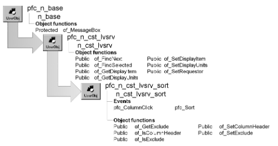

# n_cst_lvsrv_sort

**Description**

ListView sort service. ListView sorting applies to detail view only.

**Ancestry**



**Library**

- PFCAPSRV.PBL
- PFEAPSRV.PBL

**Usage**

To use this object:

1. Enable the service by calling the u_lvs of_SetSort function:

   ```
   lv_1.of_SetSort(TRUE)
   ```

2. Specify whether to enable column header sorting by calling the of_SetColumnHeader function:

   ```
   lv_1.inv_sort.of_SetColumnHeader(TRUE)
   ```

3. (Optional) Specify columns to exclude from sorting by calling the of_SetExclude function:

   ```
   String  ls_exclude[ ]

   ls_exclude[1] = "emp_phone_number"
   lv_1.inv_sort.of_SetExclude(ls_exclude)
   ```

**See also**

- [n_cst_lvsrv_datasource](n_cst_lvsrv_datasource.md)
- [u_lvs](../06-standard-visual-user-objects/u_lvs.md)

## Instance variables

N_cst_lvsrv_sort includes instance variables:

| Instance variable | Description | Data type | Access | Usage |
| --- | --- | --- | --- | --- |
| ib_columnheadersort | Indicates whether column header sort is enabled | Boolean | Protected | Set with of_SetColumnHeader |
| ie_currentsort | Specifies current sort type | GRSortType | Protected | Internal |
| ii_currentsortcol | Specifies current sort column | Integer | Protected | Internal |
| is_excludecolumns[ ] | Columns for which sorting is disabled | String | Protected | Set with of_SetExclude |

## Events

N_cst_lvsrv_sort includes precoded events:

- pfc_ColumnClick
- pfc_Sort

### pfc_ColumnClick

**Description**

Sorts items based on the column whose heading was clicked. If the column was already sorted, this event reverses the sort order.

**Syntax**

```
lvcontrol.instancename.EVENT pfc_ColumnClick ( column )
```

| Argument | Description |
| --- | --- |
| *lvcontrol* | Instance name of the u_lvs-based ListView control |
| *instancename* | Instance name of n_cst_lvsrv_sort (the u_lvs default for this value is inv_sort) |
| *column* | Integer indicating the column that was clicked |

**Return value**

Integer. Returns 1 if the event succeeds, 0 if no action is taken, and -1 if an error occurs.

**Usage**

This event executes when the user clicks a column heading in detail view.

**Examples**

This example is from the u_lvs ColumnClick event:

```
...
If isvalid(inv_sort) then
       inv_sort.event pfc_columnclick(column)
End If
...
```

### pfc_Sort

**Description**

Performs the sort comparison on the column whose heading was clicked.

**Syntax**

```
lvcontrol.instancename.EVENT pfc_Sort ( index1, index2, column )
```

| Argument | Description |
| --- | --- |
| *lvcontrol* | Instance name of the u_lvs-based ListView control |
| *instancename* | Instance name of n_cst_lvsrv_sort (the u_lvs default for this value is inv_sort) |
| *index1* | Integer specifying the index of the first item being compared |
| *index2* | Integer specifying the index of the second item being compared |
| *column* | Integer specifying the number of the column containing the items to be sorted |

**Return value**

Integer. Returns 1 if *index1* is greater than *index2*, 0 if they are equal, and -1 if *index1* is less than *index2*.

**Usage**

The u_lvs Sort event calls this event.

**Examples**

This example is from the u_lvs Sort event:

```
Integer  li_rc

If isvalid(inv_sort) then
       li_rc = inv_sort.event pfc_sort(index1,  &
      index2, column)
End If
Return li_rc
```

## Functions

N_cst_lvsrv_sort includes precoded functions:

- of_GetExclude
- of_IsColumnHeader
- of_IsExclude
- of_SetColumnHeader
- of_SetExclude

### of_GetExclude

**Description**

Retrieves the list of excluded columns.

**Access**

Public

**Syntax**

```
lvcontrol.instancename.of_GetExclude ( columns )
```

| Argument | Description |
| --- | --- |
| *lvcontrol* | Instance name of the u_lvs-based ListView control |
| *instancename* | Instance name of n_cst_lvsrv_sort (the u_lvs default for this value is inv_sort) |
| *columns* | String array into which the function places the list of excluded columns (passed by reference) |

**Return value**

Integer. Returns the number of elements in the *columns* array if the function succeeds and -1 if an error occurs.

**Examples**

This example calls the of_GetExclude function:

```
String  ls_cols[ ]
Integer  li_count, li_return

lb_1.Reset()
li_return = lv_1.inv_sort.of_GetExclude(ls_cols)
FOR li_count = 1 to li_return
   lb_1.AddItem(ls_cols[li_count])
NEXT
```

### of_IsColumnHeader

**Description**

Reports whether column header sorting is enabled.

**Access**

Public

**Syntax**

```
lvcontrol.instancename.of_IsColumnHeader ( )
```

| Argument | Description |
| --- | --- |
| *lvcontrol* | Instance name of the u_lvs-based ListView control |
| *instancename* | Instance name of n_cst_lvsrv_sort (the u_lvs default for this value is inv_sort) |

**Return value**

Boolean. Returns TRUE if column header sorting is enabled and FALSE if it is not.

**Examples**

This example calls the of_IsColumnHeader function:

```
IF lv_1.inv_sort.of_IsColumnHeader() THEN
       MessageBox("ListView", "Sorting enabled")
ELSE
       MessageBox("ListView", "Sorting disabled")
END IF
```

### of_IsExclude

**Description**

Reports whether a column is eligible for sorting.

**Access**

Public

**Syntax**

```
lvcontrol.instancename.of_IsExclude ( column )
```

| Argument | Description |
| --- | --- |
| *lvcontrol* | Instance name of the u_lvs-based ListView control |
| *instancename* | Instance name of n_cst_lvsrv_sort (the u_lvs default for this value is inv_sort) |
| *column* | Integer specifying the column number or string specifying the column name |

**Return value**

Boolean. Returns TRUE if *column* is excluded and FALSE if it is included.

**Examples**

This example calls the of_IsExclude function:

```
IF lv_1.inv_sort.of_IsExclude("emp_fname") THEN
       MessageBox("ListView", "Excluded")
ELSE
       MessageBox("ListView", "Included")
END IF
```

### of_SetColumnHeader

**Description**

Enables or disables column header sorting.

**Access**

Public

**Syntax**

```
lvcontrol.instancename.of_SetColumnHeader ( boolean )
```

| Argument | Description |
| --- | --- |
| *lvcontrol* | Instance name of the u_lvs-based ListView control |
| *instancename* | Instance name of n_cst_lvsrv_sort (the u_lvs default for this value is inv_sort) |
| *boolean* | Boolean specifying whether to enable (TRUE) or disable (FALSE) column header sorting |

**Return value**

Integer. Returns 1 if the function succeeds and -1 if an error occurs.

**Examples**

This example calls the of_SetColumnHeader function:

```
this.of_SetSort(TRUE)
this.inv_sort.of_SetColumnHeader(TRUE)
```

### of_SetExclude

**Description**

Specifies columns to be excluded from sorting.

**Access**

Public

**Syntax**

```
lvcontrol.instancename.of_SetExclude ( columns )
```

| Argument | Description |
| --- | --- |
| *lvcontrol* | Instance name of the u_lvs-based ListView control |
| *instancename* | Instance name of n_cst_lvsrv_sort (the u_lvs default for this value is inv_sort) |
| *columns* | String array containing columns to be excluded from sorting |

**Return value**

Integer. Returns 1 if the function succeeds and -1 if an error occurs.

**Examples**

This example calls the of_SetExclude function:

```
String  ls_exclude[ ]
this.of_SetSort(TRUE)
this.inv_sort.of_SetColumnHeader(TRUE)
ls_exclude[1] = "emp_phone_number"
this.inv_sort.of_SetExclude(ls_exclude)
```
