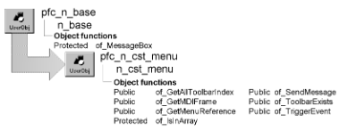

# n_cst_menu

**Description**

Menu service object. The m_master of_SendMessage function, the preference service, and the w_toolbars dialog box use n_cst_menu functions to access menu and frame information.

**Ancestry**



**Library**

- PFCWNSRV.PBL
- PFEWNSRV.PBL

**Usage**

To use this object:

1. Declare a variable of type n_cst_menu. Because PFC defines this object with the autoinstantiate option, you don’t need to code CREATE or DESTROY statements:

   ```
   n_cst_menu  lnv_menu
   ```

2. Call n_cst_menu functions as needed (this example is from the m_master of_SendMessage function):

   ```
   ...
   li_rc = lnv_menu.of_GetMDIframe(this, lw_frame)
   IF NOT IsNull (lw_frame) AND &
          IsValid(lw_frame) THEN
      lb_frameexists = TRUE
   END IF
   ...
   ```

**See also**

- [m_master](../03-menus/m_master.md)
- [n_cst_winsrv_preference](n_cst_winsrv_preference.md)

## Functions

N_cst_menu contains object functions:

- of_GetAllToolbarIndex
- of_GetMDIFrame
- of_GetMenuReference
- of_IsInArray
- of_SendMessage
- of_ToolbarExists
- of_TriggerEvent

### of_GetAllToolbarIndex

**Description**

Retrieves an array containing all unique toolbar item index values.

**Access**

Public

**Syntax**

```
instancename.of_GetAllToolbarIndex ( menu, index )
```

| Argument | Description |
| --- | --- |
| *instancename* | Instance name of n_cst_menu |
| *menu* | Menu variable containing the menu whose toolbar index is returned |
| *index* | Integer array into which the function places all unique ToolbarItemBarIndex values (passed by reference) |

**Return value**

Integer. Returns the size of the *index* array if the function succeeds and -1 if an error occurs.

**Examples**

This example calls the of_GetAllToolbarIndex function:

```
...
IF lnv_menu.of_GetAllToolbarIndex  &
       (iw_requestor.MenuId, li_barindexarray) < 0 THEN
       Return -1
END IF
...
```

### of_GetMDIFrame

**Description**

Retrieves the MDI frame window.

**Access**

Public

**Syntax**

```
instancename.of_GetMDIFrame ( menu, frame )
```

| Argument | Description |
| --- | --- |
| *instancename* | Instance name of n_cst_menu |
| *menu* | Menu variable containing the menu for which to find the MDI frame |
| *frame* | Window variable into which the function places the frame window (passed by reference) |

**Return value**

Integer. Returns 1 if the function succeeds and -1 if an error occurs.

**Examples**

This example calls the of_GetMDIFrame function:

```
Integer  li_rc
Window   lw_obj
n_cst_menu  lnv_menu

lnv_menu.of_GetMDIFrame(iw_requestor.MenuID, lw_obj)
IF IsValid(lw_obj) THEN
       lw_obj.SetRedraw(FALSE)
ELSE
       iw_requestor.SetRedraw(False)
END IF
...
```

### of_GetMenuReference

**Description**

Retrieves a reference to the specified menu item.

**Access**

Public

**Syntax**

```
instancename.of_GetMenuReference ( menu, itemname, itemref )
```

| Argument | Description |
| --- | --- |
| *instancename* | Instance name of n_cst_menu |
| *menu* | Menu variable containing the menu for which to retrieve the menu item reference |
| *itemname* | String specifying the menu item name |
| *itemref* | Menu variable into which the function places a reference to the menu item (passed by reference) |

**Return value**

Integer. Returns 1 if the function succeeds, 0 if *itemname* is not found, and -1 if an error occurs.

**Usage**

Use the retrieved reference to control menu item properties.

**Examples**

This example calls the of_GetMenuReference function:

```
n_cst_menu  lnv_menu
Menu  lm_item, lm_menu

lm_menu = parent.MenuID
lnv_menu.of_GetMenuReference  &
   (lm_menu, "m_save", lm_item)
lm_item.Enabled = FALSE
```

### of_IsInArray

**Description**

Reports whether the specified ToolbarItemBarIndex is in the array.

**Access**

Protected

**Syntax**

```
instancename.of_IsInArray ( array, index )
```

| Argument | Description |
| --- | --- |
| *instancename* | Instance name of n_cst_menu |
| *array* | Integer array containing currently stored ToolbarItemBarIndex numbers |
| *index* | Integer specifying the ToolbarItemBarIndex to be tested |

**Return value**

Boolean. Returns TRUE if *index* is in *array* and FALSE if it is not.

**Usage**

Internal.

**Examples**

This example is from the of_GetAllToolbarIndex function.

```
...
IF Len(am_source.toolbaritemname) > 0 THEN
       IF NOT of_IsInArray(ai_barindex, &
          am_source.ToolbarItemBarIndex) THEN
        ai_barindex[UpperBound(ai_barindex)+1] &
          = am_source.ToolbarItemBarIndex
       END IF
END IF
...
```

### of_SendMessage

**Description**

Sends the passed message to the current window through the pfc_MessageRouter event.

**Access**

Public

**Syntax**

```
instancename.of_SendMessage ( message )
```

| Argument | Description |
| --- | --- |
| *instancename* | Instance name of n_cst_menu |
| *message* | String specifying the user event to be triggered by the pfc_MessageRouter event |

**Return value**

Integer. Returns 1 if the function succeeds and -1 if an error occurs.

**Usage**

PFC menu items call this function to trigger events on the associated window and window controls.

**Examples**

This example calls the of_SendMessage function:

```
n_cst_menu  lnv_menu
lnv_menu.of_SendMessage("pfc_Open")
```

### of_ToolbarExists

**Description**

Reports whether the passed menu has a toolbar.

**Access**

Public

**Syntax**

```
instancename.of_ToolbarExists ( menu )
```

| Argument | Description |
| --- | --- |
| *instancename* | Instance name of n_cst_menu |
| *menu* | Menu variable containing the menu to be tested for the existence of a toolbar |

**Return value**

Boolean. Returns TRUE if *menu* has a toolbar and FALSE if it does not.

**Examples**

This example is from the n_cst_preference of_Save function:

```
...
IF NOT lnv_menu.of_ToolBarExists &
       (iw_requestor.MenuId) THEN
       Return 1
END IF
...
```

### of_TriggerEvent

**Description**

Triggers the specified user event on the sheet associated with the passed menu.

**Access**

Public

**Syntax**

```
instancename.of_TriggerEvent ( menu, event )
```

| Argument | Description |
| --- | --- |
| *instancename* | Instance name of n_cst_menu |
| *menu* | Menu variable containing the menu for which to trigger the event |
| *event* | String specifying the user event to trigger |

**Return value**

Integer. Returns 1 if the function succeeds and -1 if *event* does not exist has or no script.

**Examples**

This example calls the of_TriggerEvent function:

```
n_cst_menu  lnv_menu
Integer     li_return

li_return = lnv_menu.of_TriggerEvent &
       (parent.menuid, "ue_options")
IF li_return = -1 THEN
       MessageBox("Menu", "Options not enabled")
END IF
```
