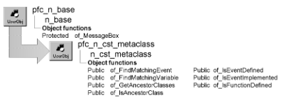

# n_cst_metaclass

**Description**

Metaclass service. This object contains functions that provide information on the functions, events, and variables defined within another object.

**Ancestry**



**Library**

- PFCAPSRV.PBL
- PFEAPSRV.PBL

**Usage**

To use this object:

1. Create a variable of type n_cst_metaclass.

   Because PFC defines this object with the autoinstantiate option, there is no need to code CREATE or DESTROY statements.

2. Call n_cst_metaclass functions as needed:

   ```
   boolean  lb_ancestor
   n_cst_metaclass  lnv_metaclass
   n_cst_conversion  lnv_conversion
   classdefinition  lcd_obj

   lcd_obj = findClassDefinition ("w_sheet")
   lb_ancestor = lnv_metaclass.of_isAncestorClass  &
      (lcd_obj, "pfc_w_master")
   if isNull (lb_ancestor) then
      messagebox ("MetaClass", "class not found")
   else
      messagebox ("MetaClass",  &
      lnv_conversion.of_string (lb_ancestor))
   end if
   ```

**See also**

n_cst_luw

## Instance variables

N_cst_metaclass includes instance variables:

| Instance variable | Description | Data type | Access |
| --- | --- | --- | --- |
| ib_NotifyObsolete |  | Boolean | Protected |
| ib_skip_system |  | Boolean | Protected |
| is_ObsoleteTag |  | String | Protected |

## Functions

N_cst_metaclass includes precoded functions:

- of_FindMatchingEvent
- of_FindMatchingVariable
- of_GetAncestorClasses
- of_getargumentvariables
- of_getclassdefinition
- of_getevents
- of_getfunctions
- of_getglobalvariables
- of_getinitialvalue
- of_getinstancevariables
- of_getlocalvariables
- of_getnestedclasses
- of_getnestednonvisual
- of_getnestedstructure
- of_getObsoletetag
- of_getoverview
- of_getscripts
- of_getsharedvariables
- of_getvariables
- of_IsAncestorClass
- of_IsEventDefined
- of_IsEventImplemented
- of_IsFunctionDefined
- of_isnotifyObsoleteenabled
- of_isObsolete
- of_isskipsystemmodeenabled
- of_issystemdefined
- of_isystsemdefined
- of_setnotifyObsolete
- of_setObsoletetag
- of_setskipsystemmode

### of_FindMatchingEvent

**Description**

Retrieves the script definition for a given object and event.

**Access**

Public

**Syntax**

```
instancename.of_FindMatchingEvent ( object, event )
```

| Argument | Description |
| --- | --- |
| *instancename* | Instance name of n_cst_metaclass |
| *object* | ClassDefinition specifying the object containing *event* |
| *event* | String specifying the event name |

**Return value**

ScriptDefinition. Returns the script definition if the function succeeds and NULL if *event* cannot be found.

**Examples**

This example calls the of_FindMatchingEvent function:

```
classdefinition  lcd_object
scriptdefinition  lscrd_object
n_cst_metaclass  lnv_metaclass

lcd_object = findClassDefinition ("pfc_u_dw")
lscrd_object = lnv_metaclass.of_findMatchingEvent  &
   (lcd_object, "pfc_update")
if isNull (lscrd_object) or not isValid  &
   (lscrd_object) then
  messagebox ("MetaClass",  &
    "Bad class or can’t find event definition")
else
   messagebox ("MetaClass", lscrd_object.name)
end if
```

### of_FindMatchingVariable

**Description**

Retrieves the variable definition for a given object or script and variable.

**Access**

Public

**Syntax**

```
instancename.of_FindMatchingVariable ( classorscript, variable )
```

| Argument | Description |
| --- | --- |
| *instancename* | Instance name of n_cst_metaclass |
| *classorscript* | ClassDefinition of the object containing *variable* or ScriptDefinition of the script containing *variable* |
| *variable* | String specifying the variable name |

**Return value**

VariableDefinition. Returns the variable definition if the function succeeds and NULL if an error occurs.

**Usage**

If you specify a ScriptDefinition as the first argument, the function looks for *variable* in both local variables and arguments.

**Examples**

This example calls the of_FindMatchingVariable function:

```
string  ls_argtype[ ]
classdefinition  lcd_object
variabledefinition  lvrd_object
scriptdefinition  lscrd_object
n_cst_metaclass  lnv_metaclass

lcd_object = findClassDefinition("pfc_u_dw")
ls_argtype[1] = "Boolean"
ls_argtype[2] = "Boolean"
lscrd_object = lcd_object.findMatchingFunction  &
   ("of_Update", ls_argtype[ ])
if isNull (lscrd_object) or not isValid  &
   (lscrd_object) then
  messagebox ("", "can’t find script definition")
end if
lvrd_object = lnv_metaclass.of_findMatchingVariable &
   (lscrd_object, "li_rc")
if not isValid (lvrd_object) or  &
  isNull (lvrd_object) then
  messagebox ("MetaClass",  &
   "scriptdefinition not valid or var not found")
else
   messagebox ("MetaClass", lvrd_object.name)
end if
```

### of_GetAncestorClasses

**Description**

Retrieves all ancestor classes for a specified class.

**Access**

Public

**Syntax**

```
instancename.of_GetAncestorClasses ( sourceclass, ancestorclass )
```

| Argument | Description |
| --- | --- |
| *instancename* | Instance name of n_cst_metaclass |
| *sourceclass* | String or ClassDefinition specifying the class for which to retrieve ancestor classes |
| *ancestorclass* | ClassDefinition array into which the function places references to ancestor classes (passed by reference) |

**Return value**

Integer. Returns the number of elements in the *ancestorclass* array if the function succeeds and -1 if an error occurs.

**Usage**

The elements in *ancestorclass* are ordered in ascending order (that is, element 1 contains the immediate ancestor and the upperbound contains the highest level ancestor).

**Examples**

This example calls the of_GetAncestorClasses function:

```
n_cst_metaclass  lnv_metaclass
classdefinition  lcd_ancestor[ ]
integer  li_ubound, li_cnt

lnv_metaclass.of_GetAncestorClasses  &
   ("w_sheet", lcd_ancestor[ ])
li_ubound = UpperBound (lcd_ancestor[ ])
lb_1.reset()
for li_cnt = 1 to li_ubound
   lb_1.addItem (lcd_ancestor[li_cnt].name)
next
```

### of_getargumentvariables

**Description**

Extract the argument variables list from the specified classname and correspondiing to the specified VarAccess, into specified result's variabless list, in append mode or not.

**Syntax 1**

Access: Public

**Syntax**

```
instancename.of_getargumentvariables ( acd_class, ava_access, as_varslist, ab_append )
```

| Argument | Description |
| --- | --- |
| *instancename* | Instance name of n_cst_metaclass |
| *acd_class* | ClassDefinition. The classdefinition from wich will be extracted the variable list. |
| *ava_access* | Varaccess. The access level of the variable to be found, expressed using the VarAccess Enumerated values. For more information, see PowerBuilder's documentation. as_variableslist[]: The array of string that will stant as result list. |
| *as_varslist* | String array, passed by reference. |
| *ab_append* | Boolean. Wether the variables found will be or not append to as_variableslist. |

**Return value**

Integer. The number of entries found, or -1, if an error occurs.

**Syntax 2**

Extract the argument variables list from the specified classname and correspondiing to the specified VarAccess, into specified result's variabless list.

Access: Public

**Syntax**

```
instancename.of_getargumentvariables ( acd_class, ava_access, as_varslist )
```

| Argument | Description |
| --- | --- |
| *instancename* | Instance name of n_cst_metaclass |
| *acd_class* | ClassDefinition. The classdefinition from wich will be extracted the variable list. |
| *ava_access* | Varaccess. The access level of the variable to be found, expressed using the VarAccess Enumerated values. For more information, see PowerBuilder's documentation. as_variableslist[]: The array of string that will stant as result list. |
| *as_varslist* | String array, passed by reference. |

**Return value**

Integer. The number of entries found, or -1, if an error occurs.

**Syntax 3**

Extract all the argument variables list from the specified classname into specified result's variabless list, in append mode or not.

Access: Public

**Syntax**

```
instancename.of_getargumentvariables ( acd_class, as_varslist, ab_append )
```

| Argument | Description |
| --- | --- |
| *instancename* | Instance name of n_cst_metaclass |
| *acd_class* | ClassDefinition. The classdefinition from wich will be extracted the variable list as_variableslist[]: The array of string that will stant as result list. |
| *as_varslist* | String array, passed by reference. |
| *ab_append* | Boolean. Wether the variables found will be or not append to as_variableslist. |

**Return value**

Integer. The number of entries found, or -1, if an error occurs.

**Syntax 4**

Extract all the argument variables list from the specified classname into specified result's variabless list.

Access: Public

**Syntax**

```
instancename.of_getargumentvariables ( acd_class, as_varslist )
```

| Argument | Description |
| --- | --- |
| *instancename* | Instance name of n_cst_metaclass |
| *acd_class* | ClassDefinition. The classdefinition from wich will be extracted the variable list as_variableslist[]: The array of string that will stant as result. |
| *as_varslist* | String array, passed by reference. |

**Return value**

Integer. The number of entries found, or -1, if an error occurs.

**Usage**

Call this method to extract argument variables from a specified classname Call this method to extract argument variables from a specified classname Call this method to extract argument variables from a specified classname Call this method to extract argument variables from a specified classname.

### of_getclassdefinition

**Description**

Get the classdefinition of the specified class extracted from the specified library list.

**Syntax 1**

Access: Public

**Syntax**

```
instancename.of_getclassdefinition ( as_classname, as_librarylist )
```

| Argument | Description |
| --- | --- |
| *instancename* | Instance name of n_cst_metaclass |
| *as_classname* | String. The name of the class to get its classdefinition as_librarylist[]: The library list from where to extract the classdefinition. |
| *as_librarylist* | String array. |

**Return value**

ClassDefinition. The classdefinition of the specified class, or NULL, if an error occurs.

**Syntax 2**

Get the classdefinition of the specified class extracted from the actual application's library list.

Access: Public

**Syntax**

```
instancename.of_getclassdefinition ( as_classname )
```

| Argument | Description |
| --- | --- |
| *instancename* | Instance name of n_cst_metaclass |
| *as_classname* | String. The name of the class to get its classdefinition. |

**Return value**

ClassDefinition. The classdefinition of the specified class, or NULL, if an error occurs.

**Usage**

Call this method to get the classdefinition of a class Call this method to get the classdefinition of a class.

### of_getevents

**Description**

Get all event of the specified classname extracted from the passed librarylist and store into result's event list in append mode or not.

**Syntax 1**

Access: Public

**Syntax**

```
instancename.of_getevents ( as_classname, as_librarylist, as_eventslist, ab_append )
```

| Argument | Description |
| --- | --- |
| *instancename* | Instance name of n_cst_metaclass |
| *as_classname* | String. will be searched as_eventslist[]: The string array that will stand as events result list. |
| *as_librarylist* | String array. |
| *as_eventslist* | String array, passed by reference. |
| *ab_append* | Boolean. Wether the result list will be append or not. |

**Return value**

Integer. The number of entries found, or -1, if an error occurs.

**Syntax 2**

Get all event of the specified classname extracted from actual application's librarylist and store into result's event list.

Access: Public

**Syntax**

```
instancename.of_getevents ( as_classname, as_librarylist, as_eventslist )
```

| Argument | Description |
| --- | --- |
| *instancename* | Instance name of n_cst_metaclass |
| *as_classname* | String. The name of the class to extract it's events list as_eventslist[]: The string array that will stand as events result list. |
| *as_librarylist* | String array. |
| *as_eventslist* | String array, passed by reference. |

**Return value**

Integer. The number of entries found, or -1, if an error occurs.

**Syntax 3**

Get all event of the specified classname extracted from actual application's librarylist and store into result's event list in append mode or not.

Access: Public

**Syntax**

```
instancename.of_getevents ( as_classname, as_eventslist, ab_append )
```

| Argument | Description |
| --- | --- |
| *instancename* | Instance name of n_cst_metaclass |
| *as_classname* | String. The name of the class to extract it's events list as_eventslist[]: The string array that will stand as events result list. |
| *as_eventslist* | String array, passed by reference. |
| *ab_append* | Boolean. Wether the result list will be append or not. |

**Return value**

Integer. The number of entries found, or -1, if an error occurs.

**Syntax 4**

Get all event of the specified classname extracted from actual application's librarylist and store into result's event list.

Access: Public

**Syntax**

```
instancename.of_getevents ( as_classname, as_eventslist )
```

| Argument | Description |
| --- | --- |
| *instancename* | Instance name of n_cst_metaclass |
| *as_classname* | String. The name of the class to extract it's events list as_eventslist[]: The string array that will stand as events result list. |
| *as_eventslist* | String array, passed by reference. |

**Return value**

Integer. The number of entries found, or -1, if an error occurs.

**Syntax 5**

Get all event of the specified classdefinition extracted and store into result's event list in append mode or not.

Access: Public

**Syntax**

```
instancename.of_getevents ( acd_class, as_eventslist, ab_append )
```

| Argument | Description |
| --- | --- |
| *instancename* | Instance name of n_cst_metaclass |
| *acd_class* | ClassDefinition. The classdefinition of the class to extract it's events list as_eventslist[]: The string array that will stand as events result list. |
| *as_eventslist* | String array, passed by reference. |
| *ab_append* | Boolean. Wether the result list will be append or not. |

**Return value**

Integer. The number of entries found, or -1, if an error occurs.

**Syntax 6**

Get all events of the specified classdefinitiond from and store into result's event list.

Access: Public

**Syntax**

```
instancename.of_getevents ( acd_class, as_eventslist )
```

| Argument | Description |
| --- | --- |
| *instancename* | Instance name of n_cst_metaclass |
| *acd_class* | ClassDefinition. The classdefinition of the class to extract it's events list. |
| *as_eventslist* | String array, passed by reference. The array of string that will stad as result list. |

**Return value**

Integer. The number of entries found, or -1, if an error occurs.

**Usage**

Call this method to ger all events of a specified clasname Call this method to ger all events of a specified clasname Call this method to ger all events of a specified clasname Call this method to ger all events of a specified clasname Call this method to ger all events of a specified classdefinition Call this method to ger all events of a specified classdefinition.

### of_getfunctions

**Description**

Get all functions of the specified classname extracted from the passed librarylist and corresponding to the specified Access Level, and store them into the passed result's event list in append mode or not.

**Syntax 1**

Access: Public

**Syntax**

```
instancename.of_getfunctions ( as_classname, as_librarylist, ava_access, as_functionslist, ab_append )
```

| Argument | Description |
| --- | --- |
| *instancename* | Instance name of n_cst_metaclass |
| *as_classname* | String. will be searched. |
| *as_librarylist* | String array. |
| *ava_access* | Varaccess. The AccessLevel of the functions to be found, expressed using the VarAccess enumerated values. For more informations read the Powerbuilder's Documentation. as_functionslist[]: The string array that will stand as functions result list. |
| *as_functionslist* | String array, passed by reference. |
| *ab_append* | Boolean. Wether the result list will be append or not. |

**Return value**

Integer. The number of entries found, or -1, if an error occurs.

**Syntax 2**

Get all functions of the specified classname extracted from the actual application's librarylist and corresponding to the specified Access Level, and store them into the passed result's event list in append mode or not.

Access: Public

**Syntax**

```
instancename.of_getfunctions ( as_classname, ava_access, as_functionslist, ab_append )
```

| Argument | Description |
| --- | --- |
| *instancename* | Instance name of n_cst_metaclass |
| *as_classname* | String. The name of the class to extract it's functions list. |
| *ava_access* | Varaccess. The AccessLevel of the functions to be found, expressed using the VarAccess enumerated values. For more informations read the Powerbuilder's Documentation. as_functionslist[]: The string array that will stand as functions result list. |
| *as_functionslist* | String array, passed by reference. |
| *ab_append* | Boolean. Wether the result list will be append or not. |

**Return value**

Integer. The number of entries found, or -1, if an error occurs.

**Syntax 3**

Get all functions of the specified classname extracted from the actual application's librarylist and corresponding to the specified Access Level, and store them into the passed result's event list.

Access: Public

**Syntax**

```
instancename.of_getfunctions ( as_classname, ava_access, as_functionslist )
```

| Argument | Description |
| --- | --- |
| *instancename* | Instance name of n_cst_metaclass |
| *as_classname* | String. The name of the class to extract it's functions list. |
| *ava_access* | Varaccess. The AccessLevel of the functions to be found, expressed using the VarAccess enumerated values. For more informations read the Powerbuilder's Documentation. as_functionslist[]: The string array that will stand as functions result list. |
| *as_functionslist* | String array, passed by reference. |

**Return value**

Integer. The number of entries found, or -1, if an error occurs.

**Syntax 4**

Get all functions of the specified classname extracted from the passed librarylist and corresponding to the specified Access Level, and store them into the passed result's event list.

Access: Public

**Syntax**

```
instancename.of_getfunctions ( as_classname, as_librarylist, ava_access, as_functionslist )
```

| Argument | Description |
| --- | --- |
| *instancename* | Instance name of n_cst_metaclass |
| *as_classname* | String. will be searched. |
| *as_librarylist* | String array. |
| *ava_access* | Varaccess. The AccessLevel of the functions to be found, expressed using the VarAccess enumerated values. For more informations read the Powerbuilder's Documentation. as_functionslist[]: The string array that will stand as functions result list. |
| *as_functionslist* | String array, passed by reference. |

**Return value**

Integer. The number of entries found, or -1, if an error occurs.

**Syntax 5**

Get all Public functions of the specified classname extracted from the passed librarylist and store them into the passed result's event list.

Access: Public

**Syntax**

```
instancename.of_getfunctions ( as_classname, as_librarylist, as_functionslist )
```

| Argument | Description |
| --- | --- |
| *instancename* | Instance name of n_cst_metaclass |
| *as_classname* | String. will be searched as_functionslist[]: The string array that will stand as functions result list. |
| *as_librarylist* | String array. |
| *as_functionslist* | String array, passed by reference. |

**Return value**

Integer. The number of entries found, or -1, if an error occurs.

**Syntax 6**

Get all Public functions of the specified classname extracted from the passed librarylist and store them into the passed result's event list in append mode or not.

Access: Public

**Syntax**

```
instancename.of_getfunctions ( as_classname, as_librarylist, as_functionslist, ab_append )
```

| Argument | Description |
| --- | --- |
| *instancename* | Instance name of n_cst_metaclass |
| *as_classname* | String. will be searched as_functionslist[]: The string array that will stand as functions result list. |
| *as_librarylist* | String array. |
| *as_functionslist* | String array, passed by reference. |
| *ab_append* | Boolean. Wether the result list will be append or not. |

**Return value**

Integer. The number of entries found, or -1, if an error occurs.

**Syntax 7**

Get all Public functions of the specified classname extracted from the actual application's librarylist and store them into the passed result's event list.

Access: Public

**Syntax**

```
instancename.of_getfunctions ( as_classname, as_functionslist )
```

| Argument | Description |
| --- | --- |
| *instancename* | Instance name of n_cst_metaclass |
| *as_classname* | String. The name of the class to extract it's functions list as_functionslist[]: The string array that will stand as functions result list. |
| *as_functionslist* | String array, passed by reference. |

**Return value**

Integer. The number of entries found, or -1, if an error occurs.

**Syntax 8**

Get all functions of the specified classdefintion and corresponding to the specified Access Level, and store them into the passed result's event list in append mode or not.

Access: Protected

**Syntax**

```
instancename.of_getfunctions ( acd_class, ava_access, as_functionslist, ab_append )
```

| Argument | Description |
| --- | --- |
| *instancename* | Instance name of n_cst_metaclass |
| *acd_class* | ClassDefinition. The clasdefinition of the class to extract it's functions list. |
| *ava_access* | Varaccess. The AccessLevel of the functions to be found, expressed using the VarAccess enumerated values. For more informations read the Powerbuilder's Documentation. as_functionslist[]: The string array that will stand as functions result list. |
| *as_functionslist* | String array, passed by reference. |
| *ab_append* | Boolean. Wether the result list will be append or not. |

**Return value**

Integer. The number of entries found, or -1, if an error occurs.

**Syntax 9**

Get all functions of the specified classname extracted from the actual application's librarylist and corresponding to the specified Access Level, and store them into the passed result's event list.

Access: Public

**Syntax**

```
instancename.of_getfunctions ( acd_class, ava_access, as_functionslist )
```

| Argument | Description |
| --- | --- |
| *instancename* | Instance name of n_cst_metaclass |
| *acd_class* | ClassDefinition. The classdefinition of the class to extract it's functions list. |
| *ava_access* | Varaccess. The AccessLevel of the functions to be found, expressed using the VarAccess enumerated values. For more informations read the Powerbuilder's Documentation. as_functionslist[]: The string array that will stand as functions result list. |
| *as_functionslist* | String array, passed by reference. |

**Return value**

Integer. The number of entries found, or -1, if an error occurs.

**Syntax 10**

Get all Public functions of the specified classname extracted from the actual application's librarylist and store them into the passed result's event list.

Access: Public

**Syntax**

```
instancename.of_getfunctions ( acd_class, as_functionslist )
```

| Argument | Description |
| --- | --- |
| *instancename* | Instance name of n_cst_metaclass |
| *acd_class* | ClassDefinition. The classdefinition of the class to extract it's functions list as_functionslist[]: The string array that will stand as functions result list. |
| *as_functionslist* | String array, passed by reference. |

**Return value**

Integer. The number of entries found, or -1, if an error occurs.

**Usage**

Call this method to ger all functions of a specified clasname Call this method to get all functions of a specified clasname Call this method to get all functions of a specified clasname Call this method to ger all functions of a specified clasname Call this method to get all functions of a specified clasname Call this method to ger all functions of a specified clasname Call this method to get all public functions of a specified clasname Call this method to get all functions of a specified clasname Call this method to get all functions of a specified classdefinition Call this method to get all public functions of a specified classdefinition.

### of_getglobalvariables

**Description**

Extract the global variables list from the specified classname and correspondiing to the specified VarAccess, into specified result's variabless list, in append mode or not.

**Syntax 1**

Access: Public

**Syntax**

```
instancename.of_getglobalvariables ( acd_class, ava_access, as_varslist, ab_append )
```

| Argument | Description |
| --- | --- |
| *instancename* | Instance name of n_cst_metaclass |
| *acd_class* | ClassDefinition. The classdefinition from wich will be extracted the variable list. |
| *ava_access* | Varaccess. The access level of the variable to be found, expressed using the VarAccess Enumerated values. For more information, see PowerBuilder's documentation. as_variableslist[]: The array of string that will stant as result list. |
| *as_varslist* | String array, passed by reference. |
| *ab_append* | Boolean. Wether the variables found will be or not append to as_variableslist. |

**Return value**

Integer. The number of entries found, or -1, if an error occurs.

**Syntax 2**

Extract all the global variables list from the specified classname into specified result's variabless list, in append mode or not.

Access: Public

**Syntax**

```
instancename.of_getglobalvariables ( acd_class, as_varslist, ab_append )
```

| Argument | Description |
| --- | --- |
| *instancename* | Instance name of n_cst_metaclass |
| *acd_class* | ClassDefinition. |
| *as_varslist* | String array, passed by reference. |
| *ab_append* | Boolean. |

**Return value**

Integer. The number of entries found, or -1, if an error occurs.

**Syntax 3**

Extract all the global variables list from the specified classname into specified result's variabless list.

Access: Public

**Syntax**

```
instancename.of_getglobalvariables ( acd_class, as_varslist )
```

| Argument | Description |
| --- | --- |
| *instancename* | Instance name of n_cst_metaclass |
| *acd_class* | ClassDefinition. |
| *as_varslist* | String array, passed by reference. |

**Return value**

Integer. The number of entries found, or -1, if an error occurs.

**Usage**

Call this method to extract global variables from a specified classname Call this method to extract global variables from a specified classname Call this method to extract global variables from a specified classname.

### of_getinitialvalue

**Description**

Return tne initial value of the specified variable name contained in the passed classdefinition.

**Syntax 1**

Access: Public

**Syntax**

```
instancename.of_getinitialvalue ( acd_class, as_varname )
```

| Argument | Description |
| --- | --- |
| *instancename* | Instance name of n_cst_metaclass |
| *acd_class* | ClassDefinition. The class definition of the class containing the variable to get its initial value. |
| *as_varname* | String. The name of the variable to get its initial value contained into acd_class. |

**Return value**

Any. The initial value of the variable, or NULL if an error occurs.

**Syntax 2**

Access: Public

**Syntax**

```
instancename.of_getinitialvalue ( as_classname, as_varname, as_librarylist )
```

| Argument | Description |
| --- | --- |
| *instancename* | Instance name of n_cst_metaclass |
| *as_classname* | String. The name of the class containing the variable to get its initial value. |
| *as_varname* | String. The name of the variable to get its initial value contained into acd_class. |
| *as_librarylist* | String array. The array of string containing the complete library list where to find as_classname. |

**Return value**

Any. The initial value of the variable, or NULL if an error occurs.

**Syntax 3**

Access: Public

**Syntax**

```
instancename.of_getinitialvalue ( as_classname, as_varname )
```

| Argument | Description |
| --- | --- |
| *instancename* | Instance name of n_cst_metaclass |
| *as_classname* | String. The name of the class containing the variable to get its initial value. |
| *as_varname* | String. The name of the variable to get its initial value contained into acd_class. |

**Return value**

Any. The initial value of the variable, or NULL if an error occurs.

**Usage**

Call this method to get the initial value of a variable contained in a specified class. Call this method to get the initial value of a variable contained in a specified class. Call this method to get the initial value of a variable contained in a specified class.

### of_getinstancevariables

**Description**

Extract the instance variables list from the specified classname and correspondiing to the specified VarAccess, into specified result's variabless list, in append mode or not.

**Syntax 1**

Access: Public

**Syntax**

```
instancename.of_getinstancevariables ( acd_class, ava_access, as_varslist, ab_append )
```

| Argument | Description |
| --- | --- |
| *instancename* | Instance name of n_cst_metaclass |
| *acd_class* | ClassDefinition. The classdefinition from wich will be extracted the variable list. |
| *ava_access* | Varaccess. The access level of the variable to be found, expressed using the VarAccess Enumerated values. For more information, see PowerBuilder's documentation. as_variableslist[]: The array of string that will stant as result list. |
| *as_varslist* | String array, passed by reference. |
| *ab_append* | Boolean. Wether the variables found will be or not append to as_variableslist. |

**Return value**

Integer. The number of entries found, or -1, if an error occurs.

**Syntax 2**

Extract all the instance variables list from the specified classname into specified result's variabless list, in append mode or not.

Access: Public

**Syntax**

```
instancename.of_getinstancevariables ( acd_class, as_varslist, ab_append )
```

| Argument | Description |
| --- | --- |
| *instancename* | Instance name of n_cst_metaclass |
| *acd_class* | ClassDefinition. |
| *as_varslist* | String array, passed by reference. |
| *ab_append* | Boolean. |

**Return value**

Integer. The number of entries found, or -1, if an error occurs.

**Syntax 3**

Extract all the instance variables list from the specified classname into specified result's variabless list.

Access: Public

**Syntax**

```
instancename.of_getinstancevariables ( acd_class, as_varslist )
```

| Argument | Description |
| --- | --- |
| *instancename* | Instance name of n_cst_metaclass |
| *acd_class* | ClassDefinition. |
| *as_varslist* | String array, passed by reference. |

**Return value**

Integer. The number of entries found, or -1, if an error occurs.

**Usage**

Call this method to extract instance variables from a specified classname Call this method to extract instance variables from a specified classname Call this method to extract instance variables from a specified classname.

### of_getlocalvariables

**Description**

Extract the local variables list from the specified classname and correspondiing to the specified VarAccess, into specified result's variabless list, in append mode or not.

**Syntax 1**

Access: Public

**Syntax**

```
instancename.of_getlocalvariables ( acd_class, ava_access, as_varslist, ab_append )
```

| Argument | Description |
| --- | --- |
| *instancename* | Instance name of n_cst_metaclass |
| *acd_class* | ClassDefinition. The classdefinition from wich will be extracted the variable list. |
| *ava_access* | Varaccess. The access level of the variable to be found, expressed using the VarAccess Enumerated values. For more information, see PowerBuilder's documentation. as_variableslist[]: The array of string that will stant as result list. |
| *as_varslist* | String array, passed by reference. |
| *ab_append* | Boolean. Wether the variables found will be or not append to as_variableslist. |

**Return value**

Integer. The number of entries found, or -1, if an error occurs.

**Syntax 2**

Extract all the local variables list from the specified classname into specified result's variabless list, in append mode or not.

Access: Public

**Syntax**

```
instancename.of_getlocalvariables ( acd_class, as_varslist, ab_append )
```

| Argument | Description |
| --- | --- |
| *instancename* | Instance name of n_cst_metaclass |
| *acd_class* | ClassDefinition. |
| *as_varslist* | String array, passed by reference. |
| *ab_append* | Boolean. |

**Return value**

Integer. The number of entries found, or -1, if an error occurs.

**Syntax 3**

Extract all the local variables list from the specified classname into specified result's variabless list.

Access: Public

**Syntax**

```
instancename.of_getlocalvariables ( acd_class, as_varslist )
```

| Argument | Description |
| --- | --- |
| *instancename* | Instance name of n_cst_metaclass |
| *acd_class* | ClassDefinition. |
| *as_varslist* | String array, passed by reference. |

**Return value**

Integer. The number of entries found, or -1, if an error occurs.

**Usage**

Call this method to extract local variables from a specified classname Call this method to extract local variables from a specified classname Call this method to extract local variables from a specified classname.

### of_getnestedclasses

**Description**

Extract all the nested classes list from the specified classname into specified result's list, in append mode or not.

**Syntax 1**

Access: Public

**Syntax**

```
instancename.of_getnestedclasses ( acd_class, ai_handlingmode, as_classeslist, ab_append )
```

| Argument | Description |
| --- | --- |
| *instancename* | Instance name of n_cst_metaclass |
| *acd_class* | ClassDefinition. |
| *ai_handlingmode* | Integer. |
| *as_classeslist* | String array, passed by reference. |
| *ab_append* | Boolean, read-only. |

**Return value**

Integer. The number of entries found, or -1, if an error occurs.

**Syntax 2**

Extract all the nested classes list from the specified classname into specified result's list.

Access: Public

**Syntax**

```
instancename.of_getnestedclasses ( acd_class, ai_handlingmode, as_classeslist )
```

| Argument | Description |
| --- | --- |
| *instancename* | Instance name of n_cst_metaclass |
| *acd_class* | ClassDefinition. |
| *ai_handlingmode* | Integer. |
| *as_classeslist* | String array, passed by reference. |

**Return value**

Integer. The number of entries found, or -1, if an error occurs.

**Syntax 3**

Extract all the nested classes list from the specified classname into specified result's list.

Access: Public

**Syntax**

```
instancename.of_getnestedclasses ( acd_class, as_classeslist )
```

| Argument | Description |
| --- | --- |
| *instancename* | Instance name of n_cst_metaclass |
| *acd_class* | ClassDefinition. |
| *as_classeslist* | String array, passed by reference. |

**Return value**

Integer. The number of entries found, or -1, if an error occurs.

**Syntax 4**

Access: Public

**Syntax**

```
instancename.of_getnestedclasses ( acd_class, as_classeslist, ab_append )
```

| Argument | Description |
| --- | --- |
| *instancename* | Instance name of n_cst_metaclass |
| *acd_class* | ClassDefinition. |
| *as_classeslist* | String array, passed by reference. |
| *ab_append* | Boolean. |

**Return value**

Integer. The number of entries found, or -1, if an error occurs.

**Usage**

Call this method to extract nesteed classes from a specified classname Call this method to extract nesteed classes from a specified classname Call this method to extract nesteed classes from a specified classname Call this method to extract nesteed classes from a specified classname.

### of_getnestednonvisual

**Description**

Extract all the nested non visual classes list from the specified classname into specified result's list, in append mode or not.

**Syntax 1**

Access: Public

**Syntax**

```
instancename.of_getnestednonvisual ( acd_class, as_classeslist, ab_append )
```

| Argument | Description |
| --- | --- |
| *instancename* | Instance name of n_cst_metaclass |
| *acd_class* | ClassDefinition. |
| *as_classeslist* | String array, passed by reference. |
| *ab_append* | Boolean. |

**Return value**

Integer. The number of entries found, or -1, if an error occurs.

**Syntax 2**

Access: Public

**Syntax**

```
instancename.of_getnestednonvisual ( acd_class, as_classeslist )
```

| Argument | Description |
| --- | --- |
| *instancename* | Instance name of n_cst_metaclass |
| *acd_class* | ClassDefinition. |
| *as_classeslist* | String array, passed by reference. |

**Return value**

Integer. The number of entries found, or -1, if an error occurs.

**Syntax 3**

Access: Public

**Syntax**

```
instancename.of_getnestednonvisual ( as_classname, as_librarylist, as_classeslist, ab_append )
```

| Argument | Description |
| --- | --- |
| *instancename* | Instance name of n_cst_metaclass |
| *as_classname* | String. |
| *as_librarylist* | String array. |
| *as_classeslist* | String array, passed by reference. |
| *ab_append* | Boolean. |

**Return value**

Integer. The number of entries found, or -1, if an error occurs.

**Syntax 4**

Access: Public

**Syntax**

```
instancename.of_getnestednonvisual ( as_classname, as_classeslist, ab_append )
```

| Argument | Description |
| --- | --- |
| *instancename* | Instance name of n_cst_metaclass |
| *as_classname* | String. |
| *as_classeslist* | String array, passed by reference. |
| *ab_append* | Boolean. |

**Return value**

Integer. The number of entries found, or -1, if an error occurs.

**Syntax 5**

Access: Public

**Syntax**

```
instancename.of_getnestednonvisual ( as_classname, as_classeslist )
```

| Argument | Description |
| --- | --- |
| *instancename* | Instance name of n_cst_metaclass |
| *as_classname* | String. |
| *as_classeslist* | String array, passed by reference. |

**Return value**

Integer. The number of entries found, or -1, if an error occurs.

**Usage**

Call this method to extract nesteed nonv visual classes from a specified classname Call this method to extract nesteed nonv visual classes from a specified classname Call this method to extract nesteed nonv visual classes from a specified classname Call this method to extract nesteed nonv visual classes from a specified classname Call this method to extract nesteed nonv visual classes from a specified classname.

### of_getnestedstructure

**Description**

Extract all the nested local structure list from the specified classname into specified result's list, in append mode or not.

**Syntax 1**

Access: Public

**Syntax**

```
instancename.of_getnestedstructure ( acd_class, as_classeslist, ab_append )
```

| Argument | Description |
| --- | --- |
| *instancename* | Instance name of n_cst_metaclass |
| *acd_class* | ClassDefinition. |
| *as_classeslist* | String array, passed by reference. |
| *ab_append* | Boolean. |

**Return value**

Integer. The number of entries found, or -1, if an error occurs.

**Syntax 2**

Extract all the nested local structure list from the specified classname into specified result's list.

Access: Public

**Syntax**

```
instancename.of_getnestedstructure ( acd_class, as_classeslist )
```

| Argument | Description |
| --- | --- |
| *instancename* | Instance name of n_cst_metaclass |
| *acd_class* | ClassDefinition. |
| *as_classeslist* | String array, passed by reference. |

**Return value**

Integer. The number of entries found, or -1, if an error occurs.

**Syntax 3**

Access: Public

**Syntax**

```
instancename.of_getnestedstructure ( as_classname, as_librarylist, as_classeslist, ab_append )
```

| Argument | Description |
| --- | --- |
| *instancename* | Instance name of n_cst_metaclass |
| *as_classname* | String. |
| *as_librarylist* | String array. |
| *as_classeslist* | String array, passed by reference. |
| *ab_append* | Boolean. |

**Return value**

Integer. The number of entries found, or -1, if an error occurs.

**Syntax 4**

Access: Public

**Syntax**

```
instancename.of_getnestedstructure ( as_classname, as_classeslist, ab_append )
```

| Argument | Description |
| --- | --- |
| *instancename* | Instance name of n_cst_metaclass |
| *as_classname* | String. |
| *as_classeslist* | String array, passed by reference. |
| *ab_append* | Boolean. |

**Return value**

Integer. The number of entries found, or -1, if an error occurs.

**Syntax 5**

Extract all the nested local structure list from the specified classname into specified result's list.

Access: Public

**Syntax**

```
instancename.of_getnestedstructure ( as_classname, as_classeslist )
```

| Argument | Description |
| --- | --- |
| *instancename* | Instance name of n_cst_metaclass |
| *as_classname* | String. |
| *as_classeslist* | String array, passed by reference. |

**Return value**

Integer. The number of entries found, or -1, if an error occurs.

**Usage**

Call this method to extract nesteed local structure from a specified classname Call this method to extract nesteed local structure from a specified classname Call this method to extract nesteed local structure from a specified classname Call this method to extract nesteed local structure from a specified classname Call this method to extract nesteed local structure from a specified classname.

### of_getObsoletetag

**Description**

returns the actual Obsolete tag value.

**Access**

Public

**Syntax**

```
instancename.of_getObsoletetag ( )
```

| Argument | Description |
| --- | --- |
| *instancename* | Instance name of n_cst_metaclass |

**Return value**

String. The actual Obsolete tag value.

**Usage**

Call this method to know what Obsolete tag is actually used to mark an item as Obsolete.

### of_getoverview

**Description**

Extract overview information of the specified classdefinition and store it in the passed Class Overview Attributes structure.

**Syntax 1**

Access: Public

**Syntax**

```
instancename.of_getoverview ( acd_class, astr_overview )
```

| Argument | Description |
| --- | --- |
| *instancename* | Instance name of n_cst_metaclass |
| *acd_class* | ClassDefinition. The class definition of the class to get overview informations. |
| *astr_overview* | s_classoverview_attrib, passed by reference. The class overview attributes structure that will hold the result. |

**Return value**

Integer. Returns 1 - OK, or, -1 - An error occurs.

**Syntax 2**

Get the overview of the specified classname extracted from the specified library list.

Access: Public

**Syntax**

```
instancename.of_getoverview ( as_classname, as_librarylist, astr_overview )
```

| Argument | Description |
| --- | --- |
| *instancename* | Instance name of n_cst_metaclass |
| *as_classname* | String. The name of the class to obtains its overview as_librarylist[]: The library list from where the as_classname will be extracted. |
| *as_librarylist* | String array. |
| *astr_overview* | s_classoverview_attrib, passed by reference. The class overview atttributes structure that will hold the result. |

**Return value**

Integer. 1, Ok -1, An error occurs.

**Syntax 3**

Get the overview of the specified classname.

Access: Public

**Syntax**

```
instancename.of_getoverview ( as_classname, astr_overview )
```

| Argument | Description |
| --- | --- |
| *instancename* | Instance name of n_cst_metaclass |
| *as_classname* | String. The name of the class to obtains its overview. |
| *astr_overview* | s_classoverview_attrib, passed by reference. The class overview atttributes structure that will hold the result. |

**Return value**

Integer. 1, Ok -1, An error occurs.

**Usage**

Call this method to get the overview of a class Call this method to get the overview of the specified classname Call this method to get the overview of the specified classname.

### of_getscripts

**Description**

Extract the scritps list from the specified classname and correspondiing to the specified ScriptKind and VarAccess, into specified result's variabless list, in append mode or not.

**Syntax 1**

Access: Public

**Syntax**

```
instancename.of_getscripts ( acd_class, ask_kind, ava_access, as_scriptslist, ab_append )
```

| Argument | Description |
| --- | --- |
| *instancename* | Instance name of n_cst_metaclass |
| *acd_class* | ClassDefinition. The classdefinition from wich will be extracted the script list. |
| *ask_kind* | Scriptkind. The type of script to be found expressed using the ScriptKind enumerated values. For more informaition, see PowerBuilder's documentation. |
| *ava_access* | Varaccess. The access level of the script to be found, expressed using the VarAccess Enumerated values. For more information, see PowerBuilder's documentation. as_scriptslist[]: The array of string that will stant as result list. |
| *as_scriptslist* | String array, passed by reference. |
| *ab_append* | Boolean. Wether the scripts found will be or not append to as_scriptslist. |

**Return value**

Integer. The number of entries found, or -1, if an error occurs.

**Syntax 2**

Extract the scritps list from the specified classname searched in the specified librarylist and correspondiing to the specified ScriptKind and VarAccess, into specified result's scripts list, in append mode or not.

Access: Public

**Syntax**

```
instancename.of_getscripts ( as_classname, as_librarylist, ask_kind, ava_access, as_scriptslist, ab_append )
```

| Argument | Description |
| --- | --- |
| *instancename* | Instance name of n_cst_metaclass |
| *as_classname* | String. The name of the class from wich will be extracted the script list as_librarylist[]: The library list where to find as_classname. |
| *as_librarylist* | String array. |
| *ask_kind* | Scriptkind. The type of script to be found expressed using the ScriptKind enumerated values. For more informaition, see PowerBuilder's documentation. |
| *ava_access* | Varaccess. The access level of the script to be found, expressed using the VarAccess Enumerated values. For more information, see PowerBuilder's documentation. as_scriptslist[]: The array of string that will stant as result list. |
| *as_scriptslist* | String array, passed by reference. |
| *ab_append* | Boolean. Wether the scripts found will be or not append to as_scriptslist. |

**Return value**

Integer. The number of entries found, or -1, if an error occurs.

**Syntax 3**

Extract the scritps list from the specified classname searched actual application's librarylist and correspondiing to the specified ScriptKind and VarAccess, into specified result's scripts list, in append mode or not.

Access: Public

**Syntax**

```
instancename.of_getscripts ( as_classname, ask_kind, ava_access, as_scriptslist, ab_append )
```

| Argument | Description |
| --- | --- |
| *instancename* | Instance name of n_cst_metaclass |
| *as_classname* | String. The name of the class from wich will be extracted the script list. |
| *ask_kind* | Scriptkind. The type of script to be found expressed using the ScriptKind enumerated values. For more informaition, see PowerBuilder's documentation. |
| *ava_access* | Varaccess. The access level of the script to be found, expressed using the VarAccess Enumerated values. For more information, see PowerBuilder's documentation. as_scriptslist[]: The array of string that will stant as result list. |
| *as_scriptslist* | String array, passed by reference. |
| *ab_append* | Boolean. Wether the scripts found will be or not append to as_scriptslist. |

**Return value**

Integer. The number of entries found, or -1, if an error occurs.

**Syntax 4**

Extract the scritps list from the specified classname searched in the actual application librarylist and correspondiing to the specified ScriptKind and VarAccess, into specified result's scripts list.

Access: Public

**Syntax**

```
instancename.of_getscripts ( as_classname, ask_kind, ava_access, as_scriptslist )
```

| Argument | Description |
| --- | --- |
| *instancename* | Instance name of n_cst_metaclass |
| *as_classname* | String. The name of the class from wich will be extracted the script list. |
| *ask_kind* | Scriptkind. The type of script to be found expressed using the ScriptKind enumerated values. For more informaition, see PowerBuilder's documentation. |
| *ava_access* | Varaccess. The access level of the script to be found, expressed using the VarAccess Enumerated values. For more information, see PowerBuilder's documentation. as_scriptslist[]: The array of string that will stant as result list. |
| *as_scriptslist* | String array, passed by reference. |

**Return value**

Integer. The number of entries found, or -1, if an error occurs.

**Syntax 5**

Extract the scritps list from the specified classname searched in the specified librarylist and correspondiing to the specified ScriptKind and Acesss, into specified result's scripts list.

Access: Public

**Syntax**

```
instancename.of_getscripts ( as_classname, as_librarylist, ask_kind, ava_access, as_scriptslist )
```

| Argument | Description |
| --- | --- |
| *instancename* | Instance name of n_cst_metaclass |
| *as_classname* | String. The name of the class from wich will be extracted the script list as_librarylist[]: The library list where to find as_classname. |
| *as_librarylist* | String array. |
| *ask_kind* | Scriptkind. The type of script to be found expressed using the ScriptKind enumerated values. For more informaition, see PowerBuilder's documentation. |
| *ava_access* | Varaccess. The access level of the script to be found, expressed using the VarAccess Enumerated values. For more information, see PowerBuilder's documentation. as_scriptslist[]: The array of string that will stant as result list. ab_append: Wether the scripts found will be or not append to as_scriptslist. |
| *as_scriptslist* | String array, passed by reference. |

**Return value**

Integer. The number of entries found, or -1, if an error occurs.

**Syntax 6**

Extract the scritps list from the specified classname searched in the actual application's librarylist and correspondiing to the specified ScriptKind and VarAccess, into specified result's scripts list.

Access: Public

**Syntax**

```
instancename.of_getscripts ( acd_class, ask_kind, ava_access, as_scriptslist )
```

| Argument | Description |
| --- | --- |
| *instancename* | Instance name of n_cst_metaclass |
| *acd_class* | ClassDefinition. The classdefinition from wich will be extracted the script list. |
| *ask_kind* | Scriptkind. The type of script to be found expressed using the ScriptKind enumerated values. For more informaition, see PowerBuilder's documentation. |
| *ava_access* | Varaccess. The access level of the script to be found, expressed using the VarAccess Enumerated values. For more information, see PowerBuilder's documentation. as_scriptslist[]: The array of string that will stant as result list. |
| *as_scriptslist* | String array, passed by reference. |

**Return value**

Integer. The number of entries found, or -1, if an error occurs.

**Usage**

Call this method to extract any kind of variable from a specified classname Call this method to extract any lkind of script from a specified classname Call this method to extract any lkind of script from a specified classname Call this method to extract any lkind of script from a specified classname Call this method to extract any lkind of script from a specified classname Call this method to extract any kind of script from a specified classname.

### of_getsharedvariables

**Description**

Extract the shared variables list from the specified classname and correspondiing to the specified VarAccess, into specified result's variabless list, in append mode or not.

**Syntax 1**

Access: Public

**Syntax**

```
instancename.of_getsharedvariables ( acd_class, ava_access, as_varslist, ab_append )
```

| Argument | Description |
| --- | --- |
| *instancename* | Instance name of n_cst_metaclass |
| *acd_class* | ClassDefinition. The classdefinition from wich will be extracted the variable list. |
| *ava_access* | Varaccess. The access level of the variable to be found, expressed using the VarAccess Enumerated values. For more information, see PowerBuilder's documentation. as_variableslist[]: The array of string that will stant as result list. |
| *as_varslist* | String array, passed by reference. |
| *ab_append* | Boolean. Wether the variables found will be or not append to as_variableslist. |

**Return value**

Integer. The number of entries found, or -1, if an error occurs.

**Syntax 2**

Extract all the shared variables list from the specified classname into specified result's variabless list, in append mode or not.

Access: Public

**Syntax**

```
instancename.of_getsharedvariables ( acd_class, as_varslist, ab_append )
```

| Argument | Description |
| --- | --- |
| *instancename* | Instance name of n_cst_metaclass |
| *acd_class* | ClassDefinition. |
| *as_varslist* | String array, passed by reference. |
| *ab_append* | Boolean. |

**Return value**

Integer. The number of entries found, or -1, if an error occurs.

**Syntax 3**

Extract all the shared variables list from the specified classname into specified result's variabless list.

Access: Public

**Syntax**

```
instancename.of_getsharedvariables ( acd_class, as_varslist )
```

| Argument | Description |
| --- | --- |
| *instancename* | Instance name of n_cst_metaclass |
| *acd_class* | ClassDefinition. |
| *as_varslist* | String array, passed by reference. |

**Return value**

Integer. The number of entries found, or -1, if an error occurs.

**Usage**

Call this method to extract shared variables from a specified classname Call this method to extract shared variables from a specified classname Call this method to extract shared variables from a specified classname.

### of_getvariables

**Description**

Extract the scritps list from the specified classname and correspondiing to the specified variableKind and VarAccess, into specified result's variabless list, in append mode or not.

**Syntax 1**

Access: Public

**Syntax**

```
instancename.of_getvariables ( acd_class, avk_kind, ava_access, as_varslist, ab_append )
```

| Argument | Description |
| --- | --- |
| *instancename* | Instance name of n_cst_metaclass |
| *acd_class* | ClassDefinition. The classdefinition from wich will be extracted the variable list ask_kind: The type of variable to be found expressed using the variableKind enumerated values. For more informaition, see PowerBuilder's documentation. |
| *avk_kind* | Variablekind. |
| *ava_access* | Varaccess. The access level of the variable to be found, expressed using the VarAccess Enumerated values. For more information, see PowerBuilder's documentation. as_variableslist[]: The array of string that will stant as result list. |
| *as_varslist* | String array, passed by reference. |
| *ab_append* | Boolean. Wether the variables found will be or not append to as_variableslist. |

**Return value**

Integer. The number of entries found, or -1, if an error occurs.

**Syntax 2**

Extract the variable list from the specified classname searched in the specified librarylist and correspondiing to the specified VariableKind and VarAccess, into specified result's variables list, in append mode or not.

Access: Public

**Syntax**

```
instancename.of_getvariables ( as_classname, as_librarylist, avk_kind, ava_access, as_varslist, ab_append )
```

| Argument | Description |
| --- | --- |
| *instancename* | Instance name of n_cst_metaclass |
| *as_classname* | String. The name of the class from wich will be extracted the variables list as_librarylist[]: The library list where to find as_classname. |
| *as_librarylist* | String array. |
| *avk_kind* | Variablekind. The type of variable to be found expressed using the VariableKind enumerated values. For more informaition, see PowerBuilder's documentation. |
| *ava_access* | Varaccess. The access level of the variable to be found, expressed using the VarAccess Enumerated values. For more information, see PowerBuilder's documentation. as_varsist[]: The array of string that will stant as result list. |
| *as_varslist* | String array, passed by reference. |
| *ab_append* | Boolean. Wether the variables found will be or not append to as_varslist. |

**Return value**

Integer. The number of entries found, or -1, if an error occurs.

**Syntax 3**

Extract the variable list from the specified classname searched in the actual application(s librarylist and correspondiing to the specified VariableKind and VarAccess, into specified result's variabless list, in append mode or not.

Access: Public

**Syntax**

```
instancename.of_getvariables ( as_classname, avk_kind, ava_access, as_varslist, ab_append )
```

| Argument | Description |
| --- | --- |
| *instancename* | Instance name of n_cst_metaclass |
| *as_classname* | String. The name of the class from wich will be extracted the variables list. |
| *avk_kind* | Variablekind. The type of variable to be found expressed using the VariableKind enumerated values. For more informaition, see PowerBuilder's documentation. |
| *ava_access* | Varaccess. The access level of the variable to be found, expressed using the VarAccess Enumerated values. For more information, see PowerBuilder's documentation. as_varsist[]: The array of string that will stant as result list. |
| *as_varslist* | String array, passed by reference. |
| *ab_append* | Boolean. Wether the variables found will be or not append to as_varslist. |

**Return value**

Integer. The number of entries found, or -1, if an error occurs.

**Syntax 4**

Extract the variable list from the specified classname searched in the actual application's librarylist and correspondiing to the specified VariableKind and VarAccess, into specified result's variabless list.

Access: Protected

**Syntax**

```
instancename.of_getvariables ( as_classname, avk_kind, ava_access, as_varslist )
```

| Argument | Description |
| --- | --- |
| *instancename* | Instance name of n_cst_metaclass |
| *as_classname* | String. The name of the class from wich will be extracted the variables list. |
| *avk_kind* | Variablekind. The type of variable to be found expressed using the VariableKind enumerated values. For more informaition, see PowerBuilder's documentation. |
| *ava_access* | Varaccess. The access level of the variable to be found, expressed using the VarAccess Enumerated values. For more information, see PowerBuilder's documentation. as_varsist[]: The array of string that will stant as result list. |
| *as_varslist* | String array, passed by reference. |

**Return value**

Integer. The number of entries found, or -1, if an error occurs.

**Syntax 5**

Extract the variable list from the specified classname searched in the specified librarylist and correspondiing to the specified VariableKind and VarAccess, into specified result's variables list.

Access: Public

**Syntax**

```
instancename.of_getvariables ( as_classname, as_librarylist, avk_kind, ava_access, as_varslist )
```

| Argument | Description |
| --- | --- |
| *instancename* | Instance name of n_cst_metaclass |
| *as_classname* | String. The name of the class from wich will be extracted the variables list as_librarylist[]: The library list where to find as_classname. |
| *as_librarylist* | String array. |
| *avk_kind* | Variablekind. The type of variable to be found expressed using the VariableKind enumerated values. For more informaition, see PowerBuilder's documentation. |
| *ava_access* | Varaccess. The access level of the variable to be found, expressed using the VarAccess Enumerated values. For more information, see PowerBuilder's documentation. as_varsist[]: The array of string that will stant as result list. |
| *as_varslist* | String array, passed by reference. |

**Return value**

Integer. The number of entries found, or -1, if an error occurs.

**Usage**

Call this method to extract any kind of variable from a specified classname Call this method to extract any kind of variable from a specified classname Call this method to extract any kind of variable from a specified classname Call this method to extract any kind of variable from a specified classname Call this method to extract any kind of variable from a specified classname.

### of_IsAncestorClass

**Description**

Reports whether a specified class is an ancestor of another specified class.

**Access**

Public

**Syntax**

```
instancename.of_IsAncestorClass ( sourceclass, ancestorclass )
```

| Argument | Description |
| --- | --- |
| *instancename* | Instance name of n_cst_metaclass |
| *sourceclass* | String or ClassDefinition containing the possible descendent class |
| *ancestorclass* | String containing the class that might be an ancestor of *sourceclass* |

**Return value**

Boolean. Returns TRUE if *sourceclass* is a descendant of *ancestorclass* and FALSE if it is not.

**Examples**

This example calls the of_IsAncestorClass function:

```
boolean  lb_ancestor
n_cst_metaclass  lnv_metaclass
n_cst_conversion  lnv_conversion
classdefinition  lcd_obj

lcd_obj = findClassDefinition ("w_sheet")
lb_ancestor = lnv_metaclass.of_isAncestorClass  &
   (lcd_obj, "pfc_w_master")
if isNull (lb_ancestor) then
   messagebox ("MetaClass", "class not found")
else
   messagebox ("MetaClass",  &
   lnv_conversion.of_string (lb_ancestor))
end if
```

### of_IsEventDefined

**Description**

Reports whether the specified class contains the specified event.

**Access**

Public

**Syntax**

```
instancename.of_IsEventDefined ( class, event )
```

| Argument | Description |
| --- | --- |
| *instancename* | Instance name of n_cst_metaclass |
| *class* | String or ClassDefinition to be tested |
| *event* | String specifying the event |

**Return value**

Boolean. Returns TRUE if *class* contains *event* and FALSE if it does not.

**Examples**

This example calls the of_IsEventDefined function:

```
boolean  lb_defined
n_cst_metaclass  lnv_metaclass
n_cst_conversion lnv_conversion
classdefinition  lcd_obj

lcd_obj = findClassDefinition ("pfc_n_ds")
lb_defined = lnv_metaclass.of_isEventDefined  &
   (lcd_obj, "of_accepttext")
if isNull (lb_defined) then
   messageBox ("MetaClass", "Class not found")
else
   messageBox ("MetaClass",   &
      lnv_conversion.of_string (lb_defined))
end if
```

### of_IsEventImplemented

**Description**

Reports whether the specified class implements the specified event.

**Access**

Public

**Syntax**

```
instancename.of_IsEventImplemented (class, event )
```

| Argument | Description |
| --- | --- |
| *instancename* | Instance name of n_cst_metaclass |
| *class* | String or ClassDefinition to be tested |
| *event* | String specifying the event |

**Return value**

Boolean. Returns TRUE if *class* implements *event* and FALSE if it does not.

**Examples**

This example calls the of_IsEventImplemented function:

```
boolean  lb_defined
n_cst_metaclass  lnv_metaclass
n_cst_conversion  lnv_conversion
classdefinition  lcd_obj

lcd_obj = findClassDefinition ("pfc_n_ds")
lb_defined = lnv_metaclass.of_isEventImplemented  &
   (lcd_obj, "destructor")
if isNull (lb_defined) then
   messageBox ("MetaClass", "class not found")
else
   messageBox ("MetaClass",  "Implemented = "  &
   + lnv_conversion.of_string (lb_defined))
end if
```

### of_IsFunctionDefined

**Description**

Reports whether the specified class contains the specified function.

**Access**

Public

**Syntax**

```
instancename.of_IsFunctionDefined (class, function )
```

| Argument | Description |
| --- | --- |
| *instancename* | Instance name of n_cst_metaclass |
| *class* | String or ClassDefinition to be tested |
| *function* | String specifying the function |

**Return value**

Boolean. Returns TRUE if *class* contains *function* and FALSE if it does not.

**Examples**

This example is from the n_cst_luw of_AcceptText function:

```
...
lb_defined = inv_metaclass.of_isFunctionDefined &
   (lpo_tocheck.ClassDefinition,  &
      "of_AcceptText", ls_args)
...
```

### of_isnotifyObsoleteenabled

**Description**

retruns wether the Notify Obsolete item mode is enazbled or not.

**Access**

Public

**Syntax**

```
instancename.of_isnotifyObsoleteenabled ( )
```

| Argument | Description |
| --- | --- |
| *instancename* | Instance name of n_cst_metaclass |

**Return value**

Boolean. TRUE, enabeld FALSE, disabeld.

**Usage**

Call this method to know if the notification of Obsolete items is enabled or not.

### of_isObsolete

**Description**

Return wether the specified script is Obsolete or not. A script is considered as Obsolete when its source code begin with the actually obsolte tag's value set.

**Syntax 1**

Access: Public

**Syntax**

```
instancename.of_isObsolete ( asd_script )
```

| Argument | Description |
| --- | --- |
| *instancename* | Instance name of n_cst_metaclass |
| *asd_script* | ScriptDefinition. The script definition of the funciton or the event that is checked to be Obsolete or not. |

**Return value**

Boolean. TRUE, it is Obsolete FALSEn it is not Obsolete.

**Syntax 2**

Returns if specified class is obsolete or not.

Access: Public

**Syntax**

```
instancename.of_isobsolete ( acd_class )
```

| Argument | Description |
| --- | --- |
| *instancename* | Instance name of n_cst_metaclass |
| *acd_class* | ClassDefinition. The classdefinition of the object to check if it is obsolete or not. |

**Return value**

Boolean. TRUE, it is obsolete FALSE, it is not obsolete.

**Syntax 3**

Returns if the speciified classname extracte from the specified library list, is obsolete or not.

Access: Public

**Syntax**

```
instancename.of_isobsolete ( as_classname, as_librarylist )
```

| Argument | Description |
| --- | --- |
| *instancename* | Instance name of n_cst_metaclass |
| *as_classname* | String. The classname to determine if it is obsolete or not. as_librarylist[]: The library list friom where will be extracted as_classname. |
| *as_librarylist* | String array. |

**Return value**

Boolean. TRUE, it is obsolete FALSE, it is not obsolete.

**Syntax 4**

Returns if the speciified classname extracte from the actual library list, is obsolete or not.

Access: Public

**Syntax**

```
instancename.of_isobsolete ( as_classname )
```

| Argument | Description |
| --- | --- |
| *instancename* | Instance name of n_cst_metaclass |
| *as_classname* | String. The classname to determine if it is obsolete or not. |

**Return value**

Boolean. TRUE, it is obsolete FALSE, it is not obsolete.

**Usage**

Call this method to verify if a specific script is Obsolete or not. Call this method to know if the specivied class is obsolete or not. Call this method to know if the specigied class is obsolete or not. Call this method to know if the specigied class is obsolete or not.

### of_isskipsystemmodeenabled

**Description**

Return wether the Skip System Mode is enabled or not.

**Access**

Public

**Syntax**

```
instancename.of_isskipsystemmodeenabled ( )
```

| Argument | Description |
| --- | --- |
| *instancename* | Instance name of n_cst_metaclass |

**Return value**

Boolean. True, Skip System Mode is enabled. False, Skip System Node is disabled.

**Usage**

Call this method in order to know if the Skip System Mode is enabled or not.

### of_issystemdefined

**Description**

Return wether the specified class is a native PowerBuilder System class or not.

**Syntax 1**

Access: Public

**Syntax**

```
instancename.of_issystemdefined ( acd_class )
```

| Argument | Description |
| --- | --- |
| *instancename* | Instance name of n_cst_metaclass |
| *acd_class* | ClassDefinition. The class definition of the class to check if it is a system class or not. |

**Return value**

Boolean. True, acd_class is a system class Falsen acd_class is not a system class.

**Syntax 2**

Return wether the specified script is a native PowerBuilder System script or not.

Access: Public

**Syntax**

```
instancename.of_issystemdefined ( asd_script )
```

| Argument | Description |
| --- | --- |
| *instancename* | Instance name of n_cst_metaclass |
| *asd_script* | ScriptDefinition. The script definition of the script to check if it is a system script or not. |

**Return value**

Boolean. True, asd_script is a system script Falsen asd_script is not a system script.

**Usage**

Call this method to know if a class is a system class or not. Call this method to know if a script is a system script or not.

### of_isystsemdefined

**Description**

Return wether the specified script is a native PowerBuilder System script or not.

**Access**

Public

**Syntax**

```
instancename.of_isystsemdefined ( avd_variable )
```

| Argument | Description |
| --- | --- |
| *instancename* | Instance name of n_cst_metaclass |
| *avd_variable* | VariableDefinition. |

**Return value**

Boolean. True, asd_script is a system script Falsen asd_script is not a system script.

**Usage**

Call this method to know if a script is a system script or not.

### of_setnotifyObsolete

**Description**

Enable or disable the notification of Obsolete item.

**Access**

Public

**Syntax**

```
instancename.of_setnotifyObsolete ( ab_switch )
```

| Argument | Description |
| --- | --- |
| *instancename* | Instance name of n_cst_metaclass |
| *ab_switch* | Boolean. TRUE, enable notification FASLSE, disable notification. |

**Return value**

Integer. Always return 1.

**Usage**

Call this method enable or disable notification of Obsolete items.

### of_setObsoletetag

**Description**

Define a new Obsolete tag.

**Access**

Public

**Syntax**

```
instancename.of_setObsoletetag ( as_tag )
```

| Argument | Description |
| --- | --- |
| *instancename* | Instance name of n_cst_metaclass |
| *as_tag* | String. The new Obsolete tag value. Must be defined as a valid PB comment. Default value = // ##Obsolete## NOTE: it is not case sensitive. |

**Return value**

Integer. 1, OK -1, An error occurs.

**Usage**

Call this method to set a new obsloted tag.

### of_setskipsystemmode

**Description**

Enable or disable the Skip System Mode. When enabled, the service will not take into account PowerBuilder System Native entries.

**Access**

Public

**Syntax**

```
instancename.of_setskipsystemmode ( ab_switch )
```

| Argument | Description |
| --- | --- |
| *instancename* | Instance name of n_cst_metaclass |
| *ab_switch* | Boolean. True, enable Skip System Mode False, disable Skip System Mode. |

**Return value**

Integer. Always return 1.

**Usage**

Call this method to enable or disable Service's skip System mode.
