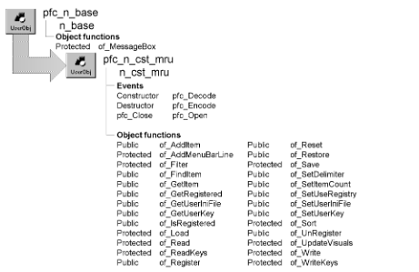

# n_cst_mru

**Description**

Most recently used (MRU) object service. When enabled, n_cst_mru displays a list of most recently used windows or sheet-specific items on the File menu. By default this list displays up to five items, but you can increase this number.

N_cst_mru automatically loads MRU information when the application opens. This information is stored in either the registry (available on Windows platforms) or an INI file (available on all platforms).

**Ancestry**



**Library**

- PFCAPSRV.PBL
- PFEAPSRV.PBL

**Object relationships**

- d_mruservice
- [m_master](../03-menus/m_master.md)
- [n_cst_mruattrib](../05-global-structures-and-structure-objects/n_cst_mruattrib.md)
- [n_ds](../08-standard-class-user-objects/n_ds.md)
- [n_cst_menu](n_cst_menu.md)
- [n_cst_string](n_cst_string.md)

**Usage**

Use this object to add MRU capabilities to your application’s File menu.

To use n_cst_mru to open most recently used sheets in an MDI application:

1. Enable n_cst_mru by calling the n_cst_appmanager of_SetMRU function. This example is from an application manager Constructor event:

   ```
   this.of_SetMRU(TRUE)
   ```

2. Specify where MRU information is to be saved by calling either the n_cst_mru of_SetUserKey (Windows only) or of_SetUserINIFile (all platforms) function. This example, which assumes you’ve already established the n_cst_appmanager user key or user INI file, saves MRU information in the registry or INI file. This example is from an application manager Constructor event:

   ```
   IF this.of_IsRegistryAvailable() THEN
     this.inv_mru.of_SetUserKey &
       (this.of_GetUserKey())
   ELSE
     this.inv_mru.of_SetUserINIFile &
       (this.of_GetUserINIFile())
   END IF
   ```

3. Register IDs to be tracked the MRU service by calling the n_cst_mru of_Register function. (An ID is the identifier that the window uses to retrieve information through the MRU service.) This is an example of code you can add to the pfc_PreOpen event of the MDI frame window:

   ```
   IF IsValid(gnv_app.inv_mru) THEN
     gnv_app.inv_mru.of_Register("myapp")
   END IF
   ```

4. Extend the pfc_MRUProcess event in each window that uses the MRU service, adding code to open the appropriate window or sheet (be sure to add this code to the frame window also):

   ```
   Window lw_frame, lw_window
   n_cst_menu lnv_menu
   n_cst_mruattrib lnv_mruattrib

   // Check parameters.
   IF IsNull(ai_row) THEN
     Return -1
   END IF
   IF NOT IsValid(gnv_app.inv_mru) THEN
     Return -1
   END IF
   // Retrieve row from DataStore.
   gnv_app.inv_mru.of_GetItem &
     (ai_row, lnv_mruattrib)

   // Get the MDI frame, if necessary.
   lnv_menu.of_GetMDIFrame(this.menuid, lw_frame)
   OpenSheet(lw_window, &
      lnv_mruattrib.is_classname, lw_frame)
   Return 1
   ```

**Performing other actions in the pfc_MRUProcess event** To see other types of processing you can perform in the pfc_MRUProcess event, see the comments in the ancestor pfc_MRUProcess event.

5. Extend the pfc_PreMRUSave event in each window that uses the MRU service. In this event, populate the n_cst_mruattrib object with the ID, classname, key, menu item text, and menu item help to be saved:

   ```
   anv_mruattrib.is_id = "myapp"
   anv_mruattrib.is_classname = this.ClassName()
   anv_mruattrib.is_menuitemname = this.Title
   anv_mruattrib.is_menuitemkey = this.ClassName()
   anv_mruattrib.is_menuitemmhelp =  &
      "Opens " + this.Title

   Return 1
   ```

6. Extend the pfc_MRURestore event in each window that uses the MRU service. In this event, call the of_Restore function, specifying the ID of the MRU information to display on this window’s menu:

   ```
   If IsValid(gnv_app.inv_mru) Then
     Return gnv_app.inv_mru.of_Restore("myapp", This)
   End If
   ```

7. Call the pfc_MRUSave event to save MRU information. You can call this event when the window opens, when information is saved, or when the window closes (this example is from the pfc_PreOpen event):

   ```
   this.Event pfc_MRUSave()
   ```

**See also**

- [m_master](../03-menus/m_master.md)
- [n_cst_appmanager](n_cst_appmanager.md)
- [w_master](../02-window-objects/w_master.md)

## Instance variables

N_cst_mru includes instance variables:

| Instance variable | Description | Data type | Access | Usage |
| --- | --- | --- | --- | --- |
| ib_useregistry | Reports whether MRU information is stored in the registry or in an INI file | Boolean | Protected | Set with of_SetUseRegistry (default is FALSE) |
| ids_mrukeys | MRU information | n_ds | Protected | Internal |
| ii_currentmrucount | Number of items currently in the list | Integer | Protected | Internal |
| ii_mruitemcount | Maximum number of MRU items | Integer | Protected | Set with of_SetItemCount (default is 5) |
| is_delimiter | Separates information stored in the registry or INI file | String | Protected | Set with of_SetDelimiter (default is the semicolon) |
| is_menubarline | Menu item name for the menu bar line above the MRU list in the File menu | String | Protected | Internal (default is m_pfcmrudash1) |
| is_menuitemstring | Menu item prefix for items in the MRU list | String | Protected | Internal (default is m_pfcmru) |
| is_mrucountkey | MRU key name for registry or INI file | String | Protected | Internal (default is ItemCount) |
| is_mruregisteredsection | MRU section name for registry or INI file | String | Protected | Internal (default is MRU Registered Id) |
| is_mruitemkey | MRU key name for registry or INI file | String | Protected | Internal (default is Item) |
| inv_register[ ] | Currently currently registered objects | n_cst_mruattrib | Protected | List of registered objects. Add items with of_Register |
| is_mrusection | MRU section name for registry or INI file | String | Protected | Internal (default is MRU) |
| is_userinifile | INI file containing registry items | String | Protected | This is typically the user INI file value from n_cst_appmanager |
| is_userkey | Registry key containing MRU items | String | Protected | This is typically the user key value from n_cst_appmanager |

## Events

N_cst_mru includes precoded events:

- Constructor
- Destructor
- pfc_Close
- pfc_Decode
- pfc_Encode
- pfc_Open

### Constructor

**Description**

Creates the ids_mrukeys DataStore and assigns the d_mruservice DataWindow object as its DataObject.

**Usage**

This event executes when the object is created.

### Destructor

**Description**

Destroys the ids_mrukeys DataStore.

**Usage**

This event executes when the object is destroyed.

### pfc_Close

**Description**

Saves MRU settings when the application closes.

**Syntax**

```
application.instancename.EVENT pfc_Close ( )
```

| Argument | Description |
| --- | --- |
| *application* | Global variable of type n_cst_appmanager (must be gnv_app) |
| *instancename* | Instance name of n_cst_apppreference (the n_cst_appmanager default is inv_mru) |

**Usage**

This event executes when the application closes; it is called by the n_cst_appmanager pfc_Close event if the MRU service is enabled.

### pfc_Decode

**Description**

Breaks down a key value into its component parts.

**Syntax**

```
application.instancename.EVENT pfc_Decode ( itemkey, mruinfo )
```

| Argument | Description |
| --- | --- |
| *application* | Global variable of type n_cst_appmanager (must be gnv_app) |
| *instancename* | Instance name of n_cst_mru (the n_cst_appmanager default is inv_mru) |
| *itemkey* | String specifying the registry or INI file key to access |
| *mruinfo* | N_cst_mruattrib instance into which the event places the class name, menu item text, and key (passed by reference) |

**Return value**

Integer. Returns 1 if the event succeeds and -1 if an error occurs.

**Usage**

The of_Read function calls this event to access the class name, menu item name, and menu item key for a saved item.

You can extend or override this event to include customized logic accessing the registry or INI file.

To control whether the service accesses information in the registry or in an INI file, call the of_SetUseRegistry function.

### pfc_Encode

**Description**

Combines MRU information into a string to be stored in the registry or INI file.

**Syntax**

```
application.instancename.EVENT pfc_Encode ( rowindex, itemkey )
```

| Argument | Description |
| --- | --- |
| *application* | Global variable of type n_cst_appmanager (must be gnv_app) |
| *instancename* | Instance name of n_cst_mru (the n_cst_appmanager default is inv_mru) |
| *rowindex* | Integer specifying the row in ids_mrukeys from which the event accesses information to be saved |
| *itemkey* | String specifying a key value for the information to be saved |

**Return value**

Integer. Returns 1 if the event succeeds and -1 if an error occurs.

**Usage**

The of_Write function calls this event.

You can extend or override this event to include customized logic for storing MRU information in the registry or INI file.

### pfc_Open

**Description**

Initializes object settings and loads the ids_mrukeys DataStore with information from the registry or INI file.

**Syntax**

```
application.instancename.EVENT pfc_Open ( commandline )
```

| Argument | Description |
| --- | --- |
| *application* | Global variable of type n_cst_appmanager (must be gnv_app) |
| *instancename* | Instance name of n_cst_mru (the n_cst_appmanager default is inv_mru) |
| *commandline* | String containing the command line argument passed to the application Open event |

**Usage**

This event executes when the application opens. It is called by the n_cst_appmanager pfc_Open event if the MRU service has been enabled.

## Functions

N_cst_mru contains precoded object functions:

- of_AddItem
- of_AddMenubarLine
- of_Filter
- of_FindItem
- of_GetItem
- of_GetRegistered
- of_GetUserIniFile
- of_GetUserKey
- of_IsRegistered
- of_Load
- of_Read
- of_ReadKeys
- of_Register
- of_Reset
- of_Restore
- of_Save
- of_SetDelimiter
- of_SetItemCount
- of_SetUseRegistry
- of_SetUserIniFile
- of_SetUserKey
- of_Sort
- of_UnRegister
- of_UpdateVisuals
- of_Write
- of_WriteKeys

### of_AddItem

**Description**

Saves information in the ids_mrukeys DataStore.

**Access**

Public

**Syntax**

```
application.instancename.of_AddItem ( mruinfo )
```

| Argument | Description |
| --- | --- |
| *application* | Global variable of type n_cst_appmanager (must be gnv_app) |
| *instancename* | Instance name of n_cst_mru (the n_cst_appmanager default is inv_mru) |
| *mruinfo* | N_cst_mruattrib instance containing information to be saved in the ids_mrukeys DataStore |

**Return value**

Integer. Returns 1 if the function succeeds and -1 if an error occurs.

**Usage**

The w_master pfc_MRUSave event calls this function to save an MRU item in the DataStore.

**Examples**

This example is from the w_master pfc_MRUSave event:

```
...
if gnv_app.inv_mru.of_IsRegistered  &
  (lnv_mruattrib.is_id) then
    Return gnv_app.inv_mru.of_additem(lnv_mruattrib)
ELSE
  Return -1
END IF
...
```

### of_AddMenubarLine

**Description**

Enables display of the separator line below the Exit menu item.

**Access**

Protected

**Syntax**

```
application.instancename.of_AddMenubarLine ( window )
```

| Argument | Description |
| --- | --- |
| *application* | Global variable of type n_cst_appmanager (must be gnv_app) |
| *instancename* | Instance name of n_cst_mru (the n_cst_appmanager default is inv_mru) |
| *window* | Window variable whose associated menu is modified |

**Return value**

Integer. Returns 1 if the function succeeds and -1 if an error occurs.

**Usage**

Internal.

**Examples**

This example is from the of_Restore function:

```
...
of_AddMenubarLine(aw_window)
...
```

### of_Filter

**Description**

Filters rows in the ids_mrukeys DataStore.

**Access**

Protected

**Syntax**

```
application.instancename.of_Filter ( filter )
```

| Argument | Description |
| --- | --- |
| *application* | Global variable of type n_cst_appmanager (must be gnv_app) |
| *instancename* | Instance name of n_cst_mru (the n_cst_appmanager default is inv_mru) |
| *filter* | String specifying the filter. To reset the filter, specify an empty string |

**Return value**

Integer. Returns 1 if the function succeeds and -1 if an error occurs.

**Usage**

Internal.

**Examples**

This example is from the of_Save function:

```
...
for li_index = 1 to ll_objectcount
  ls_id = inv_register[li_index].is_id
  of_Filter("s_id = ’" + ls_id + "’")
  of_Sort("n_identity D")
...
```

### of_FindItem

**Description**

Finds menu item text within the ids_mrukeys DataStore.

**Access**

Public

**Syntax**

```
application.instancename.of_FindItem ( menuitemtext, startrow )
```

| Argument | Description |
| --- | --- |
| *application* | Global variable of type n_cst_appmanager (must be gnv_app) |
| *instancename* | Instance name of n_cst_mru (the n_cst_appmanager default is inv_mru) |
| *menuitemtext* | String specifying the text to find |
| *startrow* | Long specifying the row from which to start searching |

**Return value**

Long. Returns the row number if *menuitemtext* is found and -1 if *menuitemtext* is not found.

**Usage**

Internal.

**Examples**

This example is from the of_AddItem function:

```
...
ll_currentrow = of_finditem  &
   ("  " + anv_mruattrib.is_menuitemname, 0)
...
```

### of_GetItem

**Description**

Retrieves MRU information from the DataStore.

**Access**

Public

**Syntax**

```
application.instancename.of_GetItem ( row, mruinfo )
```

| Argument | Description |
| --- | --- |
| *application* | Global variable of type n_cst_appmanager (must be gnv_app) |
| *instancename* | Instance name of n_cst_mru (the n_cst_appmanager default is inv_mru) |
| *row* | Long specifying the row to return |
| *mruinfo* | N_cst_mruattrib instance into which the function places MRU information (passed by reference) |

**Return value**

Integer. Returns 1 if the function succeeds and -1 if an error occurs.

**Usage**

Internal.

**Examples**

This example is from the of_Restore function:

```
...
DO UNTIL (li_index >= li_rowcount) OR &
  (li_itemnumber >= li_itemcount)
    li_index++
    of_GetItem(li_index, lnv_mruattrib)
...
```

### of_GetRegistered

**Description**

Retrieves the index of the specified ID within the inv_register array.

**Access**

Public

**Syntax**

```
application.instancename.of_GetRegistered ( id )
```

| Argument | Description |
| --- | --- |
| *application* | Global variable of type n_cst_appmanager (must be gnv_app) |
| *instancename* | Instance name of n_cst_mru (the n_cst_appmanager default is inv_mru) |
| *id* | String specifying the ID to be checked |

**Return value**

Integer. Returns the index of *id* within the inv_registered array if *id* is registered and -1 if it is not.

**Usage**

Internal.

**Examples**

This example is from the of_IsRegistered function:

```
...
if of_GetRegistered(as_id) < 1 then
   return false
...
```

### of_GetUserIniFile

**Description**

Retrieves the name of the user INI file as established by the of_SetUserIniFile function.

**Access**

Public

**Syntax**

```
application.instancename.of_GetUserIniFile ( )
```

| Argument | Description |
| --- | --- |
| *application* | Global variable of type n_cst_appmanager (must be gnv_app) |
| *instancename* | Instance name of n_cst_mru (the n_cst_appmanager default is inv_mru) |

**Return value**

String. Returns the name of the user-specific INI file.

**Examples**

This example calls the of_GetUserIniFile function:

```
String ls_file

ls_file = gnv_app.inv_mru.of_GetUserINIFile()
...
```

### of_GetUserKey

**Description**

Retrieves the name of the registry key in which MRU information is stored.

**Access**

Public

**Syntax**

```
application.instancename.of_GetUserKey ( )
```

| Argument | Description |
| --- | --- |
| *application* | Global variable of type n_cst_appmanager (must be gnv_app) |
| *instancename* | Instance name of n_cst_mru (the n_cst_appmanager default is inv_mru) |

**Return value**

String. Returns the name of the registry key.

**Examples**

This example calls the of_GetUserKey function:

```
String ls_key

ls_key = gnv_app.inv_mru.of_GetUserKey()
...
```

### of_IsRegistered

**Description**

Reports whether a specified ID is registered with the MRU service.

**Access**

Public

**Syntax**

```
application.instancename.of_IsRegistered ( id )
```

| Argument | Description |
| --- | --- |
| *application* | Global variable of type n_cst_appmanager (must be gnv_app) |
| *instancename* | Instance name of n_cst_mru (the n_cst_appmanager default is inv_mru) |
| *id* | String specifying the ID to be tested |

**Return value**

Boolean. Returns TRUE if *id* is registered and FALSE if it is not.

**Examples**

This example calls the of_IsRegistered function:

```
...
IF NOT gnv_app.inv_mru.of_IsRegistered("myapp") THEN
   gnv_app.inv_mru.of_Register("myapp")
...
```

### of_Load

**Description**

Copies MRU information from the registry or INI file to the ids_mrukeys DataStore.

**Access**

Protected

**Syntax**

```
application.instancename.of_Load ( )
```

| Argument | Description |
| --- | --- |
| *application* | Global variable of type n_cst_appmanager (must be gnv_app) |
| *instancename* | Instance name of n_cst_mru (the n_cst_appmanager default is inv_mru) |

**Return value**

Integer. Returns 1 if the function succeeds and -1 if an error occurs.

**Usage**

Internal.

**Examples**

This example is from the pfc_Open event:

```
IF of_Load() < 1 THEN
  IF IsValid(gnv_app.inv_debug) THEN
...
```

### of_Read

**Description**

Retrieves MRU items from a specified registry or INI file, calling the pfc_Decode event to extract values.

**Access**

Protected

**Syntax**

```
application.instancename.of_Read ( section, id )
```

| Argument | Description |
| --- | --- |
| *application* | Global variable of type n_cst_appmanager (must be gnv_app) |
| *instancename* | Instance name of n_cst_mru (the n_cst_appmanager default is inv_mru) |
| *section* | String specifying the registry or INI file section |
| *id* | String specifying the ID to read |

**Return value**

Integer. Returns 1 if the function succeeds and -1 if an error occurs.

**Usage**

Internal.

**Examples**

This example is from the of_Load function:

```
...
li_itemcount = UpperBound(istr_register)
FOR li_index = 1 TO li_itemcount
  ls_id = inv_register[li_index].is_id
  li_rc = of_Read(is_mrusection, ls_id)
...
```

### of_ReadKeys

**Description**

Retrieves values from the registry or INI file.

**Access**

Protected

**Syntax**

```
application.instancename.of_ReadKeys ( section, keyword, value, default )
```

| Argument | Description |
| --- | --- |
| *application* | Global variable of type n_cst_appmanager (must be gnv_app) |
| *instancename* | Instance name of n_cst_mru (the n_cst_appmanager default is inv_mru) |
| *section* | String specifying the registry or INI file section |
| *keyword* | String specifying the keyword whose corresponding value is to be returned |
| *value* | String into which the function places the value corresponding to *keyword* (passed by reference) |
| *default* | String specifying a default value to be returned if *keyword* is not found |

**Return value**

Integer. Returns 1 if the function succeeds, 0 if the default value was used, and -1 if an error occurs.

**Usage**

Internal.

**Examples**

This example is from the of_Load function:

```
...
ls_defaultcount = String(ii_mruitemcount)
of_ReadKeys(is_mrusection, is_mrucountkey, &
   ls_value, ls_defaultcount)
...
```

### of_Register

**Description**

Registers an ID to be tracked by the MRU service, optionally specifying the maximum number of items to track.

**Access**

Public

**Syntax**

```
application.instancename.of_Register ( id {, itemcount } )
```

| Argument | Description |
| --- | --- |
| *application* | Global variable of type n_cst_appmanager (must be gnv_app) |
| *instancename* | Instance name of n_cst_mru (the n_cst_appmanager default is inv_mru) |
| *id* | String specifying the ID to be registered |
| *itemcount* (optional) | Integer specifying the number of MRU items to track. The default is five, which you can modify using the of_SetItemCount function |

**Return value**

Integer. Returns 1 if the function succeeds, 0 if the ID is already registered, and -1 if an error occurs.

**Usage**

If you specify a number greater than five for *itemcount*, you must also create additional MRU menu items on the m_master File menu.

You must also add code to the window’s pfc_PreMRUSave and pfc_MRURestore events that uses the *id* value.

Call this function once for each separate group of MRU items to be tracked. For example, the sheets that display employee information might display different MRU items than the sheets that display customer information.

**Examples**

This example calls the of_Register function:

```
gnv_app.inv_mru.of_Register("empinfo")
```

### of_Reset

**Description**

Clears either rows for a specified ID or all rows from the ids_mrukeys DataStore.

**Access**

Public

**Syntax**

```
application.instancename.of_Reset ( {id } )
```

| Argument | Description |
| --- | --- |
| *application* | Global variable of type n_cst_appmanager (must be gnv_app) |
| *instancename* | Instance name of n_cst_mru (the n_cst_appmanager default is inv_mru) |
| *id* (optional) | String specifying the ID of the MRU items to remove from the ids_mrukeys DataStore |

**Return value**

Integer. Returns the number of rows removed if the function succeeds and -1 if an error occurs.

**Usage**

The items are removed from the registry or INI file too when the application closes and the service saves its lists (pfc_Close).

**Examples**

This example calls the of_Reset function:

```
...
gnv_app.inv_mru.of_Reset()
...
```

### of_Restore

**Description**

Adds MRU information to the menu associated with the passed window.

**Access**

Public

**Syntax**

```
application.instancename.of_Restore ( id, window )
```

| Argument | Description |
| --- | --- |
| *application* | Global variable of type n_cst_appmanager (must be gnv_app) |
| *instancename* | Instance name of n_cst_mru (the n_cst_appmanager default is inv_mru) |
| *id* | String specifying the id of the MRU items to be restored |
| *window* | Window variable referencing the window whose menu is to contain the MRU items |

**Return value**

Integer. Returns 1 if the function succeeds and -1 if an error occurs.

**Usage**

The code you add when extending the w_master pfc_MRURestore event calls this function.

**Examples**

This example is from the w_master pfc_MRURestore event:

```
IF IsValid(gnv_app.inv_mru) THEN
  Return gnv_app.inv_mru.of_Restore("empinfo", This)
END IF
```

### of_Save

**Description**

Copies information from the ids_mrukeys DataStore to the registry or INI file.

**Access**

Protected

**Syntax**

```
application.instancename.of_Save ( )
```

| Argument | Description |
| --- | --- |
| *application* | Global variable of type n_cst_appmanager (must be gnv_app) |
| *instancename* | Instance name of n_cst_mru (the n_cst_appmanager default is inv_mru) |

**Return value**

Integer. Returns 1 if the function succeeds and -1 if an error occurs.

**Usage**

Internal.

**Examples**

This example is from the pfc_Close event:

```
If of_Save() < 1 Then
  IF IsValid(gnv_app.inv_debug) THEN
...
```

### of_SetDelimiter

**Description**

Specifies the delimiter that separates the elements of the MRU value stored in the registry of INI file.

**Access**

Public

**Syntax**

```
application.instancename.of_SetDelimiter ( delimiter )
```

| Argument | Description |
| --- | --- |
| *application* | Global variable of type n_cst_appmanager (must be gnv_app) |
| *instancename* | Instance name of n_cst_mru (the n_cst_appmanager default is inv_mru) |
| *delimiter* | String specifying the delimiter |

**Return value**

Integer. Returns 1 if the function succeeds and -1 if an error occurs.

**Usage**

The default delimiter is the semicolon (;).

**Examples**

This example calls the of_SetDelimiter function:

```
gnv_app.inv_mru.of_SetDelimiter("^")
```

### of_SetItemCount

**Description**

Specifies the maximum number of items that n_cst_mru will track and display at the bottom of the File menu.

**Access**

Public

**Syntax**

```
application.instancename.of_SetItemCount ( count )
```

| Argument | Description |
| --- | --- |
| *application* | Global variable of type n_cst_appmanager (must be gnv_app) |
| *instancename* | Instance name of n_cst_mru (the n_cst_appmanager default is inv_mru) |
| *count* | Integer specifying the maximum number of MRU items |

**Return value**

Integer. Returns 1 if the function succeeds and -1 if an error occurs.

**Usage**

If you specify a number larger than five, you must also create additional MRU menu items for menus that use the MRU service.

**Examples**

This example calls the of_SetItemCount function:

```
gnv_app.inv_mru.of_SetItemCount(4)
```

### of_SetUseRegistry

**Description**

Specifies whether n_cst_mru stores settings in the registry or an INI file.

**Access**

Public

**Syntax**

```
application.instancename.of_SetUseRegistry ( boolean )
```

| Argument | Description |
| --- | --- |
| *application* | Global variable of type n_cst_appmanager (must be gnv_app) |
| *instancename* | Instance name of n_cst_mru (the n_cst_appmanager default is inv_mru) |
| *boolean* | Boolean indicating whether the service stores settings in the registry (TRUE) or an INI file (FALSE) |

**Return value**

Integer. Returns 1 if the function succeeds and -1 if an error occurs.

**Usage**

Call this function to toggle back and forth between an INI file and the registry (the of_SetUserIniFile and of_SetUserKey functions already control whether the service saves to the INI file or the registry).

The registry is available on Windows platforms only.

**Examples**

This example calls the of_SetUseRegistry function:

```
...
IF ib_restricted THEN
   gnv_app.inv_mru.of_SetUseRegistry(TRUE)
ELSE
   gnv_app.inv_mru.of_SetUseRegistry(FALSE)
END IF
...
```

### of_SetUserIniFile

**Description**

Specifies the name of the INI file for MRU information.

**Access**

Public

**Syntax**

```
application.instancename.of_SetUserIniFile ( inifilename )
```

| Argument | Description |
| --- | --- |
| *application* | Global variable of type n_cst_appmanager (must be gnv_app) |
| *instancename* | Instance name of n_cst_mru (the n_cst_appmanager default is inv_mru) |
| *inifilename* | String specifying the fully qualified name of the user INI file |

**Return value**

Integer. Returns 1 if the function succeeds and -1 if an error occurs.

**Usage**

When you call this function, n_cst_mru uses the specified INI file automatically, overriding any previous specifications made with either the of_SetUseRegistry or of_SetUserKey functions.

The INI file for MRU information is typically the same as the application manager user INI file.

**Examples**

This example from an n_cst_appmanager Constructor event calls the of_SetUserIniFile function:

```
...
IF this.of_IsRegistryAvailable() THEN
  this.inv_mru.of_SetUserKey &
    (this.of_GetUserKey())
ELSE
  this.inv_mru.of_SetUserINIFile &
    (this.of_GetUserINIFile())
END IF
```

### of_SetUserKey

**Description**

Specifies the name of the registry key for MRU information.

**Access**

Public

**Syntax**

```
application.instancename.of_SetUserKey ( registrykey )
```

| Argument | Description |
| --- | --- |
| *application* | Global variable of type n_cst_appmanager (must be gnv_app) |
| *instancename* | Instance name of n_cst_mru (the n_cst_appmanager default is inv_mru) |
| *registrykey* | String containing the registry key |

**Return value**

Integer. Returns 1 if the function succeeds and -1 if an error occurs.

**Usage**

When you call this function, n_cst_mru uses the specified registry key automatically, overriding any previous specifications made with either the of_SetUseRegistry or of_SetUserIniFile functions.

The registry key for MRU information is typically the same as the application manager user key.

**Examples**

This example calls the of_SetUserKey function:

```
...
IF this.of_IsRegistryAvailable() THEN
  this.inv_mru.of_SetUserKey &
    (this.of_GetUserKey())
ELSE
  this.inv_mru.of_SetUserINIFile &
    (this.of_GetUserINIFile())
END IF
```

### of_Sort

**Description**

Sorts the ids_mrukeys DataStore.

**Access**

Protected

**Syntax**

```
application.instancename.of_Sort ( sortcriteria )
```

| Argument | Description |
| --- | --- |
| *application* | Global variable of type n_cst_appmanager (must be gnv_app) |
| *instancename* | Instance name of n_cst_mru (the n_cst_appmanager default is inv_mru) |
| *sortcriteria* | String containing the sort criteria |

**Return value**

Integer. Returns 1 if the function succeeds and -1 if an error occurs.

**Usage**

Internal.

**Examples**

This example is from the of_Restore function:

```
...
of_Filter("")
of_Sort("n_identity D")
...
```

### of_UnRegister

**Description**

Removes an ID from the MRU service.

**Access**

Public

**Syntax**

```
application.instancename.of_UnRegister ( id, itemcount )
```

| Argument | Description |
| --- | --- |
| *application* | Global variable of type n_cst_appmanager (must be gnv_app) |
| *instancename* | Instance name of n_cst_mru (the n_cst_appmanager default is inv_mru) |
| *id* | String containing the id to be removed |
| *itemcount* | Integer. Not used by the function; pass any value, for example 0 |

**Return value**

Integer. Returns 1 if the function succeeds and -1 if an error occurs.

**Examples**

This example calls the of_UnRegister function:

```
gnv_app.inv_mru.of_UnRegister("empinfo", 0)
```

### of_UpdateVisuals

**Description**

Sets and displays the specified MRU items on the menu associated with the specified window.

**Access**

Protected

**Syntax**

```
application.instancename.of_UpdateVisuals ( window, menuitemtext,
menuitemindex )
```

| Argument | Description |
| --- | --- |
| *application* | Global variable of type n_cst_appmanager (must be gnv_app) |
| *instancename* | Instance name of n_cst_mru (the n_cst_appmanager default is inv_mru) |
| *window* | Window variable referencing the window whose associated menu is updated |
| *menuitemtext* | String specifying the text to display on the menu item |
| *menuitemindex* | Integer specifying which of the MRU menu items to update. This value must be between 1 and 5 |

**Return value**

Integer. Returns 1 if the function succeeds and -1 if an error occurs.

**Usage**

Internal.

**Examples**

This example is from the of_Restore function:

```
...
li_rc = of_UpdateVisuals(aw_window, &
  ls_menuitemtext, li_itemnumber)
...
```

### of_Write

**Description**

Copies MRU information from the ids_mrukeys DataStore to the registry or INI file.

**Access**

Protected

**Syntax**

```
application.instancename.of_Write ( section, itemcount )
```

| Argument | Description |
| --- | --- |
| *application* | Global variable of type n_cst_appmanager (must be gnv_app) |
| *instancename* | Instance name of n_cst_mru (the n_cst_appmanager default is inv_mru) |
| *section* | String specifying the registry or INI file section |
| *itemcount* | Integer specifying the number of items to copy |

**Return value**

Integer. Returns 1 if the function succeeds and -1 if an error occurs.

**Usage**

Internal.  An empty list is saved as empty, and the entries after the last item are cleared, so items no longer in the list are not read back the next time.

**Examples**

This example is from the of_Save function:

```
...
li_rc = of_Write(is_mrusection + " " + ls_id,  &
  inv_register[li_index].ii_itemcount)
...
```

### of_WriteKeys

**Description**

Writes information to the registry or INI file.

**Access**

Protected

**Syntax**

```
application.instancename.of_WriteKeys ( section, keyword, value )
```

| Argument | Description |
| --- | --- |
| *application* | Global variable of type n_cst_appmanager (must be gnv_app) |
| *instancename* | Instance name of n_cst_mru (the n_cst_appmanager default is inv_mru) |
| *section* | String specifying the registry or INI file section |
| *keyword* | String specifying the keyword whose corresponding value is to be saved |
| *value* | String specifying a value corresponding to *keyword* |

**Return value**

Integer. Returns 1 if the function succeeds and -1 if an error occurs.

**Usage**

Internal.

**Examples**

This example is from the of_Save function:

```
...
ls_MRUKeyName = is_mruitemkey +  &
   string(ll_registeredcount)
li_rc = of_WriteKeys(is_mruregisteredsection,  &
   ls_MRUKeyName, ls_key)
...
```
