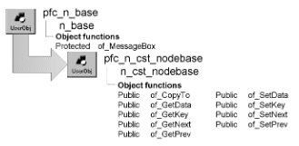

# n_cst_nodebase

**Description**

List instance ancestor object. Implement list nodes through one of this object’s descendants:

- [N_cst_linkedlistnode](n_cst_linkedlistnode.md)
- [N_cst_treenode](n_cst_treenode.md)

Each element in a linked list or balanced binary tree is an instance of n_cst_nodebase. n_cst_nodebase contains references to the next and prior nodes, data, a key value, and (balanced binary tree only) balance information.

**Ancestry**



**Library**

- PFCAPSRV.PBL
- PFEAPSRV.PBL

**Usage**

PFC objects use this object as the ancestor for list nodes.

**Descendants**

- [n_cst_linkedlistnode](n_cst_linkedlistnode.md)
- [n_cst_treenode](n_cst_treenode.md)

**See also**

- [n_cst_linkedlistbase](n_cst_linkedlistbase.md)
- [n_cst_nodecomparebase](n_cst_nodecomparebase.md)

## Instance variables

N_cst_nodebase includes instance variables:

| Instance variable | Description | Data type | Access | Usage |
| --- | --- | --- | --- | --- |
| ia_data | Node data | Any | Protected | Set with of_SetData |
| ia_key | Node key value | Any | Protected | Set with of_SetKey |
| inv_next | Reference to next node | n_cst_node base | Protected | Set with of_SetNext |
| inv_prev | Reference to prior node | n_cst_node base | Protected | Set with of_SetPrev |

## Functions

N_cst_nodebase contains precoded object functions:

- of_CopyTo
- of_GetData
- of_GetKey
- of_GetNext
- of_GetPrev
- of_SetData
- of_SetKey
- of_SetNext
- of_SetPrev

### of_CopyTo

**Description**

Copies the data, key, next pointer, and previous pointer of the current node into the passed node.

**Access**

Public

**Syntax**

```
instancename.of_CopyTo ( targetnode )
```

| Argument | Description |
| --- | --- |
| *instancename* | Instance name of n_cst_nodebase |
| *targetnode* | N_cst_nodebase instance whose information is copied from *instancename* |

**Return value**

Integer. Returns 1 if the function succeeds and -1 if an error occurs.

**Usage**

If you extend n_cst_nodebase, be sure to override this function to copy all added data elements as well as the ia_key, ia_data, inv_next, and inv_prev instance variables.

**Examples**

This example calls the of_CopyTo function:

```
n_cst_linkedlistnode  lnv_node, lnv_temp, lnv_copy
Integer  li_return
Any  la_data

lnv_temp = CREATE n_cst_linkedlistnode
...
lnv_copy = CREATE n_cst_linkedlistnode
li_return = lnv_node.of_CopyTo(lnv_copy)
IF li_return = 1 THEN
   lnv_copy.of_GetData(la_data)
   MessageBox("Success",  &
      "Node copied successfully~r~n"  &
     + "Data is: " + String(la_data))
END IF
...
```

### of_GetData

**Description**

Retrieves the data for the current node.

**Access**

Public

**Syntax**

```
instancename.of_GetData ( data )
```

| Argument | Description |
| --- | --- |
| *instancename* | Instance name of n_cst_nodebase |
| *data* | Any variable into which the function places the data from the current node (passed by reference) |

**Return value**

Integer. Returns 1 if the function succeeds and -1 if an error occurs.

**Examples**

This example calls the of_GetData function:

```
...
FOR li_loop = 1 TO li_count
   lnv_node[li_loop].of_GetData(la_data)
   ls_data = String(la_data)
   lb_list.AddItem(ls_data)
NEXT
```

### of_GetKey

**Description**

Retrieves the key for the current node.

**Access**

Public

**Syntax**

```
instancename.of_GetKey ( key )
```

| Argument | Description |
| --- | --- |
| *instancename* | Instance name of n_cst_nodebase |
| *key* | Any variable into which the function places the key value from the current node (passed by reference) |

**Return value**

Integer. Returns 1 if the function succeeds and -1 if an error occurs.

**Examples**

This example calls the of_GetKey function:

```
...
FOR li_loop = 1 TO li_count
   lnv_node[li_loop].of_GetData(la_data)
   ls_data = String(la_data)
   lnv_node[li_loop].of_GetKey(la_key)
   ls_key = String(la_key)
   lb_list.AddItem(ls_key + ", " + ls_data)
NEXT
```

### of_GetNext

**Description**

Retrieves the next node in the list.

**Access**

Public

**Syntax**

```
instancename.of_GetNext ( nextnode )
```

| Argument | Description |
| --- | --- |
| *instancename* | Instance name of n_cst_nodebase |
| *nextnode* | N_cst_nodebase instance into which the function places the next node in the list (passed by reference) |

**Return value**

Integer. Returns 1 if the function succeeds and -1 if an error occurs or there is no next node.

**Examples**

This example is from the n_cst_list of_Find function:

```
...
lnv_node.of_GetNext(lnv_node)
...
```

### of_GetPrev

**Description**

Retrieves the previous node in the list.

**Access**

Public

**Syntax**

```
instancename.of_GetPrev ( previousnode )
```

| Argument | Description |
| --- | --- |
| *instancename* | Instance name of n_cst_nodebase |
| *previousnode* | N_cst_nodebase instance into which the function places the previous node in the list (passed by reference) |

**Return value**

Integer. Returns 1 if the function succeeds and -1 if an error occurs or there is no previous node.

**Examples**

This example is from the n_cst_linkedlistbase of_Remove function:

```
...
anv_removenode.of_GetPrev(lnv_previous)
...
```

### of_SetData

**Description**

Adds data to the current node.

**Access**

Public

**Syntax**

```
instancename.of_SetData ( data )
```

| Argument | Description |
| --- | --- |
| *instancename* | Instance name of n_cst_nodebase |
| *data* | Any variable containing the data to be added to *instancename* |

**Return value**

Integer. Returns 1 if the function succeeds and -1 if an error occurs.

**Examples**

This example calls the of_SetData function:

```
n_cst_linkedlistnode  lnv_node
Integer  li_return

lnv_node = CREATE n_cst_linkedlistnode

lnv_node.of_SetKey(sle_1.text)
lnv_node.of_SetData(sle_1.text)
li_return = inv_list.of_Add(lnv_node)
```

### of_SetKey

**Description**

Specifies a key for the current node.

**Access**

Public

**Syntax**

```
instancename.of_SetKey ( key )
```

| Argument | Description |
| --- | --- |
| *instancename* | Instance name of n_cst_nodebase |
| *key* | Any variable containing the key to be added to *instancename* |

**Return value**

Integer. Returns 1 if the function succeeds and -1 if an error occurs.

**Examples**

This example calls the of_SetKey function:

```
n_cst_linkedlistnode  lnv_node
Integer  li_return

lnv_node = CREATE n_cst_linkedlistnode

lnv_node.of_SetKey(sle_1.text)
lnv_node.of_SetData(sle_1.text)
li_return = inv_list.of_Add(lnv_node)
```

### of_SetNext

**Description**

Establishes a reference to the next node in a list.

**Access**

Public

**Syntax**

```
instancename.of_SetNext ( nextnode )
```

| Argument | Description |
| --- | --- |
| *instancename* | Instance name of n_cst_nodebase |
| *nextnode* | N_cst_nodebase instance that references the new next node in the list |

**Return value**

Integer. Returns 1 if the function succeeds and -1 if an error occurs.

**Examples**

This example is from the n_cst_linkedlistbase of_Add function:

```
...
anv_insertafternode.of_SetNext(anv_newnode)
anv_newnode.of_SetPrev(anv_insertafternode)
...
```

### of_SetPrev

**Description**

Establishes a reference to the previous node in a list.

**Access**

Public

**Syntax**

```
instancename.of_SetPrev ( previousnode )
```

| Argument | Description |
| --- | --- |
| *instancename* | Instance name of n_cst_nodebase |
| *previousnode* | N_cst_nodebase instance that references the previous node in the list |

**Return value**

Integer. Returns 1 if the function succeeds and -1 if an error occurs.

**Examples**

This example is from the n_cst_list of_Add function:

```
...
anv_insertafternode.of_SetNext(anv_newnode)
anv_newnode.of_SetPrev(anv_insertafternode)
...
```
