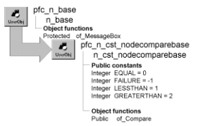

# n_cst_nodecomparebase

**Description**

Node comparison ancestor object.

**Ancestry**



**Library**

- PFCAPSRV.PBL
- PFEAPSRV.PBL

**Object relationships**

n_cst_nodebase

**Usage**

Extend this object’s descendants to implement site-specific comparison processing. PFC objects use comparison processing during sort and find operations.

**Descendants**

- [n_cst_linkedlistnodecompare](n_cst_linkedlistnodecompare.md)
- [n_cst_treenodecompare](n_cst_treenodecompare.md)

**See also**

- [n_cst_list](n_cst_list.md)
- [n_cst_queue](n_cst_queue.md)
- [n_cst_stack](n_cst_stack.md)
- [n_cst_tree](n_cst_tree.md)

## Instance variables

N_cst_nodecomparebase includes instance variables:

| Instance variable | Description | Data type | Access | Usage |
| --- | --- | --- | --- | --- |
| EQUAL | Constant set to 0 | Integer | Public | Use with of_Compare |
| GREATERTHAN | Constant set to 2 | Integer | Public | Use with of_Compare |
| LESSTHAN | Constant set to 1 | Integer | Public | Use with of_Compare |

## Functions

N_cst_nodecomparebase contains a precoded object function:

of_Compare

### of_Compare

Compares two items. There are two syntaxes.

| To | Use |
| --- | --- |
| Compare two nodes | Syntax 1 |
| Compare two values | Syntax 2 |

| Syntax 1 | To compare two nodes |
| --- | --- |

**Description**

Performs a simple comparison using the keys of two passed nodes. Both keys must use a simple data type and the data types must match.

**Access**

Public

**Syntax**

```
instancename.of_Compare ( node1, node2 )
```

| Argument | Description |
| --- | --- |
| *instancename* | Instance name of n_cst_nodecomparebase |
| *node1* | First n_cst_nodebase instance |
| *node2* | Second n_cst_nodebase instance |

**Return value**

Integer. Returns values as follows:

- **GREATERTHAN or 2** The key of *node1* is greater than the key of *node2*
- **LESSTHAN or 1** The key of *node1* is less than the key of *node2*
- **EQUAL or 0** The key of *node1* is equal to the key of *node2*
- **FAILURE or -1** An error occurred

**Usage**

PFC list processing objects call this function when comparing nodes to determine where to place them in the list.

If your list processing requires more complex comparison criteria, create a descendant of either n_cst_linkedlistnodecompare or n_cst_treenodecompare, override the of_Compare function with the appropriate comparison, and establish your customized descendant as the comparison object by calling the list object’s of_SetCompare function.

For an example of the code you might use when overriding of_Compare, see [n_cst_linkedlistnodecompare](n_cst_linkedlistnodecompare.md).

**Examples**

This example is from the n_cst_list of_Find function:

```
...
do while IsValid(lnv_node)
   choose case inv_compare.of_compare  &
       (anv_keynode, lnv_node)
     case inv_compare.EQUAL
...
```

| Syntax 2 | To compare two values |
| --- | --- |

**Description**

Performs a simple comparison of two passed values.

**Access**

Public

**Syntax**

```
instancename.of_Compare ( value1, value2 )
```

| Argument | Description |
| --- | --- |
| *instancename* | Instance name of n_cst_nodecomparebase |
| *value1* | Any containing the first value |
| *value2* | Any containing the second value |

**Return value**

Integer. Returns values as follows:

- **GREATERTHAN or 2** The key of *value1* is greater than the key of *value2*
- **LESSTHAN or 1** The key of *value1* is less than the key of *value2*
- **EQUAL or 0** The key of *value1* is equal to the key of *value2*
- **FAILURE or -1** An error occurred

**Usage**

Syntax 1 calls this version to perform the actual comparison. The data types for *value1* and *value2* must match.

**Examples**

This example is from Syntax 1 of the of_Compare function:

```
...
anv_node1.of_getkey(la_key1)
anv_node2.of_getkey(la_key2)

li_rc = of_Compare(la_key1, la_key2)

Return li_rc
```
