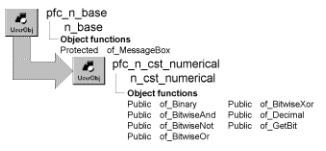

# n_cst_numerical

**Description**

Binary number service. This service provides functions that you can call to access binary data. For example, you can call the of_GetBit function to determine if a specified bit is on or off.

**Ancestry**



**Library**

- PFCAPSRV.PBL
- PFEAPSRV.PBL

**Usage**

To use numerical functions:

1. Declare a variable of type n_cst_numerical:

   ```
   n_cst_numerical  inv_numerical
   ```

Because PFC defines this object with the autoinstantiate option, you don’t need to code CREATE or DESTROY statements.

2. Call numerical service functions as needed.

   This example assumes an inv_numerical instance variable:

   ```
   Long ll_base10
   String ls_binary

   ll_base10 = Long(sle_base10.text)
   ls_binary = inv_numerical.of_Binary(ll_base10)

   MessageBox("Numerical", &
   String(ll_base10) + " base 10 is equal to " + &
      ls_binary + " in binary.")
   ```

**See also**

- [n_cst_conversion](n_cst_conversion.md)
- [n_cst_string](n_cst_string.md)

## Functions

N_cst_numerical includes precoded object functions:

- of_Binary
- of_BitwiseAnd
- of_BitwiseNot
- of_BitwiseOr
- of_BitwiseXor
- of_CreateLongLong
- of_Decimal
- of_decimal_byte
- of_Decimal_Int
- of_Decimal_Long
- of_Decimal_LongLong
- of_Decimal_UInt
- of_Decimal_ULong
- of_GetBit
- of_GetHiWord
- of_GetLoWord
- of_Hex
- of_NumberBaseString
- of_Octal
- of_SetBit

### of_Binary

**Description**

Determines the binary representation of a positive base 10 number.

**Access**

Public

**Syntax**

```
instancename.of_Binary ( number )
```

| Argument | Description |
| --- | --- |
| *instancename* | Instance name of n_cst_numerical |
| *number* | Long to be converted to binary. This number must be positive |

**Return value**

String. Retrieves the binary representation of *number*. If *number* is invalid or NULL, the function returns NULL.

**Examples**

This example calls the of_Binary function. It assumes an inv_numerical instance variable:

```
Long  ll_base10
String  ls_binary

ll_base10 = Long(sle_base10.text)
ls_binary = inv_numerical.of_Binary(ll_base10)

MessageBox("Numerical", &
   String(ll_base10) + " base 10 is equal to " + &
   ls_binary + " in binary.")
```

### of_BitwiseAnd

**Description**

Performs a bitwise AND operation on each bit of two passed values. In a bitwise AND operation:

1 AND 0 evaluates to 0 0 AND 0 evaluates to 0 1 AND 1 evaluates to 1

**Access**

Public

**Syntax**

```
instancename.of_BitwiseAnd ( value1, value2 )
```

| Argument | Description |
| --- | --- |
| *instancename* | Instance name of n_cst_numerical |
| *value1* | Long containing one of the values used in the bitwise AND operation |
| *value2* | Long containing the other value used in the bitwise AND operation |

**Return value**

Long. Returns the result of the AND operation on each of *value1*’s and *value2*'s bits.

**Examples**

This example is from the n_cst_filesrv of_IncludeFile function:

```
n_cst_numerical   lnv_numeric
...
IF lnv_numeric.of_BitwiseAnd &
   (aul_FileAttrib, al_AttribMask) > 0 THEN
   Return TRUE
END IF
```

### of_BitwiseNot

**Description**

Performs a bitwise NOT operation on each bit of a passed value. In a bitwise NOT operation:

1 evaluates to 0 0 evaluates to 1

**Access**

Public

**Syntax**

```
instancename.of_BitwiseNot ( value )
```

| Argument | Description |
| --- | --- |
| *instancename* | Instance name of n_cst_numerical |
| *value* | Long containing one of the value used in the bitwise NOT operation |

**Return value**

Long. Returns the result of the NOT operation on each of *value*'s bits.

**Examples**

This example calls the of_BitwiseNot function. It assumes an inv_numerical instance variable:

```
Long   ll_original, ll_not

ll_original = Long(sle_not.text)
ll_not = inv_numerical.of_BitwiseNot &
   (ll_original)
MessageBox("Numerical", "Binary original is " &
   + String(ll_original) + ". Bitwise NOT is " &
   + String(ll_not) )
```

### of_BitwiseOr

**Description**

Performs a bitwise OR operation on each bit of two passed values. In a bitwise OR operation:

1 OR 0 evaluates to 1 0 OR 0 evaluates to 0 1 OR 1 evaluates to 1

**Access**

Public

**Syntax**

```
instancename.of_BitwiseOr ( value1, value2 )
```

| Argument | Description |
| --- | --- |
| *instancename* | Instance name of n_cst_numerical |
| *value1* | Long containing one of the values used in the bitwise OR operation |
| *value2* | Long containing the other value used in the bitwise OR operation |

**Return value**

Long. Returns the result of the OR operation on each of *value1*’s and *value2*'s bits.

**Examples**

This example calls the of_BitwiseOr function. It assumes an inv_numerical instance variable:

```
Long   ll_value1, ll_value2, ll_result

ll_value1 = Long(sle_value1.text)
ll_value2 = Long(sle_value2.text)
ll_result = inv_numerical.of_BitwiseOr &
   (ll_value1, ll_value2)

MessageBox("Numerical", "Value 1 is " &
   + sle_value1.text + " Value 2 is " &
   + sle_value2.text + " Bitwise OR is " &
   + String(ll_result) )
```

### of_BitwiseXor

**Description**

Performs a bitwise exclusive OR (XOR) operation on each bit of two passed values.

In a bitwise XOR operation:

1 XOR 0 evaluates to 1 0 XOR 0 evaluates to 0 1 XOR 1 evaluates to 0

**Access**

Public

**Syntax**

```
instancename.of_BitwiseXor ( value1, value2 )
```

| Argument | Description |
| --- | --- |
| *instancename* | Instance name of n_cst_numerical |
| *value1* | Long containing one of the values used in the bitwise XOR operation |
| *value2* | Long containing the other value used in the bitwise XOR operation |

**Return value**

Long. Returns the result of the XOR operation on each of *value1’s* and *value2*’s bits.

**Examples**

This example calls the of_BitwiseXor function. It assumes an inv_numerical instance variable:

```
Long   ll_value1, ll_value2, ll_result

ll_value1 = Long(sle_value1.text)
ll_value2 = Long(sle_value2.text)
ll_result = inv_numerical.of_BitwiseXor &
   (ll_value1, ll_value2)

MessageBox("Numerical", "Value 1 is " &
   + sle_value1.text + " Value 2 is " &
   + sle_value2.text + " Bitwise XOR is " &
   + String(ll_result) )
```

### of_CreateLongLong

**Description**

Creates a 64-bit longlong integer from two 32-bit unsignedlong integers.

**Access**

Public

**Syntax**

```
instancename.of_CreateLongLong ( aul_hi, aul_lo )
```

| Argument | Description |
| --- | --- |
| *instancename* | Instance name of n_cst_numerical |
| *aul_hi* | UnsignedLong. UnsignedLong: The high-order 32-bit value. Bit 32 will eventually become the sign bit of the new longlong value. |
| *aul_lo* | UnsignedLong. UnsignedLong: The low-order 32-bit value. |

**Return value**

LongLong. Null will be returned if either argument value is null.

### of_Decimal

**Description**

Retrieves the base 10 representation of a binary number.

**Access**

Public

**Syntax**

```
instancename.of_Decimal ( binaryvalue )
```

| Argument | Description |
| --- | --- |
| *instancename* | Instance name of n_cst_numerical |
| *binaryvalue* | String containing the binary value whose positive base 10 value is returned |

**Return value**

Long. Returns the positive base 10 representation of *binaryvalue*. If *binaryvalue* is invalid, the function returns -1; if *binaryvalue* is NULL, the function returns NULL.

**Examples**

This example calls the of_Decimal function. It assumes an inv_numerical instance variable:

```
Long   ll_base10

ll_base10 = inv_numerical.of_Decimal &
   (sle_binary.text)
MessageBox("Numerical", &
   sle_binary.text + " in binary is equal to " + &
       String(ll_base10) + " in Base 10.")
```

### of_decimal_byte

**Description**

Determines the decimal representation of a character string containing a sequence of binary digit characters ("0" and "1".)

**Access**

Public

**Syntax**

```
instancename.of_decimal_byte ( as_binary )
```

| Argument | Description |
| --- | --- |
| *instancename* | Instance name of n_cst_numerical |
| *as_binary* | String. String: Sequence of 0's and 1's whose decimal representation needs to be determined. (e.g "1010011") |

**Return value**

Byte. The decimal representation of the Binary number (e.g. 83). If any argument's value is null, the function returns null. If any argument's value is not valid, function returns null.

### of_Decimal_Int

**Description**

Determines the decimal representation of a character string containing a sequence of binary digit characters ("0" and "1".)

**Access**

Public

**Syntax**

```
instancename.of_Decimal_Int ( as_binary )
```

| Argument | Description |
| --- | --- |
| *instancename* | Instance name of n_cst_numerical |
| *as_binary* | String. String: Sequence of 0's and 1's whose decimal representation needs to be determined. (e.g "1010011") |

**Return value**

Integer. The decimal representation of the Binary number (e.g. 83). If any argument's value is null, the function returns null. If any argument's value is not valid, function returns null.

### of_Decimal_Long

**Description**

Determines the decimal representation of a character string containing a sequence of binary digit characters ("0" and "1".)

**Access**

Public

**Syntax**

```
instancename.of_Decimal_Long ( as_binary )
```

| Argument | Description |
| --- | --- |
| *instancename* | Instance name of n_cst_numerical |
| *as_binary* | String. String: Sequence of 0's and 1's whose decimal representation needs to be determined. (e.g "1010011") |

**Return value**

Long. The decimal representation of the Binary number (e.g. 83). If any argument's value is null, the function returns null. If any argument's value is not valid, function returns null.

### of_Decimal_LongLong

**Description**

Determines the decimal representation of a character string containing a sequence of binary digit characters ("0" and "1".)

**Access**

Public

**Syntax**

```
instancename.of_Decimal_LongLong ( as_binary )
```

| Argument | Description |
| --- | --- |
| *instancename* | Instance name of n_cst_numerical |
| *as_binary* | String. String: Sequence of 0's and 1's whose decimal representation needs to be determined. (e.g "1010011") |

**Return value**

LongLong. The decimal representation of the Binary number (e.g. 83). If any argument's value is null, the function returns null. If any argument's value is not valid, function returns null.

### of_Decimal_UInt

**Description**

Determines the decimal representation of a character string containing a sequence of binary digit characters ("0" and "1".)

**Access**

Public

**Syntax**

```
instancename.of_Decimal_UInt ( as_binary )
```

| Argument | Description |
| --- | --- |
| *instancename* | Instance name of n_cst_numerical |
| *as_binary* | String. String: Sequence of 0's and 1's whose decimal representation needs to be determined. (e.g "1010011") |

**Return value**

UnsignedInteger. The decimal representation of the Binary number (e.g. 83). If any argument's value is null, the function returns null. If any argument's value is not valid, function returns null.

### of_Decimal_ULong

**Description**

Determines the decimal representation of a character string containing a sequence of binary digit characters ("0" and "1".)

**Access**

Public

**Syntax**

```
instancename.of_Decimal_ULong ( as_binary )
```

| Argument | Description |
| --- | --- |
| *instancename* | Instance name of n_cst_numerical |
| *as_binary* | String. String: Sequence of 0's and 1's whose decimal representation needs to be determined. (e.g "1010011") |

**Return value**

UnsignedLong. The decimal representation of the Binary number (e.g. 83). If any argument's value is null, the function returns null. If any argument's value is not valid, function returns null.

### of_GetBit

**Description**

Reports whether the specified binary bit of a passed base 10 argument is on (1) or off (0).

**Access**

Public

**Syntax**

```
instancename.of_GetBit ( value, bit )
```

| Argument | Description |
| --- | --- |
| *instancename* | Instance name of n_cst_numerical |
| *value* | Long whose on/off value is to be determined |
| *bit* | UnsignedInteger indicating the bit position in *value*, from right to left |

**Return value**

Boolean. Returns TRUE if the bit is on and FALSE if it is off.

**Usage**

The Windows Software Development Kit (SDK) includes many functions that return bit values. This function can help you access these bit values.

**Examples**

This example is from the n_cst_filesrvwin32 of_DirList function:

```
n_cst_numerical   lnv_numeric
Integer   li_entries
os_finddata lstr_finddata
...
// Set file attributes
anv_dirlist[li_entries].ib_readonly = &
   lnv_numeric.of_GetBit &
       (lstr_finddata.ul_fileattributes, 1)
...
```

### of_GetHiWord

**Description**

Obtains the high-order 32 bits from a 64-bit (longlong) integer.

**Access**

Public

**Syntax**

```
instancename.of_GetHiWord ( all_value )
```

| Argument | Description |
| --- | --- |
| *instancename* | Instance name of n_cst_numerical |
| *all_value* | LongLong. LongLong: The value from which the high-order 32 bits is wanted. |

**Return value**

UnsignedLong. Null will be returned if the argument value is null.

### of_GetLoWord

**Description**

Obtains the low-order 32 bits from a 64-bit (longlong) integer.

**Access**

Public

**Syntax**

```
instancename.of_GetLoWord ( all_value )
```

| Argument | Description |
| --- | --- |
| *instancename* | Instance name of n_cst_numerical |
| *all_value* | LongLong. LongLong: The value from which the low-order 32 bits is wanted. |

**Return value**

UnsignedLong. Null will be returned if the argument value is null.

### of_Hex

**Description**

Converts an unsigned integer (2-byte) value into a string representing the value in hexadecimal (base 16). Notes: No left-side padding with leading zeroes is performed. Example: 673 (decimal) -> "2a1".

**Syntax 1**

Access: Public

**Syntax**

```
instancename.of_Hex ( aui_value )
```

| Argument | Description |
| --- | --- |
| *instancename* | Instance name of n_cst_numerical |
| *aui_value* | UnsignedInteger. UnsignedInteger: The numeric value to be converted into hexadecimal. |

**Return value**

String. Null will be returned if the argument value is null.

**Syntax 2**

Converts a signed integer (2-byte) value into a string representing the value in hexadecimal (base 16). Notes: No left-side padding with leading zeroes is performed. Example: 673 (decimal) -> "2a1" -15 (decimal) -> "fff1" Please refer to the Notes section in the of_NumberBaseString function (for signed integers) for more information about the conversion of negative values to other numeric bases.

Access: Public

**Syntax**

```
instancename.of_Hex ( ai_value )
```

| Argument | Description |
| --- | --- |
| *instancename* | Instance name of n_cst_numerical |
| *ai_value* | Integer. Integer: The numeric value to be converted into hexadecimal. |

**Return value**

String. Null will be returned if the argument value is null.

**Syntax 3**

Converts a signed long (4-byte) value into a string representing the value in hexadecimal (base 16). Notes: No left-side padding with leading zeroes is performed. Example: 673 (decimal) -> "2a1" -15 (decimal) -> "fffffff1" Please refer to the Notes section in the of_NumberBaseString function (for signed longs) for more information about the conversion of negative values to other numeric bases.

Access: Public

**Syntax**

```
instancename.of_Hex ( al_value )
```

| Argument | Description |
| --- | --- |
| *instancename* | Instance name of n_cst_numerical |
| *al_value* | Long. Long: The numeric value to be converted into hexadecimal. |

**Return value**

String. Null will be returned if the argument value is null.

**Syntax 4**

Converts an unsigned long (4-byte) value into a string representing the value in hexadecimal (base 16). Notes: No left-side padding with leading zeroes is performed. Example: 673 (decimal) -> "2a1".

Access: Public

**Syntax**

```
instancename.of_Hex ( aul_value )
```

| Argument | Description |
| --- | --- |
| *instancename* | Instance name of n_cst_numerical |
| *aul_value* | UnsignedLong. UnsignedLong: The numeric value to be converted into hexadecimal. |

**Return value**

String. Null will be returned if the argument value is null.

**Syntax 5**

Converts a signed longlong (8-byte) value into a string representing the value in hexadecimal (base 16). Notes: No left-side padding with leading zeroes is performed. Example: 673 (decimal) -> "2a1" -15 (decimal) -> "fffffffffffffff1".

Access: Public

**Syntax**

```
instancename.of_Hex ( all_value )
```

| Argument | Description |
| --- | --- |
| *instancename* | Instance name of n_cst_numerical |
| *all_value* | LongLong. LongLong: The numeric value to be converted into hexadecimal. |

**Return value**

String. Null will be returned if the argument value is null.

**Syntax 6**

Converts an unsigned integer (2-byte) value into a string representing the value in hexadecimal (base 16). Notes: No left-side padding with leading zeroes is performed. Example: 73 (decimal) -> "49".

Access: Public

**Syntax**

```
instancename.of_Hex ( abyte_value )
```

| Argument | Description |
| --- | --- |
| *instancename* | Instance name of n_cst_numerical |
| *abyte_value* | Byte. Byte: The numeric value to be converted into hexadecimal. |

**Return value**

String. Null will be returned if the argument value is null.

### of_NumberBaseString

**Description**

Converts an unsigned long (4-byte) value into a string representing the value in the requested numeric base. No left-side padding of zeroes is performed. Example: 5831 (decimal) -> '1011011000111' (base 2) -> '13307' (base 8, or octal) -> '5831' (base 10) -> '16c7' (base 16, or hexadecimal)

**Syntax 1**

Access: Public

**Syntax**

```
instancename.of_NumberBaseString ( aul_value, aui_base )
```

| Argument | Description |
| --- | --- |
| *instancename* | Instance name of n_cst_numerical |
| *aul_value* | UnsignedLong. The numeric value to be converted. |
| *aui_base* | UnsignedInteger. The numeric base (2-16) to convert the value into. |

**Return value**

String. Null will be returned if either argument value is null.

**Syntax 2**

Converts an unsigned integer (2-byte) value into a string representing the value in the requested numeric base. No left-side padding of zeroes is performed. Example: 5831 (decimal) -> '1011011000111' (base 2) -> '13307' (base 8, or octal) -> '5831' (base 10) -> '16c7' (base 16, or hexadecimal)

Access: Public

**Syntax**

```
instancename.of_NumberBaseString ( aui_value, aui_base )
```

| Argument | Description |
| --- | --- |
| *instancename* | Instance name of n_cst_numerical |
| *aui_value* | UnsignedInteger. The numeric value to be converted. |
| *aui_base* | UnsignedInteger. The numeric base (2-16) to convert the value into. |

**Return value**

String. Null will be returned if either argument value is null.

**Syntax 3**

Converts a signed long (4-byte) value into a string representing the value in the requested numeric base. No left-side padding of zeroes is performed. Example: 5831 (decimal) -> (base 2) '1011011000111' -> (base 8) '13307' -> (base 10) '5831' -> (base 16) '16c7' -956 (decimal) -> (base 2) '11111111111111111111110001000100' -> (base 8) '37777776104' -> (base 10) '4294966340' \* SEE NOTE -> (base 16) 'fffffc44' Notes: A PB long is a signed, 4-byte whole number. All possible values are stored in 32 bits. The hi-order bit determines whether the value is positive (bit=0) or negative (bit=1). In addition to the hi-order bit being set to 1, a negative value is stored in "2's complement" form. Thus, the decimal value 15 is stored as the binary pattern: 0000 0000 0000 0000 0000 0000 0000 1111 The decimal value -15 is stored as the binary pattern: 1111 1111 1111 1111 1111 1111 1111 0001 and NOT as the binary pattern for 15 with the sign bit on. In order to faithfully represent the bit pattern for negative values, the memory contents of the 4-byte long integer are first copied into a 4-byte unsignedlong integer, then converted to the requested numeric base. The binary pattern for -15 in a (signed) long is identical to the binary pattern for 4294967281 in an unsignedlong.

Access: Public

**Syntax**

```
instancename.of_NumberBaseString ( al_value, aui_base )
```

| Argument | Description |
| --- | --- |
| *instancename* | Instance name of n_cst_numerical |
| *al_value* | Long. The numeric value to be converted. |
| *aui_base* | UnsignedInteger. The numeric base (2-16) to convert the value into. |

**Return value**

String. Null will be returned if either argument value is null.

**Syntax 4**

Converts a signed integer (2-byte) value into a string representing the value in the requested numeric base. No left-side padding of zeroes is performed. Example: 5831 (decimal) -> (base 2) '1011011000111' -> (base 8) '13307' -> (base 10) '5831' -> (base 16) '16c7' -956 (decimal) -> (base 2) '1111110001000100' -> (base 8) '176104' -> (base 10) '64580' \* SEE NOTES -> (base 16) 'fc44' Notes: A PB integer is a signed, 2-byte whole number. All possible values are stored in 16 bits. The hi-order bit determines whether the value is positive (bit=0) or negative (bit=1). In addition to the hi-order bit being set to 1, a negative value is stored in "2's complement" form. Thus, the decimal value 15 is stored as the binary pattern: 0000 0000 0000 1111 The decimal value -15 is stored as the binary pattern: 1111 1111 1111 0001 and NOT as the binary pattern for 15 with the sign bit on. In order to faithfully represent the bit pattern for negative values, the memory contents of the 2-byte integer are first copied into a 2-byte unsigned integer, then converted to the requested numeric base. The binary pattern for -15 in a signed integer is identical to the binary pattern for 65521 in an unsigned integer.

Access: Public

**Syntax**

```
instancename.of_NumberBaseString ( ai_value, aui_base )
```

| Argument | Description |
| --- | --- |
| *instancename* | Instance name of n_cst_numerical |
| *ai_value* | Integer. The numeric value to be converted. |
| *aui_base* | UnsignedInteger. The numeric base (2-16) to convert the value into. |

**Return value**

String. Null will be returned if either argument value is null.

**Syntax 5**

Converts a (signed) longlong (8-byte) value into a string representing the value in the requested numeric base. No left-side padding of zeroes is performed. Example: 5831 (decimal) -> (base 2) '1011011000111' -> (base 8) '13307' -> (base 10) '5831' -> (base 16) '16c7' Notes: Because there currently is no unsigned version of a longlong, the process used for other integer data types cannot be used for a longlong when the sign bit (bit 64) is 1 (i.e., when the value to be converted is negative... EXCEPT for conversions to base 2, 8 or 16. Therefore, this function returns a value of null when a negative value to be converted is supplied and aui_base is not 2, 8 or 16.

Access: Public

**Syntax**

```
instancename.of_NumberBaseString ( all_value, aui_base )
```

| Argument | Description |
| --- | --- |
| *instancename* | Instance name of n_cst_numerical |
| *all_value* | LongLong. The numeric value to be converted. |
| *aui_base* | UnsignedInteger. The numeric base (2-16) to convert the value into. |

**Return value**

String. Null will be returned if either argument value is null.

**Syntax 6**

Converts a byte (which is unsigned) value into a string representing the value in the requested numeric base. No left-side padding of zeroes is performed. Example: 115 (decimal) -> '1110011' (base 2) -> '163' (base 8, or octal) -> '115' (base 10) -> '73' (base 16, or hexadecimal)

Access: Public

**Syntax**

```
instancename.of_NumberBaseString ( abyte_value, aui_base )
```

| Argument | Description |
| --- | --- |
| *instancename* | Instance name of n_cst_numerical |
| *abyte_value* | Byte. Byte: The numeric value to be converted. |
| *aui_base* | UnsignedInteger. UnsignedInteger: The numeric base (2-16) to convert the value into. |

**Return value**

String. Null will be returned if either argument value is null.

### of_Octal

**Description**

Converts a signed integer (2-byte) value into a string representing the value in octal (base 8). No left-side padding with zeroes is peformed. Example: 673 (decimal) -> "1241" -15 (decimal) -> "177761" Notes: Please refer to the Notes section in the of_NumberBaseString function (for signed integers) for more information about the conversion of negative values to other numeric bases.

**Syntax 1**

Access: Public

**Syntax**

```
instancename.of_Octal ( ai_value )
```

| Argument | Description |
| --- | --- |
| *instancename* | Instance name of n_cst_numerical |
| *ai_value* | Integer. Integer: The numeric value to be converted into octal. |

**Return value**

String. Null will be returned if the argument value is null.

**Syntax 2**

Converts a signed long (4-byte) value into a string representing the value in octal (base 8). No left-side padding with zeroes is peformed. Example: 673 (decimal) -> "1241" -15 (decimal) -> "37777777761" Notes: Please refer to the Notes section in the of_NumberBaseString function (for signed longs) for more information about the conversion of negative values to other numeric bases.

Access: Public

**Syntax**

```
instancename.of_Octal ( al_value )
```

| Argument | Description |
| --- | --- |
| *instancename* | Instance name of n_cst_numerical |
| *al_value* | Long. Long: The numeric value to be converted into octal. |

**Return value**

String. Null will be returned if the argument value is null.

**Syntax 3**

Converts an unsigned integer (2-byte) value into a string representing the value in octal (base 8). No left-side padding with zeroes is performed. Example: 673 (decimal) -> "1241".

Access: Public

**Syntax**

```
instancename.of_Octal ( aui_value )
```

| Argument | Description |
| --- | --- |
| *instancename* | Instance name of n_cst_numerical |
| *aui_value* | UnsignedInteger. UnsignedInteger: The numeric value to be converted into octal. |

**Return value**

String. Null will be returned if the argument value is null.

**Syntax 4**

Converts an unsigned long (4-byte) value into a string representing the value in octal (base 8). No left-side padding with zeroes is performed. Example: 673 (decimal) -> "1241".

Access: Public

**Syntax**

```
instancename.of_Octal ( aul_value )
```

| Argument | Description |
| --- | --- |
| *instancename* | Instance name of n_cst_numerical |
| *aul_value* | UnsignedLong. UnsignedLong: The numeric value to be converted into octal. |

**Return value**

String. Null will be returned if the argument value is null.

**Syntax 5**

Converts a byte (unsigned) integer value into a string representing the value in octal (base 8). No left-side padding with zeroes is performed. Example: 73 (decimal) -> "111".

Access: Public

**Syntax**

```
instancename.of_Octal ( abyte_value )
```

| Argument | Description |
| --- | --- |
| *instancename* | Instance name of n_cst_numerical |
| *abyte_value* | Byte. Byte: The numeric value to be converted into octal. |

**Return value**

String. Null will be returned if the argument value is null.

**Syntax 6**

Converts a signed longlong (8-byte) value into a string representing the value in octal (base 8). No left-side padding with zeroes is performed. Example: 673 (decimal) -> "1241".

Access: Public

**Syntax**

```
instancename.of_Octal ( all_value )
```

| Argument | Description |
| --- | --- |
| *instancename* | Instance name of n_cst_numerical |
| *all_value* | LongLong. LongLong: The numeric value to be converted into octal. |

**Return value**

String. Null will be returned if the argument value is null.

### of_SetBit

**Description**

Sets a specific bit on or off.

**Syntax 1**

Access: Public

**Syntax**

```
instancename.of_SetBit ( abyte_value, aui_bit, ab_new )
```

| Argument | Description |
| --- | --- |
| *instancename* | Instance name of n_cst_numerical |
| *abyte_value* | Byte. Byte: The value that is to be manipulated. |
| *aui_bit* | UnsignedInteger. UnsignedInteger: Requested bit position (from right to left); 1 to 8. |
| *ab_new* | Boolean. Boolean: The new value for the bit (True=1, False=0). |

**Return value**

Byte. The new value after the requested bit has been set. If any argument's value is null, the function returns null. If aui_bitnumber is not between 1 and 8, the function returns null.

**Syntax 2**

Access: Public

**Syntax**

```
instancename.of_SetBit ( ai_value, aui_bit, ab_new )
```

| Argument | Description |
| --- | --- |
| *instancename* | Instance name of n_cst_numerical |
| *ai_value* | Integer. Integer: The value that is to be manipulated. |
| *aui_bit* | UnsignedInteger. UnsignedInteger: Requested bit position (from right to left); 1 to 16. |
| *ab_new* | Boolean. Boolean: The new value for the bit (True=1, False=0). |

**Return value**

Integer. The new value after the requested bit has been set. If any argument's value is null, the function returns null. If aui_bitnumber is not between 1 and 16, the function returns null.

**Syntax 3**

Access: Public

**Syntax**

```
instancename.of_SetBit ( al_value, aui_bit, ab_new )
```

| Argument | Description |
| --- | --- |
| *instancename* | Instance name of n_cst_numerical |
| *al_value* | Long. Long: The value that is to be manipulated. |
| *aui_bit* | UnsignedInteger. UnsignedInteger: Requested bit position (from right to left); 1 to 32. |
| *ab_new* | Boolean. Boolean: The new value for the bit (True=1, False=0). |

**Return value**

Long. The new value after the requested bit has been set. If any argument's value is null, the function returns null. If aui_bitnumber is not between 1 and 32, the function returns null.

**Syntax 4**

Access: Public

**Syntax**

```
instancename.of_SetBit ( all_value, aui_bit, ab_new )
```

| Argument | Description |
| --- | --- |
| *instancename* | Instance name of n_cst_numerical |
| *all_value* | LongLong. LongLong: The value that is to be manipulated. |
| *aui_bit* | UnsignedInteger. UnsignedInteger: Requested bit position (from right to left); 1 to 64. |
| *ab_new* | Boolean. Boolean: The new value for the bit (True=1, False=0). |

**Return value**

LongLong. The new value after the requested bit has been set. If any argument's value is null, the function returns null. If aui_bitnumber is not between 1 and 64, the function returns null.

**Syntax 5**

Access: Public

**Syntax**

```
instancename.of_SetBit ( aui_value, aui_bit, ab_new )
```

| Argument | Description |
| --- | --- |
| *instancename* | Instance name of n_cst_numerical |
| *aui_value* | UnsignedInteger. UnsignedInteger: The value that is to be manipulated. |
| *aui_bit* | UnsignedInteger. UnsignedInteger: Requested bit position (from right to left); 1 to 16. |
| *ab_new* | Boolean. Boolean: The new value for the bit (True=1, False=0). |

**Return value**

UnsignedInteger. The new value after the requested bit has been set. If any argument's value is null, the function returns null. If aui_bitnumber is not between 1 and 16, the function returns null.

**Syntax 6**

Access: Public

**Syntax**

```
instancename.of_SetBit ( aul_value, aui_bit, ab_new )
```

| Argument | Description |
| --- | --- |
| *instancename* | Instance name of n_cst_numerical |
| *aul_value* | UnsignedLong. UnsignedLong: The value that is to be manipulated. |
| *aui_bit* | UnsignedInteger. UnsignedInteger: Requested bit position (from right to left); 1 to 32. |
| *ab_new* | Boolean. Boolean: The new value for the bit (True=1, False=0). |

**Return value**

UnsignedLong. The new value after the requested bit has been set. If any argument's value is null, the function returns null. If aui_bitnumber is not between 1 and 32, the function returns null.
