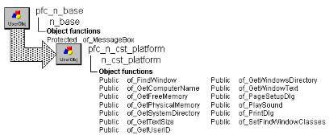

# n_cst_platform

**Description**

Ancestor object for platform-specific functions. Most of the functions in this object are virtual functions and return -1, FALSE, or an empty string. A **virtual function** is an empty placeholder function; the actual processing occurs in its descendants.

Defining virtual functions in an ancestor object is a technique that allows you to define a reference variable with the ancestor’s data type but instantiate the variable with the descendant’s data type. PFC contains descendent objects for each supported platform.

**Ancestry**



**Library**

- PFCAPSRV.PBL
- PFEAPSRV.BPL

**Object relationships**

- [s_pagesetupattrib](../05-global-structures-and-structure-objects/s_pagesetupattrib.md)
- [s_printdlgattrib](../05-global-structures-and-structure-objects/s_printdlgattrib.md)
- w_pagesetup

**Usage**

To use the platform service:

1. Instantiate the appropriate platform services object by calling the f_SetPlatform global function. This function examines your environment and instantiates the appropriate user object.
2. Call platform services functions as required. The code for these functions is defined in the descendant objects. If the function isn’t available on your platform, PowerBuilder executes the ancestor (n_cst_platform) function, which returns 0, -1, FALSE, or an empty string.

**Descendants**

n_cst_platformaix (see n_cst_platformsol2) n_cst_platformhpux (see n_cst_platformsol2) n_cst_platformsol2 n_cst_platformwin32

**See also**

- [f_SetPlatform](../04-global-functions/f_setplatform.md)
- [n_cst_filesrv](n_cst_filesrv.md)

## Instance variables

N_cst_platform contains an instance variable:

| Instance variable | Description | Data type | Access | Usage |
| --- | --- | --- | --- | --- |
| is_separator | Separator character | String | Protected | Used by the operating system when specifying fully qualified pathnames (default is backslash) |

## Functions

N_cst_platform includes precoded object functions, which are virtual functions with corresponding versions in n_cst_platform descendants:

- of_FindWindow
- of_GetComputerName
- of_GetFreeMemory
- of_GetPhysicalMemory
- of_GetSystemDirectory
- of_GetTextSize
- of_GetUserID
- of_GetWindowsDirectory
- of_GetWindowText
- of_PageSetupDlg
- of_PlaySound
- of_PrintDlg
- of_SetFindWindowClasses

By defining virtual functions in this object, you can declare a reference variable of type n_cst_platform for use with all n_cst_platform descendants.

### of_FindWindow

**Description**

Virtual function only. By defining virtual functions in this object, you can declare a reference variable of type n_cst_platform for use with all n_cst_platform descendants.

**Access**

Public

**Syntax**

```
instancename.of_FindWindow ( windowname )
```

| Argument | Description |
| --- | --- |
| *instancename* | Instance name of n_cst_platform |
| *windowname* | String |

**Return value**

UnsignedInteger. Always returns 0.

**See also**

n_cst_platformsol2 of_FindWindow function (also in n_cst_platformaix and n_cst_platformhpux) n_cst_platformwin32 of_FindWindow function of_SetFindWindowClasses

### of_GetComputerName

**Description**

Virtual function only. By defining virtual functions in this object, you can declare a reference variable of type n_cst_platform for use with all n_cst_platform descendants.

**Access**

Public

**Syntax**

```
instancename.of_GetComputerName ( )
```

| Argument | Description |
| --- | --- |
| *instancename* | Instance name of n_cst_platform |

**Return value**

String. Always returns an empty string.

**See also**

n_cst_platformsol2 of_GetComputerName function (also in n_cst_platformaix and n_cst_platformhpux) n_cst_platformwin32 of_GetComputerName function

### of_GetFreeMemory

**Description**

Virtual function only. By defining virtual functions in this object, you can declare a reference variable of type n_cst_platform for use with all n_cst_platform descendants.

**Access**

Public

**Syntax**

```
instancename.of_GetFreeMemory ( )
```

| Argument | Description |
| --- | --- |
| *instancename* | Instance name of n_cst_platform |

**Return value**

Long. Always returns -1.

**See also**

n_cst_platformsol2 of_GetFreeMemory function (also in n_cst_platformaix and n_cst_platformhpux) n_cst_platformwin32 of_GetFreeMemory function

### of_GetPhysicalMemory

**Description**

Virtual function only. By defining virtual functions in this object, you can declare a reference variable of type n_cst_platform for use with all n_cst_platform descendants.

**Access**

Public

**Syntax**

```
instancename.of_GetPhysicalMemory ( )
```

| Argument | Description |
| --- | --- |
| *instancename* | Instance name of n_cst_platform |

**Return value**

Long. Always returns -1.

**See also**

n_cst_platformsol2 of_GetPhysicalMemory function (also in n_cst_platformaix and n_cst_platformhpux) n_cst_platformwin32 of_GetPhysicalMemory function

### of_GetSystemDirectory

**Description**

Virtual function only. By defining virtual functions in this object, you can declare a reference variable of type n_cst_platform for use with all n_cst_platform descendants.

**Access**

Public

**Syntax**

```
instancename.of_GetSystemDirectory ( )
```

| Argument | Description |
| --- | --- |
| *instancename* | Instance name of n_cst_platform |

**Return value**

String. Always returns an empty string.

**See also**

n_cst_platformsol2 of_GetSystemDirectory function (also in n_cst_platformaix and n_cst_platformhpux) n_cst_platformwin32 of_GetSystemDirectory function

### of_GetTextSize

**Description**

Virtual function only. By defining virtual functions in this object, you can declare a reference variable of type n_cst_platform for use with all n_cst_platform descendants.

**Access**

Public

**Syntax**

```
instancename.of_GetTextSize ( window, text, font, fontsize, bold, italic,
underline, height, width )
```

| Argument | Description |
| --- | --- |
| *instancename* | Instance name of n_cst_platform |
| *window* | Window |
| *text* | String |
| *font* | String |
| *fontsize* | Integer |
| *bold* | Boolean |
| *italic* | Boolean |
| *underline* | Boolean |
| *height* | Integer (passed by reference) |
| *width* | Integer (passed by reference) |

**Return value**

Integer. Always returns -1.

**See also**

n_cst_platformsol2 of_GetTextSize function (also in n_cst_platformaix and n_cst_platformhpux) n_cst_platformwin32 of_GetTextSize function

### of_GetUserID

**Description**

Virtual function only. By defining virtual functions in this object, you can declare a reference variable of type n_cst_platform for use with all n_cst_platform descendants.

**Access**

Public

**Syntax**

```
instancename.of_GetUserID ( )
```

| Argument | Description |
| --- | --- |
| *instancename* | Instance name of n_cst_platform |

**Return value**

String. Always returns an empty string.

**See also**

n_cst_platformsol2 of_GetUserID function (also in n_cst_platformaix and n_cst_platformhpux) n_cst_platformwin32 of_GetUserID function

### of_GetWindowsDirectory

**Description**

Virtual function only. By defining virtual functions in this object, you can declare a reference variable of type n_cst_platform for use with all n_cst_platform descendants.

**Access**

Public

**Syntax**

```
instancename.of_GetWindowsDirectory ( )
```

| Argument | Description |
| --- | --- |
| *instancename* | Instance name of n_cst_platform |

**Return value**

String. Always returns an empty string.

**See also**

n_cst_platformsol2 of_GetWindowsDirectory function (also in n_cst_platformaix and n_cst_platformhpux) n_cst_platformwin32 of_GetWindowsDirectory function

### of_GetWindowText

**Description**

Virtual function only. By defining virtual functions in this object, you can declare a reference variable of type n_cst_platform for use with all n_cst_platform descendants.

**Access**

Public

**Syntax**

```
instancename.of_GetWindowText ( window )
```

| Argument | Description |
| --- | --- |
| *instancename* | Instance name of n_cst_platform |
| *window* | UnsignedInteger |

**Return value**

String. Always returns an empty string.

**See also**

n_cst_platformsol2 of_GetWindowText function (also in n_cst_platformaix and n_cst_platformhpux) n_cst_platformwin32 of_GetWindowText function

### of_PageSetupDlg

**Description**

Displays the w_pagesetup dialog box, which allows you to control print settings.

**Access**

Public

**Syntax**

```
instancename.of_PageSetupDlg ( setupinfo )
```

| Argument | Description |
| --- | --- |
| *instancename* | Instance name of n_cst_platform |
| *setupinfo* | S_pagesetupattrib instance into which the function places page setup information (passed by reference) |

**Return value**

Long. Returns 1 if the function succeeds, 0 if the user canceled out of the dialog box, and -1 if an error occurs.

### of_PlaySound

**Description**

Virtual function only. By defining virtual functions in this object, you can declare a reference variable of type n_cst_platform for use with all n_cst_platform descendants.

**Access**

Public

**Syntax**

```
instancename.of_PlaySound ( filename {, beeponfailure } )
```

| Argument | Description |
| --- | --- |
| *instancename* | Instance name of n_cst_platform |
| *filename* | String |
| *beeponfailure* | Boolean |

**Return value**

Integer. Always returns -1.

**See also**

n_cst_platformsol2 of_PlaySound function (also in n_cst_platformaix and n_cst_platformhpux) n_cst_platformwin32 of_PlaySound function

### of_PrintDlg

**Description**

Virtual function only. By defining virtual functions in this object, you can declare a reference variable of type n_cst_platform for use with all n_cst_platform descendants.

**Access**

Public

**Syntax**

```
instancename.of_PrintDlg ( printinfo, window )
```

| Argument | Description |
| --- | --- |
| *instancename* | Instance name of n_cst_platform |
| *printinfo* | S_printdlgattrib instance into which the function places print information (passed by reference) |
| *window* | Window |

**Return value**

Integer. Always returns -1.

**See also**

n_cst_platformwin32 of_PrintDlg function

### of_SetFindWindowClasses

**Description**

Sets the window class names to be used by the service.

**Access**

Public

**Syntax**

```
instancename.of_SetFindWindowClasses ( classname )
```

| Argument | Description |
| --- | --- |
| *instancename* | Instance name of n_cst_platform |
| *classname* | String name for array of window classes. |

**Return value**

Integer. Returns 1 if the function succeeds and -1 if an error occurs.

**Usage**

Of_FindWindow will use all of the class names specified in the *classname* array.

**See also**

of_FindWindow
