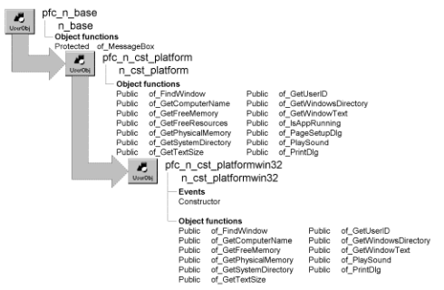

# n_cst_platformwin32

**Description**

Platform-specific functions for applications running on Windows. Platform-specific functions require a call to a platform-specific external function. When you call the f_SetPlatform function, it detects the operating environment and instantiates the correct platform-specific object.

The functions in this object call platform-specific external functions. To see a complete list of platform-specific external functions used by this object, access the User Object painter and select Declare>Local External Functions from the menu bar. This object calls functions in the following platform-specific 32-bit Windows modules:

- ADVAPI32.EXE
- GDI32.EXE
- KERNEL32.EXE
- USER32.EXE
- WINMM.DLL

**Ancestry**



**Library**

- PFCAPSRV.PBL
- PFEAPSRV.PBL

**Usage**

To use the platform service:

1. Instantiate the appropriate platform services object by calling the f_SetPlatform global function. This function examines your environment and instantiates the appropriate user object.
2. Call platform services functions as required. The code for these functions is defined in the descendant objects. If the function isn’t available on your platform, PowerBuilder executes the ancestor (n_cst_platform) function, which, depending on the function, returns an empty string, TRUE, -1, 0, or NULL.

| Structures Structure | Field | Data type |
| --- | --- | --- |
| os_memorystatus | ul_availpagefile | UnsignedLong |
|  | ul_availphys | UnsignedLong |
|  | ul_availvirtual | UnsignedLong |
|  | ul_length | UnsignedLong |
|  | ul_memoryload | UnsignedLong |
|  | ul_totalpagefile | UnsignedLong |
|  | ul_totalphys | UnsignedLong |
|  | ul_totalvirtual | UnsignedLong |
| os_size | l_cx | Long |
|  | l_cy | Long |

**See also**

- [f_SetPlatform](../04-global-functions/f_setplatform.md)
- [n_cst_filesrv](n_cst_filesrv.md)
- [n_cst_platform](n_cst_platform.md)

## Events

N_cst_platformwin32 includes a precoded event script:

Constructor

### Constructor

**Description**

Initializes the is_separator instance variable.

**Usage**

This event executes when the object is created.

## Functions

N_cst_platformwin32 includes precoded object functions:

- of_FindWindow
- of_GetComputerName
- of_GetFreeMemory
- of_GetPhysicalMemory
- of_GetSystemDirectory
- of_GetTextSize
- of_GetUserID
- of_GetWindowsDirectory
- of_GetWindowText
- of_PlaySound
- of_PrintDlg

### of_FindWindow

**Description**

Returns the handle of the specified window, as identified by window title.

**Access**

Public

**Syntax**

```
instancename.of_FindWindow ( windowname )
```

| Argument | Description |
| --- | --- |
| *instancename* | Instance name of n_cst_platform |
| *windowname* | String containing the window title. For MDI applications, this is the title of the frame window |

**Return value**

UnsignedInteger. Returns the handle of *windowname*.

**Usage**

This function calls the FindWindowA external function.

**Examples**

This example calls the of_FindWindow function:

```
UnsignedInteger lui_handle

lui_handle = inv_platform.of_FindWindow &
   (gnv_app.of_GetFrame( ).title)
MessageBox("Platform Service", &
   "Window handle is: " + String(lui_handle) )
```

### of_GetComputerName

**Description**

Returns the name of the current workstation.

**Access**

Public

**Syntax**

```
instancename.of_GetComputerName ( )
```

| Argument | Description |
| --- | --- |
| *instancename* | Instance name of n_cst_platform |

**Return value**

String. Returns the name of the current workstation.

**Usage**

This function calls the GetComputerNameA external function.

**Examples**

This example calls the of_GetComputerName function:

```
String   ls_computer

ls_computer = inv_platform.of_GetComputerName()
MessageBox("Platform", "Current workstations is:" &
   + ls_computer )
```

### of_GetFreeMemory

**Description**

Returns the number of bytes of available memory (including the maximum allowable size of the swap file).

**Access**

Public

**Syntax**

```
instancename.of_GetFreeMemory ( )
```

| Argument | Description |
| --- | --- |
| *instancename* | Instance name of n_cst_platform |

**Return value**

Long. Returns the number of bytes of available memory.

**Usage**

This function calls the GlobalMemoryStatus external function.

**Examples**

This example calls the of_GetFreeMemory function:

```
Long   ll_free

ll_free = inv_platform.of_GetFreeMemory()
MessageBox("Platform", String(ll_free) &
   + " bytes of free memory" )
```

### of_GetPhysicalMemory

**Description**

Returns the total number of bytes of physical memory (RAM).

**Access**

Public

**Syntax**

```
instancename.of_GetPhysicalMemory ( )
```

| Argument | Description |
| --- | --- |
| *instancename* | Instance name of n_cst_platform |

**Return value**

Long. Returns the number of bytes of memory.

**Usage**

This function calls the GlobalMemoryStatus external function.

**Examples**

This example calls the of_GetPhysicalMemory function:

```
Long  ll_total

ll_total = inv_platform.of_GetPhysicalMemory( )
MessageBox("Platform", String(ll_total) &
   + " bytes of RAM (total)" )
```

### of_GetSystemDirectory

**Description**

Returns the path of the system directory (for example, Windows\System).

**Access**

Public

**Syntax**

```
instancename.of_GetSystemDirectory ( )
```

| Argument | Description |
| --- | --- |
| *instancename* | Instance name of n_cst_platform |

**Return value**

String. Returns the path of the system directory if the function succeeds and an empty string if it cannot determine the system directory.

**Usage**

This function calls the GetSystemDirectoryA external function.

**Examples**

This example calls the of_GetSystemDirectory function:

```
String   ls_system

ls_system = inv_platform.of_GetSystemDirectory()
IF ls_system <> "" THEN
   MessageBox("Platform", "System Directory is: " &
       + String(ls_system) )
ELSE
...
```

### of_GetTextSize

**Description**

Calculates height and width in PBUs, based on the passed input arguments.

**Access**

Public

**Syntax**

```
instancename.of_GetTextSize ( window, text, font, fontsize, bold, italic,
underline, height, width )
```

| Argument | Description |
| --- | --- |
| *instancename* | Instance name of n_cst_platform |
| *window* | Window variable used by the function to create temporary text |
| *text* | String specifying the text for which the function calculates height and width |
| *font* | String specifying the font |
| *fontsize* | Integer specifying the font size |
| *bold* | Boolean specifying whether *text* is bold |
| *italic* | Boolean specifying whether *text* is italic |
| *underline* | Boolean specifying whether *text* is underlined |
| *height* | Integer into which the function places the text height, in PBUs (passed by reference) |
| *width* | Integer into which the function places the text width, in PBUs (passed by reference) |

**Return value**

Integer. Returns 1 if the function succeeds and -1 if an error occurs.

**Usage**

Call this function when sizing text objects and controls manually in a multiplatform environment.

This function calls the GetDC, SelectObject, GetTextExtentPoint32A, and ReleaseDC external functions.

**Examples**

This example is from the n_cst_dwsrv_report of_AddText function:

```
IF inv_Platform.of_GetTextSize(lw_parent, &
   ls_text + " ", as_fontface, ai_fontsize, &
       ab_bold, ab_italic, ab_underline, ai_height, &
          ai_width) = -1 Then Return -1
```

### of_GetUserID

**Description**

Returns the current network logon name.

**Access**

Public

**Syntax**

```
instancename.of_GetUserID ( )
```

| Argument | Description |
| --- | --- |
| *instancename* | Instance name of n_cst_platform |

**Return value**

String. Returns the current network logon ID if the function succeeds and an empty string if no log on ID can be found.

**Examples**

This example calls the of_GetUserID function:

```
String   ls_userid

ls_userid = inv_platform.of_GetUserID( )
IF ls_userid <> "" THEN
   MessageBox("Platform", "User ID is: " &
       + String(ls_userid) )
ELSE
...
```

### of_GetWindowsDirectory

**Description**

Returns the Windows directory (for example, C:\Windows).

**Access**

Public

**Syntax**

```
instancename.of_GetWindowsDirectory ( )
```

| Argument | Description |
| --- | --- |
| *instancename* | Instance name of n_cst_platform |

**Return value**

String. Returns the path of the Windows directory if the function succeeds and an empty string if it cannot determine the Windows directory.

**Usage**

This function calls the GetWindowsDirectoryA external function.

**Examples**

This example calls the of_GetWindowsDirectory function:

```
String   ls_windows

ls_windows = inv_platform.of_GetWindowsDirectory()
IF ls_windows <> "" THEN
   MessageBox("Platform", "Windows Directory is:" &
       + String(ls_windows) )
ELSE
...
```

### of_GetWindowText

**Description**

Returns the text in the window title.

**Access**

Public

**Syntax**

```
instancename.of_GetWindowText ( window )
```

| Argument | Description |
| --- | --- |
| *instancename* | Instance name of n_cst_platform |
| *window* | UnsignedInteger containing the window handle |

**Return value**

String. Returns the title text of the specified window if the function succeeds and an empty string if an error occurs.

**Usage**

This function calls the GetWindowTextA external function.

**Examples**

This example calls the of_GetWindowText function:

```
String   ls_title

ls_title = inv_platform.of_GetWindowText &
   (handle(this) )
MessageBox("Platform Service", &
   "Window title is: " + ls_title)
```

### of_PlaySound

**Description**

Plays the specified sound file.

**Access**

Public

**Syntax**

```
instancename.of_PlaySound ( filename )
```

| Argument | Description |
| --- | --- |
| *instancename* | Instance name of n_cst_platform |
| *filename* | String specifying the complete pathname of the sound file to play |

**Return value**

Integer. Returns 1 if the function succeeds and -1 if an error occurs.

**Usage**

This function calls the WaveOutGetNumDevs and sndPlaySoundA external functions.

**Examples**

This example calls the of_PlaySound function:

```
String   ls_sound

ls_sound=sle_soundfile.text
IF inv_platform.of_PlaySound(ls_sound) = -1 THEN
   gnv_app.of_GetFrame().SetMicroHelp &
       ("No sound capabilities")
END IF
```

### of_PrintDlg

**Description**

Displays an operating-system specific Print dialog box.

**Access**

Public

**Syntax**

```
instancename.of_PrintDlg ( printinfo, window )
```

| Argument | Description |
| --- | --- |
| *instancename* | Instance name of n_cst_platform |
| *printinfo* | S_printdlgattrib instance containing print information (passed by reference) |
| *window* | Window variable containing the window opening the Print dialog box |

**Return value**

Integer. Returns values as follows:

0—User cancelled print dialog 1—Success -1—Unspecified error -2—Max pages less than To pages -3—Min pages greater than From pages -4—From pages or To pages less than 0

**Usage**

In order to set the Pages radio button, you must specify From and To pages. Pages must be set to display the Collate checkbox.

**Examples**

This example is from the u_dw pfc_PrintDlg event:

```
...
astr_printdlg.b_allpages = TRUE

ls_copies = this.object.datawindow.print.copies
IF NOT IsNumber (ls_copies) THEN
   ls_copies = "1"
END IF
li_copies = Integer(ls_copies)
astr_printdlg.l_copies = li_copies
ls_collate = this.object.datawindow.print.collate
lb_collate = lnv_conversion.of_Boolean(ls_collate)
astr_printdlg.b_collate = lb_collate
astr_printdlg.l_frompage = 1
astr_printdlg.l_minpage = 1
...
this.Event pfc_PrePrintDlg(astr_printdlg)

f_SetPlatform(lnv_platform, TRUE)
this.of_GetParentWindow(lw_parent)
ll_rc = &
   lnv_platform.of_PrintDlg &
       astr_printdlg, lw_parent)
f_SetPlatform(lnv_platform, FALSE)
...
```
