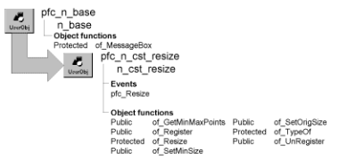

# n_cst_resize

**Description**

Resize service object.

**Ancestry**



**Library**

- PFCWNSRV.PBL
- PFEWNSRV.PBL

**Usage**

This service provides two resizing options:

- **For simple resizing** Call the of_Register function passing n_cst_resize constants, such as FIXEDBOTTOM
- **For total control over resizing** Implement weighted resize by calling the of_Register function with explicit specifications for moving and scaling

To use this service:

1. Enable the service using the w_master, u_tab, or u_tabpg of_SetResize function. This function automatically sets the original size instance variables:

   ```
   this.of_SetResize(TRUE)
   ```

2. (Optional) Specify the window, tab, or tab page’s original size by calling the of_SetOrigSize function. You call this function if an MDI application opens MDI sheets with an enumeration other than Original!:

   ```
   this.inv_resize.of_SetOrigSize &
   (this.width, this.height)
   ```

3. (Optional) Call the of_SetMinSize function to specify a minimum size below which the resize service no longer resizes registered controls:

   ```
   this.inv_resize.of_SetMinSize &
      (this.width-50, this.height-100)
   ```

4. Call the of_Register function once for each control that you want to be resized automatically whenever the object resizes.

   ```
   this.inv_resize.of_Register &
    (lv_emp, this.inv_resize.SCALERIGHTBOTTOM)
   this.inv_resize.of_Register &
    (cb_ok, this.inv_resize.FIXEDRIGHT)
   this.inv_resize.of_Register &
    (cb_cancel, this.inv_resize.FIXEDRIGHT)
   ```

The Resize event calls the n_cst_resize of_Resize function to perform the resizing.

5. (Optional) Call the of_UnRegister function to remove controls from the resize list.

**Open MDI sheets using the Original! enumeration** If you open MDI sheets with an enumeration other than Original!, call the of_SetOrigSize function before registering controls with the resize service. The call to of_SetOrigSize passes what the workspace width and height would have been had the sheet opened in the original size. This applies to controls in a window, tab, or tab page.

**PFC 7 custom class extension** To further the extendibility of PFC, a new n_cst_resizeattrib custom class user object replaces the os_resize object structure that is now obsolete.

**See also**

- [n_cst_dwsrv_resize](n_cst_dwsrv_resize.md)
- [u_tab](../06-standard-visual-user-objects/u_tab.md)
- [u_tabpg](../07-custom-visual-user-objects/u_tabpg.md)
- [w_master](../02-window-objects/w_master.md)

## Instance variables

N_cst_resize includes instance variables:

| Instance variable | Description | Data type | Access | Usage |
| --- | --- | --- | --- | --- |
| DRAGOBJECT | Constant set to DragObject! | String | Protected | Internal |
| FIXEDBOTTOM | Constant set to FixedToBottom | String | Public | Use with of_Register |
| FIXEDBOTTOM_SCALERIGHT | Constant set to FixedToBottom& ScaleToRight | String | Public | Use with of_Register |
| FIXEDCENTER | Constant set to 'FixedToCenter' | String | Public |  |
| FIXEDCENTERBOTTOM | Constant set to 'FixedToCenterBottom' | String | Public |  |
| FIXEDCENTERLEFT | Constant set to 'FixedToCenterLeft' | String | Public |  |
| FIXEDCENTERRIGHT | Constant set to 'FixedToCenterRight' | String | Public |  |
| FIXEDCENTERTOP | Constant set to 'FixedToCenterTop' | String | Public |  |
| FIXEDRIGHT | Constant set to FixedToRight | String | Public | Use with of_Register |
| FIXEDRIGHT_SCALEBOTTOM | Constant set to FixedToRight& ScaleToBottom | String | Public | Use with of_Register |
| FIXEDRIGHTBOTTOM | Constant set to FixedToRight&Bottom | String | Public | Use with of_Register |
| ics_dragobject | Obsoleted in 6.0. | String | Protected |  |
| ics_line | Obsoleted in 6.0. | String | Protected |  |
| ics_mdiclient | Obsoleted in 6.0. | String | Protected |  |
| ics_oval | Obsoleted in 6.0. | String | Protected |  |
| ics_rectangle | Obsoleted in 6.0. | String | Protected |  |
| ics_roundrectangle | Obsoleted in 6.0. | String | Protected |  |
| ii_rounding | Rounding factor | Integer | Protected | Internal (default is 5) |
| il_parentminimumheight | Minimum height for the parent window | Long | Protected | Set with the of_SetMinSize |
| il_parentminimumwidth | Minimum width for the parent window | Long | Protected | Set with the of_SetMinSize |
| il_parentprevheight | Original height of the parent window | Long | Protected | Set with of_SetOrigSize |
| il_parentprevwidth | Original width of the parent window | Long | Protected | Set with of_SetOrigSize |
| inv_registered [ ] | Structure array to track objects eligible for resizing | n_cst_resize attrib | Protected | Internal |
| istr_registered[ ] |  | n_cst_resizeattrib | Protected |  |
| LINE | Constant set to Line! | String | Protected | Internal |
| MDICLIENT | Constant set to MDIClient! | String | Protected | Internal |
| OVAL | Constant set to Oval! | String | Protected | Internal |
| RECTANGLE | Constant set to Rectangle! | String | Protected | Internal |
| ROUNDRECTANGLE | Constant set to RoundRectangle! | String | Protected | Internal |
| SCALE | Constant set to 'Scale' | String | Public |  |
| SCALEBOTTOM | Constant set to 'ScaleToBottom' | String | Public |  |
| SCALERIGHT | Constant set to 'ScaleToRight' | String | Public |  |
| SCALERIGHTBOTTOM | Constant set to 'ScaleToRight&Bottom' | String | Public |  |

## Events

N_cst_resize includes a precoded event:

pfc_Resize

### Constructor

**Description**

Resize service.

**Syntax**

```
instancename.EVENT Constructor ( )
```

| Argument | Description |
| --- | --- |
| *instancename* | Instance name of n_cst_resize |

**Return value**

None.

### pfc_Resize

**Description**

Calls the of_Resize function, resizing the object, as specified in the of_Register function calls.

**Syntax**

```
instancename.EVENT pfc_Resize ( sizetype, newwidth, newheight )
```

| Argument | Description |
| --- | --- |
| *instancename* | Instance name of n_cst_resize (the default is inv_resize) |
| *sizetype* | UnsignedLong specifying the resize type: |
|  | • 0 — (Restored) The window or DataWindow has been resized, but it was not minimized or maximized. The user may have dragged the borders or a script may have called the Resize PowerScript function |
|  | • 1 — (Minimized) The window or DataWindow has been minimized |
|  | • 2 — (Maximized) The window or DataWindow has been maximized |
| *newwidth* | Integer specifying the new width |
| *newheight* | Integer specifying the new height |

**Usage**

The u_dw, u_tab, and u_tabpg Resize events call this event.

## Functions

N_cst_resize includes precoded object functions:

- of_GetMinMaxPoints
- of_GetMinSize (PFC 2025 and later)
- of_getminmaxpoints_line
- of_Register
- of_Resize
- of_IsWindowMinSize (PFC 2025 and later)
- of_SetMinSize
- of_SetOrigSize
- of_SetWindowMinSize (PFC 2025 and later)
- of_TypeOf
- of_UnRegister

### of_GetMinMaxPoints

**Description**

Retrieves the four extreme points of all controls within a window.

**Access**

Public

**Syntax**

```
instancename.of_GetMinMaxPoints ( controls, minx, miny, maxx, maxy )
```

| Argument | Description |
| --- | --- |
| *instancename* | Instance name of n_cst_resize (the default is inv_resize) |
| *controls* | WindowObject array containing the controls for which the minimum and maximum points are returned |
| *minx* | Integer into which the function places the minimum *x* coordinate (passed by reference) |
| *miny* | Integer into which the function places the minimum *y* coordinate (passed by reference) |
| *maxx* | Integer into which the function places the maximum *x* coordinate (passed by reference) |
| *maxy* | Integer into which the function places the maximum *y* coordinate (passed by reference) |

**Return value**

Integer. Returns 1 if the function succeeds and -1 if an error occurs.

**Examples**

This example calls the of_GetMinMaxPoints function from within a window control:

```
WindowObject   lwo_controls[ ]
Integer  li_minx, li_miny, li_maxx, li_maxy
Integer  li_return

li_return = parent.inv_resize.of_GetMinMaxPoints &
   (parent.control[ ], li_minx, li_miny, &
       li_maxx, li_maxy)
IF li_return = -1 THEN
   MessageBox("Window Resize", &
       "Error in of_GetMinMaxPoints")
ELSE
   MessageBox("Window Resize", &
       "Minimum x: " + String(li_minx) &
       + "~r~nMinimum y: " + String(li_miny) &
       + "~r~nMaximum x: " + String(li_maxx) &
       + "~r~nMaximum y: " + String(li_maxy))
END IF
```

### of_GetMinSize

> Available in PFC 2025 and later. Not available in the 2019 and 2022 versions of PFC.

**Description**

Returns the minimum size set with of_SetMinSize.

**Access**

Public

**Syntax**

```
instancename.of_GetMinSize ( minimumwidth, minimumheight )
```

| Argument | Description |
| --- | --- |
| *instancename* | Instance name of n_cst_resize (the default is inv_resize) |
| *minimumwidth* | Integer, passed by reference. The minimum width of the workspace |
| *minimumheight* | Integer, passed by reference. The minimum height of the workspace |

**Return value**

Integer. Returns 1, or 0 if no minimum size is set.

### of_getminmaxpoints_line

**Description**

No description is available.

**Access**

Public

**Syntax**

```
instancename.of_getminmaxpoints_line ( awo_control, ai_x, ai_y, ai_width, ai_height )
```

| Argument | Description |
| --- | --- |
| *instancename* | Instance name of n_cst_resize |
| *awo_control* | WindowObject. |
| *ai_x* | Integer, passed by reference. |
| *ai_y* | Integer, passed by reference. |
| *ai_width* | Integer, passed by reference. |
| *ai_height* | Integer, passed by reference. |

**Return value**

Integer.

### of_IsWindowMinSize

> Available in PFC 2025 and later. Not available in the 2019 and 2022 versions of PFC.

**Description**

Reports whether the user can make the window smaller than the minimum size (see of_SetWindowMinSize).

**Access**

Public

**Syntax**

```
instancename.of_IsWindowMinSize ( )
```

| Argument | Description |
| --- | --- |
| *instancename* | Instance name of n_cst_resize (the default is inv_resize) |

**Return value**

Boolean. Returns TRUE if the user can't make the window smaller than the minimum size, and FALSE (the default) if the user can.

### of_Register

Registers a control for resizing. The resize service moves and optionally resizes registered controls when the user resizes the window. There are two syntaxes:

| To register by specifying | Use |
| --- | --- |
| Resize and move percentages | Syntax 1 |
| Resize method | Syntax 2 |

**One additional syntax** N_cst_resize supports one additional of_Register syntax, which is defined as protected and used internally by the other syntaxes.

For more information on this syntax, use the Object Browser.

| Syntax 1 | Register by specifying resize and move percentages |
| --- | --- |

**Description**

Registers a control for resizing given resize and move percentages.

**Access**

Public

**Syntax**

```
instancename.of_Register ( control, movex, movey, scalewidth,
scaleheight )
```

| Argument | Description |
| --- | --- |
| *instancename* | Instance name of n_cst_resize (the default is inv_resize) |
| *control* | WindowObject variable specifying the object to be resized |
| *movex* | Integer specifying the percentage to move the object along the x axis |
| *movey* | Integer specifying the percentage to move the object along the y axis |
| *scalewidth* | Integer specifying the percentage to resize the object along the x axis |
| *scaleheight* | Integer specifying the percentage to resize the object along the y axis |

**Return value**

Integer. Returns 1 if the function succeeds and -1 if an error occurs.

**Usage**

Because you can explicitly specify resize and move percentages, this syntax provides more flexibility than Syntax 2.

**Examples**

This example calls the of_Register function:

```
this.inv_resize.of_Register &
 (dw_1, 0, 0, 50, 50)
this.inv_resize.of_Register &
  (dw_2, 100, 0, 50, 50)
```

| Syntax 2 | Register by specifying a resize method |
| --- | --- |

**Description**

Registers a control for resizing given a resize method.

**Access**

Public

**Syntax**

```
instancename.of_Register ( control, method )
```

| Argument | Description |
| --- | --- |
| *instancename* | Instance name of n_cst_resize (the default is inv_resize) |
| *control* | WindowObject variable containing the control to be registered |
| *method* | String or n_cst_resize constant specifying how the resize service handles *control* when the window Resize event occurs: |
|  | • "FixedToRight" or FIXEDRIGHT |
|  | • "FixedToBottom" or FIXEDBOTTOM |
|  | • "FixedToRight&Bottom" or FIXEDRIGHTBOTTOM |
|  | • "Scale" or SCALE |
|  | • "ScaleToRight" or SCALERIGHT |
|  | • "ScaleToBottom" or SCALEBOTTOM |
|  | • "ScaleToRight&Bottom" or SCALERIGHTBOTTOM |
|  | • "FixedToRight&ScaleToBottom" or FIXEDRIGHT_SCALEBOTTOM |
|  | • "FixedToBottom&ScaleToRight" or FIXEDBOTTOM_SCALERIGHT |

**Return value**

Integer. Returns 1 if the function succeeds and -1 if an error occurs.

**Examples**

This example calls the of_Register function:

```
this.of_SetResize(TRUE)
this.inv_resize.of_SetOrigSize &
 (this.width, this.height)
this.inv_resize.of_Register &
 (lv_emp, this.inv_resize.SCALERIGHTBOTTOM)
this.inv_resize.of_Register &
 (cb_ok, this.inv_resize.FIXEDRIGHT)
this.inv_resize.of_Register &
 (cb_cancel, this.inv_resize.FIXEDRIGHT)
```

### of_Resize

**Description**

Moves or resizes registered controls, as specified in the of_Register function.

**Access**

Protected

**Syntax**

```
instancename.of_Resize ( newwidth, newheight )
```

| Argument | Description |
| --- | --- |
| *instancename* | Instance name of n_cst_resize (the default is inv_resize) |
| *newwidth* | Integer specifying the new window width |
| *newheight* | Integer specifying the new window height |

**Return value**

Integer. Returns 1 if the function succeeds and -1 if an error occurs.

**Usage**

The w_master Resize event calls this function when the resize service has been enabled.

**Examples**

This example is from the w_master Resize event:

```
IF IsValid (inv_resize) THEN
   inv_resize.of_Resize &
       (this.WorkSpaceWidth(), &
          this.WorkSpaceHeight())
END IF
```

### of_SetMinSize

**Description**

Establishes a minimum window size below which the resize service no longer modifies the position of registered controls.

The size is that of the window's workspace (WorkSpaceWidth and WorkSpaceHeight), the area inside the border, title bar, and menu bar.

**Access**

Public

**Syntax**

```
instancename.of_SetMinSize ( minimumwidth, minimumheight )
```

| Argument | Description |
| --- | --- |
| *instancename* | Instance name of n_cst_resize (the default is inv_resize) |
| *minimumwidth* | Integer specifying minimum width |
| *minimumheight* | Integer specifying minimum height |

**Return value**

Integer. Returns 1 if the function succeeds and -1 if an error occurs.

**Usage**

By default, the user can still make the window smaller than the minimum size; only the controls stop moving and resizing. To stop the user from making the window smaller, call of_SetWindowMinSize(TRUE) (PFC 2025 and later).

**Examples**

This example calls the of_SetMinSize function:

```
this.inv_resize.of_SetMinSize &
 (this.width, this.height)
this.inv_resize.of_Register &
 (lv_emp, this.inv_resize.SCALERIGHTBOTTOM)
this.inv_resize.of_Register &
 (cb_ok, this.inv_resize.FIXEDRIGHT)
this.inv_resize.of_Register &
 (cb_cancel, this.inv_resize.FIXEDRIGHT)
```

### of_SetOrigSize

**Description**

Saves the current window size.

**Access**

Public

**Syntax**

```
instancename.of_SetOrigSize ( width, height )
```

| Argument | Description |
| --- | --- |
| *instancename* | Instance name of n_cst_resize (the default is inv_resize) |
| *width* | Integer specifying the window width |
| *height* | Integer specifying the window height |

**Return value**

Integer. Returns 1 if the function succeeds and -1 if an error occurs.

**Usage**

You call this function before calling the of_Register function.

**Examples**

This example calls the of_SetOrigSize function:

```
Integer  li_return

this.of_SetResize(TRUE)
li_return = this.inv_resize.of_SetOrigSize &
   (this.width, this.height)
...
```

### of_SetWindowMinSize

> Available in PFC 2025 and later. Not available in the 2019 and 2022 versions of PFC.

**Description**

Specifies whether the user can make the window smaller than the minimum size set with of_SetMinSize.

**Access**

Public

**Syntax**

```
instancename.of_SetWindowMinSize ( switch )
```

| Argument | Description |
| --- | --- |
| *instancename* | Instance name of n_cst_resize (the default is inv_resize) |
| *switch* | Boolean. TRUE: the user can't make the window smaller than the minimum size. FALSE (the default): the window can be made smaller, and only the controls stop moving and resizing at the minimum size |

**Return value**

Integer. Returns 1 if the function succeeds and -1 if an error occurs.

**Usage**

The window (w_master) applies the limit in its pfc_GetMinMaxInfo event, which handles the Windows WM_GETMINMAXINFO message: the minimum size is that of the workspace, plus the window's frame (border, title bar, menu bar), so the workspace can't become smaller than the minimum size. Windows also applies it when a script resizes the window.

**Examples**

This example keeps the window at least as large as it is when it opens:

```
this.of_SetResize(TRUE)
this.inv_resize.of_SetMinSize &
   (this.WorkSpaceWidth(), this.WorkSpaceHeight())
this.inv_resize.of_SetWindowMinSize(TRUE)
```

### of_TypeOf

**Description**

Determines the object type for a window control.

**Access**

Protected

**Syntax**

```
instancename.of_TypeOf ( control )
```

| Argument | Description |
| --- | --- |
| *instancename* | Instance name of n_cst_resize (the default is inv_resize) |
| *control* | WindowObject variable for which the function determines the object type |

**Return value**

String. Returns the object type if the function succeeds and ! if an error occurs.

**Usage**

Internal.

**Examples**

This example is from the of_Register function:

```
Choose Case of_TypeOf(awo_control[li_cnt])
   Case DRAGOBJECT
   ...
```

### of_UnRegister

**Description**

Removes a control from the list of controls eligible for resizing.

**Access**

Public

**Syntax**

```
instancename.of_UnRegister ( control )
```

| Argument | Description |
| --- | --- |
| *instancename* | Instance name of n_cst_resize (the default is inv_resize) |
| *control* | WindowObject variable containing the control to be unregistered |

**Return value**

Integer. Returns 1 if the function succeeds and -1 if an error occurs.

**Examples**

This example calls the of_UnRegister function:

```
Integer  li_return

li_return = parent.inv_resize.of_UnRegister &
   (lv_emp)
IF li_return = -1 THEN
   MessageBox("Resize", "UnRegister failed")
END IF
```
