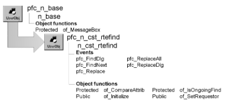

# n_cst_rtefind

**Description**

Find and replace service. Controls find and replace operations in a u_rte-based RichTextEdit control.

**Ancestry**



**Library**

- PFCAPSRV.PBL
- PFEAPSRV.PBL

**Object relationships**

u_rte

**Usage**

U_rte uses this object to control find and replace processing.

To use this service:

1. Enable the service using the u_rte of_SetFind function:

   ```
   rte_doc.of_SetFind(TRUE)
   ```

When users select Edit>Find or Edit>Replace from the menu bar of a menu that descends from the m_master menu, the service displays the w_find or w_replace dialog box. You can also display these dialog boxes programmatically, as explained in the next step.

2. Display the w_find dialog box by calling the u_rte pfc_FindDlg event; display the w_replace dialog box by calling the u_rte pfc_ReplaceDlg event. This example displays the w_find dialog box:

   ```
   rte_doc.Event pfc_FindDlg()
   ```

**See also**

u_rte

## Instance variables

| Instance variable | Description | Data type | Access | Usage |
| --- | --- | --- | --- | --- |
| ib_ongoingfind | Indicates whether a find operation is a new find or a find next operation | Boolean | Protected | Internal |

| Instance variable | Description | Data type | Access | Usage |
| --- | --- | --- | --- | --- |
| idw_requestor | U_dw-based DataWindow control that is associated with this instance of n_cst_rtefind | u_dw | Protected | The DataWindow must use the RichTextEdit presentation style. You must add supporting code to implement find and replace for RichTextEdit DataWindows |
| inv_findattrib | Structure object containing find and replace information | n_cst_findattrib | Protected | Internal |
| irte_requestor | U_rte-based RichTextEdit control that is associated with this instance of n_cst_rtefind | u_rte | Protected | Internal |

## Events

N_cst_rtefind includes precoded event scripts:

- pfc_FindDlg
- pfc_FindNext
- pfc_Replace
- pfc_ReplaceAll
- pfc_ReplaceDlg

### pfc_FindDlg

**Description**

Displays the w_find dialog box.

**Usage**

This event is called when the RichTextEdit has focus and the user selects Edit>Find from a menu that descends from the PFC m_master menu.

### pfc_FindNext

**Description**

Begins a search using the current settings.

**Syntax**

```
instancename.Event pfc_FindNext ( findattrib )
```

| Argument | Description |
| --- | --- |
| *instancename* | Instance name of n_cst_rtefind |
| *findattrib* | N_cst_findattrib instance containing find information. From within the pfc_FindNext event, access this value through the *anv_findattrib* argument |

**Return value**

Integer. Returns the number of characters found. This event returns 0 if no matching text is found and -1 if an error occurs.

**Usage**

This event is called by the w_find and w_replace dialog boxes to continue a search for a previously specified string.

### pfc_Replace

**Description**

Replaces text as specified in the w_replace dialog box.

**Syntax**

```
instancename.Event pfc_Replace ( findattrib )
```

| Argument | Description |
| --- | --- |
| *instancename* | Instance name of n_cst_rtefind |
| *findattrib* | N_cst_findattrib instance containing find information. From within the pfc_Replace event, access this value through the *anv_findattrib* argument |

**Return value**

Integer. Returns 1 if the event succeeds and -1 if an error occurs.

**Usage**

The w_replace dialog box calls this event when the user clicks Replace.

### pfc_ReplaceAll

**Description**

Calls the pfc_Replace event to replace all occurrences of the search string with the target string.

**Syntax**

```
instancename.Event pfc_ReplaceAllt ( findattrib )
```

| Argument | Description |
| --- | --- |
| *instancename* | Instance name of n_cst_rtefind |
| *findattrib* | n_cst_findattrib instance containing find information. From within the pfc_ReplaceAll event, access this value through the *anv_findattrib* argument |

**Return value**

Integer. Returns 1 if the event succeeds and -1 if an error occurs.

**Usage**

The w_replace dialog box calls this event when the user clicks Replace All.

### pfc_ReplaceDlg

**Description**

Displays the w_replace dialog box.

**Usage**

This event is called when the RichTextEdit has focus and the user selects Edit>Replace from a menu that descends from the PFC m_master menu.

## Functions

N_cst_rtefind includes precoded object functions:

- of_CompareAttrib
- of_Initialize
- of_IsOngoingFind
- of_SetRequestor

### of_CompareAttrib

**Description**

Reports whether the user has made changes to specifications on the w_replace dialog box.

**Access**

Protected

**Syntax**

```
instancename.of_CompareAttrib ( findattrib )
```

| Argument | Description |
| --- | --- |
| *instancename* | Instance name of n_cst_rtefind |
| *findattrib* | N_cst_findattrib instance containing find information |

**Return value**

Boolean. Returns TRUE if there are no changes and FALSE if changes were made.

**Usage**

The of_IsOngoingFind function calls this function.

**Examples**

This example is from the of_IsOnGoingFind function:

```
IF IsValid(anv_findattrib) THEN
   IF NOT of_CompareAttrib(anv_findattrib) THEN
   Return FALSE
   END IF
END IF
Return TRUE
```

### of_Initialize

**Description**

Initializes the inv_findattrib instance with the passed values.

**Access**

Public

**Syntax**

```
instancename.of_Initialize ( findattrib )
```

| Argument | Description |
| --- | --- |
| *instancename* | Instance name of n_cst_rtefind |
| *findattrib* | N_cst_findattrib instance containing find information |

**Return value**

Integer. Returns 1 if the function succeeds and -1 if an error occurs.

**Usage**

Call this function when the inv_findattrib default values are not appropriate.

**Examples**

This example calls the of_Initialize function:

```
// Display the Find/Replace windows with
// The Direction Control only.
n_cst_findattrib  lnv_findattrib

lnv_findattrib.is_find = ’’
lnv_findattrib.is_replacewith = ’’
lnv_findattrib.ib_wholewordvisible =False
lnv_findattrib.ib_wholewordenabled =False
lnv_findattrib.ib_wholeword = False
lnv_findattrib.ib_matchcasevisible = False
lnv_findattrib.ib_matchcaseenabled = False
lnv_findattrib.ib_matchcase = False
lnv_findattrib.ib_directionvisible = True
lnv_findattrib.ib_directionenabled = True
lnv_findattrib.is_direction = ’Down’
lnv_findattrib.ib_lookvisible = False
lnv_findattrib.ib_lookenabled = False

rte_emp.inv_find.of_Initialize(lnv_findattrib)
```

### of_IsOngoingFind

**Description**

Reports whether the current find operation is a new Find or Find Next operation.

**Access**

Public

**Syntax**

```
instancename.of_IsOngoingFind ( findattrib )
```

| Argument | Description |
| --- | --- |
| *instancename* | Instance name of n_cst_rtefind |
| *findattrib* | N_cst_findattrib instance containing find information |

**Return value**

Boolean. Returns TRUE if the current find is the same as before and FALSE if it is not.

**Usage**

N_cst_rtefind events call this function to determine is the current find operation is a new Find or Find Next operation.

**Examples**

This example is from the pfc_FindNext event:

```
...
IF ib_ongoingfind THEN
   ib_ongoingfind = of_IsOngoingFind(anv_findattrib)
END IF
...
```

### of_SetRequestor

**Description**

Associates a RichTextEdit or DataWindow control with this instance of n_cst_rtefind.

**Access**

Public

**Syntax**

```
instancename.of_SetRequestor ( requestor )
```

| Argument | Description |
| --- | --- |
| *instancename* | Instance name of n_cst_rtefind |
| *requestor* | U_rte-based RichTextEdit control or u_dw-based DataWindow window control to associate with this instance of n_cst_rtefind |

**Return value**

Integer. Returns 1 if the function succeeds and -1 if an error occurs.

**Usage**

The u_rte of_SetFind function calls this function.

If you are writing an extension to use this service with a DataWindow using the RichTextEdit presentation style, call this function to associate the DataWindow with this service.

**Examples**

This example is from the u_rte of_SetFind function:

```
...
IF ab_Switch THEN
   IF Not IsValid(inv_find) THEN
       inv_find = Create n_cst_rtefind
       inv_find.of_SetRequestor(this)
       Return 1
   END IF
ELSE
...
```
