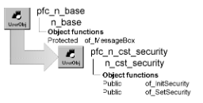

# n_cst_security

**Description**

Security service. PFC can handle many of your application’s security needs. It includes administrative components and a runtime security object, n_cst_security. N_cst_security includes instance variables as well as precoded events and functions. This discussion describes only those functions you code in an application.

For complete information on security in PFC, see the *PFC User’s Guide*.

**Ancestry**



**Library**

- PFCAPSRV.PBL
- PFEAPSRV.PBL

**Object relationships**

- [n_cst_string](n_cst_string.md)
- [n_ds](../08-standard-class-user-objects/n_ds.md)
- [n_tr](../08-standard-class-user-objects/n_tr.md)

**Usage**

To use the PFC security system, you must first define users and groups, then associate them with windows and controls, as described in the *PFC User’s Guide*.

To use n_cst_security in an application:

1. Create the object by calling the n_cst_appmanager of_SetSecurity function (this example is from an n_cst_appmanager pfc_Open event:

   ```
   this.of_SetSecurity(TRUE)
   ```

2. Establish a transaction object for the security database. This example assumes an itr_sec instance variable of type n_tr on n_cst_appmanager:

   ```
   itr_sec = CREATE n_tr
   CONNECT using itr_sec;
   ```

3. Initialize the security object by calling the of_InitSecurity function:

   ```
   this.inv_security.of_InitSecurity &
   (itr_sec, "EISAPP", &
      gnv_app.of_GetUserID(), "Default")
   ```

**N_cst_appmanager pfc_Open** The steps listed above might all be coded in the n_cst_appmanager pfc_Open event.

4. Disconnect from the database and destroy the transaction object when the application closes. This example might be coded in the n_cst_appmanager pfc_Close event:

   ```
   DISCONNECT using itr_sec;
   Destroy itr_sec
   ```

5. In the Open or pfc_PreOpen events of windows for which you want to apply security, call the of_SetSecurity function:

   ```
   IF NOT &
      gnv_app.inv_security.of_SetSecurity(this) THEN
      MessageBox("Security", &
         "Unable to set security")
      Close(this)
   END IF
   ```

**PFC 2025 and later** These features are available in PFC 2025 and later, and not in the 2019 and 2022 versions of PFC:

- Group membership from an identity provider: see the of_InitSecurity syntax that takes an array of groups, and of_GetGroups and of_IsExternalGroups.
- Keeping restrictions in place after application code enables or shows controls: see of_ApplyRestrictions, of_IsEnabledAllowed, and of_IsVisibleAllowed.
- Controls of types the service doesn't list are secured through their Visible property instead of ending the application: see of_SetControlStatus.
- Deny by default (least privilege): controls and menu items without a setting can be disabled or hidden: see of_SetDefaultStatus.

**See also**

n_cst_appmanager

## Instance variables

N_cst_security includes instance variables:

| Instance variable | Description | Data type | Access |
| --- | --- | --- | --- |
| DISABLE | Constant set to 'D' | String | Public |
| ENABLE | Constant set to 'E' | String | Public |
| ib_initscanning |  | Boolean | Protected |
| ib_externalgroups | True when the user's groups were passed to of_InitSecurity (PFC 2025 and later) | Boolean | Protected |
| ib_initsecurity |  | Boolean | Protected |
| ib_precache |  | Boolean | Protected |
| ib_restrictonly | True while of_ApplyRestrictions runs (PFC 2025 and later) | Boolean | Protected |
| ids_apps |  | n_ds | Protected |
| ids_groups |  | n_ds | Protected |
| ids_info |  | n_ds | Protected |
| ids_items |  | n_ds | Protected |
| ids_updates |  | n_ds | Protected |
| ii_libcnt |  | Integer | Protected |
| ipo_settled[ ] | Controls and menu items that received a setting in the current of_SetSecurity or of_ApplyRestrictions call, while a default status is set (PFC 2025 and later) | PowerObject | Protected |
| ii_numgroups |  | Integer | Protected |
| il_numberofrows |  | Long | Protected |
| inv_string |  | n_cst_string | Protected |
| INVISIBLE | Constant set to 'I' | String | Public |
| is_app |  | String | Protected |
| is_currfilter |  | String | Protected |
| is_defaultgroup |  | String | Protected |
| is_defaultstatus | Status for controls and menu items without a setting, set with of_SetDefaultStatus (PFC 2025 and later) | String | Protected |
| is_disabledborder |  | String | Protected |
| is_forcedstatus | Status applied instead of looking up a setting, while the default status is applied (PFC 2025 and later) | String | Protected |
| is_groups[ ] | Groups whose settings apply to the user (PFC 2025 and later) | String | Protected |
| is_enabledborder |  | String | Protected |
| is_keyword |  | String | Protected |
| is_liblist[ ] |  | String | Protected |
| is_loadedobjects | Objects whose settings have been retrieved (PFC 2025 and later) | String | Protected |
| is_separator |  | String | Protected |
| is_userID |  | String | Protected |
| itr_trans |  | n_tr | Protected |
| NOTSET | Constant set to '' | String | Public |

## Events

N_cst_security includes these events:

### Constructor

**Description**

Create all needed datastore objects.

**Syntax**

```
instancename.EVENT Constructor ( )
```

| Argument | Description |
| --- | --- |
| *instancename* | Instance name of n_cst_security |

**Return value**

None.

### Destructor

**Description**

Destroy all created datastore objects.

**Syntax**

```
instancename.EVENT Destructor ( )
```

| Argument | Description |
| --- | --- |
| *instancename* | Instance name of n_cst_security |

**Return value**

None.

## Functions

N_cst_security includes many precoded object functions. The functions you call from an application are documented here:

- of_addobject
- of_ApplyDefault (PFC 2025 and later)
- of_ApplyDefaultMenu (PFC 2025 and later)
- of_ApplyRestrictions (PFC 2025 and later)
- of_FindEntry
- of_GetControlName (PFC 2025 and later)
- of_GetDefaultStatus (PFC 2025 and later)
- of_GetGroups (PFC 2025 and later)
- of_GetPermissions
- of_GetStatus (PFC 2025 and later)
- of_GetSystemType (PFC 2025 and later)
- of_GetTag
- of_GetType
- of_InitScanProcess
- of_InitSecurity
- of_IsA (PFC 2025 and later)
- of_IsDefaultEligible (PFC 2025 and later)
- of_IsEnabledAllowed (PFC 2025 and later)
- of_IsExternalGroups (PFC 2025 and later)
- of_IsSettled (PFC 2025 and later)
- of_IsVisibleAllowed (PFC 2025 and later)
- of_LoadSecurity
- of_MarkSettled (PFC 2025 and later)
- of_ScanControlArray
- of_ScanDatawindow
- of_ScanWindow
- of_SetControlArray
- of_SetControlStatus
- of_SetControlStatus_Generic (PFC 2025 and later)
- of_SetDataWindowColumns
- of_SetDefaultStatus (PFC 2025 and later)
- of_SetMenu
- of_SetMenuStatus
- of_SetSecurity
- of_SetState

### of_addobject

**Description**

Add an objects information to the template Datastore.

**Access**

Protected

**Syntax**

```
instancename.of_addobject ( as_app, as_winname, as_object, as_objecttype, as_desc )
```

| Argument | Description |
| --- | --- |
| *instancename* | Instance name of n_cst_security |
| *as_app* | String. application. |
| *as_winname* | String. window name. |
| *as_object* | String. object name. |
| *as_objecttype* | String. object type. |
| *as_desc* | String. description of object. |

**Return value**

Integer. integer; Return code from import string.

### of_ApplyDefault

> Available in PFC 2025 and later. Not available in the 2019 and 2022 versions of PFC.

**Description**

Gives the default status (see of_SetDefaultStatus) to the controls in a control array that received no setting.

**Access**

Protected

**Syntax**

```
instancename.of_ApplyDefault ( window, controls, objectname )
```

| Argument | Description |
| --- | --- |
| *instancename* | Instance name of n_cst_security |
| *window* | String. Name of the window |
| *controls* | GraphicObject array. The control array |
| *objectname* | String. Name of the object that owns the control array, or an empty string for the window |

**Return value**

Integer. Returns the number of controls set.

**Usage**

Called by of_SetSecurity. The controls of user objects, tabs, and tab pages are checked one by one, as of_SetControlArray does. The default only restricts: a disabled control isn't shown, and nothing is enabled.

### of_ApplyDefaultMenu

> Available in PFC 2025 and later. Not available in the 2019 and 2022 versions of PFC.

**Description**

Gives the default status (see of_SetDefaultStatus) to the menu items that have no submenu and received no setting.

**Access**

Protected

**Syntax**

```
instancename.of_ApplyDefaultMenu ( window, menu )
```

| Argument | Description |
| --- | --- |
| *instancename* | Instance name of n_cst_security |
| *window* | String. Name of the window |
| *menu* | Menu. The menu or menu item, together with its items |

**Return value**

Integer. Returns the number of menu items set.

**Usage**

Called by of_SetSecurity and of_ApplyRestrictions. Toolbar buttons follow their menu items. Cascading menu items and separators are left as designed.

### of_ApplyRestrictions

> Available in PFC 2025 and later. Not available in the 2019 and 2022 versions of PFC.

**Description**

Applies the Disable and Invisible settings for the user again, without enabling or showing anything.

**Access**

Public

**Syntax 1** For a window, its controls, and its menu

```
application.instancename.of_ApplyRestrictions ( window )
```

| Argument | Description |
| --- | --- |
| *application* | Global variable of type n_cst_appmanager (this must be gnv_app) |
| *instancename* | Instance name of n_cst_security (the n_cst_appmanager default for this is inv_security) |
| *window* | Window to apply the restrictions to |

**Return value**

Boolean. Returns TRUE if there are settings for the window, FALSE otherwise.

**Syntax 2** For an object secured on its own (a user object, tab, menu, or other control)

```
application.instancename.of_ApplyRestrictions ( object )
```

| Argument | Description |
| --- | --- |
| *application* | Global variable of type n_cst_appmanager (this must be gnv_app) |
| *instancename* | Instance name of n_cst_security |
| *object* | GraphicObject to apply the restrictions to |

**Return value**

Boolean. Returns TRUE if there are settings for the object, FALSE otherwise.

**Syntax 3** For one menu

```
application.instancename.of_ApplyRestrictions ( window, menu )
```

| Argument | Description |
| --- | --- |
| *application* | Global variable of type n_cst_appmanager (this must be gnv_app) |
| *instancename* | Instance name of n_cst_security |
| *window* | Window whose settings apply (the window the menu belongs to) |
| *menu* | Menu or menu item to apply the restrictions to, together with its items |

**Return value**

Integer. Returns the number of menu items set, 0 if there are no settings, and -1 if an argument is not valid.

**Usage**

of_SetSecurity applies the settings when you call it, and code that later sets a control's Enabled or Visible property can undo them. Call of_ApplyRestrictions after such code to apply the Disable and Invisible settings again. Unlike calling of_SetSecurity again, it doesn't enable or show controls whose setting is Enable, so your application's own state is kept.

Use Syntax 3 after code that enables or shows menu items, so that the whole window isn't processed. As with of_SetSecurity, the settings stored for the menu itself are used when the window has none for it. PFC's Window menu (pfc_m_master) and MRU service call this syntax after they enable or show items.

When a default status is set (see of_SetDefaultStatus), Syntax 1 and Syntax 3 also apply it to the controls and menu items that have no setting. Syntax 2 doesn't.

**Examples**

This example enables controls according to the state of the window, then applies the user's restrictions again:

```
cb_save.Enabled = lb_changed
cb_delete.Enabled = (dw_1.RowCount() > 0)
gnv_app.inv_security.of_ApplyRestrictions(this)
```

**See also**

of_IsEnabledAllowed, of_IsVisibleAllowed, of_SetSecurity

### of_FindEntry

**Description**

Used by the scanning process, if the entry is found then it is discarded from the datastore. We discard it so that it will not deleted or updated in the database.

**Access**

Protected

**Syntax**

```
instancename.of_FindEntry ( as_win, as_object )
```

| Argument | Description |
| --- | --- |
| *instancename* | Instance name of n_cst_security |
| *as_win* | String. string; window to be found. |
| *as_object* | String. string; object to be found. |

**Return value**

Boolean. boolean (true if found otherwise false)

### of_GetControlName

> Available in PFC 2025 and later. Not available in the 2019 and 2022 versions of PFC.

**Description**

Gets the window a control is on and the control's name as the security service names it.

**Access**

Protected

**Syntax**

```
instancename.of_GetControlName ( control, window, name )
```

| Argument | Description |
| --- | --- |
| *instancename* | Instance name of n_cst_security |
| *control* | DragObject. The control |
| *window* | Window, passed by reference. The window the control is on |
| *name* | String, passed by reference. The names of the user objects, tabs, and tab pages the control is inside, followed by the control's own name, separated by periods (for example, `tab_1.tabpage_1.cb_save`) |

**Return value**

Integer. Returns 1 if the function succeeds and -1 if the control is not on a window.

### of_GetDefaultStatus

> Available in PFC 2025 and later. Not available in the 2019 and 2022 versions of PFC.

**Description**

Gets the status given to controls and menu items that have no setting for the user.

**Access**

Public

**Syntax**

```
application.instancename.of_GetDefaultStatus ( )
```

| Argument | Description |
| --- | --- |
| *application* | Global variable of type n_cst_appmanager (this must be gnv_app) |
| *instancename* | Instance name of n_cst_security |

**Return value**

String. Returns DISABLE, INVISIBLE, or NOTSET (the default: controls without a setting are left as designed).

**See also**

of_SetDefaultStatus

### of_GetGroups

> Available in PFC 2025 and later. Not available in the 2019 and 2022 versions of PFC.

**Description**

Gets the groups whose settings apply to the current user.

**Access**

Public

**Syntax**

```
application.instancename.of_GetGroups ( groups )
```

| Argument | Description |
| --- | --- |
| *application* | Global variable of type n_cst_appmanager (this must be gnv_app) |
| *instancename* | Instance name of n_cst_security |
| *groups* | String array, passed by reference. The group names |

**Return value**

Integer. Returns the number of groups.

**Usage**

Returns the groups determined by of_InitSecurity, whether they came from the security database or from an identity provider. Use of_IsExternalGroups to find out which.

### of_GetPermissions

**Description**

Checks the security table to get the objects permission.

**Access**

Public

**Syntax**

```
instancename.of_GetPermissions ( as_object, as_control )
```

| Argument | Description |
| --- | --- |
| *instancename* | Instance name of n_cst_security |
| *as_object* | String. object to check security on. |
| *as_control* | String. Name of object/control to check security for. |

**Return value**

String. ENABLED, DISABLED, NOTSET, INVISIBLE '!' = Error.

### of_GetStatus

> Available in PFC 2025 and later. Not available in the 2019 and 2022 versions of PFC.

**Description**

Gets the setting that applies to the user for a control, loading the window's settings if necessary.

**Access**

Protected

**Syntax**

```
instancename.of_GetStatus ( window, control {, default } )
```

| Argument | Description |
| --- | --- |
| *instancename* | Instance name of n_cst_security |
| *window* | String. Name of the window (or object) |
| *control* | String. Name of the control |
| *default* (optional) | Boolean. TRUE (the default) returns the default status set with of_SetDefaultStatus when there's no setting; FALSE returns NOTSET |

**Return value**

String. Returns ENABLE, DISABLE, or INVISIBLE, or NOTSET if of_InitSecurity hasn't been called. When there is no setting or the lookup fails, it returns the default status (NOTSET unless one is set with of_SetDefaultStatus).

**Usage**

Used by of_IsEnabledAllowed and of_IsVisibleAllowed. The settings of a window are retrieved from the database only once.

### of_GetSystemType

> Available in PFC 2025 and later. Not available in the 2019 and 2022 versions of PFC.

**Description**

Gets the name of the PowerBuilder system type an object is or inherits from.

**Access**

Protected

**Syntax**

```
instancename.of_GetSystemType ( object )
```

| Argument | Description |
| --- | --- |
| *instancename* | Instance name of n_cst_security |
| *object* | PowerObject |

**Return value**

String. The system type name in lowercase (for example, `commandbutton` for a u_cb), or an empty string if it can't be determined.

**Usage**

Identifies control types through their class definition, for example to name a control type that of_SetControlStatus doesn't list.

### of_GetTag

**Description**

parses the passed string. If the string is empty it returns an empty string if the string contains a keyword that matches what is in ics_keyword (default is 'microhelp', default seperator is ';') then the value for the keyword is returned if none of the aboove is true then the original string is returned.

**Access**

Protected

**Syntax**

```
instancename.of_GetTag ( as_tag )
```

| Argument | Description |
| --- | --- |
| *instancename* | Instance name of n_cst_security |
| *as_tag* | String. string; Tag value. |

**Return value**

String. string;.

### of_GetType

**Description**

Provide ASCII format of typeof() function return.

**Access**

Public

**Syntax**

```
instancename.of_GetType ( a_object, as_desc )
```

| Argument | Description |
| --- | --- |
| *instancename* | Instance name of n_cst_security |
| *a_object* | WindowObject. windowobject ; Object that we want to determine the type of. |
| *as_desc* | String, passed by reference. |

**Return value**

String. Name of the object type.

### of_InitScanProcess

**Description**

Initialize the database connection, application and library search path. Used when scanning applications.

**Access**

Public

**Syntax**

```
instancename.of_InitScanProcess ( a_trans, as_app, as_lib_list )
```

| Argument | Description |
| --- | --- |
| *instancename* | Instance name of n_cst_security |
| *a_trans* | n_tr. n_tr ; used to connect to the database. |
| *as_app* | String. string; application id. |
| *as_lib_list* | String array. string; applications library search path. |

**Return value**

Integer. Integer; 1 for success. -1 = transaction not connected.

### of_InitSecurity

**Description**

Initializes security parameters.

**Access**

Public

**Syntax**

```
application.instancename.of_InitSecurity ( transaction, appname, user,
group {, precache } )
```

| Argument | Description |
| --- | --- |
| *application* | Global variable of type n_cst_appmanager (this must be gnv_app) |
| *instancename* | Instance name of n_cst_security (the n_cst_appmanager default is inv_security) |
| *transaction* | N_tr variable for the security database connection. You must connect to the database before calling this function |
| *appname* | String specifying the application name, as defined in the security database |
| *user* | String specifying the user ID, as defined in the security database |
| *group* | String specifying the default group. PFC uses this group if no group is defined in the database for *user* |
| *precache* (optional) | Boolean specifying whether to preload all security settings for the user (the default is FALSE) |

**Return value**

Integer. Returns values as follows:

- **1** Success
- **-1** Transaction not connected
- **-2** Application not in database
- **-3** User ID not in database
- **-4** User is not a member of any groups and specified default group does not exist
- **-5** Default group not specified
- **-6** Retrieval error

**Usage**

You typically call this function in the n_cst_appmanager pfc_Open event.

You must call the n_cst_appmanager of_SetSecurity function before calling this function. You must call this function before calling the n_cst_security of_SetSecurity function.

**Examples**

This example calls the of_InitSecurity function. It assumes an itr_sec instance variable of type n_tr:

```
Integer  li_return

itr_sec = CREATE n_tr
CONNECT using itr_sec;

li_return = this.inv_security.of_InitSecurity &
   (this.itr_sec, "EISAPP", &
       gnv_app.of_GetUserID(), "Default")
...
```

**Syntax for group membership from an identity provider**

> Available in PFC 2025 and later. Not available in the 2019 and 2022 versions of PFC.

```
application.instancename.of_InitSecurity ( transaction, appname, user,
groups[ ], defaultgroup {, precache } )
```

| Argument | Description |
| --- | --- |
| *application* | Global variable of type n_cst_appmanager (this must be gnv_app) |
| *instancename* | Instance name of n_cst_security (the n_cst_appmanager default is inv_security) |
| *transaction* | N_tr variable for the security database connection. You must connect to the database before calling this function |
| *appname* | String specifying the application name, as defined in the security database |
| *user* | String specifying the user ID. The user doesn't need to be defined in the security database |
| *groups[ ]* | String array of the groups the user belongs to, as reported by an identity provider (for example, the groups claim of an OpenID Connect provider). Names are trimmed and converted to lowercase; duplicates and groups that aren't defined in the security database are ignored |
| *defaultgroup* | String specifying the group to use if none of *groups* is defined in the security database |
| *precache* (optional) | Boolean specifying whether to preload all security settings for the user (the default is FALSE) |

**Return value**

Integer. Returns values as follows:

- **1** Success
- **-1** Transaction not connected, or error retrieving settings
- **-2** Application not in database
- **-4** None of the groups is defined and the specified default group does not exist
- **-5** None of the groups is defined and no default group was specified
- **-6** Retrieval error

**Usage**

Use this syntax when users sign in through an identity provider, so that the provider is the only source of group membership: the security_groupings table isn't read. Group definitions (name and priority) and the settings for windows and controls still come from the security database. Settings for the user ID itself also still apply.

Group names in the security database are limited to 16 characters, so you may need to map longer identity provider group names to PFC group names before calling this function. The n_cst_appmanager of_OpenIDLogonDlg function signs a user in with OpenID Connect and returns the groups. Use of_GetGroups and of_IsExternalGroups to check the result.

**Examples**

This example signs the user in with OpenID Connect and initializes security with the groups the provider reports:

```
n_cst_openidattrib lnv_openid

IF this.of_OpenIDLogonDlg(lnv_openid) = 1 THEN
   li_return = this.inv_security.of_InitSecurity &
      (itr_sec, "EISAPP", this.of_GetUserID(), &
       lnv_openid.is_groups, "")
END IF
```

### of_IsA

> Available in PFC 2025 and later. Not available in the 2019 and 2022 versions of PFC.

**Description**

Determines whether an object is of a PowerBuilder system type or inherits from it.

**Access**

Protected

**Syntax**

```
instancename.of_IsA ( object, systemtype )
```

| Argument | Description |
| --- | --- |
| *instancename* | Instance name of n_cst_security |
| *object* | PowerObject |
| *systemtype* | String. Name of a PowerBuilder system type, for example `dragobject` |

**Return value**

Boolean. Returns TRUE if the object is of that type or inherits from it, FALSE otherwise.

### of_IsDefaultEligible

> Available in PFC 2025 and later. Not available in the 2019 and 2022 versions of PFC.

**Description**

Determines whether the default status (see of_SetDefaultStatus) applies to a control or menu item.

**Access**

Protected

**Syntax**

```
instancename.of_IsDefaultEligible ( object )
```

| Argument | Description |
| --- | --- |
| *instancename* | Instance name of n_cst_security |
| *object* | PowerObject. The control or menu item |

**Return value**

Boolean. Returns TRUE for interactive controls (including control types the service doesn't list) and for menu items that have no submenu and aren't separators. Returns FALSE for static text, lines and shapes (line, rectangle, round rectangle, oval), group boxes, pictures, progress bars, animations, the MDI client, status bar, MDI tabbed bar, ribbon bar, user objects, tabs, windows, and cascading menu items.

**Usage**

Override this function in n_cst_security to change which objects the default applies to. The controls inside user objects and tabs are checked one by one, whatever this function returns for the user object or tab.

### of_IsEnabledAllowed

> Available in PFC 2025 and later. Not available in the 2019 and 2022 versions of PFC.

**Description**

Determines whether the user's settings allow a control to be enabled.

**Access**

Public

**Syntax 1** For a window and control name

```
application.instancename.of_IsEnabledAllowed ( window, control )
```

| Argument | Description |
| --- | --- |
| *application* | Global variable of type n_cst_appmanager (this must be gnv_app) |
| *instancename* | Instance name of n_cst_security (the n_cst_appmanager default for this is inv_security) |
| *window* | String. Name of the window (or object), as in the security database |
| *control* | String. Name of the control, as in the security database (for example, `cb_save` or `uo_1.cb_save`) |

**Syntax 2** For a control

```
application.instancename.of_IsEnabledAllowed ( control )
```

| Argument | Description |
| --- | --- |
| *application* | Global variable of type n_cst_appmanager (this must be gnv_app) |
| *instancename* | Instance name of n_cst_security |
| *control* | DragObject. The control, directly on a window or inside user objects and tabs. The window and the control's name are worked out from it |

**Return value**

Boolean. Returns FALSE if the user's settings disable or hide the control, TRUE otherwise. Controls without settings, and all controls before of_InitSecurity is called, are allowed, unless a default status is set (see of_SetDefaultStatus). With Syntax 2, the default status is used only for the controls it applies to (see of_IsDefaultEligible).

**Usage**

Use this function in code that enables controls after of_SetSecurity has been called, so that the code doesn't undo the user's settings. To apply the settings again after several controls have changed, use of_ApplyRestrictions.

**Examples**

```
cb_save.Enabled = lb_changed AND &
   gnv_app.inv_security.of_IsEnabledAllowed(cb_save)
```

**See also**

of_ApplyRestrictions, of_IsVisibleAllowed

### of_IsExternalGroups

> Available in PFC 2025 and later. Not available in the 2019 and 2022 versions of PFC.

**Description**

Reports where the current user's group membership came from.

**Access**

Public

**Syntax**

```
application.instancename.of_IsExternalGroups ( )
```

| Argument | Description |
| --- | --- |
| *application* | Global variable of type n_cst_appmanager (this must be gnv_app) |
| *instancename* | Instance name of n_cst_security |

**Return value**

Boolean. Returns TRUE if the groups were passed to of_InitSecurity (from an identity provider), FALSE if they were read from the security database.

### of_IsSettled

> Available in PFC 2025 and later. Not available in the 2019 and 2022 versions of PFC.

**Description**

Determines whether a control or menu item received a setting in the current of_SetSecurity or of_ApplyRestrictions call.

**Access**

Protected

**Syntax**

```
instancename.of_IsSettled ( object )
```

| Argument | Description |
| --- | --- |
| *instancename* | Instance name of n_cst_security |
| *object* | PowerObject. The control or menu item |

**Return value**

Boolean. Returns TRUE if of_MarkSettled recorded the object, FALSE otherwise.

**Usage**

Used by of_ApplyDefault and of_ApplyDefaultMenu, so that the default status is only given to objects without a setting.

### of_IsVisibleAllowed

> Available in PFC 2025 and later. Not available in the 2019 and 2022 versions of PFC.

**Description**

Determines whether the user's settings allow a control to be shown.

**Access**

Public

**Syntax 1** For a window and control name

```
application.instancename.of_IsVisibleAllowed ( window, control )
```

| Argument | Description |
| --- | --- |
| *application* | Global variable of type n_cst_appmanager (this must be gnv_app) |
| *instancename* | Instance name of n_cst_security |
| *window* | String. Name of the window (or object), as in the security database |
| *control* | String. Name of the control, as in the security database |

**Syntax 2** For a control

```
application.instancename.of_IsVisibleAllowed ( control )
```

| Argument | Description |
| --- | --- |
| *application* | Global variable of type n_cst_appmanager (this must be gnv_app) |
| *instancename* | Instance name of n_cst_security |
| *control* | DragObject. The control, directly on a window or inside user objects and tabs |

**Return value**

Boolean. Returns FALSE if the user's settings hide the control, TRUE otherwise. Controls without settings, and all controls before of_InitSecurity is called, are allowed, unless the default status is INVISIBLE (see of_SetDefaultStatus). With Syntax 2, the default status is used only for the controls it applies to (see of_IsDefaultEligible).

**Usage**

Use this function in code that shows controls after of_SetSecurity has been called.

**See also**

of_ApplyRestrictions, of_IsEnabledAllowed

### of_LoadSecurity

**Description**

Reads in the security inrofmatino about the window for the current user.

**Access**

Protected

**Syntax**

```
instancename.of_LoadSecurity ( as_object )
```

| Argument | Description |
| --- | --- |
| *instancename* | Instance name of n_cst_security |
| *as_object* | String. name of object to load security for. |

**Return value**

Integer. 1 if there is security on the object 0 if there is not security -1 for error.

### of_MarkSettled

> Available in PFC 2025 and later. Not available in the 2019 and 2022 versions of PFC.

**Description**

Records that a control or menu item received a setting in the current of_SetSecurity or of_ApplyRestrictions call, so that the default status isn't applied to it.

**Access**

Protected

**Syntax**

```
instancename.of_MarkSettled ( object )
```

| Argument | Description |
| --- | --- |
| *instancename* | Instance name of n_cst_security |
| *object* | PowerObject. The control or menu item |

**Return value**

None.

**Usage**

Called by of_SetControlStatus and of_SetMenuStatus. Objects are only recorded while a default status is set (see of_SetDefaultStatus).

### of_ScanControlArray

**Description**

Scans the passed control array. It matchs up the controls with their corresponding entries in the database and sets them accordingly.

**Access**

Protected

**Syntax**

```
instancename.of_ScanControlArray ( as_win_name, ao_objects, as_object_name )
```

| Argument | Description |
| --- | --- |
| *instancename* | Instance name of n_cst_security |
| *as_win_name* | String. string ; window name. |
| *ao_objects* | WindowObject array. array of window objects; control array to scan. |
| *as_object_name* | String. name of object that owns the control array. If the control array is owned by the window then this parameter is blank. |

**Return value**

Integer. Returns 1 = success.

### of_ScanDatawindow

**Description**

Scans the datawindow object and captures the information about each column.

**Access**

Protected

**Syntax**

```
instancename.of_ScanDatawindow ( as_win_name, adw_scan, as_object )
```

| Argument | Description |
| --- | --- |
| *instancename* | Instance name of n_cst_security |
| *as_win_name* | String. string; name of window. |
| *adw_scan* | DataWindow. datawindow ; DW to be scanned. |
| *as_object* | String. string; Object that owns the datawindow control; if the object and the wondow are the same then this parameter is blank. |

**Return value**

Integer. (-1: unable to open datawindow object; -2 error on object create otherwise the number of columns that were found.

### of_ScanWindow

**Description**

Scans the passed window and captures the relevant information about all of the controls and datawindow columns on the window.

**Access**

Public

**Syntax**

```
instancename.of_ScanWindow ( aw_win )
```

| Argument | Description |
| --- | --- |
| *instancename* | Instance name of n_cst_security |
| *aw_win* | Window. |

**Return value**

Integer. Returns 1 = Success, -1 = error of some sort, -2 = database error.

### of_SetControlArray

**Description**

Scans the passed control array and set the security as needed on the controls. If the control is a tab or User object then it is exploded into it's controls.

**Access**

Protected

**Syntax**

```
instancename.of_SetControlArray ( as_window, ao_objects, as_objectname )
```

| Argument | Description |
| --- | --- |
| *instancename* | Instance name of n_cst_security |
| *as_window* | String. Name of window. |
| *ao_objects* | GraphicObject array. control array. |
| *as_objectname* | String. name of object that owns the control array. blank if the window if the owner of the array. |

**Return value**

Integer. The number of controls set 0 = Nothing set.

### of_SetControlStatus

**Description**

Figure out the kind of control that was passed and then set it's status as needed.

**PFC 2025 and later** The status bar and the MDI tabbed bar are never secured, like the MDI client. A control of a type this function doesn't list (for example, one added in a later PowerBuilder release) is passed to of_SetControlStatus_Generic, which secures it through its Visible property. In the 2019 and 2022 versions of PFC, such a control displays a message and ends the application.

**Syntax 1**

Access: Protected

**Syntax**

```
instancename.of_SetControlStatus ( ago_item, as_window, as_object )
```

| Argument | Description |
| --- | --- |
| *instancename* | Instance name of n_cst_security |
| *ago_item* | GraphicObject. control to be set. |
| *as_window* | String. name of window that the control is on. |
| *as_object* | String. object that the control is on within the window. |

**Return value**

Integer. The number of controls set 0 = Nothing was set -1 = an error occurred.

**Syntax 2**

Access: Protected

**Syntax**

```
instancename.of_SetControlStatus ( ago_item, as_window, as_object, as_itemname )
```

| Argument | Description |
| --- | --- |
| *instancename* | Instance name of n_cst_security |
| *ago_item* | GraphicObject. control to be set. |
| *as_window* | String. name of window that the control is on. |
| *as_object* | String. object that the control is on within the window. |
| *as_itemname* | String. name to use instead of the derived name. |

**Return value**

Integer. The number of controls set 0 = Nothing was set -1 = an error occurred.

### of_SetControlStatus_Generic

> Available in PFC 2025 and later. Not available in the 2019 and 2022 versions of PFC.

**Description**

Sets the status of a control whose type of_SetControlStatus doesn't list, for example a control type added in a later PowerBuilder release.

**Access**

Protected

**Syntax**

```
instancename.of_SetControlStatus_Generic ( control, window, itemname )
```

| Argument | Description |
| --- | --- |
| *instancename* | Instance name of n_cst_security |
| *control* | GraphicObject. The control |
| *window* | String. Name of the window the control is on |
| *itemname* | String. Name of the control in the security database |

**Return value**

Integer. Returns the number of controls set (0 or 1).

**Usage**

Only the Visible property is common to all controls, so a setting of Enable shows the control, and Invisible or Disable hide it: the control can't be disabled without knowing its type. When the debug service is enabled, the control is reported in the debug log.

### of_SetDataWindowColumns

**Description**

Sets the columns on the passed datawindow control based on the current contents of the ids_items datastore. Note: The ids_items datastore must have already been filtered appropriately before calling this function.

**Access**

Protected

**Syntax**

```
instancename.of_SetDataWindowColumns ( adw_obj )
```

| Argument | Description |
| --- | --- |
| *instancename* | Instance name of n_cst_security |
| *adw_obj* | DataWindow. datawindow. |

**Return value**

Integer. the number of columns set -1 = error occured.

### of_SetDefaultStatus

> Available in PFC 2025 and later. Not available in the 2019 and 2022 versions of PFC.

**Description**

Sets a status for the controls and menu items that have no setting for the user (deny by default, or least privilege).

**Access**

Public

**Syntax**

```
application.instancename.of_SetDefaultStatus ( status )
```

| Argument | Description |
| --- | --- |
| *application* | Global variable of type n_cst_appmanager (this must be gnv_app) |
| *instancename* | Instance name of n_cst_security (the n_cst_appmanager default for this is inv_security) |
| *status* | String. DISABLE ('D') to disable, INVISIBLE ('I') to hide, or NOTSET ('') to leave them as designed (the default) |

**Return value**

Integer. Returns 1 if it succeeds and -1 if the status isn't valid.

**Usage**

By default, of_SetSecurity only changes the controls that have a setting for the user. With a default status, the security database only needs to grant access (Enable): after applying the settings, of_SetSecurity gives the default status to the controls and menu items that received none, also when the window has no settings at all or they can't be loaded.

The default only restricts: a disabled control isn't shown, and nothing is enabled. It applies to interactive controls (including the controls inside user objects and tabs) and to menu items that have no submenu, whose toolbar buttons follow them. Static text, lines and shapes, group boxes, pictures, progress bars, animations, frame controls (the MDI client, status bar, MDI tabbed bar, and ribbon bar), user objects and tabs themselves, cascading menu items, separators, and DataWindow columns are left as designed; see of_IsDefaultEligible.

of_ApplyRestrictions (Syntax 1 and 3), of_IsEnabledAllowed, and of_IsVisibleAllowed use the default too. of_SetSecurity for a single object (a GraphicObject or DataWindow) doesn't.

**Examples**

This example initializes security and disables everything the user isn't granted:

```
li_return = this.inv_security.of_InitSecurity &
   (itr_sec, "EISAPP", this.of_GetUserID(), "Default")
this.inv_security.of_SetDefaultStatus &
   (this.inv_security.DISABLE)
```

**See also**

of_GetDefaultStatus, of_IsDefaultEligible, of_SetSecurity

### of_SetMenu

**Description**

Sets the menu items on the passed menu based on the current contents of the ids_items datastore. Note: The ids_items datastore must have already been filtered appropriately before calling this function.

**Access**

Protected

**Syntax**

```
instancename.of_SetMenu ( as_objname, am_menu )
```

| Argument | Description |
| --- | --- |
| *instancename* | Instance name of n_cst_security |
| *as_objname* | String. string ; Name of object that the menu is part of. This could be a window or a menu. |
| *am_menu* | Menu. menu ; Menu that is to be set. |

**Return value**

Integer. The number of items set on the menu.

### of_SetMenuStatus

**Description**

Set the passed menu item,set it's status as needed and pass back how it was set if the override flag is set then do not even lookup the settings, but use the passed settings.

**Access**

Protected

**Syntax**

```
instancename.of_SetMenuStatus ( am_item, as_window, ab_override )
```

| Argument | Description |
| --- | --- |
| *instancename* | Instance name of n_cst_security |
| *am_item* | Menu, passed by reference. |
| *as_window* | String. name of window that the menu is on. |
| *ab_override* | Boolean. menu item is to be disabled and it's toolbar item (if any) is to be made invisible. This is because it's parent menu item has been set to either invisible or disabled. |

**Return value**

Integer. Returns 1 = Success.

### of_SetSecurity

**Description**

Establishes security for a window, menu, or window control, hiding and/or disabling controls, as specified for the user in the security database.

**Access**

Public

**Syntax**

```
application.instancename.of_SetSecurity ( object )
```

| Argument | Description |
| --- | --- |
| *application* | Global variable of type n_cst_appmanager (this must be gnv_app) |
| *instancename* | Instance name of n_cst_security (the n_cst_appmanager default for this is inv_security) |
| *object* | Window, GraphicObject, or DataWindow variable containing the window, DataWindow, or window control for which security is applied |

**Return value**

Boolean. Returns TRUE if the function succeeds and FALSE if an error occurs.

**Usage**

Call this function in a window Open or pfc_PreOpen event to apply security to a window, hiding and/or disabling controls, as specified for the user in the security database.

The settings are applied when you call this function. Code that later sets a control's Enabled or Visible property can undo them. Calling this function again also enables and shows controls whose setting is Enable; to apply only the Disable and Invisible settings again, use of_ApplyRestrictions (PFC 2025 and later).

**PFC 2025 and later** When a default status is set with of_SetDefaultStatus, the window syntax also gives it to the controls and menu items that have no setting, including on windows that have no settings at all. It then returns TRUE unless the settings can't be loaded. Without a default status, a window that has no settings returns FALSE, as in earlier versions.

**Examples**

This example calls the of_SetSecurity function:

```
IF NOT &
   gnv_app.inv_security.of_SetSecurity(this) THEN
       MessageBox("Security", &
          "Unable to set security")
   Close(this)
END IF
```

### of_SetState

**Description**

Gets the status of the passed window control pair and then sets the passed attributes appropriately. If the attribute is already set to what we want it to be then DO NOT set it again.

**Access**

Protected

**Syntax**

```
instancename.of_SetState ( as_win, as_itemname, ab_enabled, ab_visible )
```

| Argument | Description |
| --- | --- |
| *instancename* | Instance name of n_cst_security |
| *as_win* | String. string; window name. |
| *as_itemname* | String. string control name. |
| *ab_enabled* | Boolean, passed by reference. boolean; enabled attribute of the control. |
| *ab_visible* | Boolean, passed by reference. boolean; visible attribute of the control. |

**Return value**

Integer. Returns 0 = Control not found, 1 = Success.
