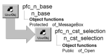

# n_cst_selection

**Description**

Selection service. This service provides functions that you can call to display the w_selection dialog box, which allows users to choose a row, which is then passed back to your application.

**Ancestry**



**Library**

- PFCAPSRV.PBL
- PFEAPSRV.PBL

**Object relationships**

- [n_tr](../08-standard-class-user-objects/n_tr.md)
- [n_cst_selectionattrib](../05-global-structures-and-structure-objects/n_cst_selectionattrib.md)
- w_selection

**Usage**

To use n_cst_selection functions:

1. Declare a local or instance variable of type n_cst_selection.
2. Establish the information from which the user selects.
3. Call the of_Open function, passing the appropriate arguments.
4. Retrieve the selected row returned by of_Open and continue processing as appropriate.

**See also**

n_tr

## Instance variables

| Instance variable | Description | Data type | Access | Usage |
| --- | --- | --- | --- | --- |
| is_defaulttitle | Default title for w_selection dialog | String | Protected | Used if you don’t specify the title argument |

## Functions

N_cst_selection includes a precoded function:

of_Open

### of_Open

Opens the w_selection dialog box, allowing the user to choose one or more rows for further processing. There are three syntaxes:

| To | Use |
| --- | --- |
| Open w_selection, displaying retrieved rows from a DataWindow | Syntax 1 |
| Open w_selection, displaying a passed set of rows | Syntax 2 |
| Open w_selection, displaying data stored with the DataWindow object | Syntax 3 |

| Syntax 1 | To display retrieved rows for a DataWindow |
| --- | --- |

**Description**

Displays the w_selection dialog box retrieving rows from the database for the specified DataWindow object. The user selects a one or more columns in w_selection, which returns selection information for the selected columns.

**Access**

Public

**Syntax**

```
instancename.of_Open ( dataobject, returnval {, transobj {, columns
{, arguments {, title } }})
```

| Argument | Description |
| --- | --- |
| *instancename* | Instance name of n_cst_selection |
| *dataobject* | String specifying the DataWindow object that w_selection uses to retrieve and display rows |
| *returnval* | Array of the Any data type into which the w_selection dialog box places information for the selected columns (passed by reference) |
| *transobj* (optional) | N_tr-based Transaction object specifying an active connection that the w_selection dialog box uses to retrieve rows |
| *columns* (optional) | String specifying the DataWindow columns that w_selection returns. The default is the first column |
| *arguments* (optional) | Twenty-element array of the Any data type specifying retrieval arguments for *dataobject* |
| *title* (optional) | String specifying a title for the w_selection dialog box |

**Return value**

Integer. Returns the number of elements in the *returnval* array if the function succeeds and -1 if an error occurs.

**Usage**

Call this function when you want the user to choose from a list of values retrieved with the specified DataWindow.

Use Syntax 2 to display passed data in w_selection and Syntax 3 to display data stored in a DataWindow object.

**Examples**

This example calls the of_Open function:

```
Any   la_values[ ]
String   ls_col[ ]

ls_col[1] = "emp_id"
inv_selection.of_Open("d_emplist", la_values, &
   SQLCA, ls_col)
...
```

| Syntax 2 | To display a passed set of rows |
| --- | --- |

**Description**

Displays the w_selection dialog box using rows passed in a function argument. The user selects a one or more columns in w_selection, which returns selection information for the selected columns.

**Access**

Public

**Syntax**

```
instancename.of_Open ( dataobject, returnval {, powerobj
{, columns {, title } } } )
```

| Argument | Description |
| --- | --- |
| *instancename* | Instance name of n_cst_selection |
| *dataobject* | String specifying the DataWindow object that w_selection uses to display rows |
| *returnval* | Array of the Any data type into which the w_selection dialog box places information for the selected columns (passed by reference) |
| *powerobj (optional)* | PowerObject array containing data that the w_selection dialog box displays in the *dataobject* DataWindow |
| *columns (optional)* | String specifying the DataWindow columns that w_selection returns. The default is the first column |
| *title* (optional) | String specifying a title for the w_selection dialog box |

**Return value**

Integer. Returns the number of elements in the *returnval* array if the function succeeds and -1 if an error occurs.

**Usage**

Call this function when you want the user to choose from a list of values in a specified DataWindow. Data for the DataWindow is supplied as a function argument.

Use Syntax 1 to display data retrieved from the database and Syntax 3 to display data stored in a DataWindow object.

**Examples**

This example calls the of_Open function:

```
Any  la_values[ ]
n_cst_selection   lnv_selection
String   ls_colreturn[ ]
Integer   li_return
s_svalue   lstr_svalue[ ]
...
lstr_svalue[1].s_value = "Massachusetts"
lstr_svalue[2].s_value = "Vermont"
lstr_svalue[3].s_value = "New Hampshire"
lstr_svalue[4].s_value = "Maine"
lstr_svalue[5].s_value = "Rhode Island"
lstr_svalue[6].s_value = "Connecticut"
lstr_svalue[7].s_value = "New York"

li_return = lnv_selection.of_Open("d_svalue", &
   la_values, lstr_svalue, ls_colreturn[], &
       "New England States")
...
```

| Syntax 3 | To display data stored with the DataWindow object |
| --- | --- |

**Description**

Displays the w_selection dialog box using data stored in the specified DataWindow object. The user selects a one or more columns in w_selection, which returns selection information for the selected columns.

**Access**

Public

**Syntax**

```
instancename.of_Open ( dataobject, returnval {, columns {, title } } )
```

| Argument | Description |
| --- | --- |
| *instancename* | Instance name of n_cst_selection |
| *dataobject* | String specifying the DataWindow object that w_selection uses to retrieve and display rows |
| *returnval* | Array of the Any data type into which the w_selection dialog box places information for the selected columns (passed by reference) |
| *columns (optional)* | String specifying the DataWindow columns that w_selection returns. The default is the first column |
| *title* (optional) | String specifying a title for the w_selection dialog box |

**Return value**

Integer. Returns the number of elements in the *returnval* array.

**Usage**

Call this function display the w_selection dialog box using data stored in the specified DataWindow object.

Use Syntax 1 to display data retrieved from the database and Syntax 2 to display passed data.

**Examples**

This example calls the of_Open function:

```
Any   ls_values[ ]

inv_selection.of_Open("d_emplist", ls_values)
...
```
