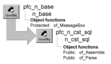

# n_cst_sql

**Description**

SQL parsing service. This service provides functions that you can call to assemble and parse SQL statements.

**Ancestry**



**Library**

- PFCAPSRV.PBL
- PFEAPSRV.PBL

**Object relationships**

n_cst_sqlattrib

**Usage**

To use n_cst_sql functions:

1. Declare a variable of type n_cst_sql:

   ```
   n_cst_sql   inv_sql
   ```

Because PFC defines this object with the autoinstantiate option, you don’t need to code CREATE or DESTROY statements.

2. Call n_cst_sql functions as needed.

**See also**

- [n_ds](../08-standard-class-user-objects/n_ds.md)
- [u_dw](../06-standard-visual-user-objects/u_dw.md)

## Functions

N_cst_sql includes precoded object functions:

- of_Assemble
- of_Parse

### of_Assemble

**Description**

Builds a SQL statement from its component parts.

**Access**

Public

**Syntax**

```
instancename.of_Assemble ( components )
```

| Argument | Description |
| --- | --- |
| *instancename* | Instance name of n_cst_sql |
| *components* | Array of n_cst_sqlattrib structures, each element of which contains a SQL statement that the function combines using a UNION statement |

**Return value**

String. Returns the completed SQL statement. An empty string indicates an error.

**Usage**

Although the *components* argument uses an array, you need to use the first element only if the SQL statement contains no UNION statements.

**Examples**

This example calls the of_Assemble function. It assumes an inv_sql instance variable:

```
String   ls_sql
n_cst_sqlattrib   lnv_sqlattrib[ ]

lnv_sqlattrib[1].s_verb = sle_verb.text
lnv_sqlattrib[1].s_tables = sle_tables.text
lnv_sqlattrib[1].s_columns = sle_columns.text
lnv_sqlattrib[1].s_values = sle_values.text
lnv_sqlattrib[1].s_where = sle_where.text
lnv_sqlattrib[1].s_order = sle_order.text
lnv_sqlattrib[1].s_group = sle_group.text
lnv_sqlattrib[1].s_having = sle_having.text

ls_sql = inv_sql.of_Assemble &
   (lstr_sql)
MessageBox("SQL", ls_sql)
```

### of_Parse

**Description**

Separates a SQL statement into its component parts.

**Access**

Public

**Syntax**

```
instancename.of_Parse ( statement, components )
```

| Argument | Description |
| --- | --- |
| *instancename* | Instance name of n_cst_sql |
| *statement* | String containing the SQL statement to be separated |
| *components* | Array of type n_cst_sqlattrib into which the function places SQL statement components (passed by reference) |

**Return value**

Integer. Returns the number of elements in the *components* array.

**Examples**

This example calls the of_Parse function. It assumes a single element in the lstr_sql array and an inv_sql instance variable:

```
String   ls_sql
n_cst_sqlattrib   lnv_sqlattrib[ ]
Integer   li_return

li_return = inv_sql.of_Parse &
   (mle_sql.text, lnv_sqlattrib)
IF li_return > 0 THEN
   sle_verb.text= lnv_sqlattrib[1].s_verb
   sle_tables.text = lnv_sqlattrib[1].s_tables
   sle_columns.text = lnv_sqlattrib[1].s_columns
   sle_values.text = lnv_sqlattrib[1].s_values
   sle_where.text = lnv_sqlattrib[1].s_where
   sle_order.text = lnv_sqlattrib[1].s_order
   sle_group.text = lnv_sqlattrib[1].s_group
   sle_having.text= lnv_sqlattrib[1].s_having
END IF
```
