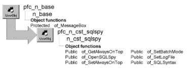

# n_cst_sqlspy

**Description**

SQL Spy debugging service, a development tool that helps you debug applications by logging and optionally displaying the SQL that DataWindows submit to the database. Do not use this functionality in production applications.

N_cst_sqlspy includes instance variables as well as precoded events and functions. This discussion describes only those functions you code in a typical application.

For complete information on using SQL Spy, see the *PFC User’s Guide*.

**Ancestry**



**Library**

PF

- PFCUTIL.PBL
- PFEUTIL.PBL

**Object relationships**

- d_sqlspyprint
- [n_cst_conversion](n_cst_conversion.md)
- [n_ds](../08-standard-class-user-objects/n_ds.md)
- w_sqlspy
- w_sqlspyinspect

**Usage**

You typically call most n_cst_sqlspy functions from within the application manager. To use SQL Spy:

1. Enable the debugging service by calling the n_cst_appmanager of_SetDebug function:

   ```
   this.of_SetDebug(TRUE)
   ```

2. Enable SQL Spy by calling the n_cst_debug of_SetSQLSpy function:

   ```
   this.inv_debug.of_SetSQLSpy(TRUE)
   ```

3. Specify the log file by calling the n_cst_sqlspy of_SetLogFile function:

   ```
   this.inv_debug.inv_sqlspy.of_SetLogFile &
      ("c:\debug\temp\appdbug.log")
   ```

4. Call other n_cst_sqlspy functions, as necessary to log and optionally display DataWindow update SQL.

**See also**

- [n_cst_appmanager](n_cst_appmanager.md)
- [n_cst_debug](n_cst_debug.md)

## Instance variables

N_cst_sqlspy includes instance variables:

| Instance variable | Description | Data type | Access |
| --- | --- | --- | --- |
| ib_allowinspect | Should service allow anything other than batchmode? | Boolean | Protected |
| ib_alwaysontop | Will window always be on top? | Boolean | Protected |
| ib_batchmode | Current mode of service. | Boolean | Protected |
| is_currentheading | SQL Current Heading. | String | Protected |
| is_currentsyntax | SQL Current Syntax. | String | Protected |
| is_history | Contains the current history. | String | Protected |
| is_logfile | The path and name of the logfile. | String | Protected |
| iw_sqlspy | Reference to the SQLSpy equivalent window. | w_sqlspy | Protected |
| iw_sqlspyinspect | Reference to the SQLSpyInspect equivalent window. | w_sqlspyinspect | Protected |

## Events

N_cst_sqlspy includes these events:

### Destructor

**Description**

Perform cleanup.

**Syntax**

```
instancename.EVENT Destructor ( )
```

| Argument | Description |
| --- | --- |
| *instancename* | Instance name of n_cst_sqlspy |

**Return value**

None.

## Functions

N_cst_sqlspy includes many precoded object functions. The functions you call from an application are documented here:

- of_AddToHistory
- of_AddTologfile
- of_clearhistory
- of_GetAllowInspect
- of_GetAlwaysOnTop
- of_GetBatchmode
- of_GetCurrentHeading
- of_GetCurrentSyntax
- of_GetHistory
- of_GetLogfile
- of_IsOpen
- of_OpenSQLSpy
- of_OpenSQLSpyInspect
- of_PreventHistoryOverflow
- of_PrintHistory
- of_SaveHistoryToFile
- of_SetAllowInspect
- of_SetAlwaysOnTop
- of_SetBatchMode
- of_SetCurrentHeading
- of_SetCurrentSyntax
- of_SetLogFile
- of_SQLPreview
- of_SQLSyntax

### of_AddToHistory

**Description**

Add a history entry into the RichTextControl.

**Access**

Protected

**Syntax**

```
instancename.of_AddToHistory ( as_heading, as_syntax )
```

| Argument | Description |
| --- | --- |
| *instancename* | Instance name of n_cst_sqlspy |
| *as_heading* | String. The header information to be added. |
| *as_syntax* | String. The detail information to be added. |

**Return value**

Integer. 1 if it succeeds. -1 if an error occurs. If any argument's value is NULL, function returns NULL.

### of_AddTologfile

**Description**

Add a history entry into the RichTextControl.

**Access**

Protected

**Syntax**

```
instancename.of_AddTologfile ( as_newentry )
```

| Argument | Description |
| --- | --- |
| *instancename* | Instance name of n_cst_sqlspy |
| *as_newentry* | String. The new entry to be added to the logfile. |

**Return value**

Integer. 1 if it succeeds. -1 if an error occurs.

### of_clearhistory

**Description**

Clear the visual history.

**Access**

Public

**Syntax**

```
instancename.of_clearhistory ( )
```

| Argument | Description |
| --- | --- |
| *instancename* | Instance name of n_cst_sqlspy |

**Return value**

Integer. 1 if it succeeds. -1 if an error occurs.

### of_GetAllowInspect

**Description**

Gets the current allowinspect mode of the SQLSpy service.

**Access**

Public

**Syntax**

```
instancename.of_GetAllowInspect ( )
```

| Argument | Description |
| --- | --- |
| *instancename* | Instance name of n_cst_sqlspy |

**Return value**

Boolean. Returns True if service is on allowinspect.

### of_GetAlwaysOnTop

**Description**

Reports whether the w_sqlspy window always displays on top of other windows.

**Access**

Public

**Syntax**

```
application.debug.sqlspy.of_GetAlwaysOnTop ( )
```

| Argument | Description |
| --- | --- |
| *application* | Global variable of type n_cst_appmanager (this must be gnv_app) |
| *debug* | Instance name of n_cst_debug (the n_cst_appmanager default is inv_debug) |
| *sqlspy* | Instance name of n_cst_sqlspy (the n_cst_debug default is inv_sqlspy) |

**Return value**

Boolean. Returns TRUE if the w_sqlspy window is always on top and FALSE if it is not.

**Examples**

This example calls the of_GetAlwaysOnTop function:

```
Boolean  ib_ontop

ib_ontop = &
   gnv_app.inv_debug.inv_sqlspy.of_GetAlwaysOnTop()
...
```

### of_GetBatchmode

**Description**

Gets the current mode of the SQLSpy service.

**Access**

Public

**Syntax**

```
instancename.of_GetBatchmode ( )
```

| Argument | Description |
| --- | --- |
| *instancename* | Instance name of n_cst_sqlspy |

**Return value**

Boolean. Returns True if service is on BatchMode.

### of_GetCurrentHeading

**Description**

Gets the current SQL Heading from the SQLSpy service.

**Access**

Public

**Syntax**

```
instancename.of_GetCurrentHeading ( )
```

| Argument | Description |
| --- | --- |
| *instancename* | Instance name of n_cst_sqlspy |

**Return value**

String. Returns the current SQL Heading.

### of_GetCurrentSyntax

**Description**

Gets the current syntax on the SQLSpy service.

**Access**

Public

**Syntax**

```
instancename.of_GetCurrentSyntax ( )
```

| Argument | Description |
| --- | --- |
| *instancename* | Instance name of n_cst_sqlspy |

**Return value**

String. strins Returns the current syntax.

### of_GetHistory

**Description**

Gets the current history from the SQLSpy service.

**Access**

Public

**Syntax**

```
instancename.of_GetHistory ( )
```

| Argument | Description |
| --- | --- |
| *instancename* | Instance name of n_cst_sqlspy |

**Return value**

String. Returns the current history. (i.e., 'c:\appl\logfile.asc')

### of_GetLogfile

**Description**

Gets the log filename for the SQLSpy service. Note: An empty string means there is no log file.

**Access**

Public

**Syntax**

```
instancename.of_GetLogfile ( )
```

| Argument | Description |
| --- | --- |
| *instancename* | Instance name of n_cst_sqlspy |

**Return value**

String. Returns the log file name (if any)

### of_IsOpen

**Description**

Reports if the SQLSpy window is currently opened.

**Access**

Public

**Syntax**

```
instancename.of_IsOpen ( )
```

| Argument | Description |
| --- | --- |
| *instancename* | Instance name of n_cst_sqlspy |

**Return value**

Boolean. True if the SQLSpy window is currently opened. False otherwise.

### of_OpenSQLSpy

**Description**

Opens or closes the w_sqlspy window. This window displays the contents of the log file specified in the of_SetLogFile function.

**Access**

Public

**Syntax**

```
application.debug.sqlspy.of_OpenSQLSpy ( boolean )
```

| Argument | Description |
| --- | --- |
| *application* | Global variable of type n_cst_appmanager (this must be gnv_app) |
| *debug* | Instance name of n_cst_debug (the n_cst_appmanager default is inv_debug) |
| *sqlspy* | Instance name of n_cst_sqlspy (the n_cst_debug default is inv_sqlspy) |
| *boolean* | Boolean specifying whether to open (TRUE) or close (FALSE) the w_sqlspy window |

**Return value**

Integer. Returns 1 if the function succeeds, -1 if an error occurs, and 0 if no action is taken.

**Examples**

This example calls the of_OpenSQLSpy function:

```
gnv_app.inv_debug.inv_sqlspy.of_OpenSQLSpy(TRUE)
```

### of_OpenSQLSpyInspect

**Description**

Open the SQLSpyInspect window.

**Access**

Protected

**Syntax**

```
instancename.of_OpenSQLSpyInspect ( )
```

| Argument | Description |
| --- | --- |
| *instancename* | Instance name of n_cst_sqlspy |

**Return value**

Integer. 0 if it succeeds and the caller's processing should continue as normal. 1 if it suceeds but the caller's proccessing should stop. 2 if it succeeds but the caller's processing should skip this request and execute the next request (if any). -1 if an error occurs.

### of_PreventHistoryOverflow

**Description**

Prevent the history string from growing past the maximum supported by the Operating Environment.

**Access**

Protected

**Syntax**

```
instancename.of_PreventHistoryOverflow ( as_history, al_newentry )
```

| Argument | Description |
| --- | --- |
| *instancename* | Instance name of n_cst_sqlspy |
| *as_history* | String. The history string. |
| *al_newentry* | String. The latest new entry to be added to the history string. |

**Return value**

String. The manipulated string. If any argument's value is NULL, function returns NULL.

### of_PrintHistory

**Description**

Prints the current history.

**Access**

Public

**Syntax**

```
instancename.of_PrintHistory ( )
```

| Argument | Description |
| --- | --- |
| *instancename* | Instance name of n_cst_sqlspy |

**Return value**

Integer. Returns 1 if it succeeds and -1 if an error occurs.

### of_SaveHistoryToFile

**Description**

Saves the current history to a file. Opens the GetFileSaveName dialog window, gets a filename, and allows for the saving of the SQL history to the file.

**Access**

Public

**Syntax**

```
instancename.of_SaveHistoryToFile ( )
```

| Argument | Description |
| --- | --- |
| *instancename* | Instance name of n_cst_sqlspy |

**Return value**

Integer. Returns 1 if it succeeds and -1 if an error occurs.

### of_SetAllowInspect

**Description**

Sets the mode of the SQLSpy service. If this mode is True then inspect capabilities are available. If the the mode is False then the service will have no inspect capabilities.

**Access**

Public

**Syntax**

```
instancename.of_SetAllowInspect ( ab_allowinspect )
```

| Argument | Description |
| --- | --- |
| *instancename* | Instance name of n_cst_sqlspy |
| *ab_allowinspect* | Boolean. Mode of the service. |

**Return value**

Integer. Returns 1 if it succeeds and -1 if an error occurs.

### of_SetAlwaysOnTop

**Description**

Controls whether the w_sqlspy window always displays on top of other windows.

**Access**

Public

**Syntax**

```
application.debug.sqlspy.of_SetAlwaysOnTop ( boolean )
```

| Argument | Description |
| --- | --- |
| *application* | Global variable of type n_cst_appmanager (this must be gnv_app) |
| *debug* | Instance name of n_cst_debug (the n_cst_appmanager default is inv_debug) |
| *sqlspy* | Instance name of n_cst_sqlspy (the n_cst_debug default is inv_sqlspy) |
| *boolean* | Boolean indicating whether to always display w_sqlspy on top of other windows (TRUE) or to let other windows display on top of w_sqlspy (FALSE) |

**Return value**

Integer. Returns 1 if the function succeeds and -1 if an error occurs.

**Examples**

This example calls the of_SetAlwaysOnTop function:

```
...
gnv_app.inv_debug.inv_sqlspy.of_SetAlwaysOnTop &
 (FALSE)
...
```

### of_SetBatchMode

**Description**

Controls whether the service displays the w_sqlspyinspect dialog box before updating the database. This dialog box displays the SQL to be submitted to the database.

**Access**

Public

**Syntax**

```
application.debug.sqlspy.of_SetBatchMode ( boolean )
```

| Argument | Description |
| --- | --- |
| *application* | Global variable of type n_cst_appmanager (this must be gnv_app) |
| *debug* | Instance name of n_cst_debug (the n_cst_appmanager default is inv_debug) |
| *sqlspy* | Instance name of n_cst_sqlspy (the n_cst_debug default is inv_sqlspy) |
| *boolean* | Boolean indicating whether to display the w_sqlspyinspect dialog box (TRUE) or not (FALSE) |

**Return value**

Integer. Returns 1 if the function succeeds and -1 if an error occurs.

**Examples**

This example calls the of_SetBatchMode function:

```
gnv_app.inv_debug.inv_sqlspy.of_SetBatchMode &
   (FALSE)
```

### of_SetCurrentHeading

**Description**

Sets the current heading for the SQLSpy service.

**Access**

Public

**Syntax**

```
instancename.of_SetCurrentHeading ( as_currentheading )
```

| Argument | Description |
| --- | --- |
| *instancename* | Instance name of n_cst_sqlspy |
| *as_currentheading* | String. String containing the current heading. |

**Return value**

Integer. Returns 1 if it succeeds and -1 if an error occurs.

### of_SetCurrentSyntax

**Description**

Sets the current syntax for the SQLSpy service.

**Access**

Public

**Syntax**

```
instancename.of_SetCurrentSyntax ( as_currentsyntax )
```

| Argument | Description |
| --- | --- |
| *instancename* | Instance name of n_cst_sqlspy |
| *as_currentsyntax* | String. |

**Return value**

Integer. Returns 1 if it succeeds and -1 if an error occurs.

### of_SetLogFile

**Description**

Specifies the file into which the SQL Spy service logs DataWindow SQL.

**Access**

Public

**Syntax**

```
application.debug.sqlspy.of_SetLogFile ( logfile )
```

| Argument | Description |
| --- | --- |
| *application* | Global variable of type n_cst_appmanager (this must be gnv_app) |
| *debug* | Instance name of n_cst_debug (the n_cst_appmanager default is inv_debug) |
| *sqlspy* | Instance name of n_cst_sqlspy (the n_cst_debug default is inv_sqlspy) |
| *logfile* | Fully qualified name of the file into which the SQL Spy service copies DataWindow update SQL and other information |

**Return value**

Integer. Returns 1 if the function succeeds and -1 if an error occurs.

**Usage**

Call this function with an empty string to disable log file processing.

**Examples**

This example calls the of_SetLogFile function:

```
this.inv_debug.inv_sqlspy.of_SetLogFile &
   ("c:\debug\temp\appdbug.log")
```

### of_SQLPreview

**Description**

Called from a datawindow's SQLPreview event. Receive all the arguments from the SQLPreview event of the calling datawindow. Create the appropriate heading and then call the function to process the SQL syntax.

**Access**

Public

**Syntax**

```
instancename.of_SQLPreview ( as_controlname, a_sqlpreviewfunction, a_sqlpreviewtype, as_sqlsyntax, a_dwbuffer, al_row )
```

| Argument | Description |
| --- | --- |
| *instancename* | Instance name of n_cst_sqlspy |
| *as_controlname* | String. Control name. (i.e.,dw_1.ClassName() or ds_1.ClassName()) |
| *a_sqlpreviewfunction* | Sqlpreviewfunction. SQLPreview arg from control: sqlpreviewfunction. |
| *a_sqlpreviewtype* | Sqlpreviewtype. SQLPreview arg from control: sqlpreviewtype. |
| *as_sqlsyntax* | String, passed by reference. SQLPreview arg from control: sqlsyntax by Reference. |
| *a_dwbuffer* | Dwbuffer. SQLPreview arg from control: dwbuffer. |
| *al_row* | Long. SQLPreview arg from control: row. |

**Return value**

Integer. 0 if it succeeds and the caller's processing should continue as normal. 1 if it suceeds but the caller's proccessing should stop. 2 if it succeeds but the caller's processing should skip this request and execute the next request (if any). -1 if an error occurs. If any argument's value is NULL, function returns NULL.

### of_SQLSyntax

**Description**

Specifies SQL syntax to be copied to the log file, optionally displaying it in the w_sqlspyinspect dialog box.

**Access**

Public

**Syntax**

```
application.debug.sqlspy.of_SQLSyntax ( heading {, sql {, oktopause } } )
```

| Argument | Description |
| --- | --- |
| *application* | Global variable of type n_cst_appmanager (this must be gnv_app) |
| *debug* | Instance name of n_cst_debug (the n_cst_appmanager default is inv_debug) |
| *sqlspy* | Instance name of n_cst_sqlspy (the n_cst_debug default is inv_sqlspy) |
| *heading* | String specifying a heading for the log file |
| *sql* (optional) | String specifying the SQL statement to be logged |
| *oktopause* (optional) | Boolean specifying whether to pause statement execution for display in the w_sqlspyinspect dialog box. The default is FALSE |

**Return value**

Integer. Returns values as follows:

- 2 Function succeeded; do not process this statement
- 1 Function succeeded; do not process other pending updates
- 0 Function succeeded; continue processing DataWindow updates
- -1 Error

**Usage**

The SQL Spy service calls this function automatically for all DataWindow and EXEC IMMEDIATE statements automatically. You can call it to log native SQL statements.

To display the statement in the w_sqlspyinspect dialog box, *oktopause* must be TRUE and batch mode must have been disabled previously by calling the of_SetBatchMode(FALSE) function

**Examples**

This example calls the of_SQLSyntax function:

```
String   ls_sql

ls_sql = "SELECT * FROM employee;"
gnv_app.inv_debug.inv_sqlspy.of_SQLSyntax &
   ("Native SQL", ls_sql, TRUE)
...
```
