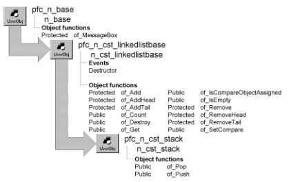

# n_cst_stack

**Description**

Stack processing object. Nodes in a stack are accessed on a last-in, first-out (LIFO) basis. When you add a new node to the stack, n_cst_stack places it at the beginning of the list; when you get a node from the stack, n_cst_stack accesses it from the beginning of the list, removing it in the process.

**Ancestry**



**Library**

- PFCAPSRV.PBL
- PFEAPSRV.PBL

**Object relationships**

n_cst_linkedlistnode

**Usage**

Use this object to handle list processing for LIFO lists (stacks).

To use n_cst_stack:

1. Create an instance of n_cst_stack. This example declares a window instance variable:

   ```
   n_cst_stack  inv_stack
   ```

2. Add nodes to the stack. To do this, first create a node, specify a key and data, then call the of_Push function:

   ```
   n_cst_linkedlistnode  lnv_node
   Integer  li_return

   lnv_node = CREATE n_cst_linkedlistnode

   lnv_node.of_SetKey(sle_1.text)
   lnv_node.of_SetData(sle_1.text)
   li_return = inv_stack.of_Push(lnv_node)
   ```

3. Access and remove items from the queue as appropriate by calling the of_Pop function. This example displays the key in a MessageBox:

   ```
   Any la_key
   n_cst_linkedlistnode lnv_node

   inv_stack.of_Pop(lnv_node)
   IF IsValid(lnv_node) THEN
      lnv_node.of_GetKey(la_key)
      MessageBox("Stack", &
         "Key is " + String(la_key))
   ELSE
      MessageBox("Stack", "Stack is empty")
   END IF
   ```

**See also**

- [n_cst_linkedlistnodecompare](n_cst_linkedlistnodecompare.md)
- [n_cst_list](n_cst_list.md)
- [n_cst_queue](n_cst_queue.md)
- [n_cst_tree](n_cst_tree.md)

## Functions

N_cst_stack includes precoded object functions:

- of_Pop
- of_Push

### of_Pop

**Description**

Retrieves the top node in the stack, removing it from the stack.

**Access**

Public

**Syntax**

```
instancename.of_Pop ( node )
```

| Argument | Description |
| --- | --- |
| *instancename* | Instance name of n_cst_stack |
| *node* | N_cst_linkedlistnode instance into which the function places a reference to the top node in the stack (passed by reference) |

**Return value**

Integer. Returns 1 if the function succeeds and -1 if an error occurs.

**Examples**

This example calls the of_Pop function:

```
Any la_key
n_cst_linkedlistnode lnv_node

inv_stack.of_Pop(lnv_node)
IF IsValid(lnv_node) THEN
   lnv_node.of_GetKey(la_key)
   MessageBox("Stack", &
      "Key is " + String(la_key))
ELSE
   MessageBox("Stack", "Stack is empty")
END IF
```

### of_Push

**Description**

Adds a node to the top of the stack.

**Access**

Public

**Syntax**

```
instancename.of_Push ( node )
```

| Argument | Description |
| --- | --- |
| *instancename* | Instance name of n_cst_stack |
| *node* | N_cst_linkedlistnode instance to add to the top of the stack |

**Return value**

Integer. Returns 1 if the function succeeds and -1 if an error occurs.

**Usage**

Before calling this function, create the node, add key information, and add data.

**Examples**

This example calls the of_Push function:

```
n_cst_linkedlistnode  lnv_node
Integer  li_return

lnv_node = CREATE n_cst_linkedlistnode

lnv_node.of_SetKey(sle_1.text)
lnv_node.of_SetData(sle_1.text)
li_return = inv_stack.of_Push(lnv_node)
```
